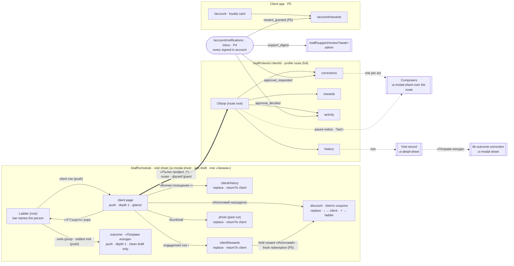

# Карта на клиента

> **Phase 4b (2026-10) — read `CLAUDE.md` Laws 1–9 for the current shape.** `libs/domain/*` and `libs/application/*` were deleted in Phase 4b (2026-10); links and paths into them below are dead history.

## The client details redesign: the visit-sheet page, the profile route, gamification, pauses and the support toolkit

**Status:** design specification · **canonical for the client-details surface.** Supersedes the client-page sketch in [staff-visit-editor-design.md](./staff-visit-editor-design.md) («Enrichment — inside the client's pushed page», which was never built) and the "open the person" item of [staff-surfaces-proposal.md](./staff-surfaces-proposal.md).
**Scope:** the `client` page of the staff visit sheet and its two sub-pages; a new staff profile route `/staff/clients/:clientId`; the client's own rewards view (later phase); a generic, admin-managed loyalty system (points, achievements and badges, visits in rhythm, tiers, rewards); pausing a client's booking; and a role-gated support toolkit for corrections, with its data model, enforcement and audit.
**Surfaces:** `lib-staff-visit-editor` (`EditorPageKind 'client'`) → new `clientHistory` / `clientRewards` pages; new route and feature libs listed in §12; nine DS additions in `libs/ui` (two extensions and seven new patterns; §7).
**Prototype:** interactive, all states × three roles × both themes — [Creativo Client Card](https://claude.ai/artifact/QnZmPMaUvErX9gPzZ9cTCK) (private artifact; share it from its page).
**Method:** twelve codebase audit readers (every claim below carries a `file:line`), nine research sweeps (Apple HIG, Material 3, three Mobbin sweeps of roughly 250 screens and flows, salon competitors, gamification ethics and EU/Bulgarian consumer law, admin-tooling safety, Firebase access control and audit), one design spine with three rounds of research-driven amendments and 59 integrator rulings, fourteen section authors with one adversarial reviewer each, then a consistency pass (naming, brief coverage, house rules and privacy, and every Angular and Firebase API checked against the official docs) and two coverage loops. The data model type-checks and its 387 executable checks pass.
**Date:** 2026-09-24 – 25.

> **Unavailable during this work.** Figma: the connected account holds a _View_ seat on its Starter team, so the connector refuses to create or edit files. The key screens therefore live in the HTML prototype instead of a Figma file. A second Figma connector needs OAuth that a non-interactive session cannot perform. Several vendor help centres (Booksy, Vagaro, Headspace, Calm) refused automated reads; claims from them are marked unverified in §1.

---

## Reading guide

| #   | Section                                      | What it answers                                                                                                                                |
| --- | -------------------------------------------- | ---------------------------------------------------------------------------------------------------------------------------------------------- |
| 1   | Research synthesis                           | What each source says, what we adopted and rejected, every conflict and its resolution, and the evidence behind each major decision            |
| 2   | Audit result and assumptions                 | What exists, what is partial, what is proposed — element by element — plus the live defects the design depends on and the assumptions it makes |
| 3   | Roles, capabilities and permissions          | Who sees and does what, the limits, the approval pattern, and which layer enforces each rule                                                   |
| 4   | Information architecture and navigation      | Surfaces, the navigation law inside the sheet, above-the-fold order, progressive disclosure, where the toolkit lives                           |
| 5A  | Screens — visit sheet                        | The client page and its two sub-pages, every state, phone and dialog widths                                                                    |
| 5B  | Screens — profile route and client self-view | Phone, tablet, desktop two-pane, activity timeline, client view, every state                                                                   |
| 6   | Support toolkit                              | Every correction flow end to end, plus the evaluation of additional support features                                                           |
| 7   | Component specifications                     | Nine DS additions (two extensions, seven patterns) and eleven feature components                                                               |
| 8   | Interaction and motion                       | Every motion, its token and its reduced-motion replacement                                                                                     |
| 9   | Data model                                   | TypeScript types (type-checked), rules, ledger, examples and worked corrections                                                                |
| 10  | Semantic icon keys                           | New and reused keys, every glyph verified at the pinned Material revision                                                                      |
| 11  | Business opportunities                       | Ranked by value against effort, with privacy risk                                                                                              |
| 12  | Implementation plan and testing              | Phases, flags, migration, test suites                                                                                                          |
| 13  | Risks and open questions                     | Ranked by impact, with the default we assume for each open question                                                                            |

## The decisions in one page

1. **Three audiences, three surfaces, one body.** The barber mid-appointment gets a glanceable page inside the visit sheet. The front desk and the owner get a full profile route. The client gets their own rewards view later. The sheet page and the route render one `lib-client-card` body (density `glance` or `full`), gated by the viewer's capabilities and by which data slices loaded. The client's own view (P5) composes the shared parts: engagement, ledger and badge grid.
2. **The sheet keeps its law.** The client page stays at depth one. Its two sub-pages (visits, rewards) are page replacements that restore the client page on back, the mechanic the sheet already ships for search → new client and discount → scan. Corrections never happen inside the visit sheet, with two recorded exceptions: fixing the visit's own outcome («Поправи изхода», a pushed page) and, later, redeeming points on behalf of the client in the chair.
3. **Safety first, then contact, then what's actionable now.** Order on the page: head, pause notice, pinned note, capsules, quick actions (call, SMS, Viber, «Същото»), a reward usable on this visit, the loyalty summary, visits, past-cut photos, the client note, the full-profile link, then the walk-in swap.
4. **Loyalty is counted in visits and never punishes.** Spendable points and a 10-slot punch card, visits in rhythm (a streak on the client's own 2–6 week cadence, with automatic protection when the shop is at fault), tiers as a worded capsule and a labelled gauge, and badges with their exact requirement. There are no countdowns, loss copy, leaderboards, hidden badges, paid repairs or silently vanishing points; at launch points do not expire at all.
5. **Pausing, not blocking.** The UI says «спряно записване», not «блокиран». A pause is a calm state on an intact record, with a reason category, dates, who applied it and a way back. Rules may only suggest a pause; a person confirms it, and the client can dispute every no-show. Barbers see the pause but never the suggestion.
6. **One correction pipeline.** Every manual change goes request → server dry-run preview → confirm (by reversibility) → commit, or approval → receipt with undo → later reversal by compensation only. Derived state is recomputed, ledger state is compensated, and manual state is never changed silently.
7. **Capabilities over roles, enforced on the server.** The existing six-role set stays and gains a capability layer with per-role limits; the owner is `admin`, the front desk is `receptionist`, and barbers hold no correction rights beyond fixing a same-day outcome. Callables re-read roles, check limits, forbid self-adjustment, and write the journal, the projection, the adjustment and the audit row in one transaction. The UI only hides.
8. **Ship it in slices.** P0 fixes defects and builds client stats. P1 is the read-only page plus the route's Обзор and Посещения. P2 is pauses. P3 is the loyalty core. P4 is the support toolkit. P5 is the client view, merge, bulk and simulation. Each phase has build-time flags and its own tests.

---

# 1. Research synthesis

Purpose: what the nine research sweeps found, what the design takes from them, what it refuses, and how every disagreement between sources is settled for **one barbershop, Bulgarian-first, mobile-first, sheet-heavy Angular + Firebase app**. The spine, with its amendments (A1–A16, B1–B6, F1–F7, T1–T6) and rulings (R1–R59), is the contract. This section gives the evidence behind it and does not re-decide it.

Citation rule: every URL below appears in one of the nine research reports. Report tags: **HIG** apple-hig · **M3** material-3 · **MP** mobbin-profiles-history · **ML** mobbin-loyalty-streaks · **MA** mobbin-admin-support · **DC** domain-competitors · **GE** gamification-ethics · **AT** admin-tooling-pitfalls · **FB** firebase-rbac-audit. "Verified" means the sweep opened the page, or looked at the Mobbin image itself, in its own run on 2026-09-24.

Notation: **spine §N** is a spine section; **A/B/F/T/R codes** are its amendments and rulings; **§N** is a section of this specification. Bulgarian UI copy is followed by an English gloss in quotes.

---

## 1.1 Method and coverage

### 1.1.1 How the sweeps ran

- Nine sweeps ran in parallel on 2026-09-24, each with a fixed brief (area, target surfaces, a "principles, not pixels" rule); every Mobbin call used the same task intent: "Design a barbershop client details sheet with loyalty, streaks, blocking and support tooling". Each report ends with principles, adopt and reject lists, and a conflicts table.
- Mobbin evidence is a still image. A still cannot show whether a countdown's deadline is real, whether a toast times out, or what happens after a tap. Interaction claims made from stills are flagged as such.

### 1.1.2 Coverage per source

"Cited" = unique Mobbin links found in the report by grep. "Viewed" = the sweep's own statement.

| Source                                                                                     | What was read                                                                                                                                                                                                         | Mobbin (cited screens / flows)                                                               | Other sources                                                               | Unverified or missing                                                                                                                                                                                                      |
| ------------------------------------------------------------------------------------------ | --------------------------------------------------------------------------------------------------------------------------------------------------------------------------------------------------------------------- | -------------------------------------------------------------------------------------------- | --------------------------------------------------------------------------- | -------------------------------------------------------------------------------------------------------------------------------------------------------------------------------------------------------------------------- |
| **HIG** (Apple HIG, Apple Support, Apple apps)                                             | 28 HIG pages (from a 44-page DocC-JSON cache); 4 Apple Support articles                                                                                                                                               | 41 / 0 (≈40 viewed: Fitness, Wallet, Notes, Mail, Reminders, Maps, Messages)                 | frankrausch.com (secondary, paraphrased)                                    | `navigation-bars` no longer exists; its guidance lives in Toolbars. Mobbin has no Apple Contacts merge UI, so the Support article stood in. **Unverified:** "iOS Safari has no Vibration API" (from memory)                |
| **M3** (Material Design 3)                                                                 | ≈34 m3.material.io pages in a browser; Compose, MDC-Android and material-web sources for cross-checks                                                                                                                 | 30 / 0 (Google Maps Local Guides, Gmail, Shopify, Intercom, Attio, Stripe, Lovable, Jobber…) | 6 implementation docs                                                       | `/foundations/accessible-design/accessibility-basics` is a 404, superseded by `/foundations/designing/*`                                                                                                                   |
| **MP** (Mobbin: profiles and history)                                                      | 16 `search_screens` (10 iOS, 6 web) + 4 `search_flows`; 28 person records classified                                                                                                                                  | 95 / 13                                                                                      | 2 HIG pages                                                                 | Booksy and Vagaro are not on Mobbin, and no staff-side loyalty, streak or tier screen on a customer record exists there                                                                                                    |
| **ML** (Mobbin: loyalty, streaks)                                                          | 20 `search_screens` (16 iOS, 4 web) + 4 `search_flows`; ≈110 references                                                                                                                                               | 105 / 12                                                                                     | deceptive.design, Stripe balance-transaction docs, Duolingo blog, NN/g, HIG | **Uses no M3 evidence.** No barbershop staff app (Booksy, Squire) is on Mobbin                                                                                                                                             |
| **MA** (Mobbin: admin and support)                                                         | 19 screen queries + 4 flows; ≈110 references                                                                                                                                                                          | 106 / 12                                                                                     | HIG alerts/action sheets/feedback, NN/g confirmation dialogs                | Its M3 snackbar note is from memory (the M3 sweep verified the same rule). No staff-side no-show screens exist                                                                                                             |
| **DC** (Fresha, Booksy, Square, Vagaro, Boulevard, Shopify, Stripe, Intercom, barber CRMs) | ≈45 official help pages and vendor help screenshots                                                                                                                                                                   | 18 / 0 (≈20 viewed)                                                                          | 55 URLs                                                                     | **Squire's "cut card" claims are search-snippet only.** Intercom's note styling comes from a third-party snippet. No Booksy Biz or Square POS screens are on Mobbin                                                        |
| **GE** (ethics, dark patterns, law)                                                        | Zagal/Björk/Lewis 2013, UCPD Notice 2021, UCTD Annex, ЗЗП Art. 143, GDPR Arts 16/22, DSA Arts 17/25 (unofficial mirror), 3 Duolingo posts, WCAG 2.3.1/2.3.3/2.2.2, Kivetz 2006, Clark & Zack 2023, Starbucks coverage | 41 / 0 (≈35 viewed)                                                                          | 52 URLs                                                                     | The CPC virtual-currency PDF yielded headings only. **Unverified:** OpenTable dispute details, the Duolingo earn-back event, the EP 2023 resolution, Nunes & Drèze, the FTC PDF, the Nike Run Club weekly-streak summaries |
| **AT** (admin-tooling safety)                                                              | ≈45 web sources (Stripe, Square, Shopify, Fowler, Azure, Modern Treasury, NIST AC-5/AU-3/AU-9, OWASP, IETF, WCAG, NN/g, GDPR/ICO/EDPB, Toast, GitHub, Firebase) + repo anchors                                        | 41 / 0 (≈40 viewed)                                                                          | 61 URLs                                                                     | Helland was read via summaries. **Unverified:** the ACFE 2024 percentages (snippet only)                                                                                                                                   |
| **FB** (Firebase RBAC and audit)                                                           | Official firebase.google.com (2026-09-24) and cloud.google.com (2026-09-22) pages                                                                                                                                     | 0 (backend only)                                                                             | 64 URLs                                                                     | None material. It corrects two pieces of lore: the 500-write transaction cap was removed on 2023-03-29, and "1 write/s per document" now "depends highly on the workload"                                                  |
| **Total**                                                                                  | 9 reports                                                                                                                                                                                                             | **466 unique Mobbin links**                                                                  | **309 unique non-Mobbin URLs** (≈270 distinct pages)                        |                                                                                                                                                                                                                            |

### 1.1.3 Tools that were unavailable, and what that leaves unverified

| Tool or site                                                               | Failure                                                                                                                                               | Effect on this design                                                                                                                                                                                                      |
| -------------------------------------------------------------------------- | ----------------------------------------------------------------------------------------------------------------------------------------------------- | -------------------------------------------------------------------------------------------------------------------------------------------------------------------------------------------------------------------------- |
| **Figma**                                                                  | Unavailable to every sweep and to this specification                                                                                                  | No Figma file, component or variable was read. Visual evidence is Mobbin stills, vendor screenshots and the house DS. Nothing depends on Figma                                                                             |
| m3.material.io, developer.apple.com (HIG), support.apple.com via WebFetch  | Client- or script-rendered; titles or a TOC only                                                                                                      | M3 was read in a browser, HIG through Apple's DocC JSON into a shared cache, Apple Support by curl + text extraction: all verified. Only the M3 sweep's reading of M3 counts (AT could not open the snackbar pages either) |
| Fresha help centre; Booksy / Vagaro Zendesk                                | Client-rendered; 403 to fetch                                                                                                                         | DC read them in a browser (verified). GE could not open Booksy Biz; its "call the business" claim is verified through DC                                                                                                   |
| getsquire.com                                                              | Blocked by the site                                                                                                                                   | The barber cut-card field list rests on SchedulingKit, Blyss and Vagaro                                                                                                                                                    |
| Headspace, Calm, Duolingo and OpenTable help, Axios                        | 403 or client-rendered                                                                                                                                | Streak and dispute evidence rests on Duolingo's blog posts (verified) and a Curiocity article. OpenTable's per-no-show "mistake" link is unverified                                                                        |
| ScienceDirect/PubMed, Columbia, EUR-Lex DSA HTML, HFTP, ACM, Collier Clerk | 403, 503 or empty                                                                                                                                     | Author PDFs, research snapshots (Greo) and an unofficial DSA mirror were used. The DSA is cited only as a _model_ of a respectful restriction notice (it does not bind a single-shop booking app)                          |
| Mobbin catalogue gaps                                                      | Booksy, Vagaro, Squire, Booksy Biz, Square POS client card, Apple Contacts merge, staff-side no-show marking, staff-side loyalty on a customer record | The staff-side loyalty screens are **our invention**, extrapolated from consumer loyalty apps and admin ledgers: the least-evidenced part of the design, to be usability-tested first                                      |

### 1.1.4 How the evidence is weighed

1. **House rulings and the spine** bind. Research can only reopen them through an owner ruling (1.5.3 lists where it pushed).
2. **Law and accessibility standards** (GDPR, UCPD, UCTD, ЗЗП, WCAG 2.2) set floors. They are never traded against engagement.
3. **Platform guidelines** (HIG, M3) set grammar. When they disagree, the house's iOS-flavoured grammar breaks the tie, and M3 contributes layout adaptivity.
4. **Vendor documentation** (Fresha, Square, Stripe, Shopify, Firebase) describes real behaviour, but it is the vendor's _intended_ behaviour, not observed use.
5. **Mobbin stills** show prevalence and anatomy, not behaviour. A pattern needs two or more independent apps before it counts as a convention.
6. **Blogs and secondary coverage** (Duolingo, Starbucks press) are used for measured effects and cautionary tales, never as the only basis for a rule.

---

## 1.2 Key findings per source

### HIG: Apple Human Interface Guidelines and Apple's own apps

- One sheet, one path. Back walks steps and never dismisses. Never show Cancel, Done and Back together. Display one sheet at a time, and give a modal task with subviews a single path, never "an app within your app" (https://developer.apple.com/design/human-interface-guidelines/sheets, https://developer.apple.com/design/human-interface-guidelines/modality). The house departs from one on purpose: a pushed page shows ‹ + ✕ in the bar and ✓ in the dock (R14, §4.3.6). No second sheet stacks over the visit sheet: «Поправи изхода» is a pushed page (R3).
- Persistent progress is a **gauge** with a labelled value and endpoints; progress indicators are transient. Never replicate Activity rings or reuse them for other data (https://developer.apple.com/design/human-interface-guidelines/gauges, https://developer.apple.com/design/human-interface-guidelines/activity-rings).
- Badges follow Game Center's four states (locked, in-progress, hidden, completed; B3 drops "hidden" for clients). Fitness shows the tone: an earned streak gets a check, and a broken one says "start a new streak" and suggests a next step (https://developer.apple.com/design/human-interface-guidelines/game-center, https://mobbin.com/screens/e1e1cef8-0e53-405f-b4e1-2e77d5aef0ea).
- Wallet is the ledger model. Balance and tier sit in header fields, voided rows stay visible struck through, and adjustments get their own filter (https://mobbin.com/screens/8e1140ce-48dc-4e3d-82b5-a9ce2216f2f0, https://mobbin.com/screens/03ea7ba3-bb2b-4dbb-ba9f-ca7cf7520598).
- A confirmation names verb and object and states the cascade in counts. Cancel goes at the bottom or on the leading side, and a destructive button is never the default (https://developer.apple.com/design/human-interface-guidelines/alerts, https://mobbin.com/screens/b7199bd5-7e4a-4eb7-be66-f815227e025f).
- Don't alert for common undoable actions; offer a named undo. Minimise time-boxed UI, so revert must also live elsewhere (https://developer.apple.com/design/human-interface-guidelines/undo-and-redo, https://developer.apple.com/design/human-interface-guidelines/accessibility).
- Duplicates are a reversible _link_ that keeps the source records (https://support.apple.com/guide/iphone/merge-or-hide-duplicate-contacts-iph2ab28320d/ios).
- Restricted-state copy is neutral and blame-free, with no "we", no "oops" and no humour (https://developer.apple.com/design/human-interface-guidelines/writing). Destructive entries go last and stand apart (https://mobbin.com/screens/58aa81c0-14d0-448a-be21-d9820344435b).
- **Profiles and avatars.** HIG has no avatars page (none among the pages the sweep read), so the evidence is Apple's own Messages contact card (https://mobbin.com/screens/58aa81c0-14d0-448a-be21-d9820344435b): a monogram when there is no photo, the name with the face, and the circular quick actions directly under the identity. Contacts-family cards centre the face above the name; the house's 52 px disc _leads_ the title instead (spine §3 item 1), the left-aligned grouping MP found in business records (1.3 #47). Activity rings set the one hard limit: never ring an avatar with progress. Rings show one person's Activity data only, and any ring-like element must look clearly different (https://developer.apple.com/design/human-interface-guidelines/activity-rings). The only ring our disc wears is the paused status tone (R53), a status and never progress.
- **Lists and tables.** Detail rows are grouped inset lists: the grouped style separates groups with headers, footers and extra space, a disclosure chevron marks drill-down, and long content lists titles only and shows the rest on a detail view (https://developer.apple.com/design/human-interface-guidelines/lists-and-tables). This is the grammar of the page's value rows that push with a count (1.3 #7) and of the house `ui-list-group` segmented runs.

### M3: Material Design 3

- A client shown inside an appointment is a **supporting pane**: a bottom sheet on compact screens, a fixed pane beside the content on expanded ones. A directory leading to a record is **list-detail** (https://m3.material.io/foundations/layout/canonical-layouts/supporting-pane, https://m3.material.io/foundations/layout/canonical-layouts/list-detail).
- Pane strategy by width: docked below 600, floating side sheet up to 400 from 840, co-planar 360–412 pane from 1200 that shrinks the schedule rather than covering it (https://m3.material.io/foundations/layout/applying-layout/pane-layouts).
- The side sheet requires a close button and allows a back button. This is where M3 and the iOS push stack agree (https://m3.material.io/components/side-sheets/guidelines).
- Naming traps. An M3 "badge" is a notification count. Progress indicators describe processes. Every chip is interactive, so read-only tags are not chips (https://m3.material.io/components/badges/guidelines, https://m3.material.io/components/chips/guidelines).
- Dialogs have a specific headline, a specific verb and at most two actions, plus a discard dialog when an unsaved form closes (https://m3.material.io/components/dialogs/guidelines).
- On the web, a self-dismissing snackbar is inaccessible. Undo must persist or have another path (https://m3.material.io/components/snackbar/guidelines).
- Motion is split into spatial and effects, and effects never overshoot. Expressive bounce is for hero moments only (https://m3.material.io/styles/motion/overview/how-it-works).
- Targets are 48 dp touch (M3 itself notes iOS uses 44). Loading ladder: nothing under 200 ms, then a loading indicator until 5 s, then progress (https://m3.material.io/foundations/designing/structure, https://m3.material.io/components/loading-indicator/guidelines).
- **Lists.** Use gaps, not dividers, for contained lists: segmented gaps plus filled items define a group, and dividers are kept for uncontained or complex lists. A list has one interaction mode. On compact widths, selecting an item opens a detail page; on medium and expanded widths, list and detail sit side by side. A circular leading avatar denotes a person (https://m3.material.io/components/lists/guidelines). This is the house `ui-list-group` segmented run (no dividers) and the route's list-detail panes (1.3 #14).
- **Cards.** A card holds one subject. Don't force content into cards where spacing and headlines give a simpler hierarchy; on compact widths, consider swapping cards for lists; and on mobile a card's content never scrolls inside itself (https://m3.material.io/components/cards/guidelines). So the client page's sections are list groups, not cards.

### MP: Mobbin profiles and history (28 person records)

- **15 of 28 records are a single scroll, and so are 9 of the 11 shown as a sheet or side panel.** Tabs dominate desktop CRMs. iOS CRMs that use them split two ways at most. Sheets push depth from a row that carries a count (Beside https://mobbin.com/screens/f6ab0ee0-a578-4897-b604-3366ec4fb254; Squarespace https://mobbin.com/flows/66ad542c-303e-4c02-8d2d-71294b85f31a).
- Inside an appointment, stats shrink to chips on the name ("New", "1 no-show"). Full stats belong on the pushed client page (https://mobbin.com/flows/a2f8f709-5697-40df-a255-b78e484f6b2a, https://mobbin.com/screens/0aa1cd4b-c3ba-454b-814e-3017aadfee9f).
- Fresha's one-line **staff alert** travels to every appointment. Notes about the client are kept apart from notes about the appointment (https://mobbin.com/flows/1e074527-baf7-449d-9832-bfd537c4f009, https://mobbin.com/flows/487fae09-e3c3-4685-b447-34b71817e881).
- Communication verbs sit under the identity (13 of 26). Record verbs sit in the header (13 of 26). Block, delete and no-show are demoted almost everywhere; Messages puts «Block Contact» alone in red at the foot (https://mobbin.com/screens/58aa81c0-14d0-448a-be21-d9820344435b). Squarespace's peer-header «Ban» is the one exception.
- Upcoming always comes first. 8 surfaces stack upcoming above past and 4 use a segmented control (Zomato's stacked «UPCOMING» / «HISTORY», https://mobbin.com/screens/b2da1a7b-4031-4299-88e6-4942956cd1bc).
- Blocking is scoped to online booking and says what continues. The blocked state is one calm strip with Unban (https://mobbin.com/flows/cd7c3b21-6a13-46b6-9c7c-f9c42a2b1357, https://mobbin.com/flows/c82ed9f4-23e8-4ba7-a779-b72a013c5ef9).
- Escalation is **suggested, never automatic**. Acuity offers to block online booking after a cancellation (https://mobbin.com/flows/487fae09-e3c3-4685-b447-34b71817e881).
- Computed state (New, Dormant) is kept apart from removable staff labels («+ Add tag») (https://mobbin.com/screens/64a3c786-930c-4f27-bcc6-c90331532a79, https://mobbin.com/screens/cdc844aa-075f-4cf0-987e-161a119f89da).

### ML: Mobbin loyalty, streaks, achievements

- What the client can spend and what they have qualified for are **two concepts** with two labels and two progress displays (https://mobbin.com/screens/991e2540-33a5-43e2-b6e0-9d72adeed18d, https://mobbin.com/screens/a087f4c5-b4f6-4d8c-a4f0-f96183c607df).
- The references closest to a barbershop count **visits**, with whole slots and a reward slot drawn differently (https://mobbin.com/screens/b8f7aeb7-13ea-46b0-b439-b6970082217f, https://mobbin.com/screens/6dc61bf0-a764-450e-857c-502d99dd769c).
- A locked badge is the same art muted, with its name and a fraction. Padlocks belong only on rewards gated by balance (https://mobbin.com/screens/385c1711-6119-4b91-8ec2-50851648825a, https://mobbin.com/screens/d710b636-5dbc-42fc-8cd5-85ffea6a5b8c).
- Ledgers are append-only, and a correction is a new row of the same shape (https://mobbin.com/screens/e485fc2e-d2cd-4e37-95a3-ac548c08c1fc, https://mobbin.com/screens/7ba5b67b-d1d8-4b05-a8b1-43be58fc745b).
- Respectful streaks give slack. Protection is free and automatic, and a pause records its reason (Paired https://mobbin.com/screens/b27cfee7-fe76-476d-b96a-1d1b53389f12, Oura https://mobbin.com/screens/63019f81-4779-4981-8bfa-498df12f2308).
- Manipulation looks like paid repair and shaming copy (Finch https://mobbin.com/flows/5a043794-f470-4275-8c78-80bdbbfca0a4, Life Reset https://mobbin.com/flows/115110d5-6b60-4908-9de0-002d9d46f940).
- Corrections show before, change and after, with a reason, a staff-only note and an explicit notify choice (Stripe https://mobbin.com/screens/ed53af21-56c6-479b-b49f-3c5ab4c875f3). Clients _claim_; a claim stays pending (Subway https://mobbin.com/screens/68514146-01e9-4350-a6a4-2ec6f4afa0be).
- A good restriction screen states the fact, what still works, a date and a route to review (https://mobbin.com/screens/91013015-b1f5-4e35-a011-f00a7529384f, https://mobbin.com/screens/84b502c6-b7a6-470f-aecf-067b5d0ac854).

### MA: Mobbin admin and support tooling

- A blocked record stays intact: a chip or strip, one line on what it stops, and Unblock in the same slot (https://mobbin.com/screens/ae5a7b70-155e-4478-a123-048e0dc93cf3, https://mobbin.com/screens/b4f66861-4add-4eb5-8c9c-56dc0bd9d813).
- Every correction takes a reason from a short list, and "Other" opens a required note (https://mobbin.com/screens/84a1ece6-6a69-4cc1-9c22-811261c32948, https://mobbin.com/screens/f95287bb-3711-4d39-87dc-a19b9d4831ce).
- Old and new values sit at the top, limits are stated before input, and the CTA names the change and the number (https://mobbin.com/flows/5f32df6d-4463-49e5-89f4-507c49e5d29b, https://mobbin.com/screens/b1128d95-047f-4d9b-8084-a853357a83cb).
- Changes that touch other records get a read-only review first (https://mobbin.com/flows/8af5acd3-de56-4f1f-a03d-b488a37fc5fc, https://mobbin.com/screens/6823bfb6-6e19-4e60-b4be-ea7c8acc9e4d).
- Confirmation strength matches reversibility. Typed confirmation is desktop-admin furniture (https://www.nngroup.com/articles/confirmation-dialog/, https://mobbin.com/screens/53c9c193-d7d8-469a-bd3a-ad1d8d9ed2bb).
- An audit entry is a sentence that opens to old→new values, with a source glyph (https://mobbin.com/screens/d76ba56f-98c3-463f-9e1d-bbe4831ee47a, https://mobbin.com/screens/fa5520ff-fda8-435f-b65b-bf910991fab4).
- An approval shows who it waits on. Approve is one tap, reject needs a reason, and the screen says what happens on timeout (https://mobbin.com/screens/9a34e3c2-65fa-49e0-9a6f-5833c749d333, https://mobbin.com/screens/d4e4f075-e8d2-4292-be15-b0bf2031b0db).
- "Not permitted" names the _rule_, not just "no access" (https://mobbin.com/screens/b09808ab-a395-4cbd-bd0c-851e918ade4d). MA recommends visible-but-disabled, which conflicts with the house rule (resolved in 1.5.1 #4).

### DC: Domain competitors

- In the appointment context, alerts come before demographics, and the full profile is a secondary action (https://mobbin.com/screens/b3031d03-35a8-43cc-8850-8aad4c98854d). Vagaro caps pop-up notes at 2 (https://support.vagaro.com/hc/en-us/articles/360007906613-Manage-Customer-Notes).
- There are three kinds of note: client/cut, one-visit and alert, each stamped with author and date (https://www.fresha.com/help-center/knowledge-base/clients/101248-add-notes-to-client-profiles).
- Reliability is a neutral fact at equal weight: Fresha shows Cancelled and No show as tiles beside Appointments (https://mobbin.com/screens/ac73bf46-1171-42da-8223-2a1fc39a7c3e). Colour appears only on history rows: Square marks no-shows red and cancellations grey (https://squareup.com/help/us/en/article/5493-set-a-custom-cancellation-policy-with-square-appointments). Boulevard and Booksy use rates instead (1.5.2 #22).
- A no-show is a **reversible status**, not a verdict (https://www.fresha.com/help-center/knowledge-base/calendar/30-mark-appointments-as-no-shows). The due cue comes from the client's own cadence (Boulevard's «Average Revisit»), and Fresha suppresses its rebook reminder when an upcoming booking exists (https://www.fresha.com/help-center/knowledge-base/marketing/141592-types-of-automated-messages).
- A block stops online self-booking only, and staff still book behind a warning. Fresha requires a reason; Square captures none and the client sees a generic error (https://www.fresha.com/help-center/knowledge-base/clients/346-block-clients-from-booking, https://squareup.com/help/us/en/article/8161-block-a-customer-from-online-booking-on-square-appointments). Vagaro («Require acceptance») and Booksy («Trusted») add softer rungs (1.3 #39).
- Loyalty changes are ledger entries with delta, reason and actor. Vagaro overwriting the balance as a plain field is the anti-pattern (https://squareup.com/help/us/en/article/8407-update-customer-loyalty-profiles, https://docs.stripe.com/invoicing/customer/balance).
- A merge previews the survivor, and the loyalty balances combine (https://help.shopify.com/en/manual/customers/manage-customers/merge-customers, https://squareup.com/help/us/en/article/8401-edit-merge-or-delete-customer-profiles).
- **Intercom.** Notes a teammate writes on a profile travel beside every conversation in the inbox sidebar (https://www.intercom.com/changes/en/2378-have-more-helpful-and-personal-conversations-with-notes-in-inbox-profiles), and the profile is framed as answers to quick questions: in touch before? active or slipping away? last seen? tags (https://www.intercom.com/help/en/articles/6988783-get-context-fast-with-user-and-company-profiles). Both are verified. This supports A6's pinned note, which travels with the client, and the route Обзор's ("Overview") key facts: client since, cadence, due cue and reliability counts (spine §4). Intercom's yellow team-only note styling rests on a third-party snippet (1.1.2) and nothing relies on it.

### GE: Gamification ethics and law

- Zagal's dark patterns map directly onto streaks: "playing by appointment", "withering" and monetary repair (http://www.fdg2013.org/program/papers/paper06_zagal_etal.pdf).
- Duolingo's own data: slack motivates (two freezes gave +0.38% DAU), milestone animation gave +1.7% day-7 retention, and outages are back-filled like a freeze (https://blog.duolingo.com/how-duolingo-streak-builds-habit, https://blog.duolingo.com/protecting-streaks-from-site-issues/).
- The UCPD Notice treats loyalty schemes as commercial practices. Fake timers (Annex I No 7), nagging (No 26) and confirmshaming are unfair (https://eur-lex.europa.eu/legal-content/EN/TXT/HTML/?uri=CELEX:52021XC1229(05)).
- **No EU or Bulgarian statute sets a points-expiry period.** UCTD Annex 1(i)/(j) and ЗЗП Art. 143(2) pts 10–12 punish terms the client could not read beforehand and unilateral changes made without a stated reason (https://www.legislation.gov.uk/eudr/1993/13/annex, https://www.290caselaw.com/glossary/zzp-143/).
- Starbucks 2023 shows the backlash when balances are not grandfathered, and its six-month star expiry adds redeem-or-lose pressure (https://onemileatatime.com/news/starbucks-rewards-devaluing/, https://thepointsguy.com/news/starbucks-star-rewards-devaluation/).
- Variable-ratio rewards are the slot-machine mechanism. Honest goal-gradient progress works without deception (Clark & Zack via Greo; https://home.uchicago.edu/ourminsky/Goal-Gradient_Illusionary_Goal_Progress.pdf).
- GDPR Art. 16 makes corrections a client right. Art. 22's spirit asks for a human in any block (https://gdpr-info.eu/art-16-gdpr/, https://gdpr-info.eu/art-22-gdpr/).
- Celebrations must not flash more than 3 times a second, must be switchable, and must not auto-move for more than 5 s (https://www.w3.org/WAI/WCAG22/Understanding/animation-from-interactions.html). An honest restriction beats Fresha's fake error (https://www.nngroup.com/articles/error-message-guidelines/).
- **Nike Run Club** counts streaks weekly, not daily, calibrated to a higher-effort activity. This rests on a third-party summary that was not opened and is **unverified** (https://trophy.so/blog/nike-run-club-gamification-case-study). It is a precedent, not a basis, for a streak whose period matches the activity: «Посещения в ритъм» ("Visits in rhythm") runs on the 42-day haircut cadence (spine §8; A5; R19), and that rule rests on the Duolingo and Zagal evidence above.

### AT: Admin-tooling pitfalls

- The balance is computed from an append-only ledger. A correction is a linked reversal and never an edit (https://docs.stripe.com/billing/customer/balance, https://martinfowler.com/eaaDev/RetroactiveEvent.html).
- **The preview is the confirmation.** The commit applies exactly what was previewed, and an approval is tied to that preview (https://developer.hashicorp.com/terraform/cli/commands/plan, https://www.w3.org/WAI/WCAG22/Understanding/error-prevention-legal-financial-data.html).
- Every mutation is idempotent. The same key with a different payload is refused (https://docs.stripe.com/api/idempotent_requests).
- Separation of duties scales to risk. Small teams rely on detection (exception views, anomaly flags) more than on gates (https://csf.tools/reference/nist-sp-800-53/r5/ac/ac-5/, https://support.toasttab.com/en/article/Exceptions-Report-Overview).
- Undo is a compensating entry. A toast-only undo fails WCAG 2.2.1. Outbound messages are held until the undo window closes (https://www.w3.org/WAI/WCAG22/Understanding/timing-adjustable.html, https://learn.microsoft.com/en-us/azure/architecture/patterns/compensating-transaction).
- Overdraws are explicit and never clamped (https://developer.squareup.com/reference/square/loyalty-api/adjust-loyalty-points). The repo's `Points.subtract` clamps silently.
- PII stays out of ledger and audit rows, so erasure remains possible (https://gdpr-info.eu/art-17-gdpr/). Repo anchors: `auditLog` accepts admin-client creates, `AuditEntry` has no before/after or reason, and the voucher "ledger" overwrites a balance.

### FB: Firebase RBAC and audit

- Claims gate access cheaply but can lag a role change by up to an hour. Keep a canonical record, force a token refresh and revoke on demotion (https://firebase.google.com/docs/auth/admin/custom-claims, https://firebase.google.com/docs/auth/admin/manage-sessions).
- Rules cannot hide fields, so staff-only data goes in separate documents. Use `hasOnly` allowlists, never `hasAny` denylists (https://firebase.google.com/docs/firestore/security/rules-fields).
- The Admin SDK bypasses rules, so every callable re-checks authorization. Set `enforceAppCheck`, and use `consumeAppCheckToken` only on the riskiest calls (https://firebase.google.com/docs/app-check/cloud-functions).
- A transaction commits all or nothing, so the audit row belongs **inside** it (https://firebase.google.com/docs/firestore/manage-data/transactions). The 500-write cap is gone (https://docs.cloud.google.com/firestore/docs/release-notes).
- Triggers deliver at least once and out of order, so key them by `event.id`. Schedules take a `timeZone` and must be idempotent per business day (https://firebase.google.com/docs/functions/retries, https://firebase.google.com/docs/functions/schedule-functions).
- TTL is not transactional and not audit-logged, so it is for bookkeeping only. Cloud Audit Logs DATA_WRITE is the forensic backstop (https://firebase.google.com/docs/firestore/ttl, https://cloud.google.com/firestore/native/docs/audit-logging).
- Seven repo gaps (FB §7.3), including forgeable audit rows (`auditLog` create for admin clients, repo `firestore.rules:423-427`), a denylist on `users/{uid}`, after-commit random-id audit rows (`apps/functions/src/lib/booking/audit.ts:27-67`) and no App Check anywhere.

### 1.2.10 Where the sources converge

● = the source argues for it explicitly · ○ = compatible or indirect · ◐ = the source is split or allows both · ✕ = the source argues against · blank = silent.

| Theme                                                      | HIG | M3  | MP  | ML  | MA  | DC  | GE  | AT  | FB  | Outcome                                                          |
| ---------------------------------------------------------- | --- | --- | --- | --- | --- | --- | --- | --- | --- | ---------------------------------------------------------------- |
| One path, pushed pages inside one sheet                    | ●   | ◐   | ●   | ○   | ○   | ●   |     |     |     | adopted (spine §2.1; R3)                                         |
| Single scroll of sections, no tabs                         | ●   | ◐   | ●   |     |     | ●   |     |     |     | adopted (spine §3)                                               |
| Safety lines first, under identity                         |     |     | ●   |     | ●   | ●   | ○   |     |     | adopted (spine §3; A6)                                           |
| Append-only ledger; a correction is a new row              | ●   | ●   | ○   | ●   | ●   | ●   | ●   | ●   | ●   | adopted (spine §6)                                               |
| Closed reason code on every restrictive or ledger act      |     |     | ○   | ●   | ●   | ●   | ●   | ●   | ●   | adopted (spine §9)                                               |
| Before → after preview before commit                       | ●   | ●   | ○   | ●   | ●   | ●   | ●   | ●   | ●   | adopted (spine §9; A8)                                           |
| Undo instead of alerts for reversible acts                 | ●   | ●   |     | ○   | ●   | ◐   |     | ●   |     | adopted (R39)                                                    |
| A toast-only undo is not enough                            | ●   | ●   |     |     |     |     |     | ●   |     | adopted (A10)                                                    |
| Typed confirmation for fan-out acts                        |     |     |     |     | ✕   | ◐   |     | ●   |     | rejected (R39: phone keyboard; merge is made reversible instead) |
| A person confirms any block                                |     |     | ●   |     |     | ○   | ●   |     |     | adopted (B1; R25)                                                |
| Restriction scoped to online booking                       |     |     | ●   | ●   | ●   | ●   | ●   |     |     | adopted (spine §7; B2)                                           |
| Record intact, loyalty frozen, when restricted             | ○   |     | ●   | ●   | ●   | ●   | ●   |     |     | adopted (A15)                                                    |
| Honest, neutral client-facing refusal                      | ●   |     | ○   | ●   | ●   | ●   | ●   |     |     | adopted (spine §7)                                               |
| Spendable vs qualifying kept apart                         | ○   |     |     | ●   |     |     |     |     |     | adopted (A1)                                                     |
| Progress phrased in visits                                 |     |     |     | ●   |     | ○   | ○   |     |     | adopted (A2)                                                     |
| Meter, not progress indicator                              | ●   | ●   |     | ●   |     |     | ○   |     |     | adopted (A3)                                                     |
| Every badge explains itself; no hidden badges              | ◐   | ○   |     | ●   |     |     | ●   |     |     | adopted (B3)                                                     |
| Forgiving, cadence-based streak                            | ●   |     |     | ●   |     | ○   | ●   |     |     | adopted (A5; R19)                                                |
| No countdowns, shame or pressure                           | ○   |     |     | ●   |     |     | ●   |     |     | adopted (spine §8 ethics)                                        |
| Celebrate only the client's moment; respect reduced motion | ●   | ●   |     | ●   | ●   |     | ●   |     |     | adopted (R32; §8)                                                |
| Role-gated acts visible but disabled (or explained)        | ◐   | ✕   | ●   |     | ●   |     |     |     | ○   | rejected; A11 notice                                             |
| Direction chosen by a segmented or select control          |     |     |     | ●   | ✕   | ◐   |     | ●   |     | rejected (A7)                                                    |
| Server authority, idempotent writes                        |     |     |     |     |     | ○   |     | ●   | ●   | adopted (F2–F4)                                                  |
| Audit row inside the transaction                           |     |     |     |     |     |     |     | ●   | ●   | adopted (F1; R26)                                                |
| Risk tiers + detection instead of universal four-eyes      |     |     |     | ●   | ●   | ○   |     | ●   | ●   | adopted (T4; R40)                                                |
| Client messages held during the undo window                |     |     |     |     |     | ○   |     | ●   |     | adopted (T1; R31)                                                |
| PII kept out of ledger and audit rows                      |     |     |     |     |     |     | ○   | ●   |     | adopted (T5; R36)                                                |
| Merge is reversible (link or tombstone)                    | ●   |     |     |     | ●   | ✕   |     | ●   | ○   | adopted (F7)                                                     |

The strongest agreement is on the preview-first, append-only correction model: eight sources argue for it, and MP (which saw only after-the-fact change sentences) is compatible. Two rows are rejected _against_ the sources that argue for them (typed confirmation: AT; a direction control: ML and AT), on house rulings; they are the likeliest to be questioned in review. The weakest evidence is the staff-side loyalty presentation (ML and HIG only; 1.9 #1).

---

## 1.3 Patterns adopted

| #   | Pattern                                                                                                                                           | Evidence                                                                                                                                                                                                                                                                                                                                            | Where it lands                                                                                                                                                                                                                                                                                                                                                                                |
| --- | ------------------------------------------------------------------------------------------------------------------------------------------------- | --------------------------------------------------------------------------------------------------------------------------------------------------------------------------------------------------------------------------------------------------------------------------------------------------------------------------------------------------- | --------------------------------------------------------------------------------------------------------------------------------------------------------------------------------------------------------------------------------------------------------------------------------------------------------------------------------------------------------------------------------------------- |
| 1   | Compact client row in the appointment that pushes to a client page; the full record is never inlined                                              | Square https://mobbin.com/screens/0aa1cd4b-c3ba-454b-814e-3017aadfee9f; Fresha https://mobbin.com/flows/1e074527-baf7-449d-9832-bfd537c4f009                                                                                                                                                                                                        | Ladder client row → `client` page (spine §2.1; §4)                                                                                                                                                                                                                                                                                                                                            |
| 2   | Safety lines directly under identity, above everything else                                                                                       | Fresha https://mobbin.com/screens/b3031d03-35a8-43cc-8850-8aad4c98854d                                                                                                                                                                                                                                                                              | Pause notice under the head (spine §3 item 2)                                                                                                                                                                                                                                                                                                                                                 |
| 3   | One-line pinned staff alert, kept apart from long notes, with a small cap                                                                         | Fresha https://www.fresha.com/help-center/knowledge-base/clients/54-add-staff-alerts-to-client-profiles; Vagaro pop-up notes capped at 2 https://support.vagaro.com/hc/en-us/articles/360007906613-Manage-Customer-Notes                                                                                                                            | «Закачена бележка» ("Pinned note"; `ClientNote.pinned`, ≤ 80 chars, `client.alert` → `keep`, the push-pin art), a neutral line under the head (A6, R12, R55). The ladder row stays unchanged by default (R11)                                                                                                                                                                                 |
| 4   | Computed qualifiers as short capsules; zero renders nothing; staff labels separate                                                                | Fresha https://mobbin.com/flows/a2f8f709-5697-40df-a255-b78e484f6b2a; Shopify https://mobbin.com/screens/64a3c786-930c-4f27-bcc6-c90331532a79                                                                                                                                                                                                       | Capsule run `span[uiBadge]`; the tier capsule's glyph uses the `ui-badge` leading-glyph extension (spine §3 item 3; R21)                                                                                                                                                                                                                                                                      |
| 5   | 2–4 labelled circular communication actions under identity                                                                                        | Messages https://mobbin.com/screens/58aa81c0-14d0-448a-be21-d9820344435b; MP tally 13/26                                                                                                                                                                                                                                                            | `ui-quick-actions`: «Обади се» · «SMS» · «Viber» · «Същото» in the sheet, «Нов час» in the last place on the route (R13). Messages dims an unavailable action; ours is **absent** (house rule)                                                                                                                                                                                                |
| 6   | Rebook from the previous visit in one tap                                                                                                         | Bolt https://mobbin.com/screens/4a0763f3-3832-4adf-9afd-8482c6685025                                                                                                                                                                                                                                                                                | «↺ Същото като миналия път» ("Same as last time"), absent offline (spine §3 item 4; R13)                                                                                                                                                                                                                                                                                                      |
| 7   | Single scroll of sections; depth through value rows that carry a count                                                                            | Beside https://mobbin.com/screens/f6ab0ee0-a578-4897-b604-3366ec4fb254; Squarespace https://mobbin.com/flows/66ad542c-303e-4c02-8d2d-71294b85f31a                                                                                                                                                                                                   | «Всички посещения · 23 ›» ("All visits · 23") → `clientHistory`; phone route rows (spine §3, §4)                                                                                                                                                                                                                                                                                              |
| 8   | Upcoming stacked above past; past grouped by month                                                                                                | Zomato https://mobbin.com/screens/b2da1a7b-4031-4299-88e6-4942956cd1bc; Freenow https://mobbin.com/screens/6575fec0-5f12-4d6b-8525-09a513562724                                                                                                                                                                                                     | `clientHistory` (R7) and the route's Посещения ("Visits", spine §4)                                                                                                                                                                                                                                                                                                                           |
| 9   | History row: service; date · barber; price; status glyph and word only on minority statuses                                                       | Square marks only no-shows (red) and cancellations (grey) https://squareup.com/help/us/en/article/5493-set-a-custom-cancellation-policy-with-square-appointments; Trip.com pairs every status colour with a word and dims cancelled rows https://mobbin.com/screens/af915440-f5a4-4632-b003-6b125fc3e2ff (we keep the word, not the per-row colour) | `lib-staff-event-head` rows (spine §4; R7)                                                                                                                                                                                                                                                                                                                                                    |
| 10  | Neutral reliability counters at equal weight                                                                                                      | Fresha https://mobbin.com/screens/ac73bf46-1171-42da-8223-2a1fc39a7c3e                                                                                                                                                                                                                                                                              | Route Обзор «Посещения · Късни откази · Неявявания» ("Visits · Late cancels · No-shows", 12 months); history «завършени · неявявания · отказани» ("completed · no-shows · cancelled") (A14, R35)                                                                                                                                                                                              |
| 11  | Due cue from the client's own cadence, suppressed while an upcoming visit exists                                                                  | Boulevard https://support.boulevard.io/en/articles/5941460-client-profiles; https://schedulingkit.com/crm/barbershops; Fresha rebook rule https://www.fresha.com/help-center/knowledge-base/marketing/141592-types-of-automated-messages                                                                                                            | «Време е — последно преди 5 седмици» ("It's time — last visit 5 weeks ago"), from personal cadence, suppressed while a next visit exists, separate from the rhythm's `atRisk` (R34)                                                                                                                                                                                                           |
| 12  | Client note separate from the visit note, stamped author · date, visibility stated                                                                | Acuity https://mobbin.com/flows/487fae09-e3c3-4685-b447-34b71817e881; Fresha https://www.fresha.com/help-center/knowledge-base/clients/101248-add-notes-to-client-profiles                                                                                                                                                                          | «Бележка за клиента» ("Note about the client"), footnote «Иван · 12.08» ("Ivan · 12 Aug") (spine §3 item 9; R18)                                                                                                                                                                                                                                                                              |
| 13  | Destructive and rare rows last and apart                                                                                                          | Messages https://mobbin.com/screens/58aa81c0-14d0-448a-be21-d9820344435b; Maps https://mobbin.com/screens/5f215346-59c4-4768-92e3-ccc64250bcf9                                                                                                                                                                                                      | Spine §3 item 11; the Корекции ("Corrections") list order                                                                                                                                                                                                                                                                                                                                     |
| 14  | List-detail on desktop: sticky identity pane plus a section pane                                                                                  | https://m3.material.io/foundations/layout/canonical-layouts/list-detail; Fresha web https://mobbin.com/screens/ac73bf46-1171-42da-8223-2a1fc39a7c3e                                                                                                                                                                                                 | Profile route ≥1024 px two panes (spine §2.2)                                                                                                                                                                                                                                                                                                                                                 |
| 15  | Balance row pushes to its ledger; entries read as sentences                                                                                       | Shopify «Store credit $40.00 ›» plus sentence rows https://mobbin.com/screens/46de7047-d628-4cf6-9a5a-bc6984f22a76; Wallet ledger rows https://mobbin.com/screens/8e1140ce-48dc-4e3d-82b5-a9ce2216f2f0                                                                                                                                              | Engagement row → `clientRewards`; `lib-loyalty-ledger` (spine §3 item 6)                                                                                                                                                                                                                                                                                                                      |
| 16  | Voided rows kept, struck through, with a reason line; an adjustments filter                                                                       | Wallet https://mobbin.com/screens/8e1140ce-48dc-4e3d-82b5-a9ce2216f2f0, https://mobbin.com/screens/03ea7ba3-bb2b-4dbb-ba9f-ca7cf7520598                                                                                                                                                                                                             | Ledger rendering; the client fold of reversal pairs (T3, R53)                                                                                                                                                                                                                                                                                                                                 |
| 17  | Spendable balance and qualifying status as two concepts                                                                                           | Starbucks https://mobbin.com/screens/991e2540-33a5-43e2-b6e0-9d72adeed18d; adidas https://mobbin.com/screens/a8f3493e-8a0b-420d-89f2-8a03cab247db                                                                                                                                                                                                   | Points metric vs tier capsule (A1)                                                                                                                                                                                                                                                                                                                                                            |
| 18  | Visit punch card with whole slots and a distinct reward slot; progress stated in visits                                                           | Honest Greens https://mobbin.com/screens/6dc61bf0-a764-450e-857c-502d99dd769c; Panera https://mobbin.com/screens/b8f7aeb7-13ea-46b0-b439-b6970082217f                                                                                                                                                                                               | «7/10» + «Още 3 посещения до безплатно подстригване» ("3 more visits to a free cut"); `ui-gauge` discrete capacity (A2, R21)                                                                                                                                                                                                                                                                  |
| 19  | Gauge (meter) semantics with both endpoints named                                                                                                 | https://developer.apple.com/design/human-interface-guidelines/gauges; Google Maps https://mobbin.com/screens/939dce9e-3766-43e2-8306-c7160a65c520                                                                                                                                                                                                   | Tier gauge «Злато 12 → Платина 20» ("Gold 12 → Platinum 20"): `ui-gauge` linear capacity, `role="meter"` (A2, A3, R21)                                                                                                                                                                                                                                                                        |
| 20  | Badge states: locked = muted real art + «3 от 10» ("3 of 10"); earned = colour + date                                                             | https://developer.apple.com/design/human-interface-guidelines/game-center; Apple Fitness https://mobbin.com/screens/385c1711-6119-4b91-8ec2-50851648825a                                                                                                                                                                                            | `ui-medal`, `lib-badge-grid` (A4 as amended by B3; R10)                                                                                                                                                                                                                                                                                                                                       |
| 21  | Padlock with a distance only on catalogue rewards not yet affordable                                                                              | Starbucks https://mobbin.com/screens/d710b636-5dbc-42fc-8cd5-85ffea6a5b8c; Commons https://mobbin.com/flows/7cda7236-34a9-4d4a-a91d-8f0e63cbe1d5                                                                                                                                                                                                    | `loyalty.locked` (`lock`) «🔒 още 60 т.» ("🔒 60 pts to go") (A4, R16)                                                                                                                                                                                                                                                                                                                        |
| 22  | Quiet «Ново» ("New") marker for staff instead of a celebration                                                                                    | Nike Run Club https://mobbin.com/screens/cd9f7c3b-983e-494f-8078-a6abe2efc90a                                                                                                                                                                                                                                                                       | Badge grid and engagement row (A4, R32)                                                                                                                                                                                                                                                                                                                                                       |
| 23  | Rhythm-based streak; free automatic protection; shop-caused misses forgiven and logged with a reason                                              | Paired https://mobbin.com/screens/b27cfee7-fe76-476d-b96a-1d1b53389f12; Oura https://mobbin.com/screens/63019f81-4779-4981-8bfa-498df12f2308; https://blog.duolingo.com/protecting-streaks-from-site-issues/                                                                                                                                        | `StreakDefinition` cadence/grace/freezes; «Посещения в ритъм» ("Visits in rhythm"), protection «защита» (spine §8, A5, R18)                                                                                                                                                                                                                                                                   |
| 24  | Broken-streak copy is neutral and offers a way forward                                                                                            | Apple Fitness https://mobbin.com/screens/e1e1cef8-0e53-405f-b4e1-2e77d5aef0ea                                                                                                                                                                                                                                                                       | The automatic earn-back sentence (R19; copy in 1.7)                                                                                                                                                                                                                                                                                                                                           |
| 25  | Rules one tap from the number                                                                                                                     | sweetgreen https://mobbin.com/screens/c20c6074-be6c-492d-b2ee-881a6363acd3; CAVA https://mobbin.com/screens/8faaf790-8300-42a6-9bd1-95e067a913e4                                                                                                                                                                                                    | «Как работят точките» ("How points work") (B4)                                                                                                                                                                                                                                                                                                                                                |
| 26  | Expiry as its own ledger row, stated calmly and warned about once                                                                                 | SHEIN https://mobbin.com/screens/c4914129-161d-4ba2-8321-bb8d4da73bd6; talabat https://mobbin.com/screens/7cd4bae1-6c06-4877-af3c-3811f71b1bb2                                                                                                                                                                                                      | Modelled and off at launch: a `points.expired` entry and one 30-day notice once `loyaltyPolicy.expiry.enabled` is on (B4, R30)                                                                                                                                                                                                                                                                |
| 27  | Correction composer: before → change → after at the top, reason first, bounds before input, staff-only note, notify toggle, CTA naming the effect | Stripe https://mobbin.com/screens/ed53af21-56c6-479b-b49f-3c5ab4c875f3; Shopify https://mobbin.com/flows/5f32df6d-4463-49e5-89f4-507c49e5d29b                                                                                                                                                                                                       | `lib-adjustment-composer`: the staff-only «Бележка на екипа» ("Team note"), CTA «Добави 50 т.» ("Add 50 pts") (A8, R18)                                                                                                                                                                                                                                                                       |
| 28  | Knock-on effects shown as sentences before commit                                                                                                 | Etsy https://mobbin.com/flows/8af5acd3-de56-4f1f-a03d-b488a37fc5fc; Tailscale https://mobbin.com/screens/6823bfb6-6e19-4e60-b4be-ea7c8acc9e4d                                                                                                                                                                                                       | `lib-cascade-preview` (spine §9)                                                                                                                                                                                                                                                                                                                                                              |
| 29  | Server dry-run preview, then a commit refused if state moved                                                                                      | Terraform https://developer.hashicorp.com/terraform/cli/commands/plan; Stripe https://docs.stripe.com/billing/subscriptions/prorations                                                                                                                                                                                                              | `previewAdjustment` / `commitAdjustment` + `stateVersion` («Нещо се промени — прегледай отново», "Something changed — review again") (spine §9, R45)                                                                                                                                                                                                                                          |
| 30  | Closed reason codes; "other" requires a note; no minimum-length narratives                                                                        | Stripe https://docs.stripe.com/api/credit_notes/create; Brex https://mobbin.com/screens/f95287bb-3711-4d39-87dc-a19b9d4831ce                                                                                                                                                                                                                        | Spine §9 reason codes, filtered per kind and direction (`REASONS_BY_KIND`)                                                                                                                                                                                                                                                                                                                    |
| 31  | Undo receipt plus a permanent revert elsewhere                                                                                                    | Todoist https://mobbin.com/screens/09f39b7b-c17a-4f87-97e5-4a1af75c3938; https://www.w3.org/WAI/WCAG22/Understanding/timing-adjustable.html                                                                                                                                                                                                         | A receipt that names the act, with «Отмени» (copy in 1.7), plus «Отмени корекцията» ("Undo the correction") on the Activity row (A10, R18)                                                                                                                                                                                                                                                    |
| 32  | Client messages held until the undo window closes                                                                                                 | https://learn.microsoft.com/en-us/azure/architecture/patterns/compensating-transaction; https://support.google.com/mail/answer/2819488                                                                                                                                                                                                              | T1, R31 (`undoWindowMinutes` = 10)                                                                                                                                                                                                                                                                                                                                                            |
| 33  | Approval card: waiting on whom, one-tap approve, reject with reason, withdraw, timeout outcome                                                    | Revolut https://mobbin.com/screens/9a34e3c2-65fa-49e0-9a6f-5833c749d333; Instacart https://mobbin.com/screens/d4e4f075-e8d2-4292-be15-b0bf2031b0db                                                                                                                                                                                                  | Requester and decider notices, and the card's timeout line (A12, R38; copy in 1.7)                                                                                                                                                                                                                                                                                                            |
| 34  | A refusal names the rule and the path                                                                                                             | Revolut https://mobbin.com/screens/b09808ab-a395-4cbd-bd0c-851e918ade4d; Glassdoor https://mobbin.com/screens/b906bc6b-8f21-49da-82a3-71de00afc0c3                                                                                                                                                                                                  | A11 notice «Не можеш да коригираш собствения си профил — помоли друг управител» ("You can't correct your own profile — ask another manager")                                                                                                                                                                                                                                                  |
| 35  | Audit as actor · verb · object sentences opening to old → new, with a source glyph                                                                | Attio https://mobbin.com/screens/d76ba56f-98c3-463f-9e1d-bbe4831ee47a; Cloudflare https://mobbin.com/screens/fa5520ff-fda8-435f-b65b-bf910991fab4                                                                                                                                                                                                   | `lib-client-activity` + `ui-value-change` (spine §4 Дейност, "Activity")                                                                                                                                                                                                                                                                                                                      |
| 36  | Restricted record stays intact; status notice; inverse action in the same slot                                                                    | Digg https://mobbin.com/screens/ae5a7b70-155e-4478-a123-048e0dc93cf3 (record and Unblock kept; its red chip is not adopted); Squarespace's calm amber strip with «Unban» https://mobbin.com/flows/cd7c3b21-6a13-46b6-9c7c-f9c42a2b1357                                                                                                              | Paused mode, «Възстанови записването» ("Restore booking") in the notice's action slot; the head's ring is `ui-sheet-headline uiMediaTone="warning"` (spine §7, A15, R53)                                                                                                                                                                                                                      |
| 37  | Pause confirmation states what stops and what continues                                                                                           | Square https://mobbin.com/flows/c82ed9f4-23e8-4ba7-a779-b72a013c5ef9; Tripadvisor https://mobbin.com/screens/0fefcc4d-bab4-42a1-8203-3ae6bbefa811                                                                                                                                                                                                   | Pause composer (spine §7)                                                                                                                                                                                                                                                                                                                                                                     |
| 38  | System suggests a restriction; a person confirms and records the basis                                                                            | Acuity https://mobbin.com/flows/487fae09-e3c3-4685-b447-34b71817e881; https://gdpr-info.eu/art-22-gdpr/                                                                                                                                                                                                                                             | «3 неявявания за 60 дни · Спри онлайн записването?» ("3 no-shows in 60 days · Pause online booking?"), front desk and admin only (B1, R2, R25)                                                                                                                                                                                                                                                |
| 39  | Graduated, scoped restriction                                                                                                                     | Vagaro https://support.vagaro.com/hc/article_attachments/52452639240987; eBay https://mobbin.com/screens/84b502c6-b7a6-470f-aecf-067b5d0ac854                                                                                                                                                                                                       | «Само по телефона» ("By phone only") → «Всички записвания» ("All bookings") (B2)                                                                                                                                                                                                                                                                                                              |
| 40  | Merge: survivor, conflicts only, "not the same person" dismissal, re-point and tombstone, land on the kept record                                 | Front https://mobbin.com/flows/6cd12873-6ff6-401c-a5d0-e312ea3be131; folk https://mobbin.com/screens/75065e3c-d49c-43fc-8705-fc5d622b140c; https://knowledge.hubspot.com/records/merge-records                                                                                                                                                      | `mergeJobs`, paired `merge_out`/`merge_in` (F7, P5)                                                                                                                                                                                                                                                                                                                                           |
| 41  | Duplicates surfaced as a suggestion row, not an error                                                                                             | Square https://mobbin.com/flows/4afc5ff3-85b7-4a30-a95b-e36be11c9f37                                                                                                                                                                                                                                                                                | Future client directory (P5; 1.10 #6)                                                                                                                                                                                                                                                                                                                                                         |
| 42  | Server authority: fresh roles, App Check, one transaction, idempotent ids                                                                         | https://firebase.google.com/docs/auth/admin/manage-sessions; https://firebase.google.com/docs/firestore/manage-data/transactions; https://docs.stripe.com/api/idempotent_requests                                                                                                                                                                   | F1–F4; spine §5 enforcement layers                                                                                                                                                                                                                                                                                                                                                            |
| 43  | Detection over gates: anomaly flags and a periodic owner review                                                                                   | Toast https://support.toasttab.com/en/article/Exceptions-Report-Overview; https://www.openloyalty.io/insider/loyalty-fraud                                                                                                                                                                                                                          | `adjustments/{id}.anomalies`, weekly digest, `owner_override` (T4, R48)                                                                                                                                                                                                                                                                                                                       |
| 44  | One brief, skippable celebration in the client's own moment, for rule-earned awards only; reduced-motion fallback                                 | Goodreads https://mobbin.com/flows/2e1000e4-fc29-4ea1-a790-98bf983871a5; https://www.w3.org/WAI/WCAG22/Understanding/animation-from-interactions.html                                                                                                                                                                                               | `ui-reward-moment` with a mark slot, client self-view only (R32; §8 M19)                                                                                                                                                                                                                                                                                                                      |
| 45  | Short choices in an anchored menu with a checkmark                                                                                                | Reminders https://mobbin.com/screens/ff586a30-f6c6-40bb-a70f-3d97cae48f35; https://developer.apple.com/design/human-interface-guidelines/pickers                                                                                                                                                                                                    | `ui-choice-menu`: history filter, reason code                                                                                                                                                                                                                                                                                                                                                 |
| 46  | Supporting pane beside the visit on very wide screens                                                                                             | https://m3.material.io/foundations/layout/canonical-layouts/supporting-pane                                                                                                                                                                                                                                                                         | A16, recorded as P5                                                                                                                                                                                                                                                                                                                                                                           |
| 47  | Avatar-led identity head, monogram fallback, no progress ring on the face                                                                         | Messages https://mobbin.com/screens/58aa81c0-14d0-448a-be21-d9820344435b (monogram, name, circular actions under the identity); https://developer.apple.com/design/human-interface-guidelines/activity-rings (no rings for other data); MP: business records lean left-aligned, contact cards centre                                                | `ui-sheet-headline` `[uiHeadlineMedia]` with `ui-avatar` large (52 px) leading the title, initials when there is no photo, on the sheet page and in the route's `lib-client-head` (spine §3 item 1; R21). The only ring the disc wears is the paused status tone `uiMediaTone="warning"` (R53), never progress. Points, rhythm and tier stay in the capsules and the engagement row (1.4 #43) |

---

## 1.4 Patterns rejected

| #   | Pattern                                                                                  | Seen in                                                                                                                                                                                                 | Why not here                                                                                                                                                                                                                                                                                                                                                                                                                                                      |
| --- | ---------------------------------------------------------------------------------------- | ------------------------------------------------------------------------------------------------------------------------------------------------------------------------------------------------------- | ----------------------------------------------------------------------------------------------------------------------------------------------------------------------------------------------------------------------------------------------------------------------------------------------------------------------------------------------------------------------------------------------------------------------------------------------------------------- |
| 1   | Many-tab record headers inside a sheet                                                   | HubSpot, Vagaro/Boulevard 10–15 tabs (DC), Apple Messages 4 tabs (MP)                                                                                                                                   | A sheet is a scoped task. HIG allows about five segments on iPhone, for closely related subviews only. 9 of 11 sheet records scroll (MP)                                                                                                                                                                                                                                                                                                                          |
| 2   | Upcoming \| Past as a segmented control                                                  | Square, Time2book (MP); M3 suggested it                                                                                                                                                                 | One client has 0–2 upcoming visits, and a segment hides whether any exist. House ruling: segmented = view toggle                                                                                                                                                                                                                                                                                                                                                  |
| 3   | A medium detent as the "glance"                                                          | Apple Maps https://mobbin.com/screens/70de8b5d-f5e7-41c1-bb41-792d9558bfa6 (HIG, M3)                                                                                                                    | A detent belongs to the sheet, not a page. Half height would show only the scrim. The glance fits the full-height fold (§4.4)                                                                                                                                                                                                                                                                                                                                     |
| 4   | A second sheet for browsing, or a hub of hubs, inside the visit sheet                    | (HIG warns)                                                                                                                                                                                             | "Display only one sheet at a time" (https://developer.apple.com/design/human-interface-guidelines/sheets) and "a single path" (https://developer.apple.com/design/human-interface-guidelines/modality). Subviews are pages. The house's nested-decision exception (a _different decision with its own commit_ may stack one `ui-modal-sheet`, house test D:999/D:2563) is not used by this design: «Поправи изхода» ("Correct the outcome") is a pushed page (R3) |
| 5   | A pushed support-toolkit page inside the visit sheet                                     | Suggested by HIG, ML and AT (a pushed «Adjust points» page); MA as a sheet draft                                                                                                                        | A second commit boundary riding a dirty draft; the wrong audience and moment; an "app within the app". Composers live over the route (spine §2; §4.7). The only correction in the sheet is «Поправи изхода», whose subject is the visit, and it is absent while the draft is dirty (R3)                                                                                                                                                                           |
| 6   | Scrim tap that always dismisses                                                          | M3 bottom sheets                                                                                                                                                                                        | It would silently drop drafts. The house discard guard applies (spine §2.1)                                                                                                                                                                                                                                                                                                                                                                                       |
| 7   | Expressive overshoot springs on chrome                                                   | M3 Expressive                                                                                                                                                                                           | iOS sheets settle without bounce. Nothing overshoots (§8)                                                                                                                                                                                                                                                                                                                                                                                                         |
| 8   | M3 badge component for achievements; chips as read-only tags                             | M3 naming                                                                                                                                                                                               | An M3 badge is a notification count, and chips are interactive. We use `ui-medal` and non-interactive capsules                                                                                                                                                                                                                                                                                                                                                    |
| 9   | Concentric or Activity-ring-like visuals for streaks or tiers                            | fitness-style apps                                                                                                                                                                                      | Forbidden by https://developer.apple.com/design/human-interface-guidelines/activity-rings (A3)                                                                                                                                                                                                                                                                                                                                                                    |
| 10  | `role="progressbar"` for loyalty progress                                                | common                                                                                                                                                                                                  | Progress indicators describe processes. Loyalty progress uses a meter (A3)                                                                                                                                                                                                                                                                                                                                                                                        |
| 11  | Padlocks on badges                                                                       | Strava, Withings https://mobbin.com/flows/c94a12da-19e7-4abb-bd82-fb56c5ecd14b                                                                                                                          | A padlock reads as "forbidden". Muted real art plus a fraction instead (A4)                                                                                                                                                                                                                                                                                                                                                                                       |
| 12  | Hidden badges                                                                            | Game Center allows them                                                                                                                                                                                 | A client must be able to see why they did or didn't get something (B3)                                                                                                                                                                                                                                                                                                                                                                                            |
| 13  | Paid or bought streak repair, freeze-refill upsells                                      | Duolingo gems; Finch https://mobbin.com/flows/5a043794-f470-4275-8c78-80bdbbfca0a4                                                                                                                      | Monetised loss aversion (Zagal), and there is nothing to sell (A5)                                                                                                                                                                                                                                                                                                                                                                                                |
| 14  | Countdown timers on streaks, rewards or stamps                                           | Duolingo, ShopBack, foodpanda; yope https://mobbin.com/screens/bcb66346-6e57-45ff-9bf7-028336fafb7c                                                                                                     | UCPD Annex I No 7. Wrong for a weeks-long cadence. A date instead (R19)                                                                                                                                                                                                                                                                                                                                                                                           |
| 15  | Shaming or commitment-device copy                                                        | Life Reset https://mobbin.com/flows/115110d5-6b60-4908-9de0-002d9d46f940                                                                                                                                | Confirmshaming (UCPD Art. 8; HIG Writing)                                                                                                                                                                                                                                                                                                                                                                                                                         |
| 16  | Daily cadence, check-ins                                                                 | ShopBack (ML)                                                                                                                                                                                           | Zagal's "playing by appointment". A haircut rhythm is 2–6 weeks                                                                                                                                                                                                                                                                                                                                                                                                   |
| 17  | Mystery or random rewards                                                                | Keeta https://mobbin.com/screens/20d837c5-0cdf-4f2a-96fa-73fee14ffdb1                                                                                                                                   | Variable-ratio mechanics (Clark & Zack; UCPD 4.2.9)                                                                                                                                                                                                                                                                                                                                                                                                               |
| 18  | Leaderboards, "owned by N%", social-proof counters                                       | Opal https://mobbin.com/screens/1ab1ceef-2aad-4a64-bf1d-b26d6e193f38; DoorDash                                                                                                                          | Social comparison has no value for one shop (spine §8 ethics)                                                                                                                                                                                                                                                                                                                                                                                                     |
| 19  | Very long stamp cards                                                                    | foodpanda (60 stamps)                                                                                                                                                                                   | The goal is too distant. The punch card stays about 10                                                                                                                                                                                                                                                                                                                                                                                                            |
| 20  | Wiping points, badges or tier when a streak breaks                                       | (Zagal "withering")                                                                                                                                                                                     | A broken rhythm resets only the rhythm (GE)                                                                                                                                                                                                                                                                                                                                                                                                                       |
| 21  | Silent expiry; devaluing held balances                                                   | Starbucks 2023                                                                                                                                                                                          | UCTD 1(j), ЗЗП 143(2) p.11. Grandfather balances and give notice (B4, R29); at launch points do not expire at all (R30)                                                                                                                                                                                                                                                                                                                                           |
| 22  | Balance as an editable field; adjustments without a reason                               | Vagaro; Fresha points; Shopify store-credit modal                                                                                                                                                       | Loses delta, reason and audit (DC, AT)                                                                                                                                                                                                                                                                                                                                                                                                                            |
| 23  | Silently clamping a deduction to zero                                                    | repo `Points.subtract`                                                                                                                                                                                  | The ledger would no longer sum. Use a Result refusal or an explicit `owes` (T2, R27)                                                                                                                                                                                                                                                                                                                                                                              |
| 24  | Typed-name or type-DELETE confirmation                                                   | Resend https://mobbin.com/screens/53c9c193-d7d8-469a-bd3a-ad1d8d9ed2bb; Railway; AT suggested it for merge                                                                                              | Desktop furniture, slow on a phone keyboard. Merge is reversible anyway (A9, R39)                                                                                                                                                                                                                                                                                                                                                                                 |
| 25  | "Are you sure?", OK, Yes/No buttons; destructive as default                              | common                                                                                                                                                                                                  | HIG Alerts; NN/g habituation                                                                                                                                                                                                                                                                                                                                                                                                                                      |
| 26  | Undo only in a disappearing toast; snapshot-restore undo for balances                    | Gmail-style toasts; Azure warns against snapshot restore                                                                                                                                                | Fails WCAG 2.2.1 and can overwrite concurrent writes. Compensate instead (A10)                                                                                                                                                                                                                                                                                                                                                                                    |
| 27  | A full-screen blocker replacing the client record (staff side)                           | Givingli, DoorDash, Hypelist                                                                                                                                                                            | Staff need the history and notes of a paused client most of all (A15)                                                                                                                                                                                                                                                                                                                                                                                             |
| 28  | Fake "Something went wrong" or fake empty slots; "business doesn't take online bookings" | Fresha, Vagaro (DC)                                                                                                                                                                                     | Untruthful. It generates confused calls and risks misleading-action rules (spine §7)                                                                                                                                                                                                                                                                                                                                                                              |
| 29  | Red «BANNED» stamps, loud red block toasts, block as a peer header button                | VSCO, Pangea; Squarespace                                                                                                                                                                               | Reads as punishment. The entry is demoted and the state is calm (spine §7)                                                                                                                                                                                                                                                                                                                                                                                        |
| 30  | Automatic blocking after N no-shows                                                      | OpenTable "four strikes"                                                                                                                                                                                | GDPR Art. 22 spirit. Suggest instead, and a person decides (B1, R25)                                                                                                                                                                                                                                                                                                                                                                                              |
| 31  | Block as a buried "Allow online booking" boolean                                         | Booksy (DC)                                                                                                                                                                                             | Invisible to the team and easy to toggle by accident                                                                                                                                                                                                                                                                                                                                                                                                              |
| 32  | Visible-but-disabled role gates; upgrade-style gates                                     | Revolut, Air https://mobbin.com/screens/2f6f57d0-d28c-437c-8225-414c68aaf86a (MA)                                                                                                                       | House rule: role-gated = absent. The A11 notice covers the "expected but refused" case                                                                                                                                                                                                                                                                                                                                                                            |
| 33  | Mandatory maker-checker on every small action                                            | NIST-style (AT)                                                                                                                                                                                         | A shop of 1–3 staff would bypass it or share credentials. Tiers plus detection instead                                                                                                                                                                                                                                                                                                                                                                            |
| 34  | Client-authored or random-id audit rows; PII in audit, ledger or keys                    | repo `auditLog` rules, `appendAudit` (AT, FB)                                                                                                                                                           | Forgeable, duplicated on redelivery, and they block erasure (F1, F2, F5, T5)                                                                                                                                                                                                                                                                                                                                                                                      |
| 35  | Role checks via `get()` in every rule; profile or points data in claims                  | (FB)                                                                                                                                                                                                    | A billed read per evaluation, capped at 10/20. Claims are for access control only                                                                                                                                                                                                                                                                                                                                                                                 |
| 36  | Hard-delete merges and notes                                                             | Zendesk, Dub (AT); Fresha, Vagaro notes (DC)                                                                                                                                                            | Silent, irreversible loss (F7, R36)                                                                                                                                                                                                                                                                                                                                                                                                                               |
| 37  | Money-based no-show protection as the lever                                              | Booksy, Square, Fresha deposits                                                                                                                                                                         | Money is deferred (house). The pause ladder instead (B2)                                                                                                                                                                                                                                                                                                                                                                                                          |
| 38  | IP-column audit tables in the phone UI; timelines logging every system email             | Docusign https://mobbin.com/screens/3b9577ec-b873-41e6-8a9b-82588f79da3b; Shopify, Zoho                                                                                                                 | Noise for a barber. Export only (P5)                                                                                                                                                                                                                                                                                                                                                                                                                              |
| 39  | Confetti on corrections or redemptions                                                   | Todoist (MA)                                                                                                                                                                                            | Corrections are accountable, not celebratory (R32; §8)                                                                                                                                                                                                                                                                                                                                                                                                            |
| 40  | Haptics or sound as a carrier                                                            | HIG haptics vocabulary                                                                                                                                                                                  | The web lacks it on iOS (unverified). A loud shop. Text receipt first. At most an optional P5 haptic on the client award moment, never the only carrier (§8.7.5)                                                                                                                                                                                                                                                                                                  |
| 41  | Colour-only tier, lock, risk or blocked cues                                             | Wallet colour-coded passes                                                                                                                                                                              | https://developer.apple.com/design/human-interface-guidelines/accessibility. The tier name is always printed                                                                                                                                                                                                                                                                                                                                                      |
| 42  | A segmented or select control for credit/debit direction                                 | Stripe select; AT "Add/Remove segment"                                                                                                                                                                  | House ruling: segmented = view toggle. Two entry rows instead (A7)                                                                                                                                                                                                                                                                                                                                                                                                |
| 43  | Progress rings or streak marks on the avatar                                             | Plenty of Fish progress ring https://mobbin.com/screens/bc7e686a-67cf-4292-83e9-127927fea85e; yope streak flame on the avatar edge https://mobbin.com/screens/7a7b4292-349f-45c5-a294-d48daa998a6a (MP) | A ring around a face reads as Activity rings, which HIG forbids for other data (A3). The face identifies the person; the paused status tone (R53) is its only ring (1.3 #47)                                                                                                                                                                                                                                                                                      |
| 44  | Unbounded earning rules and badge proliferation (reward inflation)                       | no sweep covered it (unverified)                                                                                                                                                                        | Outstanding points and the free-service liability would grow faster than visits, and badges lose meaning; guards: simulated issuance and € liability before publish, a warning above +20 % issuance per visit and past 12 badges (§13 R31, §13.7 #28)                                                                                                                                                                                                             |

---

## 1.5 Cross-source conflicts and their resolutions

Where the spine's early lines and its amendments differ (spine §8's 18-month expiry, A4's hidden badges, spine §9's "auto-pause lift", spine §5's typed bulk confirmation, the «серия» wording), the amendments and rulings bind; the tables below cite only the binding line.

### 1.5.1 The fifteen named conflicts

| #   | Conflict                                  | Side A                                                                                                                                                           | Side B                                                                                                                                                                                                                                                     | Resolution for Creativo                                                                                                                                                                                                                                                                                                                                                                                                                                                                                                                                                                                                                                                                          | Binding line                              |
| --- | ----------------------------------------- | ---------------------------------------------------------------------------------------------------------------------------------------------------------------- | ---------------------------------------------------------------------------------------------------------------------------------------------------------------------------------------------------------------------------------------------------------- | ------------------------------------------------------------------------------------------------------------------------------------------------------------------------------------------------------------------------------------------------------------------------------------------------------------------------------------------------------------------------------------------------------------------------------------------------------------------------------------------------------------------------------------------------------------------------------------------------------------------------------------------------------------------------------------------------ | ----------------------------------------- |
| 1   | **Navigation inside a sheet (HIG vs M3)** | HIG: multi-step sheets are fine, Back never dismisses, one path (https://developer.apple.com/design/human-interface-guidelines/sheets)                           | M3: a bottom sheet is one surface with no push; a full-screen dialog's ✕ is its only navigation (https://m3.material.io/components/bottom-sheets/guidelines); yet the M3 side sheet allows back (https://m3.material.io/components/side-sheets/guidelines) | Keep the house push, one level deep. Sub-pages (`clientHistory`, `clientRewards`, a past-cut `photo`, the client's `discount`) **replace and restore** to the client page (the existing `pop()` mechanic, generalised as `returnTo`), so the trail is at most two and never branches; «Поправи изхода» is its own depth-one page off the ladder (R3). Three exits (‹ + ✕ in the bar, ✓ in the dock) but only two outcomes: ✕ closes behind the discard guard, ‹ and ✓ step back without writing. That is a recorded deviation from HIG's "not Cancel, Done and Back together" (R14). Everything deeper leaves for the route. The P5 desktop pane uses side-sheet anatomy, where M3 and iOS agree | Spine §2.1; R3; R14; §4.3.6               |
| 2   | **Detents**                               | HIG and M3 both proposed medium = glance, large = depth (Apple Maps https://mobbin.com/screens/70de8b5d-f5e7-41c1-bb41-792d9558bfa6)                             | House: `ui-modal-sheet` has no detents; the visit sheet is full height; "promote before a push, never restore the smaller detent"                                                                                                                          | **No detents added.** The DS's only detent surface, `ui-detent-sheet`, is non-modal and built for map-plus-list screens: the wrong semantics for the modal visit sheet. The glance is designed for the full-height fold on a 390×844 phone. "Summary beside live context" is served at ≥1200 px by the supporting pane (A16, P5), not by a half-height sheet                                                                                                                                                                                                                                                                                                                                     | §4.4; A16                                 |
| 3   | **Alert vs undo**                         | NN/g, Stripe, Fresha: confirm before value-moving changes (https://www.nngroup.com/articles/confirmation-dialog/)                                                | HIG: no alerts for common undoable actions (https://developer.apple.com/design/human-interface-guidelines/undo-and-redo); AT: the preview _is_ the confirmation                                                                                            | **Friction tiers.** Reversible, non-cascading acts commit with a receipt and undo, no alert. Value-removing or cascading acts, including a pause that affects upcoming bookings, get ONE `ui-alert` that states the cascade in counts with the verb on the button. Merge, bulk and erasure add an undo window and step-up. The destructive verb is never the default: Return and Escape give «Отказ» ("Cancel"), as `ui-alert` already resolves Return. The preview always comes first                                                                                                                                                                                                           | A9; A10; R39                              |
| 4   | **Disabled vs absent**                    | MA: keep it visible, disabled, with the rule (https://mobbin.com/screens/b09808ab-a395-4cbd-bd0c-851e918ade4d); HIG Menus dims; Glassdoor explains locked fields | House rule: role-gated = **absent**, never disabled; HIG Context menus hides; M3 hides unavailable primary actions                                                                                                                                         | An act the role can **never** perform is absent. Where the viewer reasonably expects it (own record, `staffRelated` subject, limit reached), ONE `ui-notice` at the top of Корекции states the rule and the path. Where a request path exists, the row stays with the CTA «Изпрати за одобрение» ("Send for approval"); barbers hold no request grants (R2). A server refusal shows inline in the composer with the next step. Nothing is greyed out. In paused mode quick actions stay; reward-ready and «Размени» ("Redeem") are absent, and the frozen loyalty caption (1.7) is the explanation                                                                                               | A11; R2; spine §5 "Not permitted" UX; A15 |
| 5   | **Segmented vs choice for direction**     | Stripe credit/debit select; Fresha +Add/−Deduct; AT "Add/Remove segment"; ML "direction control"                                                                 | House ruling: segmented switches views, never chooses items; MA: let the reason set the direction or use two rows                                                                                                                                          | Two entry rows, «Добави точки» ("Add points") and «Отнеми точки» ("Take away points"), each opening a composer with a fixed direction and a reason list filtered to it. Likewise «Възстанови ритъма» ("Restore the rhythm") and «Нулирай ритъма» ("Reset the rhythm", admin only). No control whose value is a direction                                                                                                                                                                                                                                                                                                                                                                         | A7; R18                                   |
| 6   | **Typed confirmation**                    | AT: typed or counted confirmation for merge (fan-out); desktop admins (Resend, Railway, Cloudflare)                                                              | HIG/NN/g: an alert with a named verb; MA: typed confirmation is desktop furniture, prefer reversibility; Kajabi checkbox; Cloaked grace window https://mobbin.com/screens/a4157e52-69f8-499b-a2a4-63f6fdf3a9b0                                             | **Never typed.** ONE `ui-alert` states the fan-out in counts, and the act is made reversible instead: merge is re-point plus tombstone with unmerge inside `undoWindowMinutes`; bulk runs as a scheduled job with an undo window. Merge, bulk and erasure scheduling need step-up and App Check token consumption                                                                                                                                                                                                                                                                                                                                                                                | R39; F4; F7; R47                          |
| 7   | **Auto-block vs a human**                 | OpenTable suspends after four no-shows a year (https://curiocity.com/youll-now-get-locked-out-of-opentable-if-you-ghost-on-reservations-too-many-times/)         | GDPR Art. 22 spirit (https://gdpr-info.eu/art-22-gdpr/); Acuity suggests but never acts                                                                                                                                                                    | **No automatic pauses.** At the threshold (3 no-shows in 60 days) a suggestion appears for front desk and admin, and a person confirms. Every pause records its `basis` (the seats it relied on) and `reviewOn`. In an outcome correction, a pause whose basis held the corrected visit and no longer holds defaults to «Вдигни» ("Lift"); any other pause defaults to «Запази» ("Keep")                                                                                                                                                                                                                                                                                                         | B1; R25; R47                              |
| 8   | **Hidden badges**                         | Game Center allows a hidden state for surprises                                                                                                                  | GE: every badge must answer "why did or didn't I get this?" (Duolingo https://mobbin.com/screens/cf300909-93e0-42c1-9612-5ef9e96d0dea)                                                                                                                     | **No hidden badges for clients.** The shop-wide every-100th-booking celebration grants a coupon only and is announced afterwards as a thank-you, never advertised as a chance                                                                                                                                                                                                                                                                                                                                                                                                                                                                                                                    | B3                                        |
| 9   | **Expiry norms vs EU/BG law**             | Industry norm about 6 months (Starbucks, sweetgreen, CAVA)                                                                                                       | No statute sets a period, but UCTD Annex 1(i)/(j) and ЗЗП 143(2) p.10–12 punish surprise and unilateral change; UCPD Art. 7 punishes misleading omissions                                                                                                  | **No expiry at launch**: while in-app is the only channel, a lapsing client would never see the notice, so the client reads «Точките не изтичат» ("Points don't expire"). B4's 12-month rolling lapse (one neutral notice 30 days before, a `points.expired` row) is modelled and off (`loyaltyPolicy.expiry.enabled = false`). Held balances are never devalued (grandfathered, advance notice, a stated reason, `effectiveFrom` ≥ publish + notice period). «Как работят точките» sits one tap from the balance. **Counsel review before launch**                                                                                                                                              | B4; R29; R30                              |
| 10  | **Discreet vs honest blocked copy**       | Fresha: "Something went wrong" / no slots; Square generic error; Vagaro "online booking is off"; the client is silently blocked                                  | GE: honest and neutral (DSA Art. 17 as a model, NN/g, Givingli); Booksy says "call us"                                                                                                                                                                     | **Honest, neutral, with a way forward.** /book refuses with the pause, its end date and the call path, plus a call button (copy in 1.7); a calm `ui-notice` sits on /account. The category shows only when `clientVisible` (default true for no-show and late-cancel patterns, false for conduct and fraud). Never fake availability. The UI word is «спиране» ("pause"), never «блокиран» ("blocked"). The staff-only note never reaches the client                                                                                                                                                                                                                                             | Spine §7                                  |
| 11  | **Points vs visits as the unit**          | Airlines and retail use points (Starbucks, Qantas)                                                                                                               | Punch cards use visits, the unit the client lives in (Panera, Honest Greens); ML recommends visits as primary                                                                                                                                              | **Both, each for its own job.** Points (1 т. per €) are the spendable currency for the catalogue. _Progress_ is always phrased in visits: a punch card «7/10» and «Още 3 посещения до…» ("3 more visits to…"). Tier qualification counts visits in 12 months. Tier is never mixed into the points figure                                                                                                                                                                                                                                                                                                                                                                                         | A1; A2; spine §8                          |
| 12  | **Audit timing**                          | Repo: `appendAudit` writes after commit, fire-and-forget, "to avoid logging what almost happened"                                                                | FB/AT: a Firestore transaction never applies partially (https://firebase.google.com/docs/firestore/manage-data/transactions), so an in-transaction row records exactly what committed                                                                      | Journal, projection, adjustment **and** `auditLog` row commit in one transaction (audit id = request id); notifications follow the commit, a manual correction's held for the undo window (T1). Trigger-written rows use `event.id`. `auditLog` becomes `allow create: if false` for every client SDK, admins included                                                                                                                                                                                                                                                                                                                                                                           | F1; F2; F5; R26; R37                      |
| 13  | **Claims freshness**                      | Claims are free in rules and fast                                                                                                                                | Claims lag a role change by up to 1 h (https://firebase.google.com/docs/auth/admin/custom-claims); FB proposes a `staff/{uid}` doc as the source of truth                                                                                                  | Claims gate reads. Mutating support callables **re-read `users/{uid}.roles` inside the transaction**; the existing role set stays the source of truth (no `staff/` collection). A role change writes `metadata/{uid}.refreshTime`, demotion calls `revokeRefreshTokens`, and the UI treats `permission-denied` from a visible control as a normal state with an inline explanation                                                                                                                                                                                                                                                                                                               | F3; spine §5                              |
| 14  | **Notification defaults**                 | AT reads Stripe/Shopify as emailing on credits by default (DC and MA read Shopify's checkbox as default-off); AT: on for credits, off for staff-error fixes      | DC/MA: default off, goodwill only, never pushed; Fresha disables it on marketing opt-out; HIG: nudges need opt-in and an honest interruption level (https://developer.apple.com/design/human-interface-guidelines/managing-notifications)                  | «Уведоми клиента» ("Notify the client") defaults **on** for goodwill, **off** for `staff_error`/`system_fault`. The correction always reaches the client ledger under a neutral public label (1.7), never the note. Correction notifications are held until the undo window closes; a compensation sends a neutral follow-up only if the reversed entry was already announced. Rule-driven earning is not delayed. In-app is the only channel. Proactive client reminders are one per real event, never urgent, never repeated (UCPD Annex I No 26)                                                                                                                                              | A8; T1; R31; A5                           |
| 15  | **Celebration vs restraint**              | Owner taste: expressive success moments; Duolingo +1.7% d7 from milestone animation                                                                              | HIG Motion: avoid motion on frequent interactions; WCAG 2.3.3 wants it switchable; this is a staff tool mid-appointment                                                                                                                                    | **Only the client celebrates**, once per `source: rule` award, in their own moment (`ui-reward-moment` with a mark slot, skippable, reduced-motion fade). Staff see a static «Ново» and a one-line receipt. Manual grants, corrections, reinstatements, redemptions, repairs and losses never celebrate. Chrome never overshoots                                                                                                                                                                                                                                                                                                                                                                 | Spine §8 ethics; R32; §8.5.4              |

### 1.5.2 Further conflicts the sweeps surfaced

| #   | Conflict                                                                                                                                          | Resolution                                                                                                                                                                                                                                                                                                                                                                                                       | Binding                             |
| --- | ------------------------------------------------------------------------------------------------------------------------------------------------- | ---------------------------------------------------------------------------------------------------------------------------------------------------------------------------------------------------------------------------------------------------------------------------------------------------------------------------------------------------------------------------------------------------------------- | ----------------------------------- |
| 16  | Tabs (13 of 28 records) vs single scroll (15 of 28; 9 of 11 sheets)                                                                               | Single scroll on the sheet page and on phone. On desktop, an index `ui-segmented-control` switches _views_ of one record, which is allowed                                                                                                                                                                                                                                                                       | Spine §3; §4.8.3                    |
| 17  | Upcoming \| Past segmented (M3, Square) vs stacked (MP)                                                                                           | Stacked, upcoming first; refinement through a `ui-choice-menu` on a row                                                                                                                                                                                                                                                                                                                                          | Spine §4; R7                        |
| 18  | Where corrections happen: pushed page in the sheet (HIG, ML, AT), sheet draft (MA), centred modal (Stripe, Shopify)                               | Composers over the profile route. The one sheet exception is «Поправи изхода», whose subject _is_ the visit: a depth-one pushed page (`EditorPageKind 'outcome'`) from a settled visit's exits group, absent while the draft is dirty, writing the outcome, never the draft. On the route, `lib-outcome-correction` opens in a `ui-modal-sheet` from the visit record                                            | Spine §2.1; R3; §4.7                |
| 19  | Merge: irreversible with acknowledgement (DC, most vendors) vs reversible link (Apple Contacts) vs re-point + tombstone (AT)                      | Re-point + tombstone (`mergedInto`), paired journal entries, a resumable chunked job, unmerge by compensation inside the window                                                                                                                                                                                                                                                                                  | F7                                  |
| 20  | Destructive colour: HIG Alerts (no red for deliberate choices) vs Action sheets and Notes (red for deletes); MA (red only for permanent outcomes) | Red confirm only for acts that remove value or move data (debit, revoke, void, merge). A plain pause commits with a receipt, and its entry row is not red. A pause that affects upcoming bookings gets the one alert with destructive ink on its verb, because the cancellations remove something                                                                                                                | R39; 1.10 #1                        |
| 21  | Reason-code breadth: AT says 4–7 codes; the spine has 12                                                                                          | The closed set of 12 stays for reporting; each composer shows only the codes valid for its kind and direction (`REASONS_BY_KIND`, typically 4–6)                                                                                                                                                                                                                                                                 | Spine §9; A7                        |
| 22  | Reliability as counts (Fresha, Vagaro) vs rates (Booksy, Boulevard); DC: counts until about 5 visits, then a positive rate                        | Counts only, at equal weight. The warning capsule appears only at 2 no-shows in 90 days (`reliabilityCapsuleNoShows` / `reliabilityCapsuleWindowDays`). No positive show-rate: small denominators in one shop, and counts are checkable                                                                                                                                                                          | A14; R35; R47                       |
| 23  | Graduated block: binary (Fresha, Square) vs Vagaro «Require acceptance» vs Booksy «Trusted»                                                       | The ladder is none → «Само по телефона» → «Всички записвания» (owner only). "Needs approval" would require a request-accept booking state that does not exist; phone-only achieves it with today's machinery. «Trusted» can be a staff tag with no booking semantics                                                                                                                                             | B2                                  |
| 24  | Should the client see corrections? Subway shows «Points Adjustment»; Stripe keeps its note internal                                               | The row is client-visible with a public label (code + non-PII params; 1.7). The note is staff-only. The client view folds a reversal pair within `undoWindowMinutes` into one struck row plus its compensation; staff always see both                                                                                                                                                                            | Spine §6 `publicLabel`; T3; T5; R53 |
| 25  | Four-eyes (NIST AC-5, maker-checker) vs a shop with one admin                                                                                     | Tiers, not four-eyes: receptionist caps (50 per action, 150 per day) and a non-admin per-subject cap (100 per 30 days); over a cap or on a `staffRelated` subject (staff accounts implicitly) → approval, approver ≠ requester ≠ subject, refused at preview when nobody is eligible. Admin acts are flagged, not blocked (`owner_override`). An immutable journal, anomaly flags and a weekly digest compensate | Spine §5; T4; R38; R40              |
| 26  | Negative balances: Square refuses them; real cascades need them                                                                                   | Manual debits are bounded by the balance (stated before input). System cascades may go negative with an explicit `owes`: staff see «Дължи 40 т.» ("Owes 40 pts"), the client a neutral line (1.7). A debt at lapse is cleared by a `points.debtCleared` entry («Изчистен дълг», "Debt cleared"). Never clamp                                                                                                     | T2; R27                             |
| 27  | Undo mechanics: the house «Отмени» restores a snapshot; AT says balances need compensation                                                        | Visit-sheet undo stays a snapshot for plain fields. Any loyalty effect of a reverted visit fact is compensated by the engine (a derived recompute plus ledger compensation), never restored                                                                                                                                                                                                                      | Spine §9 cascades; A10              |
| 28  | Notes: editable with kept versions (DC), frozen after 5 min (Shopify), deleted (Fresha)                                                           | The note is the current truth with an author · date footnote. Earlier versions live staff-only at `clientNotes/{uid}/versions/{v}` (server-written, redactable); the audit row names the field and ids, never the text. Health data is never a field                                                                                                                                                             | Spine §6; T5; R36; R48              |
| 29  | Preferred barber: stated (Boulevard) vs inferred (Vagaro)                                                                                         | Derived in `clientStats`, overridable in `clientProfiles.preferences`, shown as a fact, never enforced                                                                                                                                                                                                                                                                                                           | Spine §6                            |
| 30  | Scrim tap: M3 always closes vs HIG confirm before data loss                                                                                       | Close from any depth, behind the discard guard when a draft exists                                                                                                                                                                                                                                                                                                                                               | Spine §2.1                          |
| 31  | Target size: M3 48 dp vs HIG 44 pt                                                                                                                | Keep the DS 36/44/52 visual sizes and the house's literal 44 px touch floor (`max(var(--control-size-regular), 44px)`, D:4961), with ≥8 px between targets. M3's 48 dp is noted, not adopted: the house grammar breaks the tie (1.1.4)                                                                                                                                                                           | §7.2 `ui-quick-actions`; R23        |
| 32  | Tier colour-coding (Wallet) vs "never colour alone"                                                                                               | The tier name always prints. Colour only reinforces                                                                                                                                                                                                                                                                                                                                                              | A1; A3                              |
| 33  | FB's `clients/{uid}/staffOnly` subcollection vs top-level staff-only documents                                                                    | Top-level `clientNotes/{uid}`, `clientProfiles/{uid}`, `clientStats/{uid}` (lifetime spend nests at `clientStats/{uid}/restricted/money`, admin-read only). Both satisfy "rules can't hide fields"; top level follows the house precedent (`appointmentNotes`, `appointmentPhotos`), keeps each rule block flat, and lets a staff directory query `clientStats` without a collection-group query                 | Spine §6; R33                       |
| 34  | FB's owner/manager/staff vocabulary vs the repo role set                                                                                          | Keep the set. Owner = admin (+ barber), manager = receptionist, sysadmin = break-glass (read-only on the route, every open logged)                                                                                                                                                                                                                                                                               | Spine §5; R15                       |

### 1.5.3 House rulings the research tested

| House ruling                                             | Research pressure                                                                     | Kept?                           | Why                                                                                                                                                                                                                                                                                  |
| -------------------------------------------------------- | ------------------------------------------------------------------------------------- | ------------------------------- | ------------------------------------------------------------------------------------------------------------------------------------------------------------------------------------------------------------------------------------------------------------------------------------ |
| Role-gated = absent, never disabled                      | MA: visible-disabled with the rule; Glassdoor: locked fields explain themselves       | Kept, reconciled                | A11 adds one explained refusal only where the act is expected. Everything else stays absent                                                                                                                                                                                          |
| Segmented control = view toggle only                     | M3: Upcoming \| Past; AT: Add/Remove segment                                          | Kept                            | Stacked history; two direction rows (A7). The desktop section index _is_ a view toggle (§4.8.3)                                                                                                                                                                                      |
| `ui-action-sheet` retired; yes/no = `ui-alert`           | HIG: action sheets for choices tied to an intentional act                             | Kept                            | `ui-alert` (native `<dialog>`): two short answers sit side by side with «Отказ» ("Cancel") leading; longer or more answers stack with «Отказ» last. The destructive answer is the only red one, and Return and Escape give the safe answer. This matches the HIG placement of Cancel |
| Depth-one law in the visit sheet                         | HIG and M3 allowed a two-level push; HIG, ML and MA suggested in-sheet toolkit pages  | Kept                            | Replace-with-restore gives a two-step trail without depth; «Поправи изхода» is a depth-one page off the ladder (R3). The toolkit lives on the route                                                                                                                                  |
| Quiet chrome: icon-only ✕ ‹ ✓                            | HIG Sheets names Cancel/Done buttons and warns against Cancel, Done and Back together | Kept, with a recorded deviation | HIG Toolbars itself avoids a text "Back"/"Close", and every icon has an accessible name. Three glyphs, two outcomes (1.5.1 #1; R14)                                                                                                                                                  |
| Money rows = value rows + pushed pages; the dock applies | Stripe/Shopify centred modals                                                         | Kept                            | Reward-ready → `discount` page, whose dock applies; the `clientRewards` dock reads «Размени 250 т.» ("Redeem 250 pts"). Redeem on behalf (P5) is the recorded exception: an immediate write on today's live visit with the receipt «Разменени 250 т. · Отмени» (R6)                  |
| «Запази» receipt with «Отмени» (8 s, pauses on focus)    | WCAG 2.2.1; M3 web snackbar rule                                                      | Kept, extended                  | The same compensation stays on the Activity row (A10)                                                                                                                                                                                                                                |
| `ui-button` busy ring on every async act                 | FB: corrections are never optimistic                                                  | Kept                            | Every commit shows the ring. A replayed tap is harmless (request id)                                                                                                                                                                                                                 |
| Expressive success moments (owner taste)                 | HIG Motion, WCAG 2.3.3, staff context                                                 | Kept, scoped                    | Only the client's award moment (R32). Staff surfaces stay quiet                                                                                                                                                                                                                      |
| Reuse, never copy                                        | M3 side sheet, chips, new DS shells                                                   | Kept                            | Extend `ui-sheet-headline` and `ui-reward-moment`; promote `.visit-actions` to `ui-quick-actions` and the fold recipe to `ui-list-fold`. No parallel shells (R21)                                                                                                                    |
| Build-time flags, no live override layer                 | (silent)                                                                              | Kept                            | One manifest of dotted build-time keys; the server leads (R41, R52)                                                                                                                                                                                                                  |

---

## 1.6 Traceability: major spine decisions

Evidence strength: **S** = several independent sources agree; **M** = one strong source or a consistent pattern with gaps; **J** = house judgement, with the research neutral or silent. Evidence already linked in 1.3–1.5 is cited by its row there.

| #   | Decision (spine)                                                                                                                                                                                                 | Alternatives considered                                                               | Evidence                                                                                                                                                                     | Why it fits one barbershop, mobile-first                                                                                                                                                                                                                                                                                                               | Str.            |
| --- | ---------------------------------------------------------------------------------------------------------------------------------------------------------------------------------------------------------------- | ------------------------------------------------------------------------------------- | ---------------------------------------------------------------------------------------------------------------------------------------------------------------------------- | ------------------------------------------------------------------------------------------------------------------------------------------------------------------------------------------------------------------------------------------------------------------------------------------------------------------------------------------------------ | --------------- |
| 1   | The client page is a depth-one push in the visit sheet; sub-pages replace and restore (spine §2.1)                                                                                                               | Inline section on the ladder; second sheet; a two-level push stack; M3 single surface | HIG Sheets and Modality; Reminders https://mobbin.com/screens/7e663498-1bc7-4e00-9b74-5eacc1668147; Square (1.3 #1); MP 9/11 sheets scroll                                   | The barber has 3–10 s and one hand. The house already ships `pop()` restore (clientSearch→clientNew, discount→scan). No new chrome                                                                                                                                                                                                                     | S               |
| 2   | Single scroll of sections; no tabs, no detents (spine §3; §4.4)                                                                                                                                                  | Tabs; segmented subviews; medium/large detents                                        | MP tally; HIG segmented controls; Maps detent (1.4 #3)                                                                                                                       | The glance fits the full-height fold. Tabs hide safety lines. Detents break the promote-then-push rule                                                                                                                                                                                                                                                 | S               |
| 3   | Order: identity + pause notice (+ the pinned note, A6) → capsules → contact → reward-ready → loyalty → visits → photos → note → full profile → destructive (spine §3)                                            | Stats-first (commerce CRMs); activity-first (sales CRMs)                              | Messages avatar-led head (1.3 #47); Fresha alerts first (1.3 #2); HIG destructive last (1.3 #13)                                                                             | A paused client in the chair is the one thing staff must not miss. The next most frequent act is calling. A reward usable _now_ is actionable now                                                                                                                                                                                                      | S               |
| 4   | Pinned staff alert ≤ 80 chars under the head (A6, R12)                                                                                                                                                           | Notes tab; notes section only; pop-up notes; a ladder-row mark                        | Fresha staff alert and Vagaro's cap (1.3 #3)                                                                                                                                 | «№2 отстрани» ("No. 2 on the sides") is the first thing read on the client page. The ladder-row mark is open (1.11)                                                                                                                                                                                                                                    | S               |
| 5   | Quick actions (spine §3 item 4; R13)                                                                                                                                                                             | Header verbs; trailing glyphs on the row; a scrolling action row                      | Messages and the MP tally (1.3 #5); Bolt Rebook (1.3 #6)                                                                                                                     | Communication is the most frequent act. «Същото» saves re-entering a repeat cut. **Viber has no research evidence**: it rests on market judgement, draws the generic `chat` glyph (`client.message.viber`), and is absent without a phone                                                                                                              | M (J for Viber) |
| 6   | Profile route with list-detail two panes ≥1024 px, for receptionist, admin and sysadmin (spine §2.2; R1; R51)                                                                                                    | Everything in the sheet; a desktop modal                                              | M3 list-detail and Fresha web (1.3 #14)                                                                                                                                      | The owner and front desk need minutes, a URL and browser back. Approval notifications can deep-link                                                                                                                                                                                                                                                    | S               |
| 7   | Support composers over the route, never inside the visit sheet (spine §2, §9)                                                                                                                                    | Pushed page in the sheet (HIG/ML/AT); a sheet draft (MA); centred modal               | HIG Modality "app within your app"; §4.7                                                                                                                                     | One commit boundary per surface. The wrong audience mid-cut. Keeps self-adjacent acts out of chair-side flow                                                                                                                                                                                                                                           | M               |
| 8   | Keep the role set; add a capability layer with limits in `settings/supportPolicy` (spine §5; R46)                                                                                                                | New owner/manager roles (FB brief); a `staff/{uid}` doc                               | Stripe roles https://docs.stripe.com/get-started/account/teams/roles; Shopify view vs edit store credit https://help.shopify.com/en/manual/customers/store-credit; NIST AC-5 | One owner (admin, often also barber), 0–1 receptionist. The grants are code (a reviewed `ROLE_CAPABILITIES` table mirrored in callables and rules); only the numeric limits are admin-editable settings, following the `settings/bookingPolicy` precedent                                                                                              | M               |
| 9   | Not permitted = absent, plus the A11 notice (spine §5, A11)                                                                                                                                                      | Visible-disabled with reason (MA); hide everything                                    | Revolut (1.3 #34); HIG Context menus; house rule                                                                                                                             | A barber never needs to see owner tools. The one explained refusal covers the cases where the act is expected                                                                                                                                                                                                                                          | M               |
| 10  | Tiered approvals, per-actor and per-subject caps, self-prohibition, `staffRelated` routing, digest (spine §5, §9; T4; R38; R40)                                                                                  | Mandatory four-eyes; no controls                                                      | AT (AC-5, Toast exceptions, loyalty fraud); Revolut approvals; Subway pending claim                                                                                          | Four-eyes is impossible with one admin. Detection is cheap and honest                                                                                                                                                                                                                                                                                  | S               |
| 11  | A pause is scoped, reversible, human-confirmed, with a recorded basis; the word is «спиране» (spine §7; B1; B2; R25)                                                                                             | Binary block; auto-block (OpenTable); deposits                                        | Fresha 346; Square 8161; Acuity flow; GDPR Art. 22; Vagaro attachment                                                                                                        | «Блокирай» already means time blocks and coupons in this app, and "blocked" reads as punishment. Phone booking keeps the relationship                                                                                                                                                                                                                  | S               |
| 12  | Paused mode keeps the record; loyalty frozen, never zeroed (A15)                                                                                                                                                 | Replace the record; hide loyalty; zero it                                             | Digg, Upwork, adidas (MA); Crypto.com forfeit https://mobbin.com/screens/8ec8eacf-6c55-4e64-8259-1620c143db39                                                                | Staff need the history of a paused client most of all. Forfeiture would be a separate, explicit act                                                                                                                                                                                                                                                    | S               |
| 13  | Honest client refusal with a call path (spine §7)                                                                                                                                                                | Fake error (Fresha); silent                                                           | GE (DSA Art. 17 model, NN/g); Givingli (1.2 ML)                                                                                                                              | Avoids confused retries and misleading-action risk. A phone call is the shop's natural review path                                                                                                                                                                                                                                                     | S               |
| 14  | Evolve the loyalty domain into one composable rule grammar; badge = presentation of an achievement (spine §8; R50)                                                                                               | Fork a new badge system; hard-coded rules                                             | Square Loyalty events https://developer.squareup.com/docs/loyalty-api/loyalty-events; deterministic award ids with `create()` (FB)                                           | Reuses Achievement/Milestone/RewardProgram. The owner composes rules without code; adding a metric stays a reviewed code change                                                                                                                                                                                                                        | J               |
| 15  | Spendable vs qualifying; progress in visits; punch card (A1, A2)                                                                                                                                                 | Points only; visits only                                                              | Starbucks, adidas, Qantas; Panera, Honest Greens                                                                                                                             | Clients think in haircuts. The catalogue needs a currency                                                                                                                                                                                                                                                                                              | S               |
| 16  | Gauges as meters; no rings; discrete slots for small counts (A3; R21)                                                                                                                                            | Progress bars; rings                                                                  | HIG gauges and activity-rings; M3 progress-indicators                                                                                                                        | Correct semantics for VoiceOver/TalkBack. No imitation of a protected Apple metaphor                                                                                                                                                                                                                                                                   | S               |
| 17  | Badge states with no padlock and no hidden state (A4, B3)                                                                                                                                                        | Padlocks (Strava); hidden surprises (Game Center)                                     | HIG Game Center; Apple Fitness; Duolingo and Tripadvisor "why" screens                                                                                                       | Transparency is a stated ethics rule and a UCPD misleading-omission concern                                                                                                                                                                                                                                                                            | S               |
| 18  | «Посещения в ритъм»: 42-day cadence, grace, automatic protection and earn-back, shop-fault forgiveness, no paid repair (spine §8; A5; R19)                                                                       | Daily streak; weekly                                                                  | Duolingo slack and outage posts; Paired, Noom, Oura; Zagal                                                                                                                   | A barbershop rhythm is 2–6 weeks. The staff due cue is separate, from the client's own cadence (R34)                                                                                                                                                                                                                                                   | S               |
| 19  | Economy: 1 т./€, catalogue 120/250, grandfathering, no expiry at launch (spine §8; B4; R30)                                                                                                                      | Per-visit stamps only; 6-month expiry; 12-month lapse                                 | UCTD, ЗЗП 143, UCPD; Starbucks 2023                                                                                                                                          | Simple to explain at the counter. Expiry cannot surprise a client who would never see the notice. **Counsel review is required**                                                                                                                                                                                                                       | M               |
| 20  | Ethics hard rules: no countdowns, leaderboards or mystery rewards; everything explainable (spine §8)                                                                                                             | Engagement-maximising defaults                                                        | UCPD Notice; Clark & Zack; deceptive.design; FTC 2022 (press release only; the report PDF is unverified)                                                                     | One shop's reputation is the business. Nothing here needs pressure                                                                                                                                                                                                                                                                                     | S               |
| 21  | Unified append-only `clientJournal` plus projections (spine §6)                                                                                                                                                  | Balance fields; per-feature logs                                                      | Stripe, Square, Modern Treasury, Fowler; Wallet struck rows                                                                                                                  | One provenance story for points, streaks, badges and pauses. Balances always add up                                                                                                                                                                                                                                                                    | S               |
| 22  | Preview → commit with CAS; the preview is the confirmation (spine §9; R45)                                                                                                                                       | Confirm dialog only; optimistic write                                                 | Terraform plan; Stripe prorations; WCAG 3.3.4; FB 7.4                                                                                                                        | Cascades (streaks, tiers, badges) are invisible without a preview. Transactions fail offline anyway                                                                                                                                                                                                                                                    | S               |
| 23  | Cascade rules: recompute derived state, compensate the ledger, never silently change manual state or revoke (spine §9)                                                                                           | Recompute everything; freeze everything                                               | Fowler RetroactiveEvent; AT compensating transactions; ML "no silent revocation"                                                                                             | Fixing a fact heals derived state. Gifts and manual pauses stay human decisions                                                                                                                                                                                                                                                                        | M               |
| 24  | Friction tiers and undo that is never only a toast (A9, A10, T1, R39)                                                                                                                                            | Alert everything; undo everything                                                     | HIG undo; NN/g; WCAG 2.2.1; M3 snackbar web rule                                                                                                                             | Few alerts, so the ones that exist are read. Undo survives a missed toast                                                                                                                                                                                                                                                                              | S               |
| 25  | Composer anatomy and direction as two rows (A7, A8)                                                                                                                                                              | Stripe-style select; segmented control                                                | Stripe, Shopify, TextNow, Etsy; house segmented ruling                                                                                                                       | One decision per screen on a phone. The CTA doubles as the summary                                                                                                                                                                                                                                                                                     | S               |
| 26  | Never clamp; explicit `owes` for system cascades (T2, R27)                                                                                                                                                       | Clamp to 0; refuse cascades                                                           | Square adjust API; Modern Treasury; repo `Points.subtract` defect                                                                                                            | The ledger must sum. A reversed visit after a redemption is real                                                                                                                                                                                                                                                                                       | S               |
| 27  | Audit in the transaction; request-id idempotency; fresh roles; App Check; rules fixes (F1–F5, R26, R37)                                                                                                          | After-commit audit; claims only                                                       | Firebase transactions, custom-claims, manage-sessions, App Check docs; AT idempotency                                                                                        | Retries are safe on flaky shop Wi-Fi. A demoted actor loses write power at once (callables re-read the roles); claim-gated reads last until the next token refresh (≤ 1 h, forced sooner through `metadata/{uid}.refreshTime`), because rules do not check revocation (FB §7.1 and §8 item 5), so no surface may promise that read access ends at once | S               |
| 28  | IDs only in journal and audit; notes redactable (T5, R36)                                                                                                                                                        | Denormalised names in rows                                                            | GDPR Art. 17, ICO, EDPB CEF 2026; AT                                                                                                                                         | Erasure stays possible without breaking balances                                                                                                                                                                                                                                                                                                       | S               |
| 29  | Merge = tombstone + re-point + unmerge window (F7)                                                                                                                                                               | Hard merge; Contacts-style link                                                       | AT (HubSpot, Zendesk); Apple Contacts article; Front, folk flows                                                                                                             | Duplicates are common in a phone-first shop (walk-ins, new numbers). Mistakes must be recoverable                                                                                                                                                                                                                                                      | M               |
| 30  | Neutral counters; warning capsule only at ≥2 no-shows in 90 days (A14, R35)                                                                                                                                      | Rates; red tiles                                                                      | Fresha tiles; Boulevard; Square row colours                                                                                                                                  | A minority signal is noticed. A single no-show isn't stigmatised                                                                                                                                                                                                                                                                                       | S               |
| 31  | Client self-view and missing-credit claims later (P5; A13, B5)                                                                                                                                                   | Client edits progress; no claims                                                      | Panera «Missed a Visit?»; Subway pending claim; GDPR Art. 16                                                                                                                 | Rectification is a right. Staff stay the only writers                                                                                                                                                                                                                                                                                                  | M               |
| 32  | Motion restraint: no motion on open, only gains animate, one client moment (§8; R32)                                                                                                                             | M3 Expressive; celebrate everywhere                                                   | HIG Motion; WCAG 2.3.x; Duolingo milestone data                                                                                                                              | The page opens dozens of times a day. The award is the client's moment, not the barber's                                                                                                                                                                                                                                                               | S               |
| 33  | Build-time flags and phases P0–P5 (spine §13; R41, R51, R52)                                                                                                                                                     | Runtime flag document                                                                 | (no external research; owner ruling against live override layers)                                                                                                            | Matches the Hosting-served app and the house ruling                                                                                                                                                                                                                                                                                                    | J               |
| 34  | New DS pieces extend the house rather than fork it (spine §10; R21)                                                                                                                                              | Feature-local markup; M3 badge and chips                                              | HIG charts (a visual carries a text summary, 1.8); Attio old → new (1.3 #35); Upwork restriction strip (1.2 MA); house "reuse, never copy"                                   | The client self-view (P5) needs the same sections, so they live in the DS or the shared `lib-client-card` body (R20). Nothing is shelled twice                                                                                                                                                                                                         | M               |
| 35  | Staff-only client facts live in their own staff-only documents; `users/{uid}.status` stays the only client-readable pause projection (spine §6; R48)                                                             | Fields on `users/{uid}`; a `staffOnly` subcollection                                  | FB rules-fields (1.2 FB); house notes and photos precedent (security audit constraint 5)                                                                                     | Rules cannot hide fields. A client must never read a staff note, tag or pause note, and erasure can redact those documents alone                                                                                                                                                                                                                       | S               |
| 36  | Client-level note and unrestricted-tag edits ride the visit draft and «Запази» ("Save"); loyalty corrections never happen in the sheet (spine §2.1; R5)                                                          | Immediate note write; a separate note sheet                                           | House one commit boundary (D:4005); Fresha's three note kinds (1.2 DC); Acuity's client vs appointment notes (1.3 #12)                                                       | One save and one undo receipt for everything the barber touched at the chair                                                                                                                                                                                                                                                                           | M               |
| 37  | Explainer «Защо?» ("Why?") with an idempotent replay instead of a manual grant (spine §9; R45)                                                                                                                   | Manual grant only; no explainer                                                       | Duolingo's locked achievement states its exact criterion (1.5.1 #8); triggers deliver at least once (1.2 FB); AT "missed accrual" reason                                     | A "missing" award is usually a delivery fault. A replay repairs the fact under its deterministic award key and invents no gift                                                                                                                                                                                                                         | M               |
| 38  | States: shaped skeletons, the head from the visit's contact snapshot, one retry line per failed slice, offline = dated data («Без връзка · данни от 10:42») with writes absent and never queued (spine §12; R18) | Spinners; an offline write queue; greyed controls                                     | House offline ruling (D:1238–1254); "Transactions will fail when the client is offline" (1.2 FB); M3 wait ladder (1.2 M3)                                                    | Shop Wi-Fi drops mid-cut. A queued correction would land later without the preview it was confirmed against                                                                                                                                                                                                                                            | S               |
| 39  | Approvals: over a cap or `staffRelated` → a pending adjustment tied to a preview, re-run at decision; 7-day expiry; the balance moves only on approval (spine §9; A12; R38)                                      | Four-eyes on everything; no approvals                                                 | Revolut and Instacart (1.3 #33); Terraform plan (1.3 #29)                                                                                                                    | The decider sees what will actually change on the day they decide. Nothing drifts silently while a request waits                                                                                                                                                                                                                                       | S               |
| 40  | Guest (walk-in without an account): name and phone from the seat, «Гост · без профил» ("Guest · no profile"), no loyalty; linking later is a merge (spine §12; F7; R43)                                          | Force an account; hide the page                                                       | House: a walk-in is the absence of a client (D:4342); Square duplicate suggestion (1.3 #41)                                                                                  | Walk-ins are common in a barbershop. The barber still gets a name and a way to call                                                                                                                                                                                                                                                                    | J               |
| 41  | Semantic icon keys in dotted camelCase from the pinned inline-SVG registry (spine §11; R16)                                                                                                                      | The brief's snake_case keys; an icon font                                             | House icon registry (`decisions.md:76–78`); HIG: never colour or glyph alone (1.8)                                                                                           | One vocabulary with the shipped registry; §10 names the keys, and every glyph is verified at the pinned revision                                                                                                                                                                                                                                       | J               |

---

## 1.7 Copy and tone, distilled

Sources: HIG Writing and Inclusion, NN/g error messages, UCPD (confirmshaming, fake urgency), and the restriction screens in MA, ML and GE. The rule underneath: **state the fact, the reason category, what still works, a date, and the next step, without blame**. The full copy canon is R18.

| Situation                       | Do                                                                                                                                                          | Don't                                                                   | Example (bg, "gloss")                                                                                                                                                                                                                                             | Binding       |
| ------------------------------- | ----------------------------------------------------------------------------------------------------------------------------------------------------------- | ----------------------------------------------------------------------- | ----------------------------------------------------------------------------------------------------------------------------------------------------------------------------------------------------------------------------------------------------------------- | ------------- |
| Pause, staff side               | Fact · until · basis; «by whom» and the «Бележка на екипа» ("Team note") only for receptionist and admin; inverse action in the notice by capability        | "Blocked", red stamps, accusations; the internal note shown to a barber | «Онлайн записването е спряно» · «до 12.10 · 3 неявявания за 60 дни» ("Online booking is paused · until 12 Oct · 3 no-shows in 60 days"); the year shows only outside the current year («до 12.10.2027 г.»)                                                        | Spine §7; R59 |
| Pause, client side              | What stopped, until when, how to book                                                                                                                       | Fake errors; a reason when `clientVisible` is false                     | «Онлайн записването ти е спряно до 12.10. За час се обади на салона.» ("Your online booking is paused until 12 Oct. Call the shop to book.")                                                                                                                      | Spine §7; R59 |
| Pause suggestion                | Numbers, then a question; a person decides                                                                                                                  | Auto-apply; showing it to barbers                                       | «3 неявявания за 60 дни · Спри онлайн записването?» ("3 no-shows in 60 days · Pause online booking?")                                                                                                                                                             | B1; R2        |
| Due cue (staff)                 | A fact about time                                                                                                                                           | A countdown                                                             | «Време е — последно преди 5 седмици» ("It's time — last visit 5 weeks ago")                                                                                                                                                                                       | R34           |
| Rhythm words                    | «Посещения в ритъм» ("Visits in rhythm"), short «ритъм»; a protected period is «защита» (verb «Дай защита»); «замразено» only for a paused client's loyalty | «серия» anywhere in UI                                                  | —                                                                                                                                                                                                                                                                 | R18           |
| Rhythm reminder (client)        | An invitation                                                                                                                                               | "You'll lose…"                                                          | «Време е за следващото подстригване» ("Time for your next cut")                                                                                                                                                                                                   | A5            |
| Broken rhythm                   | Neutral, an automatic way back, a date                                                                                                                      | Shame, flames, a timer                                                  | «Ритъмът започва отначало. Следващото ти посещение до 26.10 го възстановява.» ("The rhythm starts over. Your next visit by 26 Oct restores it.")                                                                                                                  | R19; R59      |
| Progress                        | Amount + unit + target, in visits                                                                                                                           | Vague percentages, padded bars                                          | «Още 3 посещения до безплатно подстригване» ("3 more visits to a free cut")                                                                                                                                                                                       | A2            |
| Locked badge / reward           | Requirement + fraction; distance for rewards                                                                                                                | Padlocks on badges, hidden criteria                                     | «10-о посещение · 3 от 10» ("10th visit · 3 of 10"); «🔒 още 60 т.» ("🔒 60 pts to go")                                                                                                                                                                           | A4; B3        |
| Correction CTA                  | Verb + number                                                                                                                                               | «Запази», "OK", "Yes"                                                   | «Добави 50 т.» ("Add 50 pts"); «Изпрати за одобрение» ("Send for approval")                                                                                                                                                                                       | A8            |
| Receipt                         | The act and the numbers, with undo                                                                                                                          | "Saved", "Done"                                                         | «Добавени 50 т. · 340 → 390» · «Отмени» ("Added 50 pts · 340 → 390" · "Undo"); fallback «Корекцията е записана · Отмени» ("Correction saved · Undo")                                                                                                              | R18           |
| Correction in the client ledger | A neutral label by reason                                                                                                                                   | The staff note; blame                                                   | «Бонус от салона» (goodwill, "A bonus from the shop"), «Компенсация от салона» (service_issue, "Compensation from the shop"), «Корекция от салона» (any other, "A correction by the shop"), «Анулирано» (reversal, "Voided")                                      | R18           |
| Refusal                         | The rule and the path                                                                                                                                       | "Access denied"                                                         | «Над лимита ти от 50 т. — изпрати за одобрение» ("Over your 50-pt limit — send for approval")                                                                                                                                                                     | Spine §5      |
| State moved under a preview     | What happened, then the next step                                                                                                                           | A generic error                                                         | «Нещо се промени — прегледай отново» ("Something changed — review again")                                                                                                                                                                                         | Spine §9      |
| Pending approval                | Who it waits on; what happens on timeout                                                                                                                    | A silent pending state                                                  | «Изпратено за одобрение: +120 т. · чака Иван» ("Sent for approval: +120 pts · waiting on Ivan"); deciders «1 корекция чака решение ›» ("1 correction awaits a decision"); card «Изтича на 1.10 — нищо няма да се промени» ("Expires 1 Oct — nothing will change") | A12; R38; R59 |
| Negative balance (client)       | How it resolves                                                                                                                                             | "Debt", red                                                             | «Изравнява се със следващото посещение» ("Evens out with your next visit")                                                                                                                                                                                        | T2; R27       |
| Frozen loyalty                  | Frozen, and why                                                                                                                                             | Zeroed or hidden                                                        | «Замразено, докато записването е спряно» ("Frozen while booking is paused")                                                                                                                                                                                       | A15           |
| Note visibility                 | Who can read it, and what never goes in                                                                                                                     | Unlabelled fields                                                       | «Вижда се само от екипа · без здравни данни» ("Visible to the team only · no health data"); footnote «Клиентът може да поиска да види тази бележка» ("The client may ask to see this note")                                                                       | R18; R36      |

## 1.8 Accessibility requirements the research fixes

| Requirement                                                                                                                                                                                                                                                               | Source                                                                                                                                              | Applies to                                                                                                                                                                              |
| ------------------------------------------------------------------------------------------------------------------------------------------------------------------------------------------------------------------------------------------------------------------------- | --------------------------------------------------------------------------------------------------------------------------------------------------- | --------------------------------------------------------------------------------------------------------------------------------------------------------------------------------------- |
| Persistent progress is a meter (`aria-valuemin/max/now` + a sentence `aria-valuetext`); `progressbar` only for operations                                                                                                                                                 | https://developer.apple.com/design/human-interface-guidelines/gauges; https://m3.material.io/components/progress-indicators/accessibility           | `ui-gauge` (tier gauge, punch card), badge progress (A3)                                                                                                                                |
| Never colour alone: the tier name is printed; locked vs earned differs by shape and fill; status has a word                                                                                                                                                               | https://developer.apple.com/design/human-interface-guidelines/accessibility                                                                         | Capsules, `ui-medal`, history status                                                                                                                                                    |
| Value changes are announced politely through the sheet's one polite region (the sheet keeps exactly three regions: status, alert, polite). A refusal in the sheet is the page's one toast; a refusal in a route composer is inline in the form (`role="alert"`, spine §5) | https://developer.apple.com/design/human-interface-guidelines/voiceover; house D:4982                                                               | «Същото», earning arrivals, receipts, composer refusals (§8.6)                                                                                                                          |
| An undo is never only time-limited; the receipt pauses on hover and focus                                                                                                                                                                                                 | https://www.w3.org/WAI/WCAG22/Understanding/timing-adjustable.html; https://m3.material.io/components/snackbar/guidelines                           | Receipts; Activity-row revert (A10)                                                                                                                                                     |
| Motion is switchable; reduced motion turns movement into fades; nothing flashes more than 3 times a second; nothing auto-moves for more than 5 s                                                                                                                          | https://www.w3.org/WAI/WCAG22/Understanding/three-flashes-or-below-threshold.html; https://www.w3.org/WAI/WCAG22/Understanding/pause-stop-hide.html | Award moment, folds, skeletons                                                                                                                                                          |
| Hit areas ≥44 px (the house's literal floor, D:4961), ≥8 px apart, notice actions included; M3's 48 dp is noted, not adopted (1.5.2 #31)                                                                                                                                  | https://m3.material.io/foundations/designing/structure                                                                                              | `ui-quick-actions`, rows, `ui-notice` actions (R23)                                                                                                                                     |
| Focus moves into a modal pane and returns to its trigger; a restored page focuses its origin row                                                                                                                                                                          | https://m3.material.io/foundations/designing/flow; https://m3.material.io/foundations/layout/applying-layout/pane-layouts                           | Composers, sub-page restore (§4.3)                                                                                                                                                      |
| Labels describe purpose and never include the role; icon-only buttons have names                                                                                                                                                                                          | https://m3.material.io/foundations/designing/elements                                                                                               | ✕ ‹ ✓, quick actions                                                                                                                                                                    |
| A visual summary has a one-line text summary with real values                                                                                                                                                                                                             | https://developer.apple.com/design/human-interface-guidelines/charts                                                                                | `ui-streak-track` (`role="img"` sentence + hidden list)                                                                                                                                 |
| Contrast is 4.5:1 for small text and 3:1 for graphics                                                                                                                                                                                                                     | https://m3.material.io/foundations/designing/color-contrast                                                                                         | The warning capsule's amber AA failure (§2.3 defect 11) is fixed by `--sys-color-warning-label` and `--sys-color-success-label`; toned notices set fact lines in primary ink (R22, R23) |
| Legal and financial data changes are reversible, checked or confirmed                                                                                                                                                                                                     | https://www.w3.org/WAI/WCAG22/Understanding/error-prevention-legal-financial-data.html                                                              | Adjustment preview = the confirmation (spine §9)                                                                                                                                        |
| Decorative art is hidden; badge art carries a name and a state                                                                                                                                                                                                            | https://developer.apple.com/design/human-interface-guidelines/accessibility                                                                         | `ui-medal`, `lib-badge-grid` (R10)                                                                                                                                                      |

---

## 1.9 Research gaps and residual risks

1. **Staff-side loyalty has no direct precedent.** No Mobbin app shows a points, streak or tier panel on a _customer record_ for staff (MP, ML). Our engagement row and `clientRewards` are extrapolated from consumer loyalty apps and admin ledgers, and ML would lead with visits where A2 leads with points. Usability-test both with a barber first.
2. **Staff-side no-show correction** was not found on Mobbin (MA §14). The flow rests on Fresha's help article (reversible status) and general undo and cascade patterns.
3. **Legal.** GE is research, not legal advice. The programme terms, the modelled expiry (B4), the rule-change clause and the pause copy need Bulgarian counsel (§13 Q15).
4. **Context only.** The unverified claims in 1.1.2–1.1.3, the stills-only timing evidence (toast durations, whether a deadline is real; 1.1.1) and the absent Figma file inform no decision alone. Timing claims come from HIG/M3/WCAG text.
5. **Viber** is a market assumption with no research source. It is absent when no phone exists and cannot be feature-detected (§2.4 assumption 10).
6. Reward inflation was not swept; its guards rest on §13 R31 and are unverified against external evidence.

## 1.10 Decisions this section adds beyond the spine

1. Destructive ink only on acts that remove value or move data. A plain pause commits with a receipt and its entry row is not red; a pause that affects upcoming bookings wears destructive ink on its alert verb (1.5.2 #20).
2. Each composer shows only the reason codes valid for its kind and direction, typically 4–6 of the 12 (1.5.2 #21).
3. Reliability stays as counts; no positive show-rate (1.5.2 #22).
4. No "Needs approval" booking rung. «Trusted» may exist only as a staff tag (1.5.2 #23).
5. Proactive client reminders (rhythm; expiry once enabled) are at most one per real event, in-app only, never urgent (1.5.1 #14).
6. Duplicate suggestions surface as a row in the future directory, with a «Не е същият човек» ("Not the same person") dismissal (P5).
7. Hit areas keep the house's literal 44 px floor; M3's 48 dp (and the M3 sweep's "≥48 for trailing actions") is not adopted (1.5.2 #31).

## 1.11 Open owner questions

Each has a default the design already follows; §13 carries them.

1. **Ladder-row marks** (R11; §13 Q22): the pinned note's text as the ladder client row's second line, and a `client.paused` status glyph there. Default: the row is unchanged; both lead the client page.
2. **Points expiry** (R30; §13 Q5): switch on the modelled 12-month rule once an out-of-app channel exists. Default: no expiry.
3. **A channel beyond in-app** (§13 Q14). Default: in-app only (R31).
4. **Viber, SMS or both** (§13 Q13). Default: both.
5. **When counsel reviews** the terms, the pause copy and the privacy notice (§13 Q15).
6. **App-wide motion** (R24): retiming existing folds from slow to deliberate, and capping `ui-skeleton` shimmer everywhere. New client surfaces already use deliberate folds and a capped shimmer.

---

# 2. Audit result and assumptions

Audited tree: `feat/booking-flow` @ `67d96cf`, 2026-09-24. Every pointer comes from the twelve audit reports and is repo-relative. Where the audit forced a choice, the ruling that settles it is cited inline (R-numbers, spine §17–§19).

Status words: **EXISTING** = type, persistence, wiring and a real caller exist and the design reuses them as they are. **PARTIALLY EXISTING** = some layers exist (usually domain, sometimes port/rule/UI) and the design finishes them. **PROPOSED** = nothing in the tree; the design adds it (a precedent may be named).

Path shorthand: `E`/`H` = `libs/features/staff/dashboard/src/lib/visit-editor/staff-visit-editor.{ts,html}`; `D`/`DH` = `…/staff-dashboard/staff-dashboard.{ts,html}`; `Doc` = `docs/design-research/staff-visit-editor-design.md`; `R` = `firestore.rules`; `IX` = `firestore.indexes.json`; `fn/` = `apps/functions/src/`. Report tags: SVE staff-visit-editor · ACC accounts-identity · APT appointments-waitlist-referrals · CS client-surfaces · DDR design-docs-rulings · DS ds-inventory · ENG engagement-domain · GOV governance-audit · I18N i18n-formatting-seed · ICO icon-registry · SEC security-enforcement · TOK tokens-typography-motion.

---

## 2.1 Verdict

The facts exist; the person does not. The appointment record is complete and per person (seat outcome, tip, terms snapshot, arrival, discounts, vouchers, revision; APT §1); staff-private siblings (`appointmentNotes`, `appointmentPhotos` with `clientUserId`) set the pattern a client note needs; roles gate rules, callables and routes in three matching dialects (SEC §4); every appointment write is an audited callable; and the design system covers most of the vocabulary. Missing is everything client-level: a read model (visit count, last visit and no-shows come only from bounded windows — 30 rows client-side, the loaded days staff-side), a client note, a pause record and any enforcement of the already-persisted `blocked` status, a writer for any loyalty type (Points, Achievement, RewardProgress are pure domain), a capability layer, an audit reader or index, and nine DS additions (R21). Of the 269 elements inventoried in 2.2 (icon keys counted one by one), **55 exist, 61 partially exist and 153 are proposed**. Thirty-one live defects sit under the design (2.3), thirteen starting in P0: one loses a fact for good on every booking made while it stays open (`bookedFromAppointmentId` is never sent); two make every later read dearer (audit rows name the actor instead of the client; per-seat history is invisible past 30 rows); one erases tips the moment any in-domain outcome path runs (`Seat.withOutcome`). **The spine, with its rulings, is buildable, and P0 is not optional.**

---

## 2.2 What exists, what is partial, what is proposed

### 2.2.1 Surfaces and navigation (spine §2)

| Element                                                                   | Status             | Evidence                                                                                                                                                                                                                    | What exactly is missing                                                                                                                                                                                               |
| ------------------------------------------------------------------------- | ------------------ | --------------------------------------------------------------------------------------------------------------------------------------------------------------------------------------------------------------------------- | --------------------------------------------------------------------------------------------------------------------------------------------------------------------------------------------------------------------- |
| Sheet page `client` (EditorPageKind)                                      | PARTIALLY EXISTING | kind E:709-757; page H:29-74 = name + optional line + one call row [SVE §4]                                                                                                                                                 | every row below the head; reads no client-level data                                                                                                                                                                  |
| Sub-page `clientHistory` (R7)                                             | PROPOSED           | replace-with-restore EXISTS in `pop()` E:2741-2771 (clientNew→clientSearch, scan→discount)                                                                                                                                  | new kind; `EditorPage` is `{kind, subjectId, originTestId}` E:751-757 — needs `returnTo`                                                                                                                              |
| Sub-page `clientRewards`                                                  | PROPOSED           | same mechanic                                                                                                                                                                                                               | kind; dock «Размени» (P5, R6)                                                                                                                                                                                         |
| `photo` page for a past-cut photo                                         | PARTIALLY EXISTING | `photo` kind E:709; title `photoWhen` E:1709-1753; dock «Изтрий снимката» [SVE §7]                                                                                                                                          | other visits' photos are not in the store (`probePhotos` is per appointment, D:3956-3970); read-only variant without delete (R9)                                                                                      |
| «Използвай наградата» → `discount` page pre-filtered                      | PARTIALLY EXISTING | discount page + applying dock H:2563-2848; `probeGrants(userId)` staff-day.store.ts:909-952 [ENG §13]                                                                                                                       | filter by the page's person (grants are probed for the visit owner only); replace-with-restore entry                                                                                                                  |
| «Пълен профил» leaves behind the discard guard                            | PARTIALLY EXISTING | guard D:3897-3935, DH:1519-1527                                                                                                                                                                                             | the route; the guard covers ✕/scrim/Escape, not a router navigation                                                                                                                                                   |
| Escape / swipe / ✕ close from any depth                                   | EXISTING           | E:2772-2779 (owner 2026-08-26); Doc:4009 says pop — the built rule wins [DDR §1.2]                                                                                                                                          | —                                                                                                                                                                                                                     |
| Client note, pinned note, tags in the draft, undone by the receipt        | PARTIALLY EXISTING | team-note grammar: seed E:968, write beside the batch D:4166-4172, `savedShape` E:1544-1546, whole-save undo D:4446-4520                                                                                                    | a second note target keyed by uid; tags via `updateClientProfile` beside the batch; read-only on a gone visit, which has no «Запази» (dock «Запиши пак»; staffEdit refuses cancelled/no-show, use-case :961-963) (R5) |
| «Поправи изхода» = pushed page `outcome` (R3)                             | PARTIALLY EXISTING | status verbs write immediately with inverse undo D:3474-3490; `no_show→confirmed` any day, same-day reopen transition-appointment.ts:282-367                                                                                | the page kind (absent while dirty), reason, cascade preview, correcting a `completed` visit after its day (terminal, appointment-status.ts:44-64)                                                                     |
| Profile route `/staff/clients/:clientId` + `history`/`rewards`/`activity` | PROPOSED           | precedents `/staff/schedule` rolesGuard(STAFF_ROLES) app.routes.ts:97, `/admin` :117 [ACC §3.3]                                                                                                                             | routes, the R1 guard (barber → `/forbidden`), data resolver                                                                                                                                                           |
| Route layout ≥1024 two panes / 761–1023 one column at 40rem               | PARTIALLY EXISTING | `--sys-container-content: 40rem`, 761px sheet gate, `--sys-container-sidebar: 17rem` [TOK §3.4-3.5]                                                                                                                         | list-detail layout; `--sys-container-pane: 22rem` (R22); 1024px recorded as the one split breakpoint (§5B)                                                                                                            |
| Support composers as `ui-modal-sheet` (dialog ≥761px)                     | EXISTING (shell)   | modal-sheet.ts:30, `uiPresentationSizing` :117-126 [DS §2]                                                                                                                                                                  | the composers                                                                                                                                                                                                         |
| Client self-view `/account` card + `/account/rewards`                     | PARTIALLY EXISTING | `/account` app.routes.ts:61-66; loyalty card deferred client-account.ts:52-57; «Моите награди» routes to `/account` site-menu.component.html:369-392 [CS §4, §7]                                                            | card, route, reads                                                                                                                                                                                                    |
| Body `lib-client-card` by density × capability (R20)                      | PROPOSED           | `lib-client-profile` is taken (`libs/features/client/profile/…/client-profile/`)                                                                                                                                            | lib + the shared client lib (§7)                                                                                                                                                                                      |
| Notifications inbox `/account/notifications` (P4)                         | PARTIALLY EXISTING | model notification.ts:26-48; reader `NOTIFICATION_READER` (newest 50, `markRead`) notification-reader.port.ts:21-37; menu «Известия» row + unread badge site-menu.component.html:407-451, which lands on `/account` [CS §8] | the list page; a `markRead` caller (none in any feature); the «Известия» row pointed at the page (§4.8.5)                                                                                                             |
| Weekly review `/staff/support/review?week=` (P4, admin only)              | PROPOSED           | —                                                                                                                                                                                                                           | the page over `supportDigests/{isoWeek}`: §3.5.6's six sections as read rows, each adjustment linking to its Дейност row (§3.5.6; landing §4.8.5, §12.8.3)                                                            |

### 2.2.2 The sheet page, row by row (spine §3)

| Element                                            | Status              | Evidence                                                                                                                                     | What exactly is missing                                                                                                         |
| -------------------------------------------------- | ------------------- | -------------------------------------------------------------------------------------------------------------------------------------------- | ------------------------------------------------------------------------------------------------------------------------------- |
| Head: `ui-sheet-headline`                          | PARTIALLY EXISTING  | sheet-headline.ts:42-57, contract "title + at most one line" :9-39 [DS §3]                                                                   | `[uiHeadlineMedia]` slot, `uiMediaTone` (R21)                                                                                   |
| Head avatar 52px                                   | PARTIALLY EXISTING  | `ui-avatar` `large` = 52 avatar.ts:13-19; `avatars/{uid}/original` via `find` D:5060-5084                                                    | faces for `vm.people` (2.3 #9) → none on page or ladder today (H:1802, 1866)                                                    |
| Title = full name, 2-line wrap, bar truncates      | PARTIALLY EXISTING  | `pageTitle`/`sheetTitle` E:1709-1753                                                                                                         | two-line clamp on the page                                                                                                      |
| Subline «Клиент от … · N посещения»                | PROPOSED            | today `clientLine` = meta · «Няма номер» E:2693-2701                                                                                         | `clientStats.firstVisitAt/visitsCompleted`                                                                                      |
| Subline «Гост · без профил»                        | PARTIALLY EXISTING  | guest ids `guest-*`/`'primary'` E:896-936, D:5305-5310                                                                                       | copy; stored phone (2.3 #8)                                                                                                     |
| Pause notice (`ui-notice` warning)                 | PROPOSED            | no banner/callout in the DS [DS §7]; `--sys-layer-banner` unused [TOK §13.5]                                                                 | component, pause record, capability-gated facts; actions leave for the route (R4)                                               |
| Paused ring                                        | PROPOSED            | ring hook only on the group (`--ui-avatar-group-ring`, avatar-group.ts:21)                                                                   | `uiMediaTone="warning"` on the headline (R53)                                                                                   |
| Capsule run `ui-flow` + `span[uiBadge]`            | EXISTING            | flow.ts:16; badge.ts:32 (tones incl. warning)                                                                                                | —                                                                                                                               |
| Capsule: tier (≥ Сребро, worded, glyph — A1)       | PROPOSED            | no tier concept [ENG §8]                                                                                                                     | tiers, `loyaltyAccounts`, `ui-badge` leading glyph (R21)                                                                        |
| Capsule: «Рожден ден днес»                         | PARTIALLY EXISTING  | `birthDate` on `User` user.ts:29-40; staff may `get` users R:95; `promo` ink foreground.directive.ts:17                                      | the page reads no user doc; seed has no birth dates [I18N §8.2]                                                                 |
| Capsule: «2 неявявания» (≥2 in 90 days)            | PARTIALLY EXISTING  | per-seat `no_show` outcome seat-outcome.ts:129-138                                                                                           | windowed count per client (R33, R47); badge warning ink (2.3 #11)                                                               |
| Capsule: staff tags; tags fold (R5)                | PARTIALLY EXISTING  | no tags on `User` [ACC §1]; fold recipe `.staff-visit__extend`/`__fold` Doc:8181-8194 [DDR §4.2]                                             | `clientProfiles.tags`, `settings/clientTags` (R51), `ui-list-fold` (R21)                                                        |
| Capsule: «Нов»                                     | PARTIALLY EXISTING  | copy `clientReturning` «Редовен» exists, dead D:3344                                                                                         | `clientStats`                                                                                                                   |
| `ui-quick-actions`                                 | PARTIALLY EXISTING  | `.visit-actions` glyph run client-appointments.html:480-558 [CS §5.6]                                                                        | DS promotion, 44px targets, 4-per-row wrap                                                                                      |
| Action «Обади се» (tel:)                           | EXISTING            | call row H:53-64; root dock call H:2593-2610                                                                                                 | moves into quick actions; `client.call` replaces `location.call` (H:62, H:2608)                                                 |
| Action «Viber»                                     | PROPOSED            | the only brand vector is `social.instagram` icon-vocabulary.ts:389-419                                                                       | deep link; generic glyph, no brand vector (R13)                                                                                 |
| Action ↺ «Същото»                                  | PROPOSED (designed) | Doc:4381-4418 names `lastVisitFor(clientId)`, never built [DDR §11]; «Запиши пак» H:2616 copies a gone visit                                 | `clientStats.lastVisit`, back-fill, the polite announcement (the dashboard has no `aria-live` region, §8); absent offline (R13) |
| Reward-ready row                                   | PROPOSED            | grants readable R:146-161; probe staff-day.store.ts:909-952                                                                                  | affordability vs catalogue; grant burning (2.3 #18)                                                                             |
| Engagement row (points · punch card · rhythm — A2) | PROPOSED            | the ring's docblock points persistent state (loyalty points, tiers, punch cards) to `ui-gauge` (progress-ring.ts docblock, since 2026-09-25) | `ui-metric`, `ui-gauge` (R21), `loyaltyAccounts`                                                                                |
| Visits: «Последно»                                 | PROPOSED            | window-bounded «посл.» for the omnibox only D:5118-5138 [APT §3]                                                                             | `clientStats.lastVisit`                                                                                                         |
| Visits: «Следващо»                                 | PARTIALLY EXISTING  | upcoming query by `ownerUserId` appointment-repository.adapter.ts:323-328                                                                    | by subject (`subjectUserIds`, R33); companions invisible today (port :14)                                                       |
| Past-cut photo strip (R9)                          | PARTIALLY EXISTING  | `clientUserId` on every photo appointment-photos.port.ts:21-46; `ui-scroll-row` scroll-row.ts:21                                             | per-client query + index (none [SEC §3]); guest photos carry `clientUserId: null`                                               |
| «Бележка за клиента»                               | PROPOSED            | precedent `appointmentNotes` port :18-41, R:228-230                                                                                          | `clientNotes/{uid}`, port, adapter, rule (R48), trigger `client_note.updated`                                                   |
| Note footnote «Иван · 12.08»                       | PARTIALLY EXISTING  | `authorUid`, `writtenAtIso` on `AppointmentNote`                                                                                             | author name lookup                                                                                                              |
| «От клиента» stays distinct                        | EXISTING            | H:1903-1918                                                                                                                                  | —                                                                                                                               |
| «Без клиент (на място)» / «Премахни клиента»       | PROPOSED (designed) | Doc:4372-4379; H:66-74 "copy `staff.visit` does not carry"; removal today = ladder swipe/«−» H:1793-1841, `withoutClient` E:915-936          | rows, copy, `client.remove`                                                                                                     |
| Dock ✓ on `client` and `clientHistory`             | EXISTING            | `#pageDone` H:2876-2889                                                                                                                      | —                                                                                                                               |

PROPOSED with no precedent: subline «Първо посещение» (`clientStats`) and the pause sentence (live `users/{uid}.status`); «Закачена бележка» under the head (`clientNotes.pinned`, R12); «SMS»; the quiet line «Още 3 посещения до …» (next-reward computation); «Всички посещения · N ›» (`clientHistory`); «Пълен профил ↗» (the P1 route, R51; `nav.leave`; description «Отваря се извън часа», R18); dock «Размени 250 т.» (`redeemReward` onBehalf, P5, R6).

### 2.2.3 The profile route (spine §4)

| Element                                                       | Status                | Evidence                                                                                                                     | What exactly is missing                                                                             |
| ------------------------------------------------------------- | --------------------- | ---------------------------------------------------------------------------------------------------------------------------- | --------------------------------------------------------------------------------------------------- |
| Key facts (since, visits, cadence, due cue, preferred barber) | PROPOSED              | only window derivations: client-appointments.ts:337-339, D:2393 [APT §3]                                                     | `clientStats`; due cue R34; the lapsed line in the due-cue slot (`lapsedSince`, R57); order per R58 |
| Lifetime spend (admin only)                                   | PROPOSED              | seat price snapshot appointment-document.ts:70-85; tips :113                                                                 | aggregate in `restricted/money` (R33)                                                               |
| Посещения: filter on a row                                    | EXISTING (control)    | `ui-choice-menu` choice-menu.ts:91; filter vocabulary client-appointments.ts:83                                              | —                                                                                                   |
| Month grouping                                                | EXISTING (client lib) | `groupVisitsByMonth` visit-vm.ts:62-85                                                                                       | reuse from the staff side                                                                           |
| Rows = `lib-staff-event-head`                                 | EXISTING              | staff-event-head.ts:76, inputs :159-192                                                                                      | move to `libs/features/staff/shared` (R20)                                                          |
| Load more, 30 at a time                                       | PARTIALLY EXISTING    | `observeHistoryFor(uid, limit)` port :28-31; IX `(ownerUserId, startIso desc)` :262-274                                      | cursor paging on `subjectUserIds` (R33)                                                             |
| Row → visit (read) + «Поправи изхода» in a modal sheet (R3)   | PARTIALLY EXISTING    | the sheet is keyed by a loaded row id D:3529-3535                                                                            | opening a visit outside the loaded days                                                             |
| Награди: points + ledger                                      | PROPOSED              | `Points` VO only points.ts:10-46                                                                                             | journal, account                                                                                    |
| Награди: «Посещения в ритъм» track                            | PROPOSED              | zero hits for streak [ENG §17]                                                                                               | `ui-streak-track`                                                                                   |
| Награди: tier gauge (A2, A3)                                  | PARTIALLY EXISTING    | ring is `role=progressbar` when `uiLabel` is set, `aria-hidden` otherwise (progress-ring.ts host bindings, since 2026-09-25) | `ui-gauge` meter (R21), tiers                                                                       |
| Награди: medal grid                                           | PROPOSED              | badge dropped as a reward kind reward.ts:9-12                                                                                | `ui-medal`, achievements state                                                                      |
| Награди: coupon cards held                                    | EXISTING (component)  | `uiCouponCard` coupon-card.ts:43                                                                                             | grants per person                                                                                   |
| Награди: gift vouchers held                                   | PARTIALLY EXISTING    | rule allows list by `issuedToUserId` R:376-380; reader is `findByCode` only gift-voucher-reader.port.ts:14-23                | list-by-holder read                                                                                 |
| Дейност timeline                                              | PROPOSED              | `auditLog` is write-only audit.ts:27-67, no `auditEntryFromDocument` [GOV §2.2]                                              | `listClientActivity` (R48); the admin's reader and index (2.3 #4-5)                                 |

PROPOSED, composed from the sheet's pieces or with no precedent: Обзор (head, capsules, notice, quick actions with «Нов час», R13); counters «Посещения · Късни откази · Неявявания» (A14, R35); the catalogue with costs (`rewardsCatalog`); Корекции + pending notice (no outcome row, R3).

### 2.2.4 Roles and capabilities (spine §5)

| Element                                                        | Status               | Evidence                                                                                                      | What exactly is missing                                          |
| -------------------------------------------------------------- | -------------------- | ------------------------------------------------------------------------------------------------------------- | ---------------------------------------------------------------- |
| Role set `UserRole`, roles as a set                            | EXISTING             | user-role.ts:18-33; user.ts:59                                                                                | —                                                                |
| No `owner` role; owner = admin (+barber)                       | EXISTING             | seed `dev-staff-ivan` `['barber','admin']` seed-dev-catalog.mjs:792-799; user-role.ts:15-16                   | —                                                                |
| content_manager never sees clients                             | PARTIALLY EXISTING   | no users `list`, no appointment/note/photo reads R:43-49, 96-97, 226-230; users `get` admits `isStaff()` R:95 | 2.3 #29                                                          |
| `Capability` union + `ROLE_CAPABILITIES`                       | PROPOSED             | only `BOOK_ROLES`/`MONEY_ROLES` user-role.ts:85-126; only `uiMayDiscount` reaches the sheet E:1184, DH:1203   | domain (model.ts + R46), callable mirror, rules helpers          |
| Callables derive authority from token roles                    | EXISTING (pattern)   | `callerRoles` caller-roles.ts:12-36; `handlesMoney` gate staff-edit use-case :800-805                         | per-capability checks; roles re-read in the transaction (F3)     |
| Rules read scoping                                             | EXISTING (helpers)   | R:25-73                                                                                                       | `frontDesk()`, `writesClientNotes()` (R48)                       |
| `settings/supportPolicy` limits, defaults as floor             | PARTIALLY EXISTING   | precedent booking-policy-document.ts:11-79, load-booking-policy.ts:24-30                                      | doc + parser (R47); staff-read via the per-docId split (2.3 #25) |
| client.view                                                    | EXISTING (reads)     | users `get` for staff R:95; appointments `worksTheBook` R:171-172                                             | sysadmin break-glass via `logSupportAccess` (R15)                |
| client.list                                                    | EXISTING             | R:96-97 (barber refused)                                                                                      | —                                                                |
| visit.outcome.correct (same day / ≤30 days)                    | PARTIALLY EXISTING   | `callerWorksTheBook` transition-appointment.ts:125-138                                                        | role-by-age window (R46); a >same-day edge for `completed`       |
| client.pause.*                                                 | PROPOSED             | today an admin can write `status` directly R:107                                                              | the pause kinds (R45); close the direct write (R37)              |
| client.merge                                                   | PROPOSED             | named the CRM primitive staff-surfaces-proposal.md:160                                                        | —                                                                |
| audit.read.client                                              | PARTIALLY EXISTING   | `auditLog` read `isAdmin()` R:423-427                                                                         | receptionist slice via `listClientActivity` (R48)                |
| approvals.decide, rules.*, adjust.bulk, client.export/erase    | PROPOSED             | `rewardPrograms` admin-write R:382-385 is the only authoring rule                                             | R45 callables                                                    |
| Self-prohibition (`actor.uid === subject.uid`)                 | PROPOSED             | precedents `Actor.isSelfOrSystem` actor.ts:107-117; self-redemption guard invitation-redemption.ts:55-66      | —                                                                |
| Single-admin controls (digest, anomaly flags, sysadmin export) | PROPOSED             | scheduled-job precedent `sweepCapacityDaily` rebuild-capacity.ts:138-144                                      | no-eligible-approver refusal (R38)                               |
| `Actor.admin` attribution                                      | PARTIALLY EXISTING   | `Actor.admin` type actor.ts:22-57; server always `Actor.user` audit.ts:41                                     | 2.3 #2                                                           |
| Claims carry roles only; pause read live                       | EXISTING (principle) | principal.ts:18-20                                                                                            | —                                                                |
| Refusal shown inline in the composer                           | PROPOSED             | today every sheet refusal is the page's one toast Doc:8267-8275                                               | —                                                                |

PROPOSED with no precedent: client.notes.write (`writesClientNotes()`, not sysadmin, R48), client.tags.write and restricted tags, client.stats.money (R33), loyalty.* (barbers: `loyalty.redeem.onBehalf` only, no request grants, R2), `staffRelated` routing and approver ≠ requester ≠ subject (R38, R40).

### 2.2.5 Collections (spine §6)

| Element                                                             | Status             | Evidence                                                                                                                               | What exactly is missing                                                                                                        |
| ------------------------------------------------------------------- | ------------------ | -------------------------------------------------------------------------------------------------------------------------------------- | ------------------------------------------------------------------------------------------------------------------------------ |
| `users/{uid}` profile                                               | EXISTING           | user.ts:29-63; profile.adapter.ts:129-146; R:89-109                                                                                    | no new fields (whole-doc `setDoc` profile.adapter.ts:201-208, 2.3 #20)                                                         |
| `users/{uid}.status` as the pause projection                        | PARTIALLY EXISTING | persisted by both SDKs profile.adapter.ts:78-127, firestore-user-repository.ts:70-79; owner locked out R:106                           | a writer (R45); the owner reads the doc (R:95), so a non-client-visible category projects as `manual` (`projectAccountStatus`) |
| `appointments/{id}`                                                 | EXISTING           | appointment-document.ts:44-154; writes callable-only R:214-219                                                                         | `subjectUserIds` + index, `placement` (R33; only `ownerUserId` indexed IX:82-98, 262-274)                                      |
| `appointmentNotes`                                                  | EXISTING           | appointment-notes.port.ts:18-41; R:228-230                                                                                             | —                                                                                                                              |
| `appointmentPhotos`                                                 | EXISTING           | appointment-photos.port.ts:21-94; R:238-240                                                                                            | index `(clientUserId, origin, takenAtIso desc)` (R9)                                                                           |
| `couponGrants`                                                      | PARTIALLY EXISTING | coupon-grant.ts:68-95; R:146-161 (`create: false`)                                                                                     | minting; `markUsed` on redemption (no caller)                                                                                  |
| `giftVouchers`                                                      | PARTIALLY EXISTING | gift-voucher.ts:68-285; ledger firestore-voucher-ledger.ts:15-56; R:371-380                                                            | issuing (`issue` no caller); list by holder                                                                                    |
| `coupons`                                                           | EXISTING (read)    | reader + R:366-369                                                                                                                     | —                                                                                                                              |
| `rewardPrograms`                                                    | PARTIALLY EXISTING | paths firestore-paths.ts:279-290; R:382-385                                                                                            | any adapter (client-account.ts:54-56)                                                                                          |
| `users/{uid}/rewardProgress`                                        | PARTIALLY EXISTING | reader reward-progress-reader.port.ts:9-18; R:111-116                                                                                  | any writer, any caller                                                                                                         |
| `users/{uid}/notifications`                                         | EXISTING           | notification.ts:26-48; writer firestore-notification-writer.ts:24-124                                                                  | the R31 kinds; producers beyond `waitlist_match`                                                                               |
| `auditLog`                                                          | PARTIALLY EXISTING | audit-log-document.ts:13-45; audit.ts:27-67; R:423-427                                                                                 | reader, indexes, attribution, targets, `create: false` (2.3 #1-5, #30)                                                         |
| `settings/*`                                                        | EXISTING (one doc) | `settings/bookingPolicy` booking-policy-document.ts:11-79                                                                              | `supportPolicy`, `loyaltyPolicy` (expiry off, R30), `clientTags`; per-docId split (R48)                                        |
| `clientNotes/{uid}` (+ `pinned` ≤80)                                | PROPOSED           | precedent `appointmentNotes`                                                                                                           | port, adapter, `client_note.updated` trigger, the R48 rule and `versions/{v}`                                                  |
| `clientStats/{uid}` per subject                                     | PROPOSED           | trigger precedent `rebuildBusyOnAppointmentChange` rebuild-busy.ts:84-125                                                              | trigger, backfill, the R33 shape                                                                                               |
| `loyaltyAccounts/{uid}`                                             | PROPOSED           | `Points` VO points.ts:10-46                                                                                                            | projection                                                                                                                     |
| `clientJournal` (append-only, visibility)                           | PROPOSED           | append-only precedent `auditLog` R:423-427                                                                                             | ids `${uid}_${seq:06}` (R48)                                                                                                   |
| `awards/{key}` with `create()`                                      | PROPOSED           | exactly-once precedents: `wl_`+sha256 + `create()` request-waitlist.ts:173-182; redemption id = referee uid firestore-paths.ts:117-120 | key and state machine (R28)                                                                                                    |
| `loyaltyRules` + `versions`, `streakDefinitions`, `tierDefinitions` | PROPOSED           | v2 `achievementDefinitions` deliberately dropped firestore-paths.ts:37-44                                                              | —                                                                                                                              |
| `rewardsCatalog`, `redemptions`                                     | PROPOSED           | coupon + grant are the vehicle [ENG §12-13]                                                                                            | —                                                                                                                              |
| `loyaltyEvents` (TTL 90 d); `approvals/{id}` queue (TTL, R48)       | PROPOSED           | `purgeAt` mirror on five collections; TTL policies enabled out of band [SEC §11.1]                                                     | policy + runbook line                                                                                                          |

PROPOSED with no precedent: `clientProfiles/{uid}` (`updateClientProfile`; `pauseSummary`, R48; `pauseSuggestionDismissedAt`, R49), `adjustments` (`anomalies`, R48), `clientPauses` (`frontDesk()` read, R48; the pause's «Бележка на екипа» in `clientPauses/{pauseId}/private/note`, receptionist and admin read only, R56), `mergeJobs/{mergeId}` (F7), `supportActors/{uid}` (per-actor rolling-24 h usage: the caps and the `velocity` flag, §3.3), `heldNotifications/{requestId}` (T1; ships in P2 with the allBookings pause notices, R58), `clientClaims` (A13, B5), `supportDigests/{isoWeek}` (the weekly digest, `create()` once per week), `bulkJobs` (`scheduleBulkAdjustment`), `duplicateCandidates` (merge detection, P5), `metadata/{uid}` (`refreshTime`, F3), `loyaltyCounters/shop` (the shop-scope ordinal written in `commitBooking`).

### 2.2.6 Pause model and enforcement (spine §7)

| Element                                               | Status                 | Evidence                                                                                                                                               | What exactly is missing                                        |
| ----------------------------------------------------- | ---------------------- | ------------------------------------------------------------------------------------------------------------------------------------------------------ | -------------------------------------------------------------- |
| UI word «спиране», domain keeps `blocked`             | EXISTING (rationale)   | «блокирай» taken: `cancelAndBlock` «Откажи и блокирай времето» E:2652-2672; `booking.blocked` = a service that cannot combine icon-vocabulary.ts:63-64 | copy (`clientCard.*`, `staff.client.*`, R17)                   |
| `ClientPause` record (+ `basis`, `reviewOn` — R25)    | PROPOSED               | `AccountStatusBlocked` = reason + optional until only account-status.ts:31-36                                                                          | —                                                              |
| Categories                                            | PARTIALLY EXISTING     | `BlockReason` has 4 of the 8 block-reason.ts:9-17                                                                                                      | 4 values (a code change, block-reason.ts:4-7)                  |
| Term temporary/permanent, auto-clear                  | EXISTING               | `until` absent ⇒ permanent; `isBlocked` clears a lapsed one account-status.ts:58-68                                                                    | a caller                                                       |
| `commitBooking` (self) refuses                        | PROPOSED               | nothing reads `status` [SEC §12.1]                                                                                                                     | 2.3 #14                                                        |
| Staff placement needs `acknowledgedPause`             | PROPOSED               | mirror of `acknowledgedOverlap` staff-edit use-case :83-114, :994-1014, :1524-1541                                                                     | `booking.placePaused` (R46)                                    |
| Sign-in never refused                                 | EXISTING (by omission) | `verifyOtp` ignores status verify-otp.use-case.ts:189-193                                                                                              | keep it deliberate                                             |
| Expiry job journals `pause.expired`                   | PROPOSED               | scheduled precedent rebuild-capacity.ts:138-144                                                                                                        | —                                                              |
| Ladder client row = number or «Няма номер» (R11)      | EXISTING               | H:2855-2874; "rows carry glyphs only for people and the call" Doc:8387-8388; minority-mark precedent staff-dashboard.ts:2959-2975                      | — (ladder marks: 2.6)                                          |
| Client notice on `/account`, refusal sheet in `/book` | PROPOSED               | no client screen reads `status` [CS §6.3]; `auth.blocked` copy is the OTP lockout [I18N §2.4]                                                          | live profile read; `account.pause.*`, `booking.paused.*` (R17) |

PROPOSED with no precedent: scope `selfService` / `allBookings`; the suggestion, never an automatic pause (`clientStats.pauseSuggestion`, R25, R47; not shown to barbers, R2); `requestWaitlist` refusal and held open requests (R42); staff paused mode (A15; barbers read `pauseSummary`, R48).

### 2.2.7 Gamification (spine §8, A1–A5)

| Element                                                                | Status             | Evidence                                                                                                                                                                                                                                                                               | What exactly is missing                                                                                         |
| ---------------------------------------------------------------------- | ------------------ | -------------------------------------------------------------------------------------------------------------------------------------------------------------------------------------------------------------------------------------------------------------------------------------- | --------------------------------------------------------------------------------------------------------------- |
| `LoyaltyRule` unifying Achievement + Milestone                         | PARTIALLY EXISTING | achievement.ts:11-124 (3 triggers, 2 criteria); milestone.ts:18-94 (field `atLeast` vs `n`) [ENG §6-7]                                                                                                                                                                                 | unification, persistence                                                                                        |
| `RewardProgram` container, punch-card projection                       | PARTIALLY EXISTING | reward-program.ts:22-106; `RewardProgress` reward-progress.ts:19-115                                                                                                                                                                                                                   | any writer                                                                                                      |
| Badge = presentation of an achievement                                 | EXISTING (ruling)  | reward.ts:9-12; domain-deviations.md:181-185                                                                                                                                                                                                                                           | —                                                                                                               |
| Composable `Condition` grammar                                         | PROPOSED           | today's context is `{appointmentsCompleted?}` achievement.ts:35-45                                                                                                                                                                                                                     | —                                                                                                               |
| Triggers (15)                                                          | PARTIALLY EXISTING | 3 declared, none fired [APT §7]; source events exist (`transitionAppointment`, `commitBooking`, `requestWaitlist`)                                                                                                                                                                     | observer; `waitlist.booked` never written (2.3 #19)                                                             |
| Awards `points`, `coupon`                                              | PARTIALLY EXISTING | `Reward` union reward.ts:14-32                                                                                                                                                                                                                                                         | writers, grant minting                                                                                          |
| Award `voucher`                                                        | PARTIALLY EXISTING | `GiftVoucher.issue` has no caller [ENG §15]                                                                                                                                                                                                                                            | issuer                                                                                                          |
| Occurrence key → award doc id (R28)                                    | PROPOSED           | no idempotency key in engagement [ENG §17]                                                                                                                                                                                                                                             | —                                                                                                               |
| Shop closures / barber absence / staff cancels never count (A5)        | PARTIALLY EXISTING | reasons `staff_barber_absence`, `staff_shop_closure`, seat `by: 'staff'` seat-outcome.ts:29-38, 129-138; `scheduleExceptions` closed days R:279-286                                                                                                                                    | the rule that reads them                                                                                        |
| Tiers Бронз … Платина                                                  | PROPOSED           | no tier concept [ENG §8]                                                                                                                                                                                                                                                               | flag `loyalty.tiers`                                                                                            |
| Points economy (1 т./€, welcome, catalogue; no expiry at launch — R30) | PROPOSED           | orphan `errors.gamification_points_negative` bg.json:9                                                                                                                                                                                                                                 | 2.3 #31                                                                                                         |
| Referral 30/100                                                        | PARTIALLY EXISTING | Invitation domain, use cases, adapter, rules; no UI, server or reward [APT §5]                                                                                                                                                                                                         | —                                                                                                               |
| Reduced-motion celebrations (R32)                                      | PARTIALLY EXISTING | `ui-reward-moment` reward-moment.ts:35; the confetti gate works (confetti.ts:98); the reduced-motion settle (reward-moment.css:72-91) never runs: the global kill-switch (reduced-motion.css:18-29, `!important`) clamps it to 1 ms because the disc is not essential motion (§8.9 #6) | `data-motion-essential` on the disc and an opacity-only reduced-motion settle (§8.3 #1); the mark slot (2.2.13) |

PROPOSED with no precedent: the metric registry with windows; awards `tierGrant`, `perk`, `streakFreeze`, `cosmetic`; the rule lifecycle (R29); «Посещения в ритъм» (cadence, grace, automatic «защита» and earn-back, R19).

### 2.2.8 Support toolkit (spine §9, A7–A13)

| Element                                                                                                                                      | Status                       | Evidence                                                                                                                                                      | What exactly is missing                                                                                                                                                              |
| -------------------------------------------------------------------------------------------------------------------------------------------- | ---------------------------- | ------------------------------------------------------------------------------------------------------------------------------------------------------------- | ------------------------------------------------------------------------------------------------------------------------------------------------------------------------------------ |
| `commitAdjustment` `state_changed` CAS + idempotency                                                                                         | PARTIALLY EXISTING           | revision CAS staff-edit use-case :575-578; `failed-precondition` mapping staff-edit-appointment.ts:30-46; `attemptId` replay firestore-booking-store.ts:83-99 | the callable; `requestId` as doc id (F2)                                                                                                                                             |
| Reason codes, `other` needs a note                                                                                                           | PARTIALLY EXISTING (pattern) | `cancellationReasonOf` seat-outcome.ts:70-90                                                                                                                  | the union, `REASONS_BY_KIND`                                                                                                                                                         |
| Receipt «Добавени 50 т. · 340 → 390» + «Отмени», 8 s (R18)                                                                                   | EXISTING (mechanism)         | `ui-toast` toast.ts:61, 8000 ms :151; `offerUndoOf` D:4446-4520                                                                                               | compensating adjustment                                                                                                                                                              |
| Approvals (withdraw, reject reason, expiry, pending ledger rows — A12)                                                                       | PROPOSED                     | `NotificationKind` closed notification.ts:26-36                                                                                                               | `decideAdjustment`; R31 kinds                                                                                                                                                        |
| Guided outcome correction                                                                                                                    | PARTIALLY EXISTING           | see 2.2.1                                                                                                                                                     | preview, 30-day edge                                                                                                                                                                 |
| Direction entry rows, never segmented (A7)                                                                                                   | EXISTING (ruling)            | segmented = view toggle only segmented-control.ts:36-43                                                                                                       | rows                                                                                                                                                                                 |
| Composer fields (reason menu, amount, «Бележка на екипа», «Уведоми клиента»)                                                                 | PARTIALLY EXISTING           | `ui-choice-menu`, `ui-amount-field` amount-field.ts:93, `button[uiSwitch]` switch.ts:36                                                                       | composer; a client-notice producer                                                                                                                                                   |
| Friction tiers: one `ui-alert`, no default button (A9, R39)                                                                                  | EXISTING                     | `ui-alert` with optional `preferred` alert.ts:35-42, 85                                                                                                       | —                                                                                                                                                                                    |
| Client claims and disputes: «Пропуснато посещение?» (A13), «Това е грешка?» (B5), staff «Запиши проверка» (a Корекции row on the route, R58) | PROPOSED                     | —                                                                                                                                                             | `clientClaims`, `submitClaim` (client, P5) / `logClientClaim` (staff, P4), the `claim_resolved` kind (R31) (§6.15.2)                                                                 |
| Held client notices (T1)                                                                                                                     | PARTIALLY EXISTING (writer)  | firestore-notification-writer.ts:24-124 (`deliver`; `deliverInto` stages into a caller's batch)                                                               | `heldNotifications/{requestId}` written in the commit, the release job `releaseHeldNotifications`, the drop on undo, the neutral follow-up after a released notice is reversed (R31) |
| Self rhythm pause «Защити ритъма» (B6, P5; ≤ 90 days a year)                                                                                 | PROPOSED                     | —                                                                                                                                                             | `protectRhythm`, ownership-gated (R58; §3.6.3)                                                                                                                                       |

PROPOSED with no precedent: the pipeline and `previewAdjustment` (R45 kinds); cascades (recompute vs compensate, keep manual state); no silent revocation; «Отмени корекцията» on the Activity row with scroll + highlight (A10); `explainRule` / «Обработи отново» (`replayRule`); anomaly flags, velocity caps, weekly digest; the not-permitted `ui-notice` (A11).

### 2.2.9 Components (spine §10, R20–R21)

Inventoried above: the headline slot and tone, the `ui-badge` glyph, `ui-quick-actions`, `ui-list-fold` (2.2.2) and `lib-staff-event-head` (2.2.3). The R22 tokens, the §8.2 motion classes and the §8.10 DS hooks are in 2.2.13.

| Element                                                                   | Status             | Evidence                                                                                                                                                                  | What exactly is missing                      |
| ------------------------------------------------------------------------- | ------------------ | ------------------------------------------------------------------------------------------------------------------------------------------------------------------------- | -------------------------------------------- |
| `ui-metric`                                                               | PROPOSED           | no figure component [DS §7]                                                                                                                                               | —                                            |
| `ui-streak-track`                                                         | PROPOSED           | nearest `ui-stepper` is `role=progressbar` stepper.ts:20-23; `--sys-size-dot` orphan tokens.css:80-86                                                                     | —                                            |
| `ui-medal`                                                                | PROPOSED           | composable from `ui-avatar [uiIcon]` avatar.ts:83 + ring                                                                                                                  | —                                            |
| `ui-notice`                                                               | PROPOSED           | callout absent [DS §7]; `ui-status-indicator` has no neutral/accent tone status-indicator.ts:8                                                                            | —                                            |
| `ui-value-change`                                                         | PROPOSED           | struck state only inside `lib-staff-event-head`                                                                                                                           | —                                            |
| Meter semantics (A3)                                                      | PARTIALLY EXISTING | ring is `role=progressbar` when `uiLabel` is set, `aria-hidden` otherwise (progress-ring.ts host bindings, since 2026-09-25); view `role=progressbar` progress-view.ts:31 | `ui-gauge` linearCapacity / discreteCapacity |
| 11 feature components (`lib-client-card` … `lib-outcome-correction`, R20) | PROPOSED           | —                                                                                                                                                                         | —                                            |

### 2.2.10 Icon keys (§10, R16) — against the 88-glyph pinned table [ICO §4]

Every key is PROPOSED (new intent ⇒ new key, icon-vocabulary.ts:25-28); every glyph returned HTTP 200 at pin `27e9ef1` (R16). ✓ = already in `material-glyphs.generated.ts` (the key that holds it); the rest need `pnpm icons:glyphs`. Spine §11's draft keys were renamed or dropped by §10.8. Each key lands in the phase whose surface first renders it (§10.7, R51).

| Phase | Key → glyph                                                                                                                                                                                                                                                                                                                                                                                                                                                                                                                                                                                                                                                                               |
| ----- | ----------------------------------------------------------------------------------------------------------------------------------------------------------------------------------------------------------------------------------------------------------------------------------------------------------------------------------------------------------------------------------------------------------------------------------------------------------------------------------------------------------------------------------------------------------------------------------------------------------------------------------------------------------------------------------------- |
| P1    | `client.call` → call ✓ (`contact.phone` :120) · `client.message.sms` → sms · `client.message.viber` → chat (generic, R13) · `client.profile` → contact_page · `client.remove` → person_remove · `client.alert` → keep (the push pin; `push_pin` fails the generator's viewBox check, R55, §10.7) · `nav.leave` → arrow_outward ✓ (`appointment.launch` :44) · `connection.offline` → cloud_off · `support.breakGlass` → shield (the sysadmin notice on the P1 route, R15) · alias `client.visits` → `account.reservations` ✓ (:81)                                                                                                                                                        |
| P2    | `client.paused`, `client.pause` → pause_circle · `audit.log` → manage_history (the pause-only Дейност row, R51) · `source.system` → update (pause-expiry rows in Дейност) · `value.change` → arrow_right_alt ✓ (`hiring.apply` :144; the pause preview and pause-only Дейност, R51)                                                                                                                                                                                                                                                                                                                                                                                                       |
| P3    | `loyalty.points` → stars · `loyalty.streak`, `loyalty.badge.streak` → event_repeat · `loyalty.freeze` → ac_unit · `loyalty.tier` → workspace_premium · `loyalty.badge` → military_tech · `loyalty.badge.visits` → content_cut ✓ (`service.placeholder` :351) · `loyalty.badge.referral` → group_add · `loyalty.badge.selfService` → touch_app · `loyalty.badge.birthday` → cake · `loyalty.badge.welcome` → waving_hand · `loyalty.reward` (own key) → redeem ✓ (`account.rewards` :82) · `loyalty.locked` (unaffordable catalogue rewards only, A4) → lock ✓ (`auth.locked` :108) · `source.rule` → rule · `source.migration` → unarchive · alias `client.rewards` → `account.rewards` ✓ |
| P4    | `support.adjust` → build · `support.approval` → pending_actions · `support.reverse` → undo ✓ (`visit.reopen` :296) · `visit.correct` → fact_check · `loyalty.explain` → help                                                                                                                                                                                                                                                                                                                                                                                                                                                                                                              |
| P5    | `client.merge` → merge · `client.export` → download · `client.erase` → delete ✓ (`booking.removeLine` :54) · `source.client` → smartphone                                                                                                                                                                                                                                                                                                                                                                                                                                                                                                                                                 |

Reused keys — all EXISTING: `contact.phone` :120, `contact.email` :119, `visit.last` :285, `visit.repeat` :268, `visit.noShow` :256, `visit.cancelled` :292, `visit.pending` :294, `visit.completed` :287, `promo.coupon` :84, `promo.voucher` :87, `checklist.done` :105, `checklist.pending` :106, `nav.disclosure` :140, `field.expand` :181, `field.popUp` :191, `action.add` :217, `nav.back` :138, `sheet.close` :147, `toast.dismiss` :151, `account.anonymous` :95. Withdrawn: `location.call` (the shop's number; `client.call` replaces it at H:62, H:2608), `media.camera` (the strip is read-only), `action.more` (no ⋯, R14).

### 2.2.11 States (spine §12)

| Element                                                      | Status                      | Evidence                                                                                       | What exactly is missing             |
| ------------------------------------------------------------ | --------------------------- | ---------------------------------------------------------------------------------------------- | ----------------------------------- |
| Loading: skeletons, name from the snapshot                   | PARTIALLY EXISTING          | `ui-skeleton` skeleton.ts:13; three-row precedent Doc:4426; name + phone on the VM D:3775-3787 | shaped skeletons                    |
| Empty / new client / no history / no badges                  | PARTIALLY EXISTING          | `ui-empty-state` empty-state.ts:37                                                             | copy                                |
| Partial data: one quiet line + retry                         | PARTIALLY EXISTING (ruling) | "fail one lane at a time" Doc:2491-2502                                                        | the line                            |
| Whole read failed: head from snapshot + retry                | PARTIALLY EXISTING          | refusal toast D:3512                                                                           | the line                            |
| Offline: dated data, writes absent                           | EXISTING (ruling)           | Doc:1238-1254, 2515-2517, 4430                                                                 | «Без връзка · данни от 10:42» (R18) |
| Paused, VIP/top tier, approval pending, stale claims refused | PROPOSED                    | claims re-minted only at sign-in verify-otp.use-case.ts:189-193                                | —                                   |
| Guest                                                        | PARTIALLY EXISTING          | `guest-*` ids; phone dropped D:4258-4281, 5297-5360                                            | stored phone (R43)                  |
| Long strings                                                 | PARTIALLY EXISTING          | bar truncation; tabular `.staff-visit__figures`; `ui-flow` wraps                               | two-line title clamp                |
| Not permitted = absent                                       | EXISTING (ruling)           | Doc:488, 4023, 4429                                                                            | —                                   |

### 2.2.12 Flags and phases (R41, R51, R52, A16)

| Element                                                                                                                   | Status             | Evidence                                                                                                                                                                                                  | What exactly is missing                       |
| ------------------------------------------------------------------------------------------------------------------------- | ------------------ | --------------------------------------------------------------------------------------------------------------------------------------------------------------------------------------------------------- | --------------------------------------------- |
| Build-time flag manifest, server first; dotted keys                                                                       | PROPOSED           | `FeatureFlags` is runtime tenant config with zero readers feature-flags.ts:45-110 [GOV §5]; owner ruling against live overrides app.config.ts:245-251; existing keys are dotted (`referrals.invitations`) | the manifest, both consumers, the R41 keys    |
| `loyalty.points`, `loyalty.achievements`                                                                                  | PARTIALLY EXISTING | `rewards.points`, `rewards.achievements` feature-flags.ts:16-27                                                                                                                                           | rename `rewards.*` → `loyalty.*` (no callers) |
| P0 foundations (`clientStats` trigger + backfill, `subjectUserIds`, audit fixes 2.3 #1-3, seed history, `observeProfile`) | PROPOSED           | no `dayOffset < 0` in the seed [I18N §8.2]; one-shot `getProfile` account-state.service.ts:32-38                                                                                                          | —                                             |
| A16 supporting pane ≥1200px (P5)                                                                                          | PROPOSED           | the ≥768px popover re-host (Doc:4021) was never built                                                                                                                                                     | —                                             |

### 2.2.13 Tokens, motion recipes and DS hooks (R22, R21, §7, §8.2, §8.10)

| Element                                                                           | Status                | Evidence                                                                                                                                                                                                                | What exactly is missing                                                                                                                                          |
| --------------------------------------------------------------------------------- | --------------------- | ----------------------------------------------------------------------------------------------------------------------------------------------------------------------------------------------------------------------- | ---------------------------------------------------------------------------------------------------------------------------------------------------------------- |
| `--sys-color-success-label` / `--sys-color-warning-label` (R22)                   | PROPOSED              | no label ink for either tone: warning relies on raw `warning` for ink and `on-warning` for fills [TOK §2.2]; the solid warning badge paints white on amber, badge.css:90 vs theme-light.css:45-50 [TOK §13.2] (2.3 #11) | both tokens with the R22 light/dark values; `uiForegroundStyle="success"` remapped to the success-label ink                                                      |
| `--sys-alpha-tint: 14%` (R22)                                                     | PARTIALLY EXISTING    | four literal 14 % tints in badge.css:53, 67, 81, 95 [DS §2]; the alpha ladder has no tint step (`--sys-alpha-segment-selected` is 14 %/20 % and names the selected segment) [TOK §2.5]                                  | the token; badge.css, `ui-notice` and the `ui-quick-actions` disc read it (the disc's promoted 16 % literal goes, §7)                                            |
| `--sys-motion-delay-stagger: 60ms` (R22)                                          | PARTIALLY EXISTING    | literal `transition-delay: 60ms` staff-visit-editor.rows.css:269 (§8.9 #9)                                                                                                                                              | the token in tokens.css, when the fold is promoted; the only new motion token                                                                                    |
| `--sys-stroke-mark: 1.5px` / `--sys-stroke-emphasis: 2px` (R22)                   | PROPOSED              | no stroke-width token (grep: none)                                                                                                                                                                                      | both tokens; consumers `ui-gauge`, `ui-streak-track`, `ui-medal`, the paused ring and the reversed-entry strike (§7, M23)                                        |
| `--sys-container-pane: 22rem` (R22)                                               | PROPOSED              | `--sys-container-content: 40rem` tokens.css:123 and `--sys-container-sidebar: 17rem` :126 are the only containers [TOK §3.4]                                                                                            | the token; the route's left pane ≥1024px (§5B)                                                                                                                   |
| `uiForegroundStyle="warning"` (R22)                                               | PROPOSED              | the union stops at `destructive · success · promo` foreground.directive.ts:11-17                                                                                                                                        | the member, mapped to `--sys-color-warning-label`                                                                                                                |
| `.ui-enter-fold` / `.ui-leave-fold` / `.ui-enter-rise` (with `ui-list-fold`, R21) | PARTIALLY EXISTING    | feature CSS only, which the route cannot import: the fold staff-visit-editor.rows.css:195-270 (on `slow` + `emphasized`, §8.9 #1), the rise-in `staff-visit-dock-plus-in` staff-visit-editor.sections.css:225-237       | promotion to `libs/ui/modifiers/modifiers.css` (`@layer sys-components`) with one timing definition and one reduced-motion block; the fold at `deliberate` (R24) |
| `.ui-enter-push` / `.ui-enter-pop`, `.ui-highlight`                               | PROPOSED              | no push/pop or restore-highlight class (grep: none)                                                                                                                                                                     | the classes (§8.2); `.ui-highlight` is the press state layer, never the accent wash (list-row.ts:69-77)                                                          |
| `ui-reward-moment` mark slot (R32)                                                | PROPOSED              | the check is built into the template, no content projection reward-moment.ts:37-51                                                                                                                                      | an optional projected mark (`ui-medal` or the tier capsule; default stays the check, §8.5.4)                                                                     |
| `ui-confetti.cancel()`                                                            | PROPOSED              | teardown runs only on the timeline's `onComplete` or on destroy confetti.ts:110-116; particle life hard-coded 1.2–2.1 s :141 (§8.9 #8)                                                                                  | a public `cancel()` that kills the timeline and cleans up at once, so the moment is skippable (§8.5.4)                                                           |
| `--ui-skeleton-iterations`                                                        | PROPOSED              | the shimmer and the pulse loop `infinite` skeleton.css:20, 32 (§8.9 #3)                                                                                                                                                 | the hook, `animation-iteration-count: var(--ui-skeleton-iterations, infinite)`; client surfaces set 3 (§8.5.7); the app-wide default is the owner's call (R24)   |
| Staff-sheet polite live region                                                    | PROPOSED              | none in `libs/features/staff/dashboard` (§8.9 #2); the only `role="status"` there is the agenda's row-error paragraph, inserted with its text DH:882-890; `ui-toast` carries its own region toast.ts:74-75              | one region in the editor, in P1, before «Същото» ships                                                                                                           |
| `animate.enter` / `animate.leave`                                                 | EXISTING (sanctioned) | Angular's native API, sanctioned in decisions.md in place of the retired `@angular/animations` (§8.2)                                                                                                                   | zero consumers today (grep: none, §8.9 #5): prove it inside the top-layer sheet on the first page transition before rolling it out                               |

---

## 2.3 Live defects the design depends on fixing

| #   | Defect                                                                                                                                                 | Evidence                                                                                                                                       | What breaks in the design                                                                                                                                                               | Phase                                |
| --- | ------------------------------------------------------------------------------------------------------------------------------------------------------ | ---------------------------------------------------------------------------------------------------------------------------------------------- | --------------------------------------------------------------------------------------------------------------------------------------------------------------------------------------- | ------------------------------------ |
| 1   | `staffEditAppointment` and `recordSeatTip` audit rows name the ACTOR as `targetUserId`; `transitionAppointment` names the owner, not the seat's person | staff-edit-appointment.ts:125-131; audit.ts:44; record-seat-tip.ts:120-129; transition-appointment.ts:428-443 [SEC §7.3, GOV §9.7]             | Дейност by client misses every staff edit and tip; a companion's no-show lands on the booker. Old rows need a `resourceId` → seat join                                                  | P0                                   |
| 2   | `appendAudit` always writes `Actor.user`                                                                                                               | audit.ts:41                                                                                                                                    | Дейност cannot tell an admin override from a barber's act (spine §5 requires `Actor.admin`)                                                                                             | P0                                   |
| 3   | `auditProfileChanges` skips `roles`/`status` and credits the profile owner                                                                             | audit-profile-changes.ts:6-12, 23-26                                                                                                           | pause projection and role changes invisible; rows must name fields only (R36)                                                                                                           | P0 (fields), P2 (status), P4 (roles) |
| 4   | No `auditLog` index; `at` is an ISO string                                                                                                             | IX (none) [SEC §3]; audit-log-document.ts:40                                                                                                   | the admin's per-client audit query                                                                                                                                                      | P4 (deploy before prod)              |
| 5   | No audit reader or deserializer                                                                                                                        | audit-log-document.ts (no inverse) [GOV §2.5]                                                                                                  | the admin's audit view                                                                                                                                                                  | P4                                   |
| 6   | `bookedFromAppointmentId` is never sent; `/book?repeat` only clears the draft                                                                          | booking-flow.store.ts:459-466; client-booking.ts:190-192                                                                                       | rebooking edge, cadence provenance, the staff `rebooked` flag (D:3344, always false). Un-backfillable: each booking loses it for good                                                   | P0                                   |
| 7   | `clientMeta` («Редовен») is a dead path                                                                                                                | `seedDraft` prefers `vm.people` whose `meta` is `null` E:938-975, D:3221-3245; the spec feeds it directly staff-visit-editor.spec.ts:2793-2821 | the head subline replaces it; delete the field and `clientReturning`                                                                                                                    | P1                                   |
| 8   | `saveNewClient` writes the email into `meta`; phone and email are dropped on save                                                                      | E:3703-3726 (E:3717); `subjectFor` D:4258-4281; `createFromEditor` D:5297-5360                                                                 | a guest has no stored phone after reload. Fix: persist it on the seat (R43)                                                                                                             | P1                                   |
| 9   | Visit people never run through `withFaces`; the VM drops `email`                                                                                       | D:3221-3245 vs DH:1193-1195; `withFaces` D:5087-5095; row email D:3343                                                                         | 52px head avatar, ladder face                                                                                                                                                           | P1                                   |
| 10  | `Seat.withOutcome` drops `tip` and `catalogTerms`                                                                                                      | seat.ts:240-254 vs constructor :173-186                                                                                                        | any in-domain outcome path (outcome correction, engine recompute) erases tips and spend provenance                                                                                      | P0 (cheap); hard stop before P4      |
| 11  | Warning badge solid ink is white on amber (AA fail)                                                                                                    | badge.css:90 vs theme-light.css:45-50 [TOK §13.2]                                                                                              | reliability capsule, warning `ui-notice`. Fix: R22, R23                                                                                                                                 | P1                                   |
| 12  | `uiForegroundStyle="destructive"` paints `destructive`, not `destructive-label`                                                                        | modifiers.css:90-92 [TOK §13.9]                                                                                                                | destructive rows at the foot of the page                                                                                                                                                | P1                                   |
| 13  | Claims are not refreshed after a role change; `setUserClaims` has no caller; an admin can write `roles` directly                                       | auth-token.port.ts:40-44; firebase-auth-token-adapter.ts:40-54; verify-otp.use-case.ts:173-193; R:107                                          | a demoted receptionist keeps capabilities until next sign-in. Fix: `setUserRoles` (R45, F3)                                                                                             | P4                                   |
| 14  | A block is never enforced (`isBlocked` has no caller)                                                                                                  | account-status.ts:58-68; principal.ts:18-20; verify-otp.use-case.ts:189-193                                                                    | the whole of spine §7                                                                                                                                                                   | P2                                   |
| 15  | No block/unblock callable; the admin direct write to `status` stays open                                                                               | R:103-107; fn/main.ts:1-25                                                                                                                     | the projection needs one writer (R37, R45)                                                                                                                                              | P2                                   |
| 16  | `HISTORY_LIMIT = 30`; only `ownerUserId` is queryable                                                                                                  | appointments.store.ts:26; appointment-repository.port.ts:14; adapter :325, :375                                                                | lifetime stats and companion seats; needs `subjectUserIds` + `clientStats` (R33)                                                                                                        | P0                                   |
| 17  | Staff visit count / last visit are window-bounded                                                                                                      | D:2393; D:5118-5138                                                                                                                            | «Последно», subline, omnibox «посл.»                                                                                                                                                    | P0 (via `clientStats`)               |
| 18  | Coupon grants are never burned; a `single_use` grant is reusable                                                                                       | `markUsed`/`expire`/`revoke` no callers [ENG §13]; `settleDiscounts` snapshots without transitioning staff-edit use-case :720-753              | a redeemed free-cut reward stays usable                                                                                                                                                 | P3 (before reward-ready)             |
| 19  | Waitlist `booked` is never written                                                                                                                     | waitlist-request.ts:210-216                                                                                                                    | trigger `waitlist.booked`, metric `client.waitlist.booked`                                                                                                                              | P3                                   |
| 20  | `users/{uid}` owner update is a `hasAny` denylist plus a blanket admin update; profile save is a whole-document `setDoc` from a one-shot read          | R:103-107; diff rule R:106; profile.adapter.ts:201-208; account-state.service.ts:32-38                                                         | later fields become self-editable; once pauses write `status`, a client whose cached `User` predates the pause is refused on any name/birthday save. Fix: `hasOnly` + `updateDoc` (R37) | P0                                   |
| 21  | No live `observeProfile`                                                                                                                               | account-state.service.ts:32-38                                                                                                                 | live pause notice, live loyalty on `/account`                                                                                                                                           | P0                                   |
| 22  | Seed has no past visits, birth dates, paused users or loyalty data                                                                                     | seed-dev-catalog.mjs:809-827, 1138-1363 [I18N §8.2]                                                                                            | every state in spine §12 is untestable in preview                                                                                                                                       | P0                                   |
| 23  | No per-client index on `appointmentPhotos`                                                                                                             | IX [SEC §3]                                                                                                                                    | photo strip (R9)                                                                                                                                                                        | P1                                   |
| 24  | `completed` is terminal after its day; staffEdit refuses cancelled/no-show visits                                                                      | appointment-status.ts:44-64; transition-appointment.ts:298-367; staff-edit use-case :961-963                                                   | ≤30-day outcome correction needs a new correction edge                                                                                                                                  | P4                                   |
| 25  | `settings/*` is public-read                                                                                                                            | R:435-438                                                                                                                                      | `supportPolicy` and `clientTags` would be world-readable. Fix: per-docId split (R48)                                                                                                    | P1 (`clientTags`, R51)               |
| 26  | iOS `:active` shim is gone                                                                                                                             | [TOK §13.8]                                                                                                                                    | press parity on quick actions and rows                                                                                                                                                  | P1                                   |
| 27  | `/account` upcoming card prints the raw status kind                                                                                                    | client-account.html:85-90                                                                                                                      | the card the self-view extends                                                                                                                                                          | P5                                   |
| 28  | No App Check on any callable                                                                                                                           | [SEC §6]                                                                                                                                       | every new callable enforces it (F4)                                                                                                                                                     | P2 (first mutating callable)         |
| 29  | `users/{uid}` `get` admits `isStaff()`: `content_manager` reads every client's identity                                                                | R:95 [SEC §2]                                                                                                                                  | spine §5 "no client data at all". Fix: R37                                                                                                                                              | P0                                   |
| 30  | `auditLog` `create` is open to admin clients (forgeable actor and time)                                                                                | R:423-427 [SEC §2]                                                                                                                             | audit integrity. Fix: `create: false` (R37)                                                                                                                                             | P0                                   |
| 31  | `Points.subtract` clamps silently at 0                                                                                                                 | points.ts:39-41 [ENG]                                                                                                                          | debits must refuse beyond the balance; cascades may owe (T2, R27)                                                                                                                       | P0                                   |

---

## 2.4 Assumptions

1. **One business, one tenant, one or more locations** (`DEFAULT_TENANT_ID = 'creativo'` fn/lib/otp/tenant.ts:9; two seeded locations). Client data is shop-wide. If wrong: new collections gain `tenantId`, rules scope by the token's `tenantId` claim (firebase-auth-token-adapter.ts:12-19), policy docs move per tenant.
2. **Bulgarian first, English parity.** bg is default and fallback (provide-i18n.ts:13-27); `bg.json` is the source of truth. A third language changes nothing structural; plurals already use `pluralForm`.
3. **Owner = `admin` (+ `barber` if they cut); no `owner` role** (spine §5, the seed). A distinct owner role would be added to `UserRole` and the rules twins; the capability table gains one column.
4. **Some shops have no receptionist, and often one admin.** Barbers ask the front desk (R2), which is then the admin; single-admin controls apply, and a request with no eligible approver is refused at preview (R38). If the lone admin is away, requests expire after 7 days and nothing moves — accepted.
5. **Points: 1 т. per € on worked seats, floored.** Basis: the seat's price after its share of discounts, tips excluded, voucher-paid money counted (a voucher was bought with money); lifetime spend uses the same basis (§11). Gross price or tips would change the `perSpend` metric only.
6. **A cut costs about 25 €.** It sets the 50 т. per-action cap (≈ two visits), 120 т. beard trim, 250 т. free cut. A very different ticket changes `rewardsCatalog` costs and `settings/supportPolicy` caps; no code.
7. **Visit cadence is 2–6 weeks.** Why: rhythm window 42 days + 7 grace; tiers 6/12/20 visits a year. A clientele on 8–10 weeks needs only a per-definition cadence; the due cue already follows each client's cadence (R34).
8. **EU / GDPR applies.** Staff notes are personal data with a retention period stated before collection (staff-surfaces-proposal.md:176); never health data (Art. 9, R36); conduct/fraud reasons never reach the client; export and erase are P5; erasure pseudonymises journal entries, so balances stay auditable. If a DPO requires deleting ledger rows: keep only aggregates.
9. **In-app is the only channel** (notification.ts:59-61; writer :47-62; R31). Approvals and pause notices reach people only inside the app; staff tell a paused client at the counter; points do not expire at launch (R30). A new channel adds delivery adapters, with the OTP sender kept separate from campaign sends (house ruling).
10. **Viber deep links are acceptable.** `viber://chat?number=%2B359…` opens only where Viber is installed and cannot be feature-detected; SMS sits beside it. If not: the action is absent; nothing else moves.
11. **The depth-one law is kept** (spine §2.1): sub-pages replace with restore (E:2741-2771; Doc:4019); `outcome` is a depth-one push (R3).
12. **Flags are build-time** (R41); no runtime override document (owner ruling app.config.ts:245-251).
13. **Europe/Sofia and EUR.** Period buckets (month, year, birthday, windows) use `Europe/Sofia` (appointments.store.ts:17); money goes through `formatMoney` («28,00 €»).
14. **A visit = an appointment in which a seat for the subject was `worked`, counted once per visit per subject, any relationship** (R33; root `completed` means at least one seat worked, seat-outcome.ts:186-198). Crediting only the booker would key stats on `ownerUserId` and companions would earn nothing.
15. **Guests carry no identity.** Anonymous seats get no loyalty, no pause, no history — only their typed phone (R43); they become clients only through merge (P5). Guest loyalty would need a shop-side client record without a `users` doc — a larger change.
16. **Scale: hundreds to low thousands of clients, under 200 visits each, a handful of manual adjustments a week.** Per-client documents stay small; a 30-row page suffices; at 10× the backfill batches.
17. **Staff use their own devices and sessions.** Attribution and self-prohibition rely on `uid` = a person. A shared device breaks attribution and needs a quick staff switch (out of scope).
18. **Server time is authoritative** for every stamp (arrival uses server now, mark-arrived.ts:91-100); journal `at` is server-stamped.
19. **Receptionists read and write client notes** (spine §5, R48). If the owner rules no: the capability is off for receptionists; nothing else moves.
20. **Windowed counts stay honest without new events.** A "90 days" count decays even when nothing is written, so windows are computed at read over bounded instants (R33), never kept as a trigger-only counter.

---

## 2.5 Graceful degradation — what renders when a slice is absent

House rule: a slice switched off or not shipped makes its section ABSENT; a slice that fails leaves one quiet line with «Опитай пак» (two or more merge: «Част от данните не се заредиха · Опитай пак»); offline shows the last data dated «Без връзка · данни от 10:42» with every write absent. Nothing is disabled or greyed out.

### Sheet page and sub-pages

| Section                         | Slice (source)                                              | Not shipped / flag off                                                      | Loading                          | Failed                                                                           | Offline                                |
| ------------------------------- | ----------------------------------------------------------- | --------------------------------------------------------------------------- | -------------------------------- | -------------------------------------------------------------------------------- | -------------------------------------- |
| Head title + phone              | contact snapshot on the VM (D:3775-3787)                    | always present                                                              | never a skeleton                 | —                                                                                | present                                |
| Head avatar                     | `avatars/{uid}/original`                                    | initials monogram                                                           | initials                         | initials                                                                         | cached or initials                     |
| Subline                         | `clientStats` / `users.status`                              | pause sentence if paused, else «Гост · без профил» for a guest, else absent | absent                           | absent (the visits line reports)                                                 | dated source                           |
| Pause notice                    | `users/{uid}.status` (+ `clientPauses` facts by capability) | absent (P2)                                                                 | absent — no alarm before we know | «Статусът на записването не се зареди · Опитай пак» (never implies "not paused") | dated; actions absent                  |
| «Закачена бележка»              | `clientNotes.pinned`                                        | absent                                                                      | absent                           | merged into the note row's line                                                  | dated                                  |
| Capsules                        | stats, birthDate, tags, tier                                | each capsule absent alone; the run absent when empty                        | absent (additive)                | absent silently; the owning section reports                                      | dated                                  |
| Call · SMS · Viber              | snapshot phone                                              | present whenever a phone exists                                             | present                          | —                                                                                | present (device links)                 |
| ↺ «Същото»                      | `clientStats.lastVisit`                                     | absent                                                                      | absent                           | absent                                                                           | absent (R13)                           |
| Reward ready                    | account + grants + catalogue                                | absent (P3)                                                                 | absent                           | absent (engagement row reports)                                                  | absent (a redemption is a write)       |
| Engagement row                  | `loyaltyAccounts`                                           | absent (flag off)                                                           | one row-shaped skeleton          | «Наградите не се заредиха · Опитай пак»                                          | dated; `clientRewards` opens read-only |
| Visits group                    | `clientStats` + upcoming                                    | «Всички посещения ›» alone, no count                                        | two skeleton rows                | quiet line; «Всички посещения ›» stays                                           | dated                                  |
| Photo strip                     | `appointmentPhotos` by `clientUserId`                       | absent                                                                      | absent (additive)                | merged quiet line                                                                | cached thumbnails only                 |
| Client note (and the tags fold) | `clientNotes/{uid}`                                         | absent, add-row too                                                         | one skeleton row                 | quiet line; add-row absent (never overwrite an unknown note)                     | dated, read-only                       |
| «Пълен профил ↗»                | route + capability                                          | absent before P1 and for barbers (R1)                                       | present                          | present                                                                          | present                                |
| Destructive row                 | the draft                                                   | present per the existing ruling                                             | —                                | —                                                                                | present (draft only)                   |
| `clientHistory`                 | appointments by subject                                     | the row that opens it is absent                                             | three skeleton rows (Doc:4426)   | quiet line + retry                                                               | dated, read rows                       |
| `clientRewards`                 | account + journal + grants                                  | not reachable                                                               | skeleton                         | quiet line                                                                       | dated; «Размени» absent                |

### Profile route

| Section             | Slice                                      | Not shipped / flag off                                                    | Loading                                  | Failed                                                     | Offline                                  |
| ------------------- | ------------------------------------------ | ------------------------------------------------------------------------- | ---------------------------------------- | ---------------------------------------------------------- | ---------------------------------------- |
| Обзор head          | `users/{uid}` + avatar                     | route unreachable                                                         | skeleton head (no snapshot on the route) | «Клиентът не се зареди · Опитай пак», nothing else renders | dated                                    |
| Key facts, counters | `clientStats`                              | absent                                                                    | skeleton grid                            | quiet line                                                 | dated                                    |
| Lifetime spend      | `restricted/money` + `client.stats.money`  | absent for non-admins                                                     | skeleton                                 | quiet line                                                 | dated                                    |
| Note, tags          | `clientNotes`, `clientProfiles`            | absent                                                                    | skeleton row                             | quiet line                                                 | dated, read-only                         |
| Pause row           | `users/{uid}.status`, `clientPauses`       | absent before P2                                                          | skeleton row                             | quiet line                                                 | dated; composers absent                  |
| Посещения           | appointments by `subjectUserIds`, paged    | ships with the route (P1)                                                 | three skeleton rows                      | quiet line                                                 | dated; «Още» absent                      |
| Награди             | account, journal, awards, grants, vouchers | each subsection absent with its flag; the section row absent when all are | skeleton per subsection                  | one line per failed subsection                             | dated                                    |
| Дейност             | `listClientActivity`                       | absent before P2 (pause-only until P4) or without `audit.read.client`     | skeleton rows                            | quiet line                                                 | dated; «Отмени корекцията» absent        |
| Корекции            | capabilities + pending `adjustments`       | absent before P4 or with no support capability                            | rows present, pending notice deferred    | pending notice absent, rows stay                           | section absent (every row opens a write) |

Shipping order (R51): P1 renders the sheet's head, quick actions, visits, photos and note, and the route's Обзор + Посещения read-only, on P0's `clientStats`; P2 adds the notice, subline, ring, the Обзор pause row, pause composers and a pause-only Дейност; P3 the tier capsule, engagement row, reward-ready, `clientRewards` and Награди; P4 Корекции and the full Дейност; P5 the self-view and redeem on behalf. Each phase adds sections — none rewrites one.

---

## 2.6 Open owner questions touching the audit

Each has a default the design builds on; §13 carries the question and its consequences.

1. **Ladder-row marks** (R11): the pinned note's text as the row's second line and a `client.paused` glyph. Default: the row stays the number or «Няма номер».
2. **Points expiry** (R30): enable the modelled 12-month rule once an out-of-app channel exists. Default: «Точките не изтичат».
3. **Receptionists and client notes** (assumption 19). Default: yes.
4. **Staff-created walk-ins as accounts** (assumption 15). Default: a guest label with its phone until the P5 merge.
5. **Viber, SMS or both** (assumption 10). Default: both.
6. **A channel beyond in-app** (assumption 9). Default: in-app only.
7. **Retention for notes, tags, pinned notes and pause records** (assumption 8): stated before P1 collects a note or a phone.

---

# 3. Roles, capabilities and permissions

Contract: spine §5 as amended by §14–§16 and the rulings of §17–§19, cited in the form (R12). `design/model.ts` is the source for `CAPABILITIES`, `CapabilityGrant`, `ROLE_CAPABILITIES`, `SupportPolicy`, `CLIENT_MUTATIONS`, `capabilityFor` and `decide` (R46); this section uses its names. Evidence keys:

- `R:n` = `firestore.rules` line n; `UR:n` = `libs/domain/accounts/src/lib/user-role.ts`
- `[SEC]`, `[ACC]`, `[GOV]` = the audits security-enforcement, accounts-identity and governance-audit
- `[FB Fn/Rn/Tn/Cn/An]` = the numbered facts in research/firebase-rbac-audit.md
- `[ADM Pn]` = the principles in research/admin-tooling-pitfalls.md

---

## 3.0 Decisions at a glance

1. **The six-role set stays** (`users/{uid}.roles`, minted as the `roles` claim). The owner is `admin`, plus `barber` if they cut. No `owner` or `manager` role now (§3.1.3 says when and how).
2. **Capabilities are code, not claims.** `ROLE_CAPABILITIES` sits in `libs/domain/accounts` beside `BOOK_ROLES` and `MONEY_ROLES`; rules use helper twins for reads only; numbers live in `settings/supportPolicy`.
3. **Callables are the only authority for writes.** Rules scope reads, deny writes to every loyalty and support collection and check allowlists on direct-write documents. UI absence is never security.
4. **Barbers act alone or not at all** (R2): the client record, a same-day outcome correction and (P5) redemption on behalf. Any other correction goes through the front desk.
5. **Three hard prohibitions, server-detected:** nobody acts on their own record; a staff-related subject sends every non-admin adjustment to approval; nobody decides an approval they requested or that concerns them.
6. **A single-admin shop gets detection instead of four-eyes:** admin acts commit directly, tagged `owner_override` when they cross a line, and every manual act reaches a weekly digest with its anomaly flags.
7. **"Not permitted" is absence first**, then one `ui-notice` where the action is reasonably expected, «Изпрати за одобрение» ("Send for approval") where a request path exists, and inline refusals in the composer. No control is ever disabled.

---

## 3.1 Role model

### 3.1.1 Decision and job mapping

| Job in the shop (bg)                       | Roles held         | Notes                                                                                                                                        |
| ------------------------------------------ | ------------------ | -------------------------------------------------------------------------------------------------------------------------------------------- |
| Собственик, who cuts (owner)               | `admin` + `barber` | Seed `dev-staff-ivan` = `['barber','admin']` (seed-dev-catalog.mjs:796). The owner holds the union of both grant sets                        |
| Собственик, who does not cut               | `admin`            | —                                                                                                                                            |
| Управител / рецепция (manager, front desk) | `receptionist`     | "Manager" means receptionist until §3.1.3 applies                                                                                            |
| Бръснар (barber)                           | `barber`           | —                                                                                                                                            |
| Маркетинг / съдържание (content)           | `content_manager`  | Catalogue, programmes and rule drafts. **No client data** (UR:69-83, R:43-49; FIX 5)                                                         |
| Поддръжка (the vendor's support)           | `sysadmin`         | Break-glass only: read-only on the route, the one write a break-glass points adjustment (R15, §3.2.3)                                        |
| Клиент (client)                            | `client`           | Staff accounts need no `client` role to have their own record: self-service rides ownership (`uid === subject`), not a role (§3.2.2 block I) |

### 3.1.2 Why no `owner` or `manager` role now

Where a role check lives decides where roles are stored and why a new role is expensive [FB §2]:

| Where the check lives                     | Cost per check                                                              | Freshness after a change                                                | Used here for                                      |
| ----------------------------------------- | --------------------------------------------------------------------------- | ----------------------------------------------------------------------- | -------------------------------------------------- |
| Custom claim (`request.auth.token.roles`) | Free: the claim is already in the token [FB F6]                             | Up to about 1 h stale, unless a forced refresh is signalled [FB F3, F5] | Every read gate in the rules, and the UI's absence |
| Role document read by the rules (`get()`) | One billed read per check, even on deny; at most 10 per request [FB R1, R2] | Immediate                                                               | Nothing. Every list query would pay it             |
| Callable re-reading `users/{uid}.roles`   | One read inside the transaction                                             | Immediate                                                               | Every mutation (F3)                                |

- **Claims are for coarse gates** (≤ 1000 bytes, up to an hour stale [FB F1, F3, F4, F5]). Six role strings fit; capabilities derived in code cost nothing, while capabilities as claims would bloat the token and make every policy change wait for a refresh. The research maps this repo as "owner = `admin`" (firebase-rbac-audit §7.1).
- **An `owner` role would be a second name for one grant set**, growing every rules helper and its TypeScript twin (UR:82-83) by a name that changes nothing. Where the brief says "owner", this design means `admin`.
- **A `manager` role has no job yet.** It helps only when a second senior person must decide the front desk's requests without the admin powers (firebase-rbac-audit §7.1); added early, it is a grant set nobody holds.
- **The single-admin four-eyes problem.** Maker-checker assumes two people [ADM P8; https://csf.tools/reference/nist-sp-800-53/r5/ac/ac-5/]; making a lone admin wait for approval is a dead end people route around [ADM P12]. The resolution is risk tiers plus detection with logged owner overrides [ADM §2 patterns 5–6]: an admin never files a request (§3.5.1), their acts carry flags (§3.5.6), and the independent evidence sits outside their control.
- **Stacked roles grant the union** (https://docs.stripe.com/get-started/account/teams/roles). Only the owner stacks roles, and `decide` takes the most permissive decision across them.

### 3.1.3 If the shop later has a manager who is not the front desk

Add `manager` only when a person (a) must decide the front desk's requests and (b) must not change roles, policy or rules, merge, bulk-edit, export, erase, or see lifetime spend (owner question Q1, §13.6). Then:

1. One commit adds `manager` to `UserRole`, `USER_ROLES`, `STAFF_ROLES`, `BOOK_ROLES`, `MONEY_ROLES`, the rules helpers `isStaff()`, `worksTheBook()` and `frontDesk()`, and the route guard ("keep equal", UR:82-83).
2. `ROLE_CAPABILITIES.manager` = the receptionist grants plus `approvals.decide`, `client.pause.edit` and `client.pause.lift` for any term; policy keys `managerPointsPerAction` (100) and `managerPointsPerDay` (300). A manager's own over-limit acts go to the admin; H3 applies unchanged.
3. No data migration: the claim gains one string, minted by `setUserRoles` (§3.6.5).

Never give `receptionist` a partial `approvals.decide` instead: two receptionists could approve each other's requests.

### 3.1.4 Where roles live and how they change

- **Source of truth:** `users/{uid}.roles`, already Admin-SDK-only for clients (R:101-107) and minted by `verifyOtp` [SEC §4.3]. The research's `staff/{uid}` membership document [FB §7.1] is rejected: a second role record would have to be kept equal to this one.
- **Changes** go only through `setUserRoles` (§3.6.3); FIX 3 closes the admin's direct update (R:107).
- **Guards:** nobody grants themselves a role; the last `admin` stays; only a `sysadmin` grants or revokes `sysadmin`; a role change needs step-up and consumes the App Check token, `setUserRoles` refusing a replayed one (`request.app?.alreadyConsumed` → `permission-denied` `support.app_check_replay`) as its first statement (F4, §3.6.6).

---

## 3.2 The capability layer

### 3.2.1 Domain shape

`libs/domain/accounts/src/lib/capability.ts`, next to `user-role.ts` (R50), holds model.ts §9.6: `CAPABILITIES` (a closed `as const` list: "a new kind should break the build"), `CapabilityMode = 'alone' | 'breakGlass'` (no request-only mode, R2), `CapabilityLimits` (policy keys plus `onExceed: 'approval' | 'refuse'`), `CapabilityGrant`, `ROLE_CAPABILITIES`, `CLIENT_MUTATIONS`, `capabilityFor(kind)` and `decide(roles, capability, probe, policy)`. With R2, R40 and R46 applied, the list and the grants read:

```ts
// CAPABILITIES gains (R46), in the same closed list:
  'client.pause.viewDetail',        // who applied a pause, its internal note, the basis ids
  'client.pause.confirmSuggestion', // B1: a person confirms a suggested pause (pause.apply, fromSuggestion)
  'client.identity.edit',           // staff correct a client's NAMES and BIRTH DATE (never phone or email, §3.2.3)
  'booking.placePaused',            // a staff booking for a paused client, with acknowledgedPause (spine §7)
  'loyalty.explain',                // «Защо?»: the evaluation trace
  'loyalty.replay',                 // «Обработи отново»: replayRule (R45)
  'audit.export', 'settings.supportPolicy.write', 'roles.assign',
  'ops.backfill',                   // runBackfill (§12), vendor operations

export const ROLE_CAPABILITIES: Readonly<Record<UserRole, readonly CapabilityGrant[]>> = {
  client: [],                                   // self-service rides ownership (uid === subject): block I
  content_manager: [grant('rules.draft')],      // no client data at all (FIX 5)
  barber: [                                     // R2: no request grants
    grant('client.view'), grant('client.notes.write'), grant('client.tags.write'),
    grant('visit.outcome.correct', 'alone', { daysBack: 'barberOutcomeCorrectionDays', onExceed: 'refuse' }), // 0 = same business day (R46)
    grant('booking.placePaused'),               // selfService pauses only: commitBooking refuses allBookings to non-admins (spine §7)
    grant('loyalty.redeem.onBehalf'),           // P5 (R6)
  ],
  receptionist: [
    grant('client.view'), grant('client.notes.write'), grant('client.tags.write'), grant('client.list'),
    grant('client.identity.edit'), grant('client.pause.viewDetail'), grant('client.pause.confirmSuggestion'),
    grant('visit.outcome.correct', 'alone', { daysBack: 'outcomeCorrectionDays', onExceed: 'refuse' }),
    grant('booking.placePaused'), grant('loyalty.redeem.onBehalf'),
    grant('loyalty.points.adjust', 'alone', { pointsPerAction: 'receptionistPointsPerAction',
      pointsPerDay: 'receptionistPointsPerDay', pointsPerSubject30d: 'perSubjectPoints30d', onExceed: 'approval' }), // R40
    grant('loyalty.streak.repair', 'alone', { perClientPerYear: 'receptionistStreakRepairsPerClientPerYear',
      extendDays: 'receptionistStreakExtendMaxDays', onExceed: 'approval' }),
    grant('loyalty.streak.freeze.grant', 'alone', { perClientPerYear: 'receptionistFreezeGrantsPerClientPerYear', onExceed: 'approval' }),
    grant('loyalty.achievement.grant'),
    grant('loyalty.reward.reinstate', 'alone', { ageDays: 'receptionistReinstateDays', onExceed: 'approval' }),
    grant('loyalty.redemption.reverse', 'alone', { ageDays: 'receptionistReinstateDays', onExceed: 'approval' }),
    grant('loyalty.explain'), grant('loyalty.replay'),
    grant('client.pause.temporary', 'alone', { pauseDays: 'maxTemporaryPauseDays', onExceed: 'approval' }),
    grant('client.pause.lift', 'alone', { temporaryOnly: true, onExceed: 'refuse' }),
    grant('audit.read.client'),
  ],
  admin: CAPABILITIES.filter((c) => c !== 'ops.backfill').map((c) =>
    c === 'visit.outcome.correct' ? grant(c, 'alone', { daysBack: 'outcomeCorrectionDays', onExceed: 'refuse' }) : grant(c)),
  sysadmin: [                                   // R15: read-only on the route; points only as break-glass
    grant('client.view', 'breakGlass'), grant('client.list'), grant('client.pause.viewDetail', 'breakGlass'),
    grant('loyalty.explain'), grant('loyalty.points.adjust', 'breakGlass'),
    grant('audit.read.client'), grant('audit.read.all'), grant('audit.export', 'breakGlass'),
    grant('roles.assign', 'breakGlass'), grant('ops.backfill'),
  ],
};
```

The per-subject cap (R40) is a `CapabilityLimits` key `pointsPerSubject30d` with a matching `CapabilityProbe.pointsOnSubject30d` (the Σ|points| of non-admin manual acts on this subject in the last 30 days, this one included).

`decide` returns `allowed`, `breakGlass`, `absent`, `approval {reason}` or `refused {reason}`. The web calls it with the principal's roles, a probe of its own uid and the subject, and the staff-readable policy, only to shape the page: `absent` hides the control, `approval` turns the CTA into «Изпрати за одобрение», `refused {self}` raises the A11 notice. The server decides again with the **freshly read** roles (§3.6.5) and a full probe (points, the actor's rolling-24 h total from `supportActors/{uid}`, the subject's 30-day total, days back, per-client count, age, pause term, and for a redemption reversal `receiptUndo`). `CLIENT_MUTATIONS` binds H1 for every client-record act, `loyalty.redeem.onBehalf` included; the staff-related route to approval applies only to the H2 rows of §3.4. The rules' twins are in §3.6.2.

**The receipt undo of an on-behalf redemption (R6; in model.ts and §9.6).** R6 gives a barber the «Отмени» on «Разменени 250 т.», but `capabilityFor` maps `redemption.reverse` to `loyalty.redemption.reverse`, which barbers do not hold (row 29), so `decide` alone would return `absent`. The rule is in §3.2.3. `capabilityFor` keeps its mapping; the admission rides the probe, so one function still decides every act and the §12.6.3 matrix covers it. model.ts, and its verbatim copy in §9.6, carry:

```ts
// CapabilityProbe (@creativo/domain/accounts) gains one fact:
  readonly receiptUndo?: boolean; // R6: receiptUndoOf(…) === 'admitted' on the redemption a redemption.reverse names, read in the transaction

// capabilityFor: the mapping stays; the case gains the pointer
    case 'redemption.reverse': return 'loyalty.redemption.reverse'; // the redeemer's receipt undo: decide() via probe.receiptUndo (R6)

// decide(): a new first statement
  if (capability === 'loyalty.redemption.reverse' && probe.receiptUndo === true) {
    // R6: decided as the act it compensates (H1 binds; row 20 is never routed) or as the reversal, whichever admits more
    const plain: CapabilityProbe = { ...probe, receiptUndo: false };
    const asUndo = decide(roles, 'loyalty.redeem.onBehalf', plain, policy);
    const asReverse = decide(roles, capability, plain, policy);
    return RANK[asUndo.kind] >= RANK[asReverse.kind] ? asUndo : asReverse;
  }

// @creativo/domain/support (R50), beside referencedDocs: the four facts of §3.2.3, from redemptions/{id}.
// 'lapsed' = the caller's own on-behalf redemption past the window or no longer active (§3.6.4 names the refusal).
export type ReceiptUndo = 'admitted' | 'lapsed' | 'notOwn';
export function receiptUndoOf(r: Redemption, callerUid: UserId, now: IsoInstant, policy: SupportPolicy): ReceiptUndo {
  if (actorUid(r.by) !== callerUid || r.channel !== 'onBehalf') return 'notOwn';
  const inWindow = Date.parse(now) - Date.parse(r.at) <= policy.undoWindowMinutes * 60_000;
  return inWindow && r.state.kind === 'active' ? 'admitted' : 'lapsed';
}
```

§12.6.3's `edgeProbes` then yields `receiptUndo: true` and `false` for `loyalty.redemption.reverse`. The matrix shows a barber `allowed` on the receipt undo and `absent` on the plain reversal. On a staff-related subject, it shows a receptionist `allowed` on the receipt undo where the plain reversal routes to approval.

**Phasing (R41, R51).** The capability layer ships in P2 with the first adjustment kinds: `client.pause.*`, `booking.placePaused` and `audit.read.client` for the pause-only Дейност. The loyalty support grants and staff-logged claims go live with Корекции in P4; `loyalty.redeem.onBehalf`, client claims and self-service in P5.

### 3.2.2 The full matrix

Legend:

- ✔ = the role acts alone.
- ✔≤ = the role acts alone within the named limit or window. Past a points, per-client or pause-length limit the act becomes a request (§3.5.1); past a time window the control is absent (§3.3).
- ✔ᴮ = break-glass (mode `breakGlass`). Every break-glass act notifies the admins at once, carries the `break_glass` flag and is listed in the digest. A break-glass points adjustment also needs reason `system_fault` or `migration_fix`, a ticket reference and step-up (R15).
- own = only the viewer's own record.
- — = absent from the UI and refused by the server.

Enforced where: UI = absence only; G = route guard; R = Firestore rules; C = callable; T = trigger; S = scheduled job. The self prohibition (§3.4) applies to every act row: not to the reads of block A (the explainer, row 13, included), not to block I, where acting on one's own record is the point, and not to row 43, which stays on the viewer's own record because logging a client's claim is not self-adjustment (R58).

| #     | Capability                                                                                                                                             | client                                                                                  | barber                                                                      | receptionist                                                                          | admin                                                                       | sysadmin                                                                    | content_manager | Enforced where                                                                                                                                                                                 |
| ----- | ------------------------------------------------------------------------------------------------------------------------------------------------------ | --------------------------------------------------------------------------------------- | --------------------------------------------------------------------------- | ------------------------------------------------------------------------------------- | --------------------------------------------------------------------------- | --------------------------------------------------------------------------- | --------------- | ---------------------------------------------------------------------------------------------------------------------------------------------------------------------------------------------- |
| **A** | **Read slices**                                                                                                                                        |                                                                                         |                                                                             |                                                                                       |                                                                             |                                                                             |                 |                                                                                                                                                                                                |
| 1     | `client.view`: identity and contact (name, avatar, phone, email, birth date)                                                                           | own                                                                                     | ✔                                                                           | ✔                                                                                     | ✔                                                                           | ✔ᴮ                                                                          | —               | R `users` get (FIX 5, R37); G; UI                                                                                                                                                              |
| 2     | `client.view`: visits (history, upcoming)                                                                                                              | own bookings                                                                            | ✔                                                                           | ✔                                                                                     | ✔                                                                           | ✔ᴮ                                                                          | —               | R `appointments` (R:171-172, unchanged)                                                                                                                                                        |
| 3     | `client.view`: past-cut photos                                                                                                                         | —                                                                                       | ✔                                                                           | ✔                                                                                     | ✔                                                                           | ✔ᴮ                                                                          | —               | R `appointmentPhotos` (R:238-240)                                                                                                                                                              |
| 4     | `client.view`: stats (counts, cadence, last and next visit, preferred barber)                                                                          | —                                                                                       | ✔                                                                           | ✔                                                                                     | ✔                                                                           | ✔ᴮ                                                                          | —               | R `clientStats`                                                                                                                                                                                |
| 5     | `client.view`: client note and pinned note; tags                                                                                                       | —                                                                                       | ✔                                                                           | ✔                                                                                     | ✔                                                                           | tags ✔ᴮ; note — (R15)                                                       | —               | R `clientNotes` via `writesClientNotes()` (R48); `clientProfiles` via `worksTheBook()`                                                                                                         |
| 6     | `client.view`: loyalty (account, journal, awards, redemptions)                                                                                         | own; journal only where `visibility=='client'`                                          | ✔ (journal: client-visible rows)                                            | ✔                                                                                     | ✔                                                                           | ✔ᴮ                                                                          | —               | R `loyaltyAccounts`, `clientJournal`, `awards`, `redemptions`                                                                                                                                  |
| 7     | `client.view`: pause summary (term, scope, the client-visible category or a neutral `manual`, basis counts)                                            | own projection only                                                                     | ✔                                                                           | ✔                                                                                     | ✔                                                                           | ✔ᴮ                                                                          | —               | R `users.status`, `clientProfiles.pauseSummary` (R48); both are masked by `projectAccountStatus` / `pauseSummaryOf`, so the hidden category lives only in `clientPauses` (§3.8)                |
| 8     | `client.pause.viewDetail` (who applied it, internal note, history, basis ids)                                                                          | —                                                                                       | —                                                                           | ✔                                                                                     | ✔                                                                           | ✔ᴮ (no note, R15)                                                           | —               | R `clientPauses` via `frontDesk()` (R48); the note in `clientPauses/{id}/private/note` via receptionist and admin only (R15, §3.6.2)                                                           |
| 9     | `client.list` (directory, search)                                                                                                                      | —                                                                                       | —                                                                           | ✔                                                                                     | ✔                                                                           | ✔                                                                           | —               | R `users` list (R:96-97, unchanged); G                                                                                                                                                         |
| 10    | `client.stats.money` (lifetime spend)                                                                                                                  | —                                                                                       | —                                                                           | —                                                                                     | ✔                                                                           | —                                                                           | —               | R `clientStats/{uid}/restricted/money` via `isShopAdmin()` (R33)                                                                                                                               |
| 11    | `audit.read.client` (Дейност: journal, adjustments with their anomaly flags, pauses)                                                                   | —                                                                                       | —                                                                           | ✔                                                                                     | ✔                                                                           | ✔ (through `listClientActivity` only, logged, free-text notes omitted, R15) | —               | C `listClientActivity` (R48); R `adjustments` via receptionist and admin only (not sysadmin, §3.8), `clientPauses` via `frontDesk()` (R48), its `private/note` via receptionist and admin only |
| 12    | `audit.read.all` (adds `auditLog`: booking, profile, governance and privacy rows)                                                                      | —                                                                                       | —                                                                           | —                                                                                     | ✔                                                                           | ✔                                                                           | —               | R `auditLog` via `isAdmin()`                                                                                                                                                                   |
| 13    | `loyalty.explain` («Защо?», "Why?": the evaluation trace)                                                                                              | — (P5: through a claim)                                                                 | —                                                                           | ✔                                                                                     | ✔                                                                           | ✔                                                                           | —               | C `explainRule`                                                                                                                                                                                |
| **B** | **Client record**                                                                                                                                      |                                                                                         |                                                                             |                                                                                       |                                                                             |                                                                             |                 |                                                                                                                                                                                                |
| 14    | `client.notes.write` (note, plus a pinned note of ≤80 chars)                                                                                           | —                                                                                       | ✔                                                                           | ✔                                                                                     | ✔                                                                           | —                                                                           | —               | R `clientNotes` via `writesClientNotes()` + shape + version CAS (R48); T `client_note.updated` (ids only) + versions (R36)                                                                     |
| 15    | `client.tags.write` (unrestricted tags, preferred barber; in the sheet as a draft fold saved by «Запази», R5)                                          | —                                                                                       | ✔                                                                           | ✔                                                                                     | ✔                                                                           | —                                                                           | —               | C `updateClientProfile`                                                                                                                                                                        |
| 16    | `client.tags.restricted.write` (`staffRelated`, restricted tags)                                                                                       | —                                                                                       | —                                                                           | —                                                                                     | ✔                                                                           | —                                                                           | —               | C `updateClientProfile`                                                                                                                                                                        |
| 17    | `client.identity.edit` (correct a client's names or birth date; **never** phone or email)                                                              | own names and birth date (block I); phone and email only through the OTP contact change | —                                                                           | ✔                                                                                     | ✔                                                                           | —                                                                           | —               | C `updateClientProfile`; R owner allowlist (FIX 2)                                                                                                                                             |
| **C** | **Visit and booking**                                                                                                                                  |                                                                                         |                                                                             |                                                                                       |                                                                             |                                                                             |                 |                                                                                                                                                                                                |
| 18    | `visit.outcome.correct` («Поправи изхода»: a pushed page in the sheet, a `ui-modal-sheet` from the visit record on the route, R3)                      | — (P5: «Това е грешка?», "Is this a mistake?", files a claim)                           | ✔≤ `barberOutcomeCorrectionDays` (0 = the same business day; after: absent) | ✔≤ 30 days (after: absent)                                                            | ✔≤ 30 days (after: absent, N16)                                             | —                                                                           | —               | C `commitAdjustment` (`visit.outcome`), plus the existing same-day edges in `transitionAppointment`                                                                                            |
| 19    | `booking.placePaused` (a staff booking for a paused client)                                                                                            | —                                                                                       | ✔ with ack, `selfService` pauses only                                       | ✔ with ack, `selfService` only                                                        | ✔ with ack; `allBookings` needs a reason                                    | —                                                                           | —               | C `commitBooking` (`acknowledgedPause`; `allBookings` + non-admin refused, spine §7)                                                                                                           |
| **D** | **Loyalty**                                                                                                                                            |                                                                                         |                                                                             |                                                                                       |                                                                             |                                                                             |                 |                                                                                                                                                                                                |
| 20    | `loyalty.redeem.onBehalf` (P5; the client is present: they hold a seat on today's live visit, R6), with the receipt «Отмени» for the redeemer (§3.2.3) | —                                                                                       | ✔                                                                           | ✔                                                                                     | ✔                                                                           | —                                                                           | —               | C `redeemReward({mode: 'onBehalf', visitId})`; the receipt undo: C `commitAdjustment` (`redemption.reverse`, admitted by `receiptUndo`)                                                        |
| 21    | `loyalty.points.adjust`: credit («Добави точки», its own entry row, A7)                                                                                | —                                                                                       | —                                                                           | ✔≤ 50 per act, 150 per rolling 24 h, 100 per client per 30 days (past any: a request) | ✔                                                                           | ✔ᴮ                                                                          | —               | C `previewAdjustment` → `commitAdjustment` (`points.credit`)                                                                                                                                   |
| 22    | `loyalty.points.adjust`: debit («Отнеми точки», a separate entry row, never a segmented direction control, A7; at most the balance, never clamped, T2) | —                                                                                       | —                                                                           | ✔≤ the same caps (the size of the change counts, whatever its sign)                   | ✔                                                                           | ✔ᴮ                                                                          | —               | same (`points.debit`)                                                                                                                                                                          |
| 23    | `loyalty.streak.repair` («Възстанови ритъма»; `streak.repair`, `streak.extend`)                                                                        | —                                                                                       | —                                                                           | ✔≤ 42 days per repair, 1 repair per client per year (past it: a request)              | ✔                                                                           | —                                                                           | —               | same                                                                                                                                                                                           |
| 24    | `loyalty.streak.freeze.grant` («Дай защита»)                                                                                                           | —                                                                                       | —                                                                           | ✔≤ 1 per client per year (past it: a request)                                         | ✔                                                                           | —                                                                           | —               | same (`streak.freezeGrant`)                                                                                                                                                                    |
| 25    | `loyalty.streak.set` (set, and reset through «Нулирай ритъма», A7)                                                                                     | —                                                                                       | —                                                                           | —                                                                                     | ✔                                                                           | —                                                                           | —               | same (`streak.set`, `streak.reset`)                                                                                                                                                            |
| 26    | `loyalty.achievement.grant` (manual-grantable definitions only)                                                                                        | —                                                                                       | —                                                                           | ✔                                                                                     | ✔                                                                           | —                                                                           | —               | same                                                                                                                                                                                           |
| 27    | `loyalty.achievement.revoke`                                                                                                                           | —                                                                                       | —                                                                           | —                                                                                     | ✔                                                                           | —                                                                           | —               | same                                                                                                                                                                                           |
| 28    | `loyalty.tier.override` (and clear)                                                                                                                    | —                                                                                       | —                                                                           | —                                                                                     | ✔                                                                           | —                                                                           | —               | same                                                                                                                                                                                           |
| 29    | `loyalty.reward.reinstate` / `loyalty.redemption.reverse` (the redeemer's receipt undo of an on-behalf redemption needs neither: row 20, §3.2.3)       | —                                                                                       | —                                                                           | ✔≤ 30 days (older: a request)                                                         | ✔                                                                           | —                                                                           | —               | same                                                                                                                                                                                           |
| 30    | `loyalty.replay` («Обработи отново», "Process again": the condition was met but nothing was issued)                                                    | —                                                                                       | —                                                                           | ✔                                                                                     | ✔                                                                           | — (R15)                                                                     | —               | C `replayRule` (idempotent; issues only what the rule owes; no undo, R45)                                                                                                                      |
| **E** | **Pauses**                                                                                                                                             |                                                                                         |                                                                             |                                                                                       |                                                                             |                                                                             |                 |                                                                                                                                                                                                |
| 31    | `client.pause.temporary` (`selfService`; a person applies it, never a job, B1, R25)                                                                    | —                                                                                       | —                                                                           | ✔≤ 30 days (longer: a request)                                                        | ✔ any term                                                                  | —                                                                           | —               | C `commitAdjustment` (`pause.apply`)                                                                                                                                                           |
| 32    | `client.pause.confirmSuggestion` (B1; «Не сега» writes `clientProfiles.pauseSuggestionDismissedAt`, R49)                                               | —                                                                                       | — (the suggestion notice is absent; the reliability capsule stays, R2)      | ✔                                                                                     | ✔                                                                           | —                                                                           | —               | C `commitAdjustment` (`pause.apply`, `fromSuggestion`, basis from `clientStats.pauseSuggestion`); «Не сега» via `updateClientProfile`                                                          |
| 33    | `client.pause.permanent` and the `allBookings` scope                                                                                                   | —                                                                                       | —                                                                           | —                                                                                     | ✔                                                                           | —                                                                           | —               | C `commitAdjustment` (`pause.apply`)                                                                                                                                                           |
| 34    | `client.pause.edit` («Промени»; the sheet notice leaves for the route with `?act=pause.edit`, R4)                                                      | —                                                                                       | —                                                                           | —                                                                                     | ✔                                                                           | —                                                                           | —               | C `commitAdjustment` (`pause.edit`)                                                                                                                                                            |
| 35    | `client.pause.lift` («Възстанови записването»; from the sheet via `?act=pause.lift`, R4)                                                               | —                                                                                       | —                                                                           | ✔ temporary only                                                                      | ✔                                                                           | —                                                                           | —               | C `commitAdjustment` (`pause.lift`); S `expireClientPauses` (journals `pause.expired`)                                                                                                         |
| **F** | **Records**                                                                                                                                            |                                                                                         |                                                                             |                                                                                       |                                                                             |                                                                             |                 |                                                                                                                                                                                                |
| 36    | `client.merge` (plan, merge, unmerge within the window)                                                                                                | —                                                                                       | —                                                                           | —                                                                                     | ✔ step-up; `ui-alert` + reversible window, never a typed confirmation (R39) | —                                                                           | —               | C `planMerge` → `commitMerge`                                                                                                                                                                  |
| 37    | `adjust.bulk`                                                                                                                                          | —                                                                                       | —                                                                           | —                                                                                     | ✔ step-up; `ui-alert` + undo window (R39)                                   | —                                                                           | —               | C `scheduleBulkAdjustment`                                                                                                                                                                     |
| 38    | `client.export` (GDPR Art. 15/20)                                                                                                                      | asks the shop                                                                           | —                                                                           | —                                                                                     | ✔                                                                           | —                                                                           | —               | C `exportClientData`                                                                                                                                                                           |
| 39    | `client.erase` (Art. 17; pseudonymise, T5)                                                                                                             | asks the shop                                                                           | —                                                                           | —                                                                                     | ✔ step-up (R47); `ui-alert` + the scheduled window (§6.16.2)                | —                                                                           | —               | C `scheduleErasure`                                                                                                                                                                            |
| 40    | `audit.export` (journal plus audit, for an accountant or a dispute)                                                                                    | —                                                                                       | —                                                                           | —                                                                                     | ✔                                                                           | ✔ᴮ                                                                          | —               | C `exportClientData` (its audit part is gated by `audit.export`)                                                                                                                               |
| **G** | **Approvals and claims**                                                                                                                               |                                                                                         |                                                                             |                                                                                       |                                                                             |                                                                             |                 |                                                                                                                                                                                                |
| 41    | `approvals.decide` (approve, or reject with a reason)                                                                                                  | —                                                                                       | —                                                                           | —                                                                                     | ✔ never an own request, never an own record                                 | —                                                                           | —               | C `decideAdjustment`                                                                                                                                                                           |
| 42    | Withdraw one's own request                                                                                                                             | —                                                                                       | —                                                                           | ✔                                                                                     | n/a (admins never request)                                                  | —                                                                           | —               | C `decideAdjustment` (`withdraw`)                                                                                                                                                              |
| 43    | Log a client's claim from a call («Запиши проверка», P4)                                                                                               | — (files their own, row 53)                                                             | —                                                                           | ✔                                                                                     | ✔                                                                           | —                                                                           | —               | C `logClientClaim`                                                                                                                                                                             |
| **H** | **Rules, policy, roles, operations**                                                                                                                   |                                                                                         |                                                                             |                                                                                       |                                                                             |                                                                             |                 |                                                                                                                                                                                                |
| 44    | `rules.draft`                                                                                                                                          | —                                                                                       | —                                                                           | —                                                                                     | ✔                                                                           | —                                                                           | ✔               | C `saveRuleDraft`                                                                                                                                                                              |
| 45    | `rules.simulate`                                                                                                                                       | —                                                                                       | —                                                                           | —                                                                                     | ✔                                                                           | —                                                                           | —               | C `simulateRules` (read-only)                                                                                                                                                                  |
| 46    | `rules.publish` / retire (rules and catalogue costs; B4 notice)                                                                                        | —                                                                                       | —                                                                           | —                                                                                     | ✔                                                                           | —                                                                           | —               | C `publishRule`, `retireRule`                                                                                                                                                                  |
| 47    | `settings.supportPolicy.write`                                                                                                                         | —                                                                                       | —                                                                           | —                                                                                     | ✔                                                                           | —                                                                           | —               | R `settings/supportPolicy` via `isShopAdmin()` + ranges; T `auditSettingsChanges`                                                                                                              |
| 48    | `roles.assign`                                                                                                                                         | —                                                                                       | —                                                                           | —                                                                                     | ✔ (never `sysadmin`; last-admin guard)                                      | ✔ᴮ (the only one who assigns `sysadmin`)                                    | —               | C `setUserRoles` (step-up; token consumed, a replay refused by the first statement, §3.6.6)                                                                                                    |
| 49    | `ops.backfill`                                                                                                                                         | —                                                                                       | —                                                                           | —                                                                                     | —                                                                           | ✔                                                                           | —               | C `runBackfill` (App Check; one audit row per call)                                                                                                                                            |
| **I** | **Self-service (every account, on its own record; ownership `uid === subject`, not a capability)**                                                     |                                                                                         |                                                                             |                                                                                       |                                                                             |                                                                             |                 |                                                                                                                                                                                                |
| 50    | Self view (own profile, account, journal where `visibility=='client'`, redemptions, pause projection)                                                  | ✔                                                                                       | ✔                                                                           | ✔                                                                                     | ✔                                                                           | ✔                                                                           | ✔               | R owner predicates                                                                                                                                                                             |
| 51    | Self profile edit (names, birth date)                                                                                                                  | ✔                                                                                       | ✔                                                                           | ✔                                                                                     | ✔                                                                           | ✔                                                                           | ✔               | R `users` owner allowlist (FIX 2)                                                                                                                                                              |
| 52    | Self redeem (P5; refused while paused or while the balance is owed)                                                                                    | ✔                                                                                       | ✔                                                                           | ✔                                                                                     | ✔                                                                           | ✔                                                                           | ✔               | C `redeemReward({mode: 'self'})`                                                                                                                                                               |
| 53    | Self claim (missing credit A13, dispute B5; at most `maxOpenClaimsPerClient` open)                                                                     | ✔                                                                                       | ✔                                                                           | ✔                                                                                     | ✔                                                                           | ✔                                                                           | ✔               | C `submitClaim`                                                                                                                                                                                |
| 54    | Self rhythm pause («Защити ритъма», "Protect your rhythm"; P5, B6; ≤90 days a year, freeze reason `clientPause`)                                       | ✔                                                                                       | ✔                                                                           | ✔                                                                                     | ✔                                                                           | ✔                                                                           | ✔               | C `protectRhythm` (added to the R45 inventory by R58; ownership is the gate, P5)                                                                                                               |

### 3.2.3 Reading the matrix

- **The owner who cuts** holds `barber` + `admin` and acts as admin everywhere.
- **Sysadmin ✔ᴮ on `client.view`.** Rules cannot log reads [FB §6], so the route shows a break-glass notice (N20) and calls `logSupportAccess` (App Check) once per client per session, the body a skeleton until it answers (§5B D-4). Free-text notes stay hidden (R15), and the rules enforce it in every store that holds them: `clientNotes` (R48), `adjustments` and `clientClaims` are closed to sysadmin, who reads corrections and claims only through `listClientActivity` (logged, notes stripped). `clientPauses` stays `frontDesk()`-readable as R48 binds it, but it carries no free text: a pause's «Бележка на екипа» lives in the sub-document `clientPauses/{id}/private/note`, readable by receptionist and admin only (§3.6.2). SDK or console reads show only in Cloud Audit Logs with DATA_READ on, the owner's call because of cost and noise [FB A1–A4].
- **`content_manager`** read client identity through `users` get, because `isStaff()` includes it (R:95); FIX 5 (R37) makes row 1's "—" true in the rules.
- **Row 20: "present"** means `redeemReward` in `onBehalf` mode names **today's live** visit on which the subject holds a seat (R6); the reward lands on that visit's bill.
- **Row 17: why staff never edit a phone or an email.** The OTP sign-in resolves the account by its destination (`findByDestination`, verify-otp.use-case.ts:157), so a staff member who set a client's phone to their own could sign in as that client and spend their points. A contact changes only through the client's own OTP-verified change [ACC §5.5]. A client who lost their number gets a new account, and the admin merges the old one into it (row 36), attesting the lost-phone recovery past the two-active-sign-ins blocker (reason `duplicate_account`, note required, flagged; R54, §6.13).
- **Undo and «Сторнирай» ("Reverse", T6)** need the capability of the act they compensate (`capabilityFor` maps `adjustment.reverse` to the original's) and meet the same limits, except that compensating one's own entry costs nothing toward the rolling-24 h total (`compensatesOwn`).
- **The on-behalf redemption's receipt undo (R6).** A redemption is not an adjustment, so its «Отмени» is a `redemption.reverse`, and `capabilityFor` maps that to `loyalty.redemption.reverse`. A `redemption.reverse` is admitted **without** `loyalty.redemption.reverse` when all four facts hold, read from `redemptions/{id}` inside the transaction (`receiptUndoOf` returns `admitted`, §3.2.1):
  1. `Redemption.by` is the caller (`actorUid(by) === request.auth.uid`);
  2. `Redemption.channel` is `'onBehalf'`;
  3. `now − Redemption.at ≤ undoWindowMinutes` (10);
  4. `Redemption.state.kind` is `'active'`: the grant is unused, unexpired and not already reversed.

  The undo is then decided as the act it compensates, like every undo above. The caller must still hold `loyalty.redeem.onBehalf` in the freshly read roles (F3), and H1 binds. It is never routed to approval: H2 leaves row 20 out, and the undo only restores what that redemption changed minutes before. Its `supportActors` row is `compensatesOwn`. The reason is `staff_error` (§5A.3.7 step 7), and the audit action is `support.redemption_reverse`.

  Outside those four facts the capability is required. A receptionist reverses within `receptionistReinstateDays` (row 29), and a barber's later undo goes through the front desk (R6). For a caller who holds row 20 but not the capability, the server names the real cause (§3.6.4), never `support.roles_changed`:
  - their own on-behalf redemption past the window or no longer active (`lapsed`): `failed-precondition` `support.outside_window`, the N16 pattern;
  - anyone else's redemption, a self redemption or a missing one (`notOwn`): `permission-denied` `support.forbidden`.

  The toast has gone long before the window closes (8 s against 10 min), so these refusals are a backstop.

- **A pause inside an outcome-correction cascade (R25).** «Вдигни» ("Lift") is offered only to a viewer who holds `client.pause.lift` for that pause, with the `pauseChoiceDefault` default; for anyone else the pause is kept and the preview line names who can lift it. Nothing is lifted or kept silently.

---

## 3.3 Limits (`settings/supportPolicy`)

The economy behind these numbers: 1 point per €1 spent (spine §8); a cut costs about €25 (§2.4 #6); a free beard trim is 120 points and a free cut 250; cadence is 2–6 weeks. Manual points never count toward lifetime metrics, so a manual credit cannot trigger a rule award (R40). Key names are model.ts `SupportPolicy`'s (R47).

| Key                                                          | Default | Range accepted on write     | Applies to                                                                                                                                    | At the limit                                                                                                                | Why this number                                                                                                                                                            |
| ------------------------------------------------------------ | ------- | --------------------------- | --------------------------------------------------------------------------------------------------------------------------------------------- | --------------------------------------------------------------------------------------------------------------------------- | -------------------------------------------------------------------------------------------------------------------------------------------------------------------------- |
| `receptionistPointsPerAction`                                | 50      | 1–250                       | receptionist, rows 21–22                                                                                                                      | Bound stated before input; a larger amount goes to approval                                                                 | ≈ two visits' earnings, 20% of a free cut: a genuine service recovery ("we were 30 minutes late") or one missed visit's points                                             |
| `receptionistPointsPerDay`                                   | 150     | per-action value – 1000     | receptionist; rolling 24 h per actor (`supportActors/{uid}`); the size of each change, credit or debit                                        | An A11 notice; new acts become requests                                                                                     | Three maximum acts, **below a free cut (250)**: nobody creates the flagship reward alone in a day. Rolling, so a gift cannot be sliced across midnight                     |
| `perSubjectPoints30d`                                        | 100     | per-action value – 500      | every non-admin, rows 21–22; rolling 30 days per client, all actors (R40)                                                                     | The act becomes a request                                                                                                   | Two per-act maxima a month; non-admin credits alone stay below a beard trim (120), so a friend cannot be walked to a reward in small steps                                 |
| `receptionistStreakExtendMaxDays`                            | 42      | 7–90                        | receptionist, row 23                                                                                                                          | A longer repair becomes a request                                                                                           | One rhythm period (`rollingDays: 42`): spine §5's "≤ 1 period"                                                                                                             |
| `receptionistStreakRepairsPerClientPerYear`                  | 1       | 0–3                         | receptionist, row 23                                                                                                                          | The second repair in a year becomes a request                                                                               | Matches `StreakDefinition.repair.perYear = 1`                                                                                                                              |
| `receptionistFreezeGrantsPerClientPerYear`                   | 1       | 0–3                         | receptionist, row 24                                                                                                                          | Becomes a request                                                                                                           | Protection is earned every 5 visits; more than one grant a year would replace the rule                                                                                     |
| `receptionistReinstateDays`                                  | 30      | 7–90                        | receptionist, row 29                                                                                                                          | An older case becomes a request                                                                                             | One cadence: a wrongly consumed reward is noticed at the next visit                                                                                                        |
| `barberOutcomeCorrectionDays`                                | 0       | 0 – `outcomeCorrectionDays` | barber, row 18 (0 = the same Europe/Sofia business day)                                                                                       | «Поправи изхода» absent (`onExceed: 'refuse'`); the sheet says nothing (N16)                                                | The barber corrects while the day is fresh; older is the front desk's (R46)                                                                                                |
| `outcomeCorrectionDays`                                      | 30      | 7–90                        | receptionist and admin, row 18                                                                                                                | Absent; one footnote names the window and the paths (N16)                                                                   | One cadence: a disputed no-show comes up at the next visit. Older cases are compensated with points, or the owner widens the window                                        |
| `adminDigestThreshold`                                       | 250     | 50–2000                     | admin (a flag, never a block)                                                                                                                 | Tagged `large` and `owner_override`; listed individually in the digest                                                      | A free cut ≈ 10 visits: anything worth the flagship reward is reviewed act by act                                                                                          |
| `maxTemporaryPauseDays`                                      | 30      | 7–90                        | receptionist, row 31                                                                                                                          | A longer term becomes a request                                                                                             | One visit cycle; a longer pause is the owner's decision                                                                                                                    |
| `approvalExpiryDays`                                         | 7       | 1–30                        | every request                                                                                                                                 | Expires; nothing changes (A12)                                                                                              | The owner's weekly rhythm and digest; after a week the preview is stale [ADM P4]                                                                                           |
| `undoWindowMinutes`                                          | 10      | 2–60                        | held client notifications (T1), reversal folding in the client ledger (R53), the on-behalf redemption's undo (R6), unmerge, bulk cancellation | The held notice is sent; unmerge and cancellation end; a later fix is a compensating adjustment from the Activity row (A10) | The client is still at the counter                                                                                                                                         |
| `stepUpMaxAgeMinutes`                                        | 5       | 1–15                        | merge, bulk, role changes, erasure scheduling (R47), sysadmin break-glass points (R15)                                                        | `support.step_up_required`; OTP re-verify (N17)                                                                             | One composer session                                                                                                                                                       |
| `suggestPauseNoShows` / `suggestPauseWindowDays`             | 3 / 60  | 2–10 / 30–180               | the pause suggestion (B1, R25), `clientStats.pauseSuggestion`, confirmed by a person                                                          | —                                                                                                                           | B1 default                                                                                                                                                                 |
| `reliabilityCapsuleNoShows` / `reliabilityCapsuleWindowDays` | 2 / 90  | 1–10 / 30–365               | the A14 capsule                                                                                                                               | —                                                                                                                           | A14 default                                                                                                                                                                |
| `anomalyVelocityPerDay`                                      | 5       | 2–50                        | anomaly flag                                                                                                                                  | The 6th act by one actor in 24 h                                                                                            | A shop makes a handful of manual adjustments a **week** (§2.4 #16)                                                                                                         |
| `anomalyRepeatSubject` / `anomalyRepeatSubjectDays`          | 3 / 30  | 2–10 / 7–90                 | anomaly flag                                                                                                                                  | The 3rd act by one actor on one client in 30 days                                                                           | Three fixes to one client in one cycle is a pattern                                                                                                                        |
| `anomalyPreRedemptionHours`                                  | 24      | 1–168                       | anomaly flag                                                                                                                                  | A credit followed by a redemption within 24 h                                                                               | The insider pattern (https://www.openloyalty.io/insider/loyalty-fraud)                                                                                                     |
| `anomalyDormantDays`                                         | 365     | 90–1095                     | anomaly flag                                                                                                                                  | A credit to a client with no visit in 365 days                                                                              | The modelled 12-month lapse (B4; off at launch, R30); the fake-account signature (https://www.acgcs.org/articles/the-dark-side-of-loyalty-fraud-in-casino-reward-programs) |
| `maxOpenClaimsPerClient`                                     | 3       | 1–10                        | self claim, row 53 (P5)                                                                                                                       | Refused with a quiet line                                                                                                   | Stops claim spam without blocking a real dispute                                                                                                                           |

Code constants, which the owner must not weaken: the 8 s receipt and the break-glass reason codes.

**Storage and parsing.** `SUPPORT_POLICY_DOC` and `supportPolicyFromDocument` / `supportPolicyToDocument` live in the port layer (`libs/application/shared`), so both SDKs parse alike (the `booking-policy-document.ts` precedent [GOV §5]; `SETTINGS_COLLECTION` stays in `@creativo/application/booking`). A missing or invalid field falls back to its default; the rules check the ranges on write.

**Read inside the transaction**, unlike `loadBookingPolicy` (load-booking-policy.ts:20-22): a limit the owner lowers must bind the very next commit, and a document written a few times a year adds no real contention.

**Read scope:** `worksTheBook()`, write by the admin, through the per-docId split of `settings/*` (R48, FIX 6). The limits drive the composers' stated bounds; the anomaly thresholds are therefore known to the staff they watch (§3.9).

---

## 3.4 Hard prohibitions

| #   | Prohibition                                                                                                                                    | Applies to                                                                                                                                                                                                                                                                 | How the server detects it                                                                                                                                                       | Refusal                                                                          |
| --- | ---------------------------------------------------------------------------------------------------------------------------------------------- | -------------------------------------------------------------------------------------------------------------------------------------------------------------------------------------------------------------------------------------------------------------------------- | ------------------------------------------------------------------------------------------------------------------------------------------------------------------------------- | -------------------------------------------------------------------------------- |
| H1  | **Self:** no actor adjusts, pauses, grants, revokes, redeems on behalf of, corrects the outcome of, or merges their **own** record             | Every support callable and role, admin and sysadmin included                                                                                                                                                                                                               | `request.auth.uid` (never the payload) against every subject: both records of a merge, the seat on the appointment for an outcome correction, the original entry for a reversal | `permission-denied` `support.self_forbidden`                                     |
| H2  | **Staff-related subject:** every non-admin adjustment goes to approval; an admin act commits, tagged `owner_override` (T4)                     | Rows 18, 21–29, 31–35. Not rows 19, 20 or 30 (a placement, the client's own points spent in the chair, a replay of what a rule owes): no value is created and no request path exists. Nor row 20's receipt undo (§3.2.3), which only restores what that redemption changed | Inside the transaction: `clientProfiles/{subject}.flags.staffRelated` (admin-set) **or** a staff role in `users/{subject}.roles` (implicit, R40)                                | Not a refusal: the preview returns `approval: required {reason: 'staffRelated'}` |
| H3  | **Approver ≠ requester ≠ subject**, holding `approvals.decide` **when deciding** (R38)                                                         | `decideAdjustment`                                                                                                                                                                                                                                                         | `decisionProblem` against the stored actor and `subjectUserId`; the caller's roles re-read fresh (F3)                                                                           | `permission-denied` `support.approver_conflict`                                  |
| H4  | **No eligible approver:** a request H3 leaves nobody to decide (the subject is the sole admin) is refused at preview, never left pending (R38) | `previewAdjustment`, `commitAdjustment`                                                                                                                                                                                                                                    | Eligible = `admin` holders (queried in the transaction) minus requester and subject                                                                                             | `failed-precondition` `support.no_eligible_approver`                             |
| H5  | **Roles:** no self-elevation; the last admin stays; only a `sysadmin` touches `sysadmin`                                                       | `setUserRoles`                                                                                                                                                                                                                                                             | Roles before and after, and the `admin` count, read in the transaction                                                                                                          | `permission-denied` `governance.roles_forbidden`                                 |

Consequence of H1 and H4: in a single-admin shop **nobody can manually change the owner's own loyalty record.** It moves only by the published rules, a replay by another staff member included (row 30); it is the one record where every possible approver is the interested party. A vendor break-glass adjustment (✔ᴮ) remains the path for a genuine system fault, visible in the digest.

What the server cannot see (a relative with a different surname, a second phone) is left to the `self_adjacent` and `shared_contact` flags (§3.5.6).

---

## 3.5 Approvals and single-admin controls

### 3.5.1 What sends an act to approval

| Trigger                                                                                                                                                        | Who                 | Result                                                                                                                                           |
| -------------------------------------------------------------------------------------------------------------------------------------------------------------- | ------------------- | ------------------------------------------------------------------------------------------------------------------------------------------------ |
| Any §3.3 receptionist limit with `onExceed: 'approval'` (per act, rolling day, per subject, per-client yearly, repair length, reinstatement age, pause length) | receptionist        | A request: the preview carries `approval: required {reason}`, so the composer says so **before** commit and the CTA reads «Изпрати за одобрение» |
| A staff-related subject (H2)                                                                                                                                   | any non-admin       | A request                                                                                                                                        |
| A client claim (A13, B5; P5), or one logged by staff (row 43)                                                                                                  | client / front desk | A pending support item, resolved through the normal pipeline (explainer first), never "approved" itself                                          |
| Anything an **admin** does                                                                                                                                     | admin               | **Never a request.** Commits directly; flagged when it crosses a line (§3.5.5)                                                                   |

Barbers never file requests (R2).

### 3.5.2 Lifecycle

The permanent record is `adjustments/{requestId}.approval`, never deleted, never given a TTL. The decision queue `approvals/{requestId}` is bookkeeping and the **only** approval document with a TTL (`purgeAt` = closed + 30 days; F6, R48), applied after the outcome is recorded.

```
            ┌──────────── approve (admin ≠ requester ≠ subject; preview re-run; CAS) ──→ approved ─→ the effect commits in the same transaction
 pending ───┼──────────── reject (reason required)                                  ──→ rejected
            ├──────────── withdraw (requester only)                                  ──→ withdrawn
            └──────────── expiresAt passes (7 d)                                     ──→ expired  (nothing changes)
```

| Transition  | Callable or job                                                                                                                                                                                                                                                      | Written in one transaction                                                                                                                                                                                                                                                | Notified                                                                                                                                                          |
| ----------- | -------------------------------------------------------------------------------------------------------------------------------------------------------------------------------------------------------------------------------------------------------------------- | ------------------------------------------------------------------------------------------------------------------------------------------------------------------------------------------------------------------------------------------------------------------------- | ----------------------------------------------------------------------------------------------------------------------------------------------------------------- |
| → pending   | `commitAdjustment`                                                                                                                                                                                                                                                   | The adjustment (`approval: pending {reason, requestedAt, expiresAt}`, preview digest), `approvals/{id}`, `auditLog/{id}` `support.approval_requested`, one `approval_requested` notification per eligible approver (id `appr_${id}_${uid}`), all in the transaction (R48) | Admins except requester and subject; deep link `/staff/clients/:id/corrections?approval=:id` (§4.8.5)                                                             |
| → approved  | `decideAdjustment({adjustmentId, decision: 'approve', viewedStateVersion, requestId})`                                                                                                                                                                               | Everything the direct commit writes (journal, projections, awards, held client notice), the approval state, the queue closed, `auditLog/{id}~decision` `support.approval_approved` and `auditLog/{id}~commit` `support.<kind>` (`approvedBy` in context)                  | The requester (`approval_decided`, deep link `activity?entry=`); the client only if the notify switch was on, **held** `undoWindowMinutes` from the approval (T1) |
| → rejected  | `decideAdjustment({…, decision: 'reject', rejection})`                                                                                                                                                                                                               | The approval state (code plus optional note, on the adjustment, never in the journal), the queue closed, `~decision` `support.approval_rejected`                                                                                                                          | The requester                                                                                                                                                     |
| → withdrawn | `decideAdjustment({…, decision: 'withdraw'})`, requester only                                                                                                                                                                                                        | The approval state, the queue closed, `~decision` `support.approval_withdrawn`                                                                                                                                                                                            | Nobody                                                                                                                                                            |
| → expired   | Refused **at decide time** once `expiresAt` passed (`support.approval_closed`); **materialised** by `expireApprovals` (S, daily 03:30 `Europe/Sofia`, `retryCount: 3`, one conditional transaction per approval re-checking pending, since runs can overlap [FB C7]) | The approval state, the queue closed, `~decision` `support.approval_expired`                                                                                                                                                                                              | The requester                                                                                                                                                     |

The `~decision` row is created with `create()`, so only one decision can commit per request. **TTL never decides expiry:** its deletes are not transactional, ordered or audited, and arrive "typically within 24 hours" [FB A5].

### 3.5.3 Re-running the preview at decision time

1. Opening the approval sheet calls `previewAdjustment({adjustmentId})`, which re-runs the **requested change** (a delta, per T3's difference entries) against the current state. The sheet shows the request as filed («Поискано: +80 т. · 120 → 200», "Requested: +80 pts · 120 → 200") and the effect now («Сега: 150 → 230», "Now: 150 → 230"): an approval is tied to the preview it approved (A12, [ADM P4]).
2. «Одобри» ("Approve") is **one tap**, no alert (R38). It sends `viewedStateVersion`; if the state moved, `support.state_changed` re-runs the preview and highlights the new after-values.
3. If the re-run makes the act impossible (a debit now above the balance, an award meanwhile issued by a rule), «Одобри» is **absent**, the notice says why, and «Откажи» ("Reject") remains with the code `no_longer_applicable` pre-selected.
4. «Откажи» opens a short reason sheet (R38; https://mobbin.com/flows/2c819513-ab01-441f-9607-03c6d0895c0c). The card always states what happens if nobody acts: «Изтича на 1.10 — нищо няма да се промени» ("Expires 1 Oct — nothing will change"; https://mobbin.com/screens/d4e4f075-e8d2-4292-be15-b0bf2031b0db).

Pending notices (R38): deciders see «1 корекция чака решение ›» ("1 correction awaits a decision"); the requester sees «Изпратено за одобрение: +120 т. · чака Иван» ("Sent for approval: +120 pts · waiting for Ivan"), or «… · чака одобрение» when two or more admins are eligible (the Revolut "1 of 1" model, https://mobbin.com/screens/9a34e3c2-65fa-49e0-9a6f-5833c749d333).

### 3.5.4 New notification kinds

`NotificationKind` gains `approval_requested`, `approval_decided` (approved, rejected or expired), `support_digest`, `loyalty_corrected` (the held client notice of a manual correction, T1) and `claim_resolved` (R31). The union is closed, so each kind needs a glyph and copy before it compiles (notification.ts:20-36). All are in-app only (R31, §2.4 #9).

### 3.5.5 The `owner_override` tag

The server sets it on an **admin's** act when:

- (a) the size of the points change is ≥ `adminDigestThreshold`
- (b) the subject is staff-related (H2)
- (c) within the previous 24 h a non-admin's request for the same kind and subject was refused, rejected or expired (the owner doing what the limit stopped, T4)
- (d) the act is a tier override, a badge revoke, or a permanent or `allBookings` pause (beyond T4's three triggers; it only sorts)

The tag never blocks; it sorts the act into the digest's first section. An admin outcome correction older than `outcomeCorrectionDays` is not an override: it is refused (row 18). Step-up stays on the §3.6.6 list.

### 3.5.6 Anomaly flags and the weekly digest (the compensating controls)

Flags are computed inside the commit transaction from the documents it reads (§3.6.4) and stored as `adjustments/{id}.anomalies` (R48). They **never block**, and they are not hidden: front desk and admin see each adjustment's flags on its Activity row as neutral facts ("everything visible in Дейност", spine §9). The weekly digest is admin-only.

| Flag               | Condition (thresholds in §3.3)                                                                                                                                        | Source                                  |
| ------------------ | --------------------------------------------------------------------------------------------------------------------------------------------------------------------- | --------------------------------------- |
| `self_adjacent`    | The subject has the actor's surname or is staff-related, or the actor corrects the outcome of their own visit                                                         | [ADM P12]                               |
| `shared_contact`   | The subject's phone or email equals a staff user's or another client's                                                                                                | §13 R4; the ACGCS repeated-phone signal |
| `velocity`         | The actor's 6th or later manual act in a rolling 24 h (`supportActors/{uid}`)                                                                                         | spine §9                                |
| `repeat_subject`   | The same actor and subject for the 3rd time within 30 days                                                                                                            | spine §9                                |
| `pre_redemption`   | A manual credit and a redemption for the same subject within 24 h (checked on both sides: `commitAdjustment` and `redeemReward`)                                      | spine §9; Open Loyalty                  |
| `dormant_subject`  | A credit to a client with no completed visit in `anomalyDormantDays`                                                                                                  | spine §9                                |
| `large`            | Size of change ≥ `adminDigestThreshold`, or any tier override, badge revoke or permanent pause                                                                        | spine §9                                |
| `reversal_chain`   | The act re-applies what a reversal took back (same kind and subject as a reversed adjustment within 30 days); a reversal itself is never reversed (`reversalProblem`) | [ADM P12]                               |
| `manual_then_rule` | A rule award follows an unlinked manual credit of the same size within 30 days; the engine appends it to the manual adjustment when the award lands                   | §13 R16                                 |
| `owner_override`   | §3.5.5                                                                                                                                                                | T4                                      |
| `break_glass`      | Any sysadmin ✔ᴮ act                                                                                                                                                   | [ADM P17]                               |

**Weekly digest.** `weeklySupportDigest` runs Mondays 08:00 with `timeZone: 'Europe/Sofia'` [FB C7, C8] and is idempotent: it creates `supportDigests/{isoWeek}` with `create()` and skips the run if it exists (F2). Each admin gets one `support_digest` notification, even for an empty week ("0 manual corrections" is information). It lists, in order:

1. flagged and `owner_override` acts
2. every manual adjustment, grouped by actor and by approver (Toast's "by Server" and "by Approver" views [ADM P12])
3. pauses applied, lifted or expired, suggestions dismissed, and visits completed for staff-related subjects
4. merges and bulk jobs
5. policy, role and rule publications
6. break-glass accesses and acts

**What a single admin actually gets.** With one admin the digest is a self-review, honest bookkeeping rather than four-eyes; its enforcing value is over **other** staff. The independent evidence is outside the owner's control:

- The journal and the adjustments are append-only and server-written, which binds every app client, the owner's included.
- Cloud Audit Logs DATA_WRITE for `datastore.googleapis.com` is immutable and records every commit [FB A1, A2] (F6): a client-SDK write names the Firebase user (`thirdPartyPrincipal`); a callable's write names the function's service account, the actor coming from the app's audit row in the same commit; a console edit names the editor's Google account, the one path the app cannot stop [FB R9]. The vendor (sysadmin) holds the project IAM and the log bucket's retention, so the owner cannot change either.
- The vendor can export the journal and audit (row 40): a copy the owner did not assemble.

---

## 3.6 Enforcement architecture

### 3.6.1 Layers

| Layer                                                                                                                                      | Enforces                                                                                                                                                                                                                                                                                                                                                                                                                                                                                                                                                                                                                  | Never enforces                                                                                                                                                           |
| ------------------------------------------------------------------------------------------------------------------------------------------ | ------------------------------------------------------------------------------------------------------------------------------------------------------------------------------------------------------------------------------------------------------------------------------------------------------------------------------------------------------------------------------------------------------------------------------------------------------------------------------------------------------------------------------------------------------------------------------------------------------------------------- | ------------------------------------------------------------------------------------------------------------------------------------------------------------------------ |
| **UI** (`decide` on the claimed roles)                                                                                                     | Absence of controls; bounds stated before input (`supportAllowance`); A11 notices; inline refusals                                                                                                                                                                                                                                                                                                                                                                                                                                                                                                                        | Security: a present control is not permission, a hidden one is not protection                                                                                            |
| **Route guard** (`rolesGuard('receptionist', 'admin', 'sysadmin')` on `/staff/clients/**`, R1: the set of `MONEY_ROLES` and `frontDesk()`) | Any other principal lands on `/forbidden` with role-aware copy (N11)                                                                                                                                                                                                                                                                                                                                                                                                                                                                                                                                                      | Data access                                                                                                                                                              |
| **Claims** (`{tenantId, stage, roles}`, < 1000 bytes [FB F1])                                                                              | The coarse role for rules and UI                                                                                                                                                                                                                                                                                                                                                                                                                                                                                                                                                                                          | Anything that must be fresh (up to 1 h lag [FB F3, F5]): capabilities, limits, staff-relatedness, and never the pause state (principal.ts:18-20)                         |
| **Firestore rules**                                                                                                                        | Read scoping; `write: if false` on every loyalty and support collection; allowlists and author, time and version pinning on direct-write documents (`clientNotes`, owner `users` edits, `notifications`, `settings/supportPolicy`, `settings/clientTags`); the journal visibility check                                                                                                                                                                                                                                                                                                                                   | Limits, sums, cascades, approvals, self-prohibition, anything needing a count or another document (`get()` is billed and capped at 10 [FB R1, R2]; the design uses none) |
| **Callables** (2nd gen `onCall`, Admin SDK, `enforceAppCheck`)                                                                             | **The authority:** App Check (`enforceAppCheck` rejects a missing or invalid token before the handler runs; a token-consuming callable's **first statement** refuses `request.app?.alreadyConsumed` with `permission-denied` `support.app_check_replay`, before auth and any read, §3.6.6) → auth → token roles as a cheap first gate → **fresh roles inside the transaction** → capability and grant → limits read inside the transaction → H1–H4 → idempotency (`requestId`, `create()`) → state-version CAS → **one transaction** for adjustment, journal, projections, awards and audit (F1, R26); step-up per §3.6.6 | Client reads; earning rules (triggers); anything outside Firestore inside the transaction                                                                                |
| **Triggers** (at-least-once, unordered [FB C4])                                                                                            | Projections (`clientStats` with `pauseSuggestion`, R25; the loyalty engine from `loyaltyEvents`), deterministic ids [FB C6]; audit rows for direct writes via `…WithAuthContext` [FB C5], row id `event.id`, ids and field names only (T5, R36); client-note versions                                                                                                                                                                                                                                                                                                                                                     | Authorization: they trust the rules that admitted the write                                                                                                              |
| **Scheduled jobs** (`Europe/Sofia`, keyed by business date, conditional per-client writes [FB C7, C8])                                     | `expireClientPauses`, `expireApprovals`, rhythm risk and lapse, `releaseHeldNotifications` (T1), `weeklySupportDigest`; points-lapse notices only once `loyaltyPolicy.expiry.enabled` (off at launch, R30)                                                                                                                                                                                                                                                                                                                                                                                                                | Any decision a person should make; no job applies a pause (R25)                                                                                                          |
| **Cloud Audit Logs** (DATA_WRITE on in prod; DATA_READ optional)                                                                           | An immutable forensic backstop, independent of app code (§3.5.6)                                                                                                                                                                                                                                                                                                                                                                                                                                                                                                                                                          | The product history; no TTL, import or bulk-delete writes [FB A2]; no reads without DATA_READ                                                                            |

### 3.6.2 Rules sketch: new helpers, new collections, the six fixes

Syntax status:

- **Verified in the repo rules and research R4:** `affectedKeys().hasOnly/hasAny` (R:79-81, R:106, R:129, R:400), `'roles' in request.auth.token` (R:26), `hasAny` (R:32).
- **Verified in the research cache:** `request.time` equals the server timestamp [FB R8]; `resource.data.<field> == 'x'` as a read condition; `let`; one-collection helpers belong inside that `match` block, because root helpers "are inherited and compiled into every child match block".
- **Confirm in `firestore.rules.integration.spec.ts` before merging**, one positive and one negative case each: `Map.keys()`, `List.hasOnly()`, `String.size()`, `is string` / `is int`, `x in [list]`, `resource == null` on create.

```
    // ── helpers shared by several collections (root scope; twins of user-role.ts — keep equal) ──
    function frontDesk() {            // == MONEY_ROLES == the existing users-list roles (R:96-97)
      return hasAnyRole(['receptionist', 'admin', 'sysadmin']);
    }
    function isShopAdmin() {          // owner-only reads/writes; sysadmin deliberately excluded
      return hasAnyRole(['admin']);
    }

    // ── users (FIX 2, FIX 3, FIX 5) ───────────────────────────────────────
    match /users/{uid} {
      allow get: if isOwner(uid) || worksTheBook();     // FIX 5 (R37): content_manager sees no client data
      allow list: if isOwner(uid) || frontDesk();       // unchanged (R:96-97)
      // verifyOtp provisions the stub first, so this path is rarely live; the same PR
      // tightens it to a keys().hasOnly([...]) allowlist.
      allow create: if isOwner(uid) && request.resource.data.roles == ['client'];
      // FIX 2: allowlist, not a denylist [FB R4] (`locale` joins by P3, §11). phone/email change
      // only via the OTP contact-change callables; roles via setUserRoles; status via pause.*.
      allow update: if isOwner(uid)
        && affectedKeys().hasOnly(['firstName', 'lastName', 'birthDate', 'searchName', 'searchPrefixes']);
      // FIX 3: the `allow update: if isAdmin()` line (R:107) is DELETED. Overlapping allows
      // are OR'd [FB R6], so it bypassed every field check above. Staff edits of a client's
      // names and birth date go through updateClientProfile (never phone or email, §3.2.3).
      allow delete: if false;

      match /rewardProgress/{programId} {
        allow read: if isOwner(uid) || worksTheBook();  // FIX 4: the sheet reads punch cards
        allow write: if false;
      }
      match /notifications/{notificationId} { /* unchanged, R:118-131 */ }
    }

    // Token-refresh signal (F3): the custom-claims doc's pattern, moved from RTDB to a document.
    match /metadata/{uid} {
      allow get: if isOwner(uid);
      allow write: if false;
    }

    // ── staff-only client record ─────────────────────────────────────────
    match /clientNotes/{uid} {
      function writesClientNotes() {  // client.notes.write: barber, receptionist, admin — not sysadmin (R48)
        return hasAnyRole(['barber', 'receptionist', 'admin']);
      }
      function validNote(d) {         // model.ts ClientNote, the time pinned (R48)
        return d.keys().hasOnly(['text', 'pinned', 'authorUid', 'writtenAt', 'version'])
          && d.authorUid == request.auth.uid                        // the author cannot be forged
          && d.writtenAt == request.time                            // serverTimestamp() only [FB R8]
          && d.text is string && d.text.size() <= 2000               // both empty → the adapter deletes instead
          && (!('pinned' in d) || d.pinned == null
              || (d.pinned is string && d.pinned.size() <= 80));   // «Закачена бележка» (A6, R12)
      }
      allow read: if writesClientNotes();
      allow create: if writesClientNotes() && validNote(request.resource.data)
        && request.resource.data.version == 1;
      allow update: if writesClientNotes() && validNote(request.resource.data)
        && request.resource.data.version == resource.data.version + 1;   // a stale editor is refused
      allow delete: if writesClientNotes();                         // an empty note deletes (spine §6)
      match /versions/{v} {           // prior texts (R36): written by the client_note.updated trigger, redactable
        allow read: if writesClientNotes();
        allow write: if false;
      }
    }
    match /clientProfiles/{uid} {           // tags, flags.staffRelated, preferences, pauseSummary,
      allow read: if worksTheBook();        // pauseSuggestionDismissedAt, mergedInto
      allow write: if false;                // updateClientProfile, the pause.* adjustments, commitMerge
    }
    match /clientStats/{uid} {
      allow read: if worksTheBook();
      allow write: if false;                // trigger on appointments + backfill
      match /restricted/{docId} {           // 'money': lifetimeSpendMinor (client.stats.money, R33)
        allow read: if isShopAdmin();
        allow write: if false;
      }
    }
    match /clientPauses/{pauseId} {         // appliedBy, reason.category, basis ids, history (R48); no free text
      allow get, list: if frontDesk();      // bound by R48, sysadmin included
      allow write: if false;
      match /private/{docId} {              // 'note': «Бележка на екипа» (ClientPauseNote), written by the pause.* commits
        // Rules do not cascade to subcollections, so frontDesk() above does not open it: not sysadmin (R15)
        allow read: if hasAnyRole(['receptionist', 'admin']);
        allow write: if false;
      }
    }

    // ── loyalty (projections and ledger; server-written only) ─────────────
    // Client-readable documents carry ids and codes only (T5, R36); the reason and note live on the adjustment.
    match /loyaltyAccounts/{uid} {
      allow read: if isOwner(uid) || worksTheBook();
      allow write: if false;
    }
    match /clientJournal/{entryId} {        // id `${userId}_${seq:06}` (R48)
      // Rules are not filters [FB R7]: a client or barber query MUST carry
      // where('visibility','==','client'), and a client's also where('userId','==',uid).
      allow get, list: if frontDesk()                               // staff rows: audit.read.client holders
        || (resource.data.visibility == 'client'
            && (worksTheBook() || isOwner(resource.data.userId)));
      allow write: if false;                // append-only; never updated or deleted
    }
    match /awards/{awardKey} {
      allow get, list: if worksTheBook() || isOwner(resource.data.userId);
      allow write: if false;
    }
    match /redemptions/{redemptionId} {
      allow get, list: if worksTheBook() || isOwner(resource.data.userId);
      allow write: if false;
    }
    match /loyaltyEvents/{eventId} {        // engine inbox; TTL purgeAt 90 d
      allow read, write: if false;
    }
    match /loyaltyRules/{ruleId} {
      allow get, list: if isCatalogManager()
        || (isSignedIn() && resource.data.state == 'published');
      allow write: if false;                // saveRuleDraft / publishRule
      match /versions/{version} {           // immutable; journal cites ruleId@version
        allow read: if isSignedIn();
        allow write: if false;
      }
    }
    match /streakDefinitions/{id} { allow read: if isSignedIn(); allow write: if false; }
    match /tierDefinitions/{id}   { allow read: if isSignedIn(); allow write: if false; }
    match /rewardsCatalog/{rewardId} {
      allow read: if isSignedIn();
      allow write: if false;                // publishRule(kind: reward) — B4 notice on cost rises
    }

    // ── support ──────────────────────────────────────────────────────────
    match /adjustments/{adjustmentId} {     // reason codes, «Бележка на екипа», anomalies, approval state
      // Receptionist and admin only: barbers file no requests (R2); sysadmin reads corrections only through
      // listClientActivity, which is logged and strips reason.note (R15). frontDesk() would let it bypass both.
      allow get, list: if hasAnyRole(['receptionist', 'admin']);
      allow write: if false;
    }
    match /approvals/{adjustmentId} {       // decision queue; TTL purgeAt once closed (F6, R48)
      allow get, list: if isShopAdmin()
        || (frontDesk() && resource.data.requestedBy == request.auth.uid);
      allow write: if false;
    }
    match /supportActors/{uid}       { allow read, write: if false; }        // per-actor usage: caps, flags
    match /mergeJobs/{mergeId}       { allow read: if isAdmin();     allow write: if false; }
    match /supportDigests/{isoWeek}  { allow read: if isAdmin();     allow write: if false; }
    match /heldNotifications/{id}    { allow read, write: if false; }        // T1 queue
    match /clientClaims/{claimId} {         // P5 (A13, B5); `statement` is the client's free text
      allow get, list: if hasAnyRole(['receptionist', 'admin'])   // not sysadmin (R15): listClientActivity only
        || isOwner(resource.data.userId);
      allow write: if false;                // submitClaim, logClientClaim
    }

    // ── audit (FIX 1) ────────────────────────────────────────────────────
    match /auditLog/{entryId} {             // audit.read.all: admin, sysadmin (R48); no `scope` field
      allow get, list: if isAdmin();
      // FIX 1: was `allow read, create: if isAdmin()` (R:425): an admin client could append
      // rows with any actor or time [FB §7.3 gap 1]. Server-only now (F5, R37).
      allow create, update, delete: if false;
    }

    // ── settings (FIX 6): allows are OR'd, so a narrower match cannot take back the
    //    public read of `settings/{docId}`; split by document id instead (R37, R48) ──
    match /settings/{docId} {
      // Every key must be present: reading a missing field is an error, and the write is denied.
      function validSupportPolicy(d) {
        return d.keys().hasOnly([
            'receptionistPointsPerAction', 'receptionistPointsPerDay', 'perSubjectPoints30d',
            'adminDigestThreshold', 'maxTemporaryPauseDays', 'approvalExpiryDays', 'undoWindowMinutes',
            'outcomeCorrectionDays', 'barberOutcomeCorrectionDays', 'receptionistStreakRepairsPerClientPerYear',
            'receptionistFreezeGrantsPerClientPerYear', 'receptionistReinstateDays',
            'receptionistStreakExtendMaxDays', 'stepUpMaxAgeMinutes', 'suggestPauseNoShows',
            'suggestPauseWindowDays', 'reliabilityCapsuleNoShows', 'reliabilityCapsuleWindowDays',
            'anomalyVelocityPerDay', 'anomalyRepeatSubject', 'anomalyRepeatSubjectDays',
            'anomalyPreRedemptionHours', 'anomalyDormantDays', 'maxOpenClaimsPerClient'])
          && d.receptionistPointsPerAction is int
          && d.receptionistPointsPerAction >= 1 && d.receptionistPointsPerAction <= 250
          && d.receptionistPointsPerDay is int
          && d.receptionistPointsPerDay >= d.receptionistPointsPerAction && d.receptionistPointsPerDay <= 1000
          && d.perSubjectPoints30d is int
          && d.perSubjectPoints30d >= d.receptionistPointsPerAction && d.perSubjectPoints30d <= 500
          && d.barberOutcomeCorrectionDays is int
          && d.barberOutcomeCorrectionDays >= 0 && d.barberOutcomeCorrectionDays <= d.outcomeCorrectionDays
          && d.stepUpMaxAgeMinutes is int && d.stepUpMaxAgeMinutes >= 1 && d.stepUpMaxAgeMinutes <= 15
          && d.approvalExpiryDays is int && d.approvalExpiryDays >= 1 && d.approvalExpiryDays <= 30
          && d.anomalyDormantDays is int && d.anomalyDormantDays >= 90 && d.anomalyDormantDays <= 1095;
          // … one clause per key, ranges as in §3.3
      }
      allow read: if docId in ['bookingPolicy', 'loyaltyPolicy']
        || (docId in ['supportPolicy', 'clientTags'] && worksTheBook());
      allow write: if docId == 'bookingPolicy' && isAdmin();                  // unchanged precedent
      allow write: if docId == 'supportPolicy' && isShopAdmin()
        && validSupportPolicy(request.resource.data);                        // delete fails: request.resource is null
      allow write: if docId == 'clientTags' && isShopAdmin();                // the owner curates the vocabulary (§13 R3)
      // loyaltyPolicy: publishRule only (earning and expiry changes carry the B4 notice)
    }
```

`clientNotes.writtenAt` is a Timestamp because an ISO string cannot be pinned to `request.time`, and a client could otherwise backdate a note (R48); the display «Иван · 12.08» (R59) derives from it.

**The pause note is a sub-document (R56; R15 in the rules).** R48 makes `clientPauses` readable by `frontDesk()`, which includes sysadmin, and reads are whole-document [FB R3]. So «Бележка на екипа» cannot sit on the pause record: `ClientPause.reason` carries the category and `clientVisible` only, and the note moves to `clientPauses/{pauseId}/private/note`, readable by receptionist and admin. R48's read of `clientPauses` stays as bound. The `pause.*` commits write the note in the same transaction as the record (§6.9.2), and the erasure job redacts it (T5). R56 rules the shape, and model.ts (with its verbatim copy in §9.6, and the collection row in §9.3: read receptionist and admin, written by the `pause.*` commits, redactable) carries it:

```ts
// ClientPause.reason carries no note (R56):
  readonly reason: { readonly category: PauseReasonCategory; readonly clientVisible: boolean };

/** clientPauses/{pauseId}/private/note — «Бележка на екипа» (R56): receptionist and admin only, never sysadmin (R15).
 *  Server-written by the pause.* commits; absent without a note; redactable on erasure (T5, audited). */
export interface ClientPauseNote { readonly text: string; readonly authorUid: UserId; readonly writtenAt: IsoInstant }
```

**What the six fixes break, and the tests they need** (in `firestore.rules.integration.spec.ts`):

| Fix                                       | Lands | What changes                                                                                             | What it breaks                                                                                                                                                                                                                                                                                                                                                             | New or changed cases                                                                                                                                                                        |
| ----------------------------------------- | ----- | -------------------------------------------------------------------------------------------------------- | -------------------------------------------------------------------------------------------------------------------------------------------------------------------------------------------------------------------------------------------------------------------------------------------------------------------------------------------------------------------------- | ------------------------------------------------------------------------------------------------------------------------------------------------------------------------------------------- |
| FIX 1: `auditLog` create is closed        | P0    | Admin clients can no longer append rows; the read stays `isAdmin()`                                      | Nothing live: `FirestoreImpersonationAdapter` batches an audit row [GOV §2.3b] but is **never injected** [GOV §3.3]; impersonation moves server-side, as the Phase 7 plan says                                                                                                                                                                                             | "an admin cannot create an audit row"; "a receptionist cannot read `auditLog`"                                                                                                              |
| FIX 2: owner allowlist                    | P0    | New server fields on `users` can no longer be self-edited                                                | The profile save writes the whole document with `setDoc` (profile.adapter.ts:203), and its mapper round-trips only `{kind, reason, untilIso}` of `status` (:84-93): once a server field holds anything the mapper drops, the client's own save is refused. The same PR moves `saveProfile` to `updateDoc` of the edited fields. Contact change is already inert [ACC §5.5] | "an owner cannot write an unknown key"; "an owner cannot change phone"; "an owner's name save leaves a server-written `status` untouched"; the existing user-6 case still passes            |
| FIX 3: the admin direct update is removed | P0    | `roles`, `status` and identity fields are no longer written from any client                              | Nothing live: `/admin` is a stub, and roles are seeded through the Admin SDK [SEC §12.2]                                                                                                                                                                                                                                                                                   | "an admin cannot write status/roles/firstName on another user"                                                                                                                              |
| FIX 4: staff read of `rewardProgress`     | P3    | Barbers can read punch cards                                                                             | —                                                                                                                                                                                                                                                                                                                                                                          | "a barber reads a client's progress; a content manager cannot"                                                                                                                              |
| FIX 5: `users` get narrowed (R37)         | P0    | A content manager can no longer get another user's profile                                               | Nothing live: the content manager's only surface is the catalogue (app.routes.ts:124-129), and their own profile stays readable through `isOwner`                                                                                                                                                                                                                          | "a content manager cannot get another user's document; can get their own"                                                                                                                   |
| FIX 6: `settings` split by document id    | P1    | Only `bookingPolicy` and `loyaltyPolicy` stay public; `supportPolicy` and `clientTags` become staff-read | Nothing live: `bookingPolicy` is the only settings document the code reads today (booking-policy-document.ts:12)                                                                                                                                                                                                                                                           | "anonymous, client and content-manager reads of `supportPolicy` and `clientTags` are refused; a barber reads both; `bookingPolicy` stays public"; "an out-of-range policy write is refused" |

**Indexes the rules imply** (§9 owns the full list): `auditLog (targetUserId, at desc)`; `clientJournal (userId, visibility, seq desc)` and `(userId, seq desc)`; `adjustments (subjectUserId, requestedAt desc)` and `(approval.kind, requestedAt desc)`; `approvals (state, expiresAt)`; `clientPauses (userId, state)`; `redemptions (userId, at desc)` for the `pre_redemption` flag. An equality filter plus a range on another field needs a composite index whose direction matches the query's order, so both range queries in the §3.6.4 transaction name their `orderBy` explicitly: the adjustments query `.orderBy('requestedAt', 'desc')` and the redemptions query `.orderBy('at', 'desc')`. The declared DESC indexes above serve them, and no ASC twins are declared. The equality-only queries (`clientPauses` on `userId` and `state`, the staff list's `array-contains-any`) need no order.

**Two audit-content fixes (code, R36, P0).** (1) `auditProfileChanges` stops copying `field: "old → new"` values [GOV §2.3c] and records the changed field names only (`context.fields = 'phone,email'`); existing rows stay admin-only under the retention job. (2) The booking callables stop copying the staff's free-text `note` into `context` (transitionAppointment [SEC §5]); the reason code stays.

**Tests for the new rules** (same spec): a note created at version 1 and updated at version + 1; a stale update refused; a forged `authorUid` or client-set `writtenAt` refused; `pinned: null` passes, an 81-character pin fails; a sysadmin can neither read nor write `clientNotes`; a client's or barber's journal query without the `visibility == 'client'` filter refused; a barber refused on `clientPauses`, `adjustments` and `clientStats/{uid}/restricted/money`; a sysadmin refused on `adjustments` and `clientClaims` (a receptionist and an admin read both; the claim's owner reads their own); a sysadmin reads `clientPauses/{id}` but is refused on `clientPauses/{id}/private/note`, which a receptionist and an admin read and a barber is refused on, and no client write reaches it; a barber's read of `clientProfiles/{uid}` never yields a hidden pause category (apply a `conduct` pause with `clientVisible: false` through `commitAdjustment` in the emulator suite, then read as a barber: `pauseSummary.category` is `manual`, and so is `users/{uid}.status.reason`); `content_manager` refused on every client collection.

TTL goes on bookkeeping only: `approvals.purgeAt`, `loyaltyEvents.purgeAt` and `heldNotifications.purgeAt`. Never on the journal, adjustments, pauses or `auditLog` (F6, R48).

### 3.6.3 Callable inventory

One pipeline (R45): every manual act is `previewAdjustment` → `commitAdjustment` with a `kind` (`points.credit|debit`, `streak.repair|extend|freezeGrant|reset|set`, `achievement.grant|revoke`, `tier.override|clear`, `reward.reinstate`, `redemption.reverse`, `pause.apply|edit|lift`, `visit.outcome`, `adjustment.reverse`). Every callable is `onCall({ enforceAppCheck: true, … })` [FB C2]. "Consume" = `consumeAppCheckToken: true` (beta, one more round trip; F4 reserves it for approve, merge, bulk and role changes) **plus** a handler whose first statement refuses `request.app?.alreadyConsumed` with `permission-denied` `support.app_check_replay`, before the auth check and any read: the platform only marks a reused token (firebase-functions 7.2.5, lib/common/providers/https.js:350-361, "requests will not be automatically rejected") and runs the handler anyway (§3.6.6). The web calls it through `httpsCallable(getFunctions(), name, { limitedUseAppCheckTokens: true })`, which fetches a fresh limited-use token for every call, so a retry with the same `requestId` passes; the functions' default compute service account holds the "Firebase App Check Token Verifier" role. "Step-up" = `auth_time` at most `stepUpMaxAgeMinutes` old (§3.6.6).

| Callable                                                        | Capability / gate                                                                                                                                                                                                                                                                | Consume                                                                                                                                 | Step-up                           | Writes in one transaction                                                                                                                                                                                                                                                                                                                                                                                                                                                                                                                                                                  | Audit `action`                                                                                                               |
| --------------------------------------------------------------- | -------------------------------------------------------------------------------------------------------------------------------------------------------------------------------------------------------------------------------------------------------------------------------- | --------------------------------------------------------------------------------------------------------------------------------------- | --------------------------------- | ------------------------------------------------------------------------------------------------------------------------------------------------------------------------------------------------------------------------------------------------------------------------------------------------------------------------------------------------------------------------------------------------------------------------------------------------------------------------------------------------------------------------------------------------------------------------------------------ | ---------------------------------------------------------------------------------------------------------------------------- |
| `previewAdjustment`                                             | any grant for the kind, over-limit included (the approval path); `adjustmentId` for deciders; the redeemer's receipt undo as in commit                                                                                                                                           | —                                                                                                                                       | —                                 | nothing                                                                                                                                                                                                                                                                                                                                                                                                                                                                                                                                                                                    | —                                                                                                                            |
| `commitAdjustment`                                              | the grant for the kind (rows 18, 21–29, 31–35); a `redemption.reverse` that is the redeemer's receipt undo: row 20's grant (`receiptUndo`, §3.2.3, R6)                                                                                                                           | —                                                                                                                                       | sysadmin break-glass points (R15) | adjustment, `supportActors/{uid}`, journal, projections (`loyaltyAccounts`, `awards`; `pause.*`: `clientPauses` with `basis` and `reviewOn`, «Бележка на екипа» in `clientPauses/{id}/private/note`, `users.status` and `clientProfiles.pauseSummary`, both with the neutral `manual` when the category is not client-visible (`projectAccountStatus`, `pauseSummaryOf`); `visit.outcome`: the seat outcome and `revision`, never the reason or note, which the client could read there), audit, held client notice (T1); when pending, `approvals` and the approver notifications instead | `support.<kind>` (`support.points_credit`, `support.pause_apply`, `support.visit_outcome`, …) / `support.approval_requested` |
| `decideAdjustment`                                              | `approvals.decide` (approve, reject); the requester (withdraw)                                                                                                                                                                                                                   | ✔ (F4; the option is per function, so reject and withdraw consume too; first statement: `alreadyConsumed` → `support.app_check_replay`) | —                                 | as for commit, plus the approval state and the queue closed                                                                                                                                                                                                                                                                                                                                                                                                                                                                                                                                | `support.approval_approved\|rejected\|withdrawn` (+ `support.<kind>` on approve)                                             |
| `explainRule` / `replayRule`                                    | `loyalty.explain` / `loyalty.replay`                                                                                                                                                                                                                                             | —                                                                                                                                       | —                                 | — / a replay `loyaltyEvents` document with a deterministic id, plus audit; no undo (taking it back is a revoke or a debit)                                                                                                                                                                                                                                                                                                                                                                                                                                                                 | — / `support.rule_replay`                                                                                                    |
| `redeemReward`                                                  | `{mode: 'onBehalf', visitId}`: `loyalty.redeem.onBehalf` on today's live visit (R6); its receipt «Отмени» is `commitAdjustment` `redemption.reverse`, admitted to the redeemer (§3.2.3); `{mode: 'self'}`: ownership (row 52). Refused while the subject is paused (N15) or owes | —                                                                                                                                       | —                                 | the redemption (guard `redemptions/{requestId}`), minted `couponGrants`, journal, account, audit; the `pre_redemption` flag on a recent credit                                                                                                                                                                                                                                                                                                                                                                                                                                             | `support.reward_redeemed` (§3.6.3 addendum)                                                                                  |
| `updateClientProfile`                                           | rows 15–17; «Не сега» (row 32)                                                                                                                                                                                                                                                   | —                                                                                                                                       | —                                 | `clientProfiles`, or the names and birth date of `users` (never phone or email; search fields recomputed on the server), plus audit (changed field names only, R36)                                                                                                                                                                                                                                                                                                                                                                                                                        | `support.profile_updated` (§3.6.3 addendum; one action for tags, preferences, «Не сега» and staff identity edits)            |
| `planMerge` → `commitMerge`                                     | `client.merge` (R54 exception)                                                                                                                                                                                                                                                   | ✔ `commitMerge` (first statement: `alreadyConsumed` → `support.app_check_replay`)                                                       | ✔                                 | `mergeJobs` plus chunked re-pointing, paired `merge_out`/`merge_in` points entries (`points.accountMerge`, R49), tombstone (F7)                                                                                                                                                                                                                                                                                                                                                                                                                                                            | `support.client_merge`                                                                                                       |
| `scheduleBulkAdjustment`                                        | `adjust.bulk`                                                                                                                                                                                                                                                                    | ✔ (first statement: `alreadyConsumed` → `support.app_check_replay`)                                                                     | ✔                                 | `bulkJobs/{requestId}` and its audit row; per-client adjustments at `runAt` (§6.14)                                                                                                                                                                                                                                                                                                                                                                                                                                                                                                        | `support.bulk_scheduled` (then `support.bulk_cancelled`, `support.bulk_executed`, `support.bulk_reversed`; §3.6.3 addendum)  |
| `exportClientData` / `scheduleErasure`                          | `client.export` (its audit part: `audit.export`) / `client.erase`                                                                                                                                                                                                                | —                                                                                                                                       | — / ✔ (R47)                       | an export job / a scheduled erasure (`ui-alert` + window, §6.16.2), then pseudonymisation plus note redaction                                                                                                                                                                                                                                                                                                                                                                                                                                                                              | `privacy.export` / `privacy.erasure_scheduled`, `privacy.erasure_done`                                                       |
| `setUserRoles`                                                  | `roles.assign` + H5                                                                                                                                                                                                                                                              | ✔ (first statement: `alreadyConsumed` → `support.app_check_replay`)                                                                     | ✔                                 | `users.roles` and the audit row in one transaction; after commit, in this order on a demotion: `setUserClaims`, `revokeRefreshTokens(uid)`, then `metadata/{uid}.refreshTime` (a promotion skips the revocation; §3.6.5)                                                                                                                                                                                                                                                                                                                                                                   | `governance.roles_changed`                                                                                                   |
| `logSupportAccess`                                              | sysadmin on the route (break-glass `client.view`)                                                                                                                                                                                                                                | —                                                                                                                                       | —                                 | audit                                                                                                                                                                                                                                                                                                                                                                                                                                                                                                                                                                                      | `client.viewed_break_glass`                                                                                                  |
| `supportAllowance` (read)                                       | any points, rhythm or pause grant                                                                                                                                                                                                                                                | —                                                                                                                                       | —                                 | nothing (reads `supportActors/{uid}` and the policy: the bounds stated before input, N6–N7)                                                                                                                                                                                                                                                                                                                                                                                                                                                                                                | —                                                                                                                            |
| `listClientActivity` (read)                                     | `audit.read.client`                                                                                                                                                                                                                                                              | —                                                                                                                                       | —                                 | nothing (merges `clientJournal`, `adjustments` and `clientPauses` within the caller's capabilities; free-text notes, the pause notes from `private/note` included, omitted for sysadmin, R15)                                                                                                                                                                                                                                                                                                                                                                                              | —                                                                                                                            |
| `submitClaim` / `logClientClaim`                                | ownership (row 53, P5) / front desk (row 43, P4)                                                                                                                                                                                                                                 | —                                                                                                                                       | —                                 | `clientClaims`, audit                                                                                                                                                                                                                                                                                                                                                                                                                                                                                                                                                                      | `support.claim_submitted`; on resolution `support.claim_resolved` (§3.6.3 addendum)                                          |
| `protectRhythm` (R58)                                           | ownership (row 54, P5, B6): `uid === subject`, ≤ 90 days a year                                                                                                                                                                                                                  | —                                                                                                                                       | —                                 | the rhythm's `frozen {reason: 'clientPause', until}` in `loyaltyAccounts`, a client-visible journal entry, audit                                                                                                                                                                                                                                                                                                                                                                                                                                                                           | `support.rhythm_protected` (§3.6.3 addendum)                                                                                 |
| `saveRuleDraft` / `simulateRules` / `publishRule`, `retireRule` | rows 44–46                                                                                                                                                                                                                                                                       | —                                                                                                                                       | —                                 | `loyaltyRules` / — / `versions/{v}` via `create()`, audit                                                                                                                                                                                                                                                                                                                                                                                                                                                                                                                                  | `rules.published`                                                                                                            |
| `runBackfill`                                                   | `ops.backfill` (row 49)                                                                                                                                                                                                                                                          | —                                                                                                                                       | —                                 | `backfillJobs/{job}` and the projections it recomputes                                                                                                                                                                                                                                                                                                                                                                                                                                                                                                                                     | one row per call                                                                                                             |

**R45 addendum (decided in this section under R45's `support.` prefix; model.ts `SupportAuditAction` and §9.6 carry it. Item 2 is ruled by R58).**

1. **Audit actions.** R45 names no audit action for a redemption, a profile edit, a bulk job's later steps or a claim; this section adds them under the one `support.` prefix, and model.ts `SupportAuditAction` (verbatim in §9.6) carries them:
   - `support.reward_redeemed`
   - `support.profile_updated`
   - `` `support.bulk_${'scheduled' | 'cancelled' | 'executed' | 'reversed'}` ``
   - `` `support.claim_${'submitted' | 'resolved'}` ``
   - `support.rhythm_protected`

   sec-06's bulk and claim records (§6.14, §6.15.2) already use the bulk and claim strings. The earlier `loyalty.redeemed`, `client.profile_updated` and `profile.staff_updated` are retired. The existing trigger's `profile.updated` (audit-profile-changes.ts:50) stays: it is the owner's own edit, not a support act.

2. **The B6 callable (ruled, R58).** R45 named no callable for the client's own rhythm pause (row 54), and a closed `CALLABLE_CAPABILITY` completeness test needs one. R58 adds `protectRhythm` (after the copy «Защити ритъма»), gated by ownership like `submitClaim` and self-redemption. It cannot ride `commitAdjustment`, because H1 refuses every act on one's own record there.

Existing callables change in two places, both owned by spine §7: `commitBooking` gains the pause read and `acknowledgedPause` (`allBookings` + non-admin refused), and `requestWaitlist` gains the pause read; the waitlist matcher skips a paused subject and resumes on lift (R42).

### 3.6.4 `commitAdjustment` skeleton

Confirmed APIs: `onCall` (`firebase-functions/v2/https`, `{ enforceAppCheck: true }`) and `HttpsError(code, message, details)` (cached App Check and callable pages; `mark-arrived.ts`); `db.runTransaction` with `get(ref | query)`, `getAll(...refs)`, `create()` (fails if the document exists), `set()` and `update()` (cached Node `Transaction` 7.11.0 reference; [FB T3, T7]); `where(field, 'array-contains-any', list)` (cached release notes); `collection().doc()`, `where('==' | '>=')`, `snap.exists`, `snap.data()` as the repo uses them (rebuild-busy.ts:87). Unverified `FieldValue` and `Timestamp` helpers are avoided: ISO strings follow house style, and `approvals.purgeAt` reuses `Timestamp.fromMillis` (firestore-notification-writer.ts:1, :39). `parseCommitRequest`, `planAdjustment`, `referencedDocs`, `sameIntent` and `replayOutcome` are this spec's, in `@creativo/domain/support` (R50). The replay compares and rebuilds from model.ts `Adjustment` fields only (`previewDigest`, `stateVersion`, `resultingEntryIds`, `committedAt`, `approval`); no `payloadDigest` or stored `result` is added to the model.

```ts
// apps/functions/src/lib/support/commit-adjustment.ts
import { HttpsError, onCall } from 'firebase-functions/v2/https';
import {
  STAFF_ROLES,
  capabilityFor,
  decide,
  isUserRole,
} from '@creativo/domain/accounts';
import type { Redemption } from '@creativo/domain/engagement'; // R50
import {
  type Adjustment,
  parseCommitRequest,
  planAdjustment,
  receiptUndoOf,
  referencedDocs,
  replayOutcome,
  sameIntent,
} from '@creativo/domain/support'; // R50
import { SETTINGS_COLLECTION } from '@creativo/application/booking'; // existing (booking-policy-document.ts:11)
import {
  SUPPORT_POLICY_DOC,
  supportPolicyFromDocument,
} from '@creativo/application/shared'; // new (§3.3)
import { adminFirestore } from '../firebase-admin';
import { callerRoles } from '../booking/caller-roles';
import { isoDaysAgo, isoHoursAgo, toSupportHttpsError } from './support-errors';

export const commitAdjustment = onCall(
  { enforceAppCheck: true },
  async (request) => {
    const actorUid = request.auth?.uid;
    if (!actorUid) {
      throw new HttpsError('unauthenticated', 'Sign in first', {
        code: 'support.unauthenticated',
      });
    }
    const parsed = parseCommitRequest(request.data); // primitives only; a Result, never throws
    if (parsed.isFailure()) {
      throw new HttpsError('invalid-argument', 'Invalid request', {
        code: 'support.invalid_input',
        params: { field: parsed.error.field },
      });
    }
    // { requestId, subjectUserId, input: AdjustmentKind, reason, notifyClient, choices, stateVersion, previewDigest, claimId? }
    const req = parsed.value;
    const capability = capabilityFor(req.input);

    // Cheap first gate on the TOKEN: no grant of any mode for this capability → no reads at all.
    // A redemption.reverse may be the redeemer's receipt undo (R6, §3.2.3), which only the redemption
    // document can confirm, so this gate assumes it and the transaction decides from the facts.
    const tokenProbe = {
      actorUid,
      receiptUndo: req.input.kind === 'redemption.reverse',
    };
    if (
      decide(callerRoles(request).filter(isUserRole), capability, tokenProbe)
        .kind === 'absent'
    ) {
      throw new HttpsError('permission-denied', 'Not permitted', {
        code: 'support.forbidden',
      });
    }
    // H1 on the payload subject. planAdjustment re-derives the subject from the documents the
    // input names (a reversal's original, a visit's seat) and re-checks it.
    if (req.subjectUserId === actorUid) {
      throw new HttpsError('permission-denied', 'Own record', {
        code: 'support.self_forbidden',
      });
    }

    const db = adminFirestore();
    const nowIso = new Date().toISOString();

    return db.runTransaction(async (tx) => {
      // ── READS — all before any write [FB T3] ──────────────────────────────
      const adjRef = db.collection('adjustments').doc(req.requestId);
      // What the input points at: the entry being reversed, the award, the redemption, the grant,
      // the pause, or a visit.outcome's appointment. Read here so a missing or already-revoked
      // target is a clean refusal, not a create() that fails the transaction.
      const named = referencedDocs(req.input);
      const [
        adjSnap,
        actorSnap,
        usageSnap,
        subjectSnap,
        profileSnap,
        statsSnap,
        accountSnap,
        policySnap,
        ...namedSnaps
      ] = await tx.getAll(
        adjRef,
        db.collection('users').doc(actorUid),
        db.collection('supportActors').doc(actorUid), // per-actor serialisation (SupportActorUsage)
        db.collection('users').doc(req.subjectUserId),
        db.collection('clientProfiles').doc(req.subjectUserId),
        db.collection('clientStats').doc(req.subjectUserId),
        db.collection('loyaltyAccounts').doc(req.subjectUserId),
        db.collection(SETTINGS_COLLECTION).doc(SUPPORT_POLICY_DOC),
        ...named.map((n) => db.collection(n.collection).doc(n.id)),
      );

      // Idempotency (F2): requestId IS the document id. model.ts `Adjustment` (R48) stores the intent,
      // not the response, so a replay compares the stored intent and REBUILDS the first answer from the
      // record; the same id with a different payload is refused [ADM P7].
      if (adjSnap.exists) {
        const stored = adjSnap.data() as Adjustment;
        // Field by field: subjectUserId, input, reason, notifyClient, choices, previewDigest, stateVersion.
        if (!sameIntent(stored, req)) {
          throw new HttpsError('already-exists', 'Request id reused', {
            code: 'support.idempotency_mismatch',
          });
        }
        // approval notRequired → { kind: 'committed', journalIds: stored.resultingEntryIds, balance (the account
        // read above), undoUntil: committedAt + undoWindowMinutes }; a request still pending → { kind: 'pending',
        // expiresAt: approval.expiresAt, approverCount: null } (the composer falls back to «… · чака одобрение»);
        // approved → the committed shape; rejected, withdrawn or expired → { kind: 'closed', approval } (N13).
        return replayOutcome(
          stored,
          accountSnap.data() ?? null,
          supportPolicyFromDocument(policySnap.data()),
        );
      }
      if (!subjectSnap.exists) {
        throw new HttpsError('not-found', 'No such client', {
          code: 'support.subject_not_found',
        });
      }

      // Limits bind the very next commit, so they are read inside the transaction (§3.3).
      const policy = supportPolicyFromDocument(policySnap.data());

      // R6 (§3.2.3): the caller's own on-behalf redemption, unused, inside undoWindowMinutes, is admitted
      // without loyalty.redemption.reverse. The redemption is one of the named documents read above.
      const redemptionSnap =
        namedSnaps[named.findIndex((n) => n.collection === 'redemptions')];
      const undo =
        req.input.kind === 'redemption.reverse' &&
        redemptionSnap?.exists === true
          ? receiptUndoOf(
              redemptionSnap.data() as Redemption,
              actorUid,
              nowIso,
              policy,
            )
          : 'notOwn';
      const receiptUndo = undo === 'admitted';

      // F3 — authority is the DOCUMENT's roles; the token may be up to an hour old.
      const freshRoles = (
        (actorSnap.data()?.['roles'] ?? []) as unknown[]
      ).filter(isUserRole);
      if (
        decide(freshRoles, capability, { actorUid, receiptUndo }).kind ===
        'absent'
      ) {
        // Still holding row 20 means the token gate passed on the receipt-undo assumption: name the real cause.
        const holdsRow20 =
          req.input.kind === 'redemption.reverse' &&
          decide(freshRoles, capability, { actorUid, receiptUndo: true })
            .kind !== 'absent';
        if (holdsRow20 && undo === 'lapsed') {
          // own on-behalf redemption, but the window closed or the grant moved
          throw new HttpsError(
            'failed-precondition',
            'Undo no longer available',
            { code: 'support.outside_window' },
          );
        }
        if (holdsRow20) {
          // someone else's redemption, a self redemption, or none
          throw new HttpsError('permission-denied', 'Not permitted', {
            code: 'support.forbidden',
          });
        }
        throw new HttpsError('permission-denied', 'Roles changed', {
          code: 'support.roles_changed',
        });
      }

      // The subject's year of adjustments (per-client caps, the 30-day points cap, owner_override (c)),
      // live pauses, recent redemptions (pre_redemption) and the staff list (eligible approvers,
      // implicit staff-relatedness, self_adjacent, shared_contact).
      // Equality + range on another field: the explicit DESC order lets the declared composite indexes
      // (subjectUserId, requestedAt desc) and (userId, at desc) serve the queries (§3.6.2). Without it the
      // implicit ASC order needs ASC twins, and production refuses with FAILED_PRECONDITION.
      const subjectYear = await tx.get(
        db
          .collection('adjustments')
          .where('subjectUserId', '==', req.subjectUserId)
          .where('requestedAt', '>=', isoDaysAgo(nowIso, 365))
          .orderBy('requestedAt', 'desc'),
      );
      const livePauses = await tx.get(
        db
          .collection('clientPauses')
          .where('userId', '==', req.subjectUserId)
          .where('state', '==', 'active'),
      );
      const redeemed = await tx.get(
        db
          .collection('redemptions')
          .where('userId', '==', req.subjectUserId)
          .where(
            'at',
            '>=',
            isoHoursAgo(nowIso, policy.anomalyPreRedemptionHours),
          )
          .orderBy('at', 'desc'),
      );
      const staff = await tx.get(
        db
          .collection('users')
          .where('roles', 'array-contains-any', [...STAFF_ROLES]),
      );

      // ── DECIDE — pure domain, no I/O ──────────────────────────────────────
      // decide() with the probe (pointsToday from the usage doc; perClientThisYear and pointsOnSubject30d
      // from subjectYear; receiptUndo, R6); H1 on the derived subject; H2 (R40); H4 (R38); step-up for
      // breakGlass (R15); T2; the anomalies and owner_override; the stateVersion CAS. A mode other than the
      // preview's (direct ↔ request) refuses with limit_reached, never silently filing a request (N8).
      const plan = planAdjustment({
        req,
        nowIso,
        policy,
        capability,
        receiptUndo, // R6: into the full probe; the usage row is then compensatesOwn
        actor: {
          uid: actorUid,
          roles: freshRoles,
          doc: actorSnap.data() ?? null,
          usage: usageSnap.data() ?? null,
          authTimeSec: request.auth?.token.auth_time ?? 0,
        },
        subject: {
          uid: req.subjectUserId,
          doc: subjectSnap.data() ?? null,
          profile: profileSnap.data() ?? null,
          stats: statsSnap.data() ?? null,
        },
        account: accountSnap.data() ?? null,
        named: namedSnaps.map((s) =>
          s.exists ? { id: s.id, data: s.data() ?? {} } : null,
        ),
        subjectYear: subjectYear.docs.map((d) => d.data()),
        livePauses: livePauses.docs.map((d) => ({ id: d.id, data: d.data() })),
        recentRedemptions: redeemed.docs.map((d) => d.data()),
        staff: staff.docs.map((d) => ({ uid: d.id, data: d.data() })),
      });
      if (plan.isFailure()) throw toSupportHttpsError(plan.error);
      // limit_reached | over_balance | state_changed | no_eligible_approver | outside_window
      // | subject_paused | target_missing | self_forbidden | step_up_required
      const p = plan.value;

      // ── WRITES — one atomic commit: record + audit (+ effect) [F1, R26] ────
      tx.create(adjRef, p.adjustmentDoc); // model.ts Adjustment: reason {code, note}, anomalies[], previewDigest,
      // stateVersion, choices; committedAt and resultingEntryIds on a direct commit
      // ids and codes only (T5, R36); actorForCaller; targetUserId = the client;
      // action = auditActionOf(kind), or support.approval_requested
      tx.create(db.collection('auditLog').doc(req.requestId), p.auditDoc);
      tx.set(db.collection('supportActors').doc(actorUid), p.nextUsage); // version + 1: serialises the caps

      if (p.outcome.kind === 'pending') {
        tx.create(db.collection('approvals').doc(req.requestId), p.approvalDoc);
        for (const n of p.approverNotifications) {
          // Firestore documents, so inside the commit (R48)
          tx.create(
            db
              .collection('users')
              .doc(n.uid)
              .collection('notifications')
              .doc(n.id),
            n.doc,
          );
        }
        return p.outcome; // { kind: 'pending', expiresAt, approverCount }
      }

      for (const entry of p.journal) {
        // id `${userId}_${seq:06}`, seq continuing loyaltyAccounts.seq (R48)
        tx.create(db.collection('clientJournal').doc(entry.id), entry);
      }
      for (const a of p.awardWrites) {
        // the targets were read above, so update() cannot miss
        const ref = db.collection('awards').doc(a.key);
        if (a.op === 'create') tx.create(ref, a.doc);
        else tx.update(ref, a.patch); // granted ⇄ revoked
      }
      // loyaltyAccounts (seq, version + 1); pause.*: clientPauses/{id} and its private/note (the free text,
      // R15), the users/{uid}.status projection, clientProfiles.pauseSummary; visit.outcome: the seat's
      // outcome and revision
      for (const w of p.projectionWrites) {
        const ref = db.collection(w.collection).doc(w.id);
        if (w.op === 'set') tx.set(ref, w.doc);
        else tx.update(ref, w.patch);
      }
      if (p.heldClientNotice) {
        // T1: released by releaseHeldNotifications after the window
        tx.create(
          db.collection('heldNotifications').doc(req.requestId),
          p.heldClientNotice,
        );
      }
      return p.outcome; // { kind: 'committed', journalIds, balance, undoUntil }
    });
  },
);
```

Notes:

- `tx.get(query)` takes pessimistic locks on the server [FB T4]; at one shop's volume that is harmless. Two of one actor's requests on different clients serialise on `supportActors/{uid}`, because a query cannot lock documents that do not exist yet.
- The client retries only `aborted`, `unavailable` and `deadline-exceeded`, always with the **same** `requestId` (the house retryable-code allowlist [SEC §11.3]).
- Field names follow model.ts (`subjectUserId`, `requestedAt`, `anomalies`, `previewDigest`, `resultingEntryIds`) (R48). The replay answer is rebuilt, never stored, so `Adjustment` needs no `payloadDigest` or `result` field.
- **Indexes are a deploy check, not an emulator check.** The emulator does not enforce composite indexes, so a query whose order has no matching index passes every local test and fails in production with `FAILED_PRECONDITION`. Every transaction query that pairs an equality filter with a range names its `orderBy` in the direction of its declared index (`.orderBy('requestedAt', 'desc')` on `adjustments`, `.orderBy('at', 'desc')` on `redemptions`). The deploy checklist (§12) adds one item: run each transaction query of `previewAdjustment` and `commitAdjustment` once against the staging project, or check `firestore.indexes.json` against every query in the callable specs.
- **The pattern for token-consuming callables** (`decideAdjustment`, `commitMerge`, `scheduleBulkAdjustment`, `setUserRoles`; §3.6.6). `commitAdjustment` does not consume. Each of these four makes the replay refusal its **first statement**, before the auth check, parsing and any read, because the platform only marks a reused token:

  ```ts
  // The same first statement in all four consuming callables (apps/functions/src/lib/…)
  export const decideAdjustment = onCall(
    { enforceAppCheck: true, consumeAppCheckToken: true },
    async (request) => {
      if (request.app?.alreadyConsumed) {
        // set by firebase-functions, never refused by it (https.js:350-361)
        throw new HttpsError(
          'permission-denied',
          'App Check token already used',
          { code: 'support.app_check_replay' },
        );
      }
      // … then auth, parse, the token-role gate and the transaction, as in commitAdjustment
    },
  );

  export const commitMerge = onCall(
    { enforceAppCheck: true, consumeAppCheckToken: true },
    async (request) => {
      if (request.app?.alreadyConsumed) {
        throw new HttpsError(
          'permission-denied',
          'App Check token already used',
          { code: 'support.app_check_replay' },
        );
      }
      // … then auth, step-up, parse, the token-role gate and the merge job (§6.13)
    },
  );

  export const scheduleBulkAdjustment = onCall(
    { enforceAppCheck: true, consumeAppCheckToken: true },
    async (request) => {
      if (request.app?.alreadyConsumed) {
        throw new HttpsError(
          'permission-denied',
          'App Check token already used',
          { code: 'support.app_check_replay' },
        );
      }
      // … then auth, step-up, parse, the token-role gate and bulkJobs/{requestId} (§6.14)
    },
  );

  export const setUserRoles = onCall(
    { enforceAppCheck: true, consumeAppCheckToken: true },
    async (request) => {
      if (request.app?.alreadyConsumed) {
        throw new HttpsError(
          'permission-denied',
          'App Check token already used',
          { code: 'support.app_check_replay' },
        );
      }
      // … then auth, step-up, parse, H5, and the §3.6.5 order:
      // (1) one transaction writes users/{uid}.roles and the audit row;
      // (2) after commit, setUserClaims (the whole bag {tenantId, stage, roles}, §3.6.5 step 1);
      // (3) on a demotion only, adminAuth().revokeRefreshTokens(uid);
      // (4) last, metadata/{uid}.refreshTime — on a demotion never written before (3) has succeeded.
    },
  );
  ```

### 3.6.5 Claims freshness

1. **Mint.** The claim bag stays `{tenantId, stage, roles}` (firebase-auth-token-adapter.ts:12-19); `setUserClaims` writes the whole bag, as overwrite semantics require [FB F2].
2. **Change.** `setUserRoles` orders its steps so the signal comes last:
   - **Demotion:** (1) a transaction writes `users/{uid}.roles` and the audit row; (2) after commit, `setUserClaims` (the existing seam, never called until now); (3) `adminAuth().revokeRefreshTokens(uid)` [FB F5]; (4) only then `metadata/{uid}.refreshTime`. The client's forced refresh (`getIdToken(true)`) therefore always meets revoked refresh tokens and fails with `auth/user-token-expired`, so the client signs out. The OTP sign-in then mints the new roles from the document (verify-otp.use-case.ts:184-193). With the signal before the revocation, the forced refresh could succeed with the demoted claims and the session would end only at a later refresh, up to about 1 h.
   - **Promotion:** (1), (2), then `metadata/{uid}.refreshTime`, so an early refresh cannot pick up the old claims. Nothing is revoked.
   - A failed step after the commit is retried by the same `requestId`; the document stays the truth. The steps always run in this order, so on a demotion step (4) is never written before step (3) has succeeded.
3. **The client.** `SessionIdentityService` listens to `metadata/{uid}` (the documented RTDB pattern as a Firestore document [FB F3]) and calls the existing `AuthGateway.refreshToken()` (auth-gateway.port.ts:24); `decide` re-runs and controls appear or disappear without a reload.
4. **The server.** Mutating support callables re-read the actor's roles inside the transaction (§3.6.4), so a demotion binds the **next write**, whatever the token says.
5. **Accepted residual risk.** Rules read claims, so a demoted user who ignores the signal keeps **read** access for at most the token's hour [FB F5]; closing it would cost a `get()` per read [FB R1, R2]. The existing booking callables also trust the token's roles (caller-roles.ts:12-18) and keep today's behaviour for that hour.
6. **The pause is never a claim.** Callables read `users/{uid}.status` live; the UI observes it through the new `observeProfile` (§2.3 #21).

### 3.6.6 App Check and step-up

- **App Check.** None exists in the repo today [SEC §6], so the web app initialises App Check (reCAPTCHA Enterprise) and the emulator a debug token **in the same release** as the first `enforceAppCheck` callable; otherwise every support call fails. Firestore-level enforcement is a later console switch (up to 15 minutes to apply [FB C3]).
- **Step-up** applies to merge, bulk, role changes and erasure scheduling (F4 as amended by R47) and to a sysadmin's break-glass points adjustment (R15). Past `stepUpMaxAgeMinutes` since `request.auth.token.auth_time`, the callable refuses with `unauthenticated` `support.step_up_required`; the composer re-runs the house OTP (custom token, `signInWithCustomToken`) and retries with the same `requestId`. The emulator suite verifies that a custom-token sign-in refreshes `auth_time`.
- **Consumed tokens.** `setUserRoles`, `decideAdjustment`, `commitMerge` and `scheduleBulkAdjustment` set `consumeAppCheckToken: true` (F4). The option alone refuses nothing: firebase-functions verifies the token with `{ consume: true }`, sets `request.app.alreadyConsumed = true` on a reused one, and runs the handler anyway (7.2.5, lib/common/providers/https.js:350-361; the `CallableOptions` doc says such requests "will not be automatically rejected"). So "consume" in this spec means the option **plus** the handler's first statement refusing `request.app?.alreadyConsumed` with `permission-denied` `support.app_check_replay` (the §3.6.4 pattern), before the auth check and any read. A retry with the same `requestId` passes, because `limitedUseAppCheckTokens` fetches a fresh limited-use token for every call; the retry's idempotency then rests on the `requestId` as usual.
- **Tests for the replay refusal.** A handler test calls each of the four consuming callables with `app.alreadyConsumed: true` and expects `support.app_check_replay` with nothing written; a second case sends no `auth` and an invalid payload as well, and still expects `support.app_check_replay` (not `support.unauthenticated` or `support.invalid_input`), which pins the refusal as the first statement. The permission-matrix integration suite (§12) adds one staging case: it captures one limited-use token, sends it twice to `decideAdjustment`, and expects the second call refused. The emulator cannot show this: under the `skipTokenVerification` debug feature the same file only decodes the token and sets `alreadyConsumed = false` on every call.

---

## 3.7 "Not permitted" UX, case by case

The house rule as A11 reconciles it (spine §5): a role that can **never** act sees nothing; a viewer who could **reasonably expect** to act sees one notice naming the rule and the path (Revolut's "Unable to edit" sheet, https://mobbin.com/screens/b09808ab-a395-4cbd-bd0c-851e918ade4d); a **request path** turns the CTA into «Изпрати за одобрение»; a **refusal from a visible control** is inline in the composer (a form; the page toast belongs to the sheet). Nothing is disabled; input is kept and the next step named (https://www.nngroup.com/articles/error-message-guidelines/).

| #   | Case                                                                                                                                                          | What the viewer sees                                                                                                                                                                                                                                                  | Copy (bg · gloss)                                                                                                                                                                                                                                                                                                                                                                                                                                                   | Next step                                                                                                                                | Server code                                                                                                                                                                    |
| --- | ------------------------------------------------------------------------------------------------------------------------------------------------------------- | --------------------------------------------------------------------------------------------------------------------------------------------------------------------------------------------------------------------------------------------------------------------- | ------------------------------------------------------------------------------------------------------------------------------------------------------------------------------------------------------------------------------------------------------------------------------------------------------------------------------------------------------------------------------------------------------------------------------------------------------------------- | ---------------------------------------------------------------------------------------------------------------------------------------- | ------------------------------------------------------------------------------------------------------------------------------------------------------------------------------ |
| N1  | The role can never do it (a barber and Корекции; a receptionist and «Нулирай ритъма», "Reset the rhythm")                                                     | **Absent.** No row, no teaser, no lock (A4 reserves the padlock for unaffordable rewards)                                                                                                                                                                             | —                                                                                                                                                                                                                                                                                                                                                                                                                                                                   | —                                                                                                                                        | `support.forbidden` if called anyway                                                                                                                                           |
| N2  | The viewer's own record (H1): the Корекции section on the route                                                                                               | One neutral `ui-notice` at the top of Корекции (A11); the self-prohibited rows beneath it are **absent**, and only «Запиши проверка» (row 43) and «Защо не получи…?» (row 13) stay (R58)                                                                              | «Не можеш да коригираш собствения си профил — помоли друг управител.» ("You can't correct your own profile — ask another manager."; `self`, §5B.2.4). When no other decider exists: «Не можеш да коригираш собствения си профил. Точките ти се движат само по правилата на програмата.» ("…Your points move only by the programme's rules.")                                                                                                                        | Another decider, or none (§3.4)                                                                                                          | `support.self_forbidden`                                                                                                                                                       |
| N3  | Own record in the visit sheet (a barber served as a client)                                                                                                   | The reward-ready row, «Размени» ("Redeem") and «Поправи изхода» ("Correct the outcome") are **absent**. No notice: the sheet is not the place for it                                                                                                                  | —                                                                                                                                                                                                                                                                                                                                                                                                                                                                   | The client self-view (P5)                                                                                                                | `support.self_forbidden`                                                                                                                                                       |
| N4  | Staff-related subject (explicit or a staff account, R40), non-admin viewer                                                                                    | A notice at the top of Корекции. The rows are **present**; every composer opens in request mode                                                                                                                                                                       | «Клиентът е свързан с екипа — корекциите минават през одобрение от собственика.» ("This client is linked to the team — corrections need the owner's approval."; `related`, §5B.2.4)                                                                                                                                                                                                                                                                                 | CTA «Изпрати за одобрение»                                                                                                               | — (the preview returns `approval: required`)                                                                                                                                   |
| N5  | Staff-related, or ≥ threshold, admin viewer                                                                                                                   | No notice. A quiet footnote under the cascade                                                                                                                                                                                                                         | «Ще влезе в седмичния преглед» ("Will appear in the weekly review")                                                                                                                                                                                                                                                                                                                                                                                                 | Commit                                                                                                                                   | — (the flag is recorded)                                                                                                                                                       |
| N6  | Over the per-act or the per-subject cap                                                                                                                       | The bound is stated **before** input from `supportAllowance` (Shopify's "$10.00 available for refund", https://mobbin.com/flows/97db69e0-f32d-410e-835b-0aab583b6443). Past it, the cascade adds an approval line and the CTA changes                                 | «До 50 т. наведнъж · днес остават 100 т.» ("Up to 50 pts at once · 100 pts left today"); per client: «За този клиент остават 40 т. до 12.10» ("40 pts left for this client until 12 Oct") → «Над лимита ти от 50 т. — изпрати за одобрение» ("Over your 50-pt limit — send for approval")                                                                                                                                                                           | «Изпрати за одобрение»                                                                                                                   | —                                                                                                                                                                              |
| N7  | The daily cap is used up before the composer opens                                                                                                            | An A11 notice at the top of Корекции for that actor. Rows stay; each points composer opens in request mode                                                                                                                                                            | «Дневният ти лимит от {{limit}} т. е изчерпан — следващите корекции минават през одобрение.» ("You've used today's {{limit}}-point limit — further corrections need approval."; `limit`, §5B.2.4; e.g. {{limit}} = 150)                                                                                                                                                                                                                                             | Request                                                                                                                                  | —                                                                                                                                                                              |
| N8  | The limit ran out **mid-composer** (another device or a parallel act)                                                                                         | Inline warning notice in the form. **Never silently converted** into a request                                                                                                                                                                                        | «Лимитът ти се изчерпа междувременно.» ("Your limit ran out meanwhile.") + «Изпрати за одобрение»                                                                                                                                                                                                                                                                                                                                                                   | One tap re-submits as a request with a **new** `requestId` (the refused call wrote nothing)                                              | `failed-precondition` `support.limit_reached` {limit, resetsAt}                                                                                                                |
| N9  | Stale claims: the control was visible, but the fresh roles refuse                                                                                             | Inline warning notice in the composer; input kept                                                                                                                                                                                                                     | «Правата ти са променени. Презареди, за да продължиш.» ("Your permissions changed. Reload to continue.") + «Презареди» ("Reload")                                                                                                                                                                                                                                                                                                                                   | A token refresh: the composer closes and the row disappears if the capability is gone; a demotion ends the session (§3.6.5)              | `permission-denied` `support.roles_changed`                                                                                                                                    |
| N10 | State changed between preview and commit                                                                                                                      | The preview re-runs in place and the new after-values are highlighted (A10 motion)                                                                                                                                                                                    | «Нещо се промени — прегледай отново» ("Something changed — review again")                                                                                                                                                                                                                                                                                                                                                                                           | The CTA is live again                                                                                                                    | `failed-precondition` `support.state_changed`                                                                                                                                  |
| N11 | A barber deep-links to `/staff/clients/:id` (R1)                                                                                                              | The route guard sends them to `/forbidden` (roles.guard.ts:16-25), which gains role-aware copy and a way home                                                                                                                                                         | Barber: «Пълният профил на клиента е за рецепцията и собственика. Бележките и историята са в листа на посещението.» ("The full client profile is for the front desk and the owner. Notes and history are in the visit sheet.") + «Към графика» ("To the schedule"). Content manager: «Профилите на клиентите са за рецепцията и собственика.» ("Client profiles are for the front desk and the owner.") + «Към графика». Client: «Към профила ми» ("To my profile") | `/staff/schedule` or `/account`                                                                                                          | — The guard is a hint, not the boundary: a barber still reads the per-client documents one by one under `worksTheBook()`, which is the data the visit sheet already shows them |
| N12 | A receptionist opens `?approval=` for someone else's request                                                                                                  | Корекции opens with one notice line and no sheet                                                                                                                                                                                                                      | «Решенията по заявки са за собственика.» ("Decisions on requests are the owner's.")                                                                                                                                                                                                                                                                                                                                                                                 | —                                                                                                                                        | `permission-denied` `support.forbidden`                                                                                                                                        |
| N13 | The request was already decided, withdrawn or expired                                                                                                         | One notice line in place of the sheet (§4.8.5)                                                                                                                                                                                                                        | «Заявката вече е решена · Одобрена от Иван, 12.10» ("The request is already decided · Approved by Ivan, 12 Oct")                                                                                                                                                                                                                                                                                                                                                    | —                                                                                                                                        | `failed-precondition` `support.approval_closed`                                                                                                                                |
| N14 | No eligible approver (H4)                                                                                                                                     | Inline notice in the composer. The CTA is **absent**: there is nothing to submit                                                                                                                                                                                      | «Корекциите по този профил няма кой да одобри — обърни се към поддръжката.» ("Nobody can approve corrections on this profile — contact support."; `noApprover`, §5B.2.4, §6.0.8) + «Затвори» ("Close"; the app has no support channel, so the notice names the path in words, §6.0.8)                                                                                                                                                                               | The vendor (✔ᴮ, §3.4)                                                                                                                    | `failed-precondition` `support.no_eligible_approver`                                                                                                                           |
| N15 | Paused subject: redeem on behalf                                                                                                                              | The reward-ready row and «Размени» are absent; loyalty shows as frozen (A15)                                                                                                                                                                                          | «Замразено, докато записването е спряно» ("Frozen while booking is paused")                                                                                                                                                                                                                                                                                                                                                                                         | Lift the pause (by capability)                                                                                                           | `failed-precondition` `support.subject_paused`                                                                                                                                 |
| N16 | Outcome correction outside the window                                                                                                                         | Barber past `barberOutcomeCorrectionDays`: «Поправи изхода» absent, the sheet silent (spine §2.1). Receptionist and admin past `outcomeCorrectionDays`: absent on the visit, with one footnote (the settled-visit grammar). Also absent while the draft is dirty (R3) | «Извън 30-дневния срок за корекция на изхода» ("Outside the 30-day window for correcting the outcome")                                                                                                                                                                                                                                                                                                                                                              | A points adjustment with reason `service_issue`, within the viewer's limits; the admin may widen `outcomeCorrectionDays` (up to 90)      | `failed-precondition` `support.outside_window` if called anyway                                                                                                                |
| N17 | Step-up required (§3.6.6)                                                                                                                                     | Inline notice in the composer                                                                                                                                                                                                                                         | «За това действие потвърди, че си ти.» ("Confirm it's you for this action.") + «Изпрати код» ("Send code")                                                                                                                                                                                                                                                                                                                                                          | OTP, then a retry with the same `requestId`                                                                                              | `unauthenticated` `support.step_up_required`                                                                                                                                   |
| N18 | App Check rejected                                                                                                                                            | Inline notice                                                                                                                                                                                                                                                         | «Приложението не можа да се потвърди · Опитай пак» ("The app couldn't be verified · Try again"; §6.0.8)                                                                                                                                                                                                                                                                                                                                                             | Retry with the same `requestId` (a consuming callable fetches a new limited-use token)                                                   | The platform's App Check rejection; the cached page says only that such requests "will be rejected", so the emulator suite pins the wire code before it is mapped              |
| N19 | Offline                                                                                                                                                       | Корекции is absent and data carries a date (§2.5). Writes are never queued (transactions fail offline [FB T3])                                                                                                                                                        | «Без връзка · данни от 10:42» ("Offline · data from 10:42")                                                                                                                                                                                                                                                                                                                                                                                                         | —                                                                                                                                        | —                                                                                                                                                                              |
| N20 | Sysadmin on the route                                                                                                                                         | A break-glass notice at the top; the access is logged once per client per session (R15)                                                                                                                                                                               | «Отваряш профила като поддръжка. Прегледът се записва.» ("You are viewing as support. This view is logged."; `staff.client.breakGlass`, §5B.2.2 N1)                                                                                                                                                                                                                                                                                                                 | The ✔ᴮ points composer needs `system_fault` / `migration_fix`, a ticket reference and step-up                                            | `client.viewed_break_glass`                                                                                                                                                    |
| N21 | A consuming callable (`decideAdjustment`, `commitMerge`, `scheduleBulkAdjustment`, `setUserRoles`) receives an App Check token that was already used (§3.6.6) | Inline notice, as N18; input kept                                                                                                                                                                                                                                     | As N18: «Приложението не можа да се потвърди · Опитай пак» ("The app couldn't be verified · Try again")                                                                                                                                                                                                                                                                                                                                                             | Retry with the same `requestId`; `limitedUseAppCheckTokens` fetches a fresh token for the retry, and the `requestId` keeps it idempotent | `permission-denied` `support.app_check_replay` (refused by the handler's first statement, before any read)                                                                     |

---

## 3.8 Privacy matrix

Reads are whole-document [FB R3], so every "—" below is a **separate document** the role cannot read, or a field never written to a readable one; where the UI shows less than the document, the row says so. Sysadmin reads as admin behind break-glass (N20), minus the free-text notes (R15), and the rules enforce that minimum in every store that holds free text:

- `clientNotes` is closed to sysadmin (R48).
- `adjustments` (`reason.note`) and `clientClaims` (`statement`) are readable by receptionist and admin only. Sysadmin sees corrections and claims only through `listClientActivity`, which logs the access and strips the notes.
- `clientPauses` stays `frontDesk()`-readable, as R48 binds it, and carries no free text. A pause's note lives in `clientPauses/{id}/private/note`, readable by receptionist and admin only (§3.6.2).

`content_manager` sees none of this (FIX 5). Rows marked **[S]** belong to a sensitive class, with the handling rules of §3.8.1.

| Field                                                                           | Stored in                                                                                                                                                                                                 | client (own)                                                                                                                                                        | barber                                                         | receptionist                                | admin | Why                                                                                                                                                                                                                                  |
| ------------------------------------------------------------------------------- | --------------------------------------------------------------------------------------------------------------------------------------------------------------------------------------------------------- | ------------------------------------------------------------------------------------------------------------------------------------------------------------------- | -------------------------------------------------------------- | ------------------------------------------- | ----- | ------------------------------------------------------------------------------------------------------------------------------------------------------------------------------------------------------------------------------------ |
| Name, avatar                                                                    | `users`, Storage `avatars/`                                                                                                                                                                               | ✔                                                                                                                                                                   | ✔                                                              | ✔                                           | ✔     | Identity for the chair; the avatar object is public-read today (storage.rules:38-44)                                                                                                                                                 |
| **[S]** Phone, email                                                            | `users`; a guest's typed phone on the seat (R43)                                                                                                                                                          | ✔                                                                                                                                                                   | ✔ (call, SMS, Viber)                                           | ✔                                           | ✔     | Contact is the most frequent act (spine §3). Sensitive class «Contact data» (§3.8.1): never in a journal or audit row, a URL, a push or inbox payload, a function log, analytics or a visual baseline; masked for sysadmin           |
| Birth date                                                                      | `users`                                                                                                                                                                                                   | ✔                                                                                                                                                                   | document ✔; UI shows only «Рожден ден днес» ("Birthday today") | ✔                                           | ✔     | Rules cannot hide it; the UI shows the minimum                                                                                                                                                                                       |
| The client's own booking note («От клиента», "From the client")                 | `appointments.contact.note`                                                                                                                                                                               | ✔                                                                                                                                                                   | ✔                                                              | ✔                                           | ✔     | Written by the client                                                                                                                                                                                                                |
| **[S]** «Бележка за клиента» and «Закачена бележка»                             | `clientNotes` (versions at `clientNotes/{uid}/versions/{v}`, R36)                                                                                                                                         | —                                                                                                                                                                   | ✔                                                              | ✔                                           | ✔     | Staff-only sibling (the `appointmentNotes` precedent, R:228-230). Author and date shown; helper «Вижда се само от екипа · без здравни данни», footnote «Клиентът може да поиска да види тази бележка» (R18). Versions are redactable |
| Unrestricted tags, preferred barber                                             | `clientProfiles`                                                                                                                                                                                          | —                                                                                                                                                                   | ✔                                                              | ✔                                           | ✔     | —                                                                                                                                                                                                                                    |
| `staffRelated` and restricted tags                                              | `clientProfiles.flags`                                                                                                                                                                                    | —                                                                                                                                                                   | document ✔; UI absent                                          | ✔ (A11 notice only)                         | ✔     | Write-restricted, not secret                                                                                                                                                                                                         |
| Visit history                                                                   | `appointments`                                                                                                                                                                                            | own bookings (not seats others booked for them)                                                                                                                     | ✔                                                              | ✔                                           | ✔     | Existing rule R:171-172                                                                                                                                                                                                              |
| Past-cut photos                                                                 | `appointmentPhotos`                                                                                                                                                                                       | —                                                                                                                                                                   | ✔                                                              | ✔                                           | ✔     | Staff-only (R:238-240); never health data                                                                                                                                                                                            |
| Counts: visits, no-shows, late cancellations, cadence                           | `clientStats`                                                                                                                                                                                             | — (P5: own visits through the journal)                                                                                                                              | ✔                                                              | ✔                                           | ✔     | Neutral counters (A14)                                                                                                                                                                                                               |
| Reliability capsule / pause suggestion                                          | derived (`clientStats.pauseSuggestion`)                                                                                                                                                                   | —                                                                                                                                                                   | capsule ✔; suggestion —                                        | ✔                                           | ✔     | B1, R2: only a person who can act sees the suggestion                                                                                                                                                                                |
| Lifetime spend                                                                  | `clientStats/{uid}/restricted/money`                                                                                                                                                                      | —                                                                                                                                                                   | —                                                              | —                                           | ✔     | `client.stats.money`; split out because rules cannot hide a field (R33)                                                                                                                                                              |
| Points, punch card, rhythm, tier, badges                                        | `loyaltyAccounts`, `awards`                                                                                                                                                                               | ✔                                                                                                                                                                   | ✔                                                              | ✔                                           | ✔     | Shown honestly to the client, an owed balance included (T2, R27)                                                                                                                                                                     |
| Journal entries with `visibility: 'client'` (`publicLabel` code and parameters) | `clientJournal`                                                                                                                                                                                           | ✔                                                                                                                                                                   | ✔                                                              | ✔                                           | ✔     | Ids only in the payload (T5, R36)                                                                                                                                                                                                    |
| Journal entries with `visibility: 'staff'` (pause entries, outcome corrections) | `clientJournal`                                                                                                                                                                                           | —                                                                                                                                                                   | —                                                              | ✔                                           | ✔     | Rule plus query filter; a barber never learns who paused a client (spine §7)                                                                                                                                                         |
| Pending adjustments (not yet approved)                                          | `adjustments`, `approvals`                                                                                                                                                                                | — (the balance moves only on approval, A12)                                                                                                                         | the pending ledger row, no requester name (R38)                | ✔                                           | ✔     | The requester is named only to `audit.read.client` holders                                                                                                                                                                           |
| **[S]** Adjustment reason **code**                                              | `adjustments`                                                                                                                                                                                             | only as its client label: «Бонус от салона» (goodwill), «Компенсация от салона» (service_issue), «Корекция от салона» (every other), «Анулирано» (a reversal) (R18) | the label only                                                 | ✔                                           | ✔     | The code maps to a label; the note never does (spine §9)                                                                                                                                                                             |
| **[S]** Adjustment internal note («Бележка на екипа», R18)                      | `adjustments`                                                                                                                                                                                             | —                                                                                                                                                                   | —                                                              | ✔                                           | ✔     | «Вижда се само от екипа» ("Visible to the team only", A8). Redactable on erasure (T5)                                                                                                                                                |
| Actor of a correction or approval                                               | `adjustments`, `auditLog`; the journal's `actor` and `redemptions.by` as ids only                                                                                                                         | the id only; the UI says «салонът» ("the shop"), never a staff name                                                                                                 | the id on client-visible journal rows; the UI shows none       | ✔                                           | ✔     | Staff privacy toward clients: no client-readable document carries a staff name, reason or note (T5, R36)                                                                                                                             |
| Anomaly flags                                                                   | `adjustments.anomalies`                                                                                                                                                                                   | —                                                                                                                                                                   | —                                                              | ✔                                           | ✔     | Visible in Дейност to front desk and admin (R48, §3.5.6)                                                                                                                                                                             |
| **[S]** Rejection (code plus an optional note) on a declined request            | `adjustments.approval`                                                                                                                                                                                    | — (nothing changed, so nothing is shown)                                                                                                                            | —                                                              | ✔                                           | ✔     | A12: a rejection needs a reason; it is never journaled                                                                                                                                                                               |
| Weekly digest                                                                   | `supportDigests`                                                                                                                                                                                          | —                                                                                                                                                                   | —                                                              | —                                           | ✔     | Owner review                                                                                                                                                                                                                         |
| Pause: exists, until or permanent, scope                                        | `users.status` projection; `clientProfiles.pauseSummary`                                                                                                                                                  | ✔ (term)                                                                                                                                                            | ✔                                                              | ✔                                           | ✔     | The client must be told (spine §7)                                                                                                                                                                                                   |
| **[S]** Pause category, client-visible (no-show and late-cancellation patterns) | projection; `pauseSummary`                                                                                                                                                                                | ✔                                                                                                                                                                   | ✔                                                              | ✔                                           | ✔     | Default `clientVisible: true`                                                                                                                                                                                                        |
| **[S]** Pause category, **not** client-visible (conduct, fraud, payment, terms) | `clientPauses.reason.category` and the applying adjustment's `input.category` only; `clientProfiles.pauseSummary` and `users.status` carry a neutral `manual` (`pauseSummaryOf` / `projectAccountStatus`) | — (a neutral sentence)                                                                                                                                              | — (reads «Спряно от салона», "Paused by the shop")             | ✔                                           | ✔     | §2.6 #2; R48 gives barbers only the client-visible category or a neutral one, and both projections are readable outside the front desk (`users` by its owner, `pauseSummary` by `worksTheBook()`). Rules-spec case in §3.6.2         |
| Pause basis                                                                     | `pauseSummary` (counts); `clientPauses.basis` (seat ids)                                                                                                                                                  | — (the projection carries the category and the end date only; the client's own no-shows are in their history, P5)                                                   | counts                                                         | ✔ ids                                       | ✔ ids | B1 records the basis                                                                                                                                                                                                                 |
| Pause applied by, history                                                       | `clientPauses`                                                                                                                                                                                            | —                                                                                                                                                                   | —                                                              | ✔                                           | ✔     | Spine §7: receptionist and admin only                                                                                                                                                                                                |
| **[S]** Pause internal note («Бележка на екипа»)                                | `clientPauses/{id}/private/note`                                                                                                                                                                          | —                                                                                                                                                                   | —                                                              | ✔                                           | ✔     | Staff-only, redactable (T5). A separate document, so R48's `frontDesk()` read of the pause record carries no free text and the rules refuse sysadmin (R15)                                                                           |
| Audit rows (booking, profile, governance, privacy, support)                     | `auditLog`; `profile.updated` names fields only (R36)                                                                                                                                                     | —                                                                                                                                                                   | —                                                              | — (Дейност comes from `listClientActivity`) | ✔     | `audit.read.all` (R48). Ids and codes only; the booking callables' free-text `note` leaves `context` (§3.6.2)                                                                                                                        |

**On erasure** (row 39), T5 applies: the client document is pseudonymised; the notes in `clientNotes` (and its versions), `adjustments` and `clientPauses/{id}/private/note` are redacted, and the redaction is audited; the journal and audit rows stay, because they carry ids only (research P18).

### 3.8.1 Sensitive classes

The brief names four classes of data as sensitive: block (pause) reasons, internal notes, adjustment reasons and contact data. The table above says where each field lives and who reads it. This table adds where each class must **never** appear and how it is redacted. It binds every writer: callables, triggers, jobs, the web, logs and tests. A review of any PR that touches one of these fields checks the "never" column.

| Class                  | Fields                                                                                                                  | Where it may live                                                                                                                                                                                                                                                                                                                                          | Who reads                                                                                                                                                                                                                                                                                                                                                                       | Where it must never appear                                                                                                                                                                                                                                                                                                                                                                                                                                                                                                      | Redaction                                                                                              |
| ---------------------- | ----------------------------------------------------------------------------------------------------------------------- | ---------------------------------------------------------------------------------------------------------------------------------------------------------------------------------------------------------------------------------------------------------------------------------------------------------------------------------------------------------- | ------------------------------------------------------------------------------------------------------------------------------------------------------------------------------------------------------------------------------------------------------------------------------------------------------------------------------------------------------------------------------- | ------------------------------------------------------------------------------------------------------------------------------------------------------------------------------------------------------------------------------------------------------------------------------------------------------------------------------------------------------------------------------------------------------------------------------------------------------------------------------------------------------------------------------- | ------------------------------------------------------------------------------------------------------ |
| **Pause reasons**      | `reason.category`, `reason.clientVisible`; the note «Бележка на екипа» (`ClientPauseNote.text`)                         | The category: `clientPauses`, and the `pause.apply` adjustment (`input.category`); the category only in `clientProfiles.pauseSummary` and `users.status`, and there only when `clientVisible` (otherwise `manual`, via `pauseSummaryOf` / `projectAccountStatus`). The note: `clientPauses/{id}/private/note`, and the applying adjustment's `reason.note` | Category: receptionist and admin, and sysadmin under break-glass (R48). A client-visible category also reaches the barber and the client. Note: receptionist and admin, enforced by the rules on `private/note` and `adjustments`; never sysadmin (R15)                                                                                                                         | `users.status` or `pauseSummary` when not client-visible (projected as `manual`); the note on the `clientPauses` record itself (R48 opens it to `frontDesk()`); the journal (its `pause` effect carries term and scope only); notifications, toasts and receipts; audit `context` beyond the category code                                                                                                                                                                                                                      | The note is redacted on erasure (T5, R56) and the redaction is audited. The category code stays        |
| **Internal notes**     | «Бележка за клиента», «Закачена бележка», «Бележка на екипа» on pauses and adjustments, and a rejection's optional note | `clientNotes` and its `versions` (R36); `adjustments` (`reason.note`, `approval.rejection`); `clientPauses/{id}/private/note` (`text`) only                                                                                                                                                                                                                | Client notes: barber, receptionist, admin (`writesClientNotes()`). Adjustment, rejection and pause notes: receptionist and admin. Never the client (on request under Art. 15, hence the footnote «Клиентът може да поиска да види тази бележка»). Never sysadmin (R15)                                                                                                          | The journal; `auditLog` (ids and field names only, R36); notifications, including held ones (T1); toasts, receipts and live-region announcements (a receipt names the act, never the note); test fixtures (seeded fake text only, never copied from production); error logs and structured function logs (log ids and codes, never `text` or `note`); analytics                                                                                                                                                                 | Redactable (T5, R36): on erasure the text and every version are replaced, and the redaction is audited |
| **Adjustment reasons** | `reason.code`, `reason.note`                                                                                            | `adjustments.reason` only. The code reaches the client as its label (`REASON_PUBLIC_LABEL` → `clientJournal.publicLabel`, R18)                                                                                                                                                                                                                             | Code: receptionist and admin. Client and barber see the label only. Note: receptionist and admin (staff-only, A8)                                                                                                                                                                                                                                                               | Any client-readable document: the journal carries the label code, never the reason code or the note. Held notifications (`HeldNotification.payload` is a `PublicLabel`). Audit `context` beyond the reason code                                                                                                                                                                                                                                                                                                                 | The note is redacted on erasure (T5); the code and its label stay                                      |
| **Contact data**       | Phone, email                                                                                                            | `users/{uid}`; the seat's typed guest phone (R43), under the privacy notice and the retention job                                                                                                                                                                                                                                                          | The owner; staff through `worksTheBook()` (the sheet's call, SMS and Viber); sysadmin under break-glass, **masked** in the view model («+359 88 ••• 4321») unless a ticket reference is entered, and that reveal is logged by `logSupportAccess` with the reference. The mask is a view-model minimum, not a rules boundary: the break-glass log (N20) covers the document read | Journal and audit rows (ids only; `profile.updated` names the field, R36); the app's URLs and query strings (the route uses `:clientId`, router state is not the URL, and search terms are never mirrored into the address bar; the quick actions' `tel:`, `sms:` and `viber:` hand-off links are the one exception, since handing the number to the dialler is their job, and they are never logged); push and inbox payloads; structured function logs; analytics; screenshots in visual baselines (seeded fake numbers only) | Pseudonymised on erasure (T5). Exported only through `exportClientData` (row 38)                       |

---

## 3.9 Assumptions, decisions and trade-offs

**Assumptions.** Staff use their own accounts, so self-prohibition and attribution rest on one uid per person (§2.4 #17). The in-app inbox is the only channel (R31). A shop may have exactly one admin; §3.4 and §3.5.6 are written for that case.

**Decisions this section adds within the rulings.**

- H2's route to approval covers adjustments, corrections and pauses only; a placement, an on-behalf redemption and a replay have no request path and are never routed (H1 still binds all three).
- R6's receipt undo of an on-behalf redemption is admitted to the redeemer without `loyalty.redemption.reverse`: their own `onBehalf` redemption, still `active`, within `undoWindowMinutes`. It is decided as row 20 through `CapabilityProbe.receiptUndo` and never routed (§3.2.1, §3.2.3).
- The per-subject cap is a `CapabilityLimits` key on the receptionist's points grant; the barber's `booking.placePaused` follows spine §7 (every staff placement acknowledges; `allBookings` stays the owner's).
- `owner_override` (d); the rejection code `no_longer_applicable`; the `~decision` audit row as the single-decision guard.
- The policy's write ranges, checked by the rules; the policy read inside the transaction.
- `metadata/{uid}` as a Firestore document; `saveProfile` on `updateDoc` before FIX 2 or the pause projection ships; the `users` create allowlist in the same PR.
- On a demotion the order is fixed: (1) one transaction writes `users/{uid}.roles` and the audit row; (2) `setUserClaims`; (3) `revokeRefreshTokens(uid)`; (4) `metadata/{uid}.refreshTime`. The refresh tokens are revoked **before** the signal is written, so the forced refresh fails and the session ends at once (§3.6.5).
- "Consume" means `consumeAppCheckToken` plus a handler whose first statement refuses `request.app?.alreadyConsumed` (`permission-denied` `support.app_check_replay`, N21) before the auth check and any read, in all four consuming callables (`decideAdjustment`, `commitMerge`, `scheduleBulkAdjustment`, `setUserRoles`), because the platform only marks a reused token (§3.6.4, §3.6.6).
- The `commitAdjustment` replay rebuilds its answer from the model.ts `Adjustment` fields instead of storing a response (§3.6.4).
- `adjustments` and `clientClaims` are read by receptionist and admin only (R48 is silent on both), and a pause's note is the sub-document `clientPauses/{id}/private/note` (R56), read by receptionist and admin only while R48's `frontDesk()` read of the pause record stays as bound. R15's free-text minimum for sysadmin therefore holds in the rules for every free-text store, never in the UI alone (§3.6.2).
- The four sensitive classes and their "never" places (§3.8.1).
- The `support.` audit actions for redemption, profile edits, bulk steps, claims and the rhythm protection extend R45's vocabulary under its `support.` prefix (§3.6.3; model.ts `SupportAuditAction`). The `protectRhythm` callable is R58's.

**Trade-offs recorded.** The anomaly thresholds and the flags in Дейност are visible to the staff they watch (deterrence over an admin-only document). Staff can read the staff note and pause summary on their own client record, because `worksTheBook()` reads every client; Art. 15 would give them that data anyway. A demoted user keeps claim-gated reads for up to an hour (§3.6.5).

**Owner questions** touching this section are carried in §13.6: Q1 (a manager role), Q2 (limit values), Q8 (barbers and lifetime spend), Q9 (the barber's correction window), Q10 (receptionists and client notes), Q12 (staff and their families in loyalty). The defaults above hold until the owner rules.

---

# 4. Information architecture and navigation model

Where each piece of client information and each client act lives, how people move between those places, and what the phone fold shows. Builds on spine §1–§4, §14–§16 and §17–§19. Path shorthand (§2): `E`/`H` = `staff-visit-editor.{ts,html}`, `D`/`DH` = `staff-dashboard.{ts,html}`, `Doc` = `docs/design-research/staff-visit-editor-design.md`.

**The model in one paragraph.** A barber in the chair gets one pushed page inside the visit sheet: the client page. It answers "who is this, what must I know, how do I reach them, what did they have, can they use a reward now". It has two restoring sub-pages and borrows two existing pages (`photo`, `discount`). Anything that needs minutes of attention, a second commit or an audit trail leaves for a real route, `/staff/clients/:clientId`, where the front desk and the owner work at full density; the support toolkit lives only there, one `ui-modal-sheet` composer per act. The single exception is «Поправи изхода», a pushed page on the visit it corrects (R3). The client's own view comes last (P5), under `/account`.

---

## 4.1 Audiences and the surface that serves each

| Audience (spine §1)                      | Attention and device            | Primary surface                                                                                                                                                                                                                                                       | Also reaches                                                                                                                                                       | Never reaches                                                                                                                      |
| ---------------------------------------- | ------------------------------- | --------------------------------------------------------------------------------------------------------------------------------------------------------------------------------------------------------------------------------------------------------------------- | ------------------------------------------------------------------------------------------------------------------------------------------------------------------ | ---------------------------------------------------------------------------------------------------------------------------------- |
| **Barber** mid-appointment (`barber`)    | 3–10 s, one hand, phone         | Visit sheet → **client page** (glance)                                                                                                                                                                                                                                | `clientHistory`, `clientRewards`; `photo`/`discount` hand-offs; the «Поправи изхода» page on a same-day settled visit                                              | The profile route (a deep link lands on `/forbidden` with role-aware copy and «Към графика», R1), composers, Дейност, Корекции     |
| **Front desk** (`receptionist`)          | Minutes, phone or desk          | **Profile route** (full) + composers                                                                                                                                                                                                                                  | The client page while running the book                                                                                                                             | Admin-only composers (tier override, rhythm set/reset, badge revoke, permanent pause, pause edit, merge, approvals, rules): absent |
| **Owner** (`admin`, often also `barber`) | Minutes, desk ≥1024 px or phone | **Profile route** in two panes + composers + approvals                                                                                                                                                                                                                | The client page when cutting (capabilities are the union of the owner's roles)                                                                                     | —                                                                                                                                  |
| **Vendor support** (`sysadmin`)          | Rare, desk                      | Profile route, read-only under the break-glass `ui-notice` «Отваряш профила като поддръжка. Прегледът се записва.» (`staff.client.breakGlass`, §5B.2.2 N1); free-text notes hidden; every open logged by `logSupportAccess` (audit `client.viewed_break_glass`) (R15) | The break-glass points adjustment (reason `system_fault`/`migration_fix`, ticket reference, step-up, flagged `break_glass`); the adjustments export (P5, spine §5) | The visit sheet's client acts; every other composer; approvals                                                                     |
| **Client** (`client`, P5)                | Seconds to minutes, own phone   | `/account` loyalty card → **`/account/rewards`**                                                                                                                                                                                                                      | `/book` refusal sheet when paused                                                                                                                                  | Everything staff-only (notes, reasons, pending adjustments, other clients)                                                         |

`content_manager` never sees client identities (staff-surfaces-proposal.md:28,173; the `users` get rule narrows to `worksTheBook() || isOwner(uid)`, R37): every client row, link and route is absent for that role.

---

## 4.2 Surface map



| Surface                       | Host / kind                                                                                | Address                                                                      | Entry points                                                                              | Leaves to                                                                                                           | Audience                                                                                                                                 | Density                                                                               | Phase                            |
| ----------------------------- | ------------------------------------------------------------------------------------------ | ---------------------------------------------------------------------------- | ----------------------------------------------------------------------------------------- | ------------------------------------------------------------------------------------------------------------------- | ---------------------------------------------------------------------------------------------------------------------------------------- | ------------------------------------------------------------------------------------- | -------------------------------- |
| Client page                   | pushed page, `EditorPageKind 'client'` (exists)                                            | none (sheet state)                                                           | ladder client row `staff-visit-client-row-{id}`                                           | ladder (‹, ✓, ↺), sub-pages, route                                                                                  | barber, front desk, owner                                                                                                                | `glance`                                                                              | P1                               |
| `clientHistory`               | page-replace, `returnTo: client` (new kind)                                                | none                                                                         | «Всички посещения · 23 ›»                                                                 | client page                                                                                                         | same                                                                                                                                     | `glance`                                                                              | P1                               |
| `clientRewards`               | page-replace, `returnTo: client` (new kind)                                                | none                                                                         | engagement row                                                                            | client page; `discount`                                                                                             | same                                                                                                                                     | `glance`                                                                              | P3 (redeem P5)                   |
| `photo` (past cut)            | existing kind, page-replace, read-only (R9)                                                | none                                                                         | photo strip thumbnail                                                                     | client page                                                                                                         | same                                                                                                                                     | —                                                                                     | P1                               |
| `discount` (client's coupons) | existing kind, page-replace, pre-filtered                                                  | none                                                                         | «Използвай наградата», a held reward on `clientRewards`, a fresh redemption (P5)          | ‹ client page · ✓ ladder                                                                                            | `BOOK_ROLES`: honouring a grant the shop already made is a barber's act; inventing a discount stays `MONEY_ROLES` (user-role.ts:104-113) | —                                                                                     | P3                               |
| `outcome` «Поправи изхода»    | pushed page, `EditorPageKind 'outcome'` (new), depth one (R3)                              | none                                                                         | exits group of a settled visit with a clean draft                                         | ladder                                                                                                              | `visit.outcome.correct` holders                                                                                                          | form                                                                                  | P4                               |
| Profile route                 | Angular route, lazy feature hosting `lib-client-card` at `full` (R20)                      | `/staff/clients/:clientId` + `history`, `rewards`, `activity`, `corrections` | «Пълен профил ↗», approval notifications (opened from the inbox), a future directory      | browser history, schedule                                                                                           | receptionist, admin, sysadmin (R1)                                                                                                       | `full`                                                                                | P1 (Обзор, Посещения) → P4 (R51) |
| Visit record                  | `ui-detail-sheet` over the route                                                           | `…/history?visit=:appointmentId`                                             | history row, Дейност rows about a visit                                                   | route; «Отвори в графика»                                                                                           | route audience                                                                                                                           | read                                                                                  | P1                               |
| Composers                     | one `ui-modal-sheet` per act (a centred dialog at ≥761 px)                                 | arrival params only (4.8.4)                                                  | Корекции rows, pause notice actions, the B1 pause suggestion, approvals, the visit record | route                                                                                                               | capability holders                                                                                                                       | form                                                                                  | P2 (pause) / P4                  |
| Client self-view              | `/account` card + `/account/rewards` route                                                 | `/account/rewards` (+ `/points`, `/how`)                                     | menu «Моите награди», `reward_granted` notification                                       | `/account`                                                                                                          | client                                                                                                                                   | — (shared components with `audience: 'client'`, 4.9; `lib-client-card` is staff-only) | P5                               |
| Notifications inbox           | Angular route, one list page (new; the reader and the menu badge exist, the page does not) | `/account/notifications`                                                     | the menu's «Известия» row, which keeps its unread badge                                   | each row's `deepLink`: the approval sheet, a Дейност entry, the digest's review list, `/account/rewards`, … (4.8.5) | every signed-in account, staff and clients alike                                                                                         | read                                                                                  | P4                               |

---

## 4.3 Navigation law inside the visit sheet

### 4.3.1 The rules

1. **Depth is exactly one** (Doc:4019, E:2711). The ladder pushes two pages in this design, `client` and `outcome`; nothing is pushed from either (`push()` already refuses silently when a page is up).
2. **Sub-pages replace and restore.** `clientHistory`, `clientRewards`, a past-cut `photo` and the client's `discount` replace the client page, each recording `returnTo: { kind: 'client', subjectId, originTestId }`. **Invariant: the restore target is always the client page**, even when `discount` is reached from `clientRewards`. The client page is the sheet's only hub; the trail inside a visit is at most _ladder → client → sub-page_.
3. **‹ means up, never dismiss, never commit** (Doc:946). It is the shell's `sheet-leading` button (`nav.back`, `aria-label` «Назад», DH:1172-1187) and resolves in this order: restore the `returnTo` page → pop to the ladder → walk the party trail (`backAlongTrail`, D:3548) → absent.
4. **✓ means the same as ‹, except on `discount`.** It is the dock's trailing every-page confirm (`staff-visit-page-done`). On `discount`, ✓ goes to the ladder, because the reward now sits on the bill. The `outcome` page's dock holds its own CTA instead.
5. **Arrival** (every forward move: a push, or a replace into a sub-page): `scrollPageToTop()` zeroes every scroller (E:2731), and focus lands on the page container `.staff-visit__page` (`tabindex="-1"`, labelled by `staff-visit-page-title`), never on the first control (Doc:4011).
6. **Return** (a restore): focus goes to the `originTestId` row (WCAG 3.2.2) and the page is **not** scrolled to the top. The row is brought into view with `scrollIntoView({ block: 'nearest' })` (`behavior: 'auto'` under reduced motion, §8 M2/M28), then focused with `preventScroll: true`, so the barber lands where they left. Its `scroll-margin-block-start`/`-end` read the sheet's published `--modal-sheet-chrome-height` and the dock's `--ui-sheet-action-bar-clearance`, never a px figure, so the row never lands under the bar or the dock.
7. **No live region on push, pop or restore**; an updated row name announces its own change (Doc:4013, 4982). The exception is «↺ Същото», which rewrites services away from the row that fired it: it speaks once in the sheet's single polite region (§8 adds it), «Взехме услугите от 12 август.» (an announcement takes the long month, R59; `staff.visit.client.announce.sameAsLast`, §5A).
8. **The fitted → full promotion before a push stays**; nothing restores a smaller height on pop (Doc:1076-1077; 4.4).
9. **Titles:** the bar shows `pageTitle`: the name on the client page (truncated in the bar; the page title wraps to two lines), «Посещения», «Награди» and «Поправи изхода» elsewhere, all within HIG's 15-character bar title (https://developer.apple.com/design/human-interface-guidelines/toolbars). A sub-page's `ui-sheet-headline` line names the person, «Мартин Илиев · 23 посещения».

### 4.3.2 Per-page behaviour

| Page                          | Reached from                                                                                  | ‹                                                     | Dock                                                                                                                                                                                                                                                                                                                                                                                                                                                                                                                                                                                                                                                                                                                      | ✕ · Escape · scrim · drag-down                                      | Focus on return (origin)                                                                        |
| ----------------------------- | --------------------------------------------------------------------------------------------- | ----------------------------------------------------- | ------------------------------------------------------------------------------------------------------------------------------------------------------------------------------------------------------------------------------------------------------------------------------------------------------------------------------------------------------------------------------------------------------------------------------------------------------------------------------------------------------------------------------------------------------------------------------------------------------------------------------------------------------------------------------------------------------------------------- | ------------------------------------------------------------------- | ----------------------------------------------------------------------------------------------- |
| Ladder (root)                 | sheet open, peer hop                                                                          | only while `visitTrail` is non-empty → previous visit | bill · call · «Запази» (existing)                                                                                                                                                                                                                                                                                                                                                                                                                                                                                                                                                                                                                                                                                         | close the sheet; if dirty, «Отхвърли промените?»                    | —                                                                                               |
| `client`                      | ladder client row                                                                             | pop → ladder                                          | ✓                                                                                                                                                                                                                                                                                                                                                                                                                                                                                                                                                                                                                                                                                                                         | same (BUILT rule, 4.3.5)                                            | `staff-visit-client-row-{id}`                                                                   |
| `clientHistory`               | «Всички посещения ›»                                                                          | restore `client`                                      | ✓                                                                                                                                                                                                                                                                                                                                                                                                                                                                                                                                                                                                                                                                                                                         | same                                                                | «Всички посещения» row                                                                          |
| `clientRewards`               | engagement row; in P5 also an afford-only reward-ready row, the item pre-selected (§5A)       | restore `client`                                      | «Размени 250 т.» while a catalogue reward is picked (P5), else ✓. «Размени» exists only on today's live visit whose seat holds the subject, and is absent when the client is paused, on the viewer's own record and offline. One `ui-alert` first (it spends points, A9); `uiLoading` while `redeemReward({mode: 'onBehalf', visitId})` writes (R45); then the page is replaced with `discount`, the new grant at the top, offered, not applied (‹ restores `client`; «Приложи …» applies it like any held coupon). Receipt «Разменени 250 т. · Отмени»: undo only while the grant is unused and within `undoWindowMinutes`; a barber's later undo goes through the front desk. The recorded exception to spine §2.1 (R6) | same                                                                | engagement row                                                                                  |
| `photo` (past cut)            | thumbnail                                                                                     | restore `client`                                      | ✓ only. **No «Изтрий снимката»**: the photo belongs to its own visit (R9)                                                                                                                                                                                                                                                                                                                                                                                                                                                                                                                                                                                                                                                 | same                                                                | that thumbnail                                                                                  |
| `discount` (client's coupons) | «Използвай наградата» / a held reward / a fresh redemption                                    | restore `client`                                      | «Приложи …» applies to the draft and keeps the page (house grammar); ✓ → **ladder**                                                                                                                                                                                                                                                                                                                                                                                                                                                                                                                                                                                                                                       | same                                                                | ‹: the row that opened it · ✓: the ladder's «Отстъпка» row, whose new name announces the reward |
| `outcome` «Поправи изхода»    | the ladder's exits group on a settled visit; absent while the draft is dirty and offline (R3) | pop → ladder                                          | the CTA naming the effect, no ✓: one `ui-alert` (R39), `uiLoading`, an immediate outcome write like the status verbs, then pop to the ladder; the receipt is the sheet's one toast with «Отмени» (a compensating inverse)                                                                                                                                                                                                                                                                                                                                                                                                                                                                                                 | same; the guard also asks when an outcome or reason has been chosen | the exit row (§8 names the fallback when the new status removes it)                             |

Rows in `clientHistory` are **read rows** (`li[uiListRow]`): services, date · barber, price, a status glyph only on minority statuses. They go nowhere, because depth is one. The page has a `ui-choice-menu` filter on a row, pages 30 at a time, visible footnote-secondary sentence-case month labels and the summary counters (R7). Visit records and corrections belong to the route.

### 4.3.3 The trail, walked

```
Visit B ladder ──peer row──▶ Visit A ladder ──Мартин row──▶ client(Мартин) ──«Всички посещения»──▶ clientHistory
                                                                                                         │ ‹
Visit B ladder ◀──‹ (trail)── Visit A ladder ◀──‹ (pop)──── client(Мартин) ◀── restore ────────────────┘
   focus: peer row             focus: Мартин row            focus: «Всички посещения» row
```

The perceived stack never exceeds _visit hops + 2_. Leaving to the route or closing the sheet clears the trail (`closeVisitSheet`, D:3956-3970).

### 4.3.4 Leaving to the route: «Пълен профил ↗»

- The row is a real link, `a[uiListRow][href="/staff/clients/:id"]`, led by `client.profile` and trailed by `nav.leave` (`arrow_outward`, §10): ↗ means "this leaves", unlike `›` ("go and come back") or `open_in_new` (a new window that a plain click does not open). The glyphs are `aria-hidden`; the accessible name is «Пълен профил», the accessible description «Отваря се извън часа» (R18). A modifier- or middle-click opens the route in a **new tab and leaves the sheet untouched**: the desk's way to read the profile without losing the draft.
- A plain click is router navigation **behind the existing discard guard**, widened from ✕/scrim/Escape to this navigation (§2):
  - Draft clean: close the sheet programmatically (no question, D:3897-3903), then navigate.
  - Draft dirty: the same `ui-alert`, «Отхвърли промените?» / «Промените по този час не са запазени.», with «Продължи редакцията» (cancel, preferred) and «Отхвърли» (destructive). «Отхвърли» closes the sheet and navigates; «Продължи редакцията» keeps the page and returns focus to «Пълен профил».
  - No third «Запази и отвори» answer: the save receipt's «Отмени» lives on the schedule, and navigating away would orphan the one undo the save offers (Doc:9046).
- **Return path.** Before navigating, the schedule rewrites its own URL (`replaceUrl`) to add `visit=<rowId>` beside `day`/`view`/`barber`. The row id is `appointmentId#barberId`, written through the router's query-param encoder (`#` → `%23`), never concatenated; «Отвори в графика» (4.8.4) writes the same parameter, so one reader serves both. Browser back reopens that visit's sheet **at its ladder**; the page stack and trail are not restored (a deliberate context switch earns a fresh start). The parameter is read untracked, cleared when the sheet closes, and never navigates during the first activation (house effects rule).
- A guest seat has no route, so the row is absent.
- Offline, the row stays: the route reads from the persistent cache, dated «Без връзка · данни от 10:42» (R18), with every composer entry absent (spine §12). The guard still asks first: a draft that cannot be saved offline is exactly the one the barber would lose.

### 4.3.5 Escape, swipe-down, ✕: the BUILT rule

✕, the scrim, Escape and drag-down all reach the shell, which **closes from any depth**, asking first about a dirty draft (E:2772-2779, owner 2026-08-26; D:3897-3935). The design doc's "Escape pops the child" (Doc:4009, 1077) is superseded; the guard protects the draft, and keyboard users go back through ‹, first in the bar's tab order.

| Escape while…                                       | Result                                              |
| --------------------------------------------------- | --------------------------------------------------- |
| a `ui-menu` or `ui-choice-menu` is open on a page   | closes the menu only (light dismiss)                |
| the discard `ui-alert` is up                        | the alert's `cancel` answer: «Продължи редакцията»  |
| the `outcome` page holds a chosen outcome or reason | closes the sheet behind the guard, which asks first |
| any other page or the ladder is focused             | closes the sheet, behind the guard                  |

### 4.3.6 HIG vs M3 vs house: the conflict and its resolution

| Source                                                                                                          | What it says                                                                                               | Relevance                       |
| --------------------------------------------------------------------------------------------------------------- | ---------------------------------------------------------------------------------------------------------- | ------------------------------- |
| HIG Sheets (https://developer.apple.com/design/human-interface-guidelines/sheets)                               | Back reaches a previous step and "isn't intended to dismiss a sheet"; avoid Cancel, Done and Back together | Sanctions ‹ in a sheet          |
| HIG Modality (https://developer.apple.com/design/human-interface-guidelines/modality)                           | Subviews need "a single path through the hierarchy"; avoid "an app within your app"                        | Bounds depth and branching      |
| Apple Reminders «Details» page inside a sheet (https://mobbin.com/screens/7e663498-1bc7-4e00-9b74-5eacc1668147) | ‹ replaces ✕; ✓ kept                                                                                       | Precedent for our page chrome   |
| M3 bottom sheets (https://m3.material.io/components/bottom-sheets/guidelines)                                   | One surface, no push; "more complex tasks and flows" go to a non-transient surface                         | Silence, not a ban              |
| M3 side sheets (https://m3.material.io/components/side-sheets/guidelines)                                       | Optional **back** icon button plus close                                                                   | Back in a sheet is not iOS-only |
| House (Doc:4019; D:5777-5780)                                                                                   | Depth exactly one; ✓ is the way back, not a write                                                          | The binding law                 |

**Resolution.**

- One level of iOS push, with sub-pages that replace and restore, satisfies HIG's "single path": one hub, every branch returns to it. Everything deeper (provenance, audit, corrections) leaves for the route, so the modal cannot grow into an app within the app, and because «Поправи изхода» is a pushed page (R3) the visit sheet never stacks a second sheet.
- M3's single-surface bottom sheet is rejected for the phone, since the house already ships a page stack; the P5 supporting pane (A16) follows M3's side-sheet anatomy.
- HIG's "not all three" is **not literally met**, a recorded deviation (R14): a page shows ‹ and ✕ in the bar and ✓ in the dock. HIG guards against three _different_ outcomes; here only two exist: ✕ closes (behind the guard), and ‹ and ✓ both step back without writing (house ruling, Pass 8). Reminders drops ✕; we keep it because the BUILT rule closes from any depth.

### 4.3.7 Shape for the build

`EditorPage` gains `returnTo?: { kind: 'client'; subjectId: string; originTestId: string }`. `EditorPageKind` gains `'clientHistory' | 'clientRewards' | 'outcome'`. `pop()` replaces its two special cases (`clientNew → clientSearch`, `scan → discount`, E:2741-2771) with one generic branch, _if `page.returnTo`, restore it and focus its origin_: reuse, not a third copy. `depth()` stays 1 on every sub-page and on `outcome`, so the shell's ‹ logic (DH:1183) is unchanged.

### 4.3.8 States that change the map

Spine §12 lists every state; this table shows only what a state does to _navigation_. Anything not listed keeps the map above.

| State                                                  | Effect on entries and moves                                                                                                                                                                                                                                                                                                                                                                                                               |
| ------------------------------------------------------ | ----------------------------------------------------------------------------------------------------------------------------------------------------------------------------------------------------------------------------------------------------------------------------------------------------------------------------------------------------------------------------------------------------------------------------------------- |
| Loading                                                | The client page pushes at once; its head renders from the visit's contact snapshot, never a skeleton. A sub-page entry row («Всички посещения», the engagement row) renders only when its slice has arrived; until then a same-height `ui-skeleton` row, not a button, holds its place, so nothing pushes into an empty page.                                                                                                             |
| A slice failed                                         | Its entry row becomes one quiet line with «Опитай пак»; the sub-page is unreachable, so there is never a push into an error page. The rest renders.                                                                                                                                                                                                                                                                                       |
| Whole read failed                                      | Head from the snapshot, contact actions, one retry line (spine §12); no sub-page entries. «Пълен профил» stays for its holders: the id is the seat's own, and the route runs its own reads.                                                                                                                                                                                                                                               |
| Offline                                                | Reading pages stay, sub-pages included, dated «Без връзка · данни от 10:42». Every write is **absent**, never greyed or queued (Doc:1238-1254): «Размени», «Поправи изхода», the pause notice's actions, the B1 suggestion's action, and the draft-only edits that cannot be saved offline: «↺ Същото» (R13), and the note, pinned note and tags, which become read rows (§5A I1–I3). Call, SMS and Viber stay; the phone does that work. |
| Guest (seat with a name, no account)                   | Head «Гост · без профил», contact actions when the seat carries a phone (persisted on the seat, R43), the destructive row. No note row (`clientNotes/{uid}` has no uid), no «Нов», no engagement, reward, photos or sub-pages, no «Пълен профил».                                                                                                                                                                                         |
| Gone visit (cancelled / no-show)                       | Note, pinned note and tags are read rows (R5); «Размени» is absent (today's live visit only, R6); «Поправи изхода» on the ladder corrects it.                                                                                                                                                                                                                                                                                             |
| Paused                                                 | The pause notice leads (4.5). Reward-ready and «Размени» are absent. Sub-pages stay reachable; loyalty reads frozen (A15).                                                                                                                                                                                                                                                                                                                |
| The viewer is the client (a staff member's own record) | Self-prohibited entries are absent: «Размени», the pause actions, the suggestion's action, and «Поправи изхода» on the viewer's own seat (spine §5; `CLIENT_MUTATIONS`). «Използвай наградата» stays: applying an already-held grant is a draft edit on the bill, not a redemption. The A11 notice lives on the route's Корекции, not in the sheet.                                                                                       |
| Not permitted                                          | Absent, never disabled (spine §5). A barber-only principal has no «Пълен профил», no pause actions and no pause suggestion (R1, R2).                                                                                                                                                                                                                                                                                                      |

---

## 4.4 Detents: none, and none added

- **Fact:** `ui-modal-sheet` has no detent input, only `fitted` (a content-height cap) and `uiPresentationSizing` (`page | automatic`, width). The visit sheet is full height, `automatic` width (DH:1150-1236; modal-sheet.ts:104-126). The DS's only detent surface, `ui-detent-sheet` (0.2/0.48/0.92), is **non-modal**, made for map-plus-list screens: the wrong semantics here.
- **Considered: the Maps place-card model** (https://mobbin.com/screens/70de8b5d-f5e7-41c1-bb41-792d9558bfa6, https://mobbin.com/screens/ae9b402f-89a9-4706-867c-df8b36f7e69c), proposed by both the HIG and M3 research: a medium detent for header, actions and a fact strip (glance), the large one for depth (history). **Rejected** for a pushed page inside a full-height sheet:
  1. A detent belongs to the sheet, not a page. Shrinking on push breaks the built rule "promote before a push, never restore the smaller detent on pop" (Doc:1076-1077), and drag-down would mean _shrink_ on one page and _close_ on every other.
  2. The Maps card is half height because the map stays live above it. Here the client page _replaces_ the visit in the same sheet; half height would reveal only the dimmed schedule behind the scrim.
  3. The glance fits the full-height fold (4.5); a 48 % detent (≈405 of 844 px) cuts it off before the reward and history rows.
  4. A resizable sheet needs a focusable grabber with a keyboard alternative (https://m3.material.io/components/bottom-sheets/accessibility; HIG Sheets): chrome on the most frequent screen for no gain.
- **Recorded as P5, with A16.** What the Maps model really offers is summary _beside_ live context: on ≥1200 px the visit dialog may present the client page as a 360–400 px supporting pane next to the visit (https://m3.material.io/foundations/layout/canonical-layouts/supporting-pane).

---

## 4.5 Above the fold: the client page on a 390 × 844 phone

**Budget** (assumes the staff app runs installed/standalone; in Safari with toolbars the fold sits about 110 px higher, marked ┄┄): safe area 47 + sheet top gap 10 + bar 56 = 113, plus the scroller's existing top inset (≈8; this design adds none), puts the head at y≈121. The dock (✓ `--control-size-large` 52 + 2 × `--sys-space-regular` 16 + 34 home inset) starts at y≈726, leaving about **605 px** of content. Blocks are separated by `--sys-space-comfortable` (24); rows are `uiSize="large"` (52), 2 apart within a group; the ✓ dock floats over the scroll. The px figures are fold arithmetic only; the build writes the tokens named.

```
 y   ┌──────────────────────────── 390 ─────────────────────────────┐
 57  │ ‹                      Мартин Илиев                        ✕ │ bar (title appears as the large title scrolls under)
121  │ (◉52)  Мартин Илиев                                          │ 1 HEAD  ui-sheet-headline + [uiHeadlineMedia] avatar
     │        Клиент от март 2024 г. · 23 посещения                 │   subline: subheadline/secondary state sentence
193  │                                                              │
217  │ [✦ Злато] [Брада] [Тих клиент]                               │ 3 CAPSULES  ui-flow of span[uiBadge]; nothing at zero
243  │                                                              │
267  │   (☏)        (✉)        (Viber)       (↺)                    │ 4 QUICK ACTIONS  ui-quick-actions, 44 targets
     │  Обади се     SMS        Viber       Същото                  │   each absent when its data is (R13)
335  │                                                              │
359  │ ★ Безплатно подстригване · може да се използва сега        › │ 5 REWARD READY  accent-ink row → discount
411  │                                                              │
435  │ 340 т.          7/10 ▮▮▮▮▮▮▮▯▯◇      5  в ритъм           › │ 6 ENGAGEMENT  3 × ui-metric (A2) → clientRewards
     │ Още 3 посещения до безплатно подстригване                    │   one quiet footnote/secondary line
531  │                                                              │
555  │ Последно      12.08 · Фейд · Иван                            │ 7 VISITS  ul[uiListGroup], read rows
609  │ Следващо      сб, 3.10, 10:30 · Иван                         │   (only if one exists)
663  │ Всички посещения                                      23   › │   → clientHistory (ends y 715)
726  ├┄┄┄┄┄┄┄┄┄┄┄┄┄┄┄┄┄┄┄┄┄┄┄┄┄┄┄┄┄┄┄┄┄┄┄┄┄┄┄┄┄┄┄┄┄┄┄┄┄┄┄┄┄┄┄┄┄┄┄┄┄┄┤ ← standalone fold = dock top (Safari fold ≈ y 616: mid-ENGAGEMENT)
     │                                                         (✓)  │ dock
     │ below: 8 PHOTOS ui-scroll-row (80×100 portrait, origin 'shot', R9) · 9 CLIENT NOTE + «Закачена бележка» + «Етикети ⌄»
     │        · 10 «Пълен профил ↗» · 11 destructive row
     └──────────────────────────────────────────────────────────────┘
```

**One-handed reach.** The brief asks for a fast, glanceable, one-handed workflow, so the fold is also read for the thumb. On a 390 × 844 phone held in one hand, the natural thumb zone is roughly y ≥ 480. The dock ✓ (y≈726+), the visits group (555–715) and the lower half of the engagement row (435–531) sit inside it. Above it, the page holds read-only content, controls that sit high on purpose, and bar controls that have low duplicates:

- **The head and the capsules are read, not tapped.** The avatar, name, state sentence and `span[uiBadge]` capsules are not controls.
- **Quick actions (y≈267) sit high by choice.** Identity first, contact directly under it, is the HIG/Messages order the design adopts (§1.3 #5; 13 of 26 surveyed records). Staff usually tap these before the cut starts, while they are still holding the phone in both hands. Call keeps the fixed leading slot (§7), so the thumb learns one position.
- **The one-handed call path is the ladder's docked call** (H:2591-2610; migrating from `location.call` to `client.call`, §10). It places the call on the thumb rail beside «Запази», because the owner ruled on 2026-09-09 that calling is "the most common action you do when you open the appointment". It calls without opening the client page. The client page's «Обади се» is the second path, not the only one.
- **The reward-ready row (y 359–411) sits just above the zone.** It is actionable now, on this bill (row 5 of the table below). Because it is a full-width row, the thumb can hit it anywhere along its width, including the edge nearest the hand. The same held reward can also be reached from the lower engagement row: it opens `clientRewards`, where the held reward's «Използвай» leads to `discount` (4.2).
- **Scrolling is one-handed.** A thumb flick brings every row below the fold into the thumb zone.
- **‹ and ✕ are the only controls above y≈120**, in the bar, and each has a low duplicate. The drag-down gesture does what ✕ does (4.3.5). The dock's ✓ does what ‹ does on every page except `discount`, where ✓ goes further, to the ladder (4.3.1 rule 4).
- **The pause notice's ↗ actions (paused client, below) also sit high.** They belong to the front desk and the owner, who have minutes rather than seconds. A barber sees no actions there.

**Paused client** (A15, spine §7): the notice enters directly under the head, the reward-ready row is absent, loyalty shows frozen.

```
121  │ (◉!)  Мартин Илиев                                           │ ui-sheet-headline uiMediaTone="warning" rings the avatar (R53)
     │       Онлайн записването е спряно до 12.10                   │ subline = the pause sentence
217  │ ┌ ‖ Онлайн записването е спряно ──────────────────────────┐  │ 2 PAUSE NOTICE  ui-notice uiTone="warning", glyph client.paused (pause_circle, not booking.blocked ⊘)
     │ │ до 12.10 · 3 неявявания за 60 дни                        │  │   facts in primary ink (R23)
     │ │ Спряно от Иван · 12.09                                   │  │   by-whom + «Бележка на екипа» fold: client.pause.viewDetail only
     │ │ [Промени ↗]   [Възстанови записването ↗]                 │  │   44 px actions by capability, leave to the route (4.7); none for a barber
365  │ └──────────────────────────────────────────────────────────┘  │
389  │ [✦ Злато] [Брада]                                            │ capsules (the tier stays: frozen, never zeroed, A15)
439  │  (☏) (✉) (Viber) (↺)                                          │ you can always call
531  │ 340 т.   7/10   5 ❄  · Замразено, докато записването е спряно │ engagement, frozen caption
651  │ Последно      12.08 · Фейд · Иван                            │ fold 726: the last visit stays above it
```

The internal note, «Бележка на екипа» (R18), is a collapsed `field.expand` fold inside the notice. It and «Спряно от …» render only for `client.pause.viewDetail` holders (receptionist, admin; R46); for a barber they are absent from the DOM, not hidden. A barber's facts come from `clientProfiles/{uid}.pauseSummary`: term, scope, basis counts, and the category word only when client-visible, otherwise the neutral sentence alone (R48).

**Pause suggestion** (B1, R25). When `clientStats.pauseSuggestion` is raised (`suggestPauseNoShows` 3 within `suggestPauseWindowDays` 60, R47) and no pause exists, row 2 holds a `ui-notice uiTone="neutral"`, «3 неявявания за 60 дни · Спри онлайн записването?», for `client.pause.confirmSuggestion` holders only (receptionist, admin; R46). Its one action leaves to `/staff/clients/:id?act=pause.apply&from=suggestion` through the guarded navigation of 4.3.4. «Не сега» (writes `clientProfiles.pauseSuggestionDismissedAt`, R49) lives only on the route's copy of the notice, so the sheet gains no immediate write. Barbers get no notice (R2); the ≥2 reliability capsule already carries the fact. Never warning-toned: nothing has happened yet, and the wording is a question a person answers.

With a pinned staff note (A6), a one-line neutral `ui-notice` led by `client.alert` (`keep`, the push-pin glyph, §10.3; R12 as amended by R55) follows the head, or the pause notice when both exist (about +68 px). The visits group then slips under the fold, the right trade: a written warning outranks history. The ladder's client row is unchanged by default; neither the pinned note nor the pause appears there (R11). A first visit gives a short page (head «Първо посещение», the «Нов» capsule, contact actions, the note add-row), a guest a shorter one (4.3.8); either way the dock floors at the bottom (Doc:7692-7701).

**Row semantics the wireframe cannot show:**

- Each group names itself with `[attr.aria-label]` on its `ul[uiListGroup]`; no eyebrow is drawn (Doc:1216).
- **Capsules** are `span[uiBadge]` at the default `standard` prominence. The reliability capsule (`reliabilityCapsuleNoShows` 2 within `reliabilityCapsuleWindowDays` 90, R47) is `uiTone="warning"`, **never** `uiProminence="increased"` (the solid warning badge paints white on amber and fails AA, tokens audit defect 2), and says the fact in words («2 неявявания»), so tone is never the only signal. The tier capsule leads with `loyalty.tier` through the `ui-badge` leading-glyph extension (A1, R21); the word carries the meaning.
- **The engagement row** is one `button[uiListRow]`. Inside a button, children are presentational, so the `ui-metric`s and punch-card slots cannot carry their own `role="meter"`. The button's accessible name is one sentence, «340 точки · 7 от 10 посещения до безплатно подстригване · 5 посещения в ритъм», and each visible figure is `aria-hidden`. Meter semantics (A3, `ui-gauge`) live on `clientRewards`, outside any control. In paused mode the sentence ends «· замразено», so the ❄ glyph is never the only signal.
- **The reward-ready row** is `button[uiListRow]` with accent ink (`uiForegroundStyle="accent"`, the `-label` cut) and a `loyalty.reward` glyph; never `uiVariant="prominent"` inside a group (Doc:1146), never an accent _wash_ (which means "selected").
- **The tags fold (R5).** «Етикети ⌄» sits next to the client note and unfolds in place (`ui-list-fold`, promoted from `.staff-visit__extend/__fold`, R21): a `ui-flow` of `button[uiChip uiControlSize="regular"]` toggles (44, the touch floor; `uiSelected` → `aria-pressed`), one per tag in `settings/clientTags` (staff-only read, R51). The row carries `aria-expanded` and `aria-controls` because it really unfolds; pushing rows carry neither (Doc:4950). Not `ui-choice-tiles` (a single-choice radiogroup cannot hold a set), not token chips (the retired grammar). Restricted tags are absent for non-admins. «Запази» writes the tags through `updateClientProfile` beside the `staffEdit` batch, and the save receipt's «Отмени» reverses both.

**Why each row sits where it does**

| #   | Row                                    | Why here                                                                                                                                                                                                                    | Evidence                                                                                                                                                                                                                                                                                             |
| --- | -------------------------------------- | --------------------------------------------------------------------------------------------------------------------------------------------------------------------------------------------------------------------------- | ---------------------------------------------------------------------------------------------------------------------------------------------------------------------------------------------------------------------------------------------------------------------------------------------------- |
| 1   | Head: avatar, name, one state sentence | The barber verifies the person first; the line summarises the relationship, or the state that overrides it                                                                                                                  | HIG Wallet: essentials "in the header" (https://developer.apple.com/design/human-interface-guidelines/wallet); Maps card title + subtitle (https://mobbin.com/screens/70de8b5d-f5e7-41c1-bb41-792d9558bfa6); Messages contact info (https://mobbin.com/screens/58aa81c0-14d0-448a-be21-d9820344435b) |
| 2   | Pause notice                           | What staff must not miss with the client in the chair; a calm strip, record intact, inverse act inside                                                                                                                      | Squarespace «Banning a client»: amber strip + Unban, history visible (https://mobbin.com/flows/cd7c3b21-6a13-46b6-9c7c-f9c42a2b1357); Fresha shows staff the block reason at booking (https://www.fresha.com/help-center/knowledge-base/clients/346-block-clients-from-booking)                      |
| 2b  | Pinned staff note (A6)                 | In an appointment, alerts outrank demographics                                                                                                                                                                              | Fresha «Adding a staff alert» (https://mobbin.com/flows/1e074527-baf7-449d-9832-bfd537c4f009), alert above pronouns and birthday (https://mobbin.com/screens/b3031d03-35a8-43cc-8850-8aad4c98854d)                                                                                                   |
| 3   | Capsules                               | Stats shrink to qualifiers on the name: minority signals only, reliability at ≥2 no-shows in 90 days (A14)                                                                                                                  | Fresha «Marking as no show»: "New" and "1 no-show" chips (https://mobbin.com/flows/a2f8f709-5697-40df-a255-b78e484f6b2a)                                                                                                                                                                             |
| 4   | Quick actions                          | The most frequent act; 13 of 26 surveyed records with visible actions put communication directly under the identity (mobbin-profiles-history.md). Unavailable actions are **absent**, not dimmed (house rule, unlike Apple) | Messages contact info: three circular actions under the name (row 1 URL)                                                                                                                                                                                                                             |
| 5   | Reward ready                           | Actionable _now_, on this bill, so before the summary, as Maps puts its prominent action before its fact strip                                                                                                              | Maps card (row 1 URL)                                                                                                                                                                                                                                                                                |
| 6   | Engagement row                         | The fact strip: spendable points, visit progress, rhythm; the tier is a capsule (A1)                                                                                                                                        | Wallet header field "AWARD MILES" (https://mobbin.com/screens/fbf99042-14a3-472f-8587-6e3fea7602fd); Square's 3-cell strip (https://mobbin.com/screens/52cd32dd-5734-410f-817f-16af43b8e34c)                                                                                                         |
| 7   | Visits                                 | Last time serves the cut; the rest is a pushed row with a count                                                                                                                                                             | Square history rows (https://mobbin.com/screens/2b7c0f84-e4a4-4744-8a56-fda48d046035); Beside «Call History 0 ›» (https://mobbin.com/screens/f6ab0ee0-a578-4897-b604-3366ec4fb254)                                                                                                                   |
| 8   | Past-cut photos                        | Lets any barber repeat the cut; read once, as the cut begins                                                                                                                                                                | https://blyssbook.com/barber-shop-software                                                                                                                                                                                                                                                           |
| 9   | Client note (+ pinned note, tags)      | Client-level, apart from the team note; low because its must-read line is promoted to the pinned note (A6), which answers Square's notes-above-history                                                                      | Acuity: "Notes about this appointment" vs "Notes about the client" (https://mobbin.com/flows/487fae09-e3c3-4685-b447-34b71817e881); Shopify states who sees staff comments (https://mobbin.com/screens/64a3c786-930c-4f27-bcc6-c90331532a79)                                                         |
| 10  | «Пълен профил ↗»                       | A context switch belongs after the content, never as a header verb                                                                                                                                                          | Square: client name › pushes to the full record (https://mobbin.com/screens/0aa1cd4b-c3ba-454b-814e-3017aadfee9f)                                                                                                                                                                                    |
| 11  | Destructive                            | End of the scroll, own group                                                                                                                                                                                                | Messages «Block Contact» (row 1 URL); Maps destructive rows (https://mobbin.com/screens/5f215346-59c4-4768-92e3-ccc64250bcf9)                                                                                                                                                                        |

---

## 4.6 Progressive disclosure

**Tier tests.** The **page** holds what a barber uses in most visits and reads in one look. A **sub-page** holds what a barber sometimes needs mid-visit, reads without a second commit and fits read rows. The **route** holds what needs provenance, a history of changes or more than one screen. A **composer** holds any write outside the visit draft (its own commit, preview, reason or approval).

Legend: ✔ present · read = read rows (no act) · — absent · BG break-glass read (logged; free text hidden, R15).

| Content / act                                                                                                                             | Page                                           | Sub-page                                                                  | Route                                     | Composer                    | Barber                                                         | Front desk                    | Owner                                | Sysadmin       |
| ----------------------------------------------------------------------------------------------------------------------------------------- | ---------------------------------------------- | ------------------------------------------------------------------------- | ----------------------------------------- | --------------------------- | -------------------------------------------------------------- | ----------------------------- | ------------------------------------ | -------------- |
| Name, avatar, state sentence, capsules                                                                                                    | ✔                                              | —                                                                         | ✔ Обзор                                   | —                           | ✔                                                              | ✔                             | ✔                                    | BG             |
| Call · SMS · Viber                                                                                                                        | ✔                                              | —                                                                         | ✔                                         | —                           | ✔                                                              | ✔                             | ✔                                    | —              |
| ↺ «Същото» (writes the draft; absent offline)                                                                                             | ✔                                              | —                                                                         | — (no draft)                              | —                           | ✔                                                              | ✔                             | ✔                                    | —              |
| «Нов час» (the schedule's create flow, prefilled)                                                                                         | — (the sheet is the visit)                     | —                                                                         | ✔ Обзор                                   | —                           | —                                                              | ✔                             | ✔                                    | —              |
| Pause facts (until, basis counts, category)                                                                                               | ✔ notice                                       | —                                                                         | ✔                                         | —                           | ✔ from `pauseSummary` (category only when client-visible, R48) | ✔                             | ✔                                    | BG             |
| Pause by-whom and history (`client.pause.viewDetail`)                                                                                     | ✔ notice                                       | —                                                                         | ✔                                         | —                           | —                                                              | ✔                             | ✔                                    | BG             |
| Pause internal note «Бележка на екипа»                                                                                                    | ✔ notice fold                                  | —                                                                         | ✔                                         | —                           | —                                                              | ✔                             | ✔                                    | —              |
| Pause suggestion (B1)                                                                                                                     | ✔ notice, action → route                       | —                                                                         | ✔ notice + «Не сега»                      | —                           | — (capsule only)                                               | ✔                             | ✔                                    | —              |
| Pause apply                                                                                                                               | —                                              | —                                                                         | entry row (P2: on Обзор; P4: in Корекции) | ✔                           | —                                                              | ✔ temporary                   | ✔                                    | —              |
| Pause edit                                                                                                                                | action → route                                 | —                                                                         | ✔ notice                                  | ✔                           | —                                                              | —                             | ✔                                    | —              |
| Pause lift                                                                                                                                | action → route                                 | —                                                                         | ✔ notice                                  | ✔                           | —                                                              | temporary only                | ✔                                    | —              |
| Pinned note (read)                                                                                                                        | ✔                                              | —                                                                         | ✔                                         | —                           | ✔                                                              | ✔                             | ✔                                    | —              |
| Client note + pinned note (write)                                                                                                         | ✔ draft (read rows on a gone visit or offline) | —                                                                         | ✔                                         | —                           | ✔                                                              | ✔                             | ✔                                    | —              |
| Tags (write)                                                                                                                              | «Етикети ⌄» fold in the draft (R5)             | —                                                                         | ✔                                         | —                           | ✔ unrestricted                                                 | ✔ unrestricted                | ✔ all                                | —              |
| Reward ready → apply to the bill                                                                                                          | ✔                                              | `discount`                                                                | —                                         | —                           | ✔                                                              | ✔                             | ✔                                    | —              |
| Points · punch card · rhythm summary                                                                                                      | ✔                                              | —                                                                         | ✔                                         | —                           | ✔                                                              | ✔                             | ✔                                    | BG             |
| Balance, held rewards, catalogue, punch card, rhythm track, tier gauge, badges (in-place fold), last 5 ledger entries + pending rows (R8) | —                                              | ✔ `clientRewards`                                                         | ✔ Награди                                 | —                           | ✔                                                              | ✔                             | ✔                                    | BG             |
| Redeem on behalf (P5)                                                                                                                     | —                                              | ✔ dock (today's live visit only; absent when paused, own record, offline) | — (no bill on the route)                  | alert                       | ✔                                                              | ✔                             | ✔                                    | —              |
| Full ledger with provenance, row-level «Сторнирай», «Защо?» explainer                                                                     | —                                              | —                                                                         | ✔ Награди                                 | explainer sheet · composers | —                                                              | ✔                             | ✔                                    | BG             |
| Last / next visit                                                                                                                         | ✔                                              | —                                                                         | ✔                                         | —                           | ✔                                                              | ✔                             | ✔                                    | BG             |
| History: read rows, filter, paging 30, month labels, counters (R7)                                                                        | —                                              | ✔ `clientHistory`                                                         | ✔ Посещения                               | —                           | ✔                                                              | ✔                             | ✔                                    | BG             |
| Visit record (facts, photos, notes)                                                                                                       | —                                              | —                                                                         | ✔ Посещения                               | —                           | —                                                              | ✔                             | ✔                                    | BG             |
| Outcome correction «Поправи изхода»                                                                                                       | ladder exit → `outcome` page                   | —                                                                         | visit record                              | ✔ (route)                   | ✔ same day                                                     | ✔ ≤30 d                       | ✔ ≤30 d                              | —              |
| Past-cut photos (6 newest, `shot` only)                                                                                                   | ✔ strip                                        | `photo` (read)                                                            | on the visit record                       | —                           | ✔                                                              | ✔                             | ✔                                    | BG             |
| Key facts (R58): cadence, due cue or lapsed line (R57), usual services, barber                                                            | — (the client is already in the chair)         | —                                                                         | ✔ Обзор                                   | —                           | —                                                              | ✔                             | ✔                                    | BG             |
| Lifetime spend                                                                                                                            | —                                              | —                                                                         | ✔ Обзор                                   | —                           | —                                                              | —                             | ✔                                    | —              |
| Дейност (audit timeline)                                                                                                                  | —                                              | —                                                                         | ✔                                         | —                           | —                                                              | ✔ loyalty, pause, corrections | ✔ all                                | ✔              |
| Points / rhythm / badges / tier / rewards corrections                                                                                     | —                                              | —                                                                         | ✔ Корекции                                | ✔                           | —                                                              | ✔ within caps                 | ✔                                    | BG points only |
| Approvals decide                                                                                                                          | —                                              | —                                                                         | ✔ Корекции + deep link                    | ✔                           | —                                                              | —                             | ✔ (never own request or record, R38) | —              |
| Merge, client export/erase, bulk (P5)                                                                                                     | —                                              | —                                                                         | ✔                                         | ✔                           | —                                                              | —                             | ✔                                    | —              |

---

## 4.7 Where the support toolkit lives, and why it is not in the visit sheet

**Decision (spine §2, §9):** every support act is a composer (`ui-modal-sheet`) over the profile route, entered from Корекции, from Обзор's pause notice or B1 suggestion, from an `?act=` link out of the visit sheet, from the visit record, or from an approval deep link. A pushed toolkit page inside the appointment sheet (suggested by the HIG and admin-tooling sweeps) is **rejected**:

1. **One commit boundary.** The visit sheet has one write, «Запази», plus immediate status stamps (Doc:4005; D:5433-5449). A correction has its own preview, reason, approval and receipt; inside the sheet it would be a second commit boundary riding a dirty draft, the two-level commit the house retired (Doc:517).
2. **Wrong audience, wrong moment.** The sheet serves the barber with a client in the chair; corrections are minutes of front-desk and owner work, and the history, ledger and activity they need are route content (4.6).
3. **Depth.** Composer, cascade preview and `ui-alert` inside a pushed page inside a modal is the "app within your app" HIG warns against (https://developer.apple.com/design/human-interface-guidelines/modality).
4. **Wrong subject.** Points, rhythm, badges and pauses concern the client across visits. By the house test, "a picker that starts a new decision opens" (Doc:2563-2565), and this decision opens onto a different object.
5. **Accountability.** The route is a deliberate context switch with a URL, reachable from approval notifications, and it keeps self-adjacent acts (a barber adjusting the client they are serving) out of the chair-side flow.

**The exception: «Поправи изхода» (R3).** The visit _is_ the subject, so the guided outcome correction is a pushed page, `EditorPageKind 'outcome'`, opened from the exits group of a settled visit beside the existing status verbs: depth one, no stacked sheet. One scrolling form: true outcome → reason → live cascade lines → a dock CTA naming the effect. It confirms with one `ui-alert` (A9, R39), writes the appointment's outcome immediately like the status verbs (never the draft), and its receipt is the sheet's one toast. The exit row is **absent while the draft is dirty** (and offline), so a correction never moves the row version under an unsaved draft; the barber saves or discards first. On the route the same `lib-outcome-correction` is hosted in a `ui-modal-sheet` from the visit record (4.8.4); Корекции has no outcome row.

**Pause notice actions in the sheet (R4)**, each present only for its holder:

- «Промени ↗»: admin only (`client.pause.edit`).
- «Възстанови записването ↗»: admin for any pause; receptionist only for a temporary one (`client.pause.lift`).
- A barber sees the facts and no actions.

Both **leave** through the guarded navigation of 4.3.4, to `/staff/clients/:id?act=pause.edit` or `?act=pause.lift`, which opens that composer on arrival; the B1 suggestion's action does the same with `?act=pause.apply&from=suggestion`. Spine §7 keeps its actions and §2.1 its rule that no composer runs in the sheet. A notice with no action left for the viewer shows its facts alone, never a disabled button.

**Before P4 (R51).** Pauses ship in P2, Корекции in P4. In P2 the route carries the pause-apply entry as one capability-gated row on Обзор («Спри онлайн записването», `client.pause`), the pause composers and a pause-only Дейност; in P4 the row moves into Корекции.

**How the toolkit stays invisible to barbers** (every layer shows absence, never a disabled control):

| Layer          | Mechanism                                                                                                                                                                                                                                                                                                                                                                                                                                                                                                                                                                                                                                                                                                                                   |
| -------------- | ------------------------------------------------------------------------------------------------------------------------------------------------------------------------------------------------------------------------------------------------------------------------------------------------------------------------------------------------------------------------------------------------------------------------------------------------------------------------------------------------------------------------------------------------------------------------------------------------------------------------------------------------------------------------------------------------------------------------------------------- |
| Sheet          | No Корекции row, explainer or ledger provenance. The only support act is «Поправи изхода» (`visit.outcome.correct`), for a barber only on a **same-day** settled visit (`barberOutcomeCorrectionDays = 0`, R46). Barbers hold no request grants (R2)                                                                                                                                                                                                                                                                                                                                                                                                                                                                                        |
| Entry          | «Пълен профил ↗» renders only for receptionist, admin and sysadmin                                                                                                                                                                                                                                                                                                                                                                                                                                                                                                                                                                                                                                                                          |
| Route guard    | `activeGuard` + `rolesGuard('receptionist', 'admin', 'sysadmin')` on `/staff/clients/**` (R1), the grouping `firestore.rules` already uses for listing the clientele, spread from the existing `domain/accounts` constant `MONEY_ROLES` (user-role.ts:115-119, whose doc comment already says "Same three-role list `firestore.rules` uses for listing the clientele"; the `frontDesk()` rules twin, §3), never a literal list and never a second same-valued constant (house: reuse, never copy), as `staff/schedule` spreads `STAFF_ROLES` (app.routes.ts:84-97). A typed URL lands on the existing `/forbidden` (roles.guard.ts:16-25) with role-aware copy and «Към графика». The guard is a hint; rules and callables are the boundary |
| Section        | Корекции renders only for a viewer holding at least one support capability; its A11 notice exists only for viewers who hold the capability but hit a rule                                                                                                                                                                                                                                                                                                                                                                                                                                                                                                                                                                                   |
| Owner who cuts | `barber` + `admin` holds the union of both grant sets: they see the route because they are the owner, not because barbers can                                                                                                                                                                                                                                                                                                                                                                                                                                                                                                                                                                                                               |

---

## 4.8 Profile route IA

### 4.8.1 Route tree

```
/staff/clients/:clientId                 Обзор (phone root; left pane ≥1024)       rolesGuard(receptionist, admin, sysadmin)
  ├─ history        «Посещения»          ?filter=all|upcoming|completed|noShow|cancelled · ?visit=:appointmentId
  ├─ rewards        «Награди»            anchors #points #rhythm #tier #badges #rewards #vouchers
  ├─ activity       «Дейност»            ?kind=… · ?entry=:journalOrAdjustmentId        (audit.read.client)
  └─ corrections    «Корекции»           ?approval=:adjustmentId                        (≥1 support capability)
```

Phasing follows R51 with the flags of R41: P1 (`client.profile`) ships Обзор and Посещения, read-only; P2 (`client.pause`) adds the pause entry row on Обзор, the pause composers (entered from the pause notice, the B1 suggestion and that row, 4.7) and a pause-only Дейност; P3 (`loyalty.*`) adds Награди; P4 (`client.support`) Корекции and the full Дейност. A section whose phase has not shipped, or that the viewer lacks the capability for, is **absent** from the index, and its child URL silently redirects up to Обзор.

### 4.8.2 Phone (<761 px) and mid widths (761–1023 px): one column

At mid widths the column is centred at `--sys-container-content` (40rem), like every client screen. Sections are pages. ‹ on a child route means **up** to Обзор (`../`), as in HIG hierarchy; on Обзор it goes back in history when the previous entry is inside the staff app, else to `/staff/schedule` (a future `/staff/clients` directory replaces this fallback).

```
┌ ‹ ───────────────────── Мартин Илиев ─────────┐  ui-toolbar uiSticky; ‹ + compact title always shown (R14)
│ (◉) Мартин Илиев                              │  the same lib-client-head as the sheet page
│     Клиент от март 2024 г. · 23 посещения     │
│ [pause notice]  [pinned note]                 │  same order as the sheet: pause first
│ [✦ Злато] [Брада]                             │
│  (☏)  (✉)  (Viber)  (＋)                      │  Обади се · SMS · Viber · Нов час (R13); no ↺ (no draft)
│ ┌ 23 посещения │ 1 късен отказ │ 0 неявявания ┐│  R35 neutral counters, 12 months: three ui-metric
│ │ Последно       12.08 · Фейд · Иван       │  │  key facts group (li rows), in R58's order (§5B R8)
│ │ Следващо       Време е — преди 5 седм.   │  │  one slot: the booked visit; nothing booked, the due cue (R34, accent) or, once lapsed, R57's line
│ │ Чака свободен час  чт–пт, следобед       │  │  an open waitlist request only; absent while paused (R42)
│ │ Ритъм          на ~4 седмици             │  │  absent until the personal cadence exists
│ │ Обикновено     Фейд + брада              │  │  services in ≥ 3 of the last 5 visits
│ └ Бръснар        (И) Иван                  ┘  │  ui-avatar small + name; stated beats derived
│ [Похарчено общо             1 240,00 €]       │  admin only, its own run after the key facts (§5B R9; restricted/money, R33)
│ ┌ ⟲ Посещения                        23   › ┐  │  nav[uiListGroup] > a[uiListRow] (routerLink)
│ │ ★ Награди                      340 т.   › │  │  row values = the section's headline figure
│ │ ⧗ Дейност                        днес   › │  │  audit.read.client only
│ └ ⚙ Корекции                     1 чака   › ┘  │  support capability only; act-on count accent
│ Бележка за клиента …                          │
│ Етикети …                                     │
└───────────────────────────────────────────────┘
```

«Нов час» is absent offline and, for non-admins, under an `allBookings` pause; under `selfService` the prefill carries the pause so the create flow asks for `acknowledgedPause` (§5B).

**Toolbar title (R14).** `ui-toolbar` has only `uiSticky`, `uiPlacement` and `uiToolbarBackground`; the scroll-collapsing title is `ui-sheet-header`'s sentinel (`uiSheetLargeTitle`). Until the sentinel is ported to `ui-toolbar` (DS follow-up), the toolbar shows ‹ and the compact title at all times, never through a hand-rolled scroll listener. No ⋯ anywhere.

**Counters.** The three R35 metrics sit in `ui-grid uiColumns="3"` as equal-weight `ui-metric`s in neutral ink, zeros included («0 неявявания» is a fact, not an alarm). The `│` is column spacing: no `ui-divider`, no card. They form their own block _above_ the key-facts `ul[uiListGroup]` (`li[uiListRow]` read rows); the sketch shares the corners only to save width. A non-row child of a list group loses its surface (the `display: contents` rule, Doc:1138-1142).

**Key facts (R58).** One `ul[uiListGroup]` of read rows (`li[uiListRow]`) in §5B R8's fixed order and labels: «Последно», «Следващо», «Чака свободен час», «Ритъм», «Обикновено», «Бръснар» (never «Предпочита»); a row whose fact is missing is absent, and §5B R8 holds the copy, keys and `client-fact-*` test ids. The admin-only «Похарчено общо» is not a key fact: it sits in its own run after them (§5B R9). **The «Следващо» slot** shows exactly one line and never displaces «Последно»:

- a booked visit: `{{date}}, {{time}} · {{barber}}` (`client-fact-next`);
- nothing booked and due (R34: today ≥ `dueCueOn(stats, policy)`): the due cue «Време е — последно преди 5 седмици» in accent ink, always worded (`clientCard.fact.due`, `client-fact-due`);
- nothing booked and lapsed (R57: today ≥ last visit + max(2 × cadence, 90 days), the pure `lapsedSince(stats, policy, today)` beside `dueCueOn` in model.ts): «Последно преди 14 седмици · обикновено на ~4 седмици» in secondary ink **replaces** the due cue, one line, never both (a lapse is always also due) (`clientCard.fact.lapsed.{one,other}`, `client-fact-lapsed`; below 3 visits the rhythm clause is absent, `clientCard.fact.lapsedNoRhythm`, §11 row 10).

Both cues live on the route's Обзор only, never on the glance page (4.6); the rhythm's `atRisk` stays inside «Посещения в ритъм» (R34).

Section-row glyphs: `client.visits`, `client.rewards`, `audit.log`, `support.adjust` (§10). The route is not a sheet, so the Pass 26 "glyphs only for people and the call" rule does not bind it; the model is Fitness's «All Categories» grouped list with glyphs and chevrons (https://mobbin.com/screens/d463fe74-10a8-4a3e-803e-17d88eeb78c2). The Корекции count is `span[uiBadge] uiTone="accent" uiProminence="increased"` for a viewer who can decide, `decreased` otherwise.

### 4.8.3 ≥1024 px: two panes

```
┌ ‹  Мартин Илиев ──────────────────────────────────────────────────────────── toolbar ┐
├─ left · --sys-container-pane · sticky, own scroll ─┬─ right · flexible · content ≤ --sys-container-console (48rem) ┤
│ (◉) Мартин Илиев                            │ [ Посещения │ Награди │ Дейност │ Корекции ] ← ui-segmented-control, sticky; plain words
│     Клиент от март 2024 г. · 23 посещения   │                                          │
│ [pause notice] [pinned note]                │ Мартин Илиев · Посещения                 │  headline names whose
│ [1 корекция чака решение ›] (deciders)      │                                          │  pending-approval ui-notice, left pane
│ [✦ Злато] [Брада]                           │ 23 завършени · 0 неявявания · 1 отказано │  R35 history counters
│  (☏) (✉) (Viber) (＋)                       │ [Всички ⌄]                               │  ui-choice-menu on a row
│ counters + key facts                        │ Предстоящи …                             │
│ Бележка за клиента …                        │ Септември 2026 …                         │
│ Етикети …                                   │ …  «Покажи още»                          │
└─────────────────────────────────────────────┴──────────────────────────────────────────┘
```

- **Behaviour follows M3 list-detail** (https://m3.material.io/foundations/layout/canonical-layouts/list-detail): the index is the "list", with selection state and no back button in the detail pane; in one pane the section is a detail page with ‹. Narrowing shows the selected _detail_ (the child URL says so); widening shows both. Each section keeps its scroll position while switching sections of one client.
- **Geometry follows the supporting pane** (https://m3.material.io/foundations/layout/canonical-layouts/supporting-pane): a fixed ~360 dp pane keeps identity, contact and notes in view while the work happens on the right; M3 assigns parent-child relationships to list-detail, hence its _behaviour_ with a borrowed fixed _width_. Precedents: Productboard's two-pane (https://mobbin.com/screens/dc1afab0-db31-4ad3-9810-986d06134556) and Fresha's web client sheet (identity column plus section navigation, https://mobbin.com/screens/ac73bf46-1171-42da-8223-2a1fc39a7c3e).
- **1024, not M3's 840:** a 22rem pane at 840 leaves about 490 px for ledger rows with before → after pairs; from 1024 the detail keeps ≥640 px, and M3 advises one pane at medium widths for dense content (https://m3.material.io/foundations/layout/applying-layout/window-size-classes). No third pane at XL (the Intercom model): one shop, low density. The house's `--sys-container-sidebar` (17rem) cannot hold a 52 px avatar head plus four labelled 44 px quick actions, hence `--sys-container-pane: 22rem` (R22).
- **The section index** is a sticky `ui-segmented-control` atop the right pane, 2–4 text segments: Награди with the loyalty flags, Дейност with `audit.read.client`, Корекции with a support capability. A segment that is not the viewer's is left out of `uiSegments`, never `disabled: true`. It switches _views_ of one record, never chooses among items (house: segmented means view toggle). `uiPicked` navigates to the child route with `replaceUrl: true`, so back leaves the profile instead of replaying tabs; arrow keys switch sections (a radiogroup), acceptable because a switch loads nothing irreversible. Phone row taps push. No tabs: the DS has none, and `/account/appointments`' hand-rolled tablist is recorded drift.
- **No count rides in a segment.** `UiSegment` has `label`, `icon` and `iconOnly` but no badge slot; «Корекции 1» would invent an API and change the segment's width and name as approvals come and go. Deciders get a `ui-notice uiTone="accent"` in the left pane, «1 корекция чака решение ›», whose action selects Корекции; the requester sees «Изпратено за одобрение: +120 т. · чака Иван» (R38). On phone the decider's count is the Корекции row's trailing `span[uiBadge]` (4.8.2).
- **Default detail:** `/staff/clients/:id` with no child shows Посещения on the right **without changing the URL**: an empty "select something" placeholder wastes the pane, and a redirect would open a detail page at phone widths instead of Обзор.

### 4.8.4 Composers and sheets over the route

- One `ui-modal-sheet` per act (spine §2.2): full height below 761 px, a centred dialog at ≥761 px (the M3 "levitate" floating pane, https://m3.material.io/foundations/layout/applying-layout/pane-layouts). It opens no second composer; only its `ui-alert` and, when rejecting an approval, the short reason sheet (R38) sit over it.
- **Visit record:** a history row opens a `ui-detail-sheet` (the DS "tap a thing, read, act" anatomy) with the visit's facts, photos and notes, and two actions, both absent offline: «Поправи изхода», the sheet's exit verb (one act, one label, R18), present by capability within the viewer's day window, which opens `lib-outcome-correction` in a `ui-modal-sheet` **stacked** over the read-only record (R3; the Doc:2563 test: a different decision with its own commit), and «Отвори в графика», which navigates to `/staff/schedule?day=…&visit=…` with the encoded row id of 4.3.4. The latter reads one appointment by id, so it works outside the dashboard's loaded days (§2: the sheet is keyed by loaded rows).
- **Arrival parameters** (`?visit`, `?approval`, `?act`, `?entry`) open or highlight on arrival and are removed with `replaceUrl` when the sheet closes, so back and reload never reopen a finished decision; a half-filled composer does not survive a reload. An `?act` the viewer's capabilities do not cover (a receptionist arriving with `pause.edit`), or the state no longer allows (a pause that expired meanwhile), is dropped: no composer, no error, Обзор as it is. Parameters carry ids and act names only, never names, phones or reasons, and are read untracked with no navigation inside the first activation (house effects rule).

### 4.8.5 Deep links

| Link                                                                                         | Lands on                               | Then                                                                                                                                                                                                                                                                                                                                  | Produced by                                                                               |
| -------------------------------------------------------------------------------------------- | -------------------------------------- | ------------------------------------------------------------------------------------------------------------------------------------------------------------------------------------------------------------------------------------------------------------------------------------------------------------------------------------- | ----------------------------------------------------------------------------------------- |
| `/staff/clients/:id`                                                                         | Обзор / two panes with Посещения       | —                                                                                                                                                                                                                                                                                                                                     | «Пълен профил ↗»; a future directory row                                                  |
| `/staff/clients/:id/history?visit=:apptId`                                                   | Посещения                              | visit record sheet                                                                                                                                                                                                                                                                                                                    | Дейност rows about a visit                                                                |
| `/staff/clients/:id/activity?entry=:id`                                                      | Дейност                                | scroll the entry into view (`block: 'nearest'`, `auto` under reduced motion), focus it (`tabindex="-1"`, `preventScroll`) so its sentence is read, and apply §8's `.ui-highlight` ink wash (M35/M36). Focus and the sentence carry the signal, never the wash alone, and never `uiSelected`, whose accent wash means "selected" (A10) | receipts that point at a reversible correction; `approval_decided` to the requester (R31) |
| `/staff/clients/:id/corrections?approval=:adjId`                                             | Корекции                               | approval sheet; the preview **re-runs on open** (A12)                                                                                                                                                                                                                                                                                 | `approval_requested` to admins (spine §9)                                                 |
| `/staff/clients/:id?act=pause.apply&from=suggestion` / `?act=pause.edit` / `?act=pause.lift` | Обзор                                  | the pause composer, if the viewer holds that capability (4.8.4)                                                                                                                                                                                                                                                                       | the visit sheet's B1 suggestion and pause notice                                          |
| `/account/notifications`                                                                     | the inbox (below)                      | a row tap marks it read and follows its `deepLink`                                                                                                                                                                                                                                                                                    | the menu's «Известия» row                                                                 |
| `/staff/support/review?week=:isoWeek`                                                        | the admin review list (sec-12 §12.8.3) | that week's digest: §3.5.6's six sections in order                                                                                                                                                                                                                                                                                    | `support_digest` to admins (R31, §3.5.6)                                                  |

Approval link outcomes:

- The decider sees «Одобри» (one tap after the re-run preview, no alert), «Откажи» (opens a short reason sheet; the reason is required, R38) and «Изтича на 1.10 — нищо няма да се промени», after https://mobbin.com/screens/d4e4f075-e8d2-4292-be15-b0bf2031b0db: a date stated once, never a running countdown (spine §8). If the re-run preview differs from the request, the sheet says so before «Одобри» («Нещо се промени — прегледай отново», spine §9).
- The requester sees the request with «Оттегли». Approver ≠ requester ≠ subject (R38): an admin who requested the change, or whose own record it is, has no «Одобри» (absent, not disabled), and one `ui-notice` line says why, e.g. «Не можеш да одобриш собствената си заявка».
- A request no longer pending opens no sheet; the top of Корекции shows one `ui-notice` line naming the outcome: «Заявката вече е решена · Одобрена от Иван, 12.10» (or «… · Отказана от Иван, 12.10»), «Заявката е оттеглена · нищо не е променено», or «Заявката изтече на 1.10 · нищо не е променено».
- A viewer without the route role is stopped by the guard. A route viewer without `approvals.decide` (a receptionist following a forwarded link) lands on Корекции with no approval sheet and sees only their own requests' state.

**The inbox: `/account/notifications` (P4).** Every link in the table above that a notification produces assumes someone can open that notification, and R31 makes the in-app inbox the only channel. The repo has the model, the reader and the menu's unread badge, but no list: `markRead` has no caller in any feature, and the menu's «Известия» row lands on `/account` (client-surfaces audit §8). Without a list, an admin sees an unread count but cannot open an approval request, which then expires unseen after `approvalExpiryDays`. So the inbox ships with P4, whose kinds (approvals, the digest, held correction notices) cannot work without it; it also gives today's `waitlist_match` notices their first list.

- **Route and audience.** `/account/notifications`, behind the existing `activeGuard`, for every signed-in account. Notifications live on `users/{uid}`, not on a role, so staff and clients share one page. The menu's «Известия» row points here, and its unread badge is unchanged.
- **List.** The newest 50 of `users/{uid}/notifications`, live, through the existing `NOTIFICATION_READER` (`FirestoreNotificationReader`: newest 50 by `sentAtIso desc`; each document carries a 90-day `purgeAt`). One `ul[uiListGroup]`. Each row shows the kind's glyph from §10.6's exhaustive map (`support.approval` for `approval_requested`; `audit.log` for `approval_decided` and `support_digest`; `support.adjust` for `loyalty_corrected` and `claim_resolved`; `loyalty.reward` for `reward_granted`; the four other existing kinds take theirs from the same map), then the notification's title as one sentence, then its date as a footnote-secondary line. The row's weight and its accessible name carry the unread state, never colour alone. Payloads never carry contact data (§3.8.1).
- **Tap.** `markRead` first (idempotent; the rules let the owner change `readAtIso` only), then router navigation to the payload's `deepLink`. A row with no link only marks itself read. The target handles everything after that: a request already decided shows Корекции's outcome line (above), and a link the viewer may no longer follow meets that route's guard (`/forbidden`). The inbox itself never shows an error for a stale link.
- **The digest.** `support_digest` covers the whole shop, not one client, so it has no `/staff/clients/:id` home. Its link opens the admin-only review list `/staff/support/review?week=:isoWeek` that sec-12 §12.8.3 already plans, not a second digest page. That list reads `supportDigests/{isoWeek}` and shows §3.5.6's six sections in order as read rows, each adjustment linking to its Дейност row (`activity?entry=`). An empty week still shows one line, because "0 manual corrections" is information (§3.5.6).
- **States.** Loading: two skeleton rows with the capped shimmer (R24), never a flash of the empty state. Empty: one quiet line in place of the list. Failed: one line with «Опитай пак». Offline: the cached list, dated «Без връзка · данни от 10:42». A tap still follows the link (the target applies its own offline rules) but marks nothing read, because offline writes are absent, never queued.

---

## 4.9 Client self-view IA (P5)

```
/account                     existing dashboard + the deferred loyalty card (client-account.ts:52-57)
  └─ card → /account/rewards
/account/rewards             single scroll, --sys-container-content (40rem) column at every width (no two-pane);
                             order per 5B.6.2, which mirrors the sheet's clientRewards (R8)
  ├─ pause notice             only while paused: a calm ui-notice (5B.6.4); values below stay, marked frozen (A15)
  ├─ Точки                    balance; «Точките не изтичат» (R30); an `owes` balance reads honestly with
  │                           «Изравнява се със следващото посещение» (T2)
  │                           «Как работят точките ›» directly under it → /account/rewards/how (B4: earning, redeeming,
  │                           expiry, no-shows, tiers)
  ├─ «Готови за използване»   held coupons/vouchers as article[uiCouponCard] (a ticket used at the shop, no action; 5B D-18),
  │                           stacked in a capped ui-scroll-column, never a rail; while paused uiUnavailable (muted, never a warning)
  ├─ catalogue                reward · cost; loyalty.locked «още 60 т.» only when unaffordable (A4); an affordable row's «Размени»
  │                           → ui-alert → redeemReward({mode: 'self'}) (R45), absent while paused and offline
  ├─ punch card               ui-gauge (discreteCapacity), «Още 3 посещения до безплатно подстригване» (A2, A3)
  ├─ Посещения в ритъм        ui-streak-track; «Време е за следващото подстригване» at most (A5)
  │                           «Защити ритъма» → composer, up to 90 days a year, end date shown (B6; R18: «защита», never «пауза»)
  ├─ Ниво                     ui-gauge (linearCapacity) with both ends named (A2, A3, R21)
  ├─ Значки                   ui-medal grid, every badge with its criterion and progress, none hidden (B3);
  │                           tap → ui-detail-sheet (requirement, progress, earned date)
  ├─ history                  last 5 client-visible entries · «Всички движения ›» → /account/rewards/points
  └─ «Пропуснато посещение?»  → claim composer (A13, `submitClaim`): creates a pending item, changes nothing
/account/appointments        existing page; a no-show row carries «Това е грешка?» → the same claim composer (B5)
/account/notifications       the inbox (P4, every signed-in account; 4.8.5)
```

- **Card on `/account`:** points · punch card · rhythm and one sentence («Още 3 посещения до безплатно подстригване»). A paused client _also_ gets a calm `ui-notice` at the top of `/account` with a call button (spine §7); the card stays, loyalty frozen with the caption «Замразено, докато записването е спряно», never zeroed or removed (A15). The category appears only when `clientVisible`; a non-client-visible category (conduct, fraud) never reaches the client in any form: not the notice, the `/book` refusal sheet, the ledger's `publicLabel` or the page title.
- **Fixes that fall out:** the menu's «Моите награди» row and the `reward_granted` deep link both point at `/account/rewards` instead of the `/account` placeholder; the menu's «Известия» row already points at `/account/notifications` from P4 (4.8.5).
- **Never on the self-view:** staff notes and tags, the pinned staff note, reason codes and notes (the client sees only each entry's `publicLabel`, spine §9), non-client-visible pause categories, who applied a pause, pending staff adjustments (the balance moves only on approval, A12), anomaly flags, other clients (no leaderboards), countdowns, "you'll lose" copy, hidden or mystery badges (B3).
- **The loop closes in the shop:** a reward the client redeems in the app becomes a held grant, which the barber sees as row 5, «… може да се използва сега».
- Body: the shared presentational components from `libs/features/shared/client-card` (`lib-client-engagement`, `lib-loyalty-ledger`, `lib-badge-grid`) with `audience="client"` (R20, §7.9): `lib-client-engagement` as the `/account` card's row and, with `presentation="page"`, as `/account/rewards`. `lib-client-card` is staff-only (§7.0.2): it lives in `libs/features/staff/clients`, and `ClientCardDensity` is `glance | full` with no self density. `lib-client-profile` stays the client's own `/account/profile` page (R20). `lib-staff-event-head` moves to `libs/features/staff/shared` (R20) and stays staff-only; the self-view does not import it.

---

## 4.10 Decisions this section records

An index for cross-reference; each item is specified where it is cited.

1. Restore target always `client`; one generic `returnTo` branch in `pop()` (4.3.7).
2. A restored page focuses its origin row in view, not the top (4.3.1).
3. ✓ on `discount` lands on the ladder's «Отстъпка» row.
4. `photo` from the client page is read-only (R9).
5. `clientHistory`: read rows, filter, paging by 30, month labels, counters (R7).
6. «Пълен профил» is a real `href` behind the widened discard guard; no «Запази и отвори» (4.3.4).
7. `visit=<rowId>` on the schedule URL; back reopens the visit at its ladder.
8. Pause actions and the B1 action leave with `?act=` (R4); «Не сега» lives on the route (4.5, 4.7).
9. «Поправи изхода» = pushed `outcome` page, clean draft only; a `ui-modal-sheet` on the route (R3).
10. `corrections` child route; pause-apply on Обзор before P4 (R51).
11. Desktop index = `ui-segmented-control` with `replaceUrl`, no counts (4.8.3).
12. Default right pane = Посещения, URL unchanged.
13. Visit record = `ui-detail-sheet` at `?visit`.
14. Arrival parameters consumed on close; an out-of-scope `?act` is dropped silently (4.8.4).
15. Sysadmin break-glass notice and `logSupportAccess` (4.1, R15).
16. `--sys-container-pane: 22rem` (R22).
17. `/account/rewards/points`, `/account/rewards/how`, badge detail as a `ui-detail-sheet` (4.9).
18. The fold math assumes the installed (standalone) app.
19. `approval_decided` → `activity?entry=` (R31).
20. Icon keys per §10 and R16: `nav.leave` (`arrow_outward`), `client.profile`, `client.call`, `client.message.sms`, `client.message.viber`, `client.alert` (`keep`, the push-pin glyph, R55, §10.3: R12's `push_pin` is the same pin, but at the pinned revision its file is a legacy 24-unit one the generator refuses), `client.paused`, `client.pause`, `client.visits`, `client.rewards`, `loyalty.tier`, `loyalty.reward`, `loyalty.locked` (`lock`, unaffordable catalogue rewards only), `audit.log`, `support.adjust`, `support.approval` (the inbox's `approval_requested`, 4.8.5); existing `nav.back`, `nav.disclosure`, `field.expand`, `field.popUp`, `visit.last`, `visit.repeat`.
21. The engagement row carries one composed accessible name; `ui-gauge` meters only on `clientRewards` and the route.
22. The route guard spreads the existing `MONEY_ROLES` (R1), the `frontDesk()` twin; no same-valued `CLIENTELE_ROLES` is added.
23. A redemption (P5) opens `discount` with the new grant, not applied (R6).
24. The tier capsule leads with `loyalty.tier` (R21).
25. The inbox `/account/notifications` (P4, every signed-in account) is where every notification link starts: newest 50 through the existing reader, tap = `markRead` + the `deepLink`; the menu's «Известия» row points there. `support_digest` opens sec-12's admin review list at `?week=:isoWeek`, not a second digest page (4.8.5).
26. Held rewards on `/account/rewards` are `article[uiCouponCard]` tickets with no action (5B D-18), and the page follows 5B.6.2's order (4.9).

**Open owner questions (§13):** whether the ladder's client row shows the pinned note's text and a `client.paused` glyph (R11, Q22; default unchanged); whether Viber stays among the quick actions (Q13); whether tiers ship at all (Q6), which decides the tier capsule and gauge.

---

# 5A. Screen designs — the visit-sheet client page and its two sub-pages

Scope: the visit sheet's `client` page and its sub-pages `clientHistory` and `clientRewards`, built on spine §2.1, §3, §7, §8 and §12, the amendments §14–§16 and the rulings R1–R59 (spine §17–§19). Every string is Bulgarian first, with an English gloss. «LS-Pn» cites principle n of `research/mobbin-loyalty-streaks.md`; a bare «Pn» is a phase (spine §13, R51).

---

## 5A.0 Frame, conventions, page mechanics

**Measurement basis.** Phone frame 390 × 844 pt, installed/standalone (§4.5 fold budget). The visit sheet is full height (no detents, built rule). The bar is 56 pt: ‹ leading (44, icon-only, bordered neutral), compact title, ✕ trailing (R14). Content starts at y≈121. The page inset `--ui-sheet-inset` is `regular` 16, which leaves a 358 pt column. Page blocks are separated by the page gap `comfortable` 24 (`.staff-visit__page`). Rows in one `ui-list-group` meet at the segment seam (unit/2 = 2 pt, nothing drawn). The dock starts at y≈726, leaving **≈605 pt of content on the first screen**. These figures are fold arithmetic, as in §4.5; the build writes the tokens named here and in §7 (`--control-size-*`, `--sys-space-*`, `--control-radius-*`, `--sys-stroke-*`, `--sys-motion-*`), never the numbers, and every size of a new DS piece is the one §7 gives it.

**Type roles** (tokens.css): largeTitle 36/800 · title 28/700 · title2 24/700 · title3 20/600 · headline 18/600 · body 15/400 · callout 14/400 · subheadline 13/500 · footnote 12/500 · caption 11/500 (caption paints secondary by itself). All figures are tabular. Identifiers (phone, e-mail, dates in fact lines, ledger amounts) use the mono family through `lib-staff-event-head` lines; the one exception is the contact line D2. `.staff-visit__figures` only re-asserts tabular figures. The feature never writes a `font:` of its own.

**Sizes and ink.** Controls are 36 / 44 / 52. List rows are `uiSize="large"` ≥ 52 (one line) or `uiSize="regular"` ≈ 60 (stacked, 36 disc). Every hit target is ≥ 44 pt literal. **Ink** words are `uiForegroundStyle` values: primary · secondary · tertiary · accent (`--sys-color-accent-label`) · destructive · success (`--sys-color-success-label`) · warning (`--sys-color-warning-label`, R22) · promo (aliases the accent).

**Wireframe legend.** `╭ ╮ ╰ ╯` = a `ui-list-group`'s outer corners (segments, never a card). `┊` = a segment seam. `( )` = a circular control. `[ ]` = a `span[uiBadge]`. `›` = travels and comes back (`nav.disclosure`). `↗` = leaves the sheet (`nav.leave`). `⌃⌄` = chosen from a list (`field.popUp`). `⌄` = unfolds in place (`field.expand`). `▒` = `ui-skeleton`. `‹role›` in the margin = shown only to that role.

### Page kinds

`EditorPageKind` gains `'clientHistory' | 'clientRewards'` (and `'outcome'`, R3, which is pushed from a settled visit's exits group, never from these pages). `EditorPage` gains `returnTo?: { kind: 'client'; subjectId; originTestId }`. `pop()` gets one generic branch: if `returnTo` is set, restore it and focus its origin (§4.3.7). Depth stays 1.

| kind                | reached from                                                                | presentation                                | ‹ / dock ✓ goes to       | bar title          | focus: arrive / return                                                                                                                                                                                                    |
| ------------------- | --------------------------------------------------------------------------- | ------------------------------------------- | ------------------------ | ------------------ | ------------------------------------------------------------------------------------------------------------------------------------------------------------------------------------------------------------------------- |
| `client`            | ladder row `staff-visit-client-row-{id}`                                    | push (existing)                             | ladder                   | the person's label | page container / the ladder row                                                                                                                                                                                           |
| `clientHistory`     | «Всички посещения ›»                                                        | replace, `returnTo: client`                 | `client`                 | «Посещения»        | container / `client-visits-all`                                                                                                                                                                                           |
| `clientRewards`     | engagement row                                                              | replace, `returnTo: client`                 | `client`                 | «Награди»          | container / `client-engagement`                                                                                                                                                                                           |
| `photo` (reused)    | a thumbnail                                                                 | replace, `returnTo: client`, read-only (R9) | `client`                 | photo date         | container / the thumbnail                                                                                                                                                                                                 |
| `discount` (reused) | reward-ready row; a held coupon's «Използвай»; a successful redemption (R6) | replace, filtered to the subject's grants   | ‹ → `client`; ✓ → ladder | «Отстъпка»         | container (after a redemption: the new grant) / ‹: the origin row on `client` (from `clientRewards` that is the engagement row, because the restore target is always `client`, §4.3.1-2) · ✓: the ladder's «Отстъпка» row |

A restored page is not scrolled to the top: focusing its origin row scrolls it into view (`scroll-margin-block` = bar + dock). A second ‹ on `client` returns to the ladder. ✕, Escape and drag-down close from any depth behind the discard guard (built rule).

**Capabilities in the sheet.** The editor gains `uiCapabilities: ReadonlySet<Capability>` and `uiViewerUid` (bound by the dashboard from the claims; `uiMayDiscount` folds into it later). Every ‹role› below resolves through that set; a missing capability means the element is absent, never disabled.

**Body.** The three pages do not author content. Each mounts `lib-client-card` (R20; §7.10) at `density="glance"` inside the editor's `@case`: `section="overview"` on `client`, `"history"` on `clientHistory`, `"rewards"` on `clientRewards`. The editor keeps what belongs to the sheet: the page container and the `h2` id it passes down (`staff-visit-page-title`), the dock, the draft models the body binds (`note`, `tags`, `selectedReward`), the one polite region (the body's `announce` output), and the host action for every output (replace, restore, `discount`, the guarded leave). **Ids and keys (R17):** everything the body renders carries `client-*`, `history-*` or `rewards-*` test ids and `clientCard.*` copy; the host's containers and dock keep `staff-visit-*` ids, and sheet-only copy is `staff.visit.client*`.

**Phases and flags (R41, R51).** P1 `client.profile`: head, capsules (tags, birthday, reliability, «Нов»), quick actions, visits, photos, note, pinned note, tags, «Пълен профил», destructive rows, `clientHistory`. P2 `client.pause`: pause notice, suggestion, paused ring. P3: reward-ready, engagement row and `clientRewards` (`loyalty.points`; punch card and badges `loyalty.achievements`; rhythm `loyalty.streaks`; tier capsule and gauge `loyalty.tiers`). P5: redeem on behalf (R6). Flags lead from the server (R52).

### DS pieces used (R21; APIs and drawings are §7's, the bindings are in the region specs)

| component                                                       | role here                                                                                                                                                                                                         |
| --------------------------------------------------------------- | ----------------------------------------------------------------------------------------------------------------------------------------------------------------------------------------------------------------- |
| `ui-sheet-headline` `[uiHeadlineMedia]` + `uiMediaTone` (§7.1)  | the avatar leads the `h2` (start-aligned: a wrapped title grows downward, the disc stays on line 1); `uiMediaTone="warning"` is the paused ring (R53)                                                             |
| `ui-quick-actions` (§7.2)                                       | the contact discs: 44 px floor, `--sys-alpha-tint` accent wash, four fixed columns, each action its own Tab stop                                                                                                  |
| `ui-metric` (§7.3)                                              | engagement figures, balance, history counters; `role="group"`, named from inputs, never from painted digits (§8.5.3)                                                                                              |
| `ui-gauge` (§7.4)                                               | `discreteCapacity` punch card, `linearCapacity` tier; `role="meter"` with a required `uiValueText`; presentational inside a `button`                                                                              |
| `ui-notice` (§7.7)                                              | pause, suggestion, pinned note, offline, failure; static `role="note"` read in DOM order; title and fact lines primary ink (the tone rides the glyph and the wash, §7.7 as corrected), actions `regular` 44 (R23) |
| `ui-streak-track` (§7.5)                                        | the rhythm track: `role="img"` plus a visually hidden list                                                                                                                                                        |
| `ui-medal` (§7.6)                                               | `button[uiMedal] uiInteractive` (R10): 64 px in the grid, 112 px in the fold, `[uiMedalMarker]` «Ново»                                                                                                            |
| `span[uiBadge]` leading glyph (R21)                             | the tier capsule's `loyalty.tier` glyph                                                                                                                                                                           |
| `ui-list-fold` (R21 recipe, from `.staff-visit__extend/__fold`) | the tags fold, the pause notice's «Бележка на екипа», the medal fold; deliberate timing (R24)                                                                                                                     |

Existing pieces used: `ui-list-group`/`uiListRow`, `span[uiBadge]`, `ui-flow`, `ui-grid`, `ui-scroll-row`, `ui-scroll-column`, `button/article[uiCouponCard]`, `button[uiChip]`, `ui-choice-menu` + `[uiMenuTrigger]`, `ui-alert`, `ui-toast`, `ui-skeleton`, `ui-async-image`, `textarea/input[uiTextField]`, `ui-sheet-action-bar uiAnchor="scroll"`, `lib-staff-event-head` (now in `libs/features/staff/shared`, R20), and the feature bodies `lib-client-card`, `lib-client-head`, `lib-client-engagement`, `lib-client-visits`, `lib-badge-grid`, `lib-loyalty-ledger` (§7.10–§7.15).

---

## 5A.1 `client`: the person page

### 5A.1.1 Wireframe: returning client, barber viewer, phone

```
 y   ┌────────────────────────────── 390 pt ──────────────────────────────┐
 57  │ (‹)                       Мартин Илиев                        (✕)  │ bar 56 · compact title fades in as A2 scrolls under
121  │ ╭──╮                                                               │
     │ │МИ│  Мартин Илиев                                                 │ A1 avatar 52 · A2 largeTitle (≤2 lines, D-3)
     │ ╰──╯  Клиент от март 2024 г. · 23 посещения                        │ A3 subline subheadline/secondary
 202 │                                                                    │ gap 24
     │ [◆ Злато]  [Брада]  [Тих клиент]                                   │ C capsules · ui-flow compact 8 · tier leads with loyalty.tier
 250 │                                                                    │
     │    ( ☏ )       ( ✉ )       ( ◉ )       ( ↺ )                        │ D quick actions · 44 discs, 4 per row
     │   Обади се      SMS        Viber      Същото                       │   caption labels
     │   +359 88 765 4321 · martin.iliev@mail.bg                          │ D2 contact line · footnote mono (D-4)
 358 │ ╭────────────────────────────────────────────────────────────────╮ │
     │ │ ★  Безплатно подстригване                             [Ново] › │ │ E reward ready · accent ink, ≈60
     │ │    може да се използва сега                                    │ │
 418 │ ╰────────────────────────────────────────────────────────────────╯ │
 442 │ ╭────────────────────────────────────────────────────────────────╮ │
     │ │ ✦ 340 т.          7/10               ↻ 5                     › │ │ F engagement row · 3 × ui-metric (A2)
     │ │   точки           ●●●●●●●○○◇         в ритъм                   │ │   punch = ui-gauge small (presentational)
     │ │   Още 3 посещения до безплатно подстригване                   │ │   quiet line · footnote/secondary
 538 │ ╰────────────────────────────────────────────────────────────────╯ │
 562 │ ╭────────────────────────────────────────────────────────────────╮ │
     │ │ Фейд, брада                                                    │ │ G1 read row · event head compact
     │ │ ⟲ Последно · 12.08 · Иван                                      │ │
     │ ┊ Фейд                                                           ┊ │ G2 read row (only if another is booked)
     │ ┊ ▦ Следващо · сб, 3.10, 10:30 · Иван                            ┊ │
 726 ├┄┄┄┄┄┄┄┄┄┄┄┄┄┄┄┄┄┄┄┄┄┄┄┄┄┄┄┄┄┄┄┄┄┄┄┄┄┄┄┄┄┄┄┄┄┄┄┄┄┄┄┄┄┄┄┄┄┄┄┄┄┄┄┄┄┄┄┄┤ fold (standalone) = dock top
     │ ┊ Всички посещения                                          23 › ┊ │ G3 → clientHistory
     │ ╰────────────────────────────────────────────────────────────────╯ │
     │ ┌─────┐ ┌─────┐ ┌─────┐ ┌─────┐ ┌──                                │ H photo strip · 80×100 (4:5) · peek
     │ │     │ │     │ │     │ │     │ │                                  │
     │ └─────┘ └─────┘ └─────┘ └─────┘ └──                                │
     │  12.08   8.07    3.06    2.05                                      │   caption dates
     │ ╭────────────────────────────────────────────────────────────────╮ │
     │ │ Бележка за клиента                                             │ │ I1 note · textarea in the draft
     │ │ №2 отстрани, ножица отгоре. Не иска гел.                       │ │
     │ │ Вижда се само от екипа · без здравни данни                     │ │   helper footnote/secondary
     │ │ Иван · 12.08                                                   │ │   stamp footnote/secondary
     │ ┊ ＋ Добави закачена бележка                                     ┊ │ I2 pinned-note add row (A6, R12)
     │ ┊ Етикети                                   Брада, Тих клиент ⌄  ┊ │ I3 tags fold (R5)
     │ ╰────────────────────────────────────────────────────────────────╯ │
     │   Клиентът може да поиска да види тази бележка                     │   group footnote (R18)
     │ ╭────────────────────────────────────────────────────────────────╮ │
     │ │ ▣ Пълен профил                                               ↗ │ │ J ‹receptionist, admin, sysadmin›
     │ ╰────────────────────────────────────────────────────────────────╯ │
     │ ╭────────────────────────────────────────────────────────────────╮ │
     │ │ ⊖ Без клиент (на място)                                        │ │ K destructive ink, last
     │ ╰────────────────────────────────────────────────────────────────╯ │
     ├────────────────────────────────────────────────────────────────────┤
     │                                                             ( ✓ )  │ dock · ✓ only
     └────────────────────────────────────────────────────────────────────┘
```

The barber's three-second questions are answered above the fold: who, anything to know, how to reach them, a reward to use now, loyalty at a glance, and what they had last time. The route's Обзор keeps the same order (§4.10 C4).

### 5A.1.2 Region spec

| #   | element                           | DS component + inputs                                                                                                                                                                                                                                                                                                                                                                                                                              | type role                                                    | ink                                                                                                                                                                  | spacing                                           | size                                      | data source                                                                                                                                                                                                                                                                                                                                                                                                                                                          | copy bg / en                                                                                                                                                                                                            | a11y name / role                                                                                                                            | test id                                                                                                              |
| --- | --------------------------------- | -------------------------------------------------------------------------------------------------------------------------------------------------------------------------------------------------------------------------------------------------------------------------------------------------------------------------------------------------------------------------------------------------------------------------------------------------- | ------------------------------------------------------------ | -------------------------------------------------------------------------------------------------------------------------------------------------------------------- | ------------------------------------------------- | ----------------------------------------- | -------------------------------------------------------------------------------------------------------------------------------------------------------------------------------------------------------------------------------------------------------------------------------------------------------------------------------------------------------------------------------------------------------------------------------------------------------------------- | ----------------------------------------------------------------------------------------------------------------------------------------------------------------------------------------------------------------------- | ------------------------------------------------------------------------------------------------------------------------------------------- | -------------------------------------------------------------------------------------------------------------------- |
| A1  | avatar                            | `ui-avatar uiControlSize="large" [uiSrc] [uiName]` in `[uiHeadlineMedia]`; the paused ring is the headline's `[uiMediaTone]="paused ? 'warning' : null"` (R53)                                                                                                                                                                                                                                                                                     | —                                                            | initials primary on fill                                                                                                                                             | `regular` 16 to the title                         | 52                                        | `avatars/{uid}/original` (AVATAR_UPLOADER); initials from `DraftClient.label`                                                                                                                                                                                                                                                                                                                                                                                        | —                                                                                                                                                                                                                       | `aria-hidden` (the `h2` names the person)                                                                                                   | `client-head-avatar`                                                                                                 |
| A2  | name                              | `h2 uiSheetLargeTitle [id]="titleId" uiText [uiFont]="headRole()"`                                                                                                                                                                                                                                                                                                                                                                                 | largeTitle, stepping down (D-3)                              | primary                                                                                                                                                              | —                                                 | ≤ 2 lines; the bar truncates              | `DraftClient.label` (the snapshot; the same string as the bar and ladder)                                                                                                                                                                                                                                                                                                                                                                                            | the name                                                                                                                                                                                                                | heading 2, labels the page container                                                                                                        | `client-head-title`                                                                                                  |
| A3  | state sentence                    | `p uiText uiFont="subheadline" uiForegroundStyle="secondary" .staff-visit__figures` in the headline                                                                                                                                                                                                                                                                                                                                                | subheadline                                                  | secondary                                                                                                                                                            | `tight` 4 under A2                                | 1 line; the box is reserved while loading | `clientStats.firstVisitAt`, `clientStats.lifetime.visitsCompleted`; `users/{uid}.status`                                                                                                                                                                                                                                                                                                                                                                             | «Клиент от март 2024 г. · 23 посещения» / "Client since March 2024 · 23 visits"                                                                                                                                         | plain text                                                                                                                                  | `client-head-subline`                                                                                                |
| B   | pause notice                      | `ui-notice uiTone="warning" uiIcon="client.paused"` (`pause_circle`)                                                                                                                                                                                                                                                                                                                                                                               | the notice's own (§7.7)                                      | title and facts in primary ink (`--sys-color-foreground`); the tone is carried by the `client.paused` glyph, the wash and the headline ring (§7.7 as corrected; R23) | page gap                                          | per role (S9)                             | `users/{uid}.status`; facts from `clientProfiles/{uid}.pauseSummary` (term, scope, client-visible category or neutral, basis counts); by-line and category from `clientPauses/{id}` for `client.pause.viewDetail` holders (R46, R48); the internal «Бележка на екипа» from the sub-document `clientPauses/{id}/private/note` (`ClientPauseNote {text, authorUid, writtenAt}`), which the rules let only receptionist and admin read (R56, so R15 holds in the rules) | S9                                                                                                                                                                                                                      | `role="note"` named by its title `h3[uiNoticeTitle]`, read in order right after the `h2`                                                    | `client-pause-notice` (+ `client-pause-by`, `client-pause-note-toggle`, `client-pause-edit`, `client-pause-lift`)    |
| B2  | pinned note (A6)                  | `ui-notice uiTone="neutral" uiIcon="client.alert"` (glyph `keep`: the push pin on the 960 grid; `push_pin` fails the generator, §10.8; key per R12, R16; glyph per R55), compact (default slot only), `uiAccessibilityLabel="Закачена бележка"`                                                                                                                                                                                                    | footnote (the notice's own)                                  | primary                                                                                                                                                              | page gap                                          | 1–2 lines, ≤ 80 chars                     | `clientNotes/{uid}.pinned` (the **draft** value)                                                                                                                                                                                                                                                                                                                                                                                                                     | the staff text, e.g. «Само при Иван · иска час сутрин»                                                                                                                                                                  | `role="note"` named «Закачена бележка», so the glyph is never the only signal                                                               | `client-pinned-alert`                                                                                                |
| C   | capsules                          | `ui-flow role="list" uiSpacing="compact" [attr.aria-label]` > `span[uiBadge uiSize="regular" role="listitem"]`; tier with the leading `loyalty.tier` glyph (R21); prominence always `standard`, never `increased` (tokens audit defect 2)                                                                                                                                                                                                          | badge's own                                                  | tone ink                                                                                                                                                             | `compact` 8                                       | 1 line, wraps                             | tier `loyaltyAccounts.tier.current` + `tierDefinitions`; birthday `users/{uid}.birthDate`; reliability `statWindows(clientStats, now).noShows.last90d` ≥ `reliabilityCapsuleNoShows` in `reliabilityCapsuleWindowDays` 90 (R47; windows computed at read, R33); `clientProfiles.tags` (restricted tags only for admin)                                                                                                                                               | 5A.1.5                                                                                                                                                                                                                  | list «За клиента» / "About the client" (`clientCard.capsules.label`); each item is its word                                                 | `client-capsules`, `client-capsule-{tier·birthday·noshows·new·tag-<slug>}`                                           |
| D   | quick actions (R13)               | `ui-quick-actions [uiLabel]` («Връзка»): `a[uiQuickAction uiIcon="client.call" href="tel:…"]`, `a[… uiIcon="client.message.sms" href="sms:…"]`, `a[… uiIcon="client.message.viber" href="viber://chat?number=%2B…"]`, `button[uiQuickAction uiIcon="visit.repeat" type="button"]`                                                                                                                                                                  | caption labels                                               | §7.2                                                                                                                                                                 | `compact` 8 between columns; `tight` 4 disc→label | 44 disc; row 62                           | `DraftClient.phoneHref`; ↺ `clientStats.lastVisit`                                                                                                                                                                                                                                                                                                                                                                                                                   | «Обади се» · «SMS» · «Viber» · «Същото»                                                                                                                                                                                 | named links/button (5A.1.5)                                                                                                                 | `client-quick-actions`, `client-quick-call`, `-sms`, `-viber`, `-same`                                               |
| D2  | contact line                      | `p uiText uiFont="footnote" uiForegroundStyle="secondary" .staff-visit__figures` plus one feature class that sets only `font-family: var(--sys-font-family-mono)` (no `font:` shorthand, so tabular figures survive) (D-4)                                                                                                                                                                                                                         | footnote mono                                                | secondary                                                                                                                                                            | `compact` 8 under D                               | 1 line, ellipsis at the end               | phone `formatInternational()`; `VisitEditorVm.people[].email`                                                                                                                                                                                                                                                                                                                                                                                                        | «+359 88 765 4321 · martin.iliev@mail.bg»                                                                                                                                                                               | selectable text                                                                                                                             | `client-contact`                                                                                                     |
| E   | reward ready                      | own group: `button[uiListRow uiSize="regular" uiAlignment="leading" [uiInteractive]]` + `ui-icon uiLeading uiName="loyalty.reward"`, trailing «Ново» badge + `nav.disclosure`                                                                                                                                                                                                                                                                      | title callout/medium; detail footnote                        | **accent** title + glyph (never a wash); detail secondary                                                                                                            | page gap                                          | ≈ 60                                      | `couponGrants` (holder, active), `giftVouchers` (holder, balance > 0); else the cheapest `rewardsCatalog` item whose `redeemProblem(…)` is null                                                                                                                                                                                                                                                                                                                      | «Безплатно подстригване» / «може да се използва сега»                                                                                                                                                                   | name = title + detail (+ «, ново»)                                                                                                          | `client-reward-ready`                                                                                                |
| F   | engagement row                    | `button[uiListRow uiSize="large" uiAlignment="leading" [uiInteractive]]` > `ui-grid uiColumns="3" uiSpacing="compact"` of three `ui-metric` (points `uiIcon="loyalty.points"`; punch with `[uiMetricAccessory]` = `ui-gauge uiGaugeStyle="discreteCapacity" uiControlSize="small" uiRewardIcon="loyalty.reward"`; rhythm `uiIcon="loyalty.streak"`), then a `span` quiet line (a `button` admits phrasing content only); `nav.disclosure` trailing | value title3; unit subheadline; label caption; line footnote | values primary; labels, line secondary                                                                                                                               | row padding `regular`; grid→line `compact`        | ≈ 96                                      | `loyaltyAccounts/{uid}`: `balance`, `punchCards[]`, `streaks[default]`                                                                                                                                                                                                                                                                                                                                                                                               | 5A.1.5                                                                                                                                                                                                                  | `aria-label` = one sentence (5A.1.5); inner metrics `aria-hidden`                                                                           | `client-engagement`, `client-metric-points`, `client-metric-punch`, `client-metric-rhythm`, `client-engagement-line` |
| G1  | last visit                        | `li[uiListRow uiSize="regular" uiAlignment="leading"]` (read row) + `lib-staff-event-head size="compact" [truncate]`                                                                                                                                                                                                                                                                                                                               | title callout/medium; line footnote mono                     | primary; secondary                                                                                                                                                   | group seam                                        | ≈ 60                                      | `clientStats.lastVisit` (`VisitRef {at, legs[] {label, barberId}}`)                                                                                                                                                                                                                                                                                                                                                                                                  | title «Фейд, брада»; line «Последно · 12.08 · Иван» / "Last · 12 Aug · Ivan"                                                                                                                                            | list item text                                                                                                                              | `client-visit-last`                                                                                                  |
| G2  | next visit                        | as G1, line glyph `visit.calendar`                                                                                                                                                                                                                                                                                                                                                                                                                 | as G1                                                        | as G1                                                                                                                                                                | seam                                              | ≈ 60                                      | `clientStats.nextVisit`, excluding this appointment                                                                                                                                                                                                                                                                                                                                                                                                                  | «Следващо · сб, 3.10, 10:30 · Иван» / "Next · Sat 3 Oct, 10:30 · Ivan"                                                                                                                                                  | text                                                                                                                                        | `client-visit-next`                                                                                                  |
| G2b | waiting for a slot (§11.2 #7, P1) | as G1: `li[uiListRow uiSize="regular" uiAlignment="leading"]` (read row) + `lib-staff-event-head size="compact" [truncate]`; line glyph `calendar.watching` (`notifications_active`, the booking flow's own waitlist glyph, D-22)                                                                                                                                                                                                                  | as G1                                                        | as G1                                                                                                                                                                | seam                                              | ≈ 60                                      | `waitlistRequests` where `ownerUserId == uid`, `createdAtIso desc` (existing index), kept while `isWatching()` (`open` \| `matched`) and not `hasLapsedBy(today)`; the newest such request; title = its cart's services                                                                                                                                                                                                                                              | title «Фейд»; line «Чака свободен час · чт–пт, следобед» / "Waiting for a free slot · Thu–Fri, afternoon" (5A.1.3)                                                                                                      | list item text; name «Фейд, чака свободен час: четвъртък и петък, следобед» (weekdays long, 5A.1.5)                                         | `client-visit-waitlist`                                                                                              |
| G3  | all visits                        | `button[uiListRow uiSize="large" [uiInteractive]]`, trailing count + `nav.disclosure`                                                                                                                                                                                                                                                                                                                                                              | callout/medium; count subheadline                            | primary; count secondary                                                                                                                                             | seam                                              | 52                                        | `clientStats.lifetime.visitsCompleted`                                                                                                                                                                                                                                                                                                                                                                                                                               | «Всички посещения» · 23 / "All visits"                                                                                                                                                                                  | «Всички посещения, 23»                                                                                                                      | `client-visits-all`                                                                                                  |
| H   | photo strip (R9)                  | `ui-scroll-row uiSnap="start" uiSpacing="compact"` of `button[uiInteractive] > ui-async-image uiRatio="4 / 5" uiRadius="regular"` + a caption                                                                                                                                                                                                                                                                                                      | caption                                                      | secondary                                                                                                                                                            | `compact`; `tight` image→caption                  | 80 × 100; ≤ 6                             | `appointmentPhotos` where `clientUserId == uid`, `origin == 'shot'`, `appointmentId ≠ this`, `takenAtIso desc`, limit 6 (index `(clientUserId, origin, takenAtIso desc)`)                                                                                                                                                                                                                                                                                            | caption «12.08»                                                                                                                                                                                                         | strip labelled «Снимки от предишни посещения»; each thumbnail a plain Tab stop named «Снимка от 12 август 2026 г. · Фейд»                   | `client-photos`, `client-photo-{photoId}`                                                                            |
| I1  | client note                       | group `ul[uiListGroup]` with `[attr.aria-label]` «Бележка за клиента» > `li[uiListRow uiAlignment="leading"]`: `label` footnote + `textarea[uiTextField]` (rows 3, grows ≤ 8) + helper `p` + stamp `p`                                                                                                                                                                                                                                             | label footnote; field body; helper, stamp footnote           | primary; label, helper, stamp secondary                                                                                                                              | row padding `regular`; `tight` inside             | ≥ 3 lines                                 | `clientNotes/{uid}` (`ClientNote {text, pinned, authorUid, writtenAt, version}`) → `draft.clientNotes[uid]`                                                                                                                                                                                                                                                                                                                                                          | «Бележка за клиента»; placeholder «Напр. №2 отстрани, ножица отгоре»; helper «Вижда се само от екипа · без здравни данни» (R18, R36)                                                                                    | textarea labelled «Бележка за клиента», helper via `aria-describedby`                                                                       | `client-note-text` (+ `client-note-add`, `client-note-stamp`)                                                        |
| I2  | pinned note (A6, R12)             | row: `label` «Закачена бележка» + `input[uiTextField] maxlength=80`; add row «＋ Добави закачена бележка» when empty                                                                                                                                                                                                                                                                                                                               | footnote label; field body                                   | primary                                                                                                                                                              | seam                                              | 52                                        | `clientNotes/{uid}.pinned` → draft                                                                                                                                                                                                                                                                                                                                                                                                                                   | «Закачена бележка» / "Pinned note"; placeholder «Напр. само при Иван»; hint «Показва се най-горе, когато отвориш клиента · без здравни данни» (R18, R36: the most exposed free text carries the health-data helper too) | input labelled «Закачена бележка»; the hint and, from 60 characters, the «62/80» counter via `aria-describedby` (read on focus, never live) | `client-note-pinned` (+ `-add`)                                                                                      |
| I3  | tags (R5)                         | row `button[uiListRow]` «Етикети», value = the selected names + `field.expand`; `ui-list-fold` holding `ui-flow` of `button[uiChip uiControlSize="regular" uiSelected]` (44, the touch floor)                                                                                                                                                                                                                                                      | callout/medium; value subheadline                            | primary; value secondary                                                                                                                                             | seam; chips `compact`                             | 52 closed                                 | `clientProfiles.tags`; vocabulary `settings/clientTags` (staff-only read, P1, R51)                                                                                                                                                                                                                                                                                                                                                                                   | «Етикети» / "Tags" (`clientCard.tags.label`)                                                                                                                                                                            | row `aria-expanded` + `aria-controls`; chips `aria-pressed`                                                                                 | `client-tags`, `client-tag-{slug}`                                                                                   |
| J   | full profile                      | own group: `a[uiListRow uiSize="large" [uiInteractive]] [href]="/staff/clients/{uid}"`, leading `client.profile`, trailing `nav.leave` (decorative)                                                                                                                                                                                                                                                                                                | callout/medium                                               | primary                                                                                                                                                              | page gap                                          | 52                                        | route audience (R1): receptionist, admin, sysadmin                                                                                                                                                                                                                                                                                                                                                                                                                   | «Пълен профил» / "Full profile"                                                                                                                                                                                         | name «Пълен профил», description «Отваря се извън часа» (R18)                                                                               | `client-full-profile`                                                                                                |
| K   | destructive                       | own group, last: `button[uiListRow uiSize="large" [uiInteractive]]`, leading `client.remove`, `uiText uiForegroundStyle="destructive"`                                                                                                                                                                                                                                                                                                             | callout/medium                                               | destructive                                                                                                                                                          | page gap                                          | 52                                        | `draft.clients.length`; absent when `gone()` or offline                                                                                                                                                                                                                                                                                                                                                                                                              | «Без клиент (на място)» (party of one) · «Премахни клиента» (party)                                                                                                                                                     | button text                                                                                                                                 | `client-walk-in` · `client-remove`                                                                                   |
| —   | page                              | `section.staff-visit__page[data-page=client] tabindex=-1` (host)                                                                                                                                                                                                                                                                                                                                                                                   | —                                                            | —                                                                                                                                                                    | page gap `comfortable` 24                         | —                                         | —                                                                                                                                                                                                                                                                                                                                                                                                                                                                    | —                                                                                                                                                                                                                       | labelled by A2                                                                                                                              | `staff-visit-page`                                                                                                   |

**D-3, the head title role.** `headRole()` measures the name with `measureText` against the live title column (358 − 52 − 16 = 290 pt on the phone; 528 − 68 = 460 pt in the ≥761 dialog). It breaks greedily at spaces and hyphens and picks the first of largeTitle → title → title2 → title3 that fits in **two lines**; the avatar never shrinks. A name that still needs a third line at title3 takes it, because spine §3's "never truncates on the page" outranks its line count. The bar always truncates.

### 5A.1.3 Behaviours

**«Същото» (↺, `visit.repeat`)**

- **Present only when** all hold: `clientStats.lastVisit` exists (a completed visit of this person, not this appointment); the seat is not settled (`!gone()`); the last visit's legs differ from this person's current legs; at least one of its services is still active; the device is online (R13: an edit that cannot be saved is absent offline).
- **Fire.** (1) The person's legs are replaced by the last visit's legs `{serviceId, variantId, minutes}` (D-5); the lane's chair is kept, and the last visit's barber is used only when the create sheet has no chair yet; retired services are skipped. (2) `pop()` to the ladder (M2, then M6: the back-filled rows rise together). (3) Focus goes to the ladder's client row (`originTestId`). (4) ≥ 150 ms after focus, the sheet's one polite region says «Взехме услугите от 12 август.» (`staff.visit.client.announce.sameAsLast`; timing §8.6). No toast, because nothing was written; «Запази» appears through the dirty rule, and ✕ asks.
- **Name.** «Същото като на 12 август: фейд, брада» ("Same as 12 Aug: fade, beard").
- If the new minutes overlap the next booking, the ladder's overlap grammar handles it at «Запази» (the server's overlap offer). ↺ never refuses.

**«Чака свободен час» (G2b, §11.2 #7)**

- **Present only when** the person has an account (not a guest), is not paused, and holds a waitlist request that is `open` or `matched` whose watched days have not all passed (`isWatching()` and not `hasLapsedBy(today)`, Europe/Sofia). It sits after G2 and before G3: last, next, waiting, all. A new client can have it (S2).
- **Line.** `calendar.watching` + «Чака свободен час · {{when}}». `{{when}}` is the request's watched days that have not passed: a short weekday (`{weekday: 'short'}`) for a day in the next 7, else the numeric date «12.10» (5A.1.5 dates); consecutive days collapse to a range («чт–пт»), others join with «, », and past three items the rest reads «и още 2». The windows add daypart words («сутрин», «следобед», «вечер»; two or more are joined by `Intl.ListFormat(locale, {type: 'conjunction'})` → «сутрин и следобед»); a whole-day window (an empty list) adds none. Dayparts use the booking time sheet's boundaries (before 12:00, before 17:00, after), which move from that file's local constants into `@creativo/domain/scheduling` so the client's picker and this line read one rule (reuse, never copy; D-12). With two or more watching requests the line shows the newest and ends «· още 1». The row's name (`.waitlistName`) spells the days out («четвъртък и петък», dates with `month: 'long'`), so a screen reader never hears «чт–пт».
- **Prerequisite.** Nothing writes `booked` today (§2.3 #19), so a client who has booked would still read as waiting. The `booked` writer ships in P1 with this row, and the row never ships without it (§11 row 7, §12 P1).
- **Absent** when there is no watching request, while the person is paused (their open requests are held and the matcher skips them, R42; the row returns on lift), for a guest, and when the read fails. It is a minority fact whose absence is the normal state, so a failed read adds no retry row. Offline it shows the cached value, like G1 and G2.
- **Loading.** The visits group keeps its S1 placeholder until both `clientStats` and this read have settled (a failure, or the 10 s slice timeout, settles it as absent), so G2b never pushes painted rows down (the D-9 rule, applied to the group).
- Read row only: it opens nothing, and placing the client into a freed chair stays the ladder's and the schedule's job. Nothing on it is money or free text, so every `client.view` holder sees it, sysadmin included.

**Photo strip (R9)**

- Up to 6 `shot` photos, newest first, from **other** visits; this visit's own photos stay in the ladder's photo grid. A thumbnail replaces the page with `photo`: read-only, dock ✓ only, no «Изтрий снимката» (the photo belongs to its own visit). Title = the date «12.08» (the year only outside the current year, «12.08.2025 г.», R59). ‹ restores `client` and focuses the thumbnail.
- Each thumbnail is a plain Tab stop. The 5th tile peeks to show overflow; there are no arrows. On ≥761 all 6 fit (5A.4). A failed image shows the `ui-async-image` error state and stays tappable.
- Absent at zero photos, for a guest, and offline with nothing cached.

**Client note, pinned note and tags: all in the draft** (spine §2.1, R5)

- Seed: `draft.clientNotes[uid] = {text, pinned}` from a new port `CLIENT_NOTES` (`observe(uid)`, `save(uid, {text, pinned}, baseVersion)`; both empty deletes), a mirror of `APPOINTMENT_NOTES`. A late-arriving document is adopted unless the field was typed over (the `adoptNote` precedent). Tags seed `draft.clientTags[uid]` from `clientProfiles`.
- Edits commit to the draft on `change` (the `commitNote` precedent) and count in `savedShape`, so «Запази» appears at the root. `writeFromEditor` writes them beside the batch: the note as a transaction with a base-version precondition (the rules pin `authorUid` and the write time and require `version` = read + 1, R48), the tags through the `updateClientProfile` callable. The one save receipt «Промените са запазени · Отмени» restores the prior note (a new version) and the prior tags in the same inverse.
- In a party, each person's page edits that person's record, keyed by uid.
- The note is never merged with the per-visit «Бележка на екипа» or the client's own words «От клиента». Helper and footnote say who reads it and that the client may ask to see it (R18; Shopify: https://mobbin.com/screens/64a3c786-930c-4f27-bcc6-c90331532a79). Health data is never written here (R36). The stamp «Иван · 12.08» is the stored version's author and date.
- Pinned note (A6, R12): one line, maxlength 80, counter «62/80» from 60 characters (in the field's description, never live). B2 renders from the **draft** value, so the barber sees the result at once. The ladder's client row is unchanged by default (R11; open question, §13). Fresha's staff alert is the model: one short line that travels (https://mobbin.com/flows/1e074527-baf7-449d-9832-bfd537c4f009; https://www.fresha.com/help-center/knowledge-base/clients/54-add-staff-alerts-to-client-profiles).
- Tags: I3 unfolds in place (`ui-list-fold`, deliberate) into toggle chips from `settings/clientTags`. Restricted tags (`staffRelated`) are admin-only and absent for everyone else, in the fold and the capsule row alike. Tags are many, so chips (`aria-pressed`, M3 filter-chip semantics, https://m3.material.io/components/chips/guidelines), not a single-choice radiogroup.
- **Read-only** (text rows, no add rows) when the viewer lacks `client.notes.write` / `client.tags.write`, the visit is gone (cancelled or no-show, R5), the note could not be read, or the device is offline. The page never shows an editable field over data it could not read. Sysadmin: I1 and I2 are absent (the rules deny the read, R48; free text hidden, R15), I3 is a read row.

**Reward-ready routing**

- A held grant or voucher → replace → `discount`, filtered to this subject's grants; its dock «Приложи …» applies to the draft; ✓ → ladder (spine §2.1).
- Affordable only (nothing held; a catalogue item's `redeemProblem` is null; redemption shipped; the viewer may redeem, 5A.3.7) → replace → `clientRewards` with that item **pre-selected** and scrolled into view (D-6). Copy «Безплатно подстригване за 250 т.» / «има достатъчно точки».
- When both apply, the held reward wins (usable now). «Ново» trails when the grant was earned after `clientStats.lastVisit.at` (R32: staff get a marker, never a celebration).
- Absent when paused, offline, `loyalty.points` is off, the client is a guest, or the slice failed.

**Leaving the sheet.** J and the pause notice's actions are real links (§4.3.4): plain clicks go through the discard guard, modifier-clicks open a new tab. The pause actions carry `?act=pause.lift|pause.edit` (R4), the S18 suggestion's action `?act=pause.apply&from=suggestion`. Nothing on this page writes outside the draft.

**Destructive rows.** «Без клиент (на място)» runs the built `withoutClient`: the seat becomes the walk-in placeholder, legs stay, and the page pops to the ladder with focus on «Добави клиент». «Премахни клиента» removes the person with their services, pops, and focuses the next person's row. Both are draft edits: no alert, and the discard guard is the undo (HIG: no alert for undoable acts, https://developer.apple.com/design/human-interface-guidelines/alerts). Both are absent when settled or offline.

### 5A.1.4 Dock

Every state: trailing ✓ `staff-visit-page-done` (existing every-page confirm, `aria-label` «Потвърди»), which pops to the ladder and focuses the client row. No second act: the page's acts are rows, and none of them commits.

### 5A.1.5 Copy and i18n keys

| key                                                                                                                                                                                           | bg                                                                                                           | en                                                                                                        |
| --------------------------------------------------------------------------------------------------------------------------------------------------------------------------------------------- | ------------------------------------------------------------------------------------------------------------ | --------------------------------------------------------------------------------------------------------- |
| `clientCard.head.since`                                                                                                                                                                       | Клиент от {{since}} · {{visits}}                                                                             | Client since {{since}} · {{visits}}                                                                       |
| `staff.day.visitCount.one` / `.other` (existing orphan, reused)                                                                                                                               | {{count}} посещение / {{count}} посещения                                                                    | {{count}} visit / {{count}} visits                                                                        |
| `clientCard.head.sinceNoVisits`                                                                                                                                                               | Клиент от {{since}} · без завършени посещения                                                                | Client since {{since}} · no completed visits                                                              |
| `clientCard.head.firstVisit`                                                                                                                                                                  | Първо посещение                                                                                              | First visit                                                                                               |
| `clientCard.head.guest`                                                                                                                                                                       | Гост · без профил                                                                                            | Guest · no profile                                                                                        |
| `clientCard.head.pausedUntil` / `.pausedPermanent`                                                                                                                                            | Онлайн записването е спряно до {{date}} / Онлайн записването е спряно за постоянно                           | Online booking paused until {{date}} / Online booking paused permanently                                  |
| `clientCard.pause.title`                                                                                                                                                                      | Онлайн записването е спряно                                                                                  | Online booking is paused                                                                                  |
| `clientCard.pause.until` / `.permanent`                                                                                                                                                       | до {{date}} / за постоянно                                                                                   | until {{date}} / permanently                                                                              |
| `clientCard.pause.evidence.noShows.one` / `.other`                                                                                                                                            | {{count}} неявяване за {{days}} дни / {{count}} неявявания за {{days}} дни                                   | {{count}} no-show(s) in {{days}} days                                                                     |
| `clientCard.pause.evidence.lateCancels.one` / `.other`                                                                                                                                        | {{count}} късен отказ за {{days}} дни / {{count}} късни отказа за {{days}} дни                               | {{count}} late cancellation(s) in {{days}} days                                                           |
| `clientCard.pause.byShop`                                                                                                                                                                     | Спряно от салона                                                                                             | Paused by the shop                                                                                        |
| `clientCard.pause.reason.{conduct,payment_issue,fraud_suspect,terms_violation,excessive_failed_attempts,manual}`                                                                              | Поведение · Плащане · Съмнение за злоупотреба · Нарушени условия · Много неуспешни опити · Решение на салона | Conduct · Payment · Suspected abuse · Terms breached · Too many failed attempts · Shop decision           |
| `clientCard.pause.by`                                                                                                                                                                         | Спряно от {{name}} · {{date}}                                                                                | Paused by {{name}} · {{date}}                                                                             |
| `clientCard.pause.note`                                                                                                                                                                       | Бележка на екипа                                                                                             | Team note                                                                                                 |
| `clientCard.pause.edit` / `.lift`                                                                                                                                                             | Промени / Възстанови записването                                                                             | Change / Restore booking                                                                                  |
| `clientCard.pause.suggest` / `.suggestAction`                                                                                                                                                 | {{count}} неявявания за {{days}} дни · Спри онлайн записването? / Спри онлайн записването…                   | {{count}} no-shows in {{days}} days · Pause online booking? / Pause online booking…                       |
| `clientCard.pause.dismiss` (the route's, §5B; absent in the sheet)                                                                                                                            | Не сега                                                                                                      | Not now                                                                                                   |
| `clientCard.capsules.label`                                                                                                                                                                   | За клиента                                                                                                   | About the client                                                                                          |
| `clientCard.capsule.birthday`                                                                                                                                                                 | Рожден ден днес                                                                                              | Birthday today                                                                                            |
| `clientCard.capsule.noShows.one` / `.other`                                                                                                                                                   | {{count}} неявяване / {{count}} неявявания                                                                   | {{count}} no-show(s)                                                                                      |
| `clientCard.capsule.new`                                                                                                                                                                      | Нов                                                                                                          | New                                                                                                       |
| `clientCard.actions.label` / `.call` / `.sms` / `.viber`                                                                                                                                      | Връзка / Обади се / SMS / Viber                                                                              | Contact / Call / SMS / Viber                                                                              |
| `clientCard.actions.callName`                                                                                                                                                                 | Обади се на {{name}} — {{phone}}                                                                             | Call {{name}} — {{phone}}                                                                                 |
| `clientCard.actions.smsName` / `.viberName`                                                                                                                                                   | SMS до {{name}} / Viber до {{name}}                                                                          | SMS {{name}} / Viber {{name}}                                                                             |
| `staff.visit.client.same` / `.sameName`                                                                                                                                                       | Същото / Същото като на {{date}}: {{services}}                                                               | Same again / Same as {{date}}: {{services}}                                                               |
| `staff.visit.client.announce.sameAsLast`                                                                                                                                                      | Взехме услугите от {{date}}.                                                                                 | Took the services from {{date}}.                                                                          |
| `clientCard.rewardReady.one` / `.many`                                                                                                                                                        | може да се използва сега / {{count}} награди · могат да се използват сега                                    | can be used now / {{count}} rewards · can be used now                                                     |
| `clientCard.rewardReady.afford` / `.affordDetail`                                                                                                                                             | {{reward}} за {{cost}} / има достатъчно точки                                                                | {{reward}} for {{cost}} / enough points                                                                   |
| `clientCard.new`                                                                                                                                                                              | Ново                                                                                                         | New                                                                                                       |
| `clientCard.engagement.points` / `.pointsUnit`                                                                                                                                                | точки / т.                                                                                                   | points / pts                                                                                              |
| `clientCard.engagement.punch` / `.rhythm`                                                                                                                                                     | посещения / в ритъм                                                                                          | visits / in rhythm                                                                                        |
| `clientCard.engagement.nextReward.one` / `.other`                                                                                                                                             | Още {{count}} посещение до {{reward}} / Още {{count}} посещения до {{reward}}                                | 1 more visit to {{reward}} / {{count}} more visits to {{reward}}                                          |
| `clientCard.engagement.startsHere`                                                                                                                                                            | Първото посещение започва картата и ритъма.                                                                  | The first visit starts the card and the rhythm.                                                           |
| `clientCard.frozen` (one key: the engagement row, the Награди page's notice and its frozen · pause rhythm line, the pause notice)                                                             | Замразено, докато записването е спряно                                                                       | Frozen while booking is paused                                                                            |
| `clientCard.engagement.name`                                                                                                                                                                  | Награди: {{points}} точки, {{filled}} от {{size}} посещения до {{reward}}, {{rhythm}}{{frozen}}{{newBadge}}  | Rewards: {{points}} points, {{filled}} of {{size}} visits to {{reward}}, {{rhythm}}{{frozen}}{{newBadge}} |
| `clientCard.engagement.rhythmName` / `.rhythmNone` / `.frozenSuffix` / `.newBadgeSuffix`                                                                                                      | {{count}} посещения в ритъм / ритъмът още не е започнал / , замразено / , нова значка                        | {{count}} visits in rhythm / the rhythm has not started / , frozen / , new badge                          |
| `clientCard.sliceFailed` / `.slicesFailed` / `.retry`                                                                                                                                         | {{region}} не се зареди / Част от данните не се заредиха / Опитай пак                                        | {{region}} didn't load / Some data didn't load / Try again                                                |
| `clientCard.region.rewards` / `.visits` (a singular noun phrase, so bg «не се зареди» agrees)                                                                                                 | Разделът „Награди“ / Историята на посещенията                                                                | The Rewards section / Visit history                                                                       |
| `clientCard.visits.last` / `.next`                                                                                                                                                            | Последно · {{when}} · {{barber}} / Следващо · {{when}} · {{barber}}                                          | Last · … / Next · …                                                                                       |
| `clientCard.visits.all`                                                                                                                                                                       | Всички посещения                                                                                             | All visits                                                                                                |
| `clientCard.visits.waitlist` / `.waitlistName`                                                                                                                                                | Чака свободен час · {{when}} / {{services}}, чака свободен час: {{when}}                                     | Waiting for a free slot · {{when}} / {{services}}, waiting for a free slot: {{when}}                      |
| `clientCard.visits.daypart.{morning,afternoon,evening}` (lower case, because they sit mid-line; the booking picker's capitalised `booking.schedule.daypart.*` headings are never case-mapped) | сутрин · следобед · вечер                                                                                    | morning · afternoon · evening                                                                             |
| `clientCard.visits.waitlistMoreDays` / `.waitlistMoreRequests`                                                                                                                                | и още {{count}} / · още {{count}}                                                                            | and {{count}} more / · {{count}} more                                                                     |
| `clientCard.photos.label` / `.photoName`                                                                                                                                                      | Снимки от предишни посещения / Снимка от {{date}} · {{services}}                                             | Photos from past visits / Photo from {{date}} · {{services}}                                              |
| `clientCard.note.label` / `.add`                                                                                                                                                              | Бележка за клиента / Добави бележка за клиента                                                               | Client note / Add a client note                                                                           |
| `clientCard.note.placeholder`                                                                                                                                                                 | Напр. №2 отстрани, ножица отгоре                                                                             | E.g. No. 2 on the sides, scissors on top                                                                  |
| `clientCard.note.helper` / `.footnote`                                                                                                                                                        | Вижда се само от екипа · без здравни данни / Клиентът може да поиска да види тази бележка                    | Only the team sees this · no health data / The client may ask to see this note                            |
| `clientCard.note.pinned` / `.pinnedAdd`                                                                                                                                                       | Закачена бележка / Добави закачена бележка                                                                   | Pinned note / Add a pinned note                                                                           |
| `clientCard.note.pinnedPlaceholder` / `.pinnedHint` / `.pinnedCount`                                                                                                                          | Напр. само при Иван / Показва се най-горе, когато отвориш клиента · без здравни данни / {{count}}/80         | E.g. only with Ivan / Shows at the top when you open the client · no health data / {{count}}/80           |
| `clientCard.note.byline` (the stamp)                                                                                                                                                          | {{name}} · {{date}}                                                                                          | {{name}} · {{date}}                                                                                       |
| `clientCard.tags.label` / `.none`                                                                                                                                                             | Етикети / Няма                                                                                               | Tags / None                                                                                               |
| `staff.visit.client.fullProfile` / `.fullProfileHint`                                                                                                                                         | Пълен профил / Отваря се извън часа                                                                          | Full profile / Opens outside this visit                                                                   |
| `staff.visit.client.walkIn` / `.remove`                                                                                                                                                       | Без клиент (на място) / Премахни клиента                                                                     | No client (walk-in) / Remove client                                                                       |
| `clientCard.offline`                                                                                                                                                                          | Без връзка · данни от {{time}}                                                                               | Offline · data from {{time}}                                                                              |
| `clientCard.failed`                                                                                                                                                                           | Данните за клиента не се заредиха.                                                                           | The client's details didn't load.                                                                         |

**Shared keys (R17, one bg.json).** `clientCard.head.{since,sinceNoVisits,firstVisit,guest,pausedUntil,pausedPermanent}`, `clientCard.capsules.label`, `clientCard.actions.{label,call,sms,viber,callName,smsName,viberName}`, `clientCard.note.*` (the pinned field is `clientCard.note.pinned`), `clientCard.tags.*`, `clientCard.pause.{suggest,suggestAction,dismiss}`, `clientCard.frozen` and `clientCard.{failed,sliceFailed,slicesFailed,retry}` are the shared body's one set: §5B.9 uses the same keys with the same copy, and the no-visits head line is one sentence (`clientCard.head.sinceNoVisits`, `{{since}}`). The pause scope facts `clientCard.pause.scopeSelf` / `.scopeAll` are defined once, in §5B.9 (the pair covers both scopes); the sheet renders only `.scopeAll` (S9).

**Dates (R59; numeric, per the owner's 2026-09-04 ruling that the numeric month IS bg's abbreviated month and `Intl` output is never post-processed).** The house `Intl` helpers are pinned to Europe/Sofia (the house `shortDate` in `staff-dashboard.ts` is the model). Every visible date in a fact line, caption, stamp, ledger or history row, coupon detail, notice fact, page title and coaching line takes `{day: 'numeric', month: 'short'}` → «12.08»; with weekday and time `{weekday: 'short', day, month: 'short', hour, minute}` → «сб, 3.10, 10:30» (3 Oct 2026 is a Saturday); a time alone is «10:00». The year is added only when the date falls outside the current year (R59): `{day, month: 'short', year: 'numeric'}` → «3.03.2024 г.» (the history end line's first visit), «до 12.01.2027 г.» (a pause term that ends next year). Inside the current year the pause notice's term fact, the photo page title and the medal fold read the short form like every other surface («до 12.10», «12.08»), and the A3 head line is a fact line too («…спряно до 12.10»). `{{since}}` is `{month: 'long', year: 'numeric'}` in prose, lower case → «март 2024 г.». Month group labels take the same options through the house `formatTitled`, which capitalises the month part only, in headings only (R59), and always carry the year → «Август 2026 г.». R59 writes the label «Август 2026»; the trailing « г.» is `Intl`'s own literal and stays, because `Intl` output is never post-processed (no `formatToParts` trimming, so no owner exception is needed). Accessible names, the medal and ledger sentences, the rhythm track's hidden list and the polite region's announcements take `month: 'long'` («12 август», «12 август 2026 г.»), so a screen reader never reads a bare number pair. Checked with ICU 78.2. Points go through `Intl.NumberFormat(locale)`: «12 450 т.» (bg groups from 5 digits with a no-break space). Tier names are data (`tierDefinitions.name`, bg and en), not keys.

### 5A.1.6 States

**S1 Loading.** The head never skeletons (§8.5.7): it renders from the visit's contact snapshot at 0 ms.

```
│ ╭──╮                                                     │ A1 initials now; the portrait swaps in when resolved
│ │МИ│  Мартин Илиев                                       │ A2 from DraftClient.label
│ ╰──╯  ·                                                  │ A3 line box reserved, empty (no shimmer)
│   ( ☏ )   ( ✉ )   ( ◉ )                                  │ D from the snapshot phone; ↺ joins when stats land
│   +359 88 765 4321                                       │ D2 phone now; the e-mail appends later
│ ╭────────────────────────────────────────────────────╮   │
│ │ ▒▒▒▒▒▒     ▒▒▒▒▒▒     ▒▒▒▒▒▒                       │   │ F skeleton 96: three 64×24 blocks + a 70 % line
│ ╰────────────────────────────────────────────────────╯   │
│ ╭────────────────────────────────────────────────────╮   │
│ │ ▒▒▒▒▒▒▒▒▒▒▒▒▒▒▒▒▒▒▒                                 │   │ G two 60 pt skeleton rows + the 52 pt «Всички посещения» shape
│ ┊ ▒▒▒▒▒▒▒▒▒▒▒▒▒▒                                      ┊   │
│ ╰────────────────────────────────────────────────────╯   │
│ ▒▒▒▒  ▒▒▒▒  ▒▒▒▒  ▒▒▒▒                                   │ H four 80×100 tiles
│  … J and K render at once (no data needed)                │
```

- **Status gates the reveal (D-9).** Everything below the head stays placeholder until `users/{uid}.status` (one small document, read first) settles, so a pause notice is never inserted above painted content. Placeholders are laid out at 0 ms and painted after 200 ms; the shimmer runs 3 × 1.4 s at most (R24); reduced motion gets a static placeholder; at 10 s the slice counts as failed (S5/S6) (M37, M38).
- Capsules: two 22 pt pill placeholders. Note group: one 52 pt placeholder row. `aria-busy="true"` on each section until it lands.

**S2 First visit / new client** (account, `clientStats.lifetime.visitsCompleted = 0`, no earlier appointment)

| region | delta                                                                                                                                                                                                                                              |
| ------ | -------------------------------------------------------------------------------------------------------------------------------------------------------------------------------------------------------------------------------------------------- |
| A3     | «Първо посещение» / "First visit"                                                                                                                                                                                                                  |
| C      | «Нов» (neutral), plus the birthday capsule if it applies                                                                                                                                                                                           |
| D      | call / SMS / Viber if a phone exists; ↺ absent                                                                                                                                                                                                     |
| E      | only if a welcome grant exists (rare)                                                                                                                                                                                                              |
| F      | points «20 т.» (welcome); punch «0/10»; rhythm «—» (`uiValue` null: no rhythm exists yet; Fitness "-/-" rather than a fake 0: https://mobbin.com/screens/5b8d5290-6c52-436f-bac3-9d0a531db829); line «Първото посещение започва картата и ритъма.» |
| G      | G1 and G3 absent; G2 only if another visit is booked; G2b only if the person is waiting for a slot                                                                                                                                                 |
| H      | absent                                                                                                                                                                                                                                             |
| I      | add rows «＋ Добави бележка за клиента», «＋ Добави закачена бележка»; tags row «Няма»                                                                                                                                                             |

**S3 No history** (appointments exist, none completed, e.g. two no-shows)

| region | delta                                                                                                                                                         |
| ------ | ------------------------------------------------------------------------------------------------------------------------------------------------------------- |
| A3     | «Клиент от март 2024 г. · без завършени посещения»                                                                                                            |
| C      | «2 неявявания» (warning, only when `statWindows(…).noShows.last90d` ≥ `reliabilityCapsuleNoShows`, A14, R47)                                                  |
| D      | ↺ absent                                                                                                                                                      |
| G      | G1 absent; G3 «Всички посещения · 0 ›» present, because the list holds the no-shows; the count is completed visits, and the history counters explain the rest |

**S4 No badges.** No delta here: badges live on `clientRewards` (R-S4), and the engagement row never shows a badge figure.

**S5 Partial, loyalty slice failed**

```
│ ╭────────────────────────────────────────────────────╮   │
│ │ Разделът „Награди“ не се зареди         Опитай пак │   │ F replaced: button[uiListRow uiSize="large"]
│ ╰────────────────────────────────────────────────────╯   │   label secondary · trailing accent text
```

The row reads `clientCard.sliceFailed` with `clientCard.region.rewards`, trailing `clientCard.retry`. E and the tier capsule are absent (unknown), and `clientRewards` is unreachable (F was its door). Tapping retries the listener, the row becomes the F skeleton, and focus stays on the region. Everything else renders. Test id `client-retry-engagement`.

**S6 Partial, stats slice failed.** A3, ↺, the reliability capsule and «Нов» are absent (never guessed). G is replaced by one row «Историята на посещенията не се зареди · Опитай пак» (`clientCard.sliceFailed` + `clientCard.region.visits`; `client-retry-visits`). Photos and loyalty render on their own. Two or more failed slices on this page (S5 and S6 together, for example) merge into one row «Част от данните не се заредиха · Опитай пак» (`clientCard.slicesFailed`, §2.5) at the first failed region; its tap retries every failed listener (`client-retry-slices`).

**S7 Whole read failed** (the card VM stream errors)

```
│ ╭──╮  Мартин Илиев                                       │ head from the snapshot
│ ╰──╯                                                     │
│ ┌ ui-notice neutral ─────────────────────────────────┐   │
│ │ Данните за клиента не се заредиха.                 │   │ title
│ │ [Опитай пак]                                       │   │ uiButton bordered neutral regular (44)
│ └────────────────────────────────────────────────────┘   │
│   ( ☏ )   ( ✉ )   ( ◉ )                                  │ D stays: calling needs only the snapshot
│   … K (draft edits) and J stay; everything else is absent │
```

The note is absent rather than empty: an empty field over an unread note would overwrite it on «Запази». Test id `client-retry-profile`.

**S8 Offline** (`navigator.onLine === false`, or the Firestore snapshot `fromCache` without a server ack; offline removes controls and never queues)

| region         | delta                                                                                                                                                            |
| -------------- | ---------------------------------------------------------------------------------------------------------------------------------------------------------------- |
| under the head | `ui-notice uiTone="neutral" uiIcon="connection.offline"` compact «Без връзка · данни от 10:42» (R18), dated by the last server snapshot; `client-offline-notice` |
| D              | call/SMS/Viber stay (device acts); ↺ absent (R13)                                                                                                                |
| E              | absent (applying a reward is a write)                                                                                                                            |
| F, G, H        | cached values, no skeletons (§8.5.7); an uncached photo shows its error tile                                                                                     |
| I              | read rows                                                                                                                                                        |
| J              | present (the route may be cached)                                                                                                                                |
| K              | absent                                                                                                                                                           |

**S9 Paused (spine §7, A15).** The headline gains `uiMediaTone="warning"` (R53). A3 becomes the pause sentence. B enters directly under the head. E and redemption are absent. G2b «Чака свободен час» is absent: the open requests are held, not cancelled, and the row returns on lift (R42). F keeps the points, and the rhythm metric wears `loyalty.freeze` with the line «Замразено, докато записването е спряно» (`clientCard.frozen`). D stays: staff can always call. The ladder row is unchanged by default (R11).

```
│ ╭──╮◌ Мартин Илиев                                       │ warning ring (shape + colour)
│ ╰──╯  Онлайн записването е спряно до 12.10               │ A3
│ ┌ ‖ ────────────────────────────────────────────────┐    │ B ui-notice warning, client.paused
│ │ ‖ Онлайн записването е спряно                     │    │ title
│ │   до 12.10 · 3 неявявания за 60 дни               │    │ fact 1: all staff
│ │   Спряно от Иван · 12.09                          │    │ fact 2 ‹receptionist, admin›
│ │   Бележка на екипа ⌄                              │    │ collapsed fold ‹receptionist, admin›
│ │   [Възстанови записването ↗]  [Промени ↗]         │    │ actions per role (table)
│ └───────────────────────────────────────────────────┘    │
│ ╭──────────────────────────────────────────────────╮     │
│ │ ✦ 340 т.     7/10      ❄ 5                     › │     │ F: rhythm shows frozen, not zero
│ │ Замразено, докато записването е спряно           │     │
│ ╰──────────────────────────────────────────────────╯     │
```

| notice part                                                                                                                                                                                 | barber | receptionist   | admin |
| ------------------------------------------------------------------------------------------------------------------------------------------------------------------------------------------- | ------ | -------------- | ----- |
| title «Онлайн записването е спряно»                                                                                                                                                         | ✔      | ✔              | ✔     |
| fact 1: term + evidence («до 12.10 · 3 неявявания за 60 дни»), with the category word when `reason.clientVisible` is true; otherwise «Спряно от салона» («за постоянно · Спряно от салона») | ✔      | ✔              | ✔     |
| fact «Записва само собственикът» (`clientCard.pause.scopeAll`, §5B.9; scope `allBookings` only, the default `selfService` scope adds no line)                                               | ✔      | ✔              | ✔     |
| fact 2 «Спряно от Иван · 12.09» (`client.pause.viewDetail`)                                                                                                                                 | —      | ✔              | ✔     |
| «Бележка на екипа ⌄» fold: a non-client-visible category word («Поведение», «Съмнение за злоупотреба», …) and the internal note; absent when it would hold neither                          | —      | ✔              | ✔     |
| «Възстанови записването ↗» (`?act=pause.lift`, R4)                                                                                                                                          | —      | temporary only | ✔     |
| «Промени ↗» (`?act=pause.edit`, R4)                                                                                                                                                         | —      | —              | ✔     |

- The sheet is read in front of the client, so a category the client may not see is never an open fact line for anyone: barbers read the neutral «Спряно от салона» from `pauseSummary` (R48), and receptionist and admin find the category word in the fold. A sysadmin reads the fact lines only (no fold: free text is hidden, R15).
- The fold is a disclosure `button` («Бележка на екипа», `field.expand`, `aria-expanded`, `aria-controls`, 44 px) that unfolds in place (`ui-list-fold`) and starts collapsed on every open.
- Actions are real links, `a[uiButton uiButtonStyle="bordered" uiTint="neutral" uiControlSize="regular"]` with the decorative `nav.leave` glyph, in a wrapping row (R23). A barber sees no action, so the notice has no empty slot.
- Temporary vs permanent differs only in the words (A3 «…до 12.10» / «…за постоянно»; fact 1 «до 12.10» / «за постоянно»; a term that ends in another year carries it, «до 12.01.2027 г.», R59). The tone is warning in both, never destructive, because the record is intact and the relationship continues (Squarespace amber strip: https://mobbin.com/flows/cd7c3b21-6a13-46b6-9c7c-f9c42a2b1357; Telegram's blocked profile keeps everything: https://mobbin.com/screens/19fa286e-c101-4f24-8aa1-2b3c737fc3bb). After `until`, the projection clears and the notice is absent on the next render.

**S10 VIP / top tier.** C leads with «Платина» (neutral tone, the `loyalty.tier` glyph leading, R21; the tier is a word and a glyph, never a hue, A1). Nothing else changes: no ring or frame on the avatar (HIG activity-rings rule: https://developer.apple.com/design/human-interface-guidelines/activity-rings). The top state reads on `clientRewards` (5A.3.3).

**S11 Guest walk-in** (`guest-*` id, no account)

```
│ ╭──╮  Гост Иво                                           │ initials; label from the seat
│ ╰──╯  Гост · без профил                                  │ A3
│   ( ☏ )   ( ✉ )   ( ◉ )                                  │ only if the seat holds a phone (clientNew; persisted on the seat, R43)
│   +359 88 111 2233                                       │
│ ╭──────────────────────────────────────────────────╮     │
│ │ Премахни клиента                                 │     │ K (or «Без клиент (на място)» alone)
│ ╰──────────────────────────────────────────────────╯     │
```

A guest has no capsules, no ↺, no E/F/G/H, no note group (nothing to key it on) and no J (no route). The dock floors at the bottom. «Свържи с профил» (link to an account, merge) is P5.

**S12 Long names and strings**

```
│ ╭──╮  Константин-Александър                               │ 42-char name → title2 (D-3), 2 lines
│ ╰──╯  Хаджидимитров-Павлов                                │
│       Клиент от март 2024 г. · 112 посещения              │
│ [◆ Платина] [Рожден ден днес] [Брада] [Тих клиент]        │ C wraps to 2 lines (compact row gap)
│ [Фейд с ножица] [Не иска гел] [Кафе без захар] [Сутрин]   │   6 tags + 2 system capsules
│ │ ✦ 12 450 т.     7/10      ↻ 14                     › │  F 5-digit figure fits the 104 pt column;
│ │   точки         ●●●●●●●○○◇  в ритъм                  │    over width the unit wraps under, the digits never do
```

- The bar truncates the name to one line; the page never does.
- G1 titles (services) truncate to one line in `lib-staff-event-head` (`truncate`); the full text is in the row's name.
- The note textarea grows to 8 lines, then scrolls inside itself.
- The pinned note wraps to at most 2 lines (≤ 80 chars). Tag names are capped at 20 characters where `settings/clientTags` is edited (M3 chip label ≤ 20: https://m3.material.io/components/chips/guidelines), so a capsule never truncates and nothing hides behind a `title` tooltip.
- The e-mail in D2 ellipsizes at the end; the phone, first, never truncates.

**S13 Birthday today** (`users/{uid}.birthDate` month-day = today, Sofia time). C gains «Рожден ден днес» (`uiTone="accent"`) right after the tier: a word, no glyph (§10 dropped `client.birthday`). If a birthday rule granted a reward, E shows it with «Ново». Staff get no confetti (R32).

**S14 Reward ready.** E as wireframed. With two or more: «2 награди · могат да се използват сега ›» → `discount`. The affordable-only variant is in 5A.1.3.

**S15 Pinned note set.** B2 renders under the head, or under B when paused (§4.5 order: safety, then alert): one neutral line with `client.alert`. I2 shows the field with its value instead of the add row.

**S16 Pending approval exists** (A12). No change here: the balance is unchanged until the decision, and the pending item shows on `clientRewards` (R-S13). The barber's glance stays free of back-office state.

**S17 «Ново»: earned since the last visit** (`earnedAt > clientStats.lastVisit.at`; R32: a marker, never a celebration)

| what was earned         | where the marker lands                                                                                                                                          |
| ----------------------- | --------------------------------------------------------------------------------------------------------------------------------------------------------------- |
| a reward (coupon grant) | E trails `span[uiBadge uiTone="accent" uiProminence="standard"]` «Ново»; the name gains «, ново»                                                                |
| a badge                 | F trails the same «Ново» badge before `›`, and its name gains «, нова значка»; A2's quiet line is unchanged; the medal itself carries «Ново» on `clientRewards` |
| a tier                  | the capsule shows the new tier (no marker; M15 handles it live)                                                                                                 |

Nike Run Club marks recent items with a "new" dot (https://mobbin.com/screens/c07489f7-ad1c-47f5-b464-1eaf73a7102b).

**S18 Pause suggested (B1, R25)** (no pause exists; `clientStats.pauseSuggestion {basis, raisedAt, dismissedAt}` is raised and not dismissed)

```
│ ┌ ui-notice neutral ────────────────────────────────┐    │ the B slot, directly under the head
│ │ 3 неявявания за 60 дни · Спри онлайн записването? │    │ one line, a question a person answers
│ │ [Спри онлайн записването… ↗]                       │    │ ‹receptionist, admin› a[uiButton] → ?act=pause.apply&from=suggestion
│ └────────────────────────────────────────────────────┘    │
```

- Present only for `client.pause.confirmSuggestion` holders (receptionist, admin, R46). Barbers never see it (R2); the reliability capsule carries the fact.
- `uiIcon="client.pause"`, neutral, never warning: nothing has happened yet and a person decides (B1). No ring, no subline change, no frozen loyalty.
- Count = the basis length; days = `suggestPauseWindowDays` (R47). The page never re-derives the rule, and the pause that follows records the basis and a review date (R25).
- The action is a real link through the guarded navigation (§4.3.4), `regular` (44). It is absent offline and on the viewer's own record. Dismissal («Не сега», `clientProfiles.pauseSuggestionDismissedAt`, R49) happens on the route; a dismissed suggestion is absent here too.
- Copy `clientCard.pause.suggest` / `.suggestAction` (5A.1.5; one set with §5B.9). Test ids `client-pause-suggestion`, `client-pause-suggest-act`.

**S19 Own record** (the viewer is the subject, e.g. a barber served by a colleague). The page reads normally. Self-prohibited acts are absent: the pause actions, the S18 action and redemption. «Използвай наградата» stays, because applying a held grant spends nothing new (D-21). The A11 notice lives on the route's Корекции, never here.

**S20 Owes** (T2, R27: a system cascade left the balance negative). F's points metric reads «−40 т.» in primary ink, never red; the affordable-only reward-ready variant is absent (`insufficientPoints`). `clientRewards` states the debt (R-S16).

**S21 Waiting for a slot** (§11.2 #7: a waitlist request is `open` or `matched`, its days have not all passed, and the person is not paused)

```
│ ╭────────────────────────────────────────────────────╮   │
│ │ Фейд, брада                                        │   │ G1 last visit
│ │ ⟲ Последно · 12.08 · Иван                          │   │
│ ┊ Фейд                                               ┊   │ G2b read row · event head compact · title = the request's services
│ ┊ ◎ Чака свободен час · чт–пт, следобед              ┊   │   calendar.watching · line footnote mono, truncates
│ ┊ Всички посещения                              23 › ┊   │ G3
│ ╰────────────────────────────────────────────────────╯   │
```

A matched request reads the same: being told is not booking (the domain's own rule), so the row stays until the client books, cancels the request or its days pass. When the client books, the `booked` writer (§2.3 #19) closes the request: the row leaves and G2 shows the booked visit. No marker, no count, no tone: it is a fact for the barber who is on the phone or has a chair free (§11 row 7). Test id `client-visit-waitlist`.

---

## 5A.2 `clientHistory`: every visit of this person

This is the only complete history a **barber** can reach (no `client.list`, no route, R1), so the sheet version carries counters, a filter and paging (R7).

### 5A.2.1 Wireframe: returning client, phone

```
     ┌────────────────────────────── 390 pt ──────────────────────────────┐
     │ (‹)                        Посещения                          (✕)  │ bar · pageTitle
     │ Посещения                                                          │ HA largeTitle (ui-sheet-headline)
     │ Мартин Илиев · 23 посещения                                        │ HB subheadline/secondary (§4.3.1-9)
     │ ╭────────────────────────────────────────────────────────────────╮ │
     │ │   23                  1                  2                     │ │ HC counters · 3 × ui-metric, neutral ink (R35)
     │ │   завършени           неявяване          отказани              │ │
     │ ╰────────────────────────────────────────────────────────────────╯ │
     │ ╭────────────────────────────────────────────────────────────────╮ │
     │ │ Покажи                                             Всички ⌃⌄   │ │ HD filter row → ui-choice-menu
     │ ╰────────────────────────────────────────────────────────────────╯ │
     │ Предстоящи                                                         │ HE group label · footnote/secondary
     │ ╭────────────────────────────────────────────────────────────────╮ │
     │ │ Фейд, брада                                         [Този час] │ │ HF this visit · read row
     │ │ днес, 14:30 · Иван                                             │ │
     │ ┊ Фейд                                                  28,00 €  ┊ │ HF confirmed, upcoming · price secondary
     │ ┊ сб, 3.10, 10:30 · Иван                                         ┊ │
     │ ╰────────────────────────────────────────────────────────────────╯ │
     │ Август 2026 г.                                                     │ HE month label · month long + year, always (R59)
     │ ╭────────────────────────────────────────────────────────────────╮ │
     │ │ Фейд, брада                                          35,00 €   │ │ HF completed · price primary
     │ │ 12.08 · Иван                                                   │ │
     │ │ ✎ „Къса отстрани, по-дълго отгоре“                             │ │   quote line «От клиента» (visit.note, 5A.2.3) · one line
     │ ┊ ̶Ф̶е̶й̶д̶                                         ⊗ Неявяване     ┊ │ HF no-show · struck title · glyph+word
     │ ┊ 1.08 · Петър                                                   ┊ │   read row: nothing opens here (R7)
     │ ╰────────────────────────────────────────────────────────────────╯ │
     │ Юли 2026 г.                                                        │
     │ ╭────────────────────────────────────────────────────────────────╮ │
     │ │ ̶Ф̶е̶й̶д̶                                           ⊘ Отказан       │ │ HF cancelled · who in the line
     │ │ 18.07 · Иван · от клиента                                      │ │
     │ ┊ …                                                              ┊ │
     │ ╰────────────────────────────────────────────────────────────────╯ │
     │                         ( Покажи още )                             │ HG load more · 30 per page
     │     Това е всичко · първото посещение е на 3.03.2024 г.            │ HH end line, once all are loaded
     ├────────────────────────────────────────────────────────────────────┤
     │                                                             ( ✓ )  │ dock · ✓ restores client
     └────────────────────────────────────────────────────────────────────┘
```

### 5A.2.2 Region spec

| #   | element             | DS component + inputs                                                                                                                                                                                                                                                                                                                                                   | type role                                                                                  | ink                                                       | spacing                  | size                           | data source                                                                                                                                                                                                                | copy bg / en                                                                                                                                             | a11y name / role                                                                                                                                                | test id                                                                              |
| --- | ------------------- | ----------------------------------------------------------------------------------------------------------------------------------------------------------------------------------------------------------------------------------------------------------------------------------------------------------------------------------------------------------------------- | ------------------------------------------------------------------------------------------ | --------------------------------------------------------- | ------------------------ | ------------------------------ | -------------------------------------------------------------------------------------------------------------------------------------------------------------------------------------------------------------------------- | -------------------------------------------------------------------------------------------------------------------------------------------------------- | --------------------------------------------------------------------------------------------------------------------------------------------------------------- | ------------------------------------------------------------------------------------ |
| HA  | title               | `ui-sheet-headline` > `h2 uiSheetLargeTitle [id]="titleId" uiText uiFont="largeTitle"`                                                                                                                                                                                                                                                                                  | largeTitle                                                                                 | primary                                                   | —                        | 1 line                         | —                                                                                                                                                                                                                          | «Посещения» / "Visits"                                                                                                                                   | heading 2                                                                                                                                                       | `history-title`                                                                      |
| HB  | person line         | `p uiText uiFont="subheadline" uiForegroundStyle="secondary"`                                                                                                                                                                                                                                                                                                           | subheadline                                                                                | secondary                                                 | `tight` 4                | 1 line, ellipsis               | `DraftClient.label`, `clientStats.lifetime.visitsCompleted`                                                                                                                                                                | «Мартин Илиев · 23 посещения»                                                                                                                            | text                                                                                                                                                            | `history-person`                                                                     |
| HC  | counters (A14, R35) | `ul[uiListGroup] > li[uiListRow uiSize="large"]` > `ui-grid uiColumns="3" uiSpacing="compact"` of `ui-metric` (no icons)                                                                                                                                                                                                                                                | value title3; label caption                                                                | **primary values, secondary labels, never tone-coloured** | row padding `regular`    | ≈ 72                           | `clientStats.lifetime.visitsCompleted`, `clientStats.lifetime.noShows`, and client-attributable cancels (`clientStats.lifetime.clientCancels`, R35); shop-cancelled visits are never counted                               | «23 завършени · 1 неявяване · 2 отказани»                                                                                                                | the `ui-grid` carries `role="group"` «Общо: 23 завършени, 1 неявяване, 2 отказани», so the `li` keeps its list-item role                                        | `history-counts` (+ `history-count-{completed·noShows·cancelled}`)                   |
| HD  | filter              | `ul[uiListGroup] > li > button[uiListRow uiSize="large" [uiInteractive] uiMenuTrigger]` + `ui-choice-menu [uiOptions] [uiSelectedId] uiAlignment="trailing"`; trailing value + `field.popUp`                                                                                                                                                                            | callout/medium; value subheadline                                                          | primary; value secondary                                  | page gap                 | 52                             | UI state `historyFilter` (per page visit; resets on restore)                                                                                                                                                               | «Покажи» · «Всички»                                                                                                                                      | trigger name «Покажи: Всички, 26» (`aria-haspopup`, `aria-expanded` from `uiMenuTrigger`)                                                                       | `history-filter`, options `history-filter-{all·upcoming·completed·noShow·cancelled}` |
| HE  | group label (R7)    | `p uiText uiFont="footnote" uiForegroundStyle="secondary"` above each group; the group carries the same words as `[attr.aria-label]` (the built add-client page's «На посещението» / «Скорошни»: `ui-stack uiSpacing="compact"` > footnote `span` + `ul[uiListGroup]`, staff-visit-editor.html:128-146, 285-300); sentence case, not an eyebrow, no `ui-section-header` | footnote                                                                                   | secondary                                                 | `compact` 8 to its group | 1 line                         | computed                                                                                                                                                                                                                   | «Предстоящи»; month via the house `formatTitled` with `{month: 'long', year: 'numeric'}`, always with the year («Август 2026 г.», «Август 2025 г.», R59) | labels the list                                                                                                                                                 | `history-upcoming`, `history-month-{yyyy-mm}`                                        |
| HF  | visit row           | always a read row, `li[uiListRow uiSize="regular" uiAlignment="leading"]` (R7); body `lib-staff-event-head size="regular" [title] [lines] [struck] [truncate] [quote]` (`quote` = the client's own words, 5A.2.3, D-23); trailing column (5A.2.3)                                                                                                                       | title callout/medium; line footnote mono; quote footnote (text face); trailing subheadline | primary; line and quote secondary; trailing per 5A.2.3    | seam                     | ≈ 60; ≈ 76 with the quote line | `appointments` where `subjectUserIds array-contains uid`, `timeSlot.startIso desc` (R33), via the `clientHistory(uid, cursor)` port read (D-12), newest first per group; the quote from the same document's `contact.note` | 5A.2.3                                                                                                                                                   | row name «Фейд, брада, 12 август, Иван, 35,00 €» (status word included when shown), then «, от клиента: „Къса отстрани“» with the whole note when a quote shows | `history-row-{appointmentId}` (+ `history-row-{appointmentId}-quote`)                |
| HG  | load more           | `button[uiButton uiButtonStyle="bordered" uiTint="neutral" uiControlSize="regular" [uiLoading]]`, hugged, centred                                                                                                                                                                                                                                                       | button's own                                                                               | —                                                         | page gap                 | 44                             | cursor after the 30th past row                                                                                                                                                                                             | «Покажи още» / "Show more"                                                                                                                               | button; `aria-busy` while loading                                                                                                                               | `history-more`                                                                       |
| HH  | end line            | `p uiText uiFont="footnote" uiForegroundStyle="secondary" uiMultilineTextAlignment="center"`                                                                                                                                                                                                                                                                            | footnote                                                                                   | secondary                                                 | page gap                 | ≤ 2 lines                      | `clientStats.firstVisitAt`                                                                                                                                                                                                 | «Това е всичко · първото посещение е на 3.03.2024 г.»                                                                                                    | text                                                                                                                                                            | `history-end`                                                                        |
| —   | empty (per filter)  | `figure.staff-visit__search-empty` (glyph over one line; the house "nothing matched" precedent), glyph `visit.calendar`                                                                                                                                                                                                                                                 | footnote                                                                                   | secondary                                                 | page gap                 | —                              | filter result = 0                                                                                                                                                                                                          | 5A.2.6                                                                                                                                                   | `figcaption` text                                                                                                                                               | `history-empty`                                                                      |

### 5A.2.3 Row anatomy (`lib-staff-event-head`: mount it, never restyle it)

| status               | title (services)                                    | line                                                                                                                                                              | trailing column                                                       |
| -------------------- | --------------------------------------------------- | ----------------------------------------------------------------------------------------------------------------------------------------------------------------- | --------------------------------------------------------------------- |
| this appointment     | plain                                               | «днес, 14:30 · Иван»                                                                                                                                              | `span[uiBadge uiTone="neutral"]` «Този час»                           |
| confirmed (upcoming) | plain                                               | «сб, 3.10, 10:30 · Иван»                                                                                                                                          | booked price, **secondary** (not yet charged)                         |
| pending (upcoming)   | plain                                               | same                                                                                                                                                              | `visit.pending` glyph + «Заявен», secondary                           |
| completed            | plain                                               | «12.08 · Иван»                                                                                                                                                    | charged total after discounts, **primary** (`formatMoney`, «35,00 €») |
| no_show              | **struck** (`struck`, the `hollowStatus` precedent) | «1.08 · Петър»                                                                                                                                                    | `visit.noShow` glyph + «Неявяване», secondary                         |
| cancelled            | **struck**                                          | «18.07 · Иван · от клиента» / «· от салона» (who cancelled, the inDrive "You cancelled" grammar: https://mobbin.com/screens/1489a9fd-f96a-4bdb-80b1-2f4ce62bc09e) | `visit.cancelled` glyph + «Отказан», secondary                        |

- No row carries `›`: every row is a read row (R7). A status word shows only on minority statuses, and no status is coloured (A14; nine visits in ten are confirmed or completed). Glyph = shape, word = meaning, strike = outcome; colour is never the only signal.
- No price on no-show or cancelled rows: nothing was charged, and the house never renders a fabricated figure.
- A party visit shows only this person's legs and share of the price; the line appends «· с още 1».
- **The client's own words («От клиента», §11.2 #14, P1; D-23).** A row whose appointment carries a non-empty `contact.note` that belongs to this person adds one line under the facts through the event head's new `quote` input (§7.13). The contact belongs to whoever booked, so the line needs the visit's `ownerUserId == uid`; on a party visit someone else booked, the words are the booker's and the line is absent. The component stamps the line itself: the decorative `visit.note` glyph (`sticky_note_2`, the registry's "what the client asked the shop to know"), the text inside the locale's quotation marks (`staff.visit.clientNoteQuote`: bg „…“, en “…”), one line with an ellipsis at the end, footnote in the text face (prose, not data, so never mono), secondary ink, and a visually hidden «От клиента: » (`staff.visit.clientNoteFrom`, the built figure's key, reused) so the glyph is never the only signal. The history never styles a line by class (house: pass an input, the child stamps the state). Test id `history-row-{appointmentId}-quote`.
- The quote is never merged with «Бележка за клиента» or the visit's «Бележка на екипа», never lifted into a profile field or a capsule, and it shows on every status, unstruck (a no-show's «ще закъснея» is evidence). The words can hold health terms («алергия»), which is why they stay on their own visit (R36, §11 row 14); an erasure redacts them with the appointment's contact. Absent for a sysadmin (free text hidden, R15). The glance rows G1 and G2 carry no quote: `clientStats` holds no free text.
- The sheet's rows open nothing (R7), so the whole note (≤ 200 characters) rides in the row's accessible name; on the route the row opens the visit record, where the note reads whole.
- Anatomy after Tesla's dense service row (https://mobbin.com/screens/a1ea4590-a32c-4634-94b0-5dd3e669e2af); month groups after Freenow (https://mobbin.com/screens/6575fec0-5f12-4d6b-8525-09a513562724); upcoming first.

### 5A.2.4 Grouping, filter, paging

- **Order.** «Предстоящи» first (soonest first, including this visit if it is today and unsettled), then past visits by month, newest first. The month label always carries the year (`{month: 'long', year: 'numeric'}`, R59): «Август 2026 г.». A group renders only when it has rows.
- **Filter** (`ui-choice-menu`, spine §4, R7). Options Всички · Предстоящи · Завършени · Неявявания · Отказани, each with `detail` = its count («Неявявания · 1»); «Отказани» lists every cancelled visit, by the client or the shop, while the HC counter counts the client's only (R35). An option with 0 stays listed: the menu offers the state and the empty list says so. Never a segmented control: it switches views, never filters items (house ruling; https://m3.material.io/components/chips/guidelines). On pick, the list re-renders in place, focus returns to the trigger, and the trigger's name carries the new state and count. No live region.
- **Paging.** Upcoming rows all load (a client has 0–2). Past rows load 30 at a time through a cursor; «Покажи още» holds `uiLoading`, and new rows append with no scroll jump (M22). When the cursor is exhausted, HG leaves and HH appears (Todoist's explicit end: https://mobbin.com/screens/6bd704b6-fefe-46d6-86f4-c987cb9f5902). A filter applies server-side (`status in […]`) with its own cursor.
- **Data.** `clientHistory(uid, {filter, cursor, limit: 30})` (D-12) queries `appointments` on `subjectUserIds` + `timeSlot.startIso DESC` (R33). `clientStats` supplies the counters, so they never depend on how many pages are loaded.

### 5A.2.5 Rows open nothing; where «Поправи изхода» lives

- A history row never opens its visit from inside the sheet (R7): the ‹ trail visit → `clientHistory` → `client` → ladder would break spine §2.1's two-step trail.
- «Поправи изхода» belongs to the visit (spine §2.1, R3). A barber (same day, `barberOutcomeCorrectionDays = 0`, R46) opens the settled visit from today's schedule and pushes the `outcome` page from its exits group; it is absent while the draft is dirty. A receptionist or admin (≤ `outcomeCorrectionDays`) opens it from the route's visit record, where `lib-outcome-correction` sits in a `ui-modal-sheet`. Every correctable visit already has its door.
- A row's accessible name carries the whole fact (services, date, barber, and the price or the status word), so a screen-reader user loses nothing.

### 5A.2.6 Dock, copy, states

**Dock:** trailing ✓ `staff-visit-page-done`, which restores `client` and focuses «Всички посещения». Nothing leading.

| key                                                                                                                                           | bg                                                                                                                                         | en                                                                                                                    |
| --------------------------------------------------------------------------------------------------------------------------------------------- | ------------------------------------------------------------------------------------------------------------------------------------------ | --------------------------------------------------------------------------------------------------------------------- |
| `clientCard.history.title`                                                                                                                    | Посещения                                                                                                                                  | Visits                                                                                                                |
| `clientCard.history.person`                                                                                                                   | {{name}} · {{visits}}                                                                                                                      | {{name}} · {{visits}}                                                                                                 |
| `clientCard.history.counts.completed.one` / `.other`                                                                                          | завършено / завършени                                                                                                                      | completed                                                                                                             |
| `clientCard.history.counts.noShows.one` / `.other`                                                                                            | неявяване / неявявания                                                                                                                     | no-show / no-shows                                                                                                    |
| `clientCard.history.counts.cancelled.one` / `.other`                                                                                          | отказано / отказани                                                                                                                        | cancelled                                                                                                             |
| `clientCard.history.countsName`                                                                                                               | Общо: {{completed}}, {{noShows}}, {{cancelled}}                                                                                            | In total: {{completed}}, {{noShows}}, {{cancelled}}                                                                   |
| `clientCard.history.filter` / `.filterName`                                                                                                   | Покажи / Покажи: {{value}}, {{count}}                                                                                                      | Show / Show: {{value}}, {{count}}                                                                                     |
| `clientCard.history.filters.{all,upcoming,completed,noShow,cancelled}`                                                                        | Всички · Предстоящи · Завършени · Неявявания · Отказани                                                                                    | All · Upcoming · Completed · No-shows · Cancelled                                                                     |
| `clientCard.history.upcoming`                                                                                                                 | Предстоящи                                                                                                                                 | Upcoming                                                                                                              |
| `clientCard.history.thisVisit`                                                                                                                | Този час                                                                                                                                   | This visit                                                                                                            |
| `clientCard.history.status.{pending,noShow,cancelled}`                                                                                        | Заявен · Неявяване · Отказан                                                                                                               | Requested · No-show · Cancelled                                                                                       |
| `clientCard.history.byClient` / `.byShop`                                                                                                     | от клиента / от салона                                                                                                                     | by the client / by the shop                                                                                           |
| `clientCard.history.withPeers.one` / `.other`                                                                                                 | с още {{count}} / с още {{count}}                                                                                                          | with {{count}} more                                                                                                   |
| `staff.visit.clientNoteFrom` (existing, reused: the event head's hidden quote label) / `staff.visit.clientNoteQuote` (new, the stamped marks) | От клиента / „{{text}}“                                                                                                                    | From the client / “{{text}}”                                                                                          |
| `clientCard.history.quoteName` (the row name's suffix)                                                                                        | , от клиента: „{{text}}“                                                                                                                   | , from the client: “{{text}}”                                                                                         |
| `clientCard.history.more`                                                                                                                     | Покажи още                                                                                                                                 | Show more                                                                                                             |
| `clientCard.history.end`                                                                                                                      | Това е всичко · първото посещение е на {{date}}.                                                                                           | That's all · first visit on {{date}}.                                                                                 |
| `clientCard.history.empty.{all,upcoming,completed,noShow,cancelled}`                                                                          | Това е първото посещение. · Няма други предстоящи посещения. · Още няма завършени посещения. · Няма неявявания. · Няма отказани посещения. | This is the first visit. · No other upcoming visits. · No completed visits yet. · No no-shows. · No cancelled visits. |
| `clientCard.history.failed` / `.moreFailed`                                                                                                   | Посещенията не се заредиха. / Още посещения не се заредиха.                                                                                | Visits didn't load. / More visits didn't load.                                                                        |

| state                         | delta                                                                                                                                                                                                                                                                                      |
| ----------------------------- | ------------------------------------------------------------------------------------------------------------------------------------------------------------------------------------------------------------------------------------------------------------------------------------------ |
| H-S1 loading                  | HA/HB at once (HB's count waits; the name alone first). HC: three 40×24 placeholders. HD at once. Rows: five 60 pt placeholders in one group. M37/M38 timings                                                                                                                              |
| H-S2 first visit / no history | HC «0 завършени · 0 неявявания · 0 отказани» (real zeros, stated neutrally). Only «Предстоящи» with «Този час». HH reads «Това е първото посещение.», no HG. A guest cannot reach the page (no G3)                                                                                         |
| H-S3 empty per filter         | the groups give way to the figure: `visit.calendar` over the filter's empty line («Няма неявявания.»). HD stays, so the way out is where the way in was                                                                                                                                    |
| H-S4 page load failed         | HG becomes «Опитай пак» (same button, label = state, `history-more-retry`) with the footnote «Още посещения не се заредиха.» above it. Loaded rows stay                                                                                                                                    |
| H-S5 whole read failed        | HC and HD absent. In place of the list: `ui-notice neutral` «Посещенията не се заредиха.» + [Опитай пак] (`history-retry`)                                                                                                                                                                 |
| H-S6 offline                  | `ui-notice neutral` «Без връзка · данни от 10:42» under the head. Cached rows show. HG absent (a page fetch needs the server)                                                                                                                                                              |
| H-S7 paused client            | no delta: the notice lives on the client page, and history is a record, intact (A15)                                                                                                                                                                                                       |
| H-S8 long strings             | titles truncate to one line (full text in the row name); the line never wraps (mono, ellipsis); the quote line truncates at the end, and the whole note is in the row name (5A.2.3); a 5-digit total «1 245,00 €» fits the content-sized trailing column, and the event head shrinks first |
| H-S9 long history             | only paging grows the DOM; month labels keep the reader oriented, and the bar's compact title stays                                                                                                                                                                                        |

---

## 5A.3 `clientRewards`: points, card, rhythm, tier, badges, rewards

### 5A.3.1 Wireframe: returning client, barber viewer, a catalogue reward selected

```
     ┌────────────────────────────── 390 pt ──────────────────────────────┐
     │ (‹)                         Награди                           (✕)  │ bar
     │ Награди                                                            │ RA largeTitle
     │ Мартин Илиев · 23 посещения                                        │ RB subheadline/secondary
     │ ╭────────────────────────────────────────────────────────────────╮ │
     │ │ 340 т.                                                         │ │ RC balance · title (28) figure
     │ │ Спечелени общо 1 240 т. · използвани 900 т.                    │ │   footnote/secondary
     │ ┊ ⧗ Чака одобрение · +50 т.                                     ┊ │ RC2 pending (A12, R38)
     │ ╰────────────────────────────────────────────────────────────────╯ │
     │ За използване                                                      │ RD held rewards
     │ ┌╌╌╌╌╌╌╌╌╌╌╌╌╌╌╌╌╌╌╌╌╌╌╌╌╌╌╌╌╌╌╌╌╌╌╌╌╌╌╌╌╌╌╌╌╌╌╌╌╌╌╌╌╌╌╌╌╌╌╌╌╌╌┐ │ button[uiCouponCard] in a capped
     │ ┆ ★ Безплатно подстригване                               [Ново] ┆ │ ui-scroll-column
     │ ┆   −28,00 €        до 31.12                   ( Използвай )    ┆ │
     │ └╌╌╌╌╌╌╌╌╌╌╌╌╌╌╌╌╌╌╌╌╌╌╌╌╌╌╌╌╌╌╌╌╌╌╌╌╌╌╌╌╌╌╌╌╌╌╌╌╌╌╌╌╌╌╌╌╌╌╌╌╌╌┘ │
     │ Размени точки                                                      │ RE catalogue · radiogroup
     │ ╭────────────────────────────────────────────────────────────────╮ │
     │ │   Без размяна                                                  │ │ first radio: checked by default; the way to clear (D-15)
     │ ┊ ★ Безплатно оформяне на брада                     120 т.    ✓  ┊ │ selectable · SELECTED (accent wash + ✓)
     │ ┊ ★ Безплатно подстригване                          250 т.       ┊ │ selectable
     │ ┊ ★ Продукт по избор                           🔒 още 60 т.      ┊ │ static row · loyalty.locked + caption (A4, R16)
     │ ╰────────────────────────────────────────────────────────────────╯ │
     │ Карта                                                              │ RF punch card
     │ ╭────────────────────────────────────────────────────────────────╮ │
     │ │ ● ● ● ● ● ● ● ○ ○ ◇★                                    7 от 10 │ │ ui-gauge discreteCapacity, 10 slots ≤ 1.5rem
     │ │ Още 3 посещения до безплатно подстригване                      │ │
     │ ╰────────────────────────────────────────────────────────────────╯ │
     │ Посещения в ритъм                                                  │ RG rhythm (A5, R18)
     │ ╭────────────────────────────────────────────────────────────────╮ │
     │ │ 5 в ритъм                                Най-много: 9          │ │
     │ │ ●━━━●━━━❄━━━●━━━●┈┈┈◯                                          │ │ ui-streak-track, 6 periods on phone; current = hollow ring
     │ │                         до 26.10                               │ │   the current mark's caption
     │ │ Следващото посещение до 26.10 пази ритъма.                     │ │ state line (coaching, staff)
     │ │ Автоматични защити: 1                                          │ │
     │ ╰────────────────────────────────────────────────────────────────╯ │
     │ Ниво                                                               │ RH tier gauge (A2, A3)
     │ ╭────────────────────────────────────────────────────────────────╮ │
     │ │ [◆ Злато]                              15 посещения за 12 мес. │ │
     │ │ ━━━━━━━━━━━━━━━━━━━━━━━━━━━━━━━━━━━━━━━──────────────────────• │ │ ui-gauge linearCapacity (a meter)
     │ │ Злато · 12                                         Платина · 20 │ │ both endpoints named
     │ │ Още 5 посещения до Платина.                                    │ │
     │ ╰────────────────────────────────────────────────────────────────╯ │
     │ Значки                                                             │ RI badges (A4, B3) · medals are buttons (R10)
     │   (✂)[Ново]      (☼)           (◔)                                 │ completed · completed · in progress · 64 px
     │   10-о           Рожден ден     Ранобудник                         │
     │   посещение      3.03           3 от 5 ▬▬▬▭▭                       │
     │ ╭────────────────────────────────────────────────────────────────╮ │ the medal fold (R8), under the grid,
     │ │ (✂ 112)  10-о посещение                                        │ │   one medal open at a time
     │ │          Спечелена на 12.08 · донесе +50 т.                    │ │
     │ │          10 завършени посещения                                │ │
     │ ╰────────────────────────────────────────────────────────────────╯ │
     │ Движение на точките                                                │ RJ ledger · last 5 (R8)
     │ ╭────────────────────────────────────────────────────────────────╮ │
     │ │ Спечелени                                              +35 т.  │ │ neutral ink: the sign carries it
     │ │ Посещение · 12.08                                              │ │
     │ ┊ Чака одобрение                                        (+50 т.)  ┊ │ pending: secondary, parenthesised, not in the balance
     │ ┊ Корекция · 13.08                                               ┊ │
     │ ┊ Анулирано                                               −40 т.  ┊ │ compensating entry …
     │ ┊ Корекция от салона · 11.08 · отменя запис от 10.08             ┊ │
     │ ┊ ̶К̶о̶р̶е̶к̶ц̶и̶я̶                                             ̶+̶4̶0̶ ̶т̶.̶  ┊ │ … and its original, struck, kept, worded «Отменено»
     │ ┊ Корекция от салона · 10.08 · Отменено                          ┊ │
     │ ╰────────────────────────────────────────────────────────────────╯ │
     │   По-старите движения са в пълния профил.                          │ ‹receptionist, admin, sysadmin›
     ├────────────────────────────────────────────────────────────────────┤
     │ След размяната                                                     │ dock leading stack (while selected)
     │ 220 т.                                   ( Размени 120 т. )        │ trailing borderedProminent large
     └────────────────────────────────────────────────────────────────────┘
```

**Order (R8):** balance → what can be used now → what the points buy → progress (card → rhythm → tier) → collection (badges) → the last 5 ledger entries with pending rows for staff. The balance heads the page (LS-P9; CHOPT https://mobbin.com/screens/991b64fe-c84b-42eb-b595-12f837c3267f). Spendable points and qualifying progress stay in separate blocks (A1). The full ledger and row-level «Сторнирай» are route-only.

### 5A.3.2 Region spec

| #     | element                  | DS component + inputs                                                                                                                                                                                                                                                                                                                                                                                                                                                                                                                                                                                                                                                                                                                                                                                                                                                                                                                 | type role                                                    | ink                                                                                                                                                    | spacing                 | size                                                                                   | data source                                                                                                                                                                                                                                                                                                      | copy bg / en                                                                                                                                                                                                                                           | a11y name / role                                                                                                                              | test id                                                                       |
| ----- | ------------------------ | ------------------------------------------------------------------------------------------------------------------------------------------------------------------------------------------------------------------------------------------------------------------------------------------------------------------------------------------------------------------------------------------------------------------------------------------------------------------------------------------------------------------------------------------------------------------------------------------------------------------------------------------------------------------------------------------------------------------------------------------------------------------------------------------------------------------------------------------------------------------------------------------------------------------------------------- | ------------------------------------------------------------ | ------------------------------------------------------------------------------------------------------------------------------------------------------ | ----------------------- | -------------------------------------------------------------------------------------- | ---------------------------------------------------------------------------------------------------------------------------------------------------------------------------------------------------------------------------------------------------------------------------------------------------------------- | ------------------------------------------------------------------------------------------------------------------------------------------------------------------------------------------------------------------------------------------------------ | --------------------------------------------------------------------------------------------------------------------------------------------- | ----------------------------------------------------------------------------- |
| RA/RB | head                     | `ui-sheet-headline` (as HA/HB)                                                                                                                                                                                                                                                                                                                                                                                                                                                                                                                                                                                                                                                                                                                                                                                                                                                                                                        | largeTitle; subheadline                                      | primary; secondary                                                                                                                                     | `tight`                 | —                                                                                      | label, `clientStats.lifetime.visitsCompleted`                                                                                                                                                                                                                                                                    | «Награди» / «Мартин Илиев · 23 посещения»                                                                                                                                                                                                              | heading 2                                                                                                                                     | `rewards-title`                                                               |
| RC    | balance                  | `ul[uiListGroup] > li[uiListRow uiAlignment="leading"]`: `ui-metric uiControlSize="large"` («340 т.») + a footnote lifetime line; the owes line when negative (R-S16); the expiry line only when `loyaltyPolicy.expiry.enabled` (off at launch, R30) and inside `loyaltyAccounts.pointsExpiry.noticeFrom`                                                                                                                                                                                                                                                                                                                                                                                                                                                                                                                                                                                                                             | title (the metric's own); footnote                           | primary; secondary                                                                                                                                     | row `regular`; `tight`  | ≈ 76                                                                                   | `loyaltyAccounts.balance`, `.lifetimeEarned`, `.lifetimeSpent`, `.pointsExpiry`                                                                                                                                                                                                                                  | «340 т.»; «Спечелени общо 1 240 т. · използвани 900 т.»                                                                                                                                                                                                | the metric's `role="group"`, `uiAccessibilityLabel` «Баланс: 340 точки»                                                                       | `rewards-balance` (+ `rewards-owes`, `rewards-expiry`)                        |
| RC2   | pending (A12, R38)       | a read row in RC's group, leading `support.approval` glyph                                                                                                                                                                                                                                                                                                                                                                                                                                                                                                                                                                                                                                                                                                                                                                                                                                                                            | footnote                                                     | secondary                                                                                                                                              | seam                    | 52                                                                                     | the projection `clientProfiles.pendingAdjustments[]` (model.ts: `{adjustmentId, kind, points, requestedAt, expiresAt}`, no requester, R38), never the `adjustments` documents (they hold the reason note, and rules cannot hide one field of a readable document)                                                | «Чака одобрение · +50 т.»; «· заявено от Петър» only for `audit.read.client` holders; the requester reads «· заявено от теб» (both from `adjustments/{adjustmentId}`, read only by `audit.read.client` holders; every possible requester holds it, R2) | text                                                                                                                                          | `rewards-pending`                                                             |
| RD    | held rewards             | footnote label + `ui-scroll-column` (`--ui-scroll-column-max-block-size: 22rem`) of `button[uiCouponCard] [uiTitle] [uiValue] [uiDetail] uiAction="Използвай"`, `[uiCouponBadge]` «Ново», `[uiCouponGlyph]` `promo.coupon`/`promo.voucher`                                                                                                                                                                                                                                                                                                                                                                                                                                                                                                                                                                                                                                                                                            | card's own                                                   | card's own (promo aliases accent)                                                                                                                      | `compact` between cards | card height                                                                            | `couponGrants` (holder = uid, `active`), `giftVouchers` (holder, balance > 0)                                                                                                                                                                                                                                    | title = reward name; value «−28,00 €» / «−10%» / voucher balance; detail «до 31.12»                                                                                                                                                                    | button «Безплатно подстригване, −28,00 €, до 31 декември. Използвай»                                                                          | `rewards-held`, `rewards-held-{grantId}`                                      |
| RE    | catalogue                | footnote label + one group. Selectable (5A.3.7): `ui-list-group role="radiogroup" [attr.aria-label]` (the element form: a `ul` holds only `li`, and an `li` may not sit in a radiogroup); the first option «Без размяна» → `button[uiListRow uiSize="large" role="radio" [attr.aria-checked] [uiSelected]]`, checked by default and the only way to clear a selection (D-15); an item whose `redeemProblem` is null → `button[uiListRow uiSize="large" role="radio" [attr.aria-checked] [uiSelected]]`; `insufficientPoints` → a static `ui-list-row` whose `[uiTrailing]` holds `ui-icon uiName="loyalty.locked"` + «още 60 т.» (footnote/secondary; a caption, not a badge), skipped by the roving focus; any other problem → a static row with that problem's sentence, copy from `errors.<code>` keyed by redeemReward's `RedeemProblem` (model.ts), registered per sec-12 §12.6. Read-only: `ul[uiListGroup]` of `li[uiListRow]` | callout/medium; cost subheadline                             | primary; cost secondary                                                                                                                                | seam                    | 52                                                                                     | `rewardsCatalog` (enabled, sorted by `order`) + `redeemProblem(item, {balance, today, paused, recent})`                                                                                                                                                                                                          | «Без размяна» / "No redemption"; «Безплатно оформяне на брада» · «120 т.»; «🔒 още 60 т.»                                                                                                                                                              | radio «Безплатно оформяне на брада, 120 точки»; the lock row «…, още 60 точки»                                                                | `rewards-catalogue`, `rewards-catalogue-none`, `rewards-catalogue-{rewardId}` |
| RF    | punch card (A2, A3)      | `li[uiListRow uiAlignment="leading"]` > `ui-gauge uiGaugeStyle="discreteCapacity" [uiValue]=filled [uiMaximum]=size uiRewardIcon="loyalty.reward" [uiLabel] [uiValueText]` (§7.4), figure trailing, sentence below                                                                                                                                                                                                                                                                                                                                                                                                                                                                                                                                                                                                                                                                                                                    | figure subheadline; sentence footnote                        | §7.4's drawing (filled tint disc, empty `--sys-stroke-mark` ring in `--sys-color-secondary-label` (not tertiary: < 3:1, §7.4), a distinct reward slot) | slot gap `compact`      | slots ≤ 1.5rem (10 × 24 + 9 × 8 = 312 of 326); ≤ 12 slots, which shrink and never wrap | `loyaltyAccounts.punchCards[]` `{ruleId, filled, size}`                                                                                                                                                                                                                                                          | «7 от 10»; «Още 3 посещения до безплатно подстригване»                                                                                                                                                                                                 | meter valuetext «7 от 10 посещения, още 3 до безплатно подстригване»                                                                          | `rewards-punch`                                                               |
| RG    | rhythm (A5)              | row: `ui-streak-track [uiPeriods] [uiCount] uiCountLabel="в ритъм" [uiLabel] uiProtectedIcon="loyalty.freeze" [uiFrozen]` with «Най-много: 9» trailing, then the state line and the protections line                                                                                                                                                                                                                                                                                                                                                                                                                                                                                                                                                                                                                                                                                                                                  | count title2 (the track's own); lines footnote               | primary; lines secondary; marks per 5A.3.4                                                                                                             | `compact` between parts | marks 1.5rem; 6 periods under 761 px, 8 above (§7.5)                                   | `loyaltyAccounts.streaks[default]` `{phase, current, best, dueBy, freezesBanked}` + the drawn periods (D-12)                                                                                                                                                                                                     | 5A.3.4                                                                                                                                                                                                                                                 | track `role="img"` + a visually hidden list; lines are text                                                                                   | `rewards-rhythm-track`                                                        |
| RH    | tier gauge (A2, A3)      | row: tier capsule + qualifying count; `ui-gauge uiGaugeStyle="linearCapacity" [uiMinimum] [uiMaximum] [uiValue]` with `[uiGaugeMinimumLabel]` / `[uiGaugeMaximumLabel]` endpoint captions (§7.4); sentence                                                                                                                                                                                                                                                                                                                                                                                                                                                                                                                                                                                                                                                                                                                            | caption endpoints; footnote sentence                         | primary; secondary                                                                                                                                     | `tight`                 | ≈ 110                                                                                  | `loyaltyAccounts.tier` `{current, qualifying, next, remaining, override}`, `tierDefinitions`                                                                                                                                                                                                                     | «Злато · 12» … «Платина · 20»; «Още 5 посещения до Платина.»                                                                                                                                                                                           | `role="meter" aria-valuemin=12 aria-valuemax=20 aria-valuenow=15`, valuetext «15 посещения за 12 месеца · Злато от 12, Платина от 20 · още 5» | `rewards-tier-gauge` (+ `rewards-tier-top`)                                   |
| RI    | badges (A4, B3, R8, R10) | footnote label + `lib-badge-grid detail="fold"` (§7.15; `groupTitles` stays the default `hidden`): three runs (Спечелени · В процес · Предстоят), each a `ui-grid role="list" uiAdaptiveMinimum="5.5rem" uiSpacing="compact"` of `button[uiMedal] uiInteractive` (64 px) in `role="listitem"` wrappers; plain Tab stops in DOM order, no roving tabindex; a tap opens the medal fold under the grid (5A.3.5)                                                                                                                                                                                                                                                                                                                                                                                                                                                                                                                          | title footnote 600 (2 lines); caption                        | per state (§7.6)                                                                                                                                       | `compact`               | 64 disc; cell ≥ 5.5rem                                                                 | `loyaltyAccounts.badges` `{earned[], inProgress[]}` + published `loyaltyRules` with badge metadata                                                                                                                                                                                                               | title; «12.08» / «3 от 5» / «0 от 10»                                                                                                                                                                                                                  | each medal a button named by one sentence (5A.3.5), `aria-expanded` + `aria-controls` on the fold                                             | `rewards-badges`, `rewards-badge-{ruleId}`, `rewards-badge-detail`            |
| RJ    | ledger (LS-P5)           | footnote label + `lib-loyalty-ledger audience="staff" mode="recent"` (§7.14): `ul[uiListGroup]` of `li[uiListRow uiSize="regular" uiAlignment="leading"]` with `lib-staff-event-head [struck]`, trailing signed amount; the last 5 entries (R8), no paging; for route holders a closing footnote «По-старите движения са в пълния профил.»                                                                                                                                                                                                                                                                                                                                                                                                                                                                                                                                                                                            | title callout/medium; line footnote mono; amount subheadline | both signs primary (the «+»/«−» carries the direction); pending secondary in parentheses; struck secondary                                             | seam                    | ≈ 60                                                                                   | `clientJournal` where `userId = uid`, points effects, `seq desc`, limit 5; `visibility: 'staff'` entries (labelled «само за екипа») only for `audit.read.client` holders; pending rows from `clientProfiles.pendingAdjustments[]` (the requester, from `adjustments`, only for `audit.read.client` holders, R38) | 5A.3.6                                                                                                                                                                                                                                                 | row «Спечелени, посещение 12 август, плюс 35 точки»                                                                                           | `rewards-ledger`, `rewards-ledger-entry-{entryId}`, `rewards-ledger-older`    |

### 5A.3.3 Punch card and tier: the meter rules (A3)

- Both are **meters** (`ui-gauge`, `role="meter"`), never progress bars, which stay for operations (https://m3.material.io/components/progress-indicators/accessibility; HIG gauges: https://developer.apple.com/design/human-interface-guidelines/gauges).
- The punch card is a **discrete capacity** strip: slots fill whole, and the reward slot is drawn differently (Honest Greens: https://mobbin.com/screens/6dc61bf0-a764-450e-857c-502d99dd769c). Progress is counted in visits (Panera "2 VISITS until your next reward": https://mobbin.com/screens/b8f7aeb7-13ea-46b0-b439-b6970082217f). At 10/10 the reward is granted and appears in RD; the card restarts at 0/10 with «Картата започва отначало · наградата е в „За използване“».
- The tier meter is **continuous**, both endpoints named (Starbucks: https://mobbin.com/screens/3d9aedc3-52c9-4044-99d5-958650c3dffa). The sentence states the gap in visits, «за 12 месеца» for the rolling window, never a date or a countdown.
- **Below the first real tier** (Бронз): endpoints «Бронз · 0» → «Сребро · 6». **Top tier** (Платина): endpoints «Платина · 20» → «запазено»; the meter shows the 12-month count against the retention threshold (`aria-valuemin=0`, `aria-valuemax=20`, valuetext «18 от 20 посещения за 12 месеца · Платина се запазва с 20»), and the sentence reads «Най-високото ниво · запазва се с 20 посещения за 12 месеца». **Override**: a footnote «Зададено ръчно · до 31.12».
- Nothing animates on open: gauges render at their value (§8.0-1). No concentric rings anywhere.

### 5A.3.4 Rhythm «Посещения в ритъм» (A5, R18, R19)

**Marks** (the §7.5 drawings; they differ by shape and glyph, never only by colour; Deepstash: https://mobbin.com/flows/7101cf92-c69b-4ca3-81b5-d77ae3b610fb; Duolingo's distinct protected day: https://mobbin.com/screens/f6675d16-c6b5-4847-aa9f-fb66a2d61e88):

| mark                                                                 | shape                                            | hidden-list text                                                                                                                              |
| -------------------------------------------------------------------- | ------------------------------------------------ | --------------------------------------------------------------------------------------------------------------------------------------------- |
| kept                                                                 | filled tint disc, joined to a kept neighbour     | «юли · посещение 12 юли»                                                                                                                      |
| protected (freeze, shop closed, barber away, staff-cancelled, pause) | ring + `loyalty.freeze` glyph                    | «юни · защита: салонът беше затворен» (the reason is logged; Oura Rest Mode: https://mobbin.com/screens/63019f81-4779-4981-8bfa-498df12f2308) |
| repaired                                                             | tint disc + dashed halo; the run continues       | «май · възстановено» (who repaired it is route-only provenance)                                                                               |
| missed (only before the current run)                                 | dashed empty ring, no connector either side      | «април · без посещение»                                                                                                                       |
| current                                                              | hollow emphasis ring with the caption «до 26.10» | «текущ период · до 26 октомври»                                                                                                               |

6 periods under 761 px, 8 above; the oldest drop off on the left. Label sentence: «5 посещения в ритъм, най-много 9, следващото до 26 октомври» (the §7.5 `uiLabel` grammar; spoken, so the month is long).

**State line** (addressed to staff as coaching; never loss language; Apple Fitness's broken-streak screen: https://mobbin.com/screens/e1e1cef8-0e53-405f-b4e1-2e77d5aef0ea). `atRisk` stays inside this block; the personal due cue is the route's (R34).

| phase           | line (bg / en)                                                                                                                                                                                                                                |
| --------------- | --------------------------------------------------------------------------------------------------------------------------------------------------------------------------------------------------------------------------------------------- |
| active          | «Следващото посещение до {{date}} пази ритъма.» / "A visit by {{date}} keeps the rhythm."                                                                                                                                                     |
| atRisk          | «Последно преди {{weeks}} седмици · посещение до {{date}} пази ритъма.» / "Last visit {{weeks}} weeks ago · a visit by {{date}} keeps the rhythm."                                                                                            |
| inGrace         | «В гратисния период до {{date}}.» / "In the grace period until {{date}}."                                                                                                                                                                     |
| frozen · freeze | «Пропускът е покрит автоматично.» / "The gap was covered automatically."                                                                                                                                                                      |
| frozen · pause  | «Замразено, докато записването е спряно» / "Frozen while booking is paused" (`clientCard.frozen`, the one key, 5A.1.5)                                                                                                                        |
| broken          | «Ритъмът започва отначало · посещение до {{date}} го възстановява.» / "The rhythm starts over · a visit by {{date}} restores it." (R19: the earn-back is automatic, once per 12 months; staff «Възстанови ритъма» on the route is for faults) |
| none yet        | «Първото посещение започва ритъма.» / "The first visit starts the rhythm."                                                                                                                                                                    |

The protections line «Автоматични защити: {{count}}» (`loyalty.freeze`) appears only when count > 0. While the client is in the chair today, the current mark's caption reads «днес»; it shows as kept once the visit completes (M13).

### 5A.3.5 Badges (A4, B3): states and the fold (R8, R10)

| state      | medal (§7.6)                                                           | caption                                                                                                              | run                       |
| ---------- | ---------------------------------------------------------------------- | -------------------------------------------------------------------------------------------------------------------- | ------------------------- |
| completed  | filled disc, the rule's own emblem (`loyalty.badge.*`)                 | the earned date «12.08»; `[uiMedalMarker]` «Ново» (`span[uiBadge uiTone="accent"]`) when earned since the last visit | «Спечелени», newest first |
| inProgress | the emblem inside a solid ring, plus a small presentational `ui-gauge` | «3 от 5»                                                                                                             | «В процес», closest first |
| locked     | the emblem muted inside a **dashed** ring                              | «0 от 10» (the requirement, never blank)                                                                             | «Предстоят»               |

- No hidden state (B3: every badge shows its criterion; the shop-wide celebration grants a coupon, not a badge). No padlock on badges: `loyalty.locked` is only for unaffordable catalogue rewards (A4). Locked vs earned differs by shape and fill, not hue alone (Apple Fitness "Go For It": https://mobbin.com/screens/385c1711-6119-4b91-8ec2-50851648825a).
- Each medal's name is one sentence: «10-о посещение, спечелена на 12 август 2026 г., донесе +50 т., ново» or «Ранобудник, 3 от 5 посещения преди 10:00».
- **The fold.** A tap unfolds a `ui-list-fold` panel under the grid (not a sheet: the depth law) holding the medal at 112 px, its title, state and caption, the rule's requirement with its window, and what it carried. One medal is open at a time: tapping another switches the panel, tapping the open one closes it. Focus stays on the medal; the panel is its `aria-controls` target. «Защо?» (`loyalty.explain`) and the award history stay route-only.

### 5A.3.6 Ledger rows (A12, R18, LS-P5)

| entry                           | title (verb)                           | line (source · date)                                                                                                                           | amount                                                          | notes                                                                                                                                                                                                                                                                                                                                                                                         |
| ------------------------------- | -------------------------------------- | ---------------------------------------------------------------------------------------------------------------------------------------------- | --------------------------------------------------------------- | --------------------------------------------------------------------------------------------------------------------------------------------------------------------------------------------------------------------------------------------------------------------------------------------------------------------------------------------------------------------------------------------- |
| earn on a visit                 | «Спечелени»                            | «Посещение · 12.08» (`source.rule`)                                                                                                            | «+35 т.» (neutral ink; the sign carries the direction)          | —                                                                                                                                                                                                                                                                                                                                                                                             |
| welcome / referral / rule award | «Бонус»                                | «Добре дошъл · 3.03» / «Препоръка: Иван П. · …» (the staff audience only; 5A.3.9)                                                              | «+20 т.»                                                        | —                                                                                                                                                                                                                                                                                                                                                                                             |
| redemption                      | «Използвани»                           | «Размяна: Безплатно подстригване · 12.09» (`loyalty.reward`)                                                                                   | «−250 т.»                                                       | —                                                                                                                                                                                                                                                                                                                                                                                             |
| manual adjustment               | «Корекция»                             | the reason's public label · date: «Бонус от салона» (goodwill), «Компенсация от салона» (service_issue), «Корекция от салона» (any other)      | ±                                                               | staff see that label, never the internal note; who acted is route-only                                                                                                                                                                                                                                                                                                                        |
| reversal                        | «Анулирано»                            | «… · отменя запис от 10.08»                                                                                                                    | the compensating sign                                           | the original stays, struck, secondary, with the word «Отменено» in its line and in its accessible name («Корекция, 10 август, плюс 40 точки, отменено»; §7.14), so the strike is never the only signal (Apple Wallet: https://mobbin.com/screens/8e1140ce-48dc-4e3d-82b5-a9ce2216f2f0; 7-Eleven: https://mobbin.com/screens/7ba5b67b-d1d8-4b05-a8b1-43be58fc745b); staff always see both rows |
| expiry                          | «Изтекли»                              | «12 месеца без посещение · 1.09» (`source.system`)                                                                                             | «−120 т.»                                                       | only when `loyaltyPolicy.expiry.enabled` (off at launch, R30); never silent                                                                                                                                                                                                                                                                                                                   |
| debt cleared                    | «Изчистен дълг» (`points.debtCleared`) | «12 месеца без посещение · 1.09» (`source.system`)                                                                                             | «+40 т.»                                                        | a negative balance at lapse (R27), never «Изтекли»                                                                                                                                                                                                                                                                                                                                            |
| pending (A12)                   | «Чака одобрение»                       | «Корекция · 13.08» (`support.approval`); «· заявено от Петър» only for `audit.read.client` holders, «· заявено от теб» for the requester (R38) | «(+50 т.)» secondary, in parentheses, excluded from the balance | its own row style, same shape                                                                                                                                                                                                                                                                                                                                                                 |
| staff-only entry                | any                                    | line gains «· само за екипа»                                                                                                                   | —                                                               | `visibility: 'staff'` entries render only for `audit.read.client` holders (LS-P7)                                                                                                                                                                                                                                                                                                             |

Each row reads verb · source · date · signed amount (CHOPT: https://mobbin.com/screens/2b2330e5-2b91-4e04-9eee-0e900349753e; Subway: https://mobbin.com/screens/e485fc2e-d2cd-4e37-95a3-ac548c08c1fc). Rows are read rows; provenance, «Сторнирай» (T6) and «Отмени корекцията» are route-only.

### 5A.3.7 Redeem on behalf (P5, R6)

A recorded exception to spine §2.1's "no immediate write in the sheet": a stamp-like write, like the status verbs (R6).

**Conditions (R6).** Selection exists only when **all** hold: the P5 redemption release is on (R6, §12); the viewer holds `loyalty.redeem.onBehalf` (barber, receptionist, admin; never sysadmin); the subject is not the viewer (self-prohibition, server-enforced too); the client is not paused; the device is online; and this is **today's live visit whose seat holds the subject** (not cancelled, not a no-show), because "client present" is the visit's own fact. Otherwise every catalogue row is a read row with costs and lock captions, and the dock is ✓: information, never a disabled control.

| step        | what the viewer sees                                                                                                                                                                                                                                                                                                                                                                                                                                                                  | system                                                                                                                                                                                                                                                                                                                                                                                                                                                                                                                                                                                       |
| ----------- | ------------------------------------------------------------------------------------------------------------------------------------------------------------------------------------------------------------------------------------------------------------------------------------------------------------------------------------------------------------------------------------------------------------------------------------------------------------------------------------- | -------------------------------------------------------------------------------------------------------------------------------------------------------------------------------------------------------------------------------------------------------------------------------------------------------------------------------------------------------------------------------------------------------------------------------------------------------------------------------------------------------------------------------------------------------------------------------------------- |
| 1 select    | tap an affordable row: accent wash + `checklist.done` (`aria-checked=true`). A checked radio never unchecks itself (ARIA/APG radio semantics), so there is no tap-to-clear: the selection clears through the group's first option «Без размяна» (checked by default) or by leaving the page (‹ drops the UI state). Arrow keys move and select across «Без размяна» and the affordable rows (radiogroup, D-15)                                                                        | UI state only (`selectedReward`)                                                                                                                                                                                                                                                                                                                                                                                                                                                                                                                                                             |
| 2 dock      | leading stack «След размяната» over «220 т.» (subheadline figure, `staff-visit-redeem-after`); trailing `button[uiButton uiButtonStyle="borderedProminent" uiControlSize="large"]` «Размени 120 т.» (`staff-visit-redeem`)                                                                                                                                                                                                                                                            | —                                                                                                                                                                                                                                                                                                                                                                                                                                                                                                                                                                                            |
| 3 confirm   | `ui-alert`: title «Безплатно оформяне на брада за 120 т.?»; message «Точки: 340 − 120 = 220. Наградата отива при Мартин и може да се използва още днес.»; actions «Отказ» (`cancel`) · «Размени» (`default`); **no `preferred`**, so Return cancels (A9)                                                                                                                                                                                                                              | TextNow's before/after arithmetic (https://mobbin.com/screens/1b34a241-3bde-4bd6-bb8f-9c33ffa5bb88); 7-Eleven says where the reward goes (https://mobbin.com/screens/28ed4f05-6378-4b97-9426-d87a68bd6924)                                                                                                                                                                                                                                                                                                                                                                                   |
| 4 commit    | the alert closes; the dock button holds `uiLoading`                                                                                                                                                                                                                                                                                                                                                                                                                                   | the editor calls `redeemReward({mode: 'onBehalf', userId, rewardId, visitId, requestId})` (R45). `requestId` is minted when the alert opens and kept across retries (F2); it is the redemption, journal and audit doc id, so a replay returns the first result. One transaction (F1) writes `redemptions/{requestId}` (`channel: 'onBehalf'`, `context: 'visitSheet'`), the minted `couponGrants/{id}` (expiry from what the item grants), the journal `points` entry −120 (`source: redemption`, `publicLabel` `points.redeemed`, visibility `client`), `loyaltyAccounts` and the audit row |
| 5 lands     | the page **replaces to `discount`** with the new grant at the top, «Ново», **not yet applied**; focus moves to it; ‹ restores `client`; the dock's «Приложи …» applies it like any held coupon (R6)                                                                                                                                                                                                                                                                                   | the bill is the draft; applying is the discount page's act                                                                                                                                                                                                                                                                                                                                                                                                                                                                                                                                   |
| 6 receipt   | the one `ui-toast`: «Разменени 120 т.» · «Отмени» (R6, R18)                                                                                                                                                                                                                                                                                                                                                                                                                           | `role="status"`                                                                                                                                                                                                                                                                                                                                                                                                                                                                                                                                                                              |
| 7 undo (R6) | «Отмени» → the grant leaves the list (losses never animate, §8.0-4), focus moves to the page container, the toast reads «Размяната е отменена». Available only within `undoWindowMinutes` (10) and while the grant is unused (R6). Later reversals are route-only, for `loyalty.redemption.reverse` holders: the Корекции row «Сторнирай размяна» (§5B.2.4) or «Сторнирай» on the redemption's «Размяна: …» ledger row (A10, T6, §7.14); a barber's later path is the front desk (R6) | `commitAdjustment({kind: 'redemption.reverse', redemptionId}, reason staff_error)` (R45), audited `support.redemption_reverse`; the server admits the redeeming actor inside the window. The route ledger shows the struck pair                                                                                                                                                                                                                                                                                                                                                              |
| refusal     | the toast carries the server's sentence («Балансът вече е 200 т. — не стига за тази награда.» / «Записването е спряно — размяната не е възможна.»); the selection stays; the balance re-reads                                                                                                                                                                                                                                                                                         | `failed-precondition` / `state_changed` (spine §9); copy from `errors.<code>` keyed by redeemReward's `RedeemProblem` (model.ts: `insufficientPoints`, `paused`, …), registered per sec-12 §12.6                                                                                                                                                                                                                                                                                                                                                                                             |

### 5A.3.8 Dock

| state                                                                     | leading                     | trailing                                                                    |
| ------------------------------------------------------------------------- | --------------------------- | --------------------------------------------------------------------------- |
| nothing selected («Без размяна» checked, the default; any read-only case) | —                           | ✓ `staff-visit-page-done` → restores `client`, focus on the engagement row  |
| a catalogue reward selected                                               | «След размяната» / «220 т.» | «Размени {{cost}} т.» borderedProminent large, `uiLoading` while committing |

### 5A.3.9 Copy and i18n keys

| key                                                                                                                            | bg                                                                                                                                                                            | en                                                                                                                                                                                 |
| ------------------------------------------------------------------------------------------------------------------------------ | ----------------------------------------------------------------------------------------------------------------------------------------------------------------------------- | ---------------------------------------------------------------------------------------------------------------------------------------------------------------------------------- |
| `clientCard.rewards.title`                                                                                                     | Награди                                                                                                                                                                       | Rewards                                                                                                                                                                            |
| `clientCard.rewards.balanceName`                                                                                               | Баланс: {{points}} точки                                                                                                                                                      | Balance: {{points}} points                                                                                                                                                         |
| `clientCard.rewards.lifetime`                                                                                                  | Спечелени общо {{earned}} · използвани {{spent}}                                                                                                                              | Earned in total {{earned}} · spent {{spent}}                                                                                                                                       |
| `clientCard.rewards.owes`                                                                                                      | Дължи {{points}} т.                                                                                                                                                           | Owes {{points}} pts                                                                                                                                                                |
| `clientCard.rewards.expiry`                                                                                                    | Посещение до {{date}} пази {{points}} т.                                                                                                                                      | A visit by {{date}} keeps {{points}} pts.                                                                                                                                          |
| `clientCard.rewards.pending` / `.pendingBy` / `.pendingByMe`                                                                   | Чака одобрение · {{amount}} / · заявено от {{name}} / · заявено от теб                                                                                                        | Awaiting approval · {{amount}} / · requested by {{name}} / · requested by you                                                                                                      |
| `clientCard.rewards.held` / `.use`                                                                                             | За използване / Използвай                                                                                                                                                     | Ready to use / Use                                                                                                                                                                 |
| `clientCard.rewards.catalogue`                                                                                                 | Размени точки                                                                                                                                                                 | Spend points                                                                                                                                                                       |
| `clientCard.rewards.cost` / `.short`                                                                                           | {{cost}} т. / още {{points}} т.                                                                                                                                               | {{cost}} pts / {{points}} pts to go                                                                                                                                                |
| `clientCard.rewards.punch` / `.punchCount`                                                                                     | Карта / {{filled}} от {{size}}                                                                                                                                                | Stamp card / {{filled}} of {{size}}                                                                                                                                                |
| `clientCard.rewards.punchNext.one` / `.other`                                                                                  | Още {{count}} посещение до {{reward}} / Още {{count}} посещения до {{reward}}                                                                                                 | 1 more visit to {{reward}} / {{count}} more visits to {{reward}}                                                                                                                   |
| `clientCard.rewards.punchRestart`                                                                                              | Картата започва отначало · наградата е в „За използване“                                                                                                                      | The card starts over · the reward is in "Ready to use"                                                                                                                             |
| `clientCard.rewards.rhythm` / `.rhythmCount` / `.rhythmBest`                                                                   | Посещения в ритъм / {{count}} в ритъм / Най-много: {{count}}                                                                                                                  | Visits in rhythm / {{count}} in rhythm / Most: {{count}}                                                                                                                           |
| `clientCard.rewards.rhythmState.{active,atRisk,inGrace,frozenFreeze,broken,none}` (frozen · pause renders `clientCard.frozen`) | the six lines in 5A.3.4                                                                                                                                                       | the six glosses in 5A.3.4                                                                                                                                                          |
| `clientCard.rewards.protections` / `.today`                                                                                    | Автоматични защити: {{count}} / днес                                                                                                                                          | Automatic protections: {{count}} / today                                                                                                                                           |
| `clientCard.rewards.tier` / `.tierQualifying`                                                                                  | Ниво / {{count}} посещения за 12 месеца                                                                                                                                       | Tier / {{count}} visits in 12 months                                                                                                                                               |
| `clientCard.rewards.tierNext.one` / `.other`                                                                                   | Още {{count}} посещение до {{tier}}. / Още {{count}} посещения до {{tier}}.                                                                                                   | 1 more visit to {{tier}}. / {{count}} more visits to {{tier}}.                                                                                                                     |
| `clientCard.rewards.tierTop` / `.tierKept` / `.tierOverride`                                                                   | Най-високото ниво · запазва се с {{count}} посещения за 12 месеца / запазено / Зададено ръчно · до {{date}}                                                                   | Top tier · kept with {{count}} visits in 12 months / kept / Set manually · until {{date}}                                                                                          |
| `clientCard.rewards.badges` / `.earned` / `.inProgress` / `.locked`                                                            | Значки / Спечелени / В процес / Предстоят                                                                                                                                     | Badges / Earned / In progress / Still to come                                                                                                                                      |
| `clientCard.rewards.badgeProgress` / `.badgeEarnedOn`                                                                          | {{done}} от {{total}} / Спечелена на {{date}}                                                                                                                                 | {{done}} of {{total}} / Earned on {{date}}                                                                                                                                         |
| `clientCard.rewards.badgeCarried`                                                                                              | , донесе {{award}}                                                                                                                                                            | , carried {{award}}                                                                                                                                                                |
| `clientCard.rewards.badgesNone`                                                                                                | Първата значка идва с {{rule}}.                                                                                                                                               | The first badge comes with {{rule}}.                                                                                                                                               |
| `clientCard.rewards.ledger` / `.ledgerOlder`                                                                                   | Движение на точките / По-старите движения са в пълния профил.                                                                                                                 | Points activity / Older entries are in the full profile.                                                                                                                           |
| `clientCard.rewards.verb.{earned,bonus,spent,adjusted,reversed,expired,debtCleared,pending,voided}`                            | Спечелени · Бонус · Използвани · Корекция · Анулирано · Изтекли · Изчистен дълг · Чака одобрение · Отменено                                                                   | Earned · Bonus · Spent · Adjustment · Cancelled · Expired · Debt cleared · Awaiting approval · Reversed                                                                            |
| `clientCard.rewards.source.{visit,welcome,referral,redemption,goodwill,serviceIssue,correction,reverses,staffOnly}`            | Посещение · Добре дошъл · Препоръка: {{name}} · Размяна: {{reward}} · Бонус от салона · Компенсация от салона · Корекция от салона · отменя запис от {{date}} · само за екипа | Visit · Welcome · Referral: {{name}} · Redeemed: {{reward}} · Bonus from the shop · Compensation from the shop · Adjusted by the shop · reverses the entry of {{date}} · team only |
| `account.rewards.source.referral` (client self-view: never a name)                                                             | Препоръка                                                                                                                                                                     | Referral                                                                                                                                                                           |
| `clientCard.rewards.ledgerEmpty`                                                                                               | Още няма движение — първите точки идват след завършено посещение.                                                                                                             | No activity yet — the first points come after a completed visit.                                                                                                                   |
| `clientCard.rewards.failed` / `.sectionFailed`                                                                                 | Наградите не се заредиха. / Това не се зареди.                                                                                                                                | Rewards didn't load. / This didn't load.                                                                                                                                           |
| `staff.visit.clientRewards.none`                                                                                               | Без размяна                                                                                                                                                                   | No redemption                                                                                                                                                                      |
| `staff.visit.clientRewards.after` / `.redeem`                                                                                  | След размяната / Размени {{cost}} т.                                                                                                                                          | After / Redeem {{cost}} pts                                                                                                                                                        |
| `staff.visit.clientRewards.redeemTitle`                                                                                        | {{reward}} за {{cost}} т.?                                                                                                                                                    | {{reward}} for {{cost}} pts?                                                                                                                                                       |
| `staff.visit.clientRewards.redeemMessage`                                                                                      | Точки: {{before}} − {{cost}} = {{after}}. Наградата отива при {{name}} и може да се използва още днес.                                                                        | Points: {{before}} − {{cost}} = {{after}}. The reward goes to {{name}} and can be used today.                                                                                      |
| `staff.visit.clientRewards.redeemConfirm` / `.redeemCancel`                                                                    | Размени / Отказ                                                                                                                                                               | Redeem / Cancel                                                                                                                                                                    |
| `staff.visit.clientRewards.redeemed` / `.redeemUndone`                                                                         | Разменени {{cost}} т. / Размяната е отменена                                                                                                                                  | Redeemed {{cost}} pts / Redemption undone                                                                                                                                          |

`clientCard.rewards.source.referral` names the other person and renders only at `audience='staff'` (this page is staff-only); `audience='client'` never interpolates a person's name (the journal carries ids only, T5, and a client cannot read another user's document, R37), so the self-view uses `account.rewards.source.referral` «Препоръка».

Refusal sentences reuse the callable's copy from `errors.<code>` keyed by redeemReward's `RedeemProblem` (model.ts), registered per sec-12 §12.6 (registry coverage, §12.6.11); this section adds no refusal key.

### 5A.3.10 States

| state                         | delta                                                                                                                                                                                                                                                                                                                                                         |
| ----------------------------- | ------------------------------------------------------------------------------------------------------------------------------------------------------------------------------------------------------------------------------------------------------------------------------------------------------------------------------------------------------------- |
| R-S1 loading                  | RA/RB now. Each block gets a placeholder of its own shape: RC 76, RD one card outline, RE three 52 rows, RF ten 1.5rem dots, RG six marks (eight at ≥ 761), RH a track, RI six 64 discs, RJ four 60 rows. Status gates the reveal (D-9); M37/M38 timings                                                                                                      |
| R-S2 first visit / new client | RC «20 т.» (welcome) + the ledger's one «Бонус» row. RD absent. RE all rows locked («🔒 още 100 т.»). RF «0 от 10». RG count «—» + «Първото посещение започва ритъма.», the track shows only the current mark. RH «Бронз · 0» → «Сребро · 6». RI only «В процес» and «Предстоят»                                                                              |
| R-S3 no history               | as R-S2, but RC may be a real «0 т.», with no welcome row if none was issued. RJ shows `ledgerEmpty`                                                                                                                                                                                                                                                          |
| R-S4 no badges                | no badge rules published → RI absent. Rules published but none earned → only «В процес» and «Предстоят», led by «Първата значка идва с 5-о посещение.» (Strava's encouraging empty state: https://mobbin.com/screens/f921cb7b-4fb3-402f-a494-0428c4a7b99d)                                                                                                    |
| R-S5 partial                  | a failed slice replaces only its block with one quiet row «Това не се зареди · Опитай пак» (`rewards-retry-{block}`). Blocks load independently: `loyaltyAccounts` (RC, RF, RG, RH, RI), `couponGrants`/`giftVouchers` (RD), `rewardsCatalog` (RE), `clientJournal` (RJ)                                                                                      |
| R-S6 whole read failed        | `ui-notice neutral` «Наградите не се заредиха.» + [Опитай пак] under the head; all blocks absent                                                                                                                                                                                                                                                              |
| R-S7 offline                  | `ui-notice neutral` «Без връзка · данни от 10:42». Cached blocks render. RE read-only; RD cards become `article[uiCouponCard]` with no action; RI medals still open their fold (a read). Dock ✓                                                                                                                                                               |
| R-S8 paused                   | `ui-notice neutral` «Замразено, докато записването е спряно» (`clientCard.frozen`, A15) directly under the head (`rewards-frozen`). RG shows the frozen·pause phase and a protected current mark. RE read-only; RD cards become `article` (reward use and redemption are absent, spine §7). Points, card, tier, badges and ledger stay readable, never zeroed |
| R-S9 VIP / top tier           | RH top state (5A.3.3); no special hue                                                                                                                                                                                                                                                                                                                         |
| R-S10 guest                   | unreachable (no F row)                                                                                                                                                                                                                                                                                                                                        |
| R-S11 long strings            | RC «12 450 т.» at title fits (6 glyphs + unit). Reward names wrap to 2 lines in RE and on coupon cards. The lock caption never wraps (it moves under the name in the row's stacked layout). Medal titles clamp at 2 lines; the full title is in the medal's name and the fold                                                                                 |
| R-S12 reward ready            | RD present, first after the balance. From E with a held grant the page goes to `discount`, not here. From E in afford-only mode the item is pre-selected, the dock shows «Размени …», and RE scrolls into view (D-6)                                                                                                                                          |
| R-S13 pending approval        | RC2 + the pending ledger row; the balance excludes it (A12). The requester sees «заявено от теб»; a viewer without `audit.read.client` who is not the requester sees no name (R38)                                                                                                                                                                            |
| R-S14 «Ново»                  | RD card `[uiCouponBadge]` «Ново»; the RI medal marker. No motion on open (§8.0-1)                                                                                                                                                                                                                                                                             |
| R-S15 own record              | RE read-only (self-prohibition). No notice in the sheet: the A11 notice lives in the route's Корекции                                                                                                                                                                                                                                                         |
| R-S16 owes (T2, R27)          | RC reads «−40 т.» with «Дължи 40 т.» under it (`rewards-owes`), primary ink, never red or warning-toned. RE: every row is locked or a read row (`insufficientPoints`); RD stays usable                                                                                                                                                                        |

---

## 5A.4 Breakpoints: phone sheet vs ≥ 761 px centred dialog

At ≥ 761 px (the DS's live sheet-as-dialog gate, tokens audit §3.5) `ui-modal-sheet uiPresentationSizing="automatic"` presents the same sheet as a **centred dialog**, capped at `--sys-container-drawer` (36 rem = 576 px) and the built dialog height. The page inset becomes `comfortable` 24, leaving a **528 px** column. No layout fork: the same pages reflow. A 360–400 px supporting pane beside the visit at ≥ 1200 px is A16 / P5 and not specified here.

| region                     | phone (358 pt column)                                    | ≥ 761 dialog (528 px column)                                                                                                                       |
| -------------------------- | -------------------------------------------------------- | -------------------------------------------------------------------------------------------------------------------------------------------------- |
| head                       | title column 290; `headRole()` steps down for long names | column 460; the 42-char name fits `title` in 2 lines                                                                                               |
| capsules                   | 1 line typical, wraps                                    | 1 line for up to ~8 capsules                                                                                                                       |
| quick actions              | 4 fixed columns across 358 (§7.2)                        | the same 4 columns across 528, so call stays first and positions never move                                                                        |
| contact line               | ellipsis at ~44 chars                                    | fits phone + typical e-mail                                                                                                                        |
| engagement metrics         | 3 × ~104                                                 | 3 × ~160; the quiet line stays one line                                                                                                            |
| photo strip                | peek, horizontal scroll                                  | all 6 visible (6 × 80 + 5 × 8 = 520), no scroll; plain Tab stops either way                                                                        |
| history counters           | 3 columns                                                | 3 columns, left-weighted                                                                                                                           |
| history rows               | title truncates first                                    | line and trailing column comfortable; the 40–60 char measure holds (https://m3.material.io/foundations/layout/applying-layout/window-size-classes) |
| punch slots · rhythm marks | ≤ 1.5rem · 1.5rem, 6 periods                             | ≤ 1.5rem · 1.5rem, 8 periods (never stretched)                                                                                                     |
| badges grid                | 3 columns (5.5rem min)                                   | 5 columns; the fold spans the grid                                                                                                                 |

Unchanged at both sizes: catalogue and ledger rows, the 22 rem coupon column, the sticky dock (`uiAnchor="scroll"`; ✓ and CTA hug the trailing edge), the 20 rem `ui-alert`, the toast at the bottom of the sheet or dialog. Pointer devices add the `uiInteractive` hover layer; the `:active` mirror is unchanged.

---

## 5A.5 Accessibility, focus and live regions (page level; §8 owns the global rules)

- **Headings.** Each page has one `h2` (the name, «Посещения», «Награди») that labels `.staff-visit__page`. The client page's groups carry `aria-label` (no visible eyebrows). The sub-pages' groups show a sentence-case footnote label and carry the same words as `aria-label` (R7; the built add-client precedent).
- **Focus.** Push/replace → the page container. Restore → the origin row (5A.0). ↺ → the ladder's client row (§8.5.2). Redemption → the new grant on `discount`; its undo → that page's container. Filter pick → back to the trigger. Medal → stays on the medal while its fold opens. Retry rows keep focus while their block reloads.
- **Tab order.** Photo thumbnails (R9), medals (R10) and quick actions are plain Tab stops in DOM order. The one composite widget is the catalogue radiogroup (↑/↓ select, «Без размяна» first, D-15). The engagement row is one `button`.
- **Live regions.** Pages open none. «Същото» speaks in the sheet's one polite region; the redemption and refusals speak through the page's `ui-toast` (`role="status"`); live value changes follow §8.6 (M7–M16).
- **Meters and images.** Punch and tier are `ui-gauge` (`role="meter"`) with a full `aria-valuetext`; inside the engagement row's `button` and inside a medal the gauge is presentational, and the container's sentence carries the value. The rhythm track is `role="img"` + a visually hidden list. Every glyph that carries meaning has a label or visible text beside it; decorative glyphs are `aria-hidden`.
- **Colour never alone.** Pause = ring + sentence + notice. Tier = word + glyph. Statuses = glyph + word + strike. Badges = disc vs ring, dashed vs solid. Rhythm marks = shape and glyph. Ledger sign = the «+»/«−» character; pending = parentheses + word; a reversed original = strike + the word «Отменено».
- **Targets.** Every row ≥ 52. Quick-action discs 44. Thumbnails 80 × 100. Medals 64. Notice actions and retry buttons `regular` (44), never `small` (R23). Lock captions are not targets.
- **Motion.** Nothing moves on open (§8.0-1). Page transitions M1/M2. Folds are deliberate (R24). Placeholders M37/M38. Reduced motion per §8.3.
- **Privacy at the chair.** The client can see the phone. Nothing says more than the viewer's capability allows (S9 by role). A non-client-visible pause category is never an open line; it and the internal note stay folded for `client.pause.viewDetail` holders. Requester names and staff-only ledger entries need `audit.read.client` (R38). Health data is never a field (R36); the client's own words show only as their own quote line on their own visit (D-23). No announcement carries a staff note, a pause note or an adjustment reason (§8.6, T5).

---

## 5A.6 Icon keys (R16; sec-10 is authoritative)

| key                                                                                                                                                                                                                | status                                                                                                | used for                                                                                                                                                                                                                                                                                                  |
| ------------------------------------------------------------------------------------------------------------------------------------------------------------------------------------------------------------------ | ----------------------------------------------------------------------------------------------------- | --------------------------------------------------------------------------------------------------------------------------------------------------------------------------------------------------------------------------------------------------------------------------------------------------------- |
| `nav.back`, `nav.disclosure`, `field.popUp`, `field.expand`, `checklist.done`, `visit.last`, `visit.calendar`, `visit.repeat`, `visit.pending`, `visit.noShow`, `visit.cancelled`, `promo.coupon`, `promo.voucher` | existing (§10.4)                                                                                      | as named; `visit.calendar` marks the «Следващо» fact line and the history empty figure                                                                                                                                                                                                                    |
| `calendar.watching`, `visit.note`                                                                                                                                                                                  | existing in the registry (`icon-vocabulary.ts:312`, `:253`); §10.4's reused-key list should name them | `calendar.watching` (`notifications_active`, "a standing waitlist request") leads G2b's line, the same glyph the client's booking flow shows for the same request (D-22); `visit.note` (`sticky_note_2`, "what the client asked the shop to know") leads the history rows' «От клиента» quote line (D-23) |
| `client.call`, `client.message.sms`, `client.message.viber`, `client.profile`, `client.remove`, `nav.leave`, `connection.offline`                                                                                  | new, P1 (§10.3)                                                                                       | the call, SMS and Viber discs (`call`, `sms`, `chat` per R13); «Пълен профил» leading (`contact_page`) and trailing ↗ (`arrow_outward`); the destructive rows (`person_remove`); the pause notice's leave-actions (`nav.leave`); the offline notice (`cloud_off`)                                         |
| `client.alert`                                                                                                                                                                                                     | new, P1 (R12, R16, R55; glyph per §10.3)                                                              | the pinned note B2 (`keep`: the push pin on the 960 grid; `push_pin` fails the generator, §10.8)                                                                                                                                                                                                          |
| `client.paused`, `client.pause`                                                                                                                                                                                    | new, P2 (§10.3)                                                                                       | the pause notice (`pause_circle`, never ⊘ `booking.blocked`); the suggestion notice                                                                                                                                                                                                                       |
| `loyalty.points`, `loyalty.streak`, `loyalty.freeze`, `loyalty.tier`, `loyalty.reward`, `loyalty.badge.*`                                                                                                          | new, P3 (§10.3)                                                                                       | the points and rhythm metrics (`stars`; `event_repeat`, never a flame, A5), protected marks and the frozen metric (`ac_unit`), the tier capsule's leading glyph (`workspace_premium`, R21), the reward row and the punch card's reward slot (`redeem`), medal emblems                                     |
| `loyalty.locked`                                                                                                                                                                                                   | new, P3 (R16)                                                                                         | the catalogue's «още 60 т.» caption only (`lock`, A4)                                                                                                                                                                                                                                                     |
| `source.rule`, `source.system`                                                                                                                                                                                     | new, P3 (§10.3)                                                                                       | ledger provenance for rule and system entries                                                                                                                                                                                                                                                             |
| `support.approval`                                                                                                                                                                                                 | new, P4 (§10.3)                                                                                       | the pending row (`pending_actions`)                                                                                                                                                                                                                                                                       |
| not used                                                                                                                                                                                                           | —                                                                                                     | `nav.external`, `location.call` / `contact.phone` on the discs, `client.message` / `client.viber`, `client.birthday` (the birthday capsule is a word), `source.manual` (who acted is route-only provenance), `status.offline`                                                                             |

---

## 5A.7 Decisions this section makes, and open owner questions

Decisions (each consistent with the spine and R1–R59):

- **D-3** `headRole()` steps largeTitle → title → title2 → title3 so the name keeps to 2 lines; at title3 a name that still needs a third line takes it rather than truncate.
- **D-4** A contact line (phone · e-mail, footnote mono) sits under the quick actions: the retired «Обади се» row was the only place the number was printed.
- **D-5** ↺ «Същото» replaces the person's legs with `{serviceId, variantId, minutes}` from the last visit, keeps the lane's chair, and uses the last barber only when no chair is chosen. It is absent when the legs already match or every service is retired.
- **D-6** An affordable-only reward-ready row routes to `clientRewards` with the item pre-selected (nothing is held, so `discount` cannot serve it); a held grant routes to `discount`.
- **D-9** The `users/{uid}.status` read gates the reveal of everything below the head, so a pause notice never pushes painted content down.
- **D-12** Data this section needs (owned by §9). Already in model.ts, read as named there: `clientStats.lastVisit.legs[]` (`VisitRef.legs`, D-5), `clientStats.lifetime.clientCancels` (client-attributable, R35), and `clientProfiles.pendingAdjustments[] {adjustmentId, kind, points, requestedAt, expiresAt}` (no requester, R38; «· заявено от …» comes from `adjustments` for `audit.read.client` holders), written by the approval path, so a barber's sheet never reads `adjustments`. Beyond model.ts: the rhythm track's drawn periods on `loyaltyAccounts.streaks[id]`, `VisitEditorVm.people[].email/avatarSrc`, a `CLIENT_NOTES` port, a `clientHistory(uid, {filter, cursor, limit})` read whose rows carry `ownerUserId` and `contact.note` (D-23), a staff read of the person's watching waitlist requests (`waitlistRequests` on `ownerUserId`, `createdAtIso desc`, the existing index; D-22), the daypart rule moved from the booking time sheet's local constants into `@creativo/domain/scheduling` (5A.1.3), the event head's `quote` input (§7.13), and the editor inputs `uiCapabilities` and `uiViewerUid`.
- **D-15** The catalogue radiogroup reuses `ui-choice-tiles`' keyboard logic, extracted as a shared roving-radio behaviour (reuse, never copy). Its first option «Без размяна» is checked by default and is how a selection clears on the page: a checked radio never unchecks on a second tap (ARIA/APG), so there is no tap-to-clear, and the group always has exactly one checked option.
- **D-21** Applying an already-held grant to one's own bill is not "redeem on behalf": «Използвай наградата» stays on one's own record, because it spends nothing new.
- **D-22** The waitlist fact (§11.2 #7) is G2b, a read row between «Следващо» and «Всички посещения», with the registry's waitlist glyph `calendar.watching` rather than `visit.pending`: §10 keeps `visit.pending` for a booking being vetted (the history's «Заявен») and already refused to overload it for approvals, and the client sees `calendar.watching` for the same request in /book. It is absent while paused (R42) and ships only with the `booked` writer (§2.3 #19).
- **D-23** A history row's «От клиента» line (§11.2 #14) is the event head's `quote` input, shown only when the visit's contact is this person's (`ownerUserId == uid`), because on a party someone else booked, `contact.note` is the booker's words. The quote uses the text face, not mono: it is prose, not an identifier.

Open owner questions (§13): the ladder row's pinned-note line and `client.paused` mark (R11; default: unchanged); retiming the house folds from slow to deliberate and capping `ui-skeleton` shimmer app-wide (R24; these pages already use deliberate folds and a capped shimmer); enabling points expiry once an out-of-app channel exists (R30; default off, «Точките не изтичат»); tiers at all (Q6; `loyalty.tiers` ships last); Viber, SMS or both (Q13; default both).

---

## 5A.8 Sources

House: spine §2.1, §3, §5, §7–§9, §12, §14–§19; the built `staff-visit-editor.html:128-146, 285-300` (visible footnote group labels) and `:1900-1916` (the «От клиента» figure); `libs/domain/scheduling/src/lib/waitlist-request.ts` (`isWatching`, `hasLapsedBy`), `booking-time-sheet.ts:70-71` (daypart boundaries), `icon-vocabulary.ts:253, 312` (`visit.note`, `calendar.watching`); `audit/appointments-waitlist-referrals.md` §4; `audit/staff-visit-editor.md`, `audit/design-docs-rulings.md`, `audit/ds-inventory.md`, `audit/tokens-typography-motion.md`; §4, §7, §8 and §10 of this spec. External sources (Apple HIG, Material 3, Mobbin, Fresha) are cited inline where each decision uses them.

---

# 5B. Screen designs — the profile route, the client self-view, and breakpoints

Scope: `/staff/clients/:clientId` and its child routes at every width, the Activity (audit) page, the client's `/account` card and `/account/rewards` (P5), and the client's pause notice and `/book` refusal (P2). The glance sheet page and its sub-pages are §5A. Composer forms, cascade previews, the approval sheet and the explainer are §6; this section mounts them. The integrator rulings (spine §17–§19, R1–R59) govern; decisions this section adds are marked **D-n** and summarised in 5B.12.

Notation in wireframes: `┌ ┐` is the outer corner of a `ui-list-group` segmented run, not a card, and the seams between segments are never drawn. `(МИ)` is a `ui-avatar` monogram. `[Текст]` is a `uiButton`. `‹ › ⌄ ⇅` are `nav.back`, `nav.disclosure`, `field.expand` and `field.popUp`. `⚠ ⓘ ◆` are the `ui-notice` tone glyphs (warning, accent, neutral). `◌` is a row's leading `ui-icon` or a quick-action disc; its key is named in the region table. Glosses in `/…/` are en. Dates follow R59: a visible short date is `Intl` bg «12.08» (the year only outside the current year, «12.08.2025 г.»), a date with time «22.10, 10:00»; accessible names and announcements take the long month («12 август 2026»).

---

## 5B.1 Route map, guard, chrome, grid

### 5B.1.1 URL tree

| URL                                                            | Renders                                                                                                             | Guard · presence · phase                                                                                                                                           |
| -------------------------------------------------------------- | ------------------------------------------------------------------------------------------------------------------- | ------------------------------------------------------------------------------------------------------------------------------------------------------------------ |
| `/staff/clients/:clientId`                                     | root: Обзор. At ≥1024 the two panes, with Посещения implicitly selected in the right pane (no URL change, §4.8.3)   | `activeGuard` + `rolesGuard('receptionist', 'admin', 'sysadmin')` (R1, D-1). P1, flag `client.profile` (R41)                                                       |
| `…/history`                                                    | Посещения (phone: a pushed child page; ≥1024: the right pane)                                                       | P1                                                                                                                                                                 |
| `…/history?filter=all\|upcoming\|completed\|noShow\|cancelled` | the history filter (5B.2.5)                                                                                         | absent param = «Всички»                                                                                                                                            |
| `…/history?visit=:appointmentId`                               | also presents the read visit record (D-5)                                                                           | an unknown id drops the param                                                                                                                                      |
| `…/rewards`                                                    | Награди                                                                                                             | P3; absent while every loyalty flag is off                                                                                                                         |
| `…/activity`                                                   | Дейност (5B.5); `?kind=` holds the filter                                                                           | `audit.read.client`. P2 pause entries only; P4 every kind (R51)                                                                                                    |
| `…/activity?entry=:journalOrAdjustmentId`                      | scrolls to the entry, expands it and highlights it (`.ui-highlight`, §8 M36)                                        | inherits                                                                                                                                                           |
| `…/corrections`                                                | Корекции (5B.2.4): phone and tablet a pushed child page; ≥1024 the right-pane view                                  | ≥1 support capability; P4                                                                                                                                          |
| `…/corrections?approval=:adjustmentId`                         | also presents the approval sheet (§6)                                                                               | `approvals.decide` or the requester; otherwise the param is dropped. A request no longer pending opens no sheet (§4.8.5 words the outcomes)                        |
| `?act=pause.apply\|pause.edit\|pause.lift` (on the root)       | opens that pause composer on arrival, prefilled: the entry from the sheet's pause notice and the B1 suggestion (R4) | the matching capability and a state that still allows the act; otherwise dropped silently. Read untracked and cleared once the composer opens (house effects rule) |

A child the viewer may not see (a phase not shipped, a missing capability, every loyalty flag off) redirects to `..` silently: the parent is permitted, so the child is simply absent.

Entry points: the sheet page's «Пълен профил» row passes router state `{ name, phone, avatarSrc }` so the head paints before the first read (the route's copy of the snapshot rule in spine §12). The way back to the visit is §4.3.4's: the schedule rewrites its own URL with `visit=<rowId>` before navigating, so browser back reopens that visit's sheet at its ladder; nothing else travels in state. Other entries: the approval notification (`corrections?approval=`), the sheet's pause notice and B1 suggestion (`?act=`), a future directory.

**D-1 — the guard.** The route guard spreads R1's three roles (receptionist, admin, sysadmin) from one `domain/accounts` constant, never a literal list, as `staff/schedule` spreads `STAFF_ROLES`. A barber-only principal, `content_manager` or `client` lands on `/forbidden` with role-aware copy and «Към графика» (R1). An owner who also cuts (barber + admin) holds the union of both grant sets and sees the admin route because they are the owner. Barbers hold no request grants (R2): a barber who wants a correction asks the front desk. The guard is a hint; rules and callables stay the boundary.

### 5B.1.2 Page chrome

| Element       | DS                                                                                                                                                                                                                                                                                                                | Spec                                                                                                                                                                                                                                                                                                                                                                                                                                       |
| ------------- | ----------------------------------------------------------------------------------------------------------------------------------------------------------------------------------------------------------------------------------------------------------------------------------------------------------------- | ------------------------------------------------------------------------------------------------------------------------------------------------------------------------------------------------------------------------------------------------------------------------------------------------------------------------------------------------------------------------------------------------------------------------------------------ |
| Toolbar       | `ui-toolbar uiSticky uiPlacement="top" uiToolbarBackground="scrim"` holding one `ui-stack uiAxis="horizontal" uiAlignment="center" uiSpacing="compact" uiFrame uiFrameMaxWidth="infinity"` (the `/account/appointments` bar, client-appointments.html:5-19; `ui-toolbar` has one content slot and no named slots) | Height `--control-size-large` (52). `scrim` rather than `automatic`, because `automatic` draws a hairline and the house chrome carries no dividers. It sits under whatever staff app header exists; this section owns only this row.                                                                                                                                                                                                       |
| Back          | Root: `button[uiButton] uiButtonStyle="bordered" uiTint="neutral" [uiIconOnly]="true" uiControlSize="regular"`. Child routes: the same dress on `a[uiButton] routerLink=".."`. Both hold `ui-icon uiName="nav.back"`, aria-label «Назад» /Back/ (`staff.client.back`)                                             | Root: `history.back()` when the previous navigation was in-app (which reopens the visit sheet through §4's `visit=` param), otherwise `/staff/schedule`. Child routes: always _up_ to `..`, as a real link, so a deep link into `/history` goes back to the person, not out of the app (M3 list-detail: back button in the detail only).                                                                                                   |
| Compact title | `span uiText uiFont="headline"` after the back button, `aria-hidden` (the `h1` names the page)                                                                                                                                                                                                                    | Always visible at every width until `ui-toolbar` gains the large-title sentinel (R14, a DS follow-up); never a hand-rolled scroll listener. Root: the client name; child pages: the section name. One line, truncating; the `h1` never truncates. Once the sentinel lands, the phone and tablet root fades it in as the `h1` leaves (opacity, `--sys-motion-duration-regular`, `--sys-motion-ease-standard`; a swap under reduced motion). |
| Trailing      | none                                                                                                                                                                                                                                                                                                              | No `⋯` anywhere (R14): every act is visible in the body.                                                                                                                                                                                                                                                                                                                                                                                   |
| Host          | the route page component, `data-testid="staff-client-page"`, `data-state="loading\|ready\|error\|notFound"`, `data-layout="single\|split"`, `data-paused`, `data-offline`. It mounts the shared body `lib-client-card` (R20).                                                                                     | Background `--sys-color-background`; segments `--sys-color-surface-secondary` (DS).                                                                                                                                                                                                                                                                                                                                                        |

Focus: on arrival, focus moves to the page `h1` (`tabindex="-1"`); no control is autofocused. A popped child route returns focus to the row that opened it (its test id travels in router state as `returnFocus`, the route twin of the sheet's `originTestId`); a composer, alert or detail sheet returns it to its row (the DS `uiSheetBehavior` restore). When the commit makes the opener absent (the pause row leaves once the pause lands), focus goes to what replaced it: the new pause notice's title (§8 M31). Motion: the router's existing view transition (`--sys-motion-duration-deliberate`, `--sys-motion-ease-standard`; §8 M4), off under reduced motion (`app.config.ts` gate and the `::view-transition-*` rule in `apps/web/src/styles.css`).

### 5B.1.3 Grid per width

| Width         | Layout                                                                     | Column                                                                                               | Side gutter                  | Vertical rhythm                                                                |
| ------------- | -------------------------------------------------------------------------- | ---------------------------------------------------------------------------------------------------- | ---------------------------- | ------------------------------------------------------------------------------ |
| < 761 (phone) | one column; section rows push child routes                                 | fluid                                                                                                | `--sys-space-regular` 16     | `--sys-space-comfortable` 24 between runs; `--sys-space-compact` 8 heading→run |
| 761–1023      | one column, centred                                                        | `--sys-container-content` 40rem                                                                      | `--sys-space-comfortable` 24 | same                                                                           |
| 1024–1439     | two panes, co-planar                                                       | container `--sys-container-sheet-wide` 72rem max; left pane 22rem fixed; gap 24; right pane flexible | 24                           | same                                                                           |
| ≥ 1440        | two panes; the container stops at 72rem and the extra width becomes margin | right pane content caps at `--sys-container-console` 48rem                                           | `--sys-space-loose` 32       | same                                                                           |

Running text (notes, notice bodies, activity sentences, explainer copy) has `max-inline-size: 60ch` at every width. List rows may run to the pane edge, where trailing values belong (a 48rem pane at callout 14 px is ≈ 105 characters, inside M3's 120).

**D-2 — tokens (R22).** `--sys-container-pane: 22rem` joins `tokens.css` beside `--sys-container-sidebar`, and `1024px` is recorded as the one documented split breakpoint (CSS variables cannot drive `@media`). The house otherwise uses 760/761 and 640 (§2.6 #10). The DS keeps presenting `ui-modal-sheet` as a centred dialog from 761 up.

---

## 5B.2 Phone (< 761): the root page

### 5B.2.1 Wireframe: a regular client, receptionist viewing, 390 × 844, every phase shipped

```
┌────────────────────────────────────── 390 ─┐
│ [‹] Мартин Илиев                            │ toolbar; compact title always shown (R14)
│                                             │
│ (МИ) Мартин Илиев                           │ lib-client-head: avatar 52 leads the h1  R1
│      Клиент от март 2024 г. · 23 посещения  │ subheadline · secondary                 R1
│                                             │
│ ◆ №2 отстрани, ножица отгоре                │ pinned alert: ui-notice neutral         N4
│                                             │
│ (★ Злато) (Рожден ден днес) (2 неявявания)  │ ui-flow capsules; wraps                  R4
│                                             │
│  (◌)       (◌)       (◌)       (◌)         │ ui-quick-actions, 44 targets             R5
│ Обади се    SMS     Viber    Нов час        │
│                                             │
│  11           1              2              │ ui-metric ×3, uiControlSize large        R6
│ Посещения   Късни откази   Неявявания       │ labels per §7.3
│ Последните 12 месеца                        │ footnote · secondary
│                                             │
│ ┌ Телефон           +359 88 765 4321 ┐      │ contact run (li rows)                    R7
│ └ Имейл             martin@abv.bg    ┘      │
│ ┌ Последно       12.08 · Фейд · Иван ┐      │ visits run                               R8
│ │ Следващо   Време е — преди 5 седм. │      │ the next visit, the due cue (accent) or the lapse line (secondary, R57)
│ │ Ритъм                на ~4 седмици │      │
│ │ Обикновено            Фейд + брада │      │ usual services, ≥ 3 of the last 5 visits
│ └ Бръснар                   (И) Иван ┘      │
│ ┌ Рожден ден                    14.03 ┐     │ personal run; spend row admin only       R9
│ └ Похарчено общо           1 240,00 € ┘     │
│                                             │
│ ┌ ◌ Посещения                  23  › ┐     │ nav[uiListGroup] section rows            R12
│ │ ◌ Награди                340 т.  › │     │ P3
│ │ ◌ Дейност                        › │     │ audit.read.client; pause-only in P2
│ └ ◌ Корекции                       › ┘     │ ≥1 support capability; P4
│                                             │
│ ┌ Бележка за клиента                  ┐     │ note row                                 R10
│ │ №2 отстрани, ножица отгоре. Не      │     │ body, 60ch, keeps line breaks
│ │ обича много разговори.              │     │
│ └ Иван · 12.08                        ┘     │ footnote · secondary byline
│ ┌ Етикети          Брада, Тих клиент  ┐     │ tags row                                 R11
└─────────────────────────────────────────────┘
```

Order: R6 counters → R7 contact → R8 visits → R9 personal → R12 sections (+ the P2–P3 pause run) → R10 note → R11 tags, as §4.8.2 and §7.10's `full` / `overview` order. Inside R8 the key facts run Последно, Следващо (or the due cue, or the lapse line), Чака свободен час, Ритъм, Обикновено, Бръснар (R58); a fact with no data is absent, never a placeholder. In P2–P3 one more run sits under the section rows, above the note: «◌ Спри онлайн записването» (`client.pause`; `client.pause.temporary` holders; test id `client-pause-row`, component-internal to `lib-client-card`, R17). It moves into Корекции in P4 (§4.7) and is absent while the client is paused (the inverse lives in the notice). For an admin, Обзор adds «Похарчено общо» (R9); the admin's extra Корекции rows are in 5B.2.4.

### 5B.2.2 Notice stack (between R1 and R4), in order

| #   | Notice                     | When                                                                                                                                                                                                                                                                                    | DS / tone                                                                                                                                       | Copy bg /en/                                                                                                                         | Actions                                                                                                                                                                                                                                                                                                                                                                                                                                                                              |
| --- | -------------------------- | --------------------------------------------------------------------------------------------------------------------------------------------------------------------------------------------------------------------------------------------------------------------------------------- | ----------------------------------------------------------------------------------------------------------------------------------------------- | ------------------------------------------------------------------------------------------------------------------------------------ | ------------------------------------------------------------------------------------------------------------------------------------------------------------------------------------------------------------------------------------------------------------------------------------------------------------------------------------------------------------------------------------------------------------------------------------------------------------------------------------ |
| N0  | Offline-dated              | offline, or the listener has not answered for >30 s                                                                                                                                                                                                                                     | `ui-notice uiTone="neutral" uiIcon="connection.offline"`                                                                                        | «Без връзка · данни от 10:42» /Offline · data from 10:42/ `clientCard.offline` (R18)                                                 | none                                                                                                                                                                                                                                                                                                                                                                                                                                                                                 |
| N1  | Support access             | viewer is sysadmin (break-glass, R15)                                                                                                                                                                                                                                                   | neutral + `uiIcon="support.breakGlass"`                                                                                                         | «Отваряш профила като поддръжка. Прегледът се записва.» /You are viewing as support. This view is logged./ `staff.client.breakGlass` | none                                                                                                                                                                                                                                                                                                                                                                                                                                                                                 |
| N2  | Pause                      | `users/{uid}.status.kind == 'blocked'`                                                                                                                                                                                                                                                  | `uiTone="warning" uiIcon="client.paused"`, plus the head's ring: `ui-sheet-headline uiMediaTone="warning"` inside `lib-client-head` (R53, §7.1) | 5B.2.2.1                                                                                                                             | by capability                                                                                                                                                                                                                                                                                                                                                                                                                                                                        |
| N2b | Pause suggestion (B1, R25) | `clientStats.pauseSuggestion` is non-null with `dismissedAt == null` (`suggestPauseNoShows` 3 in `suggestPauseWindowDays` 60, R47; its `raisedAt` is later than `clientProfiles.pauseSuggestionDismissedAt`, R49), no pause exists, viewer holds `client.pause.confirmSuggestion` (R46) | `uiTone="neutral"`: nothing has happened yet                                                                                                    | «3 неявявания за 60 дни · Спри онлайн записването?» /3 no-shows in 60 days · Pause online booking?/ `clientCard.pause.suggest`       | «Спри онлайн записването…» opens the `pause.apply` composer prefilled with the basis (the no-show seats), the review date and `fromSuggestion: true`; a person confirms. «Не сега» /Not now/ writes `pauseSuggestionDismissedAt` through `updateClientProfile` (R49) and folds the notice out; focus moves to the page `h1` (`tabindex="-1"`), as after «Оттегли», and the receipt «Предложението е скрито до следващото неявяване» (`clientCard.pause.dismissed`, §6.9.1) announces |
| N3  | Pending approval (R38)     | ≥1 `adjustments` doc with `subjectUserId == uid` and `approval.kind == 'pending'`, and the viewer is a decider or the requester                                                                                                                                                         | `uiTone="accent" uiIcon="support.approval"`                                                                                                     | 5B.2.2.2                                                                                                                             | by role                                                                                                                                                                                                                                                                                                                                                                                                                                                                              |
| N4  | Pinned alert (A6, R12)     | `clientNotes/{uid}.pinned` set; absent for sysadmin (R15, R48)                                                                                                                                                                                                                          | `uiTone="neutral" uiIcon="client.alert"`, title only                                                                                            | the staff text, ≤ 80 chars                                                                                                           | none                                                                                                                                                                                                                                                                                                                                                                                                                                                                                 |

Safety before state, state before memo; N2 and N2b share one slot. Each is a `ui-notice` (`role="note"`, labelled by its title) inside `main`, with primary-ink facts and 44 px `regular` actions (R23). A notice is not a live region: one present on arrival is read in order; one that appears or leaves while the page is open is announced once through the route's polite region (§8 M25, M30, M32; 5B.8).

#### 5B.2.2.1 Pause notice (N2)

```
┌ ⚠ Онлайн записването е спряно ─────────────┐   title        type and ink per §7.7 (subheadline 600, foreground ink in every tone; the tone rides the glyph)
│ до 12.10 · 3 неявявания за 60 дни           │   facts        per §7.7 (footnote, primary, R23): the recorded basis, B1; `clientCard.pause.until` (the term's year only outside the current year, R59: «до 12.10.2027 г.») · `clientCard.pause.evidence.noShows.{one,other}` / `.lateCancels.{one,other}` (§5A.1.5)
│ Екипът може да записва                      │   scope line   (allBookings: «Записва само собственикът»)
│ Спряно от Иван · 12.09 · Преглед 5.10       │   client.pause.viewDetail (review date, B1)
│ Бележка на екипа ⌄                          │   ui-list-fold; receptionist + admin
│ [Промени]  [Възстанови записването]         │   bordered, uiControlSize="regular" (44)
└─────────────────────────────────────────────┘
```

The note fold is a `button` with `aria-expanded`/`aria-controls` and a rotating `field.expand`, over `ui-list-fold` (R21). The note is `clientPauses/{pauseId}/private/note` (`ClientPauseNote.text`, R56), readable by receptionist and admin only; it renders as a `blockquote` with «Вижда се само от екипа» under it.

| Action                                     | Present for                                                        | Behaviour                                                                                                                                                                                                                                                                         |
| ------------------------------------------ | ------------------------------------------------------------------ | --------------------------------------------------------------------------------------------------------------------------------------------------------------------------------------------------------------------------------------------------------------------------------- |
| «Промени» /Change/                         | `client.pause.edit` (admin)                                        | opens the `pause.edit` composer prefilled                                                                                                                                                                                                                                         |
| «Възстанови записването» /Restore booking/ | `client.pause.lift`: admin; receptionist only on a temporary pause | Receipt only (R39): «Записването е възстановено · Отмени» (`clientCard.pause.lifted`); the undo re-applies the pause by compensation. The notice folds out (§8 M32), focus moves to the `h1`, and Дейност gains the row. The lift also stamps `pauseSuggestionDismissedAt` (R49). |
| (none)                                     | sysadmin                                                           | the facts, scope line and «Спряно от» render (`client.pause.viewDetail`, break-glass); the note fold is absent (R15)                                                                                                                                                              |

While paused (A15):

- The record stays whole.
- The Награди row gains the second line «Замразено, докато записването е спряно» /Frozen while booking is paused/ (`clientCard.frozen`, the one key, §5A.1.5).
- The «Спри онлайн записването» row (Обзор in P2–P3, Корекции from P4) and N2b are absent.
- «Чака свободен час» (R8) is absent: open waitlist requests are held while the pause lasts and resume on lift (R42), when the row returns.
- «Нов час» (R5) follows `booking.placePaused` (R46). Under `selfService` it stays for receptionist and admin; the schedule's create flow carries the pause and asks for the acknowledgement (`acknowledgedPause: true`, spine §7; D-17). Under `allBookings` only an admin may place (with a reason), so it is absent for receptionists and the scope line says why.

#### 5B.2.2.2 Pending-approval notice (N3, R38)

```
┌ ⓘ 1 корекция чака решение ──────────────────┐   decider; 2+ → «2 корекции чакат решение»
│ +80 т. · Жест към клиента · от Мария · 23.09 │   change · reason label · requester · date
│ Изтича на 30.09 — нищо няма да се промени    │   A12: what happens if nobody acts
│ [Прегледай ›]                                │
└──────────────────────────────────────────────┘
```

| Viewer                                                                      | Title                                                                                          | Action                                                                                                                                                                                                                                                    |
| --------------------------------------------------------------------------- | ---------------------------------------------------------------------------------------------- | --------------------------------------------------------------------------------------------------------------------------------------------------------------------------------------------------------------------------------------------------------- |
| a decider (`approvals.decide`; never the requester, never the subject, R38) | «1 корекция чака решение» /1 correction awaits a decision/; «{{count}} корекции чакат решение» | «Прегледай ›» /Review/. With one request it opens `corrections?approval=:id`: the approval sheet (§6) re-runs the preview, approve is one tap with no alert, and reject opens a short reason sheet (R38). With 2+ it opens Корекции, whose N3 lists them. |
| the requester                                                               | «Изпратено за одобрение: +80 т. · чака Иван» /Sent for approval: +80 pts · waiting for Ivan/   | «Оттегли» /Withdraw/ (`decideAdjustment`): it removes nothing of value, so no alert; receipt «Заявката е оттеглена» (`staff.client.approval.withdrawn`), no undo (ask again instead); focus goes to the `h1`.                                             |
| anyone else                                                                 | — (the notice is absent)                                                                       | —                                                                                                                                                                                                                                                         |

With 2+ requests the facts list the first two and «и още {{count}}» /and {{count}} more/. No balance on the route moves until approval (A12). The notice is absent offline (every action is a write, and a stale pending state would mislead); Дейност keeps the pending row. The phone Корекции page repeats N3 at its top; at ≥1024 N3 lives in the left pane only, visible whatever segment is selected. The stated default outcome follows Instacart (https://mobbin.com/screens/d4e4f075-e8d2-4292-be15-b0bf2031b0db).

### 5B.2.3 Region spec (root, phone)

Rows are in render order (5B.2.1): R12 sections, with the P2–P3 pause run under them, come before R10 note and R11 tags; the region numbers are labels only. The notice stack (5B.2.2) sits between R1 and R4.

| Region                 | DS component                                                                                                                                                                                                                                                        | Type role · ink                                                                                                                                                                                                                                                    | Spacing                                               | Data source                                                                                                                                                                                                                                                                                                                                                                                                                                                                                                                                                                                                                                                                                                                                                                                                                                                                                                                                                                                                                                                                                                                                                                                                                                                                                             | Copy bg /en/ · key                                                                                                                                                                                                                                                                                                                                                                                                                                                                                                                                                                                                                                                                                                                                                                                                                                                                                                                                                                                                                                                                                                                                                                                                                                                                                                                                                                                                                                                                                                                                                                                                                                                                                                                                                                                                                                                                                                                                                                                                                                                                                                                                                                                                                                                                                                                                                                                                                          | a11y                                                                                                                                                                                                                                                                                                                                                                                    | Test id                                                                              |
| ---------------------- | ------------------------------------------------------------------------------------------------------------------------------------------------------------------------------------------------------------------------------------------------------------------- | ------------------------------------------------------------------------------------------------------------------------------------------------------------------------------------------------------------------------------------------------------------------ | ----------------------------------------------------- | ------------------------------------------------------------------------------------------------------------------------------------------------------------------------------------------------------------------------------------------------------------------------------------------------------------------------------------------------------------------------------------------------------------------------------------------------------------------------------------------------------------------------------------------------------------------------------------------------------------------------------------------------------------------------------------------------------------------------------------------------------------------------------------------------------------------------------------------------------------------------------------------------------------------------------------------------------------------------------------------------------------------------------------------------------------------------------------------------------------------------------------------------------------------------------------------------------------------------------------------------------------------------------------------------------- | ------------------------------------------------------------------------------------------------------------------------------------------------------------------------------------------------------------------------------------------------------------------------------------------------------------------------------------------------------------------------------------------------------------------------------------------------------------------------------------------------------------------------------------------------------------------------------------------------------------------------------------------------------------------------------------------------------------------------------------------------------------------------------------------------------------------------------------------------------------------------------------------------------------------------------------------------------------------------------------------------------------------------------------------------------------------------------------------------------------------------------------------------------------------------------------------------------------------------------------------------------------------------------------------------------------------------------------------------------------------------------------------------------------------------------------------------------------------------------------------------------------------------------------------------------------------------------------------------------------------------------------------------------------------------------------------------------------------------------------------------------------------------------------------------------------------------------------------------------------------------------------------------------------------------------------------------------------------------------------------------------------------------------------------------------------------------------------------------------------------------------------------------------------------------------------------------------------------------------------------------------------------------------------------------------------------------------------------------------------------------------------------------------------------------------------------- | --------------------------------------------------------------------------------------------------------------------------------------------------------------------------------------------------------------------------------------------------------------------------------------------------------------------------------------------------------------------------------------- | ------------------------------------------------------------------------------------ |
| R1 head                | `lib-client-head` (§7.11) with `titleLevel="page"` (an `h1 tabindex="-1"`): the same leading layout as the sheet, `ui-avatar uiControlSize="large"` in `[uiHeadlineMedia]` leading the `h1` + one line (D-3); the paused ring is the headline's `uiMediaTone` (R53) | name `largeTitle` stepping down through `headRole()` (D-3), primary; line `subheadline` secondary, tabular                                                                                                                                                         | the §7.1 headline grid; name→line `--sys-space-tight` | `users/{uid}` via the new `observeProfile` port; avatar `AVATAR_UPLOADER.find`; line from `clientStats.firstVisitAt` and `clientStats.lifetime.visitsCompleted`; the paused line from `users/{uid}.status` (`kind == 'blocked'`, `untilIso`)                                                                                                                                                                                                                                                                                                                                                                                                                                                                                                                                                                                                                                                                                                                                                                                                                                                                                                                                                                                                                                                            | «Клиент от {{since}} · {{visits}}» /Client since {{since}} · {{visits}}/ `clientCard.head.since` + `staff.day.visitCount.{one,other}` (revives the orphan key); first visit «Първо посещение» `clientCard.head.firstVisit`; no visits yet «Профил от {{date}} · още без посещения» /Profile since {{date}} · no visits yet/ `clientCard.head.registered` (gender-neutral wording; the route adds it to §5A.1.5's shared head set); past appointments but none completed «Клиент от {{since}} · без завършени посещения» /Client since {{since}} · no completed visits/ `clientCard.head.sinceNoVisits` (5B.7); paused → the pause sentence «Онлайн записването е спряно до {{date}}» `clientCard.head.pausedUntil` / «…за постоянно» `clientCard.head.pausedPermanent` (§5A.1.5; spine §3)                                                                                                                                                                                                                                                                                                                                                                                                                                                                                                                                                                                                                                                                                                                                                                                                                                                                                                                                                                                                                                                                                                                                                                                                                                                                                                                                                                                                                                                                                                                                                                                                                                                  | `h1` tabindex −1; avatar `aria-hidden` (the name is the name); the ring is never the only pause signal (N2 and the subline say it in words)                                                                                                                                                                                                                                             | `client-head`, `client-head-title`, `client-head-subline`, `client-head-avatar`      |
| R4 capsules            | `ui-flow uiSpacing="compact" role="list"` of `span[uiBadge] uiSize="regular" role="listitem"`                                                                                                                                                                       | badge text; tier = `neutral` + the `ui-badge` leading glyph `loyalty.tier` (R21) + tier word (A1); birthday = `accent`; reliability = `warning` at `uiProminence="standard"` (never `increased`: the white-on-amber defect in the tokens audit); «Нов» = `neutral` | row→next `--sys-space-regular`                        | tier `loyaltyAccounts.tier.current` + `tierDefinitions` (Сребро and up, A1); birthday `users/{uid}.birthDate`; no-shows `statWindows(clientStats, now).noShows.last90d` (the bounded `clientStats.last365.noShows` instants, windowed at read, R33) ≥ `reliabilityCapsuleNoShows` 2 in `reliabilityCapsuleWindowDays` 90 (R47); «Нов» when `clientStats.lifetime.visitsCompleted == 0`                                                                                                                                                                                                                                                                                                                                                                                                                                                                                                                                                                                                                                                                                                                                                                                                                                                                                                                  | «Злато» /Gold/; «Рожден ден днес» /Birthday today/ `clientCard.capsule.birthday`; «{{count}} неявявания» `clientCard.capsule.noShows.{one,other}` (A14: only at the threshold); «Нов» `clientCard.capsule.new`                                                                                                                                                                                                                                                                                                                                                                                                                                                                                                                                                                                                                                                                                                                                                                                                                                                                                                                                                                                                                                                                                                                                                                                                                                                                                                                                                                                                                                                                                                                                                                                                                                                                                                                                                                                                                                                                                                                                                                                                                                                                                                                                                                                                                              | the host carries `role="list"` and aria-label «За клиента» /About the client/ (`clientCard.capsules.label`, §5A.1.5, §7.11); nothing renders at zero, and the run is absent when empty. Staff tags are not capsules on the route: they are the Етикети row (R11), never shown twice                                                                                                     | `client-capsules`, `client-capsule-{tier\|birthday\|noShows\|new}`                   |
| R5 quick actions       | `ui-quick-actions [uiLabel]` («Връзка» /Contact/ `clientCard.actions.label`, as the sheet, R21): `a[uiQuickAction]` × 3 + `button[uiQuickAction]`                                                                                                                   | label per §7.2 (the component owns its type and ink); glyph discs 44 (§7.2)                                                                                                                                                                                        | → next `--sys-space-comfortable`                      | `users/{uid}.phone`                                                                                                                                                                                                                                                                                                                                                                                                                                                                                                                                                                                                                                                                                                                                                                                                                                                                                                                                                                                                                                                                                                                                                                                                                                                                                     | R13's set: «Обади се» `clientCard.actions.call` (tel:, `client.call`); «SMS» `clientCard.actions.sms` (sms:, `client.message.sms`); «Viber» `clientCard.actions.viber` (`viber://chat?number=%2B…`, `client.message.viber`, the generic glyph until a licence check); «Нов час» /New visit/ `staff.client.action.book` (`appointment.book`; the schedule's create flow prefilled with this client, D-17)                                                                                                                                                                                                                                                                                                                                                                                                                                                                                                                                                                                                                                                                                                                                                                                                                                                                                                                                                                                                                                                                                                                                                                                                                                                                                                                                                                                                                                                                                                                                                                                                                                                                                                                                                                                                                                                                                                                                                                                                                                    | each is an `a`/`button` with a visible label; the contact links are named «Обади се на {{name}} — {{phone}}», «SMS до {{name}}», «Viber до {{name}}» (`clientCard.actions.{callName,smsName,viberName}`, §5A.1.5); no phone → call, SMS and Viber are absent; «Нов час» is absent offline and where `booking.placePaused` does not cover the pause (5B.2.2.1); sysadmin sees none (D-4) | `client-quick-{call\|sms\|viber\|book}`                                              |
| R6 counters (A14, R35) | `ui-grid uiColumns="3" uiSpacing="compact"` of `ui-metric uiControlSize="large"`                                                                                                                                                                                    | figure and label per §7.3 (the metric's `large`: tabular, the value in the container's primary ink); the window caption `footnote` secondary; **never** a tone                                                                                                     | caption `--sys-space-tight`                           | `statWindows(clientStats, now)`, the 12-month windows computed at read from the bounded `clientStats.last365.*` instants (R33): `.visitsCompleted.last12m`, `.lateCancels.last12m` (client-attributable only), `.noShows.last12m`                                                                                                                                                                                                                                                                                                                                                                                                                                                                                                                                                                                                                                                                                                                                                                                                                                                                                                                                                                                                                                                                       | «Посещения» /Visits/, «Късни откази» /Late cancels/, «Неявявания» /No-shows/ `clientCard.metric.*`; «Последните 12 месеца» /Last 12 months/ `clientCard.metric.window`                                                                                                                                                                                                                                                                                                                                                                                                                                                                                                                                                                                                                                                                                                                                                                                                                                                                                                                                                                                                                                                                                                                                                                                                                                                                                                                                                                                                                                                                                                                                                                                                                                                                                                                                                                                                                                                                                                                                                                                                                                                                                                                                                                                                                                                                      | each `ui-metric` `role="group"` named «11 посещения за последните 12 месеца»; true zeros render as `0` (a zero is a fact, not a gap)                                                                                                                                                                                                                                                    | `client-metric-{visits\|lateCancels\|noShows}`                                       |
| R7 contact             | `ul[uiListGroup]` > `li[uiListRow uiSize="large"]`                                                                                                                                                                                                                  | label `callout` primary; value `[uiTrailing]` `uiText uiFont="subheadline" uiForegroundStyle="secondary"` in the mono family (`--sys-font-family-mono`, the house fact-line recipe), `user-select: text`                                                           | —                                                     | `users/{uid}.phone`, `users/{uid}.email`                                                                                                                                                                                                                                                                                                                                                                                                                                                                                                                                                                                                                                                                                                                                                                                                                                                                                                                                                                                                                                                                                                                                                                                                                                                                | «Телефон» `staff.visit.clientPhone`; «Имейл» `staff.visit.clientEmail`                                                                                                                                                                                                                                                                                                                                                                                                                                                                                                                                                                                                                                                                                                                                                                                                                                                                                                                                                                                                                                                                                                                                                                                                                                                                                                                                                                                                                                                                                                                                                                                                                                                                                                                                                                                                                                                                                                                                                                                                                                                                                                                                                                                                                                                                                                                                                                      | read rows (`li`): calling is R5's job                                                                                                                                                                                                                                                                                                                                                   | `client-fact-{phone\|email}`                                                         |
| R8 visits              | same                                                                                                                                                                                                                                                                | value secondary; the due cue in `accent` ink (`uiForegroundStyle="accent"`), always worded, never colour alone; the lapse line (R57) in secondary ink (`uiForegroundStyle="secondary"`): a quiet fact, never accent and never a tone                               | —                                                     | `clientStats.lastVisit` (`VisitRef {at, legs[] {label, barberId}}`), `clientStats.nextVisit`, `clientStats.avgCadenceDays`, `clientStats.preferredBarberId`; `clientProfiles.preferences.preferredBarberId` (stated beats derived). Cadence (R34): `clientStats.avgCadenceDays` (the mean interval of worked visits once ≥ 3, shop-caused gaps excluded), else `loyaltyPolicy.defaultCadenceDays` 28. Due cue (R34): `dueCueOn(clientStats, loyaltyPolicy)` = `lastVisit.at` + the cadence, shown once today (Europe/Sofia) reaches it; null while `clientStats.nextVisit` exists. Lapsed (R57): `clientStats.nextVisit` is null and today ≥ `clientStats.lastVisit.at` + max(2 × cadence, 90 days), through the pure `lapsedSince(stats, policy, today)` beside `dueCueOn` in model.ts; a lapsed client is also past due, so the lapse line supersedes the due cue in the same slot. Usual services: `clientStats.usualServiceIds` (services in ≥ 3 of the last 5 visits, S6, R33; §11.2 #2) resolved to service names through the catalogue. Waitlist: the client's `waitlistRequests` (index `(ownerUserId, createdAtIso desc)`, staff read), the newest one `open` or `matched` whose days have not lapsed (§11.2 #7); ships with the `booked` write fix (§2.3 #19, pulled to P1), never without it | «Последно» /Last/ `{{date}} · {{service}} · {{barber}}` (`lastVisit.at`, `legs[].label`, `legs[].barberId`). The second slot is exactly one of: «Следващо» /Next/ `{{date}}, {{time}} · {{barber}}` (`nextVisit`); when due and nothing is booked, «Време е — последно преди {{weeks}} седмици» /Due — last seen {{weeks}} weeks ago/ `clientCard.fact.due.{one,other}` (a staff coaching cue, A5; never shown to the client); when lapsed, the lapse line «Последно преди {{weeks}} седмици · обикновено на ~{{cadence}} седмици» /Last visit {{weeks}} weeks ago · usually every ~{{cadence}} weeks/ `clientCard.fact.lapsed.{one,other}`, a leading sentence row without the «Следващо» label (nothing is next, and the sentence names its own subject), staff-only like the due cue. `{{weeks}}` is whole weeks since `lastVisit.at` (always ≥ 12 past the 90-day floor, so always «седмици»); `{{cadence}}` is the cadence in whole weeks and the plural count (5B.9). Under 3 visits (`lapsedSince(…).personalCadenceDays` is null: the default cadence is the shop's expectation, not this client's rhythm) the rhythm clause is absent, as the «Ритъм» row is: «Последно преди {{weeks}} седмици» /Last visit {{weeks}} weeks ago/ `clientCard.fact.lapsedNoRhythm` (§11 row 10). The slot is absent when nothing is booked and the client is not yet due. «Чака свободен час» /Waiting for a slot/ `clientCard.fact.waitlist`, valued by the sheet's `{{when}}` under §5A.1.3's one rule (watched days not yet passed as short weekdays or «12.10», runs as «чт–пт», past three «и още 2» `clientCard.visits.waitlistMoreDays`; daypart words `clientCard.visits.daypart.*`; a second watching request adds «· още 1» `clientCard.visits.waitlistMoreRequests`), e.g. «чт–пт, следобед»; its accessible text spells the days out as the sheet's `clientCard.visits.waitlistName` does (absent while paused, R42, and back on lift); «Ритъм» /Rhythm/ «на ~{{weeks}} седмици» `clientCard.fact.cadenceValue.{one,other}` (absent until the personal cadence exists); «Обикновено» /Usually/ `{{services}}` `clientCard.fact.usual`, the names joined by « + », e.g. «Фейд + брада» (absent below 3 visits, S5, or while `usualServiceIds` is empty); «Бръснар» /Barber/ + `ui-avatar uiControlSize="small"`. Row order (R58): Последно, Следващо (or the due cue, or the lapse line), Чака свободен час, Ритъм, Обикновено, Бръснар | the streak's at-risk state stays inside «Посещения в ритъм» (R34), never here; the waitlist, usual and lapse rows are read rows (`li`); the lapse line is words, never colour alone                                                                                                                                                                                                     | `client-fact-{last\|next\|due\|lapsed\|waitlist\|cadence\|usual\|barber}`            |
| R9 personal            | same                                                                                                                                                                                                                                                                | value secondary; spend tabular via `formatMoney`                                                                                                                                                                                                                   | —                                                     | `users/{uid}.birthDate`; `clientStats/{uid}/restricted/money` (`ClientMoneyStats.lifetimeSpendMinor`, admin-read only, R33)                                                                                                                                                                                                                                                                                                                                                                                                                                                                                                                                                                                                                                                                                                                                                                                                                                                                                                                                                                                                                                                                                                                                                                             | «Рожден ден» /Birthday/; «Похарчено общо» /Lifetime spend/ `clientCard.fact.spend`                                                                                                                                                                                                                                                                                                                                                                                                                                                                                                                                                                                                                                                                                                                                                                                                                                                                                                                                                                                                                                                                                                                                                                                                                                                                                                                                                                                                                                                                                                                                                                                                                                                                                                                                                                                                                                                                                                                                                                                                                                                                                                                                                                                                                                                                                                                                                          | the spend row only with `client.stats.money` (admin); the run is absent when both rows are                                                                                                                                                                                                                                                                                              | `client-fact-{birthday\|spend}`                                                      |
| R12 sections           | `nav[uiListGroup]` aria-label «Раздели» /Sections/ > `a[uiListRow uiSize="large"] routerLink` with a leading `ui-icon` (`client.visits`, `client.rewards`, `audit.log`, `support.adjust`)                                                                           | label `callout` 500; count `[uiTrailing]` secondary tabular + `nav.disclosure`                                                                                                                                                                                     | —                                                     | `clientStats.lifetime.visitsCompleted`; `loyaltyAccounts.balance`                                                                                                                                                                                                                                                                                                                                                                                                                                                                                                                                                                                                                                                                                                                                                                                                                                                                                                                                                                                                                                                                                                                                                                                                                                       | «Посещения», «Награди» (second line when paused, 5B.2.2.1), «Дейност», «Корекции» `staff.client.section.*`                                                                                                                                                                                                                                                                                                                                                                                                                                                                                                                                                                                                                                                                                                                                                                                                                                                                                                                                                                                                                                                                                                                                                                                                                                                                                                                                                                                                                                                                                                                                                                                                                                                                                                                                                                                                                                                                                                                                                                                                                                                                                                                                                                                                                                                                                                                                  | `›` is drawn at rest; a count renders only when known, never a placeholder «0»; a row is absent before its phase and without its capability; Корекции is also absent offline                                                                                                                                                                                                            | `client-section-{history\|rewards\|activity\|corrections}` (component-internal, R17) |
| R10 note               | `ul[uiListGroup]` > `li[uiListRow uiAlignment="leading" uiSize="regular"]`; from P5 a `button[uiListRow …]` → the note sheet (D-15)                                                                                                                                 | label `footnote` secondary; text `body` primary; byline `footnote` secondary (`uiForegroundStyle="secondary"` → `--sys-color-secondary-label`; never tertiary, ≈ 2.85:1, §7.14)                                                                                    | —                                                     | `clientNotes/{uid}` (`ClientNote`: `text`, `pinned`, `authorUid`, `writtenAt`, `version`; `writtenAt` is a Timestamp pinned to `request.time`, R48, and the byline date derives from it)                                                                                                                                                                                                                                                                                                                                                                                                                                                                                                                                                                                                                                                                                                                                                                                                                                                                                                                                                                                                                                                                                                                | «Бележка за клиента» /Client note/ `clientCard.note.label`; «{{name}} · {{date}}» `clientCard.note.byline`; empty → absent until P5, then the add row «Добави бележка за клиента» /Add a client note/ `clientCard.note.add` (R58: one key on both surfaces, §5A.1.5) with `action.add` in accent ink                                                                                                                                                                                                                                                                                                                                                                                                                                                                                                                                                                                                                                                                                                                                                                                                                                                                                                                                                                                                                                                                                                                                                                                                                                                                                                                                                                                                                                                                                                                                                                                                                                                                                                                                                                                                                                                                                                                                                                                                                                                                                                                                        | as a button: no trailing glyph (the value is the control), named «Бележка за клиента: …, промени»; a read row without `client.notes.write` or offline; absent for sysadmin (R15, R48)                                                                                                                                                                                                   | `client-note`, `client-note-add`                                                     |
| R11 tags               | `li[uiListRow uiSize="large"]`; from P5 a `button` → the tags sheet (D-15)                                                                                                                                                                                          | value secondary, comma-joined text (read-only tags are text, not chips)                                                                                                                                                                                            | —                                                     | `clientProfiles.tags`, from the `settings/clientTags` list (P1, R51)                                                                                                                                                                                                                                                                                                                                                                                                                                                                                                                                                                                                                                                                                                                                                                                                                                                                                                                                                                                                                                                                                                                                                                                                                                    | «Етикети» /Tags/ `clientCard.tags.label`; empty → absent until P5, then «Добави етикет» `staff.client.tags.add`                                                                                                                                                                                                                                                                                                                                                                                                                                                                                                                                                                                                                                                                                                                                                                                                                                                                                                                                                                                                                                                                                                                                                                                                                                                                                                                                                                                                                                                                                                                                                                                                                                                                                                                                                                                                                                                                                                                                                                                                                                                                                                                                                                                                                                                                                                                             | restricted tags are admin-written (`client.tags.restricted.write`). `staffRelated` (`clientProfiles.flags.staffRelated`) is never rendered as a tag: non-admins learn it only through the A11 notice (5B.2.4). A read row without `client.tags.write` or offline; sysadmin sees the read row (a closed vocabulary, not free text, R15)                                                  | `client-tags`                                                                        |

**D-3 — the head on the route.** The route mounts the same leading `lib-client-head` as the sheet (`titleLevel: 'page'`); R21 fixes the DS additions, so there is no media-on-top headline variant. The name keeps to two lines through §5A D-3's measured `headRole()` step-down (largeTitle → title → title2 → title3), measured against the live title column: 290 px on a 390 phone (358 − 52 − 16), 284 px in the 22rem desktop pane (352 − 52 − 16). Last-resort guard: `overflow-wrap: anywhere` with `hyphens: auto` and `lang="bg"`.

**D-4 — sysadmin is read-only on the route (R15).** Break-glass `client.view` reads; it never calls, books, or edits notes and tags. The one write is break-glass points adjustment in Корекции (reason `system_fault` or `migration_fix`, a ticket reference, step-up, flagged `break_glass`, in the digest); sysadmin never decides approvals. Every open is logged by `logSupportAccess` (once per client per session, App Check enforced; audit action `client.viewed_break_glass`, R45) before the body renders: the body stays a skeleton until it answers, and a failure shows the load-failed state, never an unlogged record. No typed reason is asked; N1 says the view is logged, and admins see the row (ids only, T5) in Дейност. Data minimum: the client note, the pinned alert and every «Бележка на екипа» are absent (R15; sysadmin cannot read `clientNotes`, R48); state, amounts, reason codes, tags, flags and provenance stay.

**D-15 — the note and tags sheets (P5, R51).** Until P5 the route is read-only for notes and tags; they are edited in the visit sheet (R5). On the route there is no visit draft, so each is its own small form: a `ui-modal-sheet fitted` over the route (≥761 the DS centres it).

- Note sheet: `textarea[uiTextField]` labelled «Бележка за клиента» (placeholder «Напр. №2 отстрани, ножица отгоре»), with the helper «Вижда се само от екипа · без здравни данни» and the footnote «Клиентът може да поиска да види тази бележка» (R18); then `input[uiTextField] maxlength="80"` labelled «Закачена бележка» with «по желание» trailing, placeholder «Напр. само при Иван» (R12), the hint «Показва се най-горе, когато отвориш клиента · без здравни данни» and the sheet's character counter «62/80» from 60 characters (§5A); every string is the shared `clientCard.note.{label,placeholder,helper,footnote,pinned,pinnedPlaceholder,pinnedHint,pinnedCount}` (§5A.1.5), never a route copy; dock «Запази» with `[uiLoading]`. It writes `clientNotes/{uid}` directly under `writesClientNotes()` with the version it read (compare-and-set, R48); a newer version refuses inline with the newer text shown (5B.7). Receipt only (R39): «Бележката е запазена · Отмени» (`staff.client.note.saved`) restores the previous text.
- Tags sheet: the `ui-flow` of `button[uiChip] [uiSelected]` toggles the sheet uses (R5; chips here are toggles, never tokens), restricted tags only for admins, dock «Запази» through `updateClientProfile`, receipt «Етикетите са запазени · Отмени» (`staff.client.tags.saved`).
- Both are absent offline (their rows become read rows).

### 5B.2.4 Корекции (`…/corrections`, P4)

Phone and tablet: a pushed child page — ‹ up to the root, `h1 largeTitle` «Корекции» + the client name `subheadline` secondary, then N3 when it applies, the A11 notice and the runs. ≥1024: the right-pane view under a hidden `h2`. Each row is a `button[uiListRow uiSize="large"]` with a leading `ui-icon` (secondary ink) and a trailing `nav.disclosure` (§10.4: it opens a composer sheet, like the `/account` «Лични данни» rows); the composer is a `ui-modal-sheet` (§6). Runs group one concern each: points · rhythm · badges and tier · rewards · booking · check and explain · profile · erase. Data: capabilities (claims → `ROLE_CAPABILITIES`), `settings/supportPolicy`, and `supportAllowance` (R45) for the remaining allowances. Absent without any support capability, and offline (every row opens a write). There is no outcome row: «Поправи изхода» lives on each visit record (R3, D-5).

| Row bg /en/ · key `staff.client.correct.*`                               | Kind (R45)                                                                                                            | Leading icon      | receptionist                                          | admin                | sysadmin          | Friction (R39) · CTA                                                                                                             |
| ------------------------------------------------------------------------ | --------------------------------------------------------------------------------------------------------------------- | ----------------- | ----------------------------------------------------- | -------------------- | ----------------- | -------------------------------------------------------------------------------------------------------------------------------- |
| «Добави точки» /Add points/ `addPoints`                                  | `points.credit`                                                                                                       | `loyalty.points`  | ✔ ≤ caps                                              | ✔                    | break-glass (D-4) | receipt · «Добави 50 т.» or «Изпрати за одобрение»                                                                               |
| «Отнеми точки» /Remove points/ `removePoints`                            | `points.debit`                                                                                                        | `loyalty.points`  | ✔ ≤ caps                                              | ✔                    | break-glass       | one alert · «Отнеми 50 т.»; bounded by the balance, the maximum stated before input (R27)                                        |
| «Възстанови ритъма» /Restore the rhythm/ `repairRhythm`                  | `streak.repair`, `streak.extend` (≤ `receptionistStreakExtendMaxDays` 42); admin also sets a value (`streak.set`, §6) | `loyalty.streak`  | ✔ 1 per client per year                               | ✔                    | —                 | receipt · «Възстанови ритъма»; `streak.set` (admin, «Задай стойност») one alert (R39, §6.4)                                      |
| «Дай защита» /Give a protection/ `grantProtection`                       | `streak.freezeGrant`                                                                                                  | `loyalty.freeze`  | ✔ 1 per client per year                               | ✔                    | —                 | receipt · «Дай защита»                                                                                                           |
| «Нулирай ритъма» /Reset the rhythm/ `resetRhythm`                        | `streak.reset`                                                                                                        | `loyalty.streak`  | —                                                     | ✔                    | —                 | one alert · «Нулирай ритъма»                                                                                                     |
| «Дай значка» /Grant badge/ `grantBadge`                                  | `achievement.grant`                                                                                                   | `loyalty.badge`   | ✔                                                     | ✔                    | —                 | receipt · «Дай значката»                                                                                                         |
| «Отнеми значка» /Revoke badge/ `revokeBadge`                             | `achievement.revoke`                                                                                                  | `loyalty.badge`   | —                                                     | ✔                    | —                 | one alert                                                                                                                        |
| «Смени нивото» /Change tier/ `overrideTier`                              | `tier.override`, `tier.clear`                                                                                         | `loyalty.tier`    | —                                                     | ✔                    | —                 | one alert · «Смени на Злато»                                                                                                     |
| «Върни награда» /Reinstate reward/ `reinstateReward`                     | `reward.reinstate`                                                                                                    | `loyalty.reward`  | ✔ ≤ 30 days                                           | ✔                    | —                 | receipt · «Върни наградата»                                                                                                      |
| «Сторнирай размяна» /Reverse redemption/ `reverseRedemption`             | `redemption.reverse`                                                                                                  | `loyalty.reward`  | ✔ ≤ 30 days                                           | ✔                    | —                 | one alert                                                                                                                        |
| «Спри онлайн записването» /Pause online booking/ `pause`                 | `pause.apply`                                                                                                         | `client.pause`    | ✔ temporary, `selfService`, ≤ `maxTemporaryPauseDays` | ✔ any term and scope | —                 | receipt; one alert when an `allBookings` pause affects upcoming bookings; absent while paused (5B.2.2.1)                         |
| «Запиши проверка» /Log a check/ `logClaim` (test id `support-row-claim`) | `logClientClaim` (not an `AdjustmentKind`; R45, §6.15.2: kind, visit and the client's words from a phone call)        | `support.adjust`  | ✔                                                     | ✔                    | —                 | receipt · «Запиши проверката». P4. Present on the viewer's own record too: logging a client's claim is not self-adjustment (R58) |
| «Защо не получи…?» /Why wasn't … awarded?/ `explain`                     | `explainRule` (read)                                                                                                  | `loyalty.explain` | ✔                                                     | ✔                    | ✔                 | the read-only explainer                                                                                                          |
| «Обедини с друг профил» /Merge with another profile/ `merge` (P5)        | `planMerge` → `commitMerge`                                                                                           | `client.merge`    | —                                                     | ✔                    | —                 | alert + undo window + step-up                                                                                                    |
| «Изтегли данните» /Export data/ `export` (P5)                            | `exportClientData`                                                                                                    | `client.export`   | —                                                     | ✔                    | —                 | «Изтегли»                                                                                                                        |
| «Изтрий данните» /Erase data/ `erase` (P5)                               | `scheduleErasure`                                                                                                     | `client.erase`    | —                                                     | ✔                    | —                 | alert + undo window + step-up (R47); label in `uiForegroundStyle="destructive"`, alone in the last run                           |

Limits: a receptionist's points caps are `receptionistPointsPerAction` 50 per act, `receptionistPointsPerDay` 150 per rolling 24 h, and `perSubjectPoints30d` 100 per client per 30 days (R40). Past any limit the row stays and its composer's CTA becomes «Изпрати за одобрение» /Send for approval/ (A11); the same holds for the once-a-year and 30-day limits. Barbers never reach this page (R1, R2).

**A11 notice** (`ui-notice uiTone="neutral"`, directly under the page heading, at most one, in this precedence; test id `support-rule-notice`):

| Case                                                                                                       | Copy bg /en/ · key `staff.client.corrections.*`                                                                                                                                                                          | Rows                                                                                                                                                                                                     |
| ---------------------------------------------------------------------------------------------------------- | ------------------------------------------------------------------------------------------------------------------------------------------------------------------------------------------------------------------------ | -------------------------------------------------------------------------------------------------------------------------------------------------------------------------------------------------------- |
| own record (`actor.uid === subject.uid`)                                                                   | «Не можеш да коригираш собствения си профил — помоли друг управител.» /You can't correct your own profile — ask another manager./ `self`                                                                                 | every self-prohibited row is absent (adjust, pause, grant, redeem, merge); only «Запиши проверка» and «Защо не получи…?» remain (R58: logging a client's claim and reading the explainer adjust nothing) |
| no eligible approver (R38: approver ≠ requester ≠ subject; e.g. a receptionist on the only admin's record) | «Корекциите по този профил няма кой да одобри — обърни се към поддръжката.» /Nobody can approve corrections on this profile — contact support./ `noApprover`                                                             | rows that would need approval are absent                                                                                                                                                                 |
| `staffRelated` subject (staff accounts implicitly, R40), non-admin viewer                                  | «Клиентът е свързан с екипа — корекциите минават през одобрение от собственика.» /This client is linked to the team — corrections need the owner's approval./ `related`                                                  | all present; every CTA becomes «Изпрати за одобрение»                                                                                                                                                    |
| the viewer's rolling day cap reached                                                                       | «Дневният ти лимит от {{limit}} т. е изчерпан — следващите корекции минават през одобрение.» /You've used today's {{limit}}-point limit — further corrections need approval./ `limit`                                    | points rows present, CTA «Изпрати за одобрение»                                                                                                                                                          |
| the per-client cap reached (R40)                                                                           | «Лимитът за този клиент ({{limit}} т. за 30 дни) е изчерпан — следващите корекции минават през одобрение.» /This client's limit ({{limit}} pts per 30 days) is used — further corrections need approval./ `subjectLimit` | same                                                                                                                                                                                                     |

`supportAllowance` reports the caps before any callable refuses. A control is never disabled: it is present with a request path, or absent with the notice saying why (the rule-plus-path denial of Revolut's «Unable to edit … since you are assigned», https://mobbin.com/screens/b09808ab-a395-4cbd-bd0c-851e918ade4d).

### 5B.2.5 Child pages on phone and tablet

| Page            | Head                                                                  | Body                                                                                                                                                                                                                                                                                                                                                                                                                                                                                                                                                                                                                                                                                                                                                                                                                                                                                                               | Differs from the sheet sub-page (§5A)                                                   |
| --------------- | --------------------------------------------------------------------- | ------------------------------------------------------------------------------------------------------------------------------------------------------------------------------------------------------------------------------------------------------------------------------------------------------------------------------------------------------------------------------------------------------------------------------------------------------------------------------------------------------------------------------------------------------------------------------------------------------------------------------------------------------------------------------------------------------------------------------------------------------------------------------------------------------------------------------------------------------------------------------------------------------------------ | --------------------------------------------------------------------------------------- |
| `/history`      | `h1 largeTitle` «Посещения» + the client name `subheadline` secondary | `lib-client-visits density="full" interactiveRows` (§7.13): counters «завършени · неявявания · отказани» (R35: lifetime, neutral, never toned; «отказани» counts client-attributable cancels only; a shop-cancelled visit is listed with «от салона» `clientCard.history.byShop` and never counted); filter row «Покажи · Всички ⇅» (`button[uiListRow]` + `ui-choice-menu`: Всички · Предстоящи · Завършени · Неявявания · Отказани; the choice lives in `?filter=`); upcoming run; past runs by month (sentence-case month headings, D-8); rows = `button[uiListRow uiSize="regular" uiAlignment="leading"]` + `lib-staff-event-head` + `nav.disclosure`, status glyph only on minority statuses; «Покажи още» as `button[uiButton] uiButtonStyle="bordered" uiTint="neutral" [uiLoading]` (30 per page; `uiLoading` is a button input, never a row's)                                                           | a row opens the read visit record (D-5, `?visit=`); the sheet's rows are read rows (R7) |
| `/rewards` (P3) | «Награди» + name                                                      | `lib-client-engagement presentation="page" audience="staff"` in the sheet's order (R8): balance, held rewards, catalogue (costs only, D-6), punch card, «Посещения в ритъм» track, tier gauge (A2, A3), medal grid (A4, B3), then the full `lib-loyalty-ledger audience="staff" mode="full"` in place of the sheet's last five. Ledger rows follow D-16. Pending rows have their own style (A12: the word + a `support.approval` disc + the delta in secondary ink, in parentheses (`uiForegroundStyle="secondary"`, never tertiary, §7.14), never struck), naming the requester for `audit.read.client` holders (R38). A reversal shows both entries (T3). A negative balance reads «Дължи 40 т.» /Owes 40 pts/ `staff.client.ledger.owes` under the figure, in primary ink, never red (R27). While paused the figures keep their values with «Замразено, докато записването е спряно» (`clientCard.frozen`, A15) | no redemption (D-6); the full ledger and row-level «Сторнирай» are route-only (R8)      |
| `/activity`     | «Дейност» + name                                                      | 5B.5                                                                                                                                                                                                                                                                                                                                                                                                                                                                                                                                                                                                                                                                                                                                                                                                                                                                                                               | —                                                                                       |
| `/corrections`  | «Корекции» + name                                                     | 5B.2.4                                                                                                                                                                                                                                                                                                                                                                                                                                                                                                                                                                                                                                                                                                                                                                                                                                                                                                             | —                                                                                       |

**D-16 — ledger row reversal (T6).** Each staff ledger row on `/rewards` is a `button[uiListRow uiAlignment="leading" uiSize="regular"]` with `aria-expanded` that unfolds in place (`ui-list-fold`, as an Activity row): the entry's provenance («Правило „…“ @v3», «Мария · Жест», «Одобрено от Иван»), the linked entry for a reversal («Отменя запис от 12.08», `?entry=` into Дейност), and «Сторнирай» /Reverse/ `staff.client.ledger.reverse` as `button[uiButton] uiButtonStyle="bordered" uiTint="neutral" uiControlSize="regular"`. «Сторнирай» is present only when the viewer holds the entry kind's capability (its 5B.2.4 row), the entry is neither pending nor already reversed, the record is not the viewer's own, and the route is online. It opens the matching composer pre-filled and linked to the original (`reverses`), reason required; its friction is the composer's (R39). The ledger never carries swipe verbs (§8.7).

**D-5 — the visit record.** The route cannot host the dashboard's visit sheet, which is keyed by a loaded day row. A visit opens a read `ui-detail-sheet` (`uiSheetId`, `uiTitle` = the services, `uiCloseLabel`) at `…/history?visit=:appointmentId`: date · barber · price in `[sheet-facts]`, the outcome `span[uiBadge]` (word + tone) in `[sheet-badge]` for minority statuses only, and the visit's photos (R9: 80×100 portrait thumbnails, `origin: 'shot'`, read-only). Its `[sheet-actions]`:

- «Поправи изхода» /Correct the outcome/ (`staff.client.visitRecord.correct`), for `visit.outcome.correct` holders inside their window (`outcomeCorrectionDays` 30): it opens `lib-outcome-correction` in a `ui-modal-sheet` stacked over the record (R3, §4.8.4). One act, one name everywhere (R18).
- «Отвори в графика» /Open in the schedule/ (`staff.client.visitRecord.open`), `bordered`: navigates to `/staff/schedule?day=…&visit=…` (§4.8.4; D-17).
- Both are absent offline. Closing the sheet drops `?visit=` with `replaceUrl` and returns focus to the row.

**D-6 — no redemption on the route.** Redeem-on-behalf is an immediate write on today's live visit whose seat holds the subject, landing the reward on its bill (R6). A route has no bill, so redemption stays in the visit sheet (§5A, P5), and the client self-redeems in P5.

**D-17 — the dashboard deep links this route relies on (P1 dashboard work, §12).** `/staff/schedule?day=…&visit=…` reads one appointment by id, so it works outside the dashboard's loaded days (the parameter is §4.3.4's encoded row id). The «Нов час» prefill (`newVisitFor=:uid`) carries a `selfService` pause into the create flow, which asks for the acknowledgement and sends `acknowledgedPause: true`.

---

## 5B.3 761–1023: one column at `--sys-container-content`

Same order, regions and child-route pushes as 5B.2. Only these change:

| Aspect                                   | Phone                                                                                                                                                                                                                                             | 761–1023                                                           |
| ---------------------------------------- | ------------------------------------------------------------------------------------------------------------------------------------------------------------------------------------------------------------------------------------------------- | ------------------------------------------------------------------ |
| Column                                   | fluid, 16 gutters                                                                                                                                                                                                                                 | 40rem centred, ≥24 gutters                                         |
| Head                                     | leading, `headRole()` from `largeTitle`                                                                                                                                                                                                           | same (40rem leaves a 524 px title column)                          |
| Quick actions                            | 4 per row                                                                                                                                                                                                                                         | 4 per row, hugged leading, never stretched                         |
| Metrics                                  | 3 columns                                                                                                                                                                                                                                         | 3 columns; figures stay the metric's `large`                       |
| Composer / approval / tags / note sheets | bottom `ui-modal-sheet`: full height for a composer (`uiPresentationSizing="automatic"`, the form-ladder sizing), `fitted` for the short note and tags forms (`ui-modal-sheet` has no detents; detents belong to the non-modal `ui-detent-sheet`) | the same components, which the DS shows as a centred dialog (≥761) |
| Toolbar compact title                    | always shown (R14)                                                                                                                                                                                                                                | same                                                               |

A client record is dense, and M3's medium class advises one pane for dense content, so 761–1023 stays single-column (spine §2.2).

---

## 5B.4 ≥ 1024: two panes, and ≥ 1440

### 5B.4.1 Wireframe at 1280 × 800, admin viewing a paused client, Дейност selected

```
┌──────────────────────────────────────────────────── 1280 ────────────────────────────────────────────────┐
│ [‹] Мартин Илиев                                                                                          │ toolbar (R14)
│        ┌──────── 22rem, sticky ────────┐ 24 ┌──────────────── flexible, ≤ 48rem ───────────────────────┐   │
│        │ (МИ)⚠ Мартин Илиев            │    │ ( Посещения | Награди | Дейност● | Корекции )          │   │ ui-segmented-control, sticky band
│        │       Онлайн записването е    │    │                                                          │   │
│        │       спряно до 12.10         │    │ Покажи · Всички                                    ⇅    │   │ filter row (5B.5.5)
│        │ ┌ ⚠ Онлайн записването е ─┐   │    │                                                          │   │
│        │ │ спряно · до 12.10       │   │    │ Днес                                                     │   │ day heading
│        │ │ 3 неявявания за 60 дни  │   │    │ ┌ (M) Мария добави 50 т.                     +50 т.  ⌄ ┐ │   │
│        │ │ Спряно от Иван · 12.09  │   │    │ │     ръчно · Жест · 10:42  [Вижда се от клиента]        │ │   │
│        │ │ [Промени] [Възстанови]  │   │    │ └ ◌ Ритъмът е защитен — салонът беше затворен        ⌄ ┘ │   │
│        │ └─────────────────────────┘   │    │ 12 септември 2026                                        │   │
│        │ ┌ ⓘ 1 корекция чака решение┐  │    │ ┌ (И) Иван спря онлайн записването до 12.10            ⌄ ┐ │   │
│        │ └ [Прегледай ›] ───────────┘  │    │ │ …                                                      │ │   │
│        │ ◆ №2 отстрани, ножица отгоре  │    │                                                          │   │
│        │ (★ Злато) (3 неявявания)      │    │                                                          │   │
│        │ (◌) (◌) (◌) (◌)              │    │                                                          │   │
│        │ 11      1        3            │    │                                                          │   │
│        │ Посещ.  Късни    Неявявания   │    │                                                          │   │
│        │ ┌ Телефон … ┐ ┌ Последно … ┐  │    │                                                          │   │
│        │ … note, tags                  │    │                                                          │   │
│        └───────────────────────────────┘    └──────────────────────────────────────────────────────────┘   │
└───────────────────────────────────────────────────────────────────────────────────────────────────────────┘
```

### 5B.4.2 Panes

| Pane            | Content                                                                                                                                                                                     | Behaviour                                                                                                                                                                                                                                                                                                                                                                                                                                                | DS / tokens                                                                                                                  |
| --------------- | ------------------------------------------------------------------------------------------------------------------------------------------------------------------------------------------- | -------------------------------------------------------------------------------------------------------------------------------------------------------------------------------------------------------------------------------------------------------------------------------------------------------------------------------------------------------------------------------------------------------------------------------------------------------- | ---------------------------------------------------------------------------------------------------------------------------- |
| Left (Обзор)    | R1, notice stack N0–N4, R4–R9, then (P2–P3) the pause row, then R10–R11, top to bottom; R12's rows become the right pane's index. The name's `headRole()` measures the 284 px column (D-3). | `position: sticky; inset-block-start: var(--control-size-large)` (the toolbar's height, plus the staff header's when one exists); `max-block-size: calc(100dvh - var(--control-size-large)); overflow-y: auto; overscroll-behavior: contain; scrollbar-gutter: stable`. It scrolls on its own only when taller than the viewport (a long note).                                                                                                          | `inline-size: var(--sys-container-pane)` (D-2), padding-inline 0 (runs keep their own segments)                              |
| Right (section) | the index + the selected section                                                                                                                                                            | scrolls with the document; each section's scroll offset is kept and restored on return (M3 list-detail persistence). Carries `view-transition-name: client-profile-detail`, so a section change cross-fades the pane while the left pane stays still (§8.2)                                                                                                                                                                                              | content `max-inline-size: var(--sys-container-console)`                                                                      |
| Index           | `ui-segmented-control [uiSegments] [uiSelectedId] (uiPicked) uiControlSize="regular" uiShape="capsule" uiLabel="Раздели на профила"`, hugged to its content, never full width               | segments by capability and phase: Посещения · Награди (P3, loyalty flags) · Дейност (`audit.read.client`; P2 pause-only) · Корекции (≥1 support capability, P4; left out offline). A segment the viewer may not have is left out of `uiSegments`, never passed with `disabled: true`. Plain-word labels, no counts (`UiSegment` has no badge slot; the pending count lives in N3). Two to four segments; the HIG caps a segmented control at about five. | sticky band under the toolbar on `uiMaterial="regular"` (the `uiPinned` search-band precedent); test id `staff-client-index` |
| Section heading | `h2` carrying the section name, `uiVisuallyHidden`                                                                                                                                          | the selected segment is its visible twin; heading navigation still lands on it                                                                                                                                                                                                                                                                                                                                                                           | —                                                                                                                            |

**D-7 — the index is a segmented control, not rows.** The sections are exclusive views of one person: the house's meaning of a segmented control (a view toggle, never a chooser of items; the Turo host panel is the co-planar precedent, https://mobbin.com/screens/1a894579-8255-422c-92fc-2cf9639d6461). `uiPicked` calls `router.navigate([segment], { relativeTo, replaceUrl: true })` (§4.8.3): the URL stays shareable, and browser back leaves the profile instead of replaying sections. Arrow keys move the radiogroup's selection and switch the section; every section's store is live in memory, so an arrow press never waits on a fetch. Focus stays on the selected segment, whose own announcement names the section, so no second live sentence is added (§8 M4, §8.6, §8.7.3); the hidden `h2` lets heading navigation reach the new content. On phone the same destinations are R12's rows (the list half of M3 list-detail).

**Resize rules:** crossing 1024 downwards shows the child page for the URL (`/history` stays history, which keeps the detail, M3); a bare root stays the root, because the implicit default selection is not a URL. Crossing upwards from any child page, `/corrections` included, shows both panes with that segment selected. Focus order is visual order, left pane then right.

### 5B.4.3 ≥ 1440

| Rule                                                                 | Value                                                                                                                                                                                          |
| -------------------------------------------------------------------- | ---------------------------------------------------------------------------------------------------------------------------------------------------------------------------------------------- |
| Container                                                            | stops at `--sys-container-sheet-wide` (72rem) and centres; outer gutters grow to `--sys-space-loose` and beyond                                                                                |
| Panes                                                                | left stays 22rem; right content stays ≤ 48rem. No third pane in P1–P4; A16's supporting pane belongs to the visit dialog, not this route.                                                      |
| Measure                                                              | notes, notice bodies and activity sentences stay ≤ 60ch                                                                                                                                        |
| Reveal (M3: items reveal more supporting text at larger breakpoints) | Activity rows show their primary before → after inline, as a `ui-value-change` pair beside the sentence, without expanding (5B.5.2). History rows show the service line and price on one line. |

---

## 5B.5 Дейност (Activity) — `/staff/clients/:clientId/activity`

Present for `audit.read.client` (receptionist, admin, sysadmin): pause entries from P2, every kind from P4 (R51); `audit.read.all` (admin, sysadmin) adds profile entries. Each row is a day-grouped sentence of actor + verb + object, and the change unfolds underneath: Attio's collapsed attribute list expanding into an old → new diff (https://mobbin.com/screens/d76ba56f-98c3-463f-9e1d-bbe4831ee47a), with Toggl's inline before → after (https://mobbin.com/screens/2deef352-1f6b-4757-a4c9-dcce106b0e6a) and Aboard's per-person scope (https://mobbin.com/screens/8c5f9bca-6ac8-4fab-b216-6b058c3a7d21).

### 5B.5.1 Phone wireframe

```
┌─────────────────────────────────────── 390 ─┐
│ [‹] Дейност                                 │ compact title (R14)
│ Дейност                                     │ h1 largeTitle
│ Мартин Илиев                                │ subheadline · secondary
│ ┌ Покажи                     Всички     ⇅ ┐ │ button[uiListRow] + ui-choice-menu
│                                             │
│ Днес                                        │ h2 subheadline · secondary (D-8)
│ ┌ (M) Мария добави 50 т.       +50 т.   ⌄ ┐ │ collapsed row
│ │     ръчно · Жест · 10:42                │ │ source word · reason · time
│ │     Вижда се от клиента                 │ │ uiBadge neutral, decreased
│ ├─ unfolded ─────────────────────────────┤ │
│ │   Точки      ~~240~~  →  290            │ │ ui-value-change
│ │   Причина    Жест към клиента           │ │ reason code label
│ │   Бележка на екипа                      │ │ footnote secondary
│ │   “Чакал 30 мин заради закъснение.”     │ │ blockquote, 60ch
│ │   Вижда се само от екипа                │ │ footnote secondary
│ │   [Отмени корекцията]                   │ │ bordered, regular 44
│ └─────────────────────────────────────────┘ │
│ ┌ (◌) Правило „Всяко 10-о посещение“     ⌄ ┐│ rule actor = glyph disc
│ │     даде безплатно подстригване          ││
│ │     правило · 09:15                      ││
│ ├─ unfolded: [Защо?] ─────────────────────┤ │
│                                             │
│ 12 септември 2026                           │
│ ┌ (И) Иван поправи изхода на посещението  ⌄┐│
│ │     от 12.08: неявяване → завършено      ││
│ │     ръчно · Грешка на екипа · 18:02      ││
│ │     и още 3 промени                      ││ cascade summary
│ └──────────────────────────────────────────┘│
│ …                                           │
│            [Покажи по-стари]                │ bordered uiButton + uiLoading, 50 per page
│ Това е всичко.                              │ end of history (Todoist)
└─────────────────────────────────────────────┘
```

**D-8 — visible day headings on the route.** The sheet's no-eyebrow ruling is for a glance surface; a timeline without dates cannot be read, and a page needs its heading tree. Day headings are `uiText uiFont="subheadline" uiForegroundStyle="secondary"`, sentence case, never `ui-section-header` or the `eyebrow` role, one level below the section heading (`h2` on a phone child page, `h3` in the desktop right pane). The same rule serves the month headings on Посещения and the ledgers. Wording: «Днес», «Вчера», then «12 септември 2026» (`Intl.DateTimeFormat` pinned to Europe/Sofia). Each day's run carries `aria-labelledby` pointing at its heading (the Shopify and Basecamp day-grouped streams, https://mobbin.com/screens/04677420-1dd8-4ec6-94b0-481ffbe43286, https://mobbin.com/screens/07446502-ce66-4714-a13d-fd4d6b9707a9).

### 5B.5.2 Row anatomy

| Part               | Collapsed                                                                                                                                                                                                                                                                                                          | Expanded                                                                                                                                                                                                                                                                                                                           | DS / type / ink                                                                                                                                                                                                                                          |
| ------------------ | ------------------------------------------------------------------------------------------------------------------------------------------------------------------------------------------------------------------------------------------------------------------------------------------------------------------ | ---------------------------------------------------------------------------------------------------------------------------------------------------------------------------------------------------------------------------------------------------------------------------------------------------------------------------------- | -------------------------------------------------------------------------------------------------------------------------------------------------------------------------------------------------------------------------------------------------------- |
| Segment            | one segment per entry; rows with nothing to unfold (a support view, a note or tag edit: T5 keeps their text out of the audit) are `li` read rows                                                                                                                                                                   | the segment grows in place                                                                                                                                                                                                                                                                                                         | `ui-list-fold` (R21, promoted from the visit editor's `.staff-visit__extend` / `__fold`; grid `0fr → 1fr`, `inert` while folded): the height moves at `deliberate`, the content settles at `regular` (§8 `.ui-enter-fold`); instant under reduced motion |
| Header control     | `button[uiListRow uiAlignment="leading" uiSize="regular"]` with `aria-expanded`, `aria-controls` → fold id                                                                                                                                                                                                         | same                                                                                                                                                                                                                                                                                                                               | the house's "no `aria-expanded` on rows that push" does not apply: this row genuinely expands                                                                                                                                                            |
| Leading actor      | a person: `ui-avatar uiControlSize="small"` face or monogram; a non-person source: an `ui-avatar [uiIcon]` glyph disc — `source.rule`, `source.system`, `source.migration`, and `source.client` (R16) for what the client did in the app                                                                           | —                                                                                                                                                                                                                                                                                                                                  | —                                                                                                                                                                                                                                                        |
| Sentence           | actor + verb + object (5B.5.3), wraps, never truncates, ≤ 60ch                                                                                                                                                                                                                                                     | —                                                                                                                                                                                                                                                                                                                                  | `callout` 500 primary                                                                                                                                                                                                                                    |
| Meta line          | source word («правило», «ръчно», «система», «клиент», «пренос») · reason label (5B.5.4) · time `HH:mm`. No glyph: the leading disc already shows the source (a person's source is their avatar, so there is no `source.manual`, §10)                                                                               | —                                                                                                                                                                                                                                                                                                                                  | `footnote` secondary, like the event head's lines; time mono                                                                                                                                                                                             |
| Trailing           | a signed delta when the entry moves points, «+50 т.» / «−20 т.», both in primary ink, tabular (the sign carries the direction, §7.8, §7.14; a correction is a neutral fact, and a debit is not the lesser case). Then `field.expand` ⌄, rotating under `aria-expanded` (a transform, instant under reduced motion) | same                                                                                                                                                                                                                                                                                                                               | tabular figures                                                                                                                                                                                                                                          |
| Client-visible tag | `span[uiBadge uiTone="neutral" uiProminence="decreased"]` «Вижда се от клиента» /Visible to the client/ when the journal entry has `visibility == 'client'` (Basecamp's "The client can see this", https://mobbin.com/screens/9c5e357f-7293-480b-b2cf-7c8791781378)                                                | —                                                                                                                                                                                                                                                                                                                                  | —                                                                                                                                                                                                                                                        |
| Fold: changes      | —                                                                                                                                                                                                                                                                                                                  | one `ui-value-change` per changed quantity: «Точки 240 → 290», «Ритъм 4 → 5», «Ниво Сребро → Злато», «Изход неявяване → завършено»                                                                                                                                                                                                 | label `footnote` secondary; pair per the DS component                                                                                                                                                                                                    |
| Fold: cascade      | «и още {{count}} промени» in the meta when the correlation holds derived entries                                                                                                                                                                                                                                   | the derived entries, nested under the root action as pairs, each with its own client-visible tag                                                                                                                                                                                                                                   | spine §9: derived = recomputed, ledger = compensated, manual = kept                                                                                                                                                                                      |
| Fold: reason       | —                                                                                                                                                                                                                                                                                                                  | «Причина · {{label}}»                                                                                                                                                                                                                                                                                                              | every Activity viewer (5B.5.4)                                                                                                                                                                                                                           |
| Fold: team note    | —                                                                                                                                                                                                                                                                                                                  | «Бележка на екипа» + `blockquote` + «Вижда се само от екипа»                                                                                                                                                                                                                                                                       | receptionist, admin (5B.5.4)                                                                                                                                                                                                                             |
| Fold: flags        | —                                                                                                                                                                                                                                                                                                                  | the adjustment's anomaly flags (`adjustments/{id}.anomalies`: all eleven R48 values) as neutral words (`staff.client.activity.flag.*`, 5B.9), one `span[uiBadge uiTone="neutral" uiProminence="decreased"]` each. Never red, never a verdict; they never block                                                                     | visible to receptionist, admin and sysadmin (R48; spine §9: everything visible in Дейност)                                                                                                                                                               |
| Fold: provenance   | —                                                                                                                                                                                                                                                                                                                  | «Одобрено от {{name}} · {{date}}»; «Отменено от {{name}} · {{time}}» on the original, whose amount is struck through and kept visible (the Apple Card ledger grammar, https://mobbin.com/screens/8e1140ce-48dc-4e3d-82b5-a9ce2216f2f0); «Отменя запис от {{date}}» on the compensating row, linking to the original with `?entry=` | `footnote` secondary; the struck amount also carries the word «Отменено», so the strike is never the only signal                                                                                                                                         |
| Fold: actions      | —                                                                                                                                                                                                                                                                                                                  | «Отмени корекцията» `bordered`; «Защо?» `plain`; both `uiControlSize="regular"`                                                                                                                                                                                                                                                    | 5B.5.6                                                                                                                                                                                                                                                   |
| Pending (A12)      | «Мария поиска +80 т. — чака одобрение», a leading `support.approval` disc, the delta in secondary ink, in parentheses («(+80 т.)», `uiForegroundStyle="secondary"`; never struck: a strike means reversed), no balance effect in any pair                                                                          | the approval facts; «Прегледай» for deciders                                                                                                                                                                                                                                                                                       | the word «чака одобрение» carries the state; the parentheses and secondary ink keep "not yet" visible and never alarming (never tertiary: ≈ 2.85:1 fails AA, §7.14)                                                                                      |

### 5B.5.3 Sentence grammar (representative; key root `staff.client.activity.sentence.*`)

The actor is a staff member's display name, «Правило „{{rule}}“», «Системата», or the client's name. The Bulgarian aorist singular is gender-neutral («добави», «отне», «даде»), so one string serves every actor.

| Kind                                                           | bg                                                                                                                                                              | en                                                                                                                    | Filter              | Source          |
| -------------------------------------------------------------- | --------------------------------------------------------------------------------------------------------------------------------------------------------------- | --------------------------------------------------------------------------------------------------------------------- | ------------------- | --------------- |
| points credited                                                | «{{actor}} добави {{points}} т.»                                                                                                                                | "{{actor}} added {{points}} pts"                                                                                      | Точки               | manual          |
| points debited                                                 | «{{actor}} отне {{points}} т.»                                                                                                                                  | "{{actor}} removed {{points}} pts"                                                                                    | Точки               | manual          |
| points earned by a visit                                       | «Посещение на {{date}} даде {{points}} т.»                                                                                                                      | "Visit on {{date}} earned {{points}} pts"                                                                             | Точки               | rule            |
| points expired (only once `loyaltyPolicy.expiry.enabled`, R30) | «Изтекоха {{points}} т. — 12 месеца без посещение»                                                                                                              | "{{points}} pts expired — 12 months without a visit"                                                                  | Точки               | system          |
| debt cleared at lapse (R27, same condition)                    | «Дългът от {{points}} т. е изчистен»                                                                                                                            | "The {{points}}-pt debt was cleared"                                                                                  | Точки               | system          |
| redemption                                                     | «{{actor}} размени {{points}} т. за {{reward}}»                                                                                                                 | "{{actor}} redeemed {{points}} pts for {{reward}}"                                                                    | Точки               | client / manual |
| award by rule                                                  | «Правило „{{rule}}“ даде {{award}}»                                                                                                                             | "Rule “{{rule}}” gave {{award}}"                                                                                      | Значки              | rule            |
| badge granted / revoked                                        | «{{actor}} даде значката „{{badge}}“» / «…отне значката…»                                                                                                       | "{{actor}} granted / revoked the “{{badge}}” badge"                                                                   | Значки              | manual          |
| tier changed                                                   | «Нивото стана {{tier}}» / «{{actor}} смени нивото на {{tier}}»                                                                                                  | "Tier became {{tier}}" / "{{actor}} changed the tier to {{tier}}"                                                     | Ниво                | rule / manual   |
| rhythm extended                                                | «{{n}} посещения в ритъм»                                                                                                                                       | "{{n}} visits in rhythm"                                                                                              | Ритъм               | rule            |
| rhythm protected                                               | «Ритъмът е защитен — {{reason}}» (a paused client: «Ритъмът е замразен, докато записването е спряно»)                                                           | "The rhythm is protected — {{reason}}" / "The rhythm is frozen while booking is paused"                               | Ритъм               | system          |
| protection granted, rhythm repaired / reset                    | «{{actor}} даде защита» / «{{actor}} възстанови ритъма» / «{{actor}} нулира ритъма»                                                                             | "{{actor}} gave a protection" / "…restored the rhythm" / "…reset the rhythm"                                          | Ритъм               | manual          |
| pause applied / lifted / expired                               | «{{actor}} спря онлайн записването до {{date}}» (permanent: «…за постоянно») / «{{actor}} възстанови записването» / «Записването се възстанови — срокът изтече» | "{{actor}} paused online booking until {{date}}" / "…restored booking" / "Booking restored — the term ended"          | Спиране             | manual / system |
| outcome corrected                                              | «{{actor}} поправи изхода на посещението от {{date}}: {{before}} → {{after}}»                                                                                   | "{{actor}} corrected the {{date}} visit: {{before}} → {{after}}"                                                      | Посещения           | manual          |
| client claim                                                   | «{{client}} поиска проверка на посещение от {{date}}»                                                                                                           | "{{client}} asked to check the {{date}} visit"                                                                        | Посещения           | client          |
| approval requested / approved / declined / withdrawn / expired | «{{actor}} поиска {{change}} — чака одобрение» / «{{actor}} одобри {{change}} от {{requester}}» / «…отказа…» / «…оттегли…» / «Заявката за {{change}} изтече»    | "…requested … — awaiting approval" / "…approved … from …" / "…declined…" / "…withdrew…" / "The request for … expired" | the change's filter | manual / system |
| note / tags / preferences                                      | «{{actor}} промени бележката» / «…етикетите» / «…предпочитания бръснар» (sentence only: the audit row holds ids, never the note's text, T5)                     | "{{actor}} edited the note / tags / preferred barber"                                                                 | Профил              | manual          |
| profile fields (name, phone, email, birth date)                | «{{actor}} промени {{field}}» (the client as actor when they edited their own profile)                                                                          | "{{actor}} changed {{field}}"                                                                                         | Профил              | manual / client |
| merged / exported / erased (P5)                                | «{{actor}} обедини профила с {{other}}» / «…изтегли данните»                                                                                                    | "{{actor}} merged the profile with {{other}}" / "…exported the data"                                                  | Профил              | manual          |
| support view                                                   | «Поддръжката отвори профила»                                                                                                                                    | "Support opened the profile"                                                                                          | Профил              | system          |

### 5B.5.4 Visibility matrix

| Element                                                                                 | receptionist                                | admin | sysadmin | Why                                                                                                                                                                                                                                                                                            |
| --------------------------------------------------------------------------------------- | ------------------------------------------- | ----- | -------- | ---------------------------------------------------------------------------------------------------------------------------------------------------------------------------------------------------------------------------------------------------------------------------------------------- |
| loyalty, pause and correction entries (incl. visit corrections, claims, approvals)      | ✔                                           | ✔     | ✔        | `audit.read.client`                                                                                                                                                                                                                                                                            |
| profile entries (note, tags, preferences, profile fields, merge, export, support views) | — (absent, with the «Профил» filter option) | ✔     | ✔        | `audit.read.all`                                                                                                                                                                                                                                                                               |
| reason code label                                                                       | ✔                                           | ✔     | ✔        | staff-facing codes                                                                                                                                                                                                                                                                             |
| «Бележка на екипа» (adjustments, pauses)                                                | ✔ (D-10)                                    | ✔     | —        | a pause's note is `clientPauses/{pauseId}/private/note`, readable by receptionist and admin only (R56), and an adjustment's is `adjustments/{id}.reason.note`, which the front desk reads; break-glass reads state, not free text (R15: `listClientActivity` omits `reason.note` for sysadmin) |
| note text before → after                                                                | —                                           | —     | —        | never shown: audit rows carry ids only, and the note's text lives in `clientNotes`, redactable on erasure (T5). The current note is on Обзор                                                                                                                                                   |
| profile field values before → after                                                     | —                                           | —     | —        | `profile.updated` rows carry field names only (R36); legacy rows' values are never rendered                                                                                                                                                                                                    |
| anomaly flags                                                                           | ✔                                           | ✔     | ✔        | R48                                                                                                                                                                                                                                                                                            |
| client-visible tag                                                                      | ✔                                           | ✔     | ✔        | tells staff what the client sees                                                                                                                                                                                                                                                               |

### 5B.5.5 Filter

`ui-choice-menu` anchored to the row «Покажи · {{choice}} ⇅» (`button[uiListRow]` with `[uiMenuTrigger]`, `field.popUp` trailing): a short choice is an anchored menu with a check (HIG pickers), not a pushed page, and not a segmented control (it filters one collection). Options: «Всички» /All/ · «Точки» /Points/ · «Ритъм» /Rhythm/ · «Значки» /Badges/ · «Ниво» /Tier/ · «Спиране» /Pause/ · «Посещения» /Visits/ · «Профил» /Profile/ (`audit.read.all` only). In P2 only «Всички» and «Спиране» exist. Each option's `detail` is its count from the per-kind totals `listClientActivity` returns, never a count of the loaded page. An option with zero entries is kept, never disabled, and shows «0»: a filter that vanished would read as a bug.

**D-11 — mapping:** redemptions and reward reinstatements go under «Точки», because they move points; approvals take their change's filter. The choice lives in `?kind=` so it survives back, and it resets to «Всички» when the page is opened fresh.

### 5B.5.6 Row actions and their friction

| Action                                                                | Present when                                                                                                                                                                              | Friction                                                                                                                                                                                                                                                                                                                                                                                                                                                                      | After                                                                                                                                                                                                                                                                                                                                                                                                                                                                                                                |
| --------------------------------------------------------------------- | ----------------------------------------------------------------------------------------------------------------------------------------------------------------------------------------- | ----------------------------------------------------------------------------------------------------------------------------------------------------------------------------------------------------------------------------------------------------------------------------------------------------------------------------------------------------------------------------------------------------------------------------------------------------------------------------- | -------------------------------------------------------------------------------------------------------------------------------------------------------------------------------------------------------------------------------------------------------------------------------------------------------------------------------------------------------------------------------------------------------------------------------------------------------------------------------------------------------------------- |
| «Отмени корекцията» /Undo the correction/ (`adjustment.reverse`, R45) | the entry is `source: manual\|correction`; not already reversed; the viewer holds the original kind's capability and the undo is within their limits; not the viewer's own record; online | an undo that removes value or cascades (undoing a credit takes points away) gets one `ui-alert`: title «Да се отмени ли корекцията?», a message stating the counts («Ще се отнемат 50 т. Балансът става 240 т.»), actions «Отмени корекцията» (`role: 'destructive'` when value leaves the client, `'default'` otherwise, as §6.0.5 and §7.16) and «Отказ» (`role: 'cancel'`), no `preferred` answer. An undo that restores value (undoing a debit) commits without an alert. | Receipt `ui-toast` «Корекцията е отменена» /Correction undone/ with no action (never an undo of an undo). The new compensating row is scrolled to (`behavior` smooth, `auto` under reduced motion) and focused (`tabindex=-1`, `preventScroll`); it and the reversed original wear the DS `.ui-highlight` wash (an ink state-layer wash, never the accent, which on a row means selected): on at once, held 1000 ms, faded over `deliberate`; under reduced motion held 1500 ms and removed without a fade (§8 M36). |
| «Защо?» /Why?/                                                        | a `source: rule` award row; `loyalty.explain` (every Activity viewer); online (the explainer is a callable read)                                                                          | none                                                                                                                                                                                                                                                                                                                                                                                                                                                                          | opens `lib-rule-explainer` as a `ui-modal-sheet`                                                                                                                                                                                                                                                                                                                                                                                                                                                                     |
| (over the viewer's limit)                                             | —                                                                                                                                                                                         | the action reads «Изпрати за одобрение» (A11)                                                                                                                                                                                                                                                                                                                                                                                                                                 | a pending row                                                                                                                                                                                                                                                                                                                                                                                                                                                                                                        |

This row is the permanent home of the undo; the 8-second receipt is a convenience, never the only path (A10).

### 5B.5.7 Paging, empty, error, desktop, data

- Loading: a skeleton day heading and three `ui-skeleton` rows at `--control-size-large` with the capped shimmer (R24); the filter row is live from the start. Older pages load behind the button's own ring, never extra skeletons.
- Reads come 50 at a time, newest first. «Покажи по-стари» /Show older/ is a hugged `button[uiButton] uiButtonStyle="bordered" uiTint="neutral" [uiLoading]`. When the page lands, focus stays on the button and the route's polite region says «Още 50 записа» /50 more entries/ (`staff.client.activity.loaded`). At the end: the `footnote` secondary line «Това е всичко.» /That's everything./ (Todoist's explicit end, https://mobbin.com/screens/6bd704b6-fefe-46d6-86f4-c987cb9f5902).
- Empty (new client): «Още няма промени по профила.» /No changes to this profile yet./
- Filtered empty: `ui-empty-state` titled «Няма записи от този вид.» /No entries of this kind./ with a `button[uiButton] uiButtonStyle="bordered"` «Покажи всички» /Show all/ in `[uiActions]`.
- Failed: one quiet row «Дейността не се зареди · Опитай пак» /Activity didn't load · Try again/; the filter row stays.
- Offline: dated (N0); «Отмени корекцията», «Защо?» and «Покажи по-стари» are absent (each needs the server); rows already loaded still expand.
- Desktop: identical inside the right pane; at ≥1440 the first `ui-value-change` pair also shows in the collapsed row (5B.4.3).
- Data: the `listClientActivity` callable (R45, R48), behind a `ClientActivityReader.page(uid, { kinds, before, limit })` port. It merges `clientJournal` (by `userId, seq`), `adjustments` (by `subjectUserId`) and `clientPauses` history (`ClientPause.history`, with the R56 pause note for receptionist and admin) within the caller's capabilities, adds the client's `auditLog` rows (profile changes, support views) for `audit.read.all` holders only (`auditLog` stays admin/sysadmin-read), groups by `correlationId`, and returns the per-kind totals the filter shows.

---

## 5B.6 Client self-view: `/account` card, `/account/rewards`, the pause notice and the `/book` refusal

The `/account` card and `/account/rewards` ship in P5 behind `loyalty.selfView` (R41). The pause notice and the `/book` refusal (5B.6.4) ship in P2 and are never flagged: pause enforcement and refusal-rendering surfaces are always on (R41, R52). The self-view composes the shared presentational components (`lib-client-engagement`, `lib-loyalty-ledger`, `lib-badge-grid`, §7.0.2) with `audience="client"`; it never mounts the staff body `lib-client-card`, and the staff-only `lib-staff-event-head` is not imported. Page-level test ids follow the account page's `account-*`; shared sections keep their `client-*` / `rewards-*` ids (R17).

### 5B.6.1 `/account` loyalty card

It sits after the upcoming card and before the completion card, in the existing `client-account.html` column.

```
┌ Награди                                  › ┐   a[uiCard] uiPadding="comfortable" [uiInteractive]
│                                            │   headline + nav.disclosure
│  340 т.        7/10          5             │   ui-metric ×3: points · punch card · rhythm
│  точки       посещения    в ритъм          │   (A2: count in visits)
│                                            │
│ Още 3 посещения до безплатно подстригване  │   body · secondary, one sentence
│ (★ Злато)                                  │   tier capsule, Сребро+ only (A1)
└────────────────────────────────────────────┘
```

| Part            | Spec                                                                                                                                                                                                                                                                                                               |
| --------------- | ------------------------------------------------------------------------------------------------------------------------------------------------------------------------------------------------------------------------------------------------------------------------------------------------------------------ |
| Surface         | `a[uiCard] routerLink="/account/rewards"`, following the `/account` tile precedent (cards are house grammar on account pages, not in sheets); test id `account-loyalty-card`                                                                                                                                       |
| Accessible name | composed: «Награди: 340 точки, 7 от 10 посещения, 5 посещения в ритъм. Още 3 посещения до безплатно подстригване.»                                                                                                                                                                                                 |
| Paused          | the card stays and nothing is zeroed (A15). The rhythm label becomes «замразено» /frozen/, and the footnote «Замразено, докато записването е спряно» (`clientCard.frozen`, one key per string, §5A.1.5) replaces the next-reward sentence. Points keep counting, because visits that happen still earn (spine §7). |
| Owes (R27)      | a negative balance shows as it is («−40 т.»), and the sentence becomes «Изравнява се със следващото посещение» /Evens out with your next visit/. Never hidden, never red.                                                                                                                                          |
| Absent          | while every loyalty flag is off, or until the account slice has loaded (the card never renders zeros it doesn't know)                                                                                                                                                                                              |
| Failed          | the card body is replaced by one line «Наградите не се заредиха · Опитай пак»                                                                                                                                                                                                                                      |

### 5B.6.2 `/account/rewards`

Phone-first, one column at `--sys-container-content` at every width. The toolbar is the `/account/appointments` one: ‹ → `/account`. The order mirrors the sheet's clientRewards (R8).

| #   | Region                | DS                                                                                                                                                                                                                                                                                                                                                                                                                                                                                             | Copy bg /en/ · key `account.rewards.*`                                                                                                                                                                                                                                                                                                                                                                                                                                                                                                                                                                                                                                                                                                                                                                                                                                                                                                                                                                                                                                                                                                 | Test id                                                     |
| --- | --------------------- | ---------------------------------------------------------------------------------------------------------------------------------------------------------------------------------------------------------------------------------------------------------------------------------------------------------------------------------------------------------------------------------------------------------------------------------------------------------------------------------------------- | -------------------------------------------------------------------------------------------------------------------------------------------------------------------------------------------------------------------------------------------------------------------------------------------------------------------------------------------------------------------------------------------------------------------------------------------------------------------------------------------------------------------------------------------------------------------------------------------------------------------------------------------------------------------------------------------------------------------------------------------------------------------------------------------------------------------------------------------------------------------------------------------------------------------------------------------------------------------------------------------------------------------------------------------------------------------------------------------------------------------------------------- | ----------------------------------------------------------- |
| 1   | Head                  | `h1 largeTitle`                                                                                                                                                                                                                                                                                                                                                                                                                                                                                | «Награди» /Rewards/ `title`                                                                                                                                                                                                                                                                                                                                                                                                                                                                                                                                                                                                                                                                                                                                                                                                                                                                                                                                                                                                                                                                                                            | `account-rewards-title`                                     |
| 2   | Pause notice (5B.6.4) | `ui-notice uiTone="neutral"`                                                                                                                                                                                                                                                                                                                                                                                                                                                                   | —                                                                                                                                                                                                                                                                                                                                                                                                                                                                                                                                                                                                                                                                                                                                                                                                                                                                                                                                                                                                                                                                                                                                      | `account-rewards-paused`                                    |
| 3   | Balance               | figure `largeTitle` tabular + a `footnote` secondary rule line                                                                                                                                                                                                                                                                                                                                                                                                                                 | «340 т.» `points`. At launch «Точките не изтичат.» /Points don't expire./ `expiryNone` (R30). Once `loyaltyPolicy.expiry.enabled`, the rule is stated calmly instead: «Точките не изтичат, докато идваш поне веднъж на 12 месеца.» `expiryRule` (B4); within 30 days of a lapse the one neutral in-app notice is the notification, and this line never counts down. A negative balance shows as it is with «Изравнява се със следващото посещение» `owes` (R27)                                                                                                                                                                                                                                                                                                                                                                                                                                                                                                                                                                                                                                                                        | `rewards-balance`, `rewards-expiry`, `rewards-owes`         |
| 4   | How points work       | `a[uiListRow]` + `nav.disclosure` directly under the balance → `/account/rewards/how` (B4: one tap from the balance)                                                                                                                                                                                                                                                                                                                                                                           | «Как работят точките» /How points work/ `how`: earning, redeeming, expiry, what a no-show does, how tiers are kept                                                                                                                                                                                                                                                                                                                                                                                                                                                                                                                                                                                                                                                                                                                                                                                                                                                                                                                                                                                                                     | `rewards-how`                                               |
| 5   | Your rewards          | `article[uiCouponCard]` tickets stacked in a capped `ui-scroll-column` (never a rail)                                                                                                                                                                                                                                                                                                                                                                                                          | «Използва се в салона при следващото посещение» /Used at the shop on your next visit/ `heldHint` (D-18). While paused the tickets stay with `uiUnavailable` (muted, never a warning) and «Замразено, докато записването е спряно» (`clientCard.frozen`, the one key, §5A.1.5)                                                                                                                                                                                                                                                                                                                                                                                                                                                                                                                                                                                                                                                                                                                                                                                                                                                          | `rewards-held-{grantId}`                                    |
| 6   | Catalogue             | `ul[uiListGroup]` rows: reward · cost. An unaffordable row shows `loyalty.locked` «още 60 т.» /60 pts to go/ `catalogLocked` (A4: the padlock is for catalogue rewards only; Starbucks' distance lock, https://mobbin.com/screens/d710b636-5dbc-42fc-8cd5-85ffea6a5b8c); an affordable row gets a trailing «Размени» `redeem` as `button[uiButton] uiButtonStyle="bordered" uiControlSize="regular"`, absent while paused and offline (the row stays, with its cost)                           | redeem → `ui-alert` (`redeemAlert.*`) «Да размениш 250 т. за безплатно подстригване?», message «Остават ти 90 т.», actions «Размени» (`role: 'default'`) / «Отказ» (`role: 'cancel'`), no `preferred` answer (value-removing, R39) → `redeemReward({ mode: 'self' })` (R45). Receipt `redeemed` «Наградата е при „Твоите награди“ — използва се в салона.»                                                                                                                                                                                                                                                                                                                                                                                                                                                                                                                                                                                                                                                                                                                                                                             | `rewards-catalogue-{rewardId}`, `rewards-redeem-{rewardId}` |
| 7   | Punch card            | `ui-gauge uiGaugeStyle="discreteCapacity" uiMinimum="0" uiMaximum="10" [uiValue] [uiLabel] [uiValueText] uiRewardIcon="loyalty.reward"` (§7.4): 10 slots that fill whole, the last drawn as the reward by shape and glyph; `role="meter"` with `aria-valuemin/max/now` and the required `aria-valuetext` sentence (A3); filled and empty slots differ by fill and outline, not colour alone                                                                                                    | «Още {{count}} посещения до {{reward}}» `nextReward.{one,other}`; `aria-valuetext` «7 от 10 посещения до безплатно подстригване»                                                                                                                                                                                                                                                                                                                                                                                                                                                                                                                                                                                                                                                                                                                                                                                                                                                                                                                                                                                                       | `rewards-punch`                                             |
| 8   | Посещения в ритъм     | `ui-streak-track`, the client variant (`role="img"` + a sentence + the visually hidden list)                                                                                                                                                                                                                                                                                                                                                                                                   | «{{count}} посещения в ритъм» `streak.{one,other}`; when due, at most «Време е за следващото подстригване» /Time for your next cut/ `streakDue` (A5: no loss framing). A protected period gets its own mark and line: «Салонът беше затворен 1.08 – 7.08 — ритъмът е защитен» /The shop was closed 1–7 Aug — your rhythm is protected/ `streakProtected`. Broken (R19): «Ритъмът започва отначало. Следващото ти посещение до 26.10 го възстановява.» /Your rhythm starts again. Your next visit by 26 Oct restores it./ `streakRestart` — the earn-back is automatic, a date and never a timer; once the yearly earn-back is spent, the first sentence alone. When a visit may be missing, a link to region 12. B6: «Защити ритъма» /Protect your rhythm/ `protect` opens a short form (up to 90 days a year, an end date; freeze reason `clientPause`), after which the line reads «Ритъмът е защитен до {{date}}» `protectedUntil`. While paused: frozen marks and «Замразено, докато записването е спряно» (`clientCard.frozen`); «Защити ритъма» is absent (the pause already freezes the rhythm), while the region-12 link stays | `rewards-rhythm-track`, `rewards-rhythm-protect`            |
| 9   | Tier                  | capsule (word + `loyalty.tier` glyph) + `ui-gauge uiGaugeStyle="linearCapacity"` with both endpoints named in its endpoint slots and in `uiValueText` (`role="meter"`, A2, A3; never a ring)                                                                                                                                                                                                                                                                                                   | «Злато 12 → Платина 20 посещения за 12 месеца»; «Още 5 посещения до Платина» `tierNext`                                                                                                                                                                                                                                                                                                                                                                                                                                                                                                                                                                                                                                                                                                                                                                                                                                                                                                                                                                                                                                                | `rewards-tier-gauge`                                        |
| 10  | Badges                | `lib-badge-grid audience="client" groupTitles="visible"` (§7.15; `detail` stays the default `sheet`) of `ui-medal` (64 px; 112 px in detail, R10) in Game Center states: completed → in progress → locked. No hidden state for clients (B3): every badge shows its criterion and progress. Locked = the real art muted + name + «3 от 10», no padlock (A4). Medals are plain `button`s in a `role="list"` (R10)                                                                                | a medal opens the detail sheet: the rule, window and progress, or the earned date and why                                                                                                                                                                                                                                                                                                                                                                                                                                                                                                                                                                                                                                                                                                                                                                                                                                                                                                                                                                                                                                              | `rewards-badges`                                            |
| 11  | History               | the last five client-visible entries (`lib-loyalty-ledger audience="client" mode="recent"`): public label · date · signed delta; then «Всички движения ›» /All activity/ `ledgerAll` → `/account/rewards/points` (D-19; `lib-loyalty-ledger audience="client" mode="full"`): month runs (D-8 headings), filter row «Покажи · Всички ⇅» with «Всички · Спечелени · Използвани» (`ledgerFilter.*`); a reversal within `undoWindowMinutes` folds into one struck row + its compensation (T3, R53) | public labels from the code, never the note (spine §9; `label.*` by `PublicLabelCode`): «Посещение», «Добре дошъл», «Бонус от салона» (goodwill), «Компенсация от салона» (service issue), «Корекция от салона» (every other correction), «Анулирано» (a reversal), «Размяна», and — once expiry is enabled (R30) — «Изтекли точки» and «Изчистен дълг» (R27); pending claims as a row style («Проверяваме посещението от 12.08»)                                                                                                                                                                                                                                                                                                                                                                                                                                                                                                                                                                                                                                                                                                      | `rewards-ledger`, `rewards-ledger-all`                      |
| 12  | Missed visit          | `button[uiListRow]` at the history's end                                                                                                                                                                                                                                                                                                                                                                                                                                                       | «Пропуснато посещение?» /Missed a visit?/ `claim.row` (5B.6.5)                                                                                                                                                                                                                                                                                                                                                                                                                                                                                                                                                                                                                                                                                                                                                                                                                                                                                                                                                                                                                                                                         | `rewards-claim`                                             |

States: loading = skeletons shaped like the balance, the slot row and two ledger rows, with the capped shimmer (R24), no zeros painted; new member = «0 т.» is a fact, the punch card 0/10, badges locked with their requirements, and the ledger line «Още няма движения — точките идват с всяко посещение.» /No activity yet — points come with every visit./ `empty`; a failed slice = one quiet line in its place with «Опитай пак»; paused = the notice (region 2), values kept and marked frozen (A15), «Размени» and «Защити ритъма» absent (a pause freezes loyalty acts), and the claim row present (a check is a rectification request, B5; 5B.6.5); offline = the dated line «Без връзка · данни от 10:42», with «Размени», «Защити ритъма» and the claim row absent.

**D-18 — held rewards are tickets, used at the shop.** Booking money stays deferred in `/book`, and the loop closes in the shop: a held grant is applied by the barber on the visit bill (§4.9, §5A's reward-ready row). So a held reward is an `article[uiCouponCard]` with no action, never a button that promises a flow.

**D-19 — the client ledger splits.** `/account/rewards` shows the last five entries; the full ledger is `/account/rewards/points` (the sheet's R8 pattern and §4.9's route).

### 5B.6.3 Privacy: what the client sees and never sees

| Fact                                                                                   | Client                                                                                                                                                                                                                            | Rule                                                 |
| -------------------------------------------------------------------------------------- | --------------------------------------------------------------------------------------------------------------------------------------------------------------------------------------------------------------------------------- | ---------------------------------------------------- |
| Points balance, earn rule, expiry rule                                                 | ✔                                                                                                                                                                                                                                 | B4, R30                                              |
| Ledger entries with `visibility == 'client'` (public label, date, delta)               | ✔                                                                                                                                                                                                                                 | spine §6                                             |
| Entries with `visibility == 'staff'`; staff names on entries; reason codes; team notes | ✘                                                                                                                                                                                                                                 | the public label is derived from the code (spine §9) |
| A staff adjustment still pending approval                                              | ✘                                                                                                                                                                                                                                 | the balance moves only on approval (A12)             |
| Their own claims and each claim's status                                               | ✔                                                                                                                                                                                                                                 | A13                                                  |
| Rhythm count, protected periods, and the date a broken rhythm can still be restored by | ✔                                                                                                                                                                                                                                 | A5, R19                                              |
| At-risk / due state as a warning or a date                                             | ✘ (at most «Време е за следващото подстригване»)                                                                                                                                                                                  | A5                                                   |
| Badges: completed, in progress, locked, each with its criterion and progress           | ✔; no hidden badge (the shop-wide celebration grants a coupon only)                                                                                                                                                               | B3                                                   |
| Pause basis (the no-show visit ids), review date                                       | ✘                                                                                                                                                                                                                                 | staff-only (B1)                                      |
| Held rewards while paused                                                              | ✔ visible, marked frozen                                                                                                                                                                                                          | spine §7, A15                                        |
| Tier and the gauge to the next tier                                                    | ✔                                                                                                                                                                                                                                 | A2                                                   |
| Catalogue, costs, their coupons and vouchers                                           | ✔                                                                                                                                                                                                                                 | —                                                    |
| Pause: fact, term, what still works                                                    | ✔                                                                                                                                                                                                                                 | spine §7                                             |
| Pause reason category                                                                  | ✔ only if `clientVisible`; otherwise the projection is neutral (`manual`). The reason line renders only for `no_show_pattern` and `late_cancellation_pattern`; any other projected value renders no reason line, never a raw code | spine §7                                             |
| Who paused, team note, pause history                                                   | ✘                                                                                                                                                                                                                                 | `clientPauses` is staff-only                         |
| Client note, pinned alert, tags (incl. `staffRelated`), preferences                    | ✘                                                                                                                                                                                                                                 | staff-only collections                               |
| Reliability counters, the no-show capsule                                              | ✘ (their appointments list already shows statuses)                                                                                                                                                                                | never gamify a penalty                               |
| Lifetime spend, cadence, preferred-barber derivation                                   | ✘                                                                                                                                                                                                                                 | data minimum (HIG privacy)                           |
| Activity / audit, approvals, anomaly flags, support views                              | ✘                                                                                                                                                                                                                                 | staff-facing                                         |
| Other clients: leaderboards, comparisons                                               | ✘                                                                                                                                                                                                                                 | spine §8 ethics                                      |
| Past-cut photos (`appointmentPhotos`)                                                  | ✘                                                                                                                                                                                                                                 | staff-only (`worksTheBook()`)                        |

### 5B.6.4 Paused client: the `/account` notice and the `/book` refusal (P2, never flagged)

**On `/account`** (top of the column, above the tiles): `ui-notice uiTone="neutral"`, test id `account-paused`. **D-13:** neutral for the client, warning for staff — for the client this is a fact about one channel, not an alarm; staff need the warning because they must not miss it.

```
┌ ◆ Онлайн записването ти е спряно до 12.10. ─┐   title  type and ink per §7.7 (subheadline 600, foreground ink)
│ За час се обади на салона.                   │   facts  per §7.7 (footnote, primary, R23)
│ Причина: пропуснати часове                   │   only if clientVisible
│ Можеш да виждаш часовете и наградите си.     │   what still works (eBay pattern)
│ [Обади се]   Днес 10:00–20:00                │   tel: shop; hours line
└──────────────────────────────────────────────┘
```

Keys (`account.pause.*`, R17): `title` «Онлайн записването ти е спряно до {{date}}.» /Online booking is paused for your account until {{date}}./ (permanent `titlePermanent`: «Онлайн записването ти е спряно.»); `body` «За час се обади на салона.» /To book, call the shop./; `reason` «Причина: {{category}}» with `category.no_show_pattern` «пропуснати часове» and `category.late_cancellation_pattern` «късни откази» (no other category ever renders, 5B.6.3); `stillWorks` «Можеш да виждаш часовете и наградите си.» /You can still see your visits and rewards./; `call` «Обади се» /Call/; `hours` «Днес {{from}}–{{to}}» /Today {{from}}–{{to}}/, or `hoursClosed` «Днес е затворено · утре от {{from}}» /Closed today · tomorrow from {{from}}/. The number and hours are those of the shop of the client's last visit; with more than one location and no visit yet, one row per location. Open waitlist requests are held, not cancelled, and resume on lift (R42).

Fact, category, what still works, one concrete path with its hours (eBay https://mobbin.com/screens/84b502c6-b7a6-470f-aecf-067b5d0ac854; ANZ https://mobbin.com/screens/390af9d2-bff7-4303-a56e-af61c79b6545). Truthful and neutral: never fake empty availability or an error (the rejected Fresha/Vagaro behaviour, https://www.fresha.com/help-center/knowledge-base/clients/346-block-clients-from-booking); no blame, no "we".

**The `/book` refusal sheet** (spine §7): `ui-modal-sheet fitted`, `sheetId="book-paused-sheet"`, `labelledBy` its `h2`, `closeLabel` «Затвори», test id `book-paused`. A sheet, not a `ui-alert`, because it carries facts, a phone number and hours. Its strings live in `booking.paused.*` (R17: `title`, `titlePermanent`, `body`, `call`, `close`); the category labels and the hours lines are shared from `account.pause.*`, never copied.

```
┌───────────────────────────────── ✕ ┐
│ Онлайн записването ти е спряно      │   h2 uiSheetLargeTitle (title2 in a fitted sheet)
│ до 12.10.                           │   booking.paused.title
│ За час се обади на салона.          │   booking.paused.body
│ Причина: пропуснати часове          │   only if clientVisible
│ ┌ Салон Creativo   +359 2 …      ┐  │   li row, mono number
│ └ Днес            10:00–20:00    ┘  │
│              [Обади се]             │   dock: borderedProminent large, tel:
└─────────────────────────────────────┘
```

When it appears:

- A signed-in paused client opening `/book`, `/book?repeat=` from «Пак същото», or the waitlist: on arrival, before any step. Nobody should build a booking only to be refused at the end.
- An anonymous flow learns the pause only when `commitBooking` refuses (`booking.client_paused`): the same sheet, raised at commit. The selection is kept, so the call can use it.

✕ returns to `/account`, or to `/` for the anonymous flow. On open, focus lands on the sheet surface and the title is read (DS sheet rule); nothing is announced separately. The copy never says "blocked".

### 5B.6.5 «Пропуснато посещение?» (A13)

A `ui-modal-sheet` form, `sheetId="rewards-claim-sheet"`, sent through `submitClaim` (R45):

1. «Кое посещение липсва?» /Which visit is missing?/ Their completed visits from the last 60 days that have no earning entry, each a row (date · service · barber) picked by selection with a check (single choice). The last row «Не е в списъка» /It's not listed/ reveals `ui-date-field` + «Бръснар» (`ui-choice-menu`).
2. «Бележка» with «по желание» trailing, as a `textarea[uiTextField]`, placeholder «Напр. платих на касата в 18:30».
3. The dock: «Изпрати» /Send/ with `uiLoading`.

After sending: the sheet closes; the receipt «Изпратено — салонът ще провери посещението.» /Sent — the shop will check the visit./ is the page's one toast; the ledger gains a pending row «Проверяваме посещението от 12.08» /Checking your 12 Aug visit/; the balance does not move (Subway, https://mobbin.com/screens/68514146-01e9-4350-a6a4-2ec6f4afa0be; Panera, https://mobbin.com/screens/b8f7aeb7-13ea-46b0-b439-b6970082217f); focus returns to the claim row.

Rules:

- No response time is promised (no SLA copy until the shop sets one).
- One open claim per visit: a visit with an open claim is a read row reading «Проверява се» /Being checked/, not a pickable one (present, never disabled). At `maxOpenClaimsPerClient` (3, R47) open claims the claim row itself becomes a read row «Проверяваме {{count}} посещения» /We're checking {{count}} visits/ `claim.atLimit`.
- The row is absent offline only. A pause never removes it, and never removes B5's «Това е грешка?» on `/account/appointments`: a check is a rectification request, not a loyalty act, and a disputed no-show that formed a pause's basis is exactly what staff must review (sec-06 §6.10, B1).
- Staff see the claim in Дейност («{{client}} поиска проверка…», source `client`) and resolve it through the normal pipeline, explainer first.

**B5 — disputing a no-show.** The row lives on `/account/appointments`: a no-show row there gains a `plain` «Това е грешка?» /Is this a mistake?/ that opens this same sheet with the visit pre-picked, the kind `noShowDispute`, and step 1 skipped. The claim, receipt, pending row and staff path are identical; nothing changes until staff resolve it.

### 5B.6.6 Celebration rules (client only, R32)

| Rule                | Spec                                                                                                                                                                                                                                                                                                                                                                                                                                                                                                                                                                                                                                                                                                                                                                                        |
| ------------------- | ------------------------------------------------------------------------------------------------------------------------------------------------------------------------------------------------------------------------------------------------------------------------------------------------------------------------------------------------------------------------------------------------------------------------------------------------------------------------------------------------------------------------------------------------------------------------------------------------------------------------------------------------------------------------------------------------------------------------------------------------------------------------------------------- |
| What earns a moment | only `source: rule` awards: a badge completed, a tier reached upward, a punch card completed. **Not**: points from a visit (passive status, HIG feedback), corrections, reinstatements, manual, system or migration entries, a tier kept, a rhythm restored or reset.                                                                                                                                                                                                                                                                                                                                                                                                                                                                                                                       |
| Where and when      | on entering `/account` or `/account/rewards`, once per award. Never inside `/book` or any task flow, and never on staff surfaces: staff see a quiet «Ново» /New/ marker on the medal until the client's next visit (Nike Run Club's "new" dot, https://mobbin.com/screens/c07489f7-ad1c-47f5-b464-1eaf73a7102b).                                                                                                                                                                                                                                                                                                                                                                                                                                                                            |
| Once-only           | the engine server-writes a `reward_granted` notification whose payload is the award key or the tier id (R32). The moment plays while it is unread and marks it read (`markRead`; rules allow only `readAtIso`). Nothing is kept in `localStorage`.                                                                                                                                                                                                                                                                                                                                                                                                                                                                                                                                          |
| Form                | one `ui-modal-sheet fitted` (`sheetId="rewards-celebration"`) whose body is the existing `ui-reward-moment` with its mark slot holding the `ui-medal` (completed), or the tier capsule; the confetti is `ui-reward-moment`'s own, never a second `ui-confetti` beside it (§8 M19, §8.5.4). Title «Нова значка: {{name}}» /New badge: {{name}}/ (tier: «Ново ниво: {{tier}}»; punch card: «Нова награда: {{reward}}»); why «Получаваш я, защото това е десетото ти посещение при нас.» (name the reason, as Headway does, https://mobbin.com/screens/4a055d51-258b-4416-8f97-5a15d98957eb); next step «Следваща: 20-о посещение · 10 от 20»; one exit, «Продължи» /Continue/ (plus ✕). Several awards at once: one sheet lists up to 3 marks and «и още {{count}}», never a chain of modals. |
| Motion              | §8 M19: the reward-moment timings (the named hero exception to the `deliberate` ceiling) with `uiConfettiCount="90"` bound explicitly (default 160), settling by about 3 s, played once, never looping or flashing (WCAG 2.3.1). Any tap, key or ✕ skips it (`ui-confetti.cancel()`); the text is in the DOM and read on open (focus on the sheet surface, labelled by the title, described by the reason). Reduced motion: no particles, scale or draw; one opacity settle at `deliberate` on the disc, marked `data-motion-essential` so the global clamp keeps it.                                                                                                                                                                                                                       |
| Guards              | never render an unresolved value (a celebration amplifies data bugs): if the award or label fails to resolve, skip the moment and keep the medal's «Ново» marker.                                                                                                                                                                                                                                                                                                                                                                                                                                                                                                                                                                                                                           |
| Copy                | congratulatory, not hype. No «не я губи» /don't lose it/, no countdown, no follow-up nag.                                                                                                                                                                                                                                                                                                                                                                                                                                                                                                                                                                                                                                                                                                   |

---

## 5B.7 Route states

| State                       | Trigger                                                                                                                                                                                                                            | What renders                                                                                                                                                                                                                                                                                                                                                                                                 | Copy bg /en/                                                                                                                                                                                                                | Test id                                 |
| --------------------------- | ---------------------------------------------------------------------------------------------------------------------------------------------------------------------------------------------------------------------------------- | ------------------------------------------------------------------------------------------------------------------------------------------------------------------------------------------------------------------------------------------------------------------------------------------------------------------------------------------------------------------------------------------------------------ | --------------------------------------------------------------------------------------------------------------------------------------------------------------------------------------------------------------------------- | --------------------------------------- |
| Loading, from the sheet     | router state carries a name                                                                                                                                                                                                        | the head paints from the state (name, avatar, phone, so the quick actions are live); skeletons below with the capped shimmer (R24): 3 metric figures and 2 runs × 2 rows at `--control-size-large`; section rows render, their counts blank until known                                                                                                                                                      | —                                                                                                                                                                                                                           | `staff-client-page[data-state=loading]` |
| Loading, deep link          | no state                                                                                                                                                                                                                           | a skeleton head (disc + two text bars) and the same body skeletons. Capsules reserve no space: they may be empty, and reserving space causes a jump                                                                                                                                                                                                                                                          | —                                                                                                                                                                                                                           | same                                    |
| Ready                       | —                                                                                                                                                                                                                                  | 5B.2 / 5B.4                                                                                                                                                                                                                                                                                                                                                                                                  | —                                                                                                                                                                                                                           | `[data-state=ready]`                    |
| New client (0 visits)       | `clientStats.lifetime.visitsCompleted == 0` and no past appointment                                                                                                                                                                | line «Профил от 3.09 · още без посещения», or «Първо посещение» when one is booked; capsule «Нов»; counters render true zeros; Ритъм, the due cue, the lapse line, Обикновено and Бръснар absent (no `clientStats.lastVisit`); Награди shows the welcome points                                                                                                                                              | see R1                                                                                                                                                                                                                      | —                                       |
| No history                  | `clientStats.lifetime.visitsCompleted == 0` and ≥ 1 past appointment (e.g. two no-shows)                                                                                                                                           | line «Клиент от {{since}} · без завършени посещения»; the counters show real zeros except the no-shows (and any client-attributable late cancels); Посещения lists the no-shows and cancellations; Ритъм, the due cue, the lapse line, Обикновено and Бръснар are absent (`clientStats.lastVisit` is null)                                                                                                   | «Клиент от {{since}} · без завършени посещения» /Client since {{since}} · no completed visits/ `clientCard.head.sinceNoVisits`                                                                                              | —                                       |
| Lapsed (R57, P1)            | `clientStats.nextVisit` is null and today (Europe/Sofia) ≥ `clientStats.lastVisit.at` + max(2 × cadence, 90 days), cadence = `clientStats.avgCadenceDays` ?? `loyaltyPolicy.defaultCadenceDays` (`lapsedSince`, beside `dueCueOn`) | R8's second slot shows the lapse line in secondary ink in place of the due cue, as a leading sentence row without the «Следващо» label; the rest of the key facts keep the R58 order. Nothing else changes: no capsule, no tone, no notice, no second signal; «Нов час» (R5) is the path. A booked visit (`nextVisit`) removes it at once, as the listener updates                                           | «Последно преди 14 седмици · обикновено на ~4 седмици» /Last visit 14 weeks ago · usually every ~4 weeks/ `clientCard.fact.lapsed.{one,other}`; under 3 visits «Последно преди 14 седмици» `clientCard.fact.lapsedNoRhythm` | `client-fact-lapsed`                    |
| No badges (Награди)         | no badge earned                                                                                                                                                                                                                    | no badge rules published → the medal grid is absent. Rules published but none earned → «В процес» and «Предстоят» only, led by «Първата значка идва с 5-о посещение.» (as 5A R-S4)                                                                                                                                                                                                                           | «Първата значка идва с 5-о посещение.» /The first badge comes with your 5th visit./                                                                                                                                         | `rewards-badges`                        |
| Награди, new member         | `clientStats.lifetime.visitsCompleted == 0`                                                                                                                                                                                        | as 5A R-S2: the welcome points and its one ledger row, the catalogue locked, the punch card «0 от 10», the rhythm's first-visit line, the tier gauge from Бронз, badges «В процес» and «Предстоят» only                                                                                                                                                                                                      | 5A R-S2                                                                                                                                                                                                                     | —                                       |
| Корекции, allowance loading | `supportAllowance` has not answered                                                                                                                                                                                                | the rows render; inside a composer the bounds line is a one-line `ui-skeleton`, and the CTA waits for the preview (it never guesses between the act and «Изпрати за одобрение»)                                                                                                                                                                                                                              | —                                                                                                                                                                                                                           | —                                       |
| Корекции, allowance failed  | `supportAllowance` fails                                                                                                                                                                                                           | the composer's bounds line reads «Лимитът не се зареди · Опитай пак» (a retry on the line); the preview's `approval` still decides the CTA, so the act stays honest without the stated bound                                                                                                                                                                                                                 | «Лимитът не се зареди · Опитай пак» /The limit didn't load · Try again/ `staff.client.corrections.allowanceFailed`                                                                                                          | —                                       |
| Partial                     | one slice fails (stats, loyalty, note, profile)                                                                                                                                                                                    | one quiet row in that region's place; all else renders. Two or more failures merge into one line at the first failed region (§2.5)                                                                                                                                                                                                                                                                           | «{{region}} не се зареди · Опитай пак» /… didn't load · Try again/ `clientCard.sliceFailed`; merged «Част от данните не се заредиха · Опитай пак» `clientCard.slicesFailed`                                                 | `client-retry-{slice}`                  |
| Error                       | the `users/{uid}` read fails                                                                                                                                                                                                       | the head from router state if present, else the name line from state; one row «Профилът не се зареди · Опитай пак»; nothing else                                                                                                                                                                                                                                                                             | /The profile didn't load · Try again/ `staff.client.loadFailed`                                                                                                                                                             | `staff-client-retry`                    |
| Not found                   | no `users/{uid}` (a mistyped id, an erased client, a `guest-*` id)                                                                                                                                                                 | `ui-empty-state` «Няма такъв клиент» /No such client/ + `[uiActions]` «Към графика» /To the schedule/                                                                                                                                                                                                                                                                                                        | `staff.client.notFound`, `staff.client.toSchedule`                                                                                                                                                                          | `staff-client-notfound`                 |
| Merged away (P5)            | `clientProfiles.mergedInto`                                                                                                                                                                                                        | redirect to the survivor's route; toast «Профилът е обединен с {{name}}»                                                                                                                                                                                                                                                                                                                                     | `staff.client.mergedInto`                                                                                                                                                                                                   | —                                       |
| Offline                     | `navigator.onLine` false, or a listener error of kind unavailable                                                                                                                                                                  | N0; the regions keep their last snapshot. Writes are **absent**, never queued or greyed: note and tags rows become read rows, add rows go, Корекции goes (the row on phone, the segment at ≥1024), the pause notice's actions, N2b and N3 go, and «Нов час» goes. Call, SMS and Viber stay (the phone does the work). No skeletons offline; unknown data is dated or absent                                  | «Без връзка · данни от {{time}}»                                                                                                                                                                                            | `client-offline-notice`                 |
| Stale while open            | listeners are live, so the route updates in place                                                                                                                                                                                  | a moved preview version shows «Нещо се промени — прегледай отново» inside the composer (spine §9); a stale note save refuses inline with the newer text (D-15)                                                                                                                                                                                                                                               | —                                                                                                                                                                                                                           | —                                       |
| Stale claims refused        | a callable returns `permission-denied` because roles changed                                                                                                                                                                       | the composer shows the refusal inline (spine §5, F3); if a READ is then refused, the route switches to this state                                                                                                                                                                                                                                                                                            | «Нямаш вече достъп до този профил.» /You no longer have access to this profile./ `staff.client.accessLost` + «Към графика»                                                                                                  | `staff-client-access-lost`              |
| Paused                      | `users/{uid}.status.kind == 'blocked'`                                                                                                                                                                                             | 5B.2.2.1                                                                                                                                                                                                                                                                                                                                                                                                     | —                                                                                                                                                                                                                           | `client-pause-notice`                   |
| Pause suggested (B1)        | see N2b                                                                                                                                                                                                                            | N2b in the pause slot; nothing is applied until a person confirms                                                                                                                                                                                                                                                                                                                                            | 5B.2.2                                                                                                                                                                                                                      | `client-pause-suggestion`               |
| Approval pending            | see N3                                                                                                                                                                                                                             | 5B.2.2.2                                                                                                                                                                                                                                                                                                                                                                                                     | —                                                                                                                                                                                                                           | `support-pending-notice`                |
| VIP / top tier              | Платина                                                                                                                                                                                                                            | the capsule «Платина» (word + `loyalty.tier`; never colour alone). Nothing else changes: no special ring or ordering                                                                                                                                                                                                                                                                                         | —                                                                                                                                                                                                                           | `client-capsule-tier`                   |
| Own record                  | viewer uid = client uid                                                                                                                                                                                                            | the A11 self notice (5B.2.4); Корекции keeps «Запиши проверка» and «Защо не получи…?» only (R58)                                                                                                                                                                                                                                                                                                             | —                                                                                                                                                                                                                           | `support-rule-notice`                   |
| Support view                | sysadmin                                                                                                                                                                                                                           | N1 and the read-only route (D-4)                                                                                                                                                                                                                                                                                                                                                                             | —                                                                                                                                                                                                                           | `staff-client-breakglass`               |
| Not permitted               | a barber-only, `content_manager` or `client` deep link                                                                                                                                                                             | `/forbidden` with role-aware copy and «Към графика» (R1). Inside the route, a child the viewer may not see redirects to the root silently (5B.1.1)                                                                                                                                                                                                                                                           | —                                                                                                                                                                                                                           | —                                       |
| Guest                       | walk-in without an account                                                                                                                                                                                                         | **no route exists.** A guest is a seat `{kind:'guest', label}` with no uid (§2), so nothing keys a profile, stats, loyalty or pause; the typed phone persists on the seat only (R43). The sheet page says «Гост · без профил» (`clientCard.head.guest`, §5A.1.5), with no «Пълен профил» row, until P5's «Свържи с профил» merges the seat into an account. A `guest-*` id in the URL is the not-found state | —                                                                                                                                                                                                                           | —                                       |

The `/history` and `/rewards` child pages inherit the sheet sub-pages' state tables state by state (5A.2.6 H-S1–H-S9, 5A.3.10 R-S1–R-S16); only the deltas above differ (the route's rows are interactive, the full ledger and row-level «Сторнирай» are route-only, R8).

**Long strings:**

| String                                    | Rule                                                                                                                                                       |
| ----------------------------------------- | ---------------------------------------------------------------------------------------------------------------------------------------------------------- |
| Name                                      | `h1` wraps (≤ 2 lines through `headRole()`); never truncates on the page; the toolbar title truncates. D-3 guard.                                          |
| Capsules, tags                            | `ui-flow` wraps; tag text wraps inside its row value, never ellipsised                                                                                     |
| Note                                      | full text at 60ch, keeping line breaks; no clamp on the route (it is the place to read the note)                                                           |
| Pinned alert                              | ≤ 80 chars by model (A6), so one line on desktop and up to two on phone                                                                                    |
| Activity sentences, rule and reward names | wrap; the trailing delta stays top-aligned to the first line                                                                                               |
| Figures                                   | tabular everywhere; every unlayered feature `font:` shorthand re-asserts `font-variant-numeric: tabular-nums`. Money through `formatMoney` («1 240,00 €»). |
| Phone / email                             | mono, `overflow-wrap: anywhere` for long emails; a phone never splits                                                                                      |

---

## 5B.8 Accessibility summary

- Landmarks: one `main` per route, holding both panes. The page `h1` (the client's name) must sit inside `main`, so the left pane is not an `aside`: it is a `section` labelled by the `h1`, and the right pane a `section` labelled by its hidden `h2`. One `h1` (the name on the root and on desktop; the section name on phone child pages); headings are sequential, with day and month headings one level below their section (D-8).
- Live regions: exactly the house's three per surface. The app's one `ui-toast` (`role="status"`) for receipts; composers keep their own inline `role="alert"` refusal (spine §5); and one visually hidden `aria-live="polite"` region owned by the route page (§8.6) for live-change sentences only: changes that arrive while the page is open (a pause applied or lifted elsewhere, an approval decided, a new Activity row the viewer did not cause) and «Още 50 записа» when an older page lands under a focused button, each said once and coalesced within 1 s. A desktop section change is named by the segmented control's own radio announcement. Notices and fold toggles otherwise speak through focus and `aria-expanded`.
- Meters and medals: `ui-gauge` for the punch card and tier (`role="meter"`, §7.4), the rhythm track as `role="img"` + a sentence + a hidden list, medals as plain buttons in Tab order (R10); `role="progressbar"` only for operations; no concentric rings.
- Targets: every control ≥ 44 px literal (`max(var(--control-size-regular), 44px)`); notice actions, «Покажи по-стари» and fold buttons are `regular`, never `small` (R23).
- Interaction: `uiInteractive` on every row and card; hover gated by `@media (hover: hover)`; `:active` ungated (mobile press parity; the iOS `:active` shim is a P1 fix, §2.3 #26); `:focus-visible` rings only.
- Focus and motion: as 5B.1.2 and 5B.5.6. Under reduced motion the view transition is off, folds and the ⌄ rotation are instant, `.ui-highlight` holds longer and drops without fading, and the celebration keeps one opacity settle (§8.3); every state change keeps a text or ARIA twin.
- Colour is never the only signal: tier = word + glyph, the reliability capsule = number + word, the delta = sign + word, pending = «чака одобрение», reversed = «Отменено» beside the strike, the pause = the notice and subline in words, the client-visible tag = text.

---

## 5B.9 i18n keys (bg is the source; en gloss)

Namespaces per R17: shared body copy `clientCard.*`; route and composers `staff.client.*`; client self-view `account.rewards.*`, `account.pause.*`; the `/book` refusal `booking.paused.*`. One key per string (R17): a string the sheet also shows takes §5A.1.5's key and copy, never a route twin. Shared with §5A (§5A.1.5, one bg.json, same copy): `clientCard.head.*`, `clientCard.capsules.label`, `clientCard.capsule.*`, `clientCard.actions.*`, `clientCard.note.*` (the add row is `clientCard.note.add` on both surfaces, R58), `clientCard.tags.*`, `clientCard.pause.{title,until,permanent,evidence.*,by,note,edit,lift,suggest,suggestAction,dismiss}`, `clientCard.frozen` (the self-view's frozen lines too), `clientCard.visits.{daypart.*,waitlistMoreDays,waitlistMoreRequests,waitlistName}` (the waitlist row's `{{when}}`), `clientCard.offline` and `clientCard.{sliceFailed,slicesFailed,retry}`. Reused as they are: `staff.day.visitCount.{one,other}` (orphan revived), `staff.visit.clientPhone`, `staff.visit.clientEmail`, `staff.day.undo.action` «Отмени».

| Key                                                                                                                                                                                                                                                       | bg                                                                                                                                                                                                                                                                                                                            | en                                                                                                                                                                                                                                                                                                |
| --------------------------------------------------------------------------------------------------------------------------------------------------------------------------------------------------------------------------------------------------------- | ----------------------------------------------------------------------------------------------------------------------------------------------------------------------------------------------------------------------------------------------------------------------------------------------------------------------------- | ------------------------------------------------------------------------------------------------------------------------------------------------------------------------------------------------------------------------------------------------------------------------------------------------- |
| `clientCard.head.{since,firstVisit,sinceNoVisits}` (§5A.1.5) · `clientCard.head.registered` (added here)                                                                                                                                                  | Клиент от {{since}} · {{visits}} · Първо посещение · Клиент от {{since}} · без завършени посещения · Профил от {{date}} · още без посещения                                                                                                                                                                                   | Client since {{since}} · {{visits}} · First visit · Client since {{since}} · no completed visits · Profile since {{date}} · no visits yet                                                                                                                                                         |
| `clientCard.head.{guest,pausedUntil,pausedPermanent}` (§5A.1.5)                                                                                                                                                                                           | Гост · без профил · Онлайн записването е спряно до {{date}} · Онлайн записването е спряно за постоянно                                                                                                                                                                                                                        | Guest · no profile · Online booking paused until {{date}} · Online booking paused permanently                                                                                                                                                                                                     |
| `clientCard.offline`                                                                                                                                                                                                                                      | Без връзка · данни от {{time}}                                                                                                                                                                                                                                                                                                | Offline · data from {{time}}                                                                                                                                                                                                                                                                      |
| `clientCard.capsules.label` · `.capsule.{birthday,new}`                                                                                                                                                                                                   | За клиента · Рожден ден днес · Нов                                                                                                                                                                                                                                                                                            | About the client · Birthday today · New                                                                                                                                                                                                                                                           |
| `clientCard.capsule.noShows.{one,other}`                                                                                                                                                                                                                  | {{count}} неявяване / {{count}} неявявания                                                                                                                                                                                                                                                                                    | {{count}} no-show(s)                                                                                                                                                                                                                                                                              |
| `clientCard.actions.{label,call,sms,viber}` (§5A.1.5)                                                                                                                                                                                                     | Връзка · Обади се · SMS · Viber                                                                                                                                                                                                                                                                                               | Contact · Call · SMS · Viber                                                                                                                                                                                                                                                                      |
| `clientCard.actions.{callName,smsName,viberName}` (§5A.1.5)                                                                                                                                                                                               | Обади се на {{name}} — {{phone}} · SMS до {{name}} · Viber до {{name}}                                                                                                                                                                                                                                                        | Call {{name}} — {{phone}} · SMS {{name}} · Viber {{name}}                                                                                                                                                                                                                                         |
| `clientCard.metric.{visits,lateCancels,noShows,window}`                                                                                                                                                                                                   | 5B.2.3 R6                                                                                                                                                                                                                                                                                                                     | 5B.2.3 R6                                                                                                                                                                                                                                                                                         |
| `clientCard.fact.{last,next,cadence,barber,birthday,spend}`                                                                                                                                                                                               | Последно · Следващо · Ритъм · Бръснар · Рожден ден · Похарчено общо                                                                                                                                                                                                                                                           | Last · Next · Rhythm · Barber · Birthday · Lifetime spend                                                                                                                                                                                                                                         |
| `clientCard.fact.{usual,waitlist}` (the waitlist value is the sheet's `{{when}}` from `clientCard.visits.*`, §5A.1.5; no route twin)                                                                                                                      | Обикновено · Чака свободен час                                                                                                                                                                                                                                                                                                | Usually · Waiting for a slot                                                                                                                                                                                                                                                                      |
| `clientCard.fact.due.{one,other}`                                                                                                                                                                                                                         | Време е — последно преди {{weeks}} седмица / седмици                                                                                                                                                                                                                                                                          | Due — last seen {{weeks}} week(s) ago                                                                                                                                                                                                                                                             |
| `clientCard.fact.cadenceValue.{one,other}`                                                                                                                                                                                                                | на ~{{weeks}} седмица / седмици                                                                                                                                                                                                                                                                                               | every ~{{weeks}} week(s)                                                                                                                                                                                                                                                                          |
| `clientCard.fact.lapsed.{one,other}` (R57; the plural count is `{{cadence}}`; `{{weeks}}` is always ≥ 12, so its noun is always «седмици»)                                                                                                                | Последно преди {{weeks}} седмици · обикновено на ~{{cadence}} седмица / Последно преди {{weeks}} седмици · обикновено на ~{{cadence}} седмици                                                                                                                                                                                 | Last visit {{weeks}} weeks ago · usually every ~{{cadence}} week / Last visit {{weeks}} weeks ago · usually every ~{{cadence}} weeks                                                                                                                                                              |
| `clientCard.fact.lapsedNoRhythm` (R57 under 3 visits: `lapsedSince(…).personalCadenceDays` is null; §11 row 10)                                                                                                                                           | Последно преди {{weeks}} седмици                                                                                                                                                                                                                                                                                              | Last visit {{weeks}} weeks ago                                                                                                                                                                                                                                                                    |
| `clientCard.history.byShop`                                                                                                                                                                                                                               | от салона                                                                                                                                                                                                                                                                                                                     | by the shop                                                                                                                                                                                                                                                                                       |
| `clientCard.note.{label,add,byline,placeholder,helper,footnote,pinned,pinnedPlaceholder,pinnedHint,pinnedCount}` (§5A.1.5)                                                                                                                                | Бележка за клиента · Добави бележка за клиента · {{name}} · {{date}} · Напр. №2 отстрани, ножица отгоре · Вижда се само от екипа · без здравни данни · Клиентът може да поиска да види тази бележка · Закачена бележка · Напр. само при Иван · Показва се най-горе, когато отвориш клиента · без здравни данни · {{count}}/80 | Client note · Add a client note · {{name}} · {{date}} · E.g. No. 2 on the sides, scissors on top · Only the team sees this · no health data · The client may ask to see this note · Pinned note · E.g. only with Ivan · Shows at the top when you open the client · no health data · {{count}}/80 |
| `clientCard.tags.label`                                                                                                                                                                                                                                   | Етикети                                                                                                                                                                                                                                                                                                                       | Tags                                                                                                                                                                                                                                                                                              |
| `clientCard.pause.{title,until,permanent,scopeSelf,scopeAll,by,review,edit,lift,lifted,note}`                                                                                                                                                             | Онлайн записването е спряно · до {{date}} · за постоянно · Екипът може да записва · Записва само собственикът · Спряно от {{name}} · {{date}} · Преглед {{date}} · Промени · Възстанови записването · Записването е възстановено · Бележка на екипа                                                                           | Online booking is paused · until {{date}} · permanently · The team can still book · Only the owner books · Paused by {{name}} · {{date}} · Review {{date}} · Change · Restore booking · Booking restored · Team note                                                                              |
| `clientCard.pause.evidence.{noShows,lateCancels}.{one,other}` (§5A.1.5)                                                                                                                                                                                   | {{count}} неявяване / неявявания за {{days}} дни · {{count}} късен отказ / късни отказа за {{days}} дни                                                                                                                                                                                                                       | {{count}} no-show(s) in {{days}} days · {{count}} late cancellation(s) in {{days}} days                                                                                                                                                                                                           |
| `clientCard.frozen` (§5A.1.5: the one key for the Награди row's second line, the rewards pages and the self-view's frozen lines)                                                                                                                          | Замразено, докато записването е спряно                                                                                                                                                                                                                                                                                        | Frozen while booking is paused                                                                                                                                                                                                                                                                    |
| `clientCard.pause.{suggest,suggestAction,dismiss,dismissed}`                                                                                                                                                                                              | {{count}} неявявания за {{days}} дни · Спри онлайн записването? · Спри онлайн записването… · Не сега · Предложението е скрито до следващото неявяване                                                                                                                                                                         | {{count}} no-shows in {{days}} days · Pause online booking? · Pause online booking… · Not now · Suggestion hidden until the next no-show                                                                                                                                                          |
| `clientCard.{sliceFailed,slicesFailed,retry}`                                                                                                                                                                                                             | {{region}} не се зареди · Част от данните не се заредиха · Опитай пак                                                                                                                                                                                                                                                         | {{region}} didn't load · Some data didn't load · Try again                                                                                                                                                                                                                                        |
| `staff.client.{back,breakGlass}`                                                                                                                                                                                                                          | 5B.1.2, 5B.2.2                                                                                                                                                                                                                                                                                                                | 5B.1.2, 5B.2.2                                                                                                                                                                                                                                                                                    |
| `staff.client.action.book` · `.tags.add`                                                                                                                                                                                                                  | Нов час · Добави етикет                                                                                                                                                                                                                                                                                                       | New visit · Add tag                                                                                                                                                                                                                                                                               |
| `staff.client.{note.saved,tags.saved}`                                                                                                                                                                                                                    | Бележката е запазена · Етикетите са запазени                                                                                                                                                                                                                                                                                  | Note saved · Tags saved                                                                                                                                                                                                                                                                           |
| `staff.client.section.{history,rewards,activity,corrections,nav,index}`                                                                                                                                                                                   | Посещения · Награди · Дейност · Корекции · Раздели · Раздели на профила                                                                                                                                                                                                                                                       | Visits · Rewards · Activity · Corrections · Sections · Profile sections                                                                                                                                                                                                                           |
| `staff.client.visitRecord.{correct,open}`                                                                                                                                                                                                                 | Поправи изхода · Отвори в графика                                                                                                                                                                                                                                                                                             | Correct the outcome · Open in the schedule                                                                                                                                                                                                                                                        |
| `staff.client.approval.{title.{one,other},sent,expires,review,withdraw,withdrawn,andMore}`                                                                                                                                                                | {{count}} корекция чака решение / {{count}} корекции чакат решение · Изпратено за одобрение: {{change}} · чака {{name}} · Изтича на {{date}} — нищо няма да се промени · Прегледай · Оттегли · Заявката е оттеглена · и още {{count}}                                                                                         | {{count}} correction(s) await a decision · Sent for approval: {{change}} · waiting for {{name}} · Expires {{date}} — nothing will change · Review · Withdraw · Request withdrawn · and {{count}} more                                                                                             |
| `staff.client.corrections.{self,noApprover,related,limit,subjectLimit}`                                                                                                                                                                                   | 5B.2.4                                                                                                                                                                                                                                                                                                                        | 5B.2.4                                                                                                                                                                                                                                                                                            |
| `staff.client.corrections.allowanceFailed`                                                                                                                                                                                                                | Лимитът не се зареди · Опитай пак                                                                                                                                                                                                                                                                                             | The limit didn't load · Try again                                                                                                                                                                                                                                                                 |
| `staff.client.correct.*` (16, `logClaim` included)                                                                                                                                                                                                        | 5B.2.4                                                                                                                                                                                                                                                                                                                        | 5B.2.4                                                                                                                                                                                                                                                                                            |
| `staff.client.{loadFailed,notFound,toSchedule,accessLost,mergedInto}`                                                                                                                                                                                     | Профилът не се зареди · Няма такъв клиент · Към графика · Нямаш вече достъп до този профил. · Профилът е обединен с {{name}}                                                                                                                                                                                                  | The profile didn't load · No such client · To the schedule · You no longer have access to this profile. · Profile merged into {{name}}                                                                                                                                                            |
| `staff.client.activity.{title,filterLabel,more,loaded,end,empty,filtered,showAll,loadFailed,today,yesterday}`                                                                                                                                             | Дейност · Покажи · Покажи по-стари · Още {{count}} записа · Това е всичко. · Още няма промени по профила. · Няма записи от този вид. · Покажи всички · Дейността не се зареди · Днес · Вчера                                                                                                                                  | Activity · Show · Show older · {{count}} more entries · That's everything. · No changes to this profile yet. · No entries of this kind. · Show all · Activity didn't load · Today · Yesterday                                                                                                     |
| `staff.client.activity.kind.{all,points,rhythm,badges,tier,pause,visits,profile}`                                                                                                                                                                         | Всички · Точки · Ритъм · Значки · Ниво · Спиране · Посещения · Профил                                                                                                                                                                                                                                                         | All · Points · Rhythm · Badges · Tier · Pause · Visits · Profile                                                                                                                                                                                                                                  |
| `staff.client.activity.source.{rule,manual,system,client,migration}`                                                                                                                                                                                      | правило · ръчно · система · клиент · пренос                                                                                                                                                                                                                                                                                   | rule · manual · system · client · carried over                                                                                                                                                                                                                                                    |
| `staff.client.activity.{clientVisible,reason,teamNote,noteHint,undo,why,andMore,approvedBy,reversedBy,reverses}`                                                                                                                                          | Вижда се от клиента · Причина · Бележка на екипа · Вижда се само от екипа · Отмени корекцията · Защо? · и още {{count}} промени · Одобрено от {{name}} · Отменено от {{name}} · {{time}} · Отменя запис от {{date}}                                                                                                           | Visible to the client · Reason · Team note · Only the team sees this · Undo the correction · Why? · and {{count}} more changes · Approved by {{name}} · Undone by {{name}} · {{time}} · Undoes the entry of {{date}}                                                                              |
| `staff.client.activity.undoAlert.{title,message,confirm}` · `.undone`                                                                                                                                                                                     | Да се отмени ли корекцията? · Ще се отнемат {{points}} т. Балансът става {{balance}} т. · Отмени корекцията · Корекцията е отменена                                                                                                                                                                                           | Undo the correction? · {{points}} pts will be removed. The balance becomes {{balance}} pts. · Undo the correction · Correction undone                                                                                                                                                             |
| `staff.client.activity.sentence.*`                                                                                                                                                                                                                        | 5B.5.3                                                                                                                                                                                                                                                                                                                        | 5B.5.3                                                                                                                                                                                                                                                                                            |
| `staff.client.activity.flag.{large,velocity,repeatSubject,preRedemption,dormantSubject,selfAdjacent,reversalChain,ownerOverride,breakGlass,sharedContact,manualThenRule}`                                                                                 | Голяма промяна · Много за деня · Трети път към същия клиент · Преди размяна · Неактивен клиент · Близо до екипа · Отмяна на отмяна · Над прага на собственика · Поддръжка · Общ контакт · Ръчно, после по правило                                                                                                             | Large change · Many today · Third time for this client · Before a redemption · Inactive client · Close to the team · Undo of an undo · Above the owner threshold · Support · Shared contact · Manual, then by rule                                                                                |
| `staff.client.ledger.{owes,reverse,pending}`                                                                                                                                                                                                              | Дължи {{points}} т. · Сторнирай · чака одобрение                                                                                                                                                                                                                                                                              | Owes {{points}} pts · Reverse · awaiting approval                                                                                                                                                                                                                                                 |
| `account.rewards.{title,points,expiryNone,expiryRule,owes,empty,how,heldHint,nextReward.*,streak.*,streakDue,streakProtected,streakRestart,protect,protectedUntil,tierNext,catalogLocked,redeem,redeemAlert.*,redeemed,ledgerAll,ledgerFilter.*,label.*}` | 5B.6.1–5B.6.2                                                                                                                                                                                                                                                                                                                 | 5B.6.1–5B.6.2                                                                                                                                                                                                                                                                                     |
| `account.rewards.claim.{row,title,pick,notListed,note,notePlaceholder,send,sent,pending,checking,atLimit}`                                                                                                                                                | Пропуснато посещение? · Липсва посещение · Кое посещение липсва? · Не е в списъка · Бележка · Напр. платих на касата в 18:30 · Изпрати · Изпратено — салонът ще провери посещението. · Проверяваме посещението от {{date}} · Проверява се · Проверяваме {{count}} посещения                                                   | Missed a visit? · A missing visit · Which visit is missing? · It's not listed · Note · E.g. I paid at the desk at 18:30 · Send · Sent — the shop will check the visit. · Checking your {{date}} visit · Being checked · We're checking {{count}} visits                                           |
| `account.rewards.celebrate.{badge,tier,reward,why,next,continue,andMore}`                                                                                                                                                                                 | Нова значка: {{name}} · Ново ниво: {{tier}} · Нова награда: {{reward}} · {{reason}} · Следваща: {{next}} · {{have}} от {{need}} · Продължи · и още {{count}}                                                                                                                                                                  | New badge: {{name}} · New tier: {{tier}} · New reward: {{reward}} · {{reason}} · Next: {{next}} · {{have}} of {{need}} · Continue · and {{count}} more                                                                                                                                            |
| `account.pause.{title,titlePermanent,body,reason,stillWorks,call,hours,hoursClosed}` + `.category.{no_show_pattern,late_cancellation_pattern}`                                                                                                            | 5B.6.4                                                                                                                                                                                                                                                                                                                        | 5B.6.4                                                                                                                                                                                                                                                                                            |
| `booking.paused.{title,titlePermanent,body,call,close}`                                                                                                                                                                                                   | Онлайн записването ти е спряно до {{date}}. · Онлайн записването ти е спряно. · За час се обади на салона. · Обади се · Затвори                                                                                                                                                                                               | Online booking is paused for your account until {{date}}. · Online booking is paused for your account. · To book, call the shop. · Call · Close                                                                                                                                                   |

Plurals use the `.one` / `.other` JSON-key grammar with `pluralForm` (no MessageFormat plugin).

---

## 5B.10 Test id index (R17)

| Scope                                                     | Ids                                                                                                                                                                                                                                                                                                                                                                                                                                                                                                                                                                                                                                                                                                                                  |
| --------------------------------------------------------- | ------------------------------------------------------------------------------------------------------------------------------------------------------------------------------------------------------------------------------------------------------------------------------------------------------------------------------------------------------------------------------------------------------------------------------------------------------------------------------------------------------------------------------------------------------------------------------------------------------------------------------------------------------------------------------------------------------------------------------------ |
| Route host (`staff-client-*`, route-host containers only) | `staff-client-page`, `-back`, `-index`, `-note-sheet`, `-tags-sheet`, `-visit-record`, `-breakglass`, `-retry`, `-notfound`, `-access-lost`                                                                                                                                                                                                                                                                                                                                                                                                                                                                                                                                                                                          |
| Shared body (`client-*`, component-internal, R17)         | `client-head`, `-head-title`, `-head-subline`, `-head-avatar`, `-section-{history\|rewards\|activity\|corrections}` (the section rows of region R12, 5B.2.3; §7.10), `-pause-row` (P2–P3 Обзор), `-offline-notice`, `-pause-notice`, `-pause-edit`, `-pause-lift`, `-pause-note-toggle`, `-pause-suggestion`, `-pause-suggest-act`, `-pause-suggest-dismiss`, `-pinned-alert`, `-capsules`, `-capsule-{tier\|birthday\|noShows\|new}`, `-quick-{call\|sms\|viber\|book}`, `-metric-{visits\|lateCancels\|noShows}`, `-fact-{phone\|email\|last\|next\|due\|lapsed\|waitlist\|cadence\|usual\|barber\|birthday\|spend}` (`-fact-lapsed` is R57's lapse line), `-note`, `-note-add`, `-tags`, `-retry-{slice}` (all prefixed `client`) |
| History (`history-*`)                                     | `history-count-{visits\|cancelled\|noShows}`, `history-filter`, `history-row-{appointmentId}`, `history-more`                                                                                                                                                                                                                                                                                                                                                                                                                                                                                                                                                                                                                        |
| Staff ledger (`rewards-*`)                                | `rewards-ledger-entry-{entryId}`, `rewards-ledger-reverse-{entryId}`                                                                                                                                                                                                                                                                                                                                                                                                                                                                                                                                                                                                                                                                 |
| Support (`support-*`)                                     | `support-pending-notice`, `support-approval-{adjustmentId}`, `support-approval-review`, `support-approval-withdraw`, `support-corrections`, `support-rule-notice`, `support-row-{kind}` (the check row is `support-row-claim`)                                                                                                                                                                                                                                                                                                                                                                                                                                                                                                       |
| Activity (`client-activity-*`)                            | `client-activity`, `-filter`, `-day-{yyyy-mm-dd}`, `-entry-{entryId}`, `-fold-{entryId}`, `-undo-{entryId}`, `-why-{entryId}`, `-more`, `-end`                                                                                                                                                                                                                                                                                                                                                                                                                                                                                                                                                                                       |
| Self-view                                                 | page: `account-loyalty-card`, `account-paused`, `account-rewards-{title\|paused}`; shared: `rewards-{balance\|expiry\|owes\|how\|punch\|rhythm-track\|rhythm-protect\|tier-gauge\|badges\|ledger\|ledger-all\|claim}`, `rewards-held-{grantId}`, `rewards-catalogue-{rewardId}`, `rewards-redeem-{rewardId}`; sheets `rewards-claim-sheet`, `rewards-celebration`, `book-paused`                                                                                                                                                                                                                                                                                                                                                     |

---

## 5B.11 Icon keys (§10's names, plus R16's additions)

Used here: `client.paused` (N2), `client.pause` (the pause row), `client.alert` (N4, `keep`, the push pin on the 960 grid, §10.3), `client.call`, `client.message.sms`, `client.message.viber` (R13), `client.merge`, `client.export` (`download`), `client.erase` (`delete`), `client.visits` and `client.rewards` (aliases, §10.3), `loyalty.points`, `loyalty.streak`, `loyalty.freeze`, `loyalty.tier`, `loyalty.badge`, `loyalty.reward`, `loyalty.explain`, `loyalty.locked` (`lock`, unaffordable catalogue rows only, A4), `support.adjust`, `audit.log` (§10.3; the section rows of 5B.2.3's region R12), `support.approval` (N3, pending rows), `support.breakGlass` (N1, `shield`), `visit.correct` (visit record, R3), `support.reverse` (Activity and ledger folds, T6), `source.rule`, `source.system`, `source.migration`, `source.client` (`smartphone`) (Activity discs), `value.change` (inside `ui-value-change`), `connection.offline` (N0). Every glyph is verified at pin 27e9ef1 (R16).

Existing, reused: `nav.back`, `nav.disclosure`, `field.expand`, `field.popUp`, `contact.phone`, `contact.email`, `visit.last`, `action.add`, `appointment.book` («Нов час»; the intent matches, so no new key). `action.more` is not used: no `⋯` anywhere (R14).

---

## 5B.12 Decisions and owner questions

### 5B.12.1 Decisions this section makes (index)

D-1 the guard (5B.1.1) · D-2 the pane token and breakpoint (5B.1.3) · D-3 the leading head with `headRole()` (5B.2.3) · D-4 sysadmin read-only, logged before render (5B.2.3) · D-5 the visit record (5B.2.5) · D-6 no redemption on the route · D-7 the segmented index (5B.4.2) · D-8 visible day and month headings (5B.5.1) · D-10 receptionists read «Бележка на екипа» (5B.5.4) · D-11 the Activity filter mapping (5B.5.5) · D-13 the neutral client pause notice (5B.6.4) · D-15 the note and tags sheets, P5 (5B.2.3) · D-16 row-level «Сторнирай» on the staff ledger (5B.2.5) · D-17 the dashboard deep links (5B.2.5) · D-18 held rewards are tickets used at the shop · D-19 the client ledger split (5B.6.2).

### 5B.12.2 Owner questions (carried in §13)

- R11: whether the ladder's client row shows the pinned note and a `client.paused` glyph (default: no, so nothing here promises it).
- R24: retiming the house folds to deliberate and capping `ui-skeleton` shimmer app-wide (these surfaces already do both).
- R30: enabling points expiry once an out-of-app channel exists (switches `expiryNone` to `expiryRule` and turns on «Изтекли точки», «Изчистен дълг» and their Activity sentences).
- §13 Q3, Q4 (default pause scope; permanent pauses), Q13 (Viber and SMS), Q16 (retention of notes, tags, pinned alerts, pause records): copy or rows change, the layout does not.

---

# 6. Support toolkit design

This section designs every manual act on a client record, end to end: from the row that opens it to the row it leaves in Дейност /Activity/. It pairs with §4.7 (where the toolkit lives), §5B.2 and §5B.5 (notices, Корекции, Дейност), §7.17–§7.20 (the composer, cascade preview, explainer and outcome components), §8 (M26–M36) and §13 (scenarios S1–S8). Names come from `design/model.ts`; callables and audit actions follow R45.

**Conventions.** UI copy is Bulgarian in «…» with an English gloss in /…/. Copy keys: composers and route surfaces under `staff.client.*`; client-facing lines under `account.rewards.*`, `account.pause.*` and `booking.paused.*`; component test ids `support-*` (R17). Wireframes are drawn for a 390 pt phone.

**The toolkit in one paragraph.** Every flow follows one pipeline: open → reason → live server preview → confirmation → commit (or approval, then commit) → receipt with undo. After that, the act is reversible only by compensation. The confirmation tier is fixed per kind (R39): **receipt only** when value is added or returned, **one `ui-alert`** when value is removed or state cascades, **alert plus a reversible window plus step-up** for merge, bulk and erasure. There is never a typed confirmation. Every write is one callable and one Firestore transaction that writes the journal, the projections, the adjustment record, the audit row and any notification document together (F1, R48). A client notification caused by a person waits out the undo window (T1), and the compensation the 8-second receipt offers stays on the Activity row (A10).

---

## 6.0 The shared pipeline

### 6.0.1 Entry points and presence

Composers are `ui-modal-sheet` forms over the profile route (§4.7), never inside the visit sheet. The one exception is «Поправи изхода» /Correct the outcome/: a pushed page (`EditorPageKind 'outcome'`) on a settled visit in the sheet, and a `ui-modal-sheet` over the visit record on the route (R3). Rows follow §5B.2.4. A row is **absent** for a viewer who lacks the capability, and Корекции is absent offline. Where the viewer could reasonably expect an act, one A11 `ui-notice` at the top of Корекции states the rule (§5B.2.4: own record, no eligible approver, `staffRelated` subject, a cap used). On the viewer's own record every self-prohibited row is absent, and the notice sits above the rows that stay: «Защо не получи…?» (a read, flow 12) and «Запиши проверка» /Log a check/, because logging a client's claim is not a self-adjustment (R58, 6.15.2). A control is never disabled.

| #   | Flow                                | Entry (a Корекции row unless stated)                                                                                                               | `AdjustmentKind` / callable                            | barber     | receptionist                                                   | admin    | Phase                |
| --- | ----------------------------------- | -------------------------------------------------------------------------------------------------------------------------------------------------- | ------------------------------------------------------ | ---------- | -------------------------------------------------------------- | -------- | -------------------- |
| 1   | Points credit                       | «Добави точки»; «Сторнирай» on a debit row (T6)                                                                                                    | `points.credit`                                        | —          | ✔ ≤ 50/act, ≤ 150/24 h, ≤ 100/client/30 d                      | ✔        | P4                   |
| 2   | Points debit                        | «Отнеми точки»; «Сторнирай» on a credit row                                                                                                        | `points.debit`                                         | —          | ✔ same caps                                                    | ✔        | P4                   |
| 3   | Rhythm repair · extend · protection | «Възстанови ритъма»; «Дай защита»                                                                                                                  | `streak.repair`, `streak.extend`, `streak.freezeGrant` | —          | ✔ 1 repair and 1 protection per client per year; extend ≤ 42 d | ✔        | P4                   |
| 4   | Rhythm set / reset                  | «Нулирай ритъма»; «Задай стойност» inside flow 3                                                                                                   | `streak.reset`, `streak.set`                           | —          | —                                                              | ✔        | P4                   |
| 5   | Badge grant / revoke                | «Дай значка»; «Отнеми значка»; medal detail                                                                                                        | `achievement.grant`, `achievement.revoke`              | —          | ✔ grant                                                        | ✔        | P4                   |
| 6   | Tier override / clear               | «Смени нивото»                                                                                                                                     | `tier.override`, `tier.clear`                          | —          | —                                                              | ✔        | P4                   |
| 7   | Reward reinstatement                | «Върни награда»; a held-reward row on Награди                                                                                                      | `reward.reinstate`                                     | —          | ✔ ≤ 30 d                                                       | ✔        | P4                   |
| 8   | Redemption reversal                 | «Сторнирай размяна»; a redemption ledger row                                                                                                       | `redemption.reverse`                                   | —          | ✔ ≤ 30 d                                                       | ✔        | P4                   |
| 9   | Pause apply · edit · extend · lift  | «Спри онлайн записването» (on Обзор in P2–P3, in Корекции from P4); the suggestion notice; the pause notice's «Промени» / «Възстанови записването» | `pause.apply`, `pause.edit`, `pause.lift`              | —          | ✔ temporary ≤ 30 d; lift temporary                             | ✔        | **P2**               |
| 10  | Outcome correction                  | the sheet's `outcome` page from a settled visit's exits group; the route's visit record (R3)                                                       | `visit.outcome`                                        | ✔ same day | ✔ ≤ 30 d                                                       | ✔ ≤ 30 d | P4                   |
| 11  | Approvals                           | any composer over a limit; notice N3; an `approval_requested` link                                                                                 | `decideAdjustment`                                     | —          | request, withdraw                                              | decide   | P4                   |
| 12  | «Защо?» + replay                    | «Защо?» on rule rows; «Защо не получи…?»                                                                                                           | `explainRule` / `replayRule`                           | —          | ✔                                                              | ✔        | P4                   |
| 13  | Duplicate merge                     | «Възможен дубликат» notice; «Обедини с друг профил»                                                                                                | `planMerge` → `commitMerge` (`client.merge`)           | —          | —                                                              | ✔        | P5                   |
| 14  | Bulk goodwill                       | `/admin` → «Лоялност» → «Масов бонус»                                                                                                              | `scheduleBulkAdjustment` (a job of `points.credit`)    | —          | —                                                              | ✔        | P5                   |
| 15  | Notes + checks                      | the composer's note; «Запиши проверка» (a Корекции row, present on the viewer's own record too, R58); the client's «Пропуснато посещение?»         | `logClientClaim` / `submitClaim` (`clientClaims`)      | —          | ✔                                                              | ✔        | P4 staff · P5 client |
| 16  | Export / erasure                    | «Изтегли данните»; «Изтрий данните»                                                                                                                | `exportClientData` / `scheduleErasure`                 | —          | —                                                              | ✔        | P5 (runbook from P1) |

Flags (R41): `client.pause` (flow 9; the pipeline skeleton lands with it, 6.9), `client.support` (flows 1–8, 10–12, staff checks), `client.merge` (13), `support.bulk` (14), `client.privacy` (16), `loyalty.selfView` (client checks).

**Barbers** hold no request grants (R2). Their one support act is the same-day outcome correction (`barberOutcomeCorrectionDays = 0`, R46), which lives on the visit sheet and needs no route. A barber who wants any other correction asks the front desk. **Sysadmin** is read-only on the route (R15) except break-glass points (flows 1–2): reason `system_fault` or `migration_fix`, a ticket reference, step-up, the `break_glass` flag and a digest line. A sysadmin never decides an approval.

### 6.0.2 Composer anatomy (A8, §7.17)

```
┌─ 390 ───────────────────────────────────────────────────────────┐
│ ✕                          Добави точки                         │ bar: ✕ only (a one-page form)
│ Добави точки                                                    │ ui-sheet-headline: title = the act
│ Георги Петров                                                   │   line = whose record
│ ┌ Сега                                              340 т. ┐    │ 1 BEFORE · CHANGE · AFTER
│ │ Промяна                                           +50 т. │    │   3 read rows, live (§7.17)
│ └ След                                              390 т. ┘    │   «След» in headline weight
│ ┌ Причина                             Жест от салона   ⇕ ┐      │ 2 REASON first: ui-choice-menu
│ └───────────────────────────────────────────────────────┘      │   direction-filtered list (A7)
│                 (−)        50 т.        (+)                     │ 3 PARAMETERS (per kind)
│    До 50 т. наведнъж · днес остават 100 от 150 т.               │   bounds stated BEFORE input
│ ┌ Бележка на екипа · Вижда се само от екипа     по желание ┐   │ 4 NOTE (reason.note; required
│ │ Напр. «Машинката спря по средата»                        │   │   for «Друго», for bulk, for
│ └──────────────────────────────────────────────────────────┘   │   break-glass)
│ ┌ Уведоми клиента                                      (●) ┐   │ 5 NOTIFY: default per reason
│ └──────────────────────────────────────────────────────────┘   │
│ Какво още ще се промени                                         │ 6 CASCADE: lib-cascade-preview
│  ★ Точки                                       340 → 390        │   direct · derived · rule effects
│  ◇ Ще стигат за «Безплатно подстригване» (250 т.)               │
│  ◆ Нивото не се променя — ниво се печели с посещения            │
│  » Клиентът вижда «Бонус от салона» · известие след 10 мин      │   visibility + held notice (T1)
│ [choices]  [warnings]  [approval notice]  [refusal notice]      │ 7 decisions, then server refusals
│─────────────────────────────────────────────────────── dock ────│
│                                            [ Добави 50 т. ]     │ 8 CTA names effect + number
└─────────────────────────────────────────────────────────────────┘
```

The reason comes first because it sets the direction list, the notify default and the evidence the note should carry. Precedents: before/after on top (Stripe, https://mobbin.com/screens/ed53af21-56c6-479b-b49f-3c5ab4c875f3), bounds before input (Cake Equity, https://mobbin.com/screens/b1128d95-047f-4d9b-8084-a853357a83cb), a CTA naming effect and number (Shopify, https://mobbin.com/flows/5f32df6d-4463-49e5-89f4-507c49e5d29b).

Bounds are phrased without grammatical gender: «До 50 т. наведнъж · над това — към собственика» /Up to 50 pts at once · above that, to the owner/; admin «Без лимит · над 250 т. влиза в седмичния преглед» /No limit · above 250 pts it goes into the weekly review/. The rolling figures («днес остават 100 от 150 т.», and the per-client 100 т. per 30 days, R40) come from the `supportAllowance` read (R45).

The note field is «Бележка на екипа» /Team note/ (R18) with the helper «Вижда се само от екипа · без здравни данни» /Visible to the team only · no health data/ and the footnote «Клиентът може да поиска да види тази бележка» /The client may ask to see this note/: staff notes about a client are part of an access request (6.16.1). On the `pause.apply` and `pause.edit` composers the same field is the pause's own note, stored at `clientPauses/{pauseId}/private/note` (R56, 6.9.2) and never on `ClientPause.reason`.

### 6.0.3 Reasons: staff labels and what the client sees

The lists are closed per kind (`REASONS_BY_KIND`), and the menu shows only the kind's list. `other` makes the note required (Brex: https://mobbin.com/screens/f95287bb-3711-4d39-87dc-a19b9d4831ce). `migration_fix` is offered only inside the launch migration window (§13.1 risk R12) and to sysadmin break-glass (R15). The client sees the label, never the note and never an accusation (Posh's internal note vs attendee update: https://mobbin.com/screens/9869ca53-9cac-49e4-970f-b210359e7f9b; Subway's plain adjustment row: https://mobbin.com/screens/e485fc2e-d2cd-4e37-95a3-ac548c08c1fc).

| Code                 | Staff label                                              | Wording in a specific kind                                                                  | Client-visible label (`PublicLabelCode` → copy, R18)                                                              | Notify default |
| -------------------- | -------------------------------------------------------- | ------------------------------------------------------------------------------------------- | ----------------------------------------------------------------------------------------------------------------- | -------------- |
| `goodwill`           | «Жест от салона» /Goodwill/                              | —                                                                                           | `points.goodwill` → «Бонус от салона» /Bonus from the shop/                                                       | on             |
| `service_issue`      | «Проблем с услугата» /Service issue/                     | —                                                                                           | `points.serviceIssue` → «Компенсация от салона» /Compensation from the shop/                                      | on             |
| `missed_award`       | «Пропусната награда» /Missed award/                      | points: «Пропуснати точки за посещение» /Points missed for a visit/                         | `points.correction` → «Корекция от салона» /Correction by the shop/; the row's detail names the visit date        | on             |
| `staff_error`        | «Грешка на екипа» /Staff error/                          | debit: «Грешно начислени» /Added by mistake/ · credit: «Грешно отнети» /Removed by mistake/ | `points.correction` → «Корекция от салона»                                                                        | off            |
| `system_fault`       | «Грешка в системата» /System fault/                      | —                                                                                           | `points.correction`                                                                                               | off            |
| `duplicate_account`  | «Дублиран профил» /Duplicate profile/                    | —                                                                                           | `points.accountMerge` → «Прехвърлени от другия ти профил» /Moved from your other profile/ (a merge transfer, R49) | off            |
| `wrong_client`       | «Записано на друг клиент» /Recorded on the wrong client/ | —                                                                                           | `points.correction`                                                                                               | off            |
| `fraud_or_abuse`     | «Злоупотреба» /Abuse/                                    | —                                                                                           | `points.correction` (the code never reaches the client)                                                           | off            |
| `client_request`     | «По молба на клиента» /Client's request/                 | outcome: «Клиентът оспори» /The client disputed/                                            | `points.correction` → «Корекция от салона»                                                                        | on             |
| `policy_exception`   | «Изключение от правилата» /Policy exception/             | —                                                                                           | `points.correction` → «Корекция от салона»                                                                        | off            |
| `migration_fix`      | «Пренос на данни» /Data migration/                       | —                                                                                           | `points.correction`; opening entries use «Начален баланс» /Opening balance/                                       | off            |
| `policy_enforcement` | «Правила на салона» /Shop policy/                        | `pause.apply` only (derived from the category, 6.9.2)                                       | — (pauses: 6.9)                                                                                                   | —              |
| `other`              | «Друго» /Other/ + required note                          | —                                                                                           | `points.correction`                                                                                               | off            |

The label column is model.ts `REASON_PUBLIC_LABEL`: only `goodwill` («Бонус от салона») and `service_issue` («Компенсация от салона») have a label of their own, `duplicate_account` is the merge transfer, and every other reason is `points.correction` «Корекция от салона» (R18). A reversal carries `points.reversed` → «Анулирано» /Voided/ (R18). Non-points effects use their own codes (`achievement.*`, `streak.changed`, `freeze.changed`, `tier.changed`, `reward.*`, `redemption.changed`, `pause.changed`, `visit.outcomeCorrected`); their copy is given in each flow.

### 6.0.4 Preview and version

- `previewAdjustment({ subjectUserId, input, reason, choices })` runs the engine in simulation mode and writes nothing. It returns a `CascadePreview` with `direct`, `derived`, `ruleEffects`, `choices`, `warnings`, `approval`, `balance`, `stateVersion` and `confirmation`.
- The **server** decides the friction tier (`confirmation`, 6.0.5) and the approval requirement (`decide()` against `settings/supportPolicy`, today's usage and an eligible approver, R38). The UI never guesses either.
- Timing is §8.5.5's: 400 ms after the last change, older sequences dropped, server cells dimmed after 200 ms, local cells (change, after, the CTA number) at once.
- `stateVersion` is an opaque CAS token over every document the cascade read (for example `acct:v18|stats:v13|pause:v3|appt:r2`). The commit carries it back.
- If the preview fails, one line reads «Прегледът не се зареди · Опитай пак» /Preview didn't load · Try again/ with a retry, and the CTA waits. **Nothing commits without a matching preview**: it is the WCAG 3.3.4 "checked" step (https://www.w3.org/WAI/WCAG22/Understanding/error-prevention-legal-financial-data.html) — plan, then apply exactly that plan.

### 6.0.5 Friction tiers (A9, R39)

The server returns the tier in `CascadePreview.confirmation` (`'receipt' | 'alert' | 'alertWithWindow'`). It is fixed per kind, with one data-dependent case: a pause that affects upcoming bookings.

| Flow                                  | Tier                                                                     |
| ------------------------------------- | ------------------------------------------------------------------------ |
| 1 Points credit                       | receipt                                                                  |
| 2 Points debit                        | **alert**                                                                |
| 3 Rhythm repair · extend · protection | receipt                                                                  |
| 4 Rhythm set / reset                  | **alert**                                                                |
| 5 Badge grant / revoke                | grant: receipt · revoke: **alert**                                       |
| 6 Tier override / clear               | **alert**                                                                |
| 7 Reinstatement                       | receipt                                                                  |
| 8 Redemption reversal                 | **alert**                                                                |
| 9 Pause apply · edit · lift           | receipt; **alert** when an `allBookings` pause affects upcoming bookings |
| 10 Outcome correction                 | **alert**                                                                |
| 12 Replay                             | receipt, no undo (R45; 6.12)                                             |
| 13 Merge · 14 Bulk · 16 Erasure       | **alert + window + step-up** (R39, R47)                                  |
| 16 Export                             | receipt (a file; nothing changes)                                        |

Alert grammar (§7.17; HIG Alerts, https://developer.apple.com/design/human-interface-guidelines/alerts): the title is the verb with its number; the message states the cascade in counts; the answers are the verb and «Отказ» /Cancel/; there is **no `preferred` answer**, so Return cancels; the verb is `destructive` only when value leaves the client.

### 6.0.6 Commit

1. **`requestId`.** A UUID is minted when the composer opens (per intent, §7.17). It is kept across retries and `support.state_changed` re-previews, and re-minted if a value changes after an attempt was answered or after a `support.app_check_replay` refusal (6.0.8). It becomes `adjustments/{requestId}` (the exactly-once guard, R48), the `auditLog/{requestId}` row and the journal idempotency keys `adj:{requestId}#n` (F2; model `adjustmentEntryKey`); journal doc ids stay `${uid}_${seq:06}`. The same key with a different payload is refused (Stripe: https://docs.stripe.com/api/idempotent_requests).
2. **Call.** `commitAdjustment({ subjectUserId, input, reason, notifyClient, choices, stateVersion, previewDigest, requestId, claimId? })`, an `onCall({ enforceAppCheck: true })` (F4). The callables that approve, merge or run a bulk act (`decideAdjustment`, `commitMerge`, `scheduleBulkAdjustment`) add `consumeAppCheckToken: true`; their web callers pass `httpsCallable(getFunctions(), name, { limitedUseAppCheckTokens: true })`, so every call, a network retry with the same `requestId` included, carries a fresh token (§3.6.3). `consumeAppCheckToken` only **marks** a token as used: a replayed request still reaches the handler, with `request.app.alreadyConsumed === true` (firebase-functions sets the flag and never rejects). So the approve, merge and bulk handlers (`decideAdjustment`, `commitMerge`, `scheduleBulkAdjustment`) each **first** refuse `request.app?.alreadyConsumed` with `permission-denied` · `support.app_check_replay` (6.0.8), before any read or write; without that check the consumption gives no replay protection. The retry after that refusal goes out under a **new** `requestId` (6.0.8).
3. **Server, in order** (spine §5, F1, F3). A Firestore transaction runs **every read before any write** (https://firebase.google.com/docs/firestore/manage-data/transactions):
   - **Reads.** Re-read `users/{actor}.roles` → capabilities. Read `adjustments/{requestId}`: same payload → return its stored result (a replay); different payload → refuse `support.idempotency_mismatch`. Read the limits from `supportPolicy` and the actor's usage from `supportActors/{uid}`. Check self, `staffRelated` (staff accounts are implicitly related, R40) and an eligible approver (R38). Read every document the cascade needs and compare `stateVersion`.
   - **Compute.** Recompute derived state and compose compensations.
   - **Writes, one transaction.** The journal entries; the projections (`loyaltyAccounts`, `clientStats`, `clientPauses`, `users.status`, `clientProfiles.pauseSummary`, `awards`, `couponGrants`, `redemptions`, the appointment); for `pause.apply` and `pause.edit`, the pause note `clientPauses/{pauseId}/private/note` (R56); `supportActors/{uid}` usage; the adjustment (`create()`); the audit row; the held client notice (`heldNotifications/{requestId}`, 6.0.7); and, for a pending request, `approvals/{requestId}` plus the approver notifications (R48). Firestore commits all of it or nothing.
   - **Nothing is sent after commit.** In-app notifications are Firestore documents, so they are written in the transaction; the client's notice is a held record the release job delivers, so a crash can never lose it or let it outrun an undo.
4. **UI** (§7.17, §8.5.5). The dock CTA shows `uiLoading` in flight; a second tap does nothing. A press during a pending preview waits for it, and if the preview changed the act (the label became «Изпрати за одобрение»), the press stops for a fresh tap: **the act performed is always the one whose label was pressed**. On success the composer closes and focus returns to its opener.

### 6.0.7 Receipt, undo, held notifications, later reversal

- **Receipt.** The route's `ui-toast` (the sheet's one toast for flow 10) names the act and its result (R18; HIG undo-and-redo, https://developer.apple.com/design/human-interface-guidelines/undo-and-redo): «Добавени 50 т. · 340 → 390» /Added 50 pts · 340 → 390/ with «Отмени» /Undo/. «Корекцията е записана · Отмени» is the fallback for kinds with no specific label. The toast lasts 8 s and pauses on hover and focus (M34).
- **Undo from the receipt.** A fresh `requestId` is minted for the undo intent when the toast is raised. «Отмени» commits `adjustment.reverse` on the original: reason `staff_error`, same capability, no alert and no approval (the actor's own compensation inside the window). Compensating entries carry `reverses` = the original entry ids (T3). Derived state is recomputed, manual choices made in the original are restored, and the held notification is dropped in the same transaction. The toast then reads «Корекцията е отменена» /Correction undone/ with no action, the screen scrolls to the restored rows and highlights them (M35–M36). A refused undo reads «Отмяната не мина — {{reason}}» /The undo didn't go through — …/ (house pattern `staff.day.undo.refused`).
- **Held notifications (T1, R31).** A client notification caused by a person is written in the commit's own transaction to `heldNotifications/{requestId}` as `{ userId, kind: 'loyalty_corrected', payload, releaseAt = committedAt + undoWindowMinutes, state: held | released | dropped }`; the payload is a label code and non-PII params, as in the journal (T5). A per-minute scheduled job releases due items into `users/{uid}/notifications`. An undo inside the window sets `dropped` in the compensation's transaction. After release, a later reversal sends one neutral follow-up, «Корекция на точките от салона» /Points corrected by the shop/, only because the original was sent (§13 S7). Rule-driven earnings are never held; replays and rebuilds never send (Fowler's gateways, https://martinfowler.com/eaaDev/RetroactiveEvent.html). The hold-until-undo idea is Gmail's Undo Send (https://support.google.com/mail/answer/2819488).
- **Later reversal (A10).** Two paths stay open after the toast:
  - **«Отмени корекцията»** on the Activity row (§5B.5.6): the same compensation after a fresh preview. If value leaves the client, one alert: «Да се отмени ли корекцията?» /Undo the correction?/ · «Ще се отнемат 50 т. Балансът става 340 т.». If value comes back, it commits without an alert.
  - **«Сторнирай»** /Reverse/ on any ledger row (T6): opens the matching composer **pre-filled and linked** (`reverses` = that entry), reason required, amount fixed to the entry's delta.
  - When the points were already spent, a manual debit cannot go below zero (T2, R27). The preview shows «Точките вече са използвани · остават 20 т.» /The points are already spent · 20 pts left/ and offers «Отнеми 20 т.», which opens flow 2 pre-filled. Nothing is clamped silently.
- **Client ledger folding (T3, R53).** The client view folds a reversal pair into one struck row plus its compensation when the reversal lands within `undoWindowMinutes` of the original. Staff always see both rows.

### 6.0.8 Error states (every composer)

A refusal is an inline `ui-notice uiTone="destructive" uiAnnounce="assertive"` above the dock (§7.17). It states the rule and the next step. Focus stays where it was. It never uses the page toast.

The `details.code` vocabulary is sec-03's callable skeleton (§3.4, §3.6.4): every support refusal code carries the `support.` prefix, and the composer's code → copy map keys on exactly these strings.

| Wire code · `details.code`                             | When                                                                                                                                                                                                                                                                                                                                         | Composer shows                                                                                                                                               | Next step                                                                                                                                                                                                                                                                                                                                                                                                                                                                                                                                                                                                      |
| ------------------------------------------------------ | -------------------------------------------------------------------------------------------------------------------------------------------------------------------------------------------------------------------------------------------------------------------------------------------------------------------------------------------- | ------------------------------------------------------------------------------------------------------------------------------------------------------------ | -------------------------------------------------------------------------------------------------------------------------------------------------------------------------------------------------------------------------------------------------------------------------------------------------------------------------------------------------------------------------------------------------------------------------------------------------------------------------------------------------------------------------------------------------------------------------------------------------------------- |
| `failed-precondition` · `support.state_changed`        | `stateVersion` moved (another person, a trigger, a visit landed)                                                                                                                                                                                                                                                                             | «Нещо се промени — прегледай отново» /Something changed — review again/                                                                                      | The preview re-runs itself; changed lines rise in (M28). The CTA needs a fresh tap.                                                                                                                                                                                                                                                                                                                                                                                                                                                                                                                            |
| `permission-denied` · `support.self_forbidden`         | the actor is the subject (the UI already hides this; stale data). Never raised by `logClientClaim`: logging a client's claim on one's own record is allowed (R58)                                                                                                                                                                            | «Не можеш да коригираш собствения си профил — помоли друг управител.»                                                                                        | «Затвори» /Close/                                                                                                                                                                                                                                                                                                                                                                                                                                                                                                                                                                                              |
| `failed-precondition` · `support.no_eligible_approver` | the act needs approval and nobody may decide it (approver ≠ requester ≠ subject, R38)                                                                                                                                                                                                                                                        | «Корекциите по този профил няма кой да одобри — обърни се към поддръжката.» /Nobody can approve corrections on this profile — contact support./              | «Затвори»                                                                                                                                                                                                                                                                                                                                                                                                                                                                                                                                                                                                      |
| `permission-denied` · `support.roles_changed`          | fresh roles lack the capability (F3)                                                                                                                                                                                                                                                                                                         | «Правата ти са променени. Презареди, за да продължиш.» /Your permissions changed. Reload to continue./ + «Презареди» (sec-03 N9; never a dead end, spine §5) | «Презареди» /Reload/ forces a token refresh; the route re-renders by capability                                                                                                                                                                                                                                                                                                                                                                                                                                                                                                                                |
| `failed-precondition` · `support.limit_reached`        | a parallel act crossed a cap after the preview                                                                                                                                                                                                                                                                                               | «Над дневния ти лимит от 150 т. — изпрати за одобрение.» (or the per-client cap, R40)                                                                        | The CTA flips to «Изпрати за одобрение» (fresh tap)                                                                                                                                                                                                                                                                                                                                                                                                                                                                                                                                                            |
| `failed-precondition` · `support.over_balance`         | a debit exceeds the current balance (`Points.subtract` returns a failed `Result`, never clamps, T2)                                                                                                                                                                                                                                          | «Балансът вече е 280 т. — може да се отнемат до 280 т.»                                                                                                      | The bounds line updates; the amount keeps what was typed                                                                                                                                                                                                                                                                                                                                                                                                                                                                                                                                                       |
| `failed-precondition` · `support.not_reversible`       | an undo or reversal of spent points, a used grant or a decided approval; or `reversalProblem`: `alreadyReversed` (the toast and the Activity row raced) or `isReversal` (a reversal is never reversed; a re-do is a fresh act)                                                                                                               | the case's sentence (6.0.7; flows 7, 8, 11)                                                                                                                  | the offered path (a partial debit, a goodwill credit, or none)                                                                                                                                                                                                                                                                                                                                                                                                                                                                                                                                                 |
| `unauthenticated` · `support.step_up_required`         | merge, bulk or erasure with an `auth_time` older than `stepUpMaxAgeMinutes` (5, R47)                                                                                                                                                                                                                                                         | the re-verify sheet «Потвърди, че си ти» /Confirm it's you/ (house OTP → a new custom token → `signInWithCustomToken`)                                       | After re-verify, the same payload is re-sent with the same `requestId`                                                                                                                                                                                                                                                                                                                                                                                                                                                                                                                                         |
| `unauthenticated` · App Check                          | the App Check token is missing or invalid; the platform rejects it before the handler runs (sec-03 N18: the emulator suite pins the wire code)                                                                                                                                                                                               | «Приложението не можа да се потвърди · Опитай пак» /The app couldn't be verified · Try again/                                                                | «Опитай пак» fetches a fresh token and re-sends with the same `requestId`                                                                                                                                                                                                                                                                                                                                                                                                                                                                                                                                      |
| `permission-denied` · `support.app_check_replay`       | an approve, merge or bulk call (`decideAdjustment`, `commitMerge`, `scheduleBulkAdjustment`) arrived with an App Check token that was already used: `consumeAppCheckToken` only sets `request.app.alreadyConsumed`, so each of the three handlers refuses it first, before any read or write (6.0.6); the refused call leaves nothing behind | the inline notice «Приложението не можа да се потвърди · Опитай пак» /The app couldn't be verified · Try again/, input kept (sec-03 N21)                     | «Опитай пак» is a new attempt under a **new** `requestId`: the refused id may have been captured with the token, so it is never re-sent. The composer mints the id, `limitedUseAppCheckTokens` fetches a fresh limited-use token, and the preview re-runs before the fresh tap. If the call that first used the token had landed, the re-run shows it rather than doing it twice: the approval reads as already decided (the `~decision` `create()` guard, 6.11), the merge plan's `planVersion` has moved, and a bulk job already scheduled for the same cohort and period stands in the preview as a warning |
| `not-found` · `support.subject_merged`                 | the subject was merged away (flow 13)                                                                                                                                                                                                                                                                                                        | «Профилът е обединен с {{name}}.»                                                                                                                            | «Отвори» /Open/ goes to the survivor                                                                                                                                                                                                                                                                                                                                                                                                                                                                                                                                                                           |
| `already-exists` · `support.idempotency_mismatch`      | the same `requestId` arrives with a different payload (unreachable while the form locks, below)                                                                                                                                                                                                                                              | «Тази корекция вече е изпратена с други данни — затвори и започни отначало.»                                                                                 | «Затвори»                                                                                                                                                                                                                                                                                                                                                                                                                                                                                                                                                                                                      |
| `unavailable` / `deadline-exceeded` / network          | the outcome is unknown                                                                                                                                                                                                                                                                                                                       | «Не е ясно дали е записано · Опитай пак» /Not sure it was saved · Try again/                                                                                 | Fields **lock** read-only. «Опитай пак» re-sends the identical payload with the same `requestId`; the server returns the stored result or commits once (https://www.ietf.org/archive/id/draft-ietf-httpapi-idempotency-key-header-07.html). ✕ is allowed; the live Activity shows the row if it landed.                                                                                                                                                                                                                                                                                                        |
| offline (`navigator.onLine` false)                     | the device drops the network while the composer is open                                                                                                                                                                                                                                                                                      | the CTA is **absent**; notice «Без връзка · корекциите се записват само онлайн» /Offline · corrections are saved online only/                                | The form keeps its values. When the network returns, the preview re-runs and the CTA comes back.                                                                                                                                                                                                                                                                                                                                                                                                                                                                                                               |

**Why offline has no composer.** The preview and the commit are server transactions. Queued writes would break "writes absent, never queued" (spine §12), and a stale preview cannot be approved. So Корекции is absent while offline (§5B.2.4, §2.5).

### 6.0.9 What every commit writes

| Record                                           | Content                                                                                                                                                                                                                                                                                                                                                                          | Visible to                                                                                                                                                    |
| ------------------------------------------------ | -------------------------------------------------------------------------------------------------------------------------------------------------------------------------------------------------------------------------------------------------------------------------------------------------------------------------------------------------------------------------------- | ------------------------------------------------------------------------------------------------------------------------------------------------------------- |
| `adjustments/{requestId}`                        | `Adjustment`: `input`, `reason` (note = «Бележка на екипа»; for `pause.apply` and `pause.edit` the note is written to `clientPauses/{pauseId}/private/note` instead and is not copied here, R56), `notifyClient`, actor, `previewDigest`, `stateVersion`, `choices`, `approval`, `anomalies`, `resultingEntryIds`, `reverses` / `reversedBy`; `claimId` when it resolves a check | receptionist and admin (`hasAnyRole(['receptionist','admin'])`, sec-03 §3.6.2); sysadmin only through `listClientActivity`, which omits free-text notes (R15) |
| `clientJournal/{uid}_{seq:06}`                   | one `ClientJournalEntry` per effect; `source: manual` for what was asked, `correction` for what was recomputed or compensated; `publicLabel`; `balanceAfter`; `visibility`                                                                                                                                                                                                       | `client` rows: the owner and `worksTheBook()`; `staff` rows (pauses, outcome corrections, due-date extensions): `audit.read.client` holders                   |
| projections                                      | `loyaltyAccounts` (+ `version`), `clientStats`, `awards`, `couponGrants`, `redemptions`, `clientPauses` + `users/{uid}.status` (via `projectAccountStatus`) + `clientProfiles.pauseSummary`, the appointment (flow 10)                                                                                                                                                           | by collection rules                                                                                                                                           |
| `auditLog/{requestId}`                           | `action = auditActionOf(kind)` (`support.points_credit` …), `targetUserId` = **the client** (fixes §2.3 #1), `resourceId = adjustments/{id}`, context of ids and codes only (T5)                                                                                                                                                                                                 | admin and sysadmin only (R48); the front desk sees the same facts in Дейност through `listClientActivity`                                                     |
| `supportActors/{uid}`                            | the actor's rolling usage (caps, velocity)                                                                                                                                                                                                                                                                                                                                       | server only                                                                                                                                                   |
| `approvals/{requestId}` + approver notifications | only when the act is pending (6.11)                                                                                                                                                                                                                                                                                                                                              | the queue: admins, and the requester                                                                                                                          |
| `heldNotifications/{requestId}`                  | 6.0.7                                                                                                                                                                                                                                                                                                                                                                            | server only                                                                                                                                                   |

**Audit row ids.** F2 makes the audit row id the request id. Later steps of the same request take `{requestId}~decision` / `{requestId}~commit` (model.ts; approvals, 6.11). The merge's second target takes `{requestId}~duplicate` (6.13). Bulk members take `${jobId}_${uid}` (6.14). The ids stay deterministic, so a replayed call finds them created.

**Rules for the collections this section adds** (F5: `write: if false` on every support collection). §3.6.2 covers `adjustments`, `approvals`, `supportActors`, `mergeJobs`, `heldNotifications` and `clientClaims`. The two it lacks, written with the existing helpers (`firestore.rules:25-81`):

```
match /duplicateCandidates/{pairId} { allow read: if isAdmin(); allow write: if false; }
match /bulkJobs/{jobId}             { allow read: if isAdmin(); allow write: if false; }
```

Storage `exports/{uid}/**` gets no rule: the default deny keeps it server-only, and the file is reached only through the signed URL (6.16.1).

**Anomaly flags** (`adjustments/{id}.anomalies`, R48; definitions in §3.5.6): `self_adjacent`, `velocity`, `repeat_subject`, `pre_redemption`, `dormant_subject`, `large`, `owner_override`, `break_glass`, `reversal_chain`, `shared_contact`, `manual_then_rule`. They are computed at commit and **never block**. They show on approval cards, in the weekly digest and as neutral facts on the adjustment's Activity row for the front desk and admin, the actor included (spine §9). Admin acts above `adminDigestThreshold`, on a `staffRelated` subject, or after a refusal carry `owner_override` (T4).

---

## 6.1 Points credit

**Entry and who.** «Добави точки» in Корекции: receptionist within caps, admin, sysadmin as break-glass. «Сторнирай» on a debit row opens this composer pre-filled with the reversal. The explainer offers «Добави точки» with `missed_award` only when a replay is impossible (flow 12). There is no credit from the visit sheet (spine §2.1).

**Steps.** The composer in 6.0.2: reason → amount → note → «Уведоми клиента» → cascade. The amount is `ui-amount-field` with `[uiFractionDigits]="0"` (whole points), `uiStep` 10 and **no `uiMax`**: the field clamps typed figures to `uiMax` (amount-field.ts), so a cap there would make the over-cap approval path unreachable. The bounds line states the cap, and the CTA turns into «Изпрати за одобрение» above it. When the reason is `missed_award`, a row «За кое посещение» /For which visit/ appears: a `ui-choice-menu` of worked visits in the last 60 days that have no earning entry. The composer writes the **rule's own award key** (`${ruleId}:${subjectUid}:appt:<id>:seat:<seatId>`, R28) with `source: manual`, so a late trigger retry collides on `create()` and the client is never paid twice (§13 S1). The hint under the reason reads «Първо виж „Защо?“ — ако правилото е изпълнено, „Обработи отново“ дава точно дължимото.» /Check "Why?" first — if the rule is met, "Process again" gives exactly what is owed./ and links to flow 12.

**Reasons.** goodwill · service_issue · missed_award · staff_error («Грешно отнети») · system_fault · client_request · policy_exception · other (`migration_fix` as in 6.0.3).

**Preview.**

| Line                    | Group                   | Example                                                                                                                                                                            |
| ----------------------- | ----------------------- | ---------------------------------------------------------------------------------------------------------------------------------------------------------------------------------- |
| Points                  | direct                  | «Точки 340 → 390»                                                                                                                                                                  |
| Catalogue affordability | derived (informational) | «Ще стигат за „Безплатно подстригване“ (250 т.)»                                                                                                                                   |
| Tier                    | derived                 | «Нивото не се променя — ниво се печели с посещения» (A1)                                                                                                                           |
| Owed balance settled    | derived                 | «Дългът от 15 т. се изравнява» /The 15-pt debt is settled/ (T2), when owing                                                                                                        |
| Visibility              | informational           | «Клиентът вижда „Бонус от салона“ · известие след 10 мин»                                                                                                                          |
| Warnings                | —                       | `subjectPaused` «Записването е спряно — точките се добавят и остават замразени»; `dormantSubject` «Последно посещение преди 14 месеца»; `staffRelatedSubject` (routes to approval) |

**Confirm.** None: commit and receipt (R39).

**Approval branch.** A receptionist gets it in four cases: over 50 т. per act, over 150 т. rolling in 24 h, over 100 т. for this client in 30 days (R40), or a `staffRelated` subject. The accent notice then reads «Над лимита ти от 50 т.» with the facts «Отива при Иван (собственик) · нищо не се променя до одобрението», and the CTA becomes «Изпрати за одобрение» (flow 11).

**Commit.** `commitAdjustment`, kind `points.credit`.

**Receipt.** «Добавени 50 т. · 340 → 390» with «Отмени». The undo posts −50 `reverses` the entry and drops the held notification; later reversal follows 6.0.7.

**Records.** An `Adjustment`; one journal entry `points +50` (`source: manual`, `publicLabel: points.goodwill`, `visibility: client`); `loyaltyAccounts.balance` and `version`; `auditLog` `support.points_credit` with `context { reason, points: '+50' }`. Manual points never count toward `client.points.lifetime` or any lifetime metric (R40), so a goodwill credit cannot trigger a badge and the act stays non-cascading.

## 6.2 Points debit

**Entry and who.** «Отнеми точки» (receptionist within caps, admin, break-glass). «Сторнирай» on a credit row pre-fills the entry's delta and links it with `reverses`: a reversal corrects that entry, a plain debit is a difference entry (T3).

**Steps.** As in 6.0.2, with the bounds «До 340 т. — толкова има клиентът» /Up to 340 pts — the client's balance/. The amount field's `uiMax` is **the balance only** (T2, R27: a manual debit never goes below zero, and the field's snap to the ceiling is the stated bound). The receptionist's caps are not a `uiMax`: above them the act routes to approval, as in flow 1.

**Reasons.** staff_error («Грешно начислени») · system_fault · duplicate_account · wrong_client · fraud_or_abuse · client_request · other.

**Preview.** «Точки 340 → 300» · affordability lost, «Вече няма да стигат за „Безплатно подстригване“ (250 т.)» · «Наградите, които вече има, остават» /Rewards already held stay/ (a debit never touches redemptions or grants; that is flow 8) · visibility «Клиентът вижда „Корекция от салона“».

**Confirm.** One alert (R39): «Отнеми 40 т.?» /Remove 40 pts?/ · «340 → 300 т. Клиентът вижда „Корекция от салона“ в историята си.» (plus «Вече няма да стигат за „…“.» when the preview says so) · «Отнеми» (destructive) / «Отказ».

**Approval.** Same caps as flow 1, counted on |delta|.

**Receipt.** «Отнети 40 т. · 340 → 300» + «Отмени». The undo credits the points back with no alert, because value returns.

**Errors.** `support.over_balance` when the balance moved between preview and commit (6.0.8).

**Records.** Journal `points −40` with `publicLabel` `points.correction` (or `points.reversed`, «Анулирано», when linked); `auditLog` `support.points_debit`.

## 6.3 Rhythm repair · extend · protection

**Entry and who.** «Възстанови ритъма» /Restore the rhythm/ and «Дай защита» /Give a protection/ are two rows (A7, R18). Receptionist: one repair and one protection per client per year alone, an extension of at most `receptionistStreakExtendMaxDays` (42, R47); admin always. The client's own earn-back is automatic (R19: the first completed visit within `StreakDefinition.repair.windowDays` after a break restores the rhythm, at most `repair.perYear` times per 12 months), so a staff repair is for faults: a missed fact, a rule defect, an excusable gap. The «Възстанови ритъма» composer adapts to the rhythm's phase:

| Phase (`StreakPhase`) | Act offered (radio rows)                                                                                                    | `AdjustmentKind`         |
| --------------------- | --------------------------------------------------------------------------------------------------------------------------- | ------------------------ |
| `broken`              | «Възстанови ритъма» /Restore the rhythm/: marks the missed period `repaired`; current returns to its value before the break | `streak.repair {period}` |
| `atRisk` / `inGrace`  | «Удължи срока» /Extend the due date/: +7 / +14 / +21 days                                                                   | `streak.extend {days}`   |
| any (admin)           | «Задай стойност» /Set a value/ (flow 4)                                                                                     | `streak.set`             |

```
┌─ 390 ───────────────────────────────────────────────────────────┐
│ ✕                        Възстанови ритъма                      │
│ Възстанови ритъма                                               │
│ Георги Петров · Посещения в ритъм                               │
│ ┌ Сега                               3 · прекъснат на 26.09 ┐   │ before / change / after
│ │ След                                        5 · в ритъм   ┘   │
│ ┌ Възстанови ритъма                                      ✓ ┐    │ radio rows by phase
│ └ Задай стойност                                (admin)     ┘    │
│ ┌ Период                                    август 2026   ⇕ ┐   │ the repairable period
│ ┌ Причина                          Грешка в системата    ⇕ ┐   │
│ Бележка на екипа · Вижда се само от екипа                       │
│ ┌ Уведоми клиента                                      (●) ┐   │
│ Какво още ще се промени                                         │
│  ↻ Посещения в ритъм                          3 → 5             │ direct
│  ↻ Следващото посещение до                    — → 20.10         │ derived (dueBy)
│  ✓ Значка «В ритъм × 6»                    5 от 6 (без промяна) │ derived (progress)
│  » Клиентът вижда «Посещения в ритъм: 3 → 5»                    │
│                                        [ Възстанови ритъма ]    │
└─────────────────────────────────────────────────────────────────┘
```

Rows marked «(admin)» or «(собственик)» in this section's wireframes are the admin's; for a receptionist they are **absent**, never disabled (A11).

**Reasons.** staff_error · system_fault · missed_award · service_issue · goodwill · policy_exception · other.

**Excusable gaps.** If the preview finds that the break falls on an excusable gap (a shop closure, a barber's absence, or a staff-cancelled slot the rule did not excuse, A5), a warning says so: «Прекъсването е в период, в който салонът беше затворен (14.04 – 20.04) — правилото трябваше да го пропусне.» /The break falls in a period the shop was closed — the rule should have skipped it./ The repair then carries `system_fault`, and the digest lists it as a rule defect.

**Protection** («Дай защита»): a count stepper (1 by default), bounded by `maxBanked` («Може да пази до 2 · сега 1» /Can hold up to 2 · now 1/). The preview reads «Защити в запас 1 → 2».

**Confirm.** Receipt (R39). A badge the repair completes appears as a preview line («Значката „В ритъм × 6“ ще бъде дадена»), not an alert.

**Approval.** A second repair or protection on the same client within 365 days, or an extension beyond 42 days (receptionist), goes to approval with the notice «Втора корекция на ритъма за 12 месеца — отива при собственика».

**Receipts.** «Ритъмът е възстановен · 5 посещения в ритъм», «Срокът е удължен до 26.10», «Добавена защита · 2 в запас», each + «Отмени». Undo marks the manual rhythm entry reversed, and the recompute (streaks are projections, spine §8) returns the previous state.

**Client visibility.** Repair and protection are client-visible: `streak.changed` «Посещения в ритъм: 3 → 5»; `freeze.changed` «Защита за ритъма от салона» /A rhythm protection from the shop/. **Extend is staff-only** (`visibility: 'staff'`): a due date is a staff cue, and the client sees at most «Време е за следващото подстригване» (A5).

**Records.** Journal `streak {op: repaired | extendedDue | set}` or `freeze {op: granted}`; `loyaltyAccounts.streaks`; `auditLog` `support.streak_repair` / `support.streak_extend` / `support.streak_freezeGrant`.

## 6.4 Rhythm set / reset (admin)

**Entry.** «Нулирай ритъма» /Reset the rhythm/ is its own row, because it removes value (A7). «Задай стойност» /Set a value/ sits inside flow 3 for admins: migration from a paper card, or fixing a wrong count.

**Reasons.** Reset: staff_error · system_fault · wrong_client · fraud_or_abuse · client_request · other. Set: staff_error · system_fault · migration_fix · policy_exception · other.

**Preview (reset).** «Посещения в ритъм 5 → 0» · «Най-добрият ритъм (7) остава» /The best rhythm (7) stays/ · «Защитите в запас (1) остават». The recompute honours the reset as a floor: counting restarts at the reset date. Awards the rhythm earned become **choices** (spine §9, no silent revocation): «Значка „В ритъм × 6“ вече не е изпълнена» with «Запази като жест» /Keep as a gesture/ (default) or «Отнеми» /Revoke/, which unfolds flow 5's choice about the badge's points inline. An award already used is a fact, not a choice: «Използвана на 3.09 — остава» (§13 S3).

**Confirm.** Always one alert (R39). Reset: «Нулирай ритъма?» · «5 → 0 посещения в ритъм. Най-добрият ритъм (7) остава. 1 значка се запазва.» · «Нулирай» (destructive) / «Отказ». Set: «Задай 3?» · «5 → 3 посещения в ритъм.» · «Задай» (destructive only when it lowers the value) / «Отказ».

**Receipt.** «Ритъмът е нулиран» or «Ритъмът е зададен на 8», each + «Отмени».

**Client copy.** «Посещения в ритъм: 5 → 0 · корекция от салона». It is never "you lost".

**Records.** Journal `streak {op: reset | set, from, to}` (manual), plus any award compensations (`source: correction`); `auditLog` `support.streak_reset` / `support.streak_set`.

## 6.5 Badge grant (manual-grantable) and revoke

**Entry and who.** «Дай значка» /Grant a badge/ (receptionist, admin) and «Отнеми значка» /Revoke a badge/ (admin). The same acts sit on a medal's detail on Награди: «Дай ръчно» on a locked manual-grantable medal, «Отнеми» on an earned one (admin).

**Grant steps.** A picker of eligible badges (only `manualGrantable` rules with `recurrence: once` the client has not earned, as `ui-medal` rows with their requirement, e.g. «Доведи приятел · 0 от 1») → reason → note → notify → cascade. If the explainer finds the condition **met but not issued**, the composer does not grant: its CTA becomes «Обработи отново» /Process again/ (flow 12), because a manual grant would mint a second path to the same award. If the condition is not met, the preview labels the grant honestly: «Дава се като жест — условието не е изпълнено (0 от 1)» /Given as a gesture — the condition is not met (0 of 1)/.

**Grant preview.** «Значка „Доведи приятел“ заключена → спечелена» · one line per award the rule pays («+30 т.», «Купон „−10 %“»), issued under the rule's key with `via: 'manual'` · visibility «Клиентът вижда „Значка „Доведи приятел““».

**Reasons (grant).** staff_error · system_fault · missed_award · service_issue · goodwill · policy_exception · other.

**Grant confirm and receipt.** Receipt: «Дадена значка „Доведи приятел“ · +30 т.» + «Отмени». The undo revokes the badge and compensates everything it paid, with no choice, because it is the actor's own act undone inside the window.

**Revoke steps.** Pick an earned badge, then a reason from the REMOVE list, then the choices:

```
┌─ 390 ───────────────────────────────────────────────────────────┐
│ ✕                        Отнеми значка                          │
│ Отнеми значка · Георги Петров                                   │
│ ┌ Значка                          «10-о посещение»      ⇕ ┐    │
│ ┌ Причина                                Злоупотреба    ⇕ ┐    │
│ Бележка на екипа · Вижда се само от екипа  (задължителна при «Друго») │
│ Какво още ще се промени                                         │
│  ✓ «10-о посещение»              спечелена → 10 от 10 (заключена)│ direct: back to locked/in-progress
│  ↻ Правилото няма да я даде отново автоматично                  │ the award key stays consumed
│ ┌ Точките от значката (+50 т.)                              ┐   │ choice
│ │  Остави точките                                        ✓ │   │ default keep
│ │  Отнеми и точките       (отнемат се 40 от 50 — 10 са    │   │ bounded by the balance (T2)
│ │                          използвани и остават)           │   │
│ └──────────────────────────────────────────────────────────┘   │
│  ◇ Купон «Безплатно подстригване» · използван на 3.09 — остава  │ a used grant is a fact
│                                       [ Отнеми значката ]       │
└─────────────────────────────────────────────────────────────────┘
```

The points compensation is a manual debit, so it is bounded by the balance; the shortfall is stated in the line and recorded on the adjustment (`context.shortfall`), never written off silently (T2). An unused coupon the badge paid becomes a second choice («Запази купона» default / «Отнеми купона» → `CouponGrant.revoke`). A revoked medal goes back to locked or in-progress with its count; it never vanishes (A4).

**Revoke confirm.** An alert: «Отнеми значката „10-о посещение“?» · «Значката се премахва. Точките (+50 т.) остават. Клиентът вижда „Значката е премахната“.» · «Отнеми» (destructive) / «Отказ».

**Revoke receipt.** «Значката е отнета» + «Отмени». The undo flips the award back to `granted` (the same doc, R28) and reverses any compensations.

**Records.** `awards/{key}` state `granted` ↔ `revoked {adjustmentId}`; journal `achievement {op}` (`achievement.earned` «Значка „…“» / `achievement.revoked` «Значката „…“ е премахната»), plus points entries; `couponGrants` transitions; `auditLog` `support.achievement_grant` / `support.achievement_revoke`.

## 6.6 Tier override and clear (admin)

**Entry.** «Смени нивото» /Change tier/, admin only. With an override present, the composer opens on it, with the notice «Зададено ръчно: Платина до 31.12» and the extra option «Изчисти ръчното ниво» /Clear the manual tier/.

**Steps.** The current gauge as the "before" («Злато · 13 от 20 до Платина») → «Ново ниво» /New tier/ (`ui-choice-tiles` Бронз · Сребро · Злато · Платина, current marked «сега») → «До» /Until/ («30 дни · 90 дни · До края на годината · Без край»; `until: null` = without end) → reason (policy_exception · goodwill · service_issue · staff_error · other; clearing uses the REMOVE list: staff_error · system_fault · wrong_client · fraud_or_abuse · client_request · other) → note → notify (default off).

```
┌─ 390 ───────────────────────────────────────────────────────────┐
│ ✕                         Смени нивото                          │
│ Смени нивото · Георги Петров                                    │
│ ┌ Сега                          Злато · 13 от 20 до Платина ┐   │ before: the gauge as words (A2)
│ └ След                                   Платина до 31.12   ┘   │ after, live
│ Ново ниво                                                       │ ui-choice-tiles (a target,
│ ┌────────┐ ┌────────┐ ┌──────────┐ ┌──────────┐                 │   not a direction, A7)
│ │ Бронз  │ │ Сребро │ │Злато сега│ │Платина ✓ │                 │
│ └────────┘ └────────┘ └──────────┘ └──────────┘                 │
│ ┌ До                                    До края на годината ⇕ ┐ │ ui-choice-menu
│ ┌ Причина                           Изключение от правилата ⇕ ┐ │
│ Бележка на екипа · Вижда се само от екипа         по желание    │
│ ┌ Уведоми клиента                                        ( ) ┐ │ default off
│ Какво още ще се промени                                         │
│  ◆ Ниво                                Злато → Платина до 31.12 │ direct
│  + Приоритет в листа на чакащите                                │ perks gained
│  + Запис 8 седмици напред                                       │
│  » След 31.12 нивото пак се изчислява от посещенията            │
│─────────────────────────────────────────────────────── dock ────│
│                                          [ Смени на Платина ]   │
└─────────────────────────────────────────────────────────────────┘
```

**Preview.** «Ниво Злато → Платина до 31.12» · one line per perk gained or lost («+ Приоритет в листа на чакащите», «+ Запис 8 седмици напред») · «След 31.12 нивото пак се изчислява от посещенията (сега: Злато)» /After 31.12 the tier is computed from visits again (now: Gold)/ · visibility «Клиентът вижда „Ниво: Платина · от салона до 31.12“».

**Confirm.** Always one alert (R39). Raising: «Смени нивото на Платина?» · «Злато → Платина до 31.12. +2 предимства. Клиентът вижда „Ниво: Платина“.» · «Смени» / «Отказ». Lowering: «Свали нивото на Сребро?» · «Губи 2 предимства: … Клиентът вижда „Ниво: Сребро“.» · «Свали» (destructive) / «Отказ». Clearing: the same alert with «Изчисти», destructive when perks are lost.

**Receipt.** «Нивото е Платина до 31.12» + «Отмени».

**Records.** `TierState.override {tierId, until, source: adjustment}`; journal `tier {op: overridden | overrideCleared}`; `auditLog` `support.tier_override` / `support.tier_clear`.

## 6.7 Reward and voucher reinstatement

**Why it exists.** A reward burned on a visit later cancelled or corrected; a reward that expired while the client was paused or ill; a grant burned by mistake (the grant-burning defect, §2.3 #18); a gift-voucher draw not restored when its visit was cancelled.

**Entry and who.** «Върни награда» /Reinstate a reward/ lists the client's used, expired and revoked grants from the last 90 days. The same act appears as «Върни» on a used or expired held-reward row on Награди. Receptionist within `receptionistReinstateDays` (30) of use or expiry; older, the row stays and the CTA reads «Изпрати за одобрение» (A11). Admin always.

**Steps.** Pick the grant («Безплатно подстригване · използван на 12.08 · посещение 12.08 (отказано)»), then «Нов срок» /New expiry/ («Същият срок» /Same expiry/ when it has not passed, else «+30 дни» / «+90 дни»), then the reason from the RESTORE list, the note and notify (default on for goodwill).

**Voucher draws.** The kind is `reward.reinstate { ref (couponGrant | giftVoucher), drawId? }`: with a `giftVoucher` ref, `drawId` names the **specific recorded draw** (`voucherRedemptions[]` on the visit) to restore. An arbitrary voucher amount is never restored: issuing money value is deferred (booking rulings), and a draw restore is the linked reversal of one recorded fact.

**Preview.** «Безплатно подстригване: използван → активен до 24.10» · «Точките не се връщат — наградата е без размяна» /No points come back — this reward had no redemption/, or, for a grant bought with points, «Точките (250 т.) не се връщат — за това е „Сторнирай размяна“» · «На листа на часа ще се появи „може да се използва сега“» /The visit sheet will show "can be used now"/ · visibility «Клиентът вижда „Наградата е възстановена“».

**Confirm.** Receipt (R39): value returns and nothing cascades.

**Receipt.** «Наградата е върната · Безплатно подстригване» + «Отмени». The undo returns the grant to its prior state; it is refused if the grant was used again in between: «Наградата вече е използвана отново».

**Records.** `CouponGrant` gains `reinstate(at, by, reason)`, a transition from used, expired or revoked back to active (new domain code: the aggregate has `markUsed`/`expire`/`revoke` only). Journal `reward {op: reinstated}` (`reward.reinstated`); a voucher draw restore goes through the existing `voucher-restore` path inside the transaction; `auditLog` `support.reward_reinstate`.

## 6.8 Redemption reversal

**Entry and who.** «Сторнирай размяна» /Reverse a redemption/, or «Сторнирай» on a «Размяна: …» ledger row. Receptionist within 30 days, older → approval (the flow 7 rule); admin always.

**Cases.**

| Grant state                                                    | What the reversal does                            | Offered                                                                                                                                       |
| -------------------------------------------------------------- | ------------------------------------------------- | --------------------------------------------------------------------------------------------------------------------------------------------- |
| active (unused)                                                | refunds the cost and revokes the grant            | the reversal                                                                                                                                  |
| used on a visit that is now cancelled, a no-show, or corrected | same: the grant was never consumed in fact        | the reversal, plus the note «Посещението от 12.08 е отказано»                                                                                 |
| used on a worked visit                                         | **refused**: reversing would give the value twice | warning `rewardAlreadyUsed` «Наградата е използвана на 3.09 — не може да се сторнира. За жест използвай „Добави точки“.» and a link to flow 1 |

**Reasons.** client_request («Клиентът се отказа»; a per-kind label) · staff_error («Разменено по грешка») · wrong_client · system_fault · other.

**Preview.** «Точки 90 → 340 (+250)» · «Награда „Безплатно подстригване“ активна → премахната» · «Изчезва от „може да се използва сега“» · affordability regained · visibility «Клиентът вижда „Анулирано · Безплатно подстригване“ (+250 т.)».

**Confirm.** One alert (R39): «Сторнирай размяната?» · «+250 т. (90 → 340). Наградата „Безплатно подстригване“ се премахва.» · «Сторнирай» / «Отказ».

**Receipt.** «Размяната е сторнирана · +250 т.» + «Отмени». The undo redeems again (debits 250 and reactivates the grant); it is refused when the balance has since dropped below 250.

**Records.** `redemptions/{id}.state = reversed {adjustmentId}`; journal `redemption {op: reversed}` + `points +250` (`reverses` = the redemption's points entry, `publicLabel` `points.redemptionReversed`, copy «Анулирано»); `CouponGrant.revoke`; `lifetimeSpent −250`; `auditLog` `support.redemption_reverse`.

## 6.9 Pause: suggestion, apply, edit, extend, lift

Vocabulary (spine §7): the UI verb is «спиране» /pause/, never «блокиран» /blocked/. The scope ladder is B2: «Само по телефона» /By phone only/ = `selfService` → «Всички записвания» /All bookings/ = `allBookings` (owner only).

**P2 scope** (R41, R51). Pauses ship in P2, before the P4 toolkit: the journal, the preview/commit skeleton, receipts with undo, held notices and a pause-only Дейност ship with `pause.*` as the first kinds, and «Спри онлайн записването» sits on Обзор until Корекции arrives in P4. P2 has no approvals: a non-admin pausing a `staffRelated` subject is refused with the A11 notice «Клиентът е свързан с екипа — само собственикът спира записването» until P4.

### 6.9.1 The suggestion path (B1: a rule suggests, a person decides)

There is no automatic pause anywhere (R25). The stats trigger computes `clientStats.pauseSuggestion {basis, raisedAt, dismissedAt}` with model.ts `suggestPause(stats.last365.noShows, activePauses, now, policy, profile.pauseSuggestionDismissedAt)` over `ClientStats.last365.noShows` (one `VisitFact` per visit, R33); it returns `{ noShows, windowDays, basis: AppointmentId[], raisedAt, dismissedAt }` when the no-shows in `suggestPauseWindowDays` (60) reach `suggestPauseNoShows` (3) and no pause is active (R47), else `null`. `raisedAt` is the latest no-show in the window, and `dismissedAt` comes back non-null only when `clientProfiles.pauseSuggestionDismissedAt` (R49) is at or after it. The notice shows while `dismissedAt` is null, so a dismissed suggestion returns only with a new no-show.

```
┌ ? 3 неявявания за 60 дни · Спри онлайн записването? ──────────┐   ui-notice neutral (sheet page + Обзор)
│   3.06 · 19.08 · 9.09                                          │   the basis, as dates
│   Правилото само предлага. Решаваш ти, а клиентът може         │
│   да оспори всяко неявяване.                                   │
│   [Спри онлайн записването…]   [Не сега]                       │   client.pause.confirmSuggestion
└────────────────────────────────────────────────────────────────┘
```

The notice is present for `client.pause.confirmSuggestion` holders (receptionist, admin, R46) and **absent for barbers** (R2); the ≥ 2 reliability capsule already carries the fact for them. «Не сега» /Not now/ writes `pauseSuggestionDismissedAt` through `updateClientProfile`, audited in that callable's transaction (`client.profile_updated`), with the receipt «Предложението е скрито до следващото неявяване». «Спри онлайн записването…» on the route opens the composer pre-filled: category `no_show_pattern`, basis = the three visits, `fromSuggestion: true`, 14 days, shown to the client. From the sheet it **leaves** to `/staff/clients/:id?act=pause.apply&from=suggestion` behind the discard guard (§4.7).

### 6.9.2 Apply

**Entry and who.** «Спри онлайн записването» (absent while paused, §5B.2.2.1) or the suggestion. Receptionist: temporary, `selfService`, 7/14/30 days. Admin: any scope, and permanent. `maxTemporaryPauseDays` bounds a temporary term for every role: it never ends more than 30 days from today, and anything longer is «За постоянно» with its review date.

```
┌─ 390 ───────────────────────────────────────────────────────────┐
│ ✕                        Спри записването                       │
│ Спри записването · Георги Петров                                │
│ Обхват                                                          │ radio rows (a choice, not a direction)
│ ┌ ‖ Само по телефона                                      ✓ ┐   │
│ │     Онлайн записването спира · екипът още може да го запише│  │
│ └ ‖ Всички записвания                          (собственик) ┘   │ both tiles carry `client.pause` (pause_circle);
│       Записва само собственикът                                 │   never the ⊘ ban glyph (sec-10 §10.9)
│ За колко                                                        │
│ ┌ 7 дни                                                      ┐  │
│ │ 14 дни · до 8.10                                         ✓ │  │
│ │ 30 дни · до 24.10                                          │  │
│ └ За постоянно · преглед на 23.12             (собственик)   ┘  │ B1 review date: a term's end is its
│                                                                  │   review; permanent gets one (+90 d)
│ ┌ Причина                                  Неявявания    ⇕ ┐    │ the category = the reason
│ ┌ Покажи причината на клиента                          (●) ┐   │
│ │   «след 3 пропуснати часа»                                 │   │ exactly what the client reads
│ Основание                                                       │ B1 basis (read rows)
│  3.06 · Фейд · Иван                                неявяване    │
│  19.08 · Фейд · Никола                             неявяване    │
│  9.09 · Фейд · Иван                                неявяване    │
│ Бележка на екипа · Вижда се само от екипа         по желание    │ → clientPauses/{id}/private/note (R56)
│ Какво ще стане                                                  │
│  ☐ Записаният час на 22.10 остава                               │
│  ↻ Точките и ритъмът се замразяват, не се губят                 │
│  ⧗ Заявката в листа на чакащите изчаква до възстановяването     │ R42, when one is open
│  » Клиентът вижда: «Онлайн записването ти е спряно до 8.10.     │
│    За час се обади на салона.»                                  │
│─────────────────────────────────────────────────────── dock ────│
│                                        [ Спри записването ]     │
└─────────────────────────────────────────────────────────────────┘
```

**Reasons: the category is the reason capture.** `Reason.code` is derived from the category: `fraud_suspect` → `fraud_or_abuse`, `manual` → `other` (note required), every other category → `policy_enforcement`. `client_request` is not a `pause.apply` reason (R49).

| Category                    | Staff label                                  | Client-visible by default                      | Client reads (when shown)                                              |
| --------------------------- | -------------------------------------------- | ---------------------------------------------- | ---------------------------------------------------------------------- |
| `no_show_pattern`           | «Неявявания» /No-shows/                      | yes                                            | «след {{count}} пропуснати часа» /after {{count}} missed appointments/ |
| `late_cancellation_pattern` | «Късни откази» /Late cancellations/          | yes                                            | «след {{count}} късни отказа» /after {{count}} late cancellations/     |
| `conduct`                   | «Поведение» /Conduct/                        | **no**                                         | —                                                                      |
| `payment_issue`             | «Плащане» /Payment/                          | no                                             | —                                                                      |
| `fraud_suspect`             | «Подозрение за измама» /Suspected fraud/     | **no**, and the switch is absent (never shown) | —                                                                      |
| `terms_violation`           | «Нарушени условия» /Terms violation/         | no                                             | —                                                                      |
| `manual`                    | «Друго» /Other/ + required note              | no                                             | —                                                                      |
| `excessive_failed_attempts` | not pickable (the OTP lock-out's own reason) | —                                              | —                                                                      |

A hidden category is projected to `users.status` (and to `clientProfiles.pauseSummary`, which barbers read, R48) as `manual` by model.ts `projectAccountStatus`. The client then reads the sentence without a reason (§5B.6.4). Anatomy: Binance's reason list and Tripadvisor's "what it does and does not do" (https://mobbin.com/screens/84a1ece6-6a69-4cc1-9c22-811261c32948, https://mobbin.com/screens/0fefcc4d-bab4-42a1-8203-3ae6bbefa811).

**Preview.** Upcoming visits under the scope: `selfService` keeps them all («Записаният час на 22.10 остава»); `allBookings` lists them, each a choice «Остави часа» (default) / «Откажи го» (`Choice.subject` `{ kind: 'booking', appointmentId, seatId }` with option `cancel`, R49). A cancellation is `seatCancelled(at, 'staff', { kind: 'other', note: 'спряно записване' }, policy.cancellationWindow)` /booking paused/ (seat-outcome.ts; `other` requires its note; the window in force is stamped on every cancellation, see P0 «As built»); the appointment is client-readable, so that note is the neutral phrase and never the category. **Nothing is cancelled silently** (Tailscale lists affected items inside the confirm: https://mobbin.com/screens/6823bfb6-6e19-4e60-b4be-ea7c8acc9e4d). Open waitlist requests are held and resume on lift (R42). Loyalty: «Точките и ритъмът се замразяват, не се губят»; the rhythm goes `frozen {reason: 'pause'}`, visits that happen still earn (spine §7), and when points expiry is enabled (off at launch, R30) its clock stops for the pause's length. Last, the client-facing sentence, verbatim.

**Notification.** There is no «Уведоми клиента» switch on pauses and no pause notification. The client learns in context: the calm notice on `/account` and the refusal sheet on `/book` (§5B.6.4), as in Square and Fresha.

**Confirm.** Receipt when no upcoming booking is affected (R39). An alert when `allBookings` touches upcoming visits: «Спри всички записвания?» · «2 записани часа: 1 остава, 1 се отказва. Точките и ритъмът се замразяват.» · «Спри» (destructive) / «Отказ».

**Approval.** A `staffRelated` subject for a non-admin goes to approval (P4). The receptionist's presets never exceed 30 days, so `overLimit` cannot arise from the UI.

**Receipt.** «Онлайн записването е спряно · до 8.10» + «Отмени». The undo lifts the pause with reason `staff_error` and no alert. When the pause cancelled visits (`allBookings`), the same compensation reinstates each one whose chair is still free, through the existing staff reinstate edge (`booking.staff_reinstate`, which re-checks the chair). A visit whose slot was taken meanwhile stays cancelled, and the undo receipt says so: «Спирането е отменено · 1 час не можа да се върне — часът е зает». Any client notice about those cancellations is a held notice (T1): the undo drops it, so it is never sent and then contradicted.

**Records.** `clientPauses/{pauseId}` (`ClientPause` with `adjustmentId`, `fromSuggestion`, **`basis`** as `AppointmentId[]` (R25), **`reviewOn`**, `history[applied]`). `reviewOn` is the term's end for a temporary pause and an explicit date for a permanent one (B1). `ClientPause.reason` holds the category and `clientVisible` only, never free text (R56). When «Бележка на екипа» is filled, the `pause.apply` commit writes it in the same transaction to the sub-document `clientPauses/{pauseId}/private/note` as `ClientPauseNote {text, authorUid, writtenAt}`. Only `hasAnyRole(['receptionist','admin'])` can read it, so R15's sysadmin rule holds in the rules and not just in the UI; the sub-document is server-written and redactable (6.16.2). The pause's `Adjustment` does not repeat the text. Then `users/{uid}.status` via `projectAccountStatus`, `clientProfiles.pauseSummary`, and the journal `pause {op: applied}` (`pause.changed`, `visibility: 'staff'`: the client learns from the `users.status` projection, and a barber never learns who paused). The suggestion disappears by itself, because `suggestPause` returns null while a pause is active. `auditLog` `support.pause_apply` gets `context { category, scope, term }`; audit rows are admin-only, so the category may stand there.

### 6.9.3 Edit and extend (admin)

The pause notice's «Промени» /Change/ (admin) opens the same composer pre-filled. Changes show as before → after lines: «До 12.10 → 26.10», «Обхват: само по телефона → всички», «Видимо за клиента: да → не». Extending is an edit of the term, with presets «+7 дни · +14 дни · +30 дни · За постоянно · Друга дата…».

The receptionist has no «Промени» (`client.pause.edit` is admin only). A receptionist who needs a longer pause asks the owner; lifting and re-applying to reset the 30-day cap is not a path, and the digest would show it (`repeat_subject`).

Reasons: staff_error · client_request · policy_exception · other. An edit gets a receipt, whether it loosens (shorter, narrower, now visible) or tightens (longer, permanent) (R39). An edit that widens the scope to `allBookings` while upcoming visits exist lists them as choices and asks the one alert: «Промени спирането?» · «Всички записвания. 2 записани часа: 1 остава, 1 се отказва.» · «Промени» (destructive) / «Отказ». A temporary term still ends at most `maxTemporaryPauseDays` from today; beyond that, the preset is «За постоянно». Receipt «Спирането е променено» + «Отмени». Records: `history[edited, change]`, journal `pause {op: edited}`, `auditLog` `support.pause_edit`. The edit composer opens with the current note from `clientPauses/{pauseId}/private/note`; when it changes, the `pause.edit` commit rewrites that sub-document in the same transaction (`text`, and the editor's `authorUid` and `writtenAt`, R56), the change line reads «Бележка на екипа: променена» /Team note: changed/, and the audit context names the field, never the text (T5).

### 6.9.4 Lift

The notice's «Възстанови записването» /Restore booking/: admin, or receptionist on a temporary pause. From the sheet, it leaves to `?act=pause.lift` (R4). It opens a **compact composer**: the reason row (client_request · goodwill · policy_exception · staff_error · other) and the optional note. That note explains the lift, so it rides on the lift's `Adjustment.reason.note` like any correction's note; the pause's own note at `clientPauses/{pauseId}/private/note` (R56) stays as it was. The cascade reads «Онлайн записването се възстановява» · «Точките и ритъмът се размразяват · ритъмът продължава от 5» · «Предложение за спиране ще се появи отново само при ново неявяване». A lift writes `pauseSuggestionDismissedAt` = now in the same transaction (R49); otherwise `suggestPause`, which only asks whether a pause is active, would re-suggest a pause on the very basis a person has just lifted. The CTA is «Възстанови записването». There is no alert: value returns (R39). The receipt is «Записването е възстановено · Отмени», and the undo re-applies the same `pauseId` (`history[applied]`, `reverses` = the lift entry).

**Lifting a pause applied by mistake.** Inside the undo window the apply's own receipt undo already reinstates what the pause cancelled (6.9.2). After it, a plain lift would leave two wrongs standing: the visits an `allBookings` pause cancelled stay cancelled, and the pause history keeps a mistake as a legitimate pause. So when the lift's reason is `staff_error`, the lift handles three things more. A pause put on the wrong client is lifted as `staff_error` too, because `REASONS_BY_KIND['pause.lift']` has no `wrong_client`.

- **Cancelled visits come back as choices.** The preview reads the `pause.apply` adjustment (`ClientPause.adjustmentId`) and any `pause.edit` that widened the scope, and takes every booking choice answered `cancel`. Each of those visits that is still in the future becomes a `Choice` (`subject` `{ kind: 'booking', appointmentId, seatId }`): «Върни часа» /Restore the visit/ (default) or «Остави отказан» /Leave it cancelled/. model.ts has no `reinstate` option, so the pair maps to `options: ['lift', 'keep']` with `defaultOption: 'lift'`, where `lift` on a booking means "lift the pause's effect on this visit". Each chosen visit is reinstated inside the lift's transaction by the domain transition behind the existing staff reinstate edge (`booking.staff_reinstate`), including its chair re-check. A visit whose chair is already taken is a fact line, not a choice: «Часът на 22.10 е зает — остава отказан». A chair taken between the preview and the commit leaves that visit cancelled too. Either way the receipt counts it: «Записването е възстановено · 1 час върнат, 1 остава отказан · Отмени». A visit whose time has passed is not listed.
- **The history says it was a mistake.** The pause's `history[lifted]` entry cites the lift adjustment, and that adjustment's reason `staff_error` marks the pause as applied in error. Activity and the pause history read «Спряно по грешка · вдигнато 12.10» /Paused by mistake · lifted 12.10/, and a later suggestion's history view does not list the pause or its basis as a past pause. This is derived at read, not stored. `ClientPause.history` has no `liftedAs` field, and R48 fixes field names to model.ts.
- **The client learns in context**, as with every pause (6.9.2): the `/account` notice clears, `/book` accepts again, and each restored visit is back in their upcoming list. A dedicated «Онлайн записването ти е възстановено» notice is not sent. R31's `NotificationKind`s have no pause kind, and a held notice is `loyalty_corrected` only.

Friction: a receipt, because value returns (R39 lists reinstatement and a lift without cancellations among the receipts). There is one alert only when the preview finds a cancelled visit that cannot come back, so the person learns before committing that the restore is partial: «Възстанови записването?» · «2 отказани часа: 1 се връща, 1 не може — часът е зает.» · «Възстанови» / «Отказ». The undo of such a lift re-applies the pause and cancels again only the visits this lift restored, listed in its alert (value leaves, R39). Records: the `support.pause_lift` audit row's `context` adds `reinstated` and `failed` as counts (ids and codes only, T5).

**Expiry.** A temporary pause expires by rule (`isBlocked` auto-clears). The scheduled pause-expiry job (`SystemJob 'pauseExpiry'`) journals `pause {op: expired}`, keyed by business date (F2), and clears the projection. Activity reads «Записването се възстанови — срокът изтече» /Booking restored — the term ended/.

## 6.10 Guided visit-outcome correction

**Entry and who.** (a) The sheet: a settled visit's exits group pushes the `outcome` page (R3), depth one, **absent while the draft is dirty** and offline, so a correction never moves the row version under unsaved edits (§4.7); barber same day only (`barberOutcomeCorrectionDays = 0`), receptionist and admin up to `outcomeCorrectionDays` (30). (b) The route's visit record: «Поправи изхода» opens `lib-outcome-correction` in a `ui-modal-sheet` over the read-only record (§4.8.4). (c) A check (flow 15) links to its visit record. Корекции has no outcome row (R3), and the one name everywhere is «Поправи изхода» (R18). A visit older than the window has no action; its record shows the quiet footnote «Изходът се поправя до 30 дни след часа» /An outcome can be corrected up to 30 days after the visit/ (the A11 case).

**Steps.**

1. «За кого» /For whom/, only for a party of more than one seat (rows with people, `lib-staff-event-head`); the correction is always per seat.
2. «Какво стана всъщност?» /What really happened?/: `ui-choice-tiles` (§7.20), without the current outcome.

| From                                    | Tiles                                                                                         | `to`                                                          |
| --------------------------------------- | --------------------------------------------------------------------------------------------- | ------------------------------------------------------------- |
| `no_show`                               | «Дойде» /Came/ · «Отказа навреме» /Cancelled in time/ · «Салонът отказа» /The shop cancelled/ | `worked` · `cancelled {by: client}` · `cancelled {by: staff}` |
| `worked` (completed, within the window) | «Не дойде» /Didn't come/ · «Отказа» /Cancelled/                                               | `no_show` · `cancelled`                                       |
| `cancelled`                             | «Дойде» · «Не дойде»                                                                          | `worked` · `no_show`                                          |

3. A `cancelled` target carries `by` and the cancellation reason: `to: 'worked' | 'no_show' | { kind: 'cancelled'; by: 'client' | 'staff'; reason }` (R49). **From `no_show`**, the reason is **stamped** `no_show_converted`, with no chips: seat-outcome.ts reserves that code for the correction edge that reclassifies a no-show, so it is never double-counted, and it counts as a late cancel only when the correction's `attribution` is `'client'` (R33). **From `worked`**, «Причина за отказа» /Reason for the cancellation/ offers the existing chips (`OFFERED_CANCELLATION_REASONS`); it is optional, and empty means `unspecified` (`cancellationReasonOf`, seat-outcome.ts:70-90).
4. «Причина» /Reason/, why the record was wrong: staff_error «Грешка на екипа» · system_fault · client_request «Клиентът оспори» · wrong_client «Записано на друг клиент» · other. `wrong_client` shows the hint «Ако посещението е на друг клиент, първо поправи изхода, после добави посещението при него» /If the visit belongs to another client, correct the outcome first, then add the visit to them/. Moving a visit between clients is out of scope.
5. Note, then the cascade, then choices, then the CTA «Поправи».

```
┌─ 390 ───────────────────────────────────────────────────────────┐
│ ‹                        Поправи изхода                       ✕ │ sheet: pushed page (built chrome, R14);
│ Поправи изхода                                                  │   route: ui-modal-sheet, ✕ only
│ Георги Петров · 3.06, 18:00 · Фейд · Иван                       │
│ Какво стана всъщност?                                           │
│ ┌──────────┐ ┌────────────────┐ ┌────────────────┐              │ ui-choice-tiles
│ │ Дойде  ✓ │ │ Отказа навреме │ │ Салонът отказа │              │
│ └──────────┘ └────────────────┘ └────────────────┘              │
│ ┌ Причина                         Грешка на екипа     ⇕ ┐       │
│ Бележка на екипа · Вижда се само от екипа         по желание    │
│ Промени                                                         │ lib-cascade-preview
│  ☐ Посещение 3.06                   Неявяване → Завършено       │ direct
│  ★ Точки за посещението (правило)                 115 → 140     │ rule effect
│  ▭ Карта за подстригване                         6/10 → 7/10    │ rule effect
│  ↻ Посещения в ритъм (преизчислено)                  3 → 5      │ derived
│  ⊘ Неявявания за 60 дни                              3 → 2      │ derived
│  ◆ Посещения за 12 месеца (Злато)                   12 → 13     │ derived
│ Избор                                                           │
│ ┌ ‖ Спирането от 12.09 се основава и на този час            ┐   │ B1: basis includes this visit
│ │   Остават 2 неявявания за 60 дни — под прага от 3          │   │ a choice only for a `client.pause.lift` holder
│ │   Вдигни спирането                                      ✓ │   │ default LIFT (the basis no longer holds)
│ │   Запази спирането                                        │   │
│ └────────────────────────────────────────────────────────────┘   │
│ Нищо не се трие: всяка промяна е нов ред в дейността            │
│ и може да се отмени.                                            │
│─────────────────────────────────────────────────────── dock ────│
│                                                  [ Поправи ]    │
└─────────────────────────────────────────────────────────────────┘
```

**Cascade lines, by group** (spine §9: derived is recomputed, ledger state is compensated, manual state is a choice):

| Group        | `no_show → worked`                                                                                                                          | `worked → no_show`                                                                                                                                                                                                                                                                                            | `no_show → cancelled {staff}`                                                                                        |
| ------------ | ------------------------------------------------------------------------------------------------------------------------------------------- | ------------------------------------------------------------------------------------------------------------------------------------------------------------------------------------------------------------------------------------------------------------------------------------------------------------- | -------------------------------------------------------------------------------------------------------------------- |
| direct       | visit status (and the root status via `summarizeSeatOutcomes`)                                                                              | same                                                                                                                                                                                                                                                                                                          | same                                                                                                                 |
| rule effects | per-spend points (+25); the punch card; an every-Nth award if this visit crosses a multiple (e.g. «Значка „10-о посещение“ ще бъде дадена») | the visit's points are compensated (−25; `owes` if spent: «Балансът става −15 т. · Дължи 15 т.», T2); awards whose condition fails become **choices** «Значка „10-о посещение“ вече не е изпълнена — Запази като жест / Отнеми» (default keep); a used award is a fact «Използвана на 3.09 — остава» (§13 S3) | none                                                                                                                 |
| derived      | rhythm recomputed; no-shows 60 d / 90 d; tier qualifying visits; `lastVisit`, spend (admin line)                                            | the reverse; the rhythm may break; the reliability capsule may appear at ≥ 2 in 90 days                                                                                                                                                                                                                       | no-shows −1; the rhythm's due date moves out (a staff-cancelled slot is excused, A5): «Срок за ритъма 12.10 → 19.10» |
| pause        | **choice** for each active pause, for a `client.pause.lift` holder; a read line for anyone else (below)                                     | a pause suggestion may appear: «Ще се появи предложение за спиране (3 неявявания за 60 дни)». **A pause is never applied here.**                                                                                                                                                                              | as `→ worked`                                                                                                        |
| notification | the visit reads «Минал» /Past/ (existing client status copy) and the rule's points row appears; held (T1)                                   | «Корекция от салона» row; notify off (`staff_error`)                                                                                                                                                                                                                                                          | —                                                                                                                    |

Under the cadence model a no-show and a client cancel are both non-qualifying and judged by time, so a rhythm line appears only when the recompute actually changes the value.

**Pause choices (B1, R25).** A pause whose recorded `basis` includes this visit, and whose basis **no longer holds** after the correction (below the threshold), defaults to **«Вдигни спирането»** /Lift the pause/. Any other active pause defaults to **«Запази спирането»** /Keep the pause/, with the facts «Има и спиране по друга причина (Поведение) — не зависи от този час» (the category only for `client.pause.viewDetail` holders, below). Either way it is a visible choice, never silent. model.ts implements this as `pauseChoiceDefault(pause, correctedAppointmentId, policy)` with `Choice.defaultOption: 'keep' | 'lift'`; only a pattern category (`no_show_pattern`, `late_cancellation_pattern`) can default to lift.

**Who may answer a pause choice.** The choice exists only when the actor holds `client.pause.lift` for that pause (sec-03 §3.2.3, "A pause inside an outcome-correction cascade"). That means an admin for any pause, or a receptionist for a temporary one. For anyone else the server fixes `keep`, whatever the payload says. That covers a barber (who holds no pause grant, R2, and corrects the same day on the sheet) and a receptionist facing a permanent pause. Where `pauseChoiceDefault` would have returned `lift`, such an actor sees a read line instead of the choice: «Спирането остава — рецепцията може да го вдигне» /The pause stays — the front desk can lift it/. A permanent pause reads «Спирането остава — собственикът може да го вдигне». The commit then brings the pause's review forward: `reviewOn` = today, recorded as a `history[edited]` entry whose `change` is `{ reviewOn }` and whose `adjustmentId` is the correction. The pause notice therefore asks the front desk to review it. Pause facts in the cascade use `pauseSummary` wording for a viewer without `client.pause.viewDetail` (R48): «Има и друго спиране — не зависи от този час» /There is another pause — it does not depend on this visit/, never the category.

**Confirm.** Always one alert (R39): «Поправи изхода на 3.06?» /Correct the 3.06 outcome?/ · «Неявяване → Завършено. +25 т. · ритъм 5 · 1 неявяване по-малко · спирането се вдига.» (the last clause only when a `client.pause.lift` holder chose «Вдигни»; for any other actor, where the basis no longer holds, it reads «спирането остава за преглед» /the pause stays, for review/, and it never names the category) · «Поправи» / «Отказ», no preferred answer. The verb is destructive only for `worked → no_show`, where value leaves.

**Approval.** None within the window: the capability is alone (spine §5). A `staffRelated` subject for a non-admin goes to approval.

**Commit.** `commitAdjustment`, kind `visit.outcome {appointmentId, seatId, from, to}`. One transaction writes the appointment (revision CAS; a new correction edge for `completed` within the window, §2.3 #24; **never** through `Seat.withOutcome` until defect #10 is fixed), `clientStats`, the engine effects under their **deterministic award keys** (R28; the trigger that later observes the appointment write finds them created and exits, §13 S1, S6), the compensations (which never fire earning triggers, R29), the pause lift if chosen, the journal and `auditLog`. In the sheet the page then pops to the ladder (§4.3.2).

**Receipt.** The visit sheet's one toast «Изходът е поправен · 3.06» + «Отмени» (on the route, the app toast). The undo is one compensating adjustment: the outcome goes back, rule entries are compensated, stats and rhythm are recomputed, a lifted pause is re-applied (the same `pauseId`), held notifications are dropped. After an undo in the sheet, focus goes to the visit's state chip (§7.20).

**Later.** Activity «Отмени корекцията» runs a fresh preview and the alert «Да се отмени ли корекцията? Посещението от 3.06 става пак неявяване. −25 т. · ритъм 3.», then the same compensation.

**Errors.** `support.state_changed` when the visit's revision moved (someone edited or re-stamped it). `support.outside_window` when the day rolled over for a barber: «Поправката е възможна само в деня на часа» /A correction is possible only on the day of the visit/, with «Затвори».

**Records.** `Adjustment` (`visit.outcome`); the appointment `revision+1` with the seat outcome; journal `visitOutcome {from, to, revision}` (`visit.outcomeCorrected`, `visibility: 'staff'`) plus rule, rhythm and pause entries under one `correlationId`; `awards` created or revoked; `auditLog/{requestId}` `support.visit_outcome` with `targetUserId` = **the seat's subject** (not the booker; §2.3 #1) and `context { appointment, seat, from, to, choices }`. A chosen lift is recorded in `choices` and in the pause's `history[lifted]`, which cites the adjustment; a review brought forward for an actor without `client.pause.lift` is the pause's `history[edited]` (`change: { reviewOn }`), citing it the same way.

This is Fresha's «Undo no-show» (https://www.fresha.com/help-center/knowledge-base/calendar/30-mark-appointments-as-no-shows), designed with its downstream effects.

## 6.11 Approvals: request, decide, withdraw, expire

**Request.** No composer has a special "request" mode. When the preview's `approval` is `required {reason}`, the composer shows an accent `ui-notice` above the cascade:

| `ApprovalReason` | Notice title                                                                                                                                                                 | Facts                                                             |
| ---------------- | ---------------------------------------------------------------------------------------------------------------------------------------------------------------------------- | ----------------------------------------------------------------- |
| `overLimit`      | «Над лимита ти от 50 т.» /Over your 50-pt limit/ (or «Над дневния ти лимит от 150 т.», «Над лимита за клиента от 100 т. за 30 дни», «Втора корекция на ритъма за 12 месеца») | «Отива при Иван (собственик) · нищо не се променя до одобрението» |
| `staffRelated`   | «Клиентът е свързан с екипа» /This client is linked to the team/                                                                                                             | same                                                              |

The note gains the prompt «Добави бележка за Иван» /Add a note for Ivan/ and stays optional. The CTA is «Изпрати за одобрение». A request that no one may decide (approver ≠ requester ≠ subject) is refused at preview (R38; the `noApprover` notice of §5B.2.4 makes its rows absent).

On commit, one transaction writes `adjustments/{requestId}` with `approval: pending {reason, requestedAt, expiresAt = +approvalExpiryDays}`, the decision-queue doc `approvals/{requestId}` (§3.5.2), `auditLog` `support.approval_requested`, and an `approval_requested` notification for every eligible approver (admins other than the requester and the subject, R38, R48), deep-linking to `/staff/clients/:id/corrections?approval=:adjId` (§4.8.5). There is **no journal entry and no projection change** (A12). The receipt is «Изпратено за одобрение: +120 т.» /Sent for approval/, with no undo (withdraw is the path).

**Where pending shows.** Notice N3 on Обзор (§5B.2.2.2): deciders see «1 корекция чака решение» + «Прегледай ›»; the requester sees «Изпратено за одобрение: +120 т. · чака Иван» + «Оттегли». The staff ledger shows a pending row: the word «Чака одобрение» /Awaiting approval/, the `support.approval` glyph and the delta in parentheses («(+120 т.)») on `--sys-color-secondary-label`. The delta is **never struck**, because a strike means reversed (T3, §7.14), and never in tertiary ink (≈ 2.85:1, below AA). The row is not in the balance and has no running balance (A12, §7.14). The word, the parentheses and the glyph carry the state, never the ink alone. The row names the requester only for `audit.read.client` holders (R38). The client sees nothing until approval.

**Decide (admin; never their own request, never their own record).**

```
┌─ 390 ───────────────────────────────────────────────────────────┐
│ ✕                          Заявка                               │ approval sheet (lib-adjustment-composer mode="decide")
│ (МП) +120 т. за Георги Петров                                   │
│      Поиска Мария (рецепция) · 18.09, 09:12                     │
│ ┌ При заявката                                   340 → 460 ┐    │ S8: the requested DELTA,
│ └ Сега                                           365 → 485 ┘    │ re-applied to the current state
│ Причина            Проблем с услугата                           │
│ Бележка            «Машинката спря по средата, довършихме…»     │
│ Защо чака теб      Над лимита на рецепцията (50 т.)             │
│ Сигнали            3-та корекция от Мария за клиента за 30 дни  │ anomaly flags, in words
│ Какво още ще се промени                                         │
│  ◇ Ще стигат за «Фейд + брада» (400 т.)                         │
│  ✓ Прегледът е пуснат наново сега                               │
│ Изтича на 25.09 — ако никой не реши, нищо няма да се промени.   │
│─────────────────────────────────────────────────────── dock ────│
│ [ Откажи ]                                  [ Одобри +120 т. ] │ reject leading, approve trailing
└─────────────────────────────────────────────────────────────────┘
```

- The preview **re-runs on open and at decision**: `decideAdjustment({ adjustmentId, decision: 'approve' | 'reject' | 'withdraw', rejection?, viewedStateVersion, requestId })`, `onCall({ enforceAppCheck: true, consumeAppCheckToken: true })` (F4); the handler first refuses `request.app?.alreadyConsumed` with `permission-denied` · `support.app_check_replay` (6.0.8). If the state moved while the sheet was open, the changed lines rise in and «Нещо се промени — прегледай отново» asks for a fresh tap. A stale approval is never committed (GitHub's "dismiss stale approvals": https://docs.github.com/en/repositories/configuring-branches-and-merges-in-your-repository/managing-protected-branches/about-protected-branches).
- **Approve is one tap, with no alert** (A12, R38), whatever the kind's own tier: the re-run preview is the check.
- If the request can no longer apply (for example, a debit above the current balance), «Одобри» is absent and the notice explains: «Балансът вече е 30 т. — заявката не може да се изпълни. Откажи я с причина.»
- On approve, one transaction writes: approval `approved {decidedBy}`; the journal (actor = the requester; `adjustments.approval.decidedBy` = the approver); the projections; the queue doc closed; the requester's `approval_decided` notification; and two audit rows, `auditLog/{requestId}~decision` `support.approval_approved` by the admin and `auditLog/{requestId}~commit` `support.<kind>` with `approvedBy` in its context (model.ts; the `~decision` `create()` guarantees a single decision, §3.5.2). The held client notification counts from the approval time. The receipt is «Одобрено: +120 т.» + «Отмени»; the approver's undo is an `adjustment.reverse` with reason `staff_error`.
- **Reject**: «Откажи» is plain ink, not destructive (declining a request destroys nothing). It opens a short reason sheet (R38) with the required field «Защо? · Мария ще го види» /Why? · Maria will see this/ and the CTA «Откажи заявката». The receipt is «Заявката е отказана», with no undo; the requester can send a new one. Airwallex's reject sheet is the model (https://mobbin.com/flows/2c819513-ab01-441f-9607-03c6d0895c0c).
- The requester gets `approval_decided` (R31) on approve, reject and expiry, deep-linking to `activity?entry=`.

**Withdraw.** The requester's «Оттегли» (`decideAdjustment`, withdraw) commits `withdrawn` in one tap with no alert. The receipt is «Заявката е оттеглена», with no undo (GoPay's requester cancel: https://mobbin.com/screens/a2fd5f15-47a8-41a0-9c80-5d1a05b6c726).

**Expire.** A daily job keyed by business date sets `expired` after `approvalExpiryDays` and writes `~decision` `support.approval_expired`; a decide after `expiresAt` is refused as well. The requester's N3 reads «Заявката изтече на 25.09 — нищо не е променено» for one day; after that only Activity keeps it. The weekly digest lists every expiry (Instacart states the timeout outcome: https://mobbin.com/screens/d4e4f075-e8d2-4292-be15-b0bf2031b0db).

**A single admin.** An admin never requests, so self-approval is impossible and their acts never route to approval. Acts above the digest threshold or on `staffRelated` subjects commit with `owner_override` (T4). A staff account is implicitly `staffRelated` (R40), so a request on the only admin's own record needs an approver who is not its subject, finds none and is refused at preview: nobody manually adjusts that record, and vendor break-glass remains (R38).

**Records.** `adjustments/{id}.approval` transitions; `auditLog` `support.approval_{requested|approved|rejected|withdrawn|expired}`, each its own row. **No `adjustments` document ever gets a TTL**, approved or not (F6, R48): a rejected or withdrawn request is evidence the digest and the flags rely on. The only TTL in this flow is on the queue doc `approvals/{requestId}` (`purgeAt` = closed + 30 days, §3.5.2).

## 6.12 «Защо?» explainer and idempotent replay

**Entry and who.** «Защо?» on any rule-sourced row in Activity or the staff ledger; a medal's detail; «Защо не получи…?» in Корекции, which opens a rule picker first (the client's in-progress badges, punch cards, and points rules with an event in the last 90 days); the missed-award hint in flow 1. The explainer needs `loyalty.explain` (receptionist, admin, sysadmin read-only); replay needs `loyalty.replay` (receptionist, admin; not sysadmin, R15, R46). Barbers have no provenance (§4.6).

**Screen** (`lib-rule-explainer`, a `ui-detail-sheet`, §7.19):

```
┌─ 390 ───────────────────────────────────────────────────────────┐
│ ✕                                                               │
│ Точки за посещение                                              │ the rule's name
│ Изпълнено, но не е дадено                                       │ verdict sentence
│ ┌ ✓ Завършено посещение (12.09 · Фейд · Иван)        да / да ┐  │ one row per condition,
│ └ ✓ Похарчени                                  25 € / ≥ 1 €  ┘  │ actual / required in mono
│ Проверено днес 10:42 · правило v3 · по събитие от 12.09         │
│ Наградата: не е издадена                                        │
│ Ключ  visitPoints:u1:appt:A:seat:1                              │ award key {rule}:{subject}:{occurrence} (R28)
│─────────────────────────────────────────────────────── dock ────│
│                                          [ Обработи отново ]    │ met && !issued && loyalty.replay
└─────────────────────────────────────────────────────────────────┘
```

The explainer is a read-only sheet that ✕ already closes, so the dock carries the page's one act or nothing: it renders only «Обработи отново» when met && !issued && `loyalty.replay` (§7.19). There is no «Готово» /Done/, which would repeat ✕ and is the retired child-commit word.

| Verdict             | Dock                                                                                         | Also offered                                                                                                                                                                                                                                                           |
| ------------------- | -------------------------------------------------------------------------------------------- | ---------------------------------------------------------------------------------------------------------------------------------------------------------------------------------------------------------------------------------------------------------------------- |
| met, issued         | — (no dock act; ✕ closes)                                                                    | «Дадено веднъж на 14.12.2025 г.» + the journal entries it wrote (linked)                                                                                                                                                                                               |
| met, **not** issued | «Обработи отново» /Process again/, with `loyalty.replay`; without it (sysadmin), no dock act | —                                                                                                                                                                                                                                                                      |
| not met             | — (no dock act; ✕ closes)                                                                    | «Какво липсва: още 3 посещения» /What's missing: 3 more visits/; if a fact looks wrong, a link to the visit record, where «Поправи изхода» lives (flow 10); for `manualGrantable` badges «Дай ръчно» (flow 5); for points, «Добави точки» with `missed_award` (flow 1) |

**Replay.** `replayRule({ subjectUserId, ruleId, eventId, reason, requestId })` (R45), reason `system_fault` (or `missed_award`), writes **no `Adjustment`** (model.ts: replays are `replayRule`, not an adjustment). It writes `loyaltyEvents/replay_{requestId}`, which carries the original event arm, fact key and date, with `replayOf {eventId, requestId, by, reason}`, plus `auditLog/{requestId}` `support.rule_replay`. If the original inbox event was purged (TTL 90 days), the server rebuilds that arm from the stored fact (the `factKey` on the appointment). The engine evaluates the rule and `create()`s the **same award key**; an existing award is a no-op (exactly-once). There is no alert, because the replay pays only what the rule owes. The receipt is «Обработено отново · +25 т.» or «Обработено отново · нищо ново — вече е дадено». **There is no undo** (R45): taking it back is a revoke (flow 5) or a debit (flow 2) with a reason. An undo would flip the award to `revoked` under its exactly-once key, and since a reversal is never reversed (`reversalProblem` → `isReversal`), one mis-tapped undo would strand an award the rule owes. The explainer re-runs and shows «Изпълнено · дадено днес».

**Errors.** A retired rule: «Правилото е спряно на 1.09 — не може да се обработи отново», with a link to flow 1 or 5. An engine error on replay: «Обработката не мина · Опитай пак», retried with the same `requestId`.

**Records.** No `Adjustment`. The `loyaltyEvents/replay_{requestId}` doc with `replayOf {eventId, requestId, by, reason}`; journal entries with `source: rule` (the award is the rule's), citing the original event, `correlationId` = the `requestId`; `auditLog/{requestId}` `support.rule_replay`. `explainRule` is a read and is not audited, except that a sysadmin's route views are logged by `logSupportAccess` (R15). §13 S1 shows why the replay path beats an unlinked goodwill credit.

## 6.13 Duplicate detection and merge (P5, admin)

**Detection.** Server-side, on registration, a profile change or a staff-created client: the same E.164 phone or e-mail on two `users` docs, or a guest seat's stored phone matching an account (the «Свържи с профил» path, §13.1 risk R15). It writes `duplicateCandidates/{uidA_uidB}` (sorted ids) with `{ signals: ['phone'|'email'|'name'], state: open | dismissed | merged }`. Both profiles' Обзор show an admin-only neutral notice: «Възможен дубликат · същият телефон ›» /Possible duplicate · same phone/. Its actions are «Прегледай» and «Не е същият човек» /Not the same person/. Dismissal is recorded and audited, and the pair never resurfaces on the same signals (folk's "Don't merge": https://mobbin.com/screens/75065e3c-d49c-43fc-8705-fc5d622b140c). Корекции also carries «Обедини с друг профил», which starts with a search for the other record. The search is `ui-search-field uiPinned` under `ui-sheet-headline [uiFolded]="searchEngaged()"`, with `titleCollapsed` forwarded to the composer's `ui-modal-sheet` (the house sheet-search grammar; a search band is never hand-rolled), over the existing omnibox (`client-query.ts`, `USER_SEARCH_PORT`); result rows are `lib-staff-event-head` person rows.

**Plan.** `planMerge({ survivorUserId, duplicateUserId })` returns a `MergePlan` read model (both summaries, the conflicting single-value fields only, the move manifest as counts, the loyalty recompute preview, each active pause on the duplicate as a `Choice`, blockers, `planVersion`). The names follow model.ts, where every payload names users `…UserId` (`client.merge {duplicateUserId}`, `subjectUserId`). Nothing is written. At ≥ 761 px, where the composer is a centred dialog, the two summaries sit in two columns with the survivor radio above each; at 390 pt they become the two stacked radio rows below, and each conflict row shows both values on one line.

| Blocker (refused)                                                  | Copy                                                                                                                                                                                                                                                                                                                      |
| ------------------------------------------------------------------ | ------------------------------------------------------------------------------------------------------------------------------------------------------------------------------------------------------------------------------------------------------------------------------------------------------------------------- |
| either record has staff roles                                      | «Профил на служител не може да се обединява» /A staff profile cannot be merged/                                                                                                                                                                                                                                           |
| the actor is either record                                         | the self rule (6.0.8)                                                                                                                                                                                                                                                                                                     |
| both sign in with different phones and both were active in 90 days | «И двата профила се използват за вход — обедини, когато единият не се ползва» /Both profiles are used to sign in — merge when one is no longer used/. Exception (R54): the admin attests a lost-phone recovery (reason `duplicate_account`, note required); the merge is tagged `owner_override` and listed in the digest |
| an open approval, check or erasure on either                       | «Първо реши заявката / проверката» /Resolve the request / check first/                                                                                                                                                                                                                                                    |

```
┌─ 390 ───────────────────────────────────────────────────────────┐
│ ✕                       Обедини профили                         │
│ Обедини профили                                                 │
│ Запазва се                                                      │ radio rows: the survivor
│ ┌ (ГП) Георги Петров                                        ✓ ┐ │ default: the one that signs in
│ │      +359 88 765 4321 · в приложението · 23 посещения      │ │ / has more history
│ └ (ГП) Георги Петров                                          ┘ │
│        +359 88 765 4321 · гост · 2 посещения                    │
│ Различия · 1                                                    │ conflicts only (Front)
│ ┌ Имейл      georgi@mail.bg ✓   ·   g.petrov@abv.bg           ┐ │ per-field radio
│ Какво се мести в запазения                                      │ the manifest, counted
│  ☐ 2 посещения · 1 снимка · 1 бележка · 1 етикет               │
│  ★ Точки: 0 → запазеният остава 340 т.                          │
│  ↻ Посещения в ритъм — преизчислено от всички посещения: 5 → 6  │ recompute preview
│  ◆ Посещения за 12 месеца: 13 → 15 (Злато)                      │
│  ✓ Значки: нищо ново · «10-о посещение» се дава при 25-о…       │
│ Избор                                                           │ only when the duplicate has an active pause
│ ┌ ‖ Спирането на дубликата до 12.10 (неявявания)              ┐ │ a Choice per pause (spine §9, B1): basis
│ │   Основание: 3 неявявания · преглед на 12.10                │ │   and review date shown
│ │   Пренеси                                                 ✓ │ │ default carry (`keep`)
│ │   Не пренасяй                                               │ │ `lift`: stays on the tombstone as history
│ └─────────────────────────────────────────────────────────────┘ │
│ Нищо не се губи: дубликатът остава като «обединен в»            │
│ и може да се разедини до 10:52.                                 │
│─────────────────────────────────────────────────────── dock ────│
│                                                 [ Обедини ]     │
└─────────────────────────────────────────────────────────────────┘
```

**Merge semantics.**

- Multi-value data merges automatically: tags (union), notes (concatenated with the author and date of each), photos, visits, checks.
- Single-value conflicts are chosen by the admin (Calendly's per-field preview: https://mobbin.com/flows/da9f5507-59d9-4c6f-85f1-f1dd35125b56; Front asks only about conflicts: https://mobbin.com/flows/6cd12873-6ff6-401c-a5d0-e312ea3be131).
- Loyalty: the duplicate's points move as a paired `merge_out` / `merge_in` (F7): `points` effects with `publicLabel: points.accountMerge` under one `correlationId` (R49). Balances combine, as in Square's merge (https://squareup.com/help/us/en/article/8401-edit-merge-or-delete-customer-profiles).
- Awards re-key to the survivor: the survivor gets new `create()`d docs under its own keys, and the duplicate's docs stay under their old keys with `mergedInto` set. Nothing is deleted, and the manifest pairs old and new keys for an unmerge. A once-award held by both keeps the survivor's; the duplicate's is carried as history (its points stay: they were earned). Rhythm, tiers and stats are recomputed from the union of visits.
- Pauses: each active pause on the duplicate is a `Choice` in the `MergePlan`, shown with its basis and review date: «Спирането на дубликата до 12.10 (неявявания) — Пренеси / Не пренасяй» /The duplicate's pause until 12.10 (no-shows) — Carry over / Don't carry over/. The default is «Пренеси». In model.ts terms the choice's `subject` is `{ kind: 'pause', pauseId }`, «Пренеси» is `keep` and «Не пренасяй» is `lift`. A carried pause becomes a pause on the survivor that copies `basis` and `reviewOn` and records `history[applied]` citing the merge. The alert message names it («…и спирането до 12.10 се пренася»). A pause not carried stays on the tombstone as history. Nothing is carried silently (spine §9, B1, R25).

**Confirm.** Alert plus a window plus **step-up first** (R39, R47): the server refuses an `auth_time` older than `stepUpMaxAgeMinutes` (5) with `unauthenticated` · `support.step_up_required`, and the composer raises the OTP re-verify sheet «Потвърди, че си ти» /Confirm it's you/. Then: «Обедини двата профила?» · «Гост „Георги Петров“ се прехвърля в Георги Петров. 2 посещения и 1 бележка се местят. Можеш да разединиш до 10 мин, после — само от поддръжката.» (with a carried pause: «…2 посещения и 1 бележка се местят, и спирането до 12.10 се пренася. …») · «Обедини» (destructive: data moves) / «Отказ». There is no typed confirmation (A9).

**Commit.** `commitMerge({ planVersion, fieldChoices, pauseChoices, attestation?, requestId })` (`enforceAppCheck` + `consumeAppCheckToken`, F4; the handler first refuses `request.app?.alreadyConsumed` with `permission-denied` · `support.app_check_replay`, 6.0.8) creates `mergeJobs/{requestId}`, a resumable, chunked job (F7). It records a manifest of every moved document with its original ids, so an unmerge is exact. The route navigates to the survivor (Calendly: land on the kept record) with a progress notice «Обединяване… 2 от 4», then «Профилите са обединени» with «Разедини» /Unmerge/ until the window ends («до 10:52»). The duplicate is tombstoned (`clientProfiles.mergedInto`), and its Auth user is disabled, not deleted: a later sign-in with its number meets the neutral «Този номер е свързан с друг профил — обади се на салона».

**Unmerge.** Available from the receipt, the survivor's notice and the Activity row **within `undoWindowMinutes`** (F7). It is `adjustment.reverse` of the merge: a compensating job walks the manifest backwards, re-points documents, reverses the paired journal entries, lifts a carried pause on the survivor (`history[lifted]` citing the unmerge), restores the duplicate's Auth user and recomputes both records. If something moved in between (for example, merged points were spent), the unmerge preview states it («От прехвърлените точки са използвани 120 т. — остават при запазения») and asks the one alert. After the window, unmerge is a sysadmin support job.

**Records.** `mergeJobs/{id}` (manifest, state, chunk cursor); `Adjustment` (`client.merge {duplicateUserId}`, reason `duplicate_account`) on the survivor (`subjectUserId` = `survivorUserId`), its `choices` holding the pause answers; journal `merge_out` on the duplicate and `merge_in` on the survivor; `duplicateCandidates` state `merged`. The `auditLog` `support.client_merge` rows go on **both** targets, `{requestId}` for the survivor and `{requestId}~duplicate` for the duplicate, written in the **same chunk transaction** as the paired journal entries (F1). The job-creating transaction writes only the job and the adjustment.

## 6.14 Bulk goodwill (P5, admin)

**Use.** Compensate everyone affected by one shop event: an unexpected closure, a barber who did not come in, or a booking outage. There is no bulk debit: removing value in bulk is too easy to get wrong, so debits stay one by one with their own alert.

**Entry.** `/admin` → «Лоялност» → «Масов бонус» /Bulk bonus/. The act is shop-level, so it does not live on a client route. Admin only (`adjust.bulk`).

```
┌─ 390 ───────────────────────────────────────────────────────────┐
│ ✕                        Масов бонус                            │
│ ┌ Кои клиенти                   Засегнати от отказ     ⇕ ┐      │ closed cohort list
│ ┌ Период                                       14.10   ⇕ ┐      │
│ ┌ Бръснар                                   Всички     ⇕ ┐      │
│ ┌ Причина                         Проблем с услугата   ⇕ ┐      │
│            (−)        30 т. на клиент        (+)                │
│ Бележка на екипа · Вижда се само от екипа  (задължителна)       │ required for bulk
│ ┌ Уведоми клиентите                                    (●) ┐   │
│ Преглед                                                         │ totals first
│  38 клиенти · 1 140 т. общо                                     │
│  Изключени: 2 служители · 1 обединен профил · 4 гости           │
│  3 със спряно записване — точките се добавят и остават замразени│
│  38 известия · тръгват след изпълнението                        │
│  Мартин Илиев, Петър Колев, Иван Иванов… и още 35 ›             │ the list, pushable
│─────────────────────────────────────────────────────── dock ────│
│                               [ Насрочи за 38 клиенти ]         │
└─────────────────────────────────────────────────────────────────┘
```

**Cohorts**, a closed list with no free queries:

- «Засегнати от отказ» /Affected by a shop cancellation/: seats `cancelled {by: staff}` with reason `staff_barber_absence` or `staff_shop_closure` in the period.
- «С час на дата» /Booked on a date/: any seat in the period, optionally per barber.
- «С посещение в периода» /Visited in the period/.
- «Ръчен списък» /Hand-picked/: up to 50 from search. The search is `ui-search-field uiPinned` under `ui-sheet-headline [uiFolded]="searchEngaged()"`, with `titleCollapsed` forwarded to the composer's `ui-modal-sheet` (the house sheet-search grammar; a search band is never hand-rolled), over the existing omnibox (`client-query.ts`, `USER_SEARCH_PORT`); result rows are `lib-staff-event-head` person rows.

Staff, `staffRelated` subjects, tombstones and guests are always excluded and counted. The preview is `scheduleBulkAdjustment({ mode: 'preview', … })`: totals, exclusions, a sample, and anomaly flags (a total above the digest threshold gets `large`). A job already scheduled or run for the same cohort and period is a warning in the preview; it is what stops the retry after a `support.app_check_replay` refusal, which goes out under a new `requestId` (6.0.8), from scheduling the bonus twice.

**Reasons.** goodwill · service_issue · system_fault. The notify default follows the reason. The note is required.

**Confirm.** Alert plus a scheduled window, with step-up first (R39, R47). There is no typed count (A9).

- Title: «Добави по 30 т. на 38 клиенти?»
- Message: «Общо 1 140 т. Започва в 10:52 — дотогава можеш да го отмениш.»
- Answers: «Насрочи» /Schedule/ and «Отказ».

**Commit.** `scheduleBulkAdjustment({ mode: 'schedule', cohort, action, reason, requestId })` (`enforceAppCheck` + `consumeAppCheckToken`, F4; the handler first refuses `request.app?.alreadyConsumed` with `permission-denied` · `support.app_check_replay`, 6.0.8) writes `bulkJobs/{requestId}` and its `support.bulk_scheduled` audit row in one transaction, with `state: scheduled, runAt = now + undoWindowMinutes`, and freezes the member list. **Nothing touches a client until `runAt`.** The undo inside the window is therefore a cancellation, not a compensation (`mode: 'cancel'`, `support.bulk_cancelled`). The receipt is «Насрочено: 38 клиенти · +30 т. · в 10:52» + «Отмени».

At `runAt` the job runs in chunks. Each member gets an `Adjustment` with id `${jobId}_${uid}` (deterministic, so a resumed chunk is idempotent) and `context.batchId`; its journal entry and its audit row `auditLog/${jobId}_${uid}` are written in the member's own transaction (F1). Each member is **re-checked** at `runAt`, because the list was frozen 10 minutes earlier: a member who has since become staff or `staffRelated`, been merged away, or had an erasure scheduled is skipped and counted («Пропуснати: 1 — профилът е обединен»). The client notices are written as held records in each member's transaction and released at once: the schedule itself was the T1 hold. The job page shows «Насрочено · Изпълнява се 12 от 38 · Готово · Отменено».

**Later.** The job page's «Отмени масовия бонус» /Undo the bulk bonus/ (`mode: 'reverse'`) brings one alert with counts and posts one `adjustment.reverse` per member. A member whose points were spent gets the partial rule of 6.0.7, and the job lists them («3 клиенти вече са използвали част от точките»). Per-client reversal also stays on each Activity row. The client sees «Бонус от салона» (Employment Hero labels batch entries by their channel: https://mobbin.com/screens/895b3c91-e16c-4937-b755-162acc15a26e).

**Records.** `bulkJobs/{id}` (cohort definition, member list, state, cursor); per-member `Adjustment`, journal and audit rows (`support.points_credit` with `context.batchId`); job-level `auditLog` `support.bulk_{scheduled|cancelled|executed|reversed}`; one digest section per job.

## 6.15 Internal notes and a light dispute record

### 6.15.1 Internal notes

- **Where.** A note is attached to a correction as `Adjustment.reason.note`, labelled «Бележка на екипа» on every composer (R18). It is never on the journal (spine §6).
- **Who reads it.** The author, the front desk (receptionist, admin; §5B.5.4). Sysadmin never (R15).
- **Pauses** keep their note in the sub-document `clientPauses/{pauseId}/private/note` (`ClientPauseNote {text, authorUid, writtenAt}`, R56), never on `ClientPause.reason`. The `pause.apply` commit writes it and a `pause.edit` commit rewrites it (6.9.2, 6.9.3); the pause changes, so its note may too. Only `hasAnyRole(['receptionist','admin'])` can read it, and the pause notice shows it folded as «Бележка на екипа» to those viewers.
- **No edits after posting.** A correction's note is written once, in the commit's transaction, and never changes (a pause's note, above, is the one exception, and it changes only through a `pause.edit` commit): an Activity row offers no «Промени» on it and no appended text. model.ts `Adjustment` has no annotation field, R45 fixes `decideAdjustment` to approve / reject / withdraw, and `SupportAuditAction` has no note action, so this section adds none (6.18). Context that arrives later belongs to the act it leads to, and that act carries its own «Бележка на екипа»: a reversal from the row (T6, «Сторнирай», reason required), a new correction, or a check's reply (6.15.2). Activity shows the later act beside the original, linked through `reverses` / `reversedBy` or `claimId`.
- **What a note must not hold.** No health data (R36; the helper says so) and no accusations the client could not see verified. The placeholder examples model neutral facts («Чака 30 мин заради предния клиент»).

### 6.15.2 Checks: a client claim and its staff resolution (A13, B5)

A **check** («проверка») is a light, structured dispute record; the word never overlaps «заявка», which names approval requests. `clientClaims/{claimId}` is read by `frontDesk()` or the owner, `write: if false`, and created only by callables (`submitClaim` for the client, `logClientClaim` for staff; R45, §3.6.2). The **owner reads the whole document**, and rules cannot hide fields, so it holds only what the client may see:

- `userId`, `source: 'client' | 'staff'`, and `kind: 'missingVisit' | 'wrongNoShow' | 'missingPoints' | 'missingBadge' | 'other'`.
- `about`: an `{ appointmentId, seatId }`, a `journalEntryId` or a `ruleId`.
- `statement` (≤ 500 characters, the client's words; a staff-logged check quotes what the client said on the phone) and `createdAt`.
- `state: open | resolved { resolution: 'corrected' | 'explained' | 'declined', reply: { code, text? }, at }`.

Who resolved it, the linked `adjustmentId` and any internal note stay off the claim: they live on the `Adjustment` (`claimId` points back) and on the audit row, so a client reading their check never sees a staff uid, an adjustment link or a staff note.

**Filed by the client** (P5): «Пропуснато посещение?» on `/account/rewards` (§5B.6.5), or «Това е грешка?» /Is this a mistake?/ on a no-show row in their history (B5; Zocdoc's «Report an issue»: https://mobbin.com/screens/17814717-3e7b-4479-9f03-bd4c8d1ec969). One open check per visit, at most `maxOpenClaimsPerClient` (3) open (R47).

**Filed by staff** (P4, from a phone call): «Запиши проверка» /Log a check/ (`logClientClaim`), a row in the route's Корекции. The kind is chosen, the visit picked, and the client's words typed. The row **stays on the viewer's own record** (R58): logging what a client said changes nothing on the record, so it is not a self-adjustment. There it sits under the own-record A11 notice, beside «Защо не получи…?», while every self-prohibited row is absent (6.0.1). What the check leads to is not exempt: «Поправи…» opens a correction, which the self rule refuses (6.0.8).

**Staff surface.** An accent line in N3's family on Обзор reads «Клиентът поиска проверка на посещение от 12.08» (§5B.5.3), with «Прегледай». Receptionist and admin see it; barbers do not.

```
┌─ 390 ───────────────────────────────────────────────────────────┐
│ ✕                      Проверка                                 │
│ Пропуснато посещение · 25.09 · от приложението                  │
│ «Бях на 3 юни при Иван, пише че не съм дошъл.»                  │ the client's words, as typed (free text, not an Intl date)
│ Отнася се за                                                    │
│  3.06, 18:00 · Фейд · Иван                      Неявяване   ›   │ opens the visit record
│ Какво показват данните                                          │ facts, not opinions
│  Отбелязано като неявяване от Иван · 3.06, 18:25                │
│  Няма отбелязано пристигане                                     │
│  «Защо?» за точките: условието не е изпълнено (неявяване)   ›   │ explainer first (A13)
│ Реши                                                            │
│ ┌ Поправи изхода                                          ›  ┐  │ → flow 10 on the visit record (claimId)
│ │ Обясни на клиента                                       ›  │  │ → reply step
│ └ Откажи                                                  ›  ┘  │ → reply step (reason required)
└─────────────────────────────────────────────────────────────────┘
```

**Resolutions.**

- «Поправи…» opens the matching flow (10, 1, 5 or 12) with `claimId`. Its commit resolves the check as `corrected` in the same transaction, and its own receipt, undo and held notification apply. Undoing the correction reopens the check.
- «Обясни на клиента» and «Откажи» open a reply step (`logClientClaim`, resolve). The reply is chosen from coded templates, plus optional text the client will read:
  - «Посещението е отбелязано правилно» /The visit is recorded correctly/;
  - «Точките ще дойдат след посещението» /The points arrive after the visit/;
  - «Обади се на салона за подробности» /Call the shop for details/.

  The CTA is «Изпрати отговора» /Send the reply/. The receipt is «Проверката е приключена» + «Отмени», which reopens the check within the window and holds the client notification (T1).

- The client sees their pending row become «Салонът провери посещението от 3.06: …» /The shop checked your 3.06 visit: …/, and a `claim_resolved` notification arrives (R31).

**Records.** `clientClaims/{id}`; `auditLog` `support.claim_submitted` (actor: the client or the staff member who logged it) and `support.claim_resolved` (the resolver), each written in the claim's transaction, ids and codes only, never the statement (T5); the linked `Adjustment` carries `claimId`. The statement text is erasable (6.16).

## 6.16 Data export and erasure support (GDPR)

These obligations start the day the first staff note or pause is stored (§2.4 #8), not in P5. **P1–P4 run a documented runbook**: a sysadmin script behind the same callables' server code, invoked on the owner's written request and audited as `privacy.export` / `privacy.erasure_scheduled` / `privacy.erasure_done` (R45). The P5 UI below (flag `client.privacy`) replaces the runbook with the same outputs.

### 6.16.1 Export (Art. 15 access, Art. 20 portability)

**Entry.** «Изтегли данните» /Export data/ in Корекции (admin). The step «Изтегли данните на Георги Петров» explains what is included, asks the reason (`client_request` by default; `other` + note), then commits.

**Output.** `exportClientData({ userId, requestId })` writes its `privacy.export` audit row in the request's transaction, then builds one ZIP in Storage at `exports/{uid}/{requestId}.zip`, served through a 24 h V4 signed URL (Admin SDK `file.getSignedUrl`; V4 URLs live at most 7 days); a lifecycle rule deletes the object after 7 days. The receipt is «Файлът е готов · Изтегли» /The file is ready · Download/, with no undo. The ZIP contains:

| File               | Content                                                                                                                                                                                                                                                                                |
| ------------------ | -------------------------------------------------------------------------------------------------------------------------------------------------------------------------------------------------------------------------------------------------------------------------------------- |
| `profile.json`     | the `users` doc (name, phone, e-mail, birth date, consents), `clientProfiles` preferences and tags                                                                                                                                                                                     |
| `visits.json`      | every seat where the client is the subject: date, services, the barber's first name (the client already sees it on their own visits), price, outcome, their own contact note                                                                                                           |
| `loyalty.json`     | every journal entry about them with the bg labels resolved, client-visible and staff-only alike (e.g. a due-date extension), since Art. 15 covers both; plus balance, tier, rhythm, badges, redemptions, grants and vouchers held                                                      |
| `pauses.json`      | scope, term, dates, and the category, **including a hidden one**: Art. 15 has no "hidden from the client" exception. Counsel may withhold a `fraud_suspect` category **and its note** under a documented Art. 23 restriction, and the same decision then applies to `staff-notes.json` |
| `checks.json`      | their checks and replies                                                                                                                                                                                                                                                               |
| `staff-notes.json` | `clientNotes`, pause notes (`clientPauses/*/private/note`, R56), adjustment notes _about them_, staff named by role only                                                                                                                                                               |
| `photos/`          | `appointmentPhotos` of their visits                                                                                                                                                                                                                                                    |
| `README.txt`       | a Bulgarian description of every field                                                                                                                                                                                                                                                 |

Nothing about other clients is included: party companions are omitted. Staff appear by role only («Бръснар», «Рецепция», «Собственик»), never by name, wherever they are an author or actor (notes, corrections, pauses, checks). The one exception is the barber's first name on a visit, which is part of the client's own booking.

### 6.16.2 Erasure (Art. 17)

**Entry.** «Изтрий данните» /Erase data/, the last run of Корекции in destructive ink (§5B.2.4), admin only. It opens a preview composer:

```
┌─ 390 ───────────────────────────────────────────────────────────┐
│ ✕                       Изтрий данните                          │
│ Изтрий данните · Георги Петров                                  │
│ Изтрива се                                                      │
│  Име, телефон, имейл, рожден ден, снимка на профила             │
│  4 снимки от посещения · 2 бележки · етикети · 1 проверка       │
│  Входът в приложението                                          │
│  2 неизползвани награди се анулират · 120 т. отпадат            │ nothing revoked silently
│ Остава без лични данни                                          │
│  23 посещения (дата, услуга, цена) — счетоводство               │
│  Историята на точките и корекциите — само с номер               │
│ Първо реши                                                      │ blockers (refused until resolved)
│  1 записан час на 22.10 — откажи го или го премести         ›   │
│ ┌ Причина                         По молба на клиента    ⇕ ┐    │
│─────────────────────────────────────────────────────── dock ────│
│                                      [ Насрочи изтриването ]    │ present only without blockers
└─────────────────────────────────────────────────────────────────┘
```

**Blockers.**

- An upcoming booking.
- An open approval, check or merge.
- A `legalHold` flag set by the admin under Art. 17(3)(e), for legal claims (https://gdpr-info.eu/art-17-gdpr/).

A **warning**, not a blocker: a gift voucher with a balance stays redeemable by its code, with the holder id removed. The preview says «Ваучер с остатък 20,00 € остава валиден по код».

**Confirm.** Alert plus a scheduled window plus **step-up** (R39, R47: erasure is irreversible after its run date):

- Title: «Изтрий личните данни на Георги Петров?»
- Message: «Започва в 10:52 и не може да се върне след това. 2 неизползвани награди се анулират. Посещенията и историята на точките остават без име.»
- Answers: «Изтрий» (destructive) and «Отказ».

`scheduleErasure({ userId, reason, requestId })` writes the job and its `privacy.erasure_scheduled` row. The receipt is «Изтриването е насрочено за 10:52» + «Отмени», which cancels the job inside the window (audited `privacy.erasure_cancelled`). After `runAt` the job is irreversible by nature. The route then renders a tombstone: «Изтрит клиент» /Erased client/, with no PII, and an Activity of ids and codes.

**What happens per collection, and retention in normal operation.** Every duration below is a proposal for counsel (§13 Q15, Q16): the research found no Bulgarian statute fixing them, and the EDPB's 2026 report faults undocumented retention (https://www.matheson.com/insights/edpb-publishes-cef-report-on-the-right-to-erasure/).

| Collection                                                                                                     | On erasure                                                                                                                                                                                                                                                           | Normal retention                                                                      |
| -------------------------------------------------------------------------------------------------------------- | -------------------------------------------------------------------------------------------------------------------------------------------------------------------------------------------------------------------------------------------------------------------- | ------------------------------------------------------------------------------------- |
| `users/{uid}` + Auth user                                                                                      | pseudonymised: names → «Изтрит клиент»; phone, e-mail and birth date removed; roles cleared; Auth user **deleted**                                                                                                                                                   | while the account exists                                                              |
| `avatars/{uid}/*` (Storage)                                                                                    | deleted                                                                                                                                                                                                                                                              | while the account exists                                                              |
| `appointments`                                                                                                 | the contact snapshot (name, phone, e-mail, note) is redacted; seat facts (subject id, services, price, outcome) are kept as business and accounting records                                                                                                          | the shop's accounting period                                                          |
| `appointmentNotes`, `appointmentPhotos` + objects                                                              | photos with `clientUserId` = them: deleted. A team note on a visit where they were the only client: deleted. On a party visit the note may concern the others, so the admin redacts the lines about them rather than deleting it, and the preview lists those visits | 24 months after the client's last visit                                               |
| `clientNotes` (+ `versions/*`, R36), `clientProfiles`, `clientStats` (+ `restricted/money`), `loyaltyAccounts` | deleted (projections can be recomputed; notes and tags are personal)                                                                                                                                                                                                 | notes and tags: 24 months after the last visit; projections: while the account exists |
| `clientJournal`, `awards`, `redemptions`                                                                       | **kept**, ids and codes only (T5), pseudonymous under Art. 17(3)(b)/(e)                                                                                                                                                                                              | 5 years after the last entry                                                          |
| `adjustments`                                                                                                  | `reason.note` redacted to «[изтрито]» (the redaction is audited); everything else kept                                                                                                                                                                               | as the journal                                                                        |
| `clientPauses` (+ `private/note`, R56)                                                                         | the `private/note` text redacted to «[изтрито]» (the redaction is audited); the pause record kept                                                                                                                                                                    | the note: 24 months after the pause ends; the record: as the journal                  |
| `couponGrants`                                                                                                 | active grants revoked (reason `client_request`); docs kept by id                                                                                                                                                                                                     | as the journal                                                                        |
| `giftVouchers`                                                                                                 | the holder id removed; the code stays valid                                                                                                                                                                                                                          | until the balance is spent or the voucher expires                                     |
| `users/{uid}/notifications`, `heldNotifications`                                                               | deleted                                                                                                                                                                                                                                                              | notifications: 12 months; held: TTL 7 d after release or drop (F6)                    |
| `clientClaims`                                                                                                 | the statement and reply text redacted                                                                                                                                                                                                                                | 24 months after resolution, then text redacted                                        |
| `duplicateCandidates`                                                                                          | deleted (no purpose once one side is erased)                                                                                                                                                                                                                         | until merged or dismissed, then as the journal                                        |
| `mergeJobs`, `bulkJobs`                                                                                        | ids only; kept                                                                                                                                                                                                                                                       | as the journal                                                                        |
| `loyaltyEvents`                                                                                                | deleted now                                                                                                                                                                                                                                                          | TTL 90 d (spine §6)                                                                   |
| `users/{uid}/rewardProgress`                                                                                   | deleted (a projection)                                                                                                                                                                                                                                               | while the account exists                                                              |
| `waitlistRequests` (`ownerUserId`)                                                                             | open ones cancelled, then deleted                                                                                                                                                                                                                                    | TTL: last watched day + 7 d (existing `purgeAt`)                                      |
| `otps` (`destination` = their phone)                                                                           | deleted now                                                                                                                                                                                                                                                          | TTL `expiresAt + 24 h` (existing)                                                     |
| `invitations` / `…/redemptions/{refereeUserId}`                                                                | their invitations: `inviterUserId` removed. Their redemption doc (its id IS their uid): deleted; the parent's `redemptionCount` stays as a number                                                                                                                    | as the journal (referral awards cite them)                                            |
| `impersonationSessions` (`targetUserId`)                                                                       | kept, ids only                                                                                                                                                                                                                                                       | as `auditLog`                                                                         |
| `approvals/{requestId}`                                                                                        | deleted (bookkeeping)                                                                                                                                                                                                                                                | TTL closed + 30 d (§3.5.2)                                                            |
| `auditLog`                                                                                                     | **kept**: ids and codes only; `targetUserId` stays as the pseudonymous id                                                                                                                                                                                            | as the journal; never TTL (F6)                                                        |
| `exports/*` (Storage)                                                                                          | deleted                                                                                                                                                                                                                                                              | lifecycle 7 d                                                                         |
| Cloud Audit Logs, backups                                                                                      | outside the app. Log buckets age out (`_Default` 30 d: https://cloud.google.com/logging/quotas); backups are put "beyond use" (ICO: https://ico.org.uk/for-organisations/uk-gdpr-guidance-and-resources/individual-rights/individual-rights/right-to-erasure/)       | per bucket and backup schedule                                                        |

**Verification.** After the job, a scan over the client's journal, adjustments, audit and claims finds none of the erased strings (§13.1 risk R10). The job records the counts per collection in `privacy.erasure_done`. Anonymisation is never claimed as erasure without this per-collection account. PII is referenced by id so the immutable logs stay (https://event-driven.io/en/gdpr_in_event_driven_architecture/).

---

## 6.17 Additional support features: evaluation

The value column is judged for one shop with one admin, one or two front-desk people and a handful of barbers (§2.4 #4). Effort assumes the P3 engine exists. "Now" means inside the phase named; "Later" means designed here, built afterwards.

**Ranking** uses §11.0's scale, so these rows and the business rows of §11.1 read alike. Value scores 5 for High, 4 for medium–high, 3 for medium, 2 for low–medium and 1 for low. Effort scores 1 for low, 1.5 for low–medium, 2 for medium and 3 for high. A row that pairs two parts is scored on its costlier part: notes + checks count as medium, export + erasure as high. **Score = value ÷ effort**, and rows are ordered by score. Ties go to the lower privacy risk on §11.0's scale, then to the higher value, then to the earlier phase. Rows still tied share a rank. The rows ranked «—» are never built and sit last. The rank orders value for effort; it does not schedule. A legal duty (export and erasure, a runbook from P1) and a spine requirement (the digest, spine §5) ship in their named phase whatever their rank.

Risk assigned where it breaks a tie:

- at 5.0, the «Как работят точките» page and rule replay are _none_ (a static page; facts staff already see), and the pause suggestion is _medium_ (profiling that can lead to a restriction, mitigated by B1's human confirm);
- at 3.0, the allowance and the break-glass notice are _none_, and the client claim, the self-pause and the cross-client list are _low_;
- at 2.5, held notifications and the explainer are _none_, and the timeline, notes + checks and the digest are _low_ (staff-only personal data within its purpose);
- at 1.7, the outcome correction is _low_, and export + erasure is _medium_ (the export carries the whole record out of the app);
- at 1.5, bulk goodwill and the exceptions view are both _low_, value 3 and P5, so they share a rank;
- at 1.0, rule simulation is _low_, and merge is _medium_ (a wrong merge shows one person's history to another).

| Rank · score | Feature                                                                     | User need                                                                                                                                     | Value                                                                                                                                                                                                   | Effort                                                                                                                | Included now (phase) or later                                                                                                                                       |
| ------------ | --------------------------------------------------------------------------- | --------------------------------------------------------------------------------------------------------------------------------------------- | ------------------------------------------------------------------------------------------------------------------------------------------------------------------------------------------------------- | --------------------------------------------------------------------------------------------------------------------- | ------------------------------------------------------------------------------------------------------------------------------------------------------------------- |
| **1** · 5.0  | **«Как работят точките» page** (B4)                                         | Clients understand earning, expiry and what a no-show does, which prevents disputes                                                           | **High** (a counsel item)                                                                                                                                                                               | low                                                                                                                   | **P3** with points                                                                                                                                                  |
| **2** · 5.0  | **Rule replay, per client** (6.12)                                          | Recover a missed award exactly once                                                                                                           | **High** together with the explainer                                                                                                                                                                    | low (the engine plus `create()` keys)                                                                                 | **Now · P4**                                                                                                                                                        |
| **3** · 5.0  | **Pause suggestion with human confirm** (B1, 6.9.1)                         | Staff notice a no-show pattern without the system punishing anyone                                                                            | **High** (ethics; GDPR Art. 22 spirit: https://gdpr-info.eu/art-22-gdpr/)                                                                                                                               | low (a derived field + a notice + a dismissal)                                                                        | **Now · P2**                                                                                                                                                        |
| **4** · 4.0  | **Reversal from any ledger row** «Сторнирай» (T6)                           | Correct one specific entry with a linked reversal instead of a loose difference                                                               | medium–high (clean ledgers, folded client rows)                                                                                                                                                         | low (a pre-filled composer)                                                                                           | **Now · P4** (route only, R8)                                                                                                                                       |
| **5** · 3.3  | **Anomaly flags** (6.0.9)                                                   | Surface self-adjacent, velocity, repeat-subject, pre-redemption, dormant, large, shared-contact, reversal-chain and manual-then-rule patterns | **High**: small teams detect more than they gate (Toast exceptions: https://support.toasttab.com/en/article/Exceptions-Report-Overview; Open Loyalty: https://www.openloyalty.io/insider/loyalty-fraud) | low–medium (computed at commit; digest + approval card + Дейност)                                                     | **Now · P4**                                                                                                                                                        |
| **6** · 3.0  | **Break-glass notice and review** (§5B.2.2 N1, R15)                         | The vendor's access is visible and reviewed                                                                                                   | medium                                                                                                                                                                                                  | low                                                                                                                   | **Now · P1** for the notice and `logSupportAccess` (the route opens to sysadmin in P1, R51; §12 P1); the review through the weekly digest **P4** (`support_digest`) |
| **7** · 3.0  | **Remaining allowance** `supportAllowance` (R45)                            | The receptionist sees what is left before typing                                                                                              | medium (bounds stated before input)                                                                                                                                                                     | low                                                                                                                   | **Now · P4**                                                                                                                                                        |
| **8** · 3.0  | **Missing-credit client claim** (A13)                                       | The client says "my visit is missing" without calling                                                                                         | medium: fewer calls, more trust (the Subway ledger help path)                                                                                                                                           | low on top of checks                                                                                                  | **P5** with the self-view                                                                                                                                           |
| **8** · 3.0  | **Client rhythm self-pause** (B6; the client callable `protectRhythm`, R58) | A client travelling or ill protects their rhythm                                                                                              | medium                                                                                                                                                                                                  | low                                                                                                                   | **P5** with the self-view                                                                                                                                           |
| **10** · 3.0 | **Cross-client approvals list** («Заявки»)                                  | The owner sees every pending request in one place                                                                                             | medium once volume grows                                                                                                                                                                                | low                                                                                                                   | **Later**: notifications, N3 and the digest suffice at one shop's volume                                                                                            |
| **11** · 2.5 | **Held notifications** (T1, 6.0.7)                                          | An undone correction never reaches the client                                                                                                 | **High**: without it, undo is not a real undo                                                                                                                                                           | medium (queue + release job + drop in the compensation)                                                               | **Now · P2** with the pipeline skeleton (an `allBookings` pause's cancellation notices); corrections in **P4**                                                      |
| **12** · 2.5 | **«Защо?» explainer** (6.12)                                                | "Why didn't he get the free cut?" answered from facts rather than guesses; it replaces manual grants that pay twice (§13 S1)                  | **High**: every loyalty dispute starts here                                                                                                                                                             | medium (evaluation trace from the engine's evaluator + a sheet)                                                       | **Now · P4**                                                                                                                                                        |
| **13** · 2.5 | **Per-client audit timeline** (Дейност, §5B.5)                              | The owner sees who changed what, when and why; the front desk sees corrections                                                                | **High**: the compensating control for a one-admin shop (spine §5)                                                                                                                                      | medium (`listClientActivity` merging journal, adjustments and pauses, R48; needs the P0 attribution fixes, §2.3 #1–2) | **Now · P2 pause-only, P4 full** (R51; fixes in P0)                                                                                                                 |
| **14** · 2.5 | **Internal notes + checks** (6.15)                                          | Say why a correction was made; record a client's claim and the shop's answer                                                                  | **High**: context for every later reader; B5                                                                                                                                                            | low (notes) · medium (checks)                                                                                         | **Now · P4** for notes and staff-logged checks; client-filed checks **P5**                                                                                          |
| **14** · 2.5 | **Owner weekly digest** (`support_digest`, R31)                             | Someone reviews every manual act, override, flag, expiry and erasure                                                                          | **High**: required by spine §5 for a single admin; §13.5 adds risk counts                                                                                                                               | medium (a Monday 08:00 Europe/Sofia job, a digest page, a notification)                                               | **Now · P4**                                                                                                                                                        |
| **16** · 2.0 | **Reply templates for checks**                                              | Consistent, respectful answers                                                                                                                | low–medium                                                                                                                                                                                              | low                                                                                                                   | **P5** (the starter set is in 6.15.2)                                                                                                                               |
| **17** · 1.7 | **Guided outcome correction** (6.10)                                        | Fix a wrong no-show without losing the points, the rhythm or the fairness of a pause                                                          | **High**: the most frequent correction; the GDPR Art. 16 rectification path (https://gdpr-info.eu/art-16-gdpr/)                                                                                         | high (a new correction edge, the cascade inside the transaction, choices)                                             | **Now · P4**                                                                                                                                                        |
| **18** · 1.7 | **Export / erasure** (6.16)                                                 | Answer Art. 15/17/20 requests correctly and provably                                                                                          | **High** (legal duty from the first stored note)                                                                                                                                                        | medium (export) · high (erasure across every collection in 6.16.2 + verification scan)                                | **Runbook from P1**; UI **P5**                                                                                                                                      |
| **19** · 1.5 | **Bulk goodwill** (6.14)                                                    | Make good a closure or an absent barber for everyone at once                                                                                  | medium: rare, but painful by hand                                                                                                                                                                       | medium (cohort queries, scheduled job, per-member adjustments)                                                        | **Later · P5**                                                                                                                                                      |
| **19** · 1.5 | **Exceptions view by actor and approver**                                   | The owner reviews each staff member's pattern                                                                                                 | medium                                                                                                                                                                                                  | medium                                                                                                                | **Later · P5**: the digest groups by actor first                                                                                                                    |
| **21** · 1.0 | **Rule simulation / "apply to history"**                                    | The owner sees whom a rule or tier change affects before publishing (§13 S4)                                                                  | medium                                                                                                                                                                                                  | high (a batch engine run in simulation mode over every client)                                                        | **Later · P5**                                                                                                                                                      |
| **22** · 1.0 | **Duplicate detection + merge** (6.13)                                      | One client, one history; staff-created guests become clients                                                                                  | medium: grows with self-registration and walk-ins                                                                                                                                                       | high (chunked job, manifest, unmerge, Auth handling)                                                                  | **Later · P5** (detection notice ships with merge)                                                                                                                  |
| —            | Typed confirmation for merge or erasure                                     | —                                                                                                                                             | negative: habituation and phone-keyboard friction                                                                                                                                                       | —                                                                                                                     | **Never** (A9)                                                                                                                                                      |
| —            | A toolkit page inside the visit sheet                                       | —                                                                                                                                             | negative: a second commit boundary, deeper than depth one (§4.7)                                                                                                                                        | —                                                                                                                     | **Never**                                                                                                                                                           |

---

## 6.18 Open questions (carried in §13)

- **Points expiry** is off at launch (R30, «Точките не изтичат»); enabling the 12-month rule once an out-of-app channel exists is the owner's call (§13 Q5). When it is enabled, a pause stops its clock (6.9.2).
- **Limit values** (§13 Q2) and a barber window beyond the same day (§13 Q9): numbers in `settings/supportPolicy`; this section follows the defaults.
- **A request surface for barbers** (§13 Q19): absent by default (R2); the front desk is the channel.
- **Counsel review** (§13 Q15, Q16): the retention durations in 6.16.2; exporting a hidden pause category and a `fraud_suspect` note (Art. 23 restriction); naming staff by role in exports.
- **Annotations on a posted note** (deferred, not built: outside R45; not an owner question, so not in §13): appending dated text to an adjustment's note would need an R45 amendment. It would add `readonly annotations: readonly { readonly text: string; readonly by: Actor; readonly at: IsoInstant }[]` to model.ts `Adjustment` and to sec-09 §9.6, `'annotate'` to `decideAdjustment`'s decision union (sec-03 §3.5.2, 6.11), and `'support.note_annotated'` to `SupportAuditAction`. Without that ruling the note stays write-once, and later context travels on the next act's own note (6.15.1).

---

# 7. Component specifications

Scope: every new or extended piece of the design (R21 for the design system, R20 for the features), specified closely enough to build: where it lives, its API as Angular signal inputs and outputs, states as `data-*`, sizes on the house ladders, accessibility, the exact `--sys-*` tokens, motion hooks (§8 owns the choreography), reduced motion, test ids, and what each piece must not do. Every file path is a target.

## 7.0 The count, the placement, the shared conventions

### 7.0.1 The count (R20, R21)

| Piece                                          | Kind                                                                                  | Selector                                                                                                     | Lib                | Lands (R51)                             |
| ---------------------------------------------- | ------------------------------------------------------------------------------------- | ------------------------------------------------------------------------------------------------------------ | ------------------ | --------------------------------------- |
| `ui-sheet-headline` media slot + `uiMediaTone` | extension                                                                             | `ui-sheet-headline` + the `[uiHeadlineMedia]` directive, imported together as the bundle `UI_SHEET_HEADLINE` | `libs/ui/patterns` | P1                                      |
| `ui-badge` leading glyph                       | extension                                                                             | `span[uiBadge]` + `uiIcon`                                                                                   | `libs/ui/controls` | P3 (tier capsule)                       |
| `ui-quick-actions`                             | new, promoted from client appointments' `.visit-actions`                              | `ui-quick-actions` + `a/button[uiQuickAction]`                                                               | `libs/ui/patterns` | P1                                      |
| `ui-metric`                                    | new                                                                                   | `ui-metric`                                                                                                  | `libs/ui/patterns` | P1 (route counters)                     |
| `ui-gauge`                                     | new: punch card (`discreteCapacity`), tier (`linearCapacity`), the medal's thin meter | `ui-gauge`                                                                                                   | `libs/ui/patterns` | P3                                      |
| `ui-streak-track`                              | new                                                                                   | `ui-streak-track`                                                                                            | `libs/ui/patterns` | P3                                      |
| `ui-medal`                                     | new                                                                                   | `ui-medal, button[uiMedal]`                                                                                  | `libs/ui/patterns` | P3                                      |
| `ui-notice`                                    | new                                                                                   | `ui-notice`                                                                                                  | `libs/ui/patterns` | P1 (pinned note, offline)               |
| `ui-value-change`                              | new                                                                                   | `ui-value-change`                                                                                            | `libs/ui/patterns` | P2 (pause previews, pause-only Дейност) |

Two recipe promotions ride along (R21): `ui-list-fold` (from the visit editor's `.staff-visit__extend` / `__fold`: the note segment, the team-note, tags and medal folds, the Activity and staff-ledger rows) and the §8.2 motion classes. **The punch card is a meter, one primitive with the tier.** In a HIG gauge's discrete capacity style, segments "fill completely — never partially" (https://developer.apple.com/design/human-interface-guidelines/gauges). Three places need that meter: the punch card «7/10» with a distinct reward slot, the tier progress with both ends named, and the in-progress medal's thin meter (precedents: §1). A `ui-metric` mode would switch one component between two ARIA roles (`group`, `meter`); a `ui-punch-card` would ship a second `role="meter"`. `ui-gauge` (≙ SwiftUI `Gauge(value:in:)` with `minimumValueLabel`/`maximumValueLabel`) serves all three: in `ui-metric`'s accessory slot, inside `ui-medal`, and alone on the Rewards page. Loyalty draws no rings (A3, A4); `ui-progress-ring` keeps profile completion (7.21).

**Feature components: the eleven of R20.** The Rewards page is `lib-client-engagement presentation="page"`, Корекции is a section of `lib-client-card`, and every Adjustment kind (pauses and approval decisions included) is one `lib-adjustment-composer`. They land: P1 `lib-client-card`, `lib-client-head`, `lib-client-visits`; P2 `lib-client-activity` (pause-only), `lib-adjustment-composer` (pause kinds), `lib-cascade-preview`; P3 `lib-client-engagement`, `lib-loyalty-ledger`, `lib-badge-grid`; P4 `lib-rule-explainer`, `lib-outcome-correction`, the full Activity and Корекции.

### 7.0.2 Placement (Nx)

- **DS.** The seven new patterns go in `libs/ui/patterns` (`scope:shared`, `type:ui`, re-exported through `@creativo/ui/controls`); the badge glyph edits `libs/ui/controls`. No pattern needs a control: `ui-medal` composes `ui-gauge` (pattern → pattern), and markers and buttons are _projected_ by consumers (patterns may not import controls: toast.ts:86-89, alert.ts:80-82). Patterns may import `@creativo/ui/icons`, `@creativo/ui/modifiers` and `@creativo/ui/layout`.
- **Feature libs** (all `scope:app`, `type:feature`):

```
libs/features/shared/client-card     @creativo/features/shared/client-card    (new)
  lib-client-engagement · lib-loyalty-ledger · lib-badge-grid · client-card.vm.ts
libs/features/staff/clients          @creativo/features/staff/clients         (new)
  lib-client-card · lib-client-head · lib-client-visits · lib-client-activity
  lib-adjustment-composer · lib-cascade-preview · lib-rule-explainer · lib-outcome-correction
  (+ the route page shell, routing glue only — §4.8)
libs/features/staff/shared           @creativo/features/staff/shared          (new)
  lib-staff-event-head   ← MOVED from staff/dashboard/src/lib/shared/event-head (R20)
```

The dashboard (the visit editor) mounts `lib-client-card` and `lib-outcome-correction`, and `lib-client-visits` mounts `lib-staff-event-head`; left in the dashboard, the event head would make dashboard ↔ clients a cycle, so it moves up (house: reuse, never copy). The shared lib never imports it: the self-view has no visit rows (§4.9), and ledger rows are plain list rows. Graph: `dashboard → staff/clients → shared/client-card → ui`; `dashboard → staff/shared`; `staff/clients → staff/shared`. `lib-client-profile` stays the client's own `/account/profile` page (R20).

### 7.0.3 Conventions every spec below obeys

| Topic              | Rule                                                                                                                                                                                                                                                                                                                                                                                                                                                                                                                                                                                                                                                                                                                                                                                                                                                                                                                                                                                                                                                                                                                                                                                                                                                                                                                                                                                                                                                                                                                                                                                                                                                                                                                                                                                                                                                                                                     |
| ------------------ | -------------------------------------------------------------------------------------------------------------------------------------------------------------------------------------------------------------------------------------------------------------------------------------------------------------------------------------------------------------------------------------------------------------------------------------------------------------------------------------------------------------------------------------------------------------------------------------------------------------------------------------------------------------------------------------------------------------------------------------------------------------------------------------------------------------------------------------------------------------------------------------------------------------------------------------------------------------------------------------------------------------------------------------------------------------------------------------------------------------------------------------------------------------------------------------------------------------------------------------------------------------------------------------------------------------------------------------------------------------------------------------------------------------------------------------------------------------------------------------------------------------------------------------------------------------------------------------------------------------------------------------------------------------------------------------------------------------------------------------------------------------------------------------------------------------------------------------------------------------------------------------------------------- |
| Signal API         | `input()`, `input.required()`, `output()`, `model()`, `contentChild()/contentChildren()`, `computed()`; transforms `booleanAttribute` / `numberAttribute`. DS inputs carry the `ui*` prefix and SwiftUI names. Feature inputs are plain nouns (the `lib-staff-event-head` precedent: `title`, `lines`). Ids and keys use the model.ts brands (`UserId`, `RuleId`, `JournalEntryId`, …).                                                                                                                                                                                                                                                                                                                                                                                                                                                                                                                                                                                                                                                                                                                                                                                                                                                                                                                                                                                                                                                                                                                                                                                                                                                                                                                                                                                                                                                                                                                  |
| Encapsulation      | DS: `ViewEncapsulation.None`, host class `ui-*`, `OnPush`, states as `data-*` on the host (ds-inventory §0). Features: emulated, and they never restyle a DS part by class (Pass 19).                                                                                                                                                                                                                                                                                                                                                                                                                                                                                                                                                                                                                                                                                                                                                                                                                                                                                                                                                                                                                                                                                                                                                                                                                                                                                                                                                                                                                                                                                                                                                                                                                                                                                                                    |
| Phrasing content   | `ui-metric` and `ui-gauge` templates use only `span` (and `ui-icon`), so they can sit inside `button[uiListRow]` (a `button` admits phrasing content only).                                                                                                                                                                                                                                                                                                                                                                                                                                                                                                                                                                                                                                                                                                                                                                                                                                                                                                                                                                                                                                                                                                                                                                                                                                                                                                                                                                                                                                                                                                                                                                                                                                                                                                                                              |
| Figures            | tabular: every `font:` shorthand is followed by `font-variant-numeric: tabular-nums` (tokens audit §4.6). Values arrive **pre-formatted** (`formatMoney`, locale dates). The DS never formats.                                                                                                                                                                                                                                                                                                                                                                                                                                                                                                                                                                                                                                                                                                                                                                                                                                                                                                                                                                                                                                                                                                                                                                                                                                                                                                                                                                                                                                                                                                                                                                                                                                                                                                           |
| Size inputs        | a size on the house ladder is `uiControlSize` (≙ SwiftUI `.controlSize`, the `ui-avatar`/`uiButton` name), never a bare `uiSize` or a `uiVariant`. Patterns cannot import `UiControlSize` from controls (the cycle rule), so each new pattern declares its own narrowed union (`UiGaugeControlSize = 'small' \| 'regular'`, `UiMedalControlSize = 'large' \| 'extraLarge'`), the way `UiListRowSize` is local to its file. `ui-list-row` and `ui-calendar-grid` keep `uiSize`; this design renames nothing.                                                                                                                                                                                                                                                                                                                                                                                                                                                                                                                                                                                                                                                                                                                                                                                                                                                                                                                                                                                                                                                                                                                                                                                                                                                                                                                                                                                              |
| Strokes and washes | no bare stroke width or wash percentage in a rule. The pieces draw with two strokes and one wash, all R22 tokens in `libs/ui/tokens/tokens.css`: `--sys-stroke-mark` (1.5 px: rings, dashed halos), `--sys-stroke-emphasis` (2 px: the current mark, the paused ring), `--sys-alpha-tint` (14 %: the tinted face; `badge.css`'s four literal 14 % tints point at it).                                                                                                                                                                                                                                                                                                                                                                                                                                                                                                                                                                                                                                                                                                                                                                                                                                                                                                                                                                                                                                                                                                                                                                                                                                                                                                                                                                                                                                                                                                                                    |
| Theme              | **Dark is the default** (stamped pre-paint as `[data-theme='dark']` on `<html>`, `:root[data-theme='dark']` in `libs/ui/tokens/theme-dark.css`; the light values sit on `:root` in `theme-light.css`). Every colour a piece paints (fill, ink, wash, ring, stroke colour) is a `--sys-color-*` token defined in **both** `theme-light.css` and `theme-dark.css` (R22's `-label` tokens included: a light value and a dark alias each); washes, rings and strokes are composed from those colours with the theme-independent `--sys-alpha-*` and `--sys-stroke-*` tokens (`tokens.css`). **No hex, `rgb()`, `hsl()` or named colour** appears in any new DS or feature stylesheet (the keywords `currentColor`, `transparent` and `inherit` are not colours and stay allowed). No feature stylesheet contains a `prefers-color-scheme` query or a `:root[data-theme='dark']` rule: dark-only adjustments live in the theme files. Lint does not catch a literal today, because `.stylelintrc.json:41-55` switches the token allow-list off for `libs/ui/**` and `libs/features/**` (tokens audit), so this row is a review gate until the 7.21 follow-up lands. **Per-theme checks** each piece must pass in light and in dark: `ui-notice` titles and fact lines in `--sys-color-foreground` on every toned wash (R23, 7.7); `--sys-color-success-label` / `--sys-color-warning-label`, their light values and dark aliases, at ≥ 4.5:1 as text (R22); the `ui-gauge` tint `--sys-color-accent-label` at ≥ 3:1 as a non-text mark on `--sys-color-surface-secondary` (7.4); the headline's paused ring and its ground gap on `--sys-color-surface` at ≥ 3:1 (7.1.1); the locked `ui-medal` ring on `--sys-color-secondary-label` at ≥ 3:1 (7.6; the glyph stays the muted art, the ring, name and caption carry the state); the pending ledger delta on `--sys-color-secondary-label` at ≥ 4.5:1 (7.14). |
| Motion             | CSS transitions + native `animate.enter` with the §8.2 DS classes (`ui-enter-rise`, `ui-enter-fold`, `.ui-highlight`); `animate.leave` only in its event form, `(animate.leave)="uiLeaveFold($event)"`, which adds `ui-leave-fold` itself (§8.2). **Nothing animates on first render** (§8.0-1): a DS component stamps `data-settled` in `afterNextRender`, and its enter keyframes match only `[data-settled]`. A feature binds `[animate.enter]` to a class only when the insertion is live (`settled() ? 'ui-enter-fold' : ''`). Losses never animate (§8.0-4). New client surfaces use `deliberate` folds and the capped skeleton shimmer (R24).                                                                                                                                                                                                                                                                                                                                                                                                                                                                                                                                                                                                                                                                                                                                                                                                                                                                                                                                                                                                                                                                                                                                                                                                                                                     |
| Reduced motion     | the global 1 ms clamp, plus a per-component `@media (prefers-reduced-motion: reduce)` block wherever the clamp would leave a transform or a partial draw. Keyframes that ADD motion live under `(prefers-reduced-motion: no-preference)` (sheet-header.css:166 precedent).                                                                                                                                                                                                                                                                                                                                                                                                                                                                                                                                                                                                                                                                                                                                                                                                                                                                                                                                                                                                                                                                                                                                                                                                                                                                                                                                                                                                                                                                                                                                                                                                                               |
| Test ids           | DS components never invent ids; consumers put `data-testid` on hosts. Component-internal ids use `client-*`, `history-*`, `rewards-*`, `support-*`; host page containers keep `staff-visit-*` (R17). So `staff-visit-client-meta` → `client-head-subline` and `staff-visit-client-call` → `client-quick-call` (e2e update).                                                                                                                                                                                                                                                                                                                                                                                                                                                                                                                                                                                                                                                                                                                                                                                                                                                                                                                                                                                                                                                                                                                                                                                                                                                                                                                                                                                                                                                                                                                                                                              |
| Absence            | role-gated or data-less = absent, never disabled. Where the viewer could reasonably expect an act, the A11 notice says why.                                                                                                                                                                                                                                                                                                                                                                                                                                                                                                                                                                                                                                                                                                                                                                                                                                                                                                                                                                                                                                                                                                                                                                                                                                                                                                                                                                                                                                                                                                                                                                                                                                                                                                                                                                              |
| Copy               | bg first, en gloss in parentheses; R18 canon. Namespaces (R17): shared body `clientCard.*`; staff route and composers `staff.client.*`; sheet glue `staff.visit.client*`; self-view `account.rewards.*`, `account.pause.*`; the /book refusal `booking.paused.*`.                                                                                                                                                                                                                                                                                                                                                                                                                                                                                                                                                                                                                                                                                                                                                                                                                                                                                                                                                                                                                                                                                                                                                                                                                                                                                                                                                                                                                                                                                                                                                                                                                                        |
| Names              | A person's name renders **exactly as written**: `users/{uid}` `firstName` + `lastName` joined by one space (the store keeps the two fields; the user-search adapter's `written` name is the precedent, user-search.adapter.ts:27-29), and a guest's seat label as typed. A name is never transliterated (a Latin name stays Latin in bg, a Cyrillic one stays Cyrillic in en), never inflected and never re-cased (the lowercased `searchName` is an index key, never display). Sentences keep the name in its one form: the subject before a fixed verb in the aorist («Иван добави 50 т.», "Ivan added 50 pts"), or after a fixed word («Спряно от Иван», «чака Иван»), per §13 risk R14. **Initials** in `ui-avatar`'s monogram: the first grapheme (`Intl.Segmenter` with `granularity: 'grapheme'`) of each of the first two whitespace-separated words, uppercased with `toLocaleUpperCase(document.documentElement.lang)`; a name of one hyphenated word gives its first two parts («Анна-Мария» → «АМ»), while «Анна-Мария Петрова» stays «АП». Today's `initial()` takes `charAt(0)` of whitespace-split words and calls `toUpperCase()` (avatar.ts:95-103); the fix is a 7.21 follow-up. **Staff actors** (by-lines, provenance, Activity sentences, «чака …»): the first name, plus the last initial when two active staff share a first name («Иван П.»). The VM builder decides this over the active staff roster, so one person reads the same on every row of a page. Names are never truncated on a page (the bar truncates, 7.1.1).                                                                                                                                                                                                                                                                                                                                                     |

### 7.0.4 Icon keys (R16; §10 is authoritative)

This section adds no key; each spec names the keys it draws. Rules worth stating once: `client.alert` draws `keep` (the push pin on the 960 grid; `push_pin` fails the generator, §10.7); `loyalty.locked` (lock) marks ONLY an unaffordable catalogue reward (A4); `client.message.viber` draws a generic glyph, no brand vector (R13); «Нов час» reuses `appointment.book`; a person's ledger or Activity entry leads with their `ui-avatar` (no `source.manual`), a non-person source with `source.rule`, `source.system`, `source.migration` or `source.client`; `ui-value-change` owns `value.change`, and there is no `value.increase`/`value.decrease` (the sign carries direction), no `status.offline` (`connection.offline`), and no glyph on notes or tags.

## 7.1 Extensions

### 7.1.1 `ui-sheet-headline` — media slot and `uiMediaTone`

**Purpose.** A sheet page's one head, now with a face: `ui-avatar` (large, 52 px) leading the large title (spine §3). It stays the only head: the fold, the one-subline limit and the `uiSheetLargeTitle` sentinel are unchanged. The route mounts the same leading layout (§5B D-3); there is no media-on-top variant. The paused ring is this headline's `uiMediaTone="warning"`, never an `ui-avatar` input (R53).
**Lives.** `libs/ui/patterns/src/lib/sheet-headline/` (existing files, edited; `UiHeadlineMedia` and the `UI_SHEET_HEADLINE` bundle are new exports of the same entry, re-exported through `@creativo/ui/controls` like every pattern).

```
 no media (unchanged)                 with media
┌───────────────────────────┐       ┌───────────────────────────────────────┐
│ Добави клиент             │       │ ╭────╮  Мартин Илиев                   │ ← h2[uiSheetLargeTitle] largeTitle
│ subline                   │       │ │ MI │  Клиент от март 2024 · 23 пос.  │ ← subheadline / secondary
└───────────────────────────┘       │ ╰────╯   media: aria-hidden, top-aligned│
                                     └───────────────────────────────────────┘
                                     paused: ╭────╮ 2 px warning ring inset, 2 px ground gap
```

```ts
export type UiHeadlineMediaTone = 'warning';

/** Marks the head's media, the face of the title (≙ a Contacts card photo). Exactly one per headline. */
@Directive({
  selector: '[uiHeadlineMedia]',
  host: { class: 'ui-headline-media' },
})
export class UiHeadlineMedia {}

@Component({
  selector: 'ui-sheet-headline',
  template: ` <div class="ui-sheet-headline__body">
    <span class="ui-sheet-headline__media" aria-hidden="true"
      ><ng-content select="[uiHeadlineMedia]"
    /></span>
    <div class="ui-sheet-headline__text"><ng-content /></div>
  </div>`,
  host: {
    class: 'ui-sheet-headline',
    '[attr.data-folded]': 'uiFolded() ? "" : null',
    '[attr.data-media]': 'media() ? "" : null', // new
    '[attr.data-media-tone]': 'media() ? uiMediaTone() : null',
  }, // new; null removes the attribute
})
export class UiSheetHeadline {
  readonly uiFolded = input(false, { transform: booleanAttribute }); // unchanged
  readonly uiMediaTone = input<UiHeadlineMediaTone | null>(null); // new
  protected readonly media = contentChild(UiHeadlineMedia); // new: matches only an IMPORTED directive
}

/** The import bundle: a consumer imports the headline and its media directive together, never the component alone. */
export const UI_SHEET_HEADLINE = [UiSheetHeadline, UiHeadlineMedia] as const;
```

**Why an import bundle.** `<ng-content select="[uiHeadlineMedia]">` projects by attribute whether or not the directive is imported, but `contentChild(UiHeadlineMedia)` matches only when the consumer's `imports` list the directive. A consumer that imported only `UiSheetHeadline` would get the avatar projected with no media layout and no paused ring, and nothing would fail to compile. So the pattern ships `UI_SHEET_HEADLINE = [UiSheetHeadline, UiHeadlineMedia] as const`, and every consumer (`lib-client-head`, the heads of `lib-adjustment-composer` and `lib-outcome-correction`, the existing no-media pages as they are touched) imports the bundle, so the query always sees the directive the template names. As a guard for the one silent failure left, the component checks in dev mode, once in `afterNextRender`, whether `__media` holds a node while `media()` is `undefined`, and warns «import UI_SHEET_HEADLINE» (the `ui-metric` dev-warning precedent, 7.3).

| Aspect                      | Spec                                                                                                                                                                                                                                                                                                                                                                                                                                                                                                                                                                                                                                                                                                                                                          |
| --------------------------- | ------------------------------------------------------------------------------------------------------------------------------------------------------------------------------------------------------------------------------------------------------------------------------------------------------------------------------------------------------------------------------------------------------------------------------------------------------------------------------------------------------------------------------------------------------------------------------------------------------------------------------------------------------------------------------------------------------------------------------------------------------------- |
| Layout, no media            | `.ui-sheet-headline:not([data-media]) .ui-sheet-headline__media { display: none }`. `__text` takes today's body recipe (flex column, gap `--sys-space-tight`, children `margin: 0`). Rendering must be pixel-identical to today (spec test).                                                                                                                                                                                                                                                                                                                                                                                                                                                                                                                  |
| Layout, media               | `.ui-sheet-headline[data-media] .ui-sheet-headline__body { display: grid; grid-template-columns: auto minmax(0, 1fr); column-gap: var(--sys-space-regular); align-items: start }`, keyed off the host attribute that `contentChild(UiHeadlineMedia)` stamps. **Start-aligned**: a one-line title plus subline (≈ 56 px) beside the 52 px disc reads as centred, and a two-line name keeps the face on the first line (list-row.ts:19-28). Spec tests: a host that imports `UI_SHEET_HEADLINE` and projects `ui-avatar uiHeadlineMedia` gets `data-media`, the grid layout and, with `uiMediaTone="warning"`, the ring; a host that imports only `UiSheetHeadline` and projects the same avatar gets the dev warning (the failure mode the bundle exists for). |
| Title                       | wraps and never truncates on the page; `.ui-sheet-headline__text > [uisheetlargetitle] { overflow-wrap: break-word }`. The bar truncates (existing). The consumer keeps the name to two lines by stepping the type role down (`headRole()`, §5A D-3).                                                                                                                                                                                                                                                                                                                                                                                                                                                                                                         |
| `data-media-tone="warning"` | `.ui-sheet-headline[data-media-tone='warning'] .ui-sheet-headline__media::after` (inset 0, capsule radius; the host stamps the tone only while `media()` is set, and with no media the wrapper is `display: none`, so no ring draws): `box-shadow: inset 0 0 0 var(--sys-stroke-emphasis) var(--sys-color-warning), inset 0 0 0 calc(var(--sys-stroke-emphasis) * 2) var(--ui-sheet-headline-media-gap, var(--sys-color-surface))` (2 px ring, 2 px ground gap). **Inset**, because `__body` is `overflow: clip` (sheet-headline.css:15-20) and would cut an outset ring. It clears 3:1 as a non-text mark in both themes (light ≈ 4.2:1).                                                                                                                    |
| Fold                        | media folds with the body (same grid track). `uiFolded` behaviour and the view-timeline rule are untouched.                                                                                                                                                                                                                                                                                                                                                                                                                                                                                                                                                                                                                                                   |
| A11y                        | the media wrapper is `aria-hidden` (the title names the person; an `alt` would say it twice). The ring is decoration; the notice and the subline state the pause in words.                                                                                                                                                                                                                                                                                                                                                                                                                                                                                                                                                                                    |
| Motion                      | `headline.fold` (existing timing; retiming it is an owner question, R24, §13). The ring appears with M31 (opacity, `--sys-motion-duration-regular`, `--sys-motion-ease-standard`); under reduced motion, without a transition.                                                                                                                                                                                                                                                                                                                                                                                                                                                                                                                                |
| Tokens                      | `--sys-space-regular`, `--sys-space-tight`, `--sys-color-warning`, `--sys-color-surface`, `--control-radius-capsule`, `--sys-stroke-emphasis`                                                                                                                                                                                                                                                                                                                                                                                                                                                                                                                                                                                                                 |
| Must not                    | host a second text line (the one-subline law); make a wrapper a scroll container (no `overflow: hidden` anywhere in the head); accept more than one media node (a consumer projects exactly one); draw the ring outset; be imported without its media directive where media is projected (import `UI_SHEET_HEADLINE`: `contentChild` matches only directives the consumer imports, so a lone `UiSheetHeadline` projects the avatar with no layout and no ring).                                                                                                                                                                                                                                                                                               |

### 7.1.2 `ui-badge` — leading glyph

**Purpose.** A capsule whose word is led by a glyph: the tier capsule «◆ Злато» (glyph `loyalty.tier` → workspace_premium, a rosette: §10 rejects `crown` because it ranks people; A1; label icons lead). The word stays the signal; the glyph only reinforces it.
**Lives.** `libs/ui/controls/src/lib/badge/` (existing files, edited).

```ts
// template: @if (uiIcon(); as icon) { <ui-icon class="ui-badge__icon" [uiName]="icon" aria-hidden="true" /> } <ng-content />
export class UiBadge {
  readonly uiTone = input<UiBadgeTone>('neutral'); // unchanged
  readonly uiSize = input<UiBadgeSize>('regular'); // unchanged
  readonly uiProminence = input<UiBadgeProminence>('standard'); // unchanged
  readonly uiIcon = input<UiIconName | null>(null); // new: leading glyph
}
```

| Aspect    | Spec                                                                                                                                                                                                                                                                      |
| --------- | ------------------------------------------------------------------------------------------------------------------------------------------------------------------------------------------------------------------------------------------------------------------------- |
| Layout    | the existing `inline-flex` + `gap: var(--sys-space-tight)`; the glyph leads, `aria-hidden`, inheriting the caption's font size (house ruling) and the tone's ink (`currentColor`); the word names the capsule. No badge without the glyph changes by a pixel (spec test). |
| Consumers | `lib-client-head`'s tier capsule (`loyalty.tier`), only from Сребро upward and only with `loyalty.tiers` on (A1, R41).                                                                                                                                                    |
| Must not  | render a glyph without a word; take a trailing or second glyph; repeat a status glyph its row already draws.                                                                                                                                                              |

## 7.2 `ui-quick-actions` — promoted glyph run

**Purpose.** Up to four labelled circular verbs under the identity (the Contacts place-card anatomy, §1). Unavailable verbs are **absent** where Apple dims them. The sets per surface are R13's (7.11).
**Lives.** `libs/ui/patterns/src/lib/quick-actions/`. **Migration:** `client-appointments.html:480-558` switches to it, and `.visit-actions*` (client-appointments.css:372-431) is deleted.

```
 ui-quick-actions  role=group, aria-label  ─ 4 equal columns, fixed; ≥5 items wrap to a second row
┌──────────┬──────────┬──────────┬──────────┐
│   (☏)    │   (✉)    │   (V)    │   (↺)    │ ← __disc: max(control-size-regular, 44px), capsule, accent wash (--sys-alpha-tint)
│ Обади се │   SMS    │  Viber   │  Същото  │ ← __label: caption, accent-label ink, ≤ 2 lines, centred
└──────────┴──────────┴──────────┴──────────┘
  a[uiQuickAction]  a          a          button[uiQuickAction]
```

```ts
// ui-quick-actions — template <ng-content/>; host: class · role=group · aria-label
export class UiQuickActions {
  readonly uiLabel = input.required<string>(); // «Връзка» (Contact, `clientCard.actions.label`)
}
// a[uiQuickAction], button[uiQuickAction] — imports UiIcon; host: class ui-quick-action
// template: span.__disc[aria-hidden] > ui-icon[uiName=uiIcon()][uiScale=medium] · span.__label <ng-content/>
export class UiQuickAction {
  readonly uiIcon = input.required<UiIconName>();
}
```

| Aspect   | Spec                                                                                                                                                                                                                                                                                                                                                                                                                                                                                                                                                                                                                                                                                                                                                                                                       |
| -------- | ---------------------------------------------------------------------------------------------------------------------------------------------------------------------------------------------------------------------------------------------------------------------------------------------------------------------------------------------------------------------------------------------------------------------------------------------------------------------------------------------------------------------------------------------------------------------------------------------------------------------------------------------------------------------------------------------------------------------------------------------------------------------------------------------------------- |
| Grid     | `grid-template-columns: repeat(4, minmax(0, 1fr))`, gap `--sys-space-compact`. **Fixed four columns, leading-aligned**: call is always first, so a thumb learns it. A partial row does not stretch.                                                                                                                                                                                                                                                                                                                                                                                                                                                                                                                                                                                                        |
| Item     | column flex, gap `--sys-space-tight`, `padding-block: var(--sys-space-compact)`, radius `--control-radius-regular` (the focus ring's shape). The whole column is the target (≥ 72 px wide at 320 px). The native `button` needs `type="button"` from the consumer.                                                                                                                                                                                                                                                                                                                                                                                                                                                                                                                                         |
| Disc     | `inline-size = block-size = max(var(--control-size-regular), 44px)` (the literal 44 floor, D:4961: density compact shrinks the token), `--control-radius-capsule`, fill `color-mix(in srgb, var(--sys-color-accent) var(--sys-alpha-tint), transparent)` (one DS wash; the promoted 16 % literal goes). Glyph 20 px (`medium`) in `--sys-color-accent-label`. A control's own fill, not the row wash that means _selected_ (list-row.ts:69-77).                                                                                                                                                                                                                                                                                                                                                            |
| Label    | `font: var(--sys-font-caption)` + `letter-spacing: var(--sys-tracking-caption)` + tabular; ink `--sys-color-accent-label` (5.82:1 light and 7.79:1 dark on the page, at least 5.44:1 on a grouped segment; raw accent is 3.04:1 as type); `text-wrap: balance`, max 2 lines.                                                                                                                                                                                                                                                                                                                                                                                                                                                                                                                               |
| States   | hover (`@media (hover: hover)`) `::after` on the disc = `--sys-state-layer-hover`; **ungated `:active`** = `--sys-state-layer-press` + disc `scale(var(--sys-press-scale-control))` on `--sys-motion-duration-instant` (M40: the circle scales, the caption doesn't; reduced motion keeps the tint, no scale). `:focus-visible` outline `--sys-focus-ring-width` `--sys-color-ring`, offset `--sys-focus-ring-offset`. These replace the bespoke 26 %/32 % mixes.                                                                                                                                                                                                                                                                                                                                          |
| A11y     | `role="group"` + `aria-label` on the run («Връзка», `clientCard.actions.label`). Each item is a native link or button and its own Tab stop (≤ 4 distinct acts, §8.7.2). No roving tabindex. The DS names nothing: the consumer puts the accessible name on the item host (`[attr.aria-label]`), and it is exactly the §5A.1.5 key, which begins with the visible label (WCAG 2.5.3): «Обади се на {{name}} — {{phone}}» (`clientCard.actions.callName`), «SMS до {{name}}» (`clientCard.actions.smsName`), «Viber до {{name}}» (`clientCard.actions.viberName`), «Същото като на {{date}}: {{services}}» (`staff.visit.client.sameName`, the date with `month: 'long'`, §5A.1.5 Dates). An item without a name key (the route's «Нов час», `staff.client.action.book`, §5B) is named by its visible label. |
| Test ids | consumer: `client-quick-{call\|sms\|viber\|same\|book}`.                                                                                                                                                                                                                                                                                                                                                                                                                                                                                                                                                                                                                                                                                                                                                   |
| Must not | dim or disable an item (absent instead); scroll horizontally (it hides verbs); hold a destructive verb; show a busy state (every item is an OS link, a synchronous draft act or a navigation; async work belongs in a dock with `uiLoading`); exceed 8 items.                                                                                                                                                                                                                                                                                                                                                                                                                                                                                                                                              |

## 7.3 `ui-metric` — a figure with its unit and label

**Purpose.** One labelled quantity read at a glance: «340 т. · точки», «7/10», «5 · в ритъм», «23 · посещения». It is the engagement row's cells, the neutral counters (A14) and the Rewards page's balance.
**Lives.** `libs/ui/patterns/src/lib/metric/`.

```
 uiControlSize="regular"         uiControlSize="large"
 ★ 340 т.  +25                    340 т.              ← [glyph] value unit [delta] — the figure line
   точки                          точки               ← label (caption | footnote), secondary
   ●●●●●●●○○◇                                         ← [uiMetricAccessory] (a ui-gauge uiControlSize="small")
```

```ts
export type UiMetricControlSize = 'regular' | 'large'; // local union: patterns cannot import UiControlSize
export type UiMetricAlignment = 'leading' | 'center';
export type UiMetricTrend = 'up' | 'down';

// host: class ui-metric · role=group · aria-label=accessibleName() · data-control-size · data-alignment
//       data-empty · data-trend · data-settled · style --ui-metric-digits
@Component({ selector: 'ui-metric', imports: [UiIcon] /* host as above */ })
export class UiMetric {
  readonly uiValue = input.required<string | null>(); // pre-formatted «340», «7/10»; null draws «—»
  readonly uiUnit = input<string | null>(null); // «т.»
  readonly uiLabel = input.required<string>(); // «точки»
  readonly uiLabelHidden = input(false, { transform: booleanAttribute }); // ui-date-field precedent
  readonly uiIcon = input<UiIconName | null>(null); // leading glyph on the figure line
  readonly uiDelta = input<string | null>(null); // «+25» / «−50»: drawn for either trend (M8 up, M9 down); stays until the page is left
  readonly uiTrend = input<UiMetricTrend | null>(null); // direction of the last LIVE change; null = none
  readonly uiCountFrom = input<number | null>(null); // client self-view count-up start (M18); staff never set it
  readonly uiAccessibilityLabel = input<string | null>(null); // «340 точки» — required when the unit is an abbreviation or uiValue is null
  readonly uiControlSize = input<UiMetricControlSize>('regular'); // ≙ .controlSize; picks the type roles below
  readonly uiAlignment = input<UiMetricAlignment>('leading');
}
```

| Aspect          | Spec                                                                                                                                                                                                                                                                                                                                                                                                                                                                                                                                                                                                                                                                                                                                                                                                                                                                          |
| --------------- | ----------------------------------------------------------------------------------------------------------------------------------------------------------------------------------------------------------------------------------------------------------------------------------------------------------------------------------------------------------------------------------------------------------------------------------------------------------------------------------------------------------------------------------------------------------------------------------------------------------------------------------------------------------------------------------------------------------------------------------------------------------------------------------------------------------------------------------------------------------------------------- |
| Anatomy         | all `span`s: `__figure` (glyph · value · unit · delta, one baseline), `__label`, `__accessory` (`<ng-content select="[uiMetricAccessory]"/>`). Figure and label are `aria-hidden`. The accessory is not, so a gauge inside stays a meter within the group.                                                                                                                                                                                                                                                                                                                                                                                                                                                                                                                                                                                                                    |
| Type            | `uiControlSize="regular"`: value `--sys-font-title3`, unit `--sys-font-subheadline`, label `--sys-font-caption` (+ `--sys-tracking-caption`). `"large"`: value `--sys-font-title` (+ `--sys-tracking-title`), unit `--sys-font-callout`, label `--sys-font-footnote`. Tabular after each shorthand.                                                                                                                                                                                                                                                                                                                                                                                                                                                                                                                                                                           |
| Ink             | value `currentColor`, so the container decides: paused/frozen = the row's `uiForegroundStyle="secondary"` (A15). Unit and label `--sys-color-secondary-label`. Delta: an increase in `--sys-color-success-label` (R22, §8 M8), a decrease in `--sys-color-secondary-label` (§8 M9); the sign carries the direction, so the ink only reinforces it. **The value itself never takes a sentiment colour**: no-shows are never red (A14).                                                                                                                                                                                                                                                                                                                                                                                                                                         |
| Width           | `__value { min-inline-size: calc(var(--ui-metric-digits) * 1ch) }`, where `digits()` is the final string's length, so a change never reflows neighbours (§8.5.3).                                                                                                                                                                                                                                                                                                                                                                                                                                                                                                                                                                                                                                                                                                             |
| Empty           | `uiValue = null` → «—», `data-empty`; never a fabricated 0. The consumer then passes `uiAccessibilityLabel` in words («Точки: няма данни», "Points: no data"), since a dash reads as "dash"; the component warns in dev when it is missing.                                                                                                                                                                                                                                                                                                                                                                                                                                                                                                                                                                                                                                   |
| Accessible name | `uiAccessibilityLabel ?? [value, unit, label].join(' ')`, **computed from inputs, never painted digits**, so it is final from frame 0 even mid count-up. Inside a `button[uiListRow]` the row's `aria-label` wins.                                                                                                                                                                                                                                                                                                                                                                                                                                                                                                                                                                                                                                                            |
| Motion          | M7 `metric.valueChange`: when `uiValue` changes after settle **and** `uiTrend === 'up'`, the value re-enters (keyed `@for` + `animate.enter`) with opacity 0.35→1, `--sys-motion-duration-instant`, `--sys-motion-ease-standard`. M8: an up delta enters with `ui-enter-rise`. M9: `uiTrend === 'down'` swaps the value in place and the «−50» delta appears **without motion** and stays until the page is left: losses never animate, and never vanish silently (spine §8). M18: `uiCountFrom` set, the value an integer and higher → WAAPI interpolation over `--sys-motion-duration-deliberate` / `--sys-motion-ease-emphasized`, formatted with `Intl.NumberFormat(document.documentElement.lang)`; the first pointerdown, keydown or scroll jumps to the final value. Reduced motion: swap, no fade, no rise, no count-up (the `matchMedia` gate is read at call time). |
| Test ids        | consumer, e.g. `client-metric-{points\|punch\|rhythm}`, `client-metric-{visits\|lateCancels\|noShows}`, `history-count-{visits\|cancelled\|noShows}`.                                                                                                                                                                                                                                                                                                                                                                                                                                                                                                                                                                                                                                                                                                                         |
| Must not        | format numbers itself (except count-up frames); animate on first render; count down; become interactive (the row is); contain a `div`; carry a trend arrow; colour the value; paint a decrease red; drop a «−» delta on a decrease.                                                                                                                                                                                                                                                                                                                                                                                                                                                                                                                                                                                                                                           |

## 7.4 `ui-gauge` — the meter (continuous and discrete capacity)

**Purpose.** Persistent progress within a range, as a **meter**, not a progress bar (A3; HIG progress indicators "are transient", https://developer.apple.com/design/human-interface-guidelines/progress-indicators). Two styles: `linearCapacity` (tier progress, the medal's thin meter) and `discreteCapacity` (the punch card).
**Lives.** `libs/ui/patterns/src/lib/gauge/`.

```
linearCapacity · regular                          discreteCapacity · regular (punch card, 10, reward slot)
▕██████████████████░░░░░░░░░░░░▏ --sys-size-dot     (●)(●)(●)(●)(●)(●)(●)( )( )(🎁)   ≤ 1.5rem slots, gap compact
Злато · 12             Платина · 20               filled = tint disc · empty = --sys-stroke-mark secondary ring
 └ [uiGaugeMinimumLabel]   [uiGaugeMaximumLabel] ┘ reward = tint ring + uiRewardIcon; filled reward = tint disc + on-accent glyph

linearCapacity · small (half a dot, no labels)     discreteCapacity · small (dots, --sys-size-dot; reward = 1.5× ring)
▕████████░░░░░░▏                                   ●●●●●●●○○◎
```

```ts
export type UiGaugeStyle = 'linearCapacity' | 'discreteCapacity';
export type UiGaugeControlSize = 'small' | 'regular'; // local union: patterns cannot import UiControlSize

// host: class ui-gauge · role=meter · aria-label · aria-valuetext · aria-valuemin/max/now (clamped)
//       data-gauge-style (effective) · data-control-size · data-complete · data-empty
//       data-direction ('up' for one change after settle, else null) · style --ui-gauge-value, --ui-gauge-slots
@Component({ selector: 'ui-gauge', imports: [UiIcon] /* host as above */ })
export class UiGauge {
  readonly uiValue = input.required({ transform: numberAttribute });
  readonly uiMinimum = input(0, { transform: numberAttribute });
  readonly uiMaximum = input(1, { transform: numberAttribute });
  readonly uiGaugeStyle = input<UiGaugeStyle>('linearCapacity'); // ≙ .gaugeStyle
  readonly uiControlSize = input<UiGaugeControlSize>('regular'); // ≙ .controlSize
  readonly uiLabel = input.required<string>(); // «Безплатно подстригване»
  readonly uiValueText = input.required<string>(); // «7 от 10 посещения, още 3 до безплатно подстригване» (§5A RF)
  readonly uiRewardIcon = input<UiIconName | null>(null); // discrete: the LAST slot is the reward, drawn with this glyph
}
```

| Aspect          | Spec                                                                                                                                                                                                                                                                                                                                                                                                                                                                                                                                                                                                                                                                |
| --------------- | ------------------------------------------------------------------------------------------------------------------------------------------------------------------------------------------------------------------------------------------------------------------------------------------------------------------------------------------------------------------------------------------------------------------------------------------------------------------------------------------------------------------------------------------------------------------------------------------------------------------------------------------------------------------- |
| Discrete rule   | slots = `uiMaximum − uiMinimum`, **≤ 12** (long cards demotivate; HIG: continuous for large ranges). Above 12 the gauge renders `linearCapacity` and warns in dev (`effectiveStyle`). Filled = `floor(value − min)`, whole slots only. Grid `repeat(var(--ui-gauge-slots), minmax(0, 1.5rem))`, gap `--sys-space-compact` (small: `--sys-space-tight`). Slots shrink on narrow widths and never overflow; a slot never drops below `--sys-size-dot`.                                                                                                                                                                                                                |
| The reward slot | "drawn differently" (A2) by shape and glyph, not by colour: regular = ring + `uiRewardIcon`; small = a ring at `calc(var(--sys-size-dot) * 1.5)`. The DS takes the glyph as an input and knows nothing of loyalty; the feature passes `loyalty.reward`.                                                                                                                                                                                                                                                                                                                                                                                                             |
| Linear          | track `--sys-color-fill`, capsule, block-size `var(--sys-size-dot)` (small: `calc(var(--sys-size-dot) / 2)`). Fill = `transform: scaleX(var(--ui-gauge-value))` with `transform-origin: inline-start` (transform only, §8.1.2). Endpoint slots render only at `uiControlSize="regular"` (≙ `minimumValueLabel`/`maximumValueLabel`): `--sys-font-footnote`, `--sys-color-secondary-label`, `justify-content: space-between`, `margin-block-start: var(--sys-space-tight)`.                                                                                                                                                                                          |
| Colour          | `--ui-gauge-tint` (default `var(--sys-color-accent-label)`: it clears 3:1 as a non-text mark on `--sys-color-surface-secondary`; the raw accent, ≈ 2.8:1, does not). Empty slot ring: `--sys-stroke-mark` in `--sys-color-secondary-label`, **not tertiary** (≈ 2.7:1 light / 2.9:1 dark, under WCAG 1.4.11's 3:1; the empty slots say how far is left). Glyph on a filled reward slot `--sys-color-on-accent`. A frozen consumer sets `--ui-gauge-tint: var(--sys-color-secondary-label)` (the `--ui-slider-tint` hook precedent); filled slots stay discs, so frozen never erases progress. `--sys-size-dot` gets its first consumers (tokens audit defect 1).    |
| A11y            | `role="meter"` with `aria-valuemin/max/now` and a **required** `aria-valuetext` sentence with actual values, never "almost". Internals are `aria-hidden`; the endpoint labels are in the sentence. Inside a `button` or a `role="img"` the meter is presentational, so the container's name must carry the progress in words. Not focusable.                                                                                                                                                                                                                                                                                                                        |
| Motion          | **No mount draw**, unlike `ui-progress-ring`: persistent state is shown, not performed (§8.0-1). M15 `gauge.valueGlide`: only under `[data-direction='up']`, `transform` over `--sys-motion-duration-deliberate` / `--sys-motion-ease-emphasized`. M10 `gauge.punch`: a newly filled slot's inner disc enters (`animate.enter`, gated by `data-settled`) with scale 0.6→1 + opacity, `--sys-motion-duration-regular` / `--sys-motion-ease-emphasized`. M11: at complete → new cycle, all slots cross-fade to empty (`--sys-motion-duration-deliberate`, `--sys-motion-ease-standard`). Decreases swap (M9). Reduced motion: drawn at the value, no scale, no glide. |
| Test ids        | consumer: `rewards-punch`, `rewards-tier-gauge`, `rewards-medal-meter`.                                                                                                                                                                                                                                                                                                                                                                                                                                                                                                                                                                                             |
| Must not        | use `role="progressbar"` (operations only: `ui-progress-view`); fill a slot partially; draw a ring, arc or anything concentric (A3; HIG Activity rings: "Don't replicate or modify Activity rings"); animate on open; show a percentage; count down or drain.                                                                                                                                                                                                                                                                                                                                                                                                       |

## 7.5 `ui-streak-track` — «Посещения в ритъм»

**Purpose.** The last N cadence periods as marks plus the current count, on the shop's rhythm and not by day (A5). Kept periods join into one run (the joined-pill grammar); a protected period («защита», R18) shows the freeze glyph; a miss is neutral.
**Lives.** `libs/ui/patterns/src/lib/streak-track/`. Used on `clientRewards`, the route's Награди and `/account/rewards`. The glance page shows the count only, as a `ui-metric`.

```
  5          ●━━━━●━━━━❄━━━━●┈┈┈┈◯            role="img" aria-label = uiLabel (one sentence)
 в ритъм    юни  юли  авг  сеп  до 12.10        captions: caption / secondary; current = foreground 600
            kept kept prot kept current

 broken run:   ●━━●    ◌    ●━━◯            missed = dashed secondary ring, no connectors either side
 repaired:     ●━━◉━━●━━◯                  repaired = disc + dashed halo (the run continues)
 frozen (paused): all marks secondary; the current mark shows the freeze glyph
```

```ts
export type UiStreakMark =
  'kept' | 'protected' | 'missed' | 'repaired' | 'current';
export interface UiStreakPeriod {
  readonly id: string;
  readonly mark: UiStreakMark;
  readonly caption: string; // «авг»; on `current` the due date «до 12.10» — a date, never a countdown
  readonly description: string; // hidden list item, audience-scoped by the feature (see Privacy), §5A.3.4's grammar:
  // staff «септември · защита: Иван отсъстваше»; client «септември · защитено от салона»
}

@Component({
  selector: 'ui-streak-track',
  imports: [UiIcon, UiVisuallyHiddenDirective] /* … */,
})
export class UiStreakTrack {
  readonly uiPeriods = input.required<readonly UiStreakPeriod[]>(); // oldest → newest; feature passes 6 (<761 px) / 8
  readonly uiCount = input.required({ transform: numberAttribute });
  readonly uiCountLabel = input.required<string>(); // «в ритъм»
  readonly uiLabel = input.required<string>(); // «5 посещения в ритъм, най-много 9, следващото до 12 октомври» (§5A.3.4; spoken, so the month is long)
  readonly uiProtectedIcon = input.required<UiIconName>(); // feature passes loyalty.freeze
  readonly uiFrozen = input(false, { transform: booleanAttribute });
}
```

| Aspect     | Spec                                                                                                                                                                                                                                                                                                                                                                                                                                                                                                                                                 |
| ---------- | ---------------------------------------------------------------------------------------------------------------------------------------------------------------------------------------------------------------------------------------------------------------------------------------------------------------------------------------------------------------------------------------------------------------------------------------------------------------------------------------------------------------------------------------------------- |
| Structure  | `span.__figure[role=img][aria-label]` (count + marks + captions), then `ul[uiVisuallyHidden]` with one `li` per period's `description`. The list sits **outside** the img, because children of `role="img"` are presentational.                                                                                                                                                                                                                                                                                                                      |
| Marks      | 1.5rem each. kept = tint disc; repaired = tint disc + `--sys-stroke-mark` dashed halo at `--sys-stroke-emphasis` offset; protected = `--sys-stroke-mark` `--sys-color-secondary-label` ring + `uiProtectedIcon` (1rem, secondary); missed = `--sys-stroke-mark` **dashed** `--sys-color-secondary-label` ring (tertiary, ≈ 2.7:1, fails the 3:1 a mark needs; the dash, not a paler ink, says "missed"); current = `--sys-stroke-emphasis` solid tint ring, hollow. Every state differs in shape, not only colour.                                   |
| Connectors | bars of `calc(var(--sys-stroke-mark) * 2)` between adjacent non-missed periods: tint between kept/repaired, secondary through protected, dotted into current. A missed mark has none, so the break reads by shape.                                                                                                                                                                                                                                                                                                                                   |
| Privacy    | the DS renders whatever `description` it is given; the feature writes it per audience. **Staff** may read why a period was protected (closure, a named barber's absence, a staff-cancelled slot, a freeze, a pause), never the _kind_ of absence («отсъстваше», "was away": `sick` is Article 9 data, staff-surfaces-proposal §9.3). **The client** never reads a barber's name or any absence: a closure reads «салонът беше затворен», every other staff-side cause «защитено от салона», a freeze «използвана защита», and a pause A15's caption. |
| Count      | `--sys-font-title2` tabular + `uiCountLabel` in `--sys-font-caption`, leading.                                                                                                                                                                                                                                                                                                                                                                                                                                                                       |
| Colour     | `--ui-streak-tint` (default `--sys-color-accent-label`). `data-frozen` → tint `--sys-color-secondary-label`, and the current mark shows `uiProtectedIcon` (A15: frozen, never zeroed).                                                                                                                                                                                                                                                                                                                                                               |
| A11y       | one img sentence plus a detail list; not focusable. Every protected period's description states its reason at the audience's level (A5).                                                                                                                                                                                                                                                                                                                                                                                                             |
| Motion     | M13/M14 `streak.extend`: after settle, current → kept draws its connector (`scaleX` 0→1, inline-start, `--sys-motion-duration-regular`, `--sys-motion-ease-emphasized`); a mark changing kind cross-fades (`--sys-motion-duration-regular`, standard). A break swaps (§8.0-4). Reduced motion: marks and connectors drawn final.                                                                                                                                                                                                                     |
| Test ids   | consumer: `rewards-rhythm-track`.                                                                                                                                                                                                                                                                                                                                                                                                                                                                                                                    |
| Must not   | be a day calendar (cadence is 2–6 weeks); show time left («остават 3 дни»), only a date; paint a miss red or show a padlock; celebrate a freeze (§8 M14); render more than 12 periods; tell a client who was absent or why.                                                                                                                                                                                                                                                                                                                          |

## 7.6 `ui-medal` — an achievement medallion

**Purpose.** A badge (the presentation of an achievement, spine §8) with Game Center's states (A4): **locked** (no progress yet: a muted ring around the real art, the name, and the requirement _with_ its progress, «0 от 10 посещения»), **inProgress** (adds a thin meter), **completed** (a filled disc, the earned date, an optional «Ново» marker). **No hidden state** (B3): every published badge shows its criterion; a surprise gift is a coupon. Named "medal" in code: M3's badge is a notification dot, and `span[uiBadge]` is a status token.
**Lives.** `libs/ui/patterns/src/lib/medal/`.

```
 locked              inProgress            completed              extraLarge (detail, fold, reward moment)
  ╭┄┄┄╮               ╭───╮                 ███  [Ново]               ╭─────────╮
  ┆ ✂ ┆ dashed ring   │ ✂ │ solid ring      █✂█  on-accent            │    ✂    │ 112 px
  ╰┄┄┄╯               ╰───╯                 ███                       ╰─────────╯
 10-о посещение      10-о посещение        10-о посещение           10-о посещение    ← title: 2 lines max
 0 от 10 посещения   3 от 10               12.08                    title3 / subheadline
                     ▬▬▬▭▭▭▭ (ui-gauge uiControlSize=small)
 ring = hollow (locked dashed, inProgress solid)    disc = filled (completed): shape AND fill differ
```

```ts
export type UiMedalState = 'locked' | 'inProgress' | 'completed';
export type UiMedalControlSize = 'large' | 'extraLarge'; // 64 px in grids, 112 px in detail (R10); local union

// host: class ui-medal · role = isButton ? null : 'img' · aria-label · data-state · data-control-size · data-interactive
@Component({
  selector: 'ui-medal, button[uiMedal]',
  imports: [UiIcon, UiGauge] /* host as above */,
})
export class UiMedal {
  readonly uiState = input.required<UiMedalState>();
  readonly uiIcon = input.required<UiIconName>(); // the badge's own art: badgeIcon(rule.badge) (BadgeSpec.emblem → loyalty.badge.*)
  readonly uiTitle = input.required<string>(); // «10-о посещение»
  readonly uiCaption = input.required<string>(); // locked «0 от 10 посещения» | «3 от 10» | earned date — never empty
  readonly uiProgress = input<number | null>(null); // 0…1; the thin meter draws only when inProgress AND uiProgressText is set
  readonly uiProgressText = input<string | null>(null); // the thin meter's valuetext (ui-gauge requires one)
  readonly uiControlSize = input<UiMedalControlSize>('large');
  readonly uiInteractive = input(false, { transform: booleanAttribute }); // the card precedent: button form + uiInteractive
  readonly uiAccessibilityLabel = input.required<string>(); // «10-о посещение, спечелена на 12 август 2026 г., ново» (§5A.3.5; month long, §5A.1.5 Dates)
  protected readonly isButton =
    inject(ElementRef).nativeElement.tagName === 'BUTTON';
}
```

Slot: `[uiMedalMarker]`, top-trailing of the disc. The consumer projects `<span uiBadge uiTone="accent">Ново</span>` (§8 M16): a pattern cannot import the badge control, and projecting keeps the AA-tinted badge ink.

| Aspect   | Spec                                                                                                                                                                                                                                                                                                                                                                                                                                                                                                                                                                                                                                                                                                   |
| -------- | ------------------------------------------------------------------------------------------------------------------------------------------------------------------------------------------------------------------------------------------------------------------------------------------------------------------------------------------------------------------------------------------------------------------------------------------------------------------------------------------------------------------------------------------------------------------------------------------------------------------------------------------------------------------------------------------------------ |
| Disc     | `large` = `calc(var(--sys-space-unit) * 16)` (64 px, R10), glyph 1.75rem; `extraLarge` = `calc(var(--sys-space-unit) * 28)` (112 px, the avatar `extraLarge` rung), glyph 3rem. Radius `--control-radius-capsule`. completed: fill `--ui-medal-tint` (default `--sys-color-accent-label`, `ui-gauge`'s filled-slot tint, so one orange per page), glyph `--sys-color-on-accent`. inProgress: `--sys-stroke-mark` `--sys-color-secondary-label` ring, glyph secondary. locked: `--sys-stroke-mark` **dashed** `--sys-color-secondary-label` ring (the dash carries "locked"; the ring clears 3:1), glyph `--sys-color-tertiary-label` (the muted art of A4; the caption and name also carry the state). |
| Text     | title `--sys-font-footnote` weight 600 (`extraLarge`: `--sys-font-title3`), centred, `line-clamp: 2` (the full title stays in the accessible name); caption `--sys-font-caption` secondary (`extraLarge`: `--sys-font-subheadline`). Tile gap `--sys-space-tight`.                                                                                                                                                                                                                                                                                                                                                                                                                                     |
| Meter    | inProgress + `uiProgress` + `uiProgressText` → `ui-gauge uiControlSize="small" [uiLabel]="uiTitle()" [uiValueText]="uiProgressText()"`, inline-size = the disc's (`extraLarge`: 7rem).                                                                                                                                                                                                                                                                                                                                                                                                                                                                                                                 |
| States   | `data-state`, `data-control-size`, `data-interactive`. Button form: the modifier state layer (`--sys-state-layer-hover/press`, `--sys-press-scale-surface`, with the ungated `:active` mirror), radius `--control-radius-prominent`, `:focus-visible` ring. The whole tile is the target (≥ 64 × 64, above the 44 floor).                                                                                                                                                                                                                                                                                                                                                                              |
| A11y     | static form: `role="img"` + the sentence. Button form: a native button named by the sentence; it opens detail (a fold in the sheet, a detail sheet on the route, 7.15). Both make children presentational, so the sentence carries the state word, the caption (progress in words, «3 от 10 посещения») and «ново». Colour is never the only signal: ring vs disc, dashed vs solid.                                                                                                                                                                                                                                                                                                                    |
| Motion   | M16 `medal.earn`: state → completed after settle cross-fades ring → disc, `--sys-motion-duration-deliberate` / `--sys-motion-ease-standard`. **Quiet on staff surfaces** (R32: staff see «Ново»). The client celebration (§8 M19, `source: rule` awards only) puts `ui-medal uiControlSize="extraLarge" uiState="completed"` in `ui-reward-moment`'s mark slot. Reduced motion: swap.                                                                                                                                                                                                                                                                                                                  |
| Test ids | consumer: `rewards-badge-{ruleId}`.                                                                                                                                                                                                                                                                                                                                                                                                                                                                                                                                                                                                                                                                    |
| Must not | show a padlock (a padlock means "you can't have this"; that is `loyalty.locked`, catalogue only); differ by greyscale alone; show a percentage; draw a progress ring (A3); have a hidden state (B3); render a locked medal without its requirement and progress; be `span[uiBadge]`. Badges may share an emblem (e.g. `welcome` for registration, first sign-in and first visit, §9.7); the title and the requirement tell them apart, and publish warns past 12 badges (§13.7 #28).                                                                                                                                                                                                                   |

## 7.7 `ui-notice` — the in-flow callout

**Purpose.** A standing fact in the flow of a page: the pause (warning), the B1 pause suggestion (neutral: nothing has happened yet), the pinned note (neutral, compact, A6), a pending approval (accent), offline-dated data (neutral), a whole-page load failure (neutral, with a retry action), a composer refusal (destructive, announced), a not-permitted rule (neutral, A11), the sysadmin break-glass line (neutral, `support.breakGlass`, R15). A restriction leads an otherwise intact record, with the inverse action in the strip (§1).
**Lives.** `libs/ui/patterns/src/lib/notice/`.

```
 full (title + facts + actions)                                   compact (default slot only)
┌─────────────────────────────────────────────────────────┐      ┌─────────────────────────────────────┐
│ ⏸  Онлайн записването е спряно          ← title: subheadline 600, foreground ink  │ 📌 Само при Иван · иска час сутрин │
│    до 12.10 · 3 неявявания за 60 дни  ← facts: footnote, primary ink             └─────────────────────────────────────┘
│    Спряно от Иван · 12.09                                   │
│    [Промени ↗] [Възстанови записването ↗]  ← actions: consumer's uiButton bordered regular (44), hugged, wrap
└─────────────────────────────────────────────────────────┘
 radius prominent · padding compact / regular · glyph 20 px aligned to the first line
```

```ts
export type UiNoticeTone = 'neutral' | 'accent' | 'warning' | 'destructive';
export type UiNoticeAnnounce = 'off' | 'polite' | 'assertive';

// template: [glyph aria-hidden] · div.__content > ( [uiNoticeTitle] · div.__facts <ng-content/> · div.__actions [uiNoticeActions] )
// host: class ui-notice · data-tone
//       role = off → 'note' (aria-labelledby = the projected title's id, else aria-label = uiAccessibilityLabel)
//            | polite → 'status' | assertive → 'alert'
@Component({
  selector: 'ui-notice',
  imports: [UiIcon] /* template + host as above */,
})
export class UiNotice {
  readonly uiTone = input<UiNoticeTone>('neutral');
  readonly uiIcon = input<UiIconName | null>(null);
  readonly uiAnnounce = input<UiNoticeAnnounce>('off');
  readonly uiAccessibilityLabel = input<string | null>(null); // compact notices (no title): «Закачена бележка» (`clientCard.note.pinned`) names the note
}
```

| Aspect     | Spec                                                                                                                                                                                                                                                                                                                                                                                                                                                                                                                                                                                                                                                                                                                                                                                                                                                                                                                                                                                                                                                |
| ---------- | --------------------------------------------------------------------------------------------------------------------------------------------------------------------------------------------------------------------------------------------------------------------------------------------------------------------------------------------------------------------------------------------------------------------------------------------------------------------------------------------------------------------------------------------------------------------------------------------------------------------------------------------------------------------------------------------------------------------------------------------------------------------------------------------------------------------------------------------------------------------------------------------------------------------------------------------------------------------------------------------------------------------------------------------------- |
| Surface    | `--control-radius-prominent` (a sibling of the list segments, not a card: no shadow, border or hairline). Padding block `--sys-space-compact`, inline `--sys-space-regular`, glyph gap `--sys-space-compact`. neutral fill `--sys-color-surface-secondary`; toned fill `color-mix(in srgb, var(--ui-notice-tone) var(--sys-alpha-tint), var(--sys-color-surface-secondary))` (opaque, never translucent).                                                                                                                                                                                                                                                                                                                                                                                                                                                                                                                                                                                                                                           |
| Tone → ink | `--ui-notice-tone`: accent `--sys-color-accent`, warning `--sys-color-warning`, destructive `--sys-color-destructive`. Glyph = the tone (neutral: `--sys-color-secondary-label`). **Title = `--sys-color-foreground` in every tone** (subheadline 600). The tone is carried by the glyph (`--ui-notice-tone`, a non-text mark) and the wash. The `-label` cuts are not used on a toned wash. On the opaque 14 % wash over `--sys-color-surface-secondary` the warning and destructive cuts measure 4.22–4.37:1, under the 4.5:1 a 13 px title needs (warning-label 4.37:1 dark, destructive-label 4.22:1 light). The accent cut clears it since its 2026-09-25 re-cut (accent-label 4.69:1 light / 4.75:1 dark), but a title that changed ink with the tone would read as a different thing in each tone, so it stays foreground too (`--sys-color-foreground` is ≥ 10.7:1 on every wash in both themes). **Fact lines are primary ink** (`--sys-color-foreground`) in every tone: secondary on the dark warning wash is 3.79:1 and fails AA (R23). |
| Type       | owned by the notice so every notice matches (the drifted-heads lesson): title `--sys-font-subheadline` 600, facts `--sys-font-footnote`, tabular.                                                                                                                                                                                                                                                                                                                                                                                                                                                                                                                                                                                                                                                                                                                                                                                                                                                                                                   |
| Compact    | `:not(:has(> .ui-notice__content > [uinoticetitle]))` → one line, block padding `--sys-space-tight` + `--sys-space-compact`. `.ui-notice__facts:empty` and `.ui-notice__actions:empty` → `display: none`.                                                                                                                                                                                                                                                                                                                                                                                                                                                                                                                                                                                                                                                                                                                                                                                                                                           |
| Actions    | flex-wrap, gap `--sys-space-compact`, leading. Consumers project `uiButton uiButtonStyle="bordered" uiTint="neutral" uiControlSize="regular"` (44 px, never `small`: the barber reads this one-handed mid-cut, R23) or `a[uiButton]` with a trailing `nav.leave` for the ↗ leave-actions (§4.7). There is no warning button tier, and a destructive act confirms in a `ui-alert`, never in the strip. A notice with no action left for the viewer renders its facts alone, never a disabled button.                                                                                                                                                                                                                                                                                                                                                                                                                                                                                                                                                 |
| A11y       | **static by default**: `role="note"`, named by its title (`aria-labelledby`) or, compact, by `uiAccessibilityLabel`, whose text is exactly the §5A.1.5 key: «Закачена бележка» (`clientCard.note.pinned`), «Без връзка · данни от {{time}}» (`clientCard.offline`). Not a live region (the sheet's budget is three; a notice present at load is read in order). The glyph is `aria-hidden`; the title states the fact in words. `polite` is **unused in this spec**: every surface already owns a polite region, which announces a live notice once (§8 M25/M30/M32). `assertive` (`role="alert"`): composer refusals only, on the route's composer sheets (7.17, and 7.20's route host; §8 M29); a refusal inside the visit sheet is the page toast (spine §5). The title is `p` or `h3` (the consumer's outline) with `tabindex="-1"`, so focus can land on it when a live change removes the focused element (§8 M31). Contrast spec: one axe case per tone × theme (4 tones × light/dark), title and facts, feeding the §12.6 a11y gate.        |
| Motion     | the notice does not animate itself. A consumer inserting it **live** binds `[animate.enter]="settled() ? 'ui-enter-fold' : ''"` and `(animate.leave)="uiLeaveFold($event)"` (§8 M12/M25/M30, content opacity only for the pause). The leave is the one DS leave handler (§8.2), and the consumer exposes `protected readonly uiLeaveFold = uiLeaveFold`. Refusals use `ui-enter-rise` (M29). Reduced motion: appears and disappears at once.                                                                                                                                                                                                                                                                                                                                                                                                                                                                                                                                                                                                        |
| Test ids   | consumer: `client-pause-notice`, `client-pause-suggestion`, `client-pinned-alert`, `client-offline-notice`, `support-pending-notice`, `support-rule-notice`, `support-adjust-refusal`, `support-outcome-refusal`, `rewards-frozen`.                                                                                                                                                                                                                                                                                                                                                                                                                                                                                                                                                                                                                                                                                                                                                                                                                 |
| Must not   | dismiss itself (no ✕, no timer: transient news is `ui-toast`); float or pin to the viewport (in flow only; `--sys-layer-banner` stays unused); be a live region when static; use the accent tone for anything but pending/in-progress facts (an accent wash on a _row_ means selected); paint the title in a tone ink on a toned wash; tone a suggestion as a warning (nothing has happened yet, B1); stack more than one per concern at the top of a page; hold a disabled or `small` action.                                                                                                                                                                                                                                                                                                                                                                                                                                                                                                                                                      |

## 7.8 `ui-value-change` — before → after

**Purpose.** One changed value read as a sentence: the before struck, the after emphasised, the one "becomes" glyph (`value.change`) between. Used in cascade lines, Activity folds and ledger corrections.
**Lives.** `libs/ui/patterns/src/lib/value-change/`.

```
 290 т.  →  340 т.  +50        numeric increase          4  →  3  −1     decrease (neutral ink; the sign says which way)
 ‾‾‾‾‾‾      ‾‾‾‾‾‾ (600)
 Неявяване  →  Завършено       non-numeric               —  →  Сребро    no before: glyph only between present parts
```

```ts
// template: span.__visual[aria-hidden] > ( del.__before · ui-icon value.change (only with a before) · ins.__after · span.__delta )
//           + span[uiVisuallyHidden] {{ uiAccessibilityLabel() }}
// host: class ui-value-change
@Component({
  selector: 'ui-value-change',
  imports: [UiIcon, UiVisuallyHiddenDirective] /* as above */,
})
export class UiValueChange {
  readonly uiBefore = input<string | null>(null);
  readonly uiAfter = input.required<string>();
  readonly uiDelta = input<string | null>(null); // «+50 т.» / «−1»: the sign carries the direction
  readonly uiAccessibilityLabel = input.required<string>(); // «Точки: от 290 на 340, плюс 50»
}
```

| Aspect      | Spec                                                                                                                                                                                                                                                                                                                                                                                                                                                                                                          |
| ----------- | ------------------------------------------------------------------------------------------------------------------------------------------------------------------------------------------------------------------------------------------------------------------------------------------------------------------------------------------------------------------------------------------------------------------------------------------------------------------------------------------------------------- |
| Type        | inherits the context's font (a `footnote` Activity line, a `callout` cascade line), and tabular is re-asserted. The before: `--sys-color-secondary-label`, `text-decoration: line-through`, `text-decoration-thickness: from-font`. The after: `currentColor`, weight 600. Glyph 1em, secondary. Delta `--sys-color-secondary-label`. `ins`/`del` have their UA underline/strike reset to exactly this. Layout: inline-flex, gap `--sys-space-tight`, `flex-wrap: wrap`; numeric parts `white-space: nowrap`. |
| Colour rule | **direction is carried by the numbers and the sign, never red/green**: a correction is a neutral fact (A14 spirit).                                                                                                                                                                                                                                                                                                                                                                                           |
| A11y        | the visual is hidden; one consumer-written sentence speaks (the DS cannot translate «от … на …», and `del`/`ins` announcements vary). No direction input, no trend arrows.                                                                                                                                                                                                                                                                                                                                    |
| Test ids    | consumer: `support-cascade-line-{id}`, `client-activity-change-{id}`.                                                                                                                                                                                                                                                                                                                                                                                                                                         |
| Must not    | colour by sentiment; drop the before when one exists (A8); animate (its values change while the user types, §8.2); be focusable or interactive.                                                                                                                                                                                                                                                                                                                                                               |

## 7.9 Feature components: the shared contract

The VM shapes below are this section's contract; §9 owns the domain types they are built from, and the names follow model.ts.

```ts
// libs/features/shared/client-card/src/lib/client-card.vm.ts
export type ClientCardDensity = 'glance' | 'full';
export type ClientCardSection =
  'overview' | 'history' | 'rewards' | 'activity' | 'corrections';
export type Slice<T> =
  { status: 'loading' } | { status: 'ready'; data: T } | { status: 'failed' };

export interface ClientCardVm {
  readonly subject: { kind: 'account'; userId: UserId } | { kind: 'guest' };
  readonly head: ClientHeadVm; // always present: the visit's contact snapshot renders first (§12)
  readonly engagement?: Slice<EngagementVm>; // key ABSENT = flag off / capability missing → section absent
  readonly rewardReady?: RewardReadyVm | null;
  readonly visits?: Slice<ClientVisitsVm>;
  readonly photos?: Slice<readonly VisitPhotoVm[]>;
  readonly note?: ClientNoteVm | null; // null = none yet (add-row); absent = guest, or a viewer without note access (sysadmin, R15)
  readonly tags?: ClientTagsVm;
  readonly facts?: Slice<ClientFactsVm>; // full only
  readonly support?: SupportSectionVm; // full only; absent without ≥1 support capability
  readonly offlineSince: string | null; // «10:42»
  readonly settled: boolean; // settled seat → destructive rows absent
  readonly goneVisit: boolean; // cancelled / no-show visit: note, pinned note and tags are read rows (R5)
  readonly partyOfOne: boolean;
}
```

Privacy is decided in the application layer, not in templates. A VM built for a viewer without the matching capability never carries the pause's by-line, a `clientVisible: false` category or the team note (`client.pause.viewDetail`, R46), requester names on pending rows (`audit.read.client`, R38), the actor of a manual ledger entry (`audit.read.client`, and never in a `mode="recent"` build: who acted is route-only, §5A.3.6), adjustment notes or anomaly flags; a VM for the sysadmin carries no free text at all (R15); a VM for `audience: 'client'` carries only `publicLabel` text (T5). The application layer drops slices the viewer cannot read, so a component never tests a _read_ capability; it takes `capabilities` only to decide which **acts** render. Hosts navigate; features emit and never call the router. Leave-links in the body (`a[href]`: «Пълен профил», the sheet's pause ↗ actions) are real links: a plain click emits `leave` and the host runs the discard guard, a modifier-click opens a new tab (§4.3.4).

## 7.10 `lib-client-card` — the body

**Purpose.** The one body for every staff surface of a client (R20): the visit sheet's `client`, `clientHistory` and `clientRewards` pages (`density="glance"`) and every section of the route (`density="full"`). It composes the other components in spine order and owns the Корекции section and the route's polite live region. The client self-view composes the shared presentational components directly (§4.9).
**Lives.** `libs/features/staff/clients/src/lib/client-card/`. Selector `lib-client-card`.

```ts
export class ClientCard {
  readonly vm = input.required<ClientCardVm>();
  readonly density = input.required<ClientCardDensity>();
  readonly section = input<ClientCardSection>('overview');
  readonly capabilities = input.required<ReadonlySet<Capability>>();
  readonly note = model<ClientNoteDraft>(); // {text, pinned ≤ 80}: the visit draft (glance only)
  readonly tags = model<readonly string[]>(); // the draft fold (glance only, R5)
  readonly selectedReward = model<RewardId | null>(null); // clientRewards catalogue pick → the editor's dock «Размени 250 т.» (P5, R6); null = «Без размяна» checked
  readonly visitFilter = model<VisitFilter>('all');
  readonly ledgerFilter = model<LedgerFilter>('all');
  readonly activityFilter = model<ActivityFilter>('all');
  readonly highlight = input<readonly string[]>([]); // restored ids after an undo (§8 M36)
  readonly sameAsLast = output<void>(); // sheet ↺
  readonly newVisit = output<void>(); // route «Нов час» (R13)
  readonly openSection = output<Exclude<ClientCardSection, 'overview'>>(); // sheet: replace page; route: child route
  readonly useReward = output<CouponGrantId>(); // sheet: replace with `discount`
  readonly openPhoto = output<string>();
  readonly openVisit = output<AppointmentId>(); // route: the visit record (§4.8.4)
  readonly leave = output<{ href: string; event: MouseEvent }>(); // plain click on a leave-link; the host runs the discard guard
  readonly openComposer = output<ComposerRequest>(); // route only: {kind, approvalId?, reverses?, prefill?}
  readonly logClaim = output<void>(); // route only, P4: «Запиши проверка» → the host's check form (logClientClaim, §6.15.2, R58)
  readonly dismissSuggestion = output<void>(); // route «Не сега» (R49)
  readonly editProfile = output<'note' | 'tags'>(); // route, P5: the host's small form sheet (§5B D-15)
  readonly explain = output<RuleId>(); // → lib-rule-explainer
  readonly removeClient = output<'walkIn' | 'remove'>();
  readonly retry = output<keyof ClientCardVm>();
  readonly loadMore = output<'visits' | 'ledger' | 'activity'>();
  readonly announce = output<string>(); // glance: the editor's polite region speaks it
}
export type ComposerRequest = {
  kind: ComposerKind;
  approvalId?: AdjustmentId;
  reverses?: JournalEntryId /* T6 */;
  prefill?: AdjustmentPrefill;
};
```

**Order, `glance` / `overview`** (spine §3; §4.5): `lib-client-head` (head, pause notice **or** B1 suggestion, pinned note, capsules, quick actions) → `lib-client-engagement` (reward-ready group, then the engagement row) → `lib-client-visits` (visits group, photos strip) → note, then the tags fold → «Пълен профил» (its own group) → destructive group: «Без клиент (на място)» ("No client (walk-in)", `staff.visit.client.walkIn`) on a party of one, else «Премахни клиента» ("Remove client", `staff.visit.client.remove`), plain `button[uiListRow]` + `client.remove` + `uiForegroundStyle="destructive"`, absent when `settled`.

**Order, `full` / `overview`** (§4.8.2, §5B.2): head (`titleLevel="page"`) → three neutral `ui-metric` counters in `ui-grid uiColumns=3`, «Посещения · Късни откази · Неявявания», 12 months (A14, R35) → key facts `ul[uiListGroup]` of `li[uiListRow]` label + trailing value, in R58's order (§5B R8): «Последно» (`client-fact-last`); «Следващо» (`client-fact-next`), or, with no next visit, the same slot holds the personal-cadence due cue «Време е — последно преди {{weeks}} седмици» in accent ink (R34, `clientCard.fact.due.{one,other}`, `client-fact-due`) or, once today ≥ lastVisit + max(2 × cadence, 90 days), the lapsed line «Последно преди {{weeks}} седмици · обикновено на ~{{cadence}} седмици» in secondary ink (R57, `clientCard.fact.lapsed.{one,other}`, `client-fact-lapsed`; the pure `lapsedSince(stats, policy, today)` beside `dueCueOn` in model.ts decides it; the lapsed line replaces the due cue, never joins it); «Чака свободен час» (`client-fact-waitlist`); «Ритъм» «на ~4 седмици» (`client-fact-cadence`); «Обикновено» (`client-fact-usual`); «Бръснар», the preferred barber (`client-fact-barber`); then the personal run, with lifetime spend only for `client.stats.money` (R33, `client-fact-spend`) → `nav[uiListGroup]` section rows on phone (≥1024: the shell's `ui-segmented-control` index): `client.visits` Посещения · 23, `client.rewards` Награди · 340 т. (P3), `audit.log` Дейност (P2 pause-only), `support.adjust` Корекции + `span[uiBadge]` count (P4; `accent`/`increased` for a decider, `decreased` otherwise) → P2–P3 only: the «Спри онлайн записването» row (`client.pause`; absent while paused; into Корекции in P4, R51) → note → tags (read rows until P5, then each opens its form sheet via `editProfile`, §5B D-15).

**Sections** (`section` input): `history` → `lib-client-visits` (`full`). `rewards` → `lib-client-engagement presentation="page"`. `activity` → `lib-client-activity`. `corrections` → rendered here (rows, capabilities and limits: §5B.2.4):

```
┌ ○ Не можеш да коригираш собствения си профил — помоли друг управител ┐  A11 ui-notice neutral (only when a rule bites)
┌ ◷ 1 корекция чака решение                                            ┐  ui-notice accent (support.approval): deciders (R38)
│   Иван: +80 т. · жест · изтича на 1.10                            ›  │  → openComposer({kind, approvalId}) mode decide
│   the requester instead: «Изпратено за одобрение: +80 т. · чака Мария» → mode pending (withdraw)
┌ ★ Добави точки                                                    › ┐  A7: direction = two rows, never a segmented control
│ ★ Отнеми точки                                                    › │
│ ↻ Възстанови ритъма · ❄ Дай защита · ↻ Нулирай ритъма (admin)     › │  one row each
│ ▣ Дай значка · Отнеми значка (admin) · ◆ Смени нивото (admin)      › │
│ 🎁 Върни награда · Сторнирай размяна                               › │
│ ⏸ Спри онлайн записването (absent while paused)                   › │
│ ✎ Запиши проверка                                                  › │  logClientClaim (P4, R45, R58) → logClaim; support-row-claim
│ ? Защо не получи…?                                                 › │  → explain (rule picker first)
└ P5: Обедини с друг профил · Изтегли данните · Изтрий данните (last run, destructive) ┘
```

No outcome row (R3): «Поправи изхода» lives on each visit record. A row renders only for its capability holder; past a limit it stays and its composer's CTA becomes «Изпрати за одобрение» (A11). Absent offline and without any support capability. «Запиши проверка» ("Log a check", `staff.client.correct.logClaim`, P4) records a client's claim taken by phone through `logClientClaim` (R45; not an `AdjustmentKind`, so it emits `logClaim` and the host opens the check form of §6.15.2, never `lib-adjustment-composer`); receptionist and admin, never sysadmin. It **stays on the viewer's own record**: under the A11 notice every self-prohibited row is absent, and it and «Защо не получи…?» remain, because logging a client's claim is not self-adjustment (R58).

| Aspect            | Spec                                                                                                                                                                                                                                                                                                                                                                                                                                                                                                                                                                                                                                                                                                                                                                                                                                                                                                                                                                                                                                                                                                                                                                                |
| ----------------- | ----------------------------------------------------------------------------------------------------------------------------------------------------------------------------------------------------------------------------------------------------------------------------------------------------------------------------------------------------------------------------------------------------------------------------------------------------------------------------------------------------------------------------------------------------------------------------------------------------------------------------------------------------------------------------------------------------------------------------------------------------------------------------------------------------------------------------------------------------------------------------------------------------------------------------------------------------------------------------------------------------------------------------------------------------------------------------------------------------------------------------------------------------------------------------------- |
| States (host)     | `data-density`, `data-section`, `data-paused` (pause present), `data-offline`, `data-subject="account\|guest"`.                                                                                                                                                                                                                                                                                                                                                                                                                                                                                                                                                                                                                                                                                                                                                                                                                                                                                                                                                                                                                                                                     |
| Paused mode       | reward-ready absent; «Размени» absent; engagement frozen (A15); quick actions stay. The B1 suggestion never shows beside a pause (one slot). Held coupons render as `article[uiCouponCard]` read tickets (no «Използвай»): using a reward is absent while paused (spine §7).                                                                                                                                                                                                                                                                                                                                                                                                                                                                                                                                                                                                                                                                                                                                                                                                                                                                                                        |
| Guest             | head from the seat, «Гост · без профил»; engagement, visits, photos, note and tags absent; contact quick actions only when the seat has a phone (persisted on the seat, R43).                                                                                                                                                                                                                                                                                                                                                                                                                                                                                                                                                                                                                                                                                                                                                                                                                                                                                                                                                                                                       |
| Sysadmin (R15)    | read-only break-glass: a neutral `ui-notice` (`support.breakGlass`) says the view is logged, and the body renders only after `logSupportAccess` answers (§5B D-4). No note, pinned note, «Бележка на екипа» (R48) or quick actions; the one act is break-glass points adjustment in Корекции.                                                                                                                                                                                                                                                                                                                                                                                                                                                                                                                                                                                                                                                                                                                                                                                                                                                                                       |
| Loading           | the head renders from the snapshot at once. `ui-skeleton` shaped like one 52 px engagement row and three visit rows, painted after 200 ms (§8 M37), capped shimmer (R24).                                                                                                                                                                                                                                                                                                                                                                                                                                                                                                                                                                                                                                                                                                                                                                                                                                                                                                                                                                                                           |
| Partial / error   | a failed slice → one `button[uiListRow]` «{{region}} не се зареди · Опитай пак» ("{{region}} didn't load · Try again": `clientCard.sliceFailed` + `clientCard.retry`, the region from `clientCard.region.{rewards,visits}`, e.g. «Разделът „Награди“ не се зареди · Опитай пак») in its place → `retry`, named by exactly that text. A whole-read failure → head + «Данните за клиента не се заредиха.» (`clientCard.failed`) with the retry.                                                                                                                                                                                                                                                                                                                                                                                                                                                                                                                                                                                                                                                                                                                                       |
| Offline           | a compact neutral `ui-notice` (`connection.offline`) «Без връзка · данни от 10:42» (`clientCard.offline`, R18) under the head, named by the same key (7.7). Every write is absent (§4.3.8): ↺, «Нов час», note/pinned/tags editing (read rows), reward-ready, «Размени», the pause and suggestion actions, Корекции. Call, SMS and Viber stay (OS acts).                                                                                                                                                                                                                                                                                                                                                                                                                                                                                                                                                                                                                                                                                                                                                                                                                            |
| Note row (glance) | a `textarea[uiTextField]` segment (the `ui-list-fold` note paint) labelled «Бележка за клиента» ("Client note", `clientCard.note.label`; the group's `aria-label` and the field's label are this key), placeholder «Напр. №2 отстрани, ножица отгоре» (`clientCard.note.placeholder`), helper «Вижда се само от екипа · без здравни данни» (`clientCard.note.helper`, via `aria-describedby`), footnote «Клиентът може да поиска да види тази бележка» (`clientCard.note.footnote`, R18); then a one-line `input[uiTextField maxlength="80"]` labelled «Закачена бележка» ("Pinned note", `clientCard.note.pinned`, «по желание», placeholder «Напр. само при Иван» `clientCard.note.pinnedPlaceholder`, R12), its add row «＋ Добави закачена бележка» (`clientCard.note.pinnedAdd`) when empty; stamp «Иван · 12.08» (`clientCard.note.byline`). Add-row «＋ Добави бележка за клиента» ("Add a client note", `clientCard.note.add`, glyph `action.add`, the one add row on both surfaces, R58) when empty, named by that key. Read rows (`li`, no add-row) on a gone visit (R5) and offline. Staff-only (`clientNotes/{uid}`), never merged with the client's «От клиента» note. |
| Tags (glance, R5) | a `button[uiListRow]` «Етикети» (`clientCard.tags.label`), value = the selected names or «Няма» (`clientCard.tags.none`) + `field.expand`, unfolding (`ui-list-fold`) to a `ui-flow` of toggle `button[uiChip uiControlSize="regular" uiSelected]` (44 px, never token chips) from `settings/clientTags`; restricted tags only for `client.tags.restricted.write`. «Запази» writes them through `updateClientProfile` beside the batch; the save receipt's undo reverses them. Read rows on a gone visit and offline.                                                                                                                                                                                                                                                                                                                                                                                                                                                                                                                                                                                                                                                               |
| «Пълен профил»    | `a[uiListRow][href]` with leading `client.profile` and trailing `nav.leave`, named «Пълен профил» (`staff.visit.client.fullProfile`), accessible description «Отваря се извън часа» (`staff.visit.client.fullProfileHint`, `aria-describedby`, R18); receptionist, admin and sysadmin; a plain click emits `leave`.                                                                                                                                                                                                                                                                                                                                                                                                                                                                                                                                                                                                                                                                                                                                                                                                                                                                 |
| Live region       | `density === 'full'`: one visually hidden `aria-live="polite"` region (§8.6). `glance`: none; `announce` goes to the editor's region.                                                                                                                                                                                                                                                                                                                                                                                                                                                                                                                                                                                                                                                                                                                                                                                                                                                                                                                                                                                                                                               |
| Tokens            | feature CSS limited to layout: block gap `--sys-space-comfortable`, photo strip gutter `--ui-scroll-row-gutter`, and the note segment's six group declarations (`--sys-color-surface-secondary`, `--control-radius-subtle`, `--control-radius-prominent`, `--control-size-large`, `--sys-font-callout` + tabular). Type goes through `uiText`.                                                                                                                                                                                                                                                                                                                                                                                                                                                                                                                                                                                                                                                                                                                                                                                                                                      |
| Focus             | a composer, alert or detail sheet returns focus to the row that opened it (the DS `uiSheetBehavior` restore); when the commit removed the opener (the «Спри онлайн записването» row once the pause lands), to what replaced it: the new notice's title (`tabindex="-1"`, §8 M31).                                                                                                                                                                                                                                                                                                                                                                                                                                                                                                                                                                                                                                                                                                                                                                                                                                                                                                   |
| Test ids          | host `client-card` (+ `data-section`); `client-section-{head\|engagement\|visits\|photos\|note\|tags\|full-profile\|destructive\|facts\|nav\|corrections}`, each naming **only its section container** (`client-section-corrections` is the Корекции wrapper holding the notices and the runs; no row, run or notice inside carries it); `client-full-profile`, `client-walk-in`, `client-remove`, `client-note`, `client-note-text`, `client-note-pinned`, `client-note-add`, `client-note-stamp`, `client-tags`, `client-tag-{slug}`, `client-retry-{slice}`, `client-metric-{visits\|lateCancels\|noShows}`, `client-fact-{last\|next\|due\|lapsed\|waitlist\|cadence\|usual\|barber\|spend}`, `support-corrections` (the runs of rows inside the container, notices excluded), `support-row-{kind}` (the check row is `support-row-claim`), `support-pending-notice`, `support-rule-notice`, `support-approval-{adjustmentId}`, `support-approval-review`, `support-approval-withdraw`.                                                                                                                                                                                         |
| Must not          | push anything from inside the sheet (it emits and the host replaces); render a disabled control; hold its own data subscriptions (the VM arrives built); write outside the draft in `glance` (the one exceptions, «Размени» and «Поправи изхода», are the host's, R3, R6); show Корекции, the explainer or ledger provenance at `glance` (§4.7).                                                                                                                                                                                                                                                                                                                                                                                                                                                                                                                                                                                                                                                                                                                                                                                                                                    |

## 7.11 `lib-client-head` — identity, safety, contact

**Purpose.** Spine §3 items 1–4 plus A6 and B1: who, whether they are paused (or whether a person should consider it), the must-read line, the qualifiers, and how to reach them. Shared by the sheet page and the route (§5B D-3).
**Lives.** `libs/features/staff/clients/src/lib/client-head/`. Selector `lib-client-head`.

```
┌──────────────────────────────────────────────────────┐
│ ╭──╮  Мартин Илиев                                    │ ui-sheet-headline + [uiHeadlineMedia] ui-avatar large (imports UI_SHEET_HEADLINE)
│ ╰──╯  Клиент от март 2024 · 23 посещения              │ subline = state sentence (one line)
│ ┌ ⏸ Онлайн записването е спряно ─────────────────┐    │ ui-notice warning, client.paused (paused only)
│ │ до 12.10 · 3 неявявания за 60 дни              │    │   facts: until · basis (client-visible categories only)
│ │ Спряно от Иван · 12.09                          │    │   client.pause.viewDetail
│ │ Бележка на екипа ⌄                              │    │   client.pause.viewDetail; ⌄ unfolds in place (44 px target)
│ │ [Промени ↗] [Възстанови записването ↗]          │    │   by capability; sheet: leave to the route (R4)
│ └─────────────────────────────────────────────────┘    │
│   — or, when no pause exists and the B1 threshold is met —
│ ┌ ⏸ 3 неявявания за 60 дни · Спри онлайн записването? ┐│ ui-notice NEUTRAL (B1 suggestion), client.pause
│ │ [Спри онлайн записването… ↗]  (route: + [Не сега])  │    │   client.pause.confirmSuggestion; barber: absent (R2)
│ └─────────────────────────────────────────────────┘    │
│ ┌ 📌 Само при Иван · иска час сутрин ────────────┐    │ ui-notice neutral compact, client.alert (A6, R12)
│ [◆ Злато] [Рожден ден днес] [2 неявявания] [Брада]    │ ui-flow role=list «За клиента» of span[uiBadge] role=listitem
│   (☏)       (✉)       (V)       (↺)                  │ ui-quick-actions «Връзка»; route: (＋) «Нов час» for ↺
│ Обади се    SMS      Viber    Същото                  │
└──────────────────────────────────────────────────────┘
```

```ts
export interface ClientHeadVm {
  readonly name: string;
  readonly avatarSrc: string | null;
  readonly subline: string; // localized state sentence (regular / first / guest / paused):
  // clientCard.head.{since,sinceNoVisits,firstVisit,guest,pausedUntil,pausedPermanent}
  readonly pause: PauseNoticeVm | null; // {title, facts[], byLine?, category?, teamNote?, canEdit, canLift, editHref, liftHref}
  readonly pauseSuggestion: PauseSuggestionVm | null; // B1 {title, actHref: '?act=pause.apply&from=suggestion'}; null while paused,
  // dismissed, offline, on the viewer's own record, or without client.pause.confirmSuggestion
  readonly pinnedAlert: string | null;
  readonly capsules: readonly {
    id: string;
    label: string;
    tone: UiBadgeTone;
    icon?: UiIconName;
  }[];
  readonly contact: {
    telHref: string;
    smsHref: string;
    viberHref: string;
  } | null; // null: no phone, or sysadmin
  readonly canRepeat: boolean; // sheet: a completed past visit and a draft exist
  readonly canBook: boolean; // route «Нов час»: online, not sysadmin, booking.placePaused covers any pause
}
export class ClientHead {
  readonly head = input.required<ClientHeadVm>();
  readonly titleId = input.required<string>(); // sheet: 'staff-visit-page-title' (the labelledBy chain)
  readonly titleLevel = input<'sheet' | 'page'>('sheet'); // sheet → h2[uiSheetLargeTitle], ↺, leave-links; page → h1 tabindex=-1, «Нов час», composer buttons
  readonly offline = input(false, { transform: booleanAttribute });
  readonly sameAsLast = output<void>();
  readonly newVisit = output<void>();
  readonly leave = output<{ href: string; event: MouseEvent }>(); // sheet: the pause ↗ actions (guarded navigation)
  readonly compose = output<'pause.apply' | 'pause.edit' | 'pause.lift'>(); // page: the pause composers
  readonly dismissSuggestion = output<void>(); // page: «Не сега»
}
```

| Aspect                | Spec                                                                                                                                                                                                                                                                                                                                                                                                                                                                                                                                                                                                                                                                                                                                                                                                                                                                                                                                                                                                                                                                      |
| --------------------- | ------------------------------------------------------------------------------------------------------------------------------------------------------------------------------------------------------------------------------------------------------------------------------------------------------------------------------------------------------------------------------------------------------------------------------------------------------------------------------------------------------------------------------------------------------------------------------------------------------------------------------------------------------------------------------------------------------------------------------------------------------------------------------------------------------------------------------------------------------------------------------------------------------------------------------------------------------------------------------------------------------------------------------------------------------------------------- |
| Title                 | the name wraps and never truncates on the page; `headRole()` steps the type role down (largeTitle → title → title2 → title3) to keep it to two lines (§5A D-3).                                                                                                                                                                                                                                                                                                                                                                                                                                                                                                                                                                                                                                                                                                                                                                                                                                                                                                           |
| Capsule map           | tier (Сребро and up only, A1; `loyalty.tiers` on) `neutral` + the leading `loyalty.tier` glyph (7.1.2); «Рожден ден днес» ("Birthday today", `clientCard.capsule.birthday`) `accent`; «2 неявявания» ("2 no-shows", `clientCard.capsule.noShows.{one,other}`) `warning`, only when ≥ `reliabilityCapsuleNoShows` (2) in `reliabilityCapsuleWindowDays` (90) (A14, R47); staff tags `neutral`; «Нов» ("New", `clientCard.capsule.new`) `neutral`. Prominence is always `standard`, never `increased` warning (a contrast defect, badge.css:90, tokens audit defect 2). Nothing renders at zero, and an empty flow is absent.                                                                                                                                                                                                                                                                                                                                                                                                                                               |
| Quick actions (R13)   | «Обади се» ("Call", `client.call`, tel:), «SMS» (`client.message.sms`, sms:), «Viber» (`client.message.viber`, `viber://chat?number=%2B359…`), then the sheet's «Същото» ("Same again", `visit.repeat`) or the route's «Нов час» ("New visit", `appointment.book` → `newVisit`, the schedule's create flow prefilled, §5B D-17). No contact → the first three are absent; ↺ needs `canRepeat` and a connection, «Нов час» `canBook`. ↺ emits `sameAsLast`; the editor back-fills the draft, pops to the ladder, focuses the client row and speaks «Взехме услугите от 12 август.» once (`staff.visit.client.announce.sameAsLast`, month long per §5A.1.5 Dates; §8 M6).                                                                                                                                                                                                                                                                                                                                                                                                   |
| Pause notice          | a static `ui-notice` (`role="note"`, named by its title). Facts for everyone: until and basis counts (barbers read `clientProfiles/{uid}.pauseSummary`, R48). **The sheet is read in front of the client**: a category is a fact only when `clientVisible` (the no-show and late-cancel patterns); otherwise it reads «Спряно от салона» ("Paused by the shop"), and `client.pause.viewDetail` holders find the category in the collapsed «Бележка на екипа» fold with the team note (the route shows it openly). The fold is a disclosure `button` (`field.expand`, `aria-expanded`, `aria-controls`, `min-block-size: max(var(--control-size-regular), 44px)`) over `ui-list-fold`, collapsed on every open; never for sysadmin (R15). Actions (`uiControlSize="regular"`): «Промени» (`client.pause.edit`, admin), «Възстанови записването» (`client.pause.lift`; a receptionist only on a temporary pause). Sheet: `a[uiButton][href]` `?act=pause.edit\|pause.lift` + trailing `nav.leave` (R4), a plain click emits `leave`. Route: `button[uiButton]` → `compose`. |
| Pause suggestion (B1) | `ui-notice uiTone="neutral" uiIcon="client.pause"` in the pause slot, only when no pause exists: «3 неявявания за 60 дни · Спри онлайн записването?» ("3 no-shows in 60 days · Pause online booking?", `clientCard.pause.suggest`). The action's text and name are one shared key on both surfaces, «Спри онлайн записването…» (`clientCard.pause.suggestAction`). Sheet: one action `a[uiButton]` with that text + trailing `nav.leave`, leaving to the route composer prefilled with the basis, a review date and `fromSuggestion`. Route: the same text → `compose('pause.apply')` and «Не сега» ("Not now", `clientCard.pause.dismiss`) → `dismissSuggestion` (`clientProfiles.pauseSuggestionDismissedAt`, R49). For `client.pause.confirmSuggestion` holders only (R46); barbers hold no pause grant (R2) and read the reliability capsule. A rule never pauses anyone (B1, R25).                                                                                                                                                                                   |
| A11y                  | the title is `h2` (sheet) or `h1` (page), `tabindex="-1"` so focus can land on it after «Възстанови записването» (§8.7.3). The capsule list is labelled «За клиента» ("About the client", `clientCard.capsules.label`). The pinned note is a compact `ui-notice` (`client.alert`) named «Закачена бележка» (`uiAccessibilityLabel` = `clientCard.note.pinned`). The pause notice is named by its title «Онлайн записването е спряно» (`clientCard.pause.title`); its by-line is `clientCard.pause.by`, the neutral fact `clientCard.pause.byShop`, the fold toggle «Бележка на екипа» (`clientCard.pause.note`) and the actions `clientCard.pause.edit` / `.lift`. Every accessible name here is exactly its §5A.1.5 key (the quick actions' names: 7.2). DOM order = visual order.                                                                                                                                                                                                                                                                                       |
| Motion                | M30/M31 pause notice fold + ring. M15 tier capsule text cross-fade (`--sys-motion-duration-instant`). M17: capsules never animate.                                                                                                                                                                                                                                                                                                                                                                                                                                                                                                                                                                                                                                                                                                                                                                                                                                                                                                                                        |
| Test ids              | `client-head`, `client-head-title`, `client-head-subline`, `client-head-avatar`, `client-pause-notice`, `client-pause-by`, `client-pause-note-toggle`, `client-pause-edit`, `client-pause-lift`, `client-pause-suggestion`, `client-pause-suggest-act`, `client-pause-suggest-dismiss`, `client-pinned-alert`, `client-capsules`, `client-capsule-{tier\|birthday\|noShows\|new\|…}`, `client-quick-actions`, `client-quick-{call\|sms\|viber\|same\|book}`.                                                                                                                                                                                                                                                                                                                                                                                                                                                                                                                                                                                                              |
| Must not              | truncate the name on the page; show a capsule for a zero count; put the tier in the points figure (A1); show a composer; colour the whole head for a pause (the ring + notice are enough); show a non-client-visible category or the team note unfolded on the sheet; say «блокиран» (spine §7); tone the B1 suggestion as a warning.                                                                                                                                                                                                                                                                                                                                                                                                                                                                                                                                                                                                                                                                                                                                     |

## 7.12 `lib-client-engagement` — the loyalty summary row and the Rewards page

**Purpose.** A2 as a row (glance, the route's Обзор, the `/account` card) and the whole Награди page as `presentation="page"` (`clientRewards`, the route's `rewards`, `/account/rewards`). One component, because the row is the page's summary and they share one VM.
**Lives.** `libs/features/shared/client-card/src/lib/engagement/`. Selector `lib-client-engagement`.

```
 presentation="row"
┌ 🎁 Безплатно подстригване                                  › ┐  own group; button[uiListRow], accent INK (not wash)
│    може да се използва сега                                  │  loyalty.reward → useReward
└───────────────────────────────────────────────────────────────┘
┌ ★ 340 т.       7/10               ↻ 5                      › ┐  button[uiListRow uiAlignment=leading] → open
│   точки        ●●●●●●●○○◎          в ритъм                     │  ui-grid 3 × ui-metric; punch accessory = ui-gauge uiControlSize=small
│ Още 3 посещения до безплатно подстригване                      │  footnote / secondary (A2 sentence, in visits)
└───────────────────────────────────────────────────────────────┘
 frozen: row uiForegroundStyle=secondary, rhythm glyph loyalty.freeze, line «Замразено, докато записването е спряно»

 presentation="page"  (order, R8)
 1 Balance       ui-metric uiControlSize=large «340 т.» + «Похарчени 120 т. · общо 460 т.» (staff); A1 spendable only
                 owes (T2, R27): staff «Дължи 40 т.», primary ink; client the honest «−40 т.» + «Изравнява се със следващото посещение»
                 expiry: none at launch (R30); only with loyaltyPolicy.expiry.enabled, inside pointsExpiry.noticeFrom, a neutral compact
                   ui-notice «Точките са валидни до 12.11. Всяко посещение ги подновява.» — never "you'll lose"
                 route/self: «Как работят точките ›» row (B4; says «Точките не изтичат»); sheet: absent
 2 Ready to use  held coupons/vouchers, capped ui-scroll-column: sheet (not paused) button[uiCouponCard] → useReward → replace to
                 `discount` (returnTo 'client'); paused, route and self: article[uiCouponCard]
 3 Catalogue     «Безплатно брада · 120 т.»; unaffordable: li read row + «🔒 още 60 т.» (loyalty.locked, A4 — the ONLY padlock)
                 staff clientRewards (P5, R6): ui-list-group role="radiogroup" [attr.aria-label] (the element form, NO li
                   inside: a ul holds only li, and an li may not sit in a radiogroup; §5A RE) holding
                   button[uiListRow uiSize="large" role="radio" [attr.aria-checked] [uiSelected]] options:
                   FIRST «Без размяна» ("No redemption", staff.visit.clientRewards.none, rewards-catalogue-none), checked by
                   default (selectedReward null) and the way to clear: there is no tap-to-clear, since a checked radio never
                   unchecks itself (ARIA/APG; §5A D-15); then one option per affordable item → selectedReward → dock
                   «Размени 250 т.»; arrows move and select across all options (the roving-radio behaviour shared with
                   ui-choice-tiles, D-15); an unaffordable item is a static ui-list-row (no li, no role) with the
                   loyalty.locked caption «🔒 още 60 т.», skipped by the roving focus, never a disabled radio
 4 Punch card    ui-gauge discreteCapacity regular, uiRewardIcon=loyalty.reward + sentence
 5 Rhythm        ui-streak-track + «2 защити в запас»; staff: the track's due date (the due cue proper is Обзор's, R34)
                 client: «Време е за следващото подстригване» at most; broken: «Ритъмът започва отначало. Следващото ти посещение
                   до 26.10 го възстановява.» (R19: automatic earn-back; a date, never a timer); P5 «Защити ритъма» ("Protect your rhythm") row (B6, ≤ 90 d/yr; R18: a protected period is «защита»)
 6 Tier          ui-gauge linearCapacity regular, ends «Злато · 12» / «Платина · 20», «8 посещения за 12 месеца до Платина»
                 top tier: no gauge; «Платина · най-високото ниво» + «Запазва се с 20 посещения за 12 месеца» (a rule, never a countdown)
 7 Badges        lib-badge-grid (sheet: detail="fold"; route/self: detail="sheet")
 8 Ledger        lib-loyalty-ledger: clientRewards mode="recent" (last 5 + staff pending rows); route/self mode="full"
 9 Claim (client) «Пропуснато посещение?» ("Missed a visit?") → claim composer (A13, P5)
```

```ts
export class ClientEngagement {
  readonly engagement = input.required<Slice<EngagementVm>>();
  readonly rewardReady = input<RewardReadyVm | null>(null);
  readonly presentation = input.required<'row' | 'page'>();
  readonly audience = input<'staff' | 'client'>('staff');
  readonly frozen = input(false, { transform: booleanAttribute });
  readonly selectable = input(false, { transform: booleanAttribute }); // staff clientRewards (P5): today's live visit, not own record, online
  readonly selectedReward = model<RewardId | null>(null); // null = the first option «Без размяна» checked (no tap-to-clear)
  readonly open = output<void>();
  readonly useReward = output<CouponGrantId>();
  readonly openBadge = output<RuleId>();
  readonly explain = output<RuleId>(); // staff route only
  readonly claim = output<void>(); // client, P5 (A13): «Пропуснато посещение?»
  readonly protectRhythm = output<void>(); // client, P5 (B6): «Защити ритъма» ("Protect your rhythm"; R18 «защита», never «пауза»)
  readonly retry = output<void>();
}
// «Как работят точките» is an a[uiListRow][href] to the rules page (route and self only), like «Пълен профил»: a link, not an output.
```

| Aspect           | Spec                                                                                                                                                                                                                                                                                                                                                                                                                                                                                                                                                                                                                                                                                                                                                                                 |
| ---------------- | ------------------------------------------------------------------------------------------------------------------------------------------------------------------------------------------------------------------------------------------------------------------------------------------------------------------------------------------------------------------------------------------------------------------------------------------------------------------------------------------------------------------------------------------------------------------------------------------------------------------------------------------------------------------------------------------------------------------------------------------------------------------------------------ |
| Reward-ready row | shows when the client holds a usable grant (→ `useReward`) or, from P5, can afford a catalogue reward with nothing held (→ `open` with that reward pre-selected, §5A D-6). Absent while paused and offline. Named by its title + detail: «Безплатно подстригване, може да се използва сега» (`clientCard.rewardReady.one`, or `.many` / `.afford` + `.affordDetail`), plus «, ново» (`clientCard.new`) when it carries the marker.                                                                                                                                                                                                                                                                                                                                                   |
| Row a11y         | the row button's `aria-label` is one sentence, exactly `clientCard.engagement.name` (§5A.1.5): «Награди: 340 точки, 7 от 10 посещения до безплатно подстригване, 5 посещения в ритъм» ("Rewards: 340 points, 7 of 10 visits to a free cut, 5 visits in rhythm"), `{{rhythm}}` from `clientCard.engagement.rhythmName` (or `.rhythmNone` «ритъмът още не е започнал»); frozen, it ends «…, замразено» (`clientCard.engagement.frozenSuffix`), and a medal earned since the last visit adds «, нова значка» (`.newBadgeSuffix`). The quiet line is `clientCard.engagement.nextReward.{one,other}`. The metrics inside are presentational. The quiet line wraps via `white-space: normal` on the feature's own `span` (list-row.css:148-149), never by restyling `.ui-list-row__label`. |
| Frozen           | the paused client (A15): values never zeroed. The rhythm metric takes `loyalty.freeze`, the row goes secondary, the reward-ready group and catalogue selection are absent, and the tier/punch gauges take `--ui-gauge-tint: var(--sys-color-secondary-label)`. On the page a neutral `ui-notice` «Замразено, докато записването е спряно» (`clientCard.frozen`, the one key) sits under the head (`rewards-frozen`).                                                                                                                                                                                                                                                                                                                                                                 |
| Owes (T2, R27)   | only a system cascade leaves the balance negative (a manual debit is bounded by it, 7.17); nothing clamps. Staff «Дължи 40 т.» ("Owes 40 pts") in primary ink; the client the honest balance and the neutral line. No red, no warning tone, no alarm copy.                                                                                                                                                                                                                                                                                                                                                                                                                                                                                                                           |
| Redeem (P5, R6)  | the dock «Размени 250 т.» is the editor's, only on today's live visit whose seat holds the subject, never on the viewer's own record, absent offline. A pick clears only through the radiogroup's first option «Без размяна» (or by leaving the page); tapping the checked option again changes nothing (§5A D-15). After success the page replaces to `discount` with the new grant offered; the receipt «Разменени 250 т. · Отмени» undoes only while the grant is unused and within `undoWindowMinutes`.                                                                                                                                                                                                                                                                          |
| Page anchors     | `#points #rhythm #tier #badges #rewards #vouchers` (§4.8.1). Each block's name is the group's `aria-label` in the sheet (no eyebrows) and, on route and self pages, a visible sentence-case `h2`/`h3` `uiText uiFont="subheadline" uiForegroundStyle="secondary"` heading that the block is `aria-labelledby` (§5B D-8), never `ui-section-header`.                                                                                                                                                                                                                                                                                                                                                                                                                                  |
| Self audience    | pending adjustments hidden (A12); copy addressed to the client; «🔒 още 60 т.» (Starbucks' distance chip); no countdowns; the rhythm track's descriptions never name a barber or an absence (7.5 Privacy).                                                                                                                                                                                                                                                                                                                                                                                                                                                                                                                                                                           |
| Motion           | M7/M8/M10/M11/M12/M13/M15 through the DS pieces. The reward-ready group enters with `ui-enter-fold` when live.                                                                                                                                                                                                                                                                                                                                                                                                                                                                                                                                                                                                                                                                       |
| Test ids         | `client-engagement`, `client-reward-ready`, `client-metric-{points\|punch\|rhythm}`, `client-engagement-line`, `rewards-balance`, `rewards-owes`, `rewards-expiry`, `rewards-how`, `rewards-frozen`, `rewards-punch`, `rewards-rhythm-track`, `rewards-rhythm-protect`, `rewards-tier-gauge`, `rewards-tier-top`, `rewards-held-{grantId}`, `rewards-catalogue`, `rewards-catalogue-none` («Без размяна»), `rewards-catalogue-{rewardId}`, `rewards-claim`.                                                                                                                                                                                                                                                                                                                          |
| Must not         | mix tier into the points figure (A1); phrase progress in points when visits are the unit (A2); show a padlock on anything but an unaffordable catalogue reward; use a horizontal rail of coupon cards (house ruling); celebrate on staff surfaces (R32); clamp or hide a negative balance (T2); frame expiry or a tier's keep-rule as a loss; offer an unaffordable reward as a disabled choice; clear a catalogue pick by tapping it again (the first option «Без размяна» clears); put an `li` inside the catalogue radiogroup; name the rhythm anything but «ритъм» / «Посещения в ритъм», or a protected period anything but «защита» (R18).                                                                                                                                     |

## 7.13 `lib-client-visits` — last, next, history, photos

**Purpose.** "What they had last time" serves the cut (spine §1). `glance`: a short group plus the photos strip. `full`: the History page (the `clientHistory` sub-page and the route's `history`).
**Lives.** `libs/features/staff/clients/src/lib/client-visits/`. Selector `lib-client-visits`.

```
 glance                                                    full (History)
┌ Фейд, брада                                   ┐         [ 23 завършени ][ 1 неявяване ][ 2 отказани ]  3 × ui-metric, neutral
│ Последно · 12.08 · Иван                       │         ┌ Покажи        Всички ⇕ ┐  button[uiListRow] + ui-choice-menu (field.popUp)
│ Фейд                                          │         └──────────────────────────┘
│ Следващо · 3.10, 10:30 · Иван                 │         Предстоящи                                 visible label (R7)
│ Всички посещения                         23 › │         ┌ Фейд + брада                         ┐
└───────────────────────────────────────────────┘         │ 📅 3.10 · 10:30 · Иван     28,00 €     │  lib-staff-event-head regular
[▯][▯][▯][▯][▯][▯] →  ui-scroll-row, 6 newest               └──────────────────────────────────────┘
 12.08 3.07 …         80×100 portrait thumbs, caption date   Август 2026
                                                            ┌ ~~Фейд~~             ⊘ Неявяване   ┐  struck title + status glyph + word
                                                            │ 📅 12.08 · Иван                      │  only for minority statuses
                                                            └──────────────────────────────────────┘
                                                            [ Още 30 ]                                 skeleton rows while loading
```

```ts
export class ClientVisits {
  readonly visits = input.required<Slice<ClientVisitsVm>>();
  readonly photos = input<Slice<readonly VisitPhotoVm[]> | null>(null);
  readonly density = input.required<ClientCardDensity>();
  readonly interactiveRows = input(false, { transform: booleanAttribute }); // route: rows open the visit record; sheet: li (R7)
  readonly filter = model<VisitFilter>('all'); // all | upcoming | completed | noShow | cancelled
  readonly openHistory = output<void>();
  readonly openVisit = output<AppointmentId>();
  readonly openPhoto = output<string>();
  readonly loadMore = output<void>();
}
```

| Aspect       | Spec                                                                                                                                                                                                                                                                                                                                                                                                                                                                                                                                                                                                                                                                                                                                                                                                                                                                                                                                                                                                                                                                                                                                                                                                                        |
| ------------ | --------------------------------------------------------------------------------------------------------------------------------------------------------------------------------------------------------------------------------------------------------------------------------------------------------------------------------------------------------------------------------------------------------------------------------------------------------------------------------------------------------------------------------------------------------------------------------------------------------------------------------------------------------------------------------------------------------------------------------------------------------------------------------------------------------------------------------------------------------------------------------------------------------------------------------------------------------------------------------------------------------------------------------------------------------------------------------------------------------------------------------------------------------------------------------------------------------------------------- |
| Glance rows  | «Последно» ("Last") and «Следващо» ("Next") are read rows `li[uiListRow uiSize="regular" uiAlignment="leading"]` mounting `lib-staff-event-head size="compact" [truncate]` (title = services; line «Последно · 12.08 · Иван»); «Следващо» is absent when there is none. Between «Следващо» and «Всички посещения», the same read row for a waitlist request (§11.2 #7, P1; §5A G2b): title = the request's services, line `calendar.watching` + «Чака свободен час · чт–пт, следобед» ("Waiting for a free slot · Thu–Fri, afternoon"), from `waitlistRequests` (`ownerUserId == uid`, `open` \| `matched`, days not lapsed; the newest). It is absent when there is none, while the person is paused (requests held, R42) and for a guest, and it ships only with the `booked` writer (§2.3 #19). Its line is `clientCard.visits.waitlist` and its name `clientCard.visits.waitlistName`, «Фейд, чака свободен час: четвъртък и петък, следобед» (weekdays long). «Последно» / «Следващо» lines are `clientCard.visits.last` / `.next`. «Всички посещения · 23 ›» ("All visits", `clientCard.visits.all`, named «Всички посещения, 23») is `button[uiListRow]` → `openHistory`.                                            |
| History rows | `lib-staff-event-head size="regular"` with the row anatomy of §5A.2.3: title = services, line = date · time · barber (`visit.calendar`), trailing price (charged total primary on completed, booked price secondary on upcoming, none on no-show or cancelled). `struck` for cancelled or no-show (`hollowStatus`), with the status glyph + word («Неявяване», «Отказан», «Заявен») only on those minority statuses; completed rows carry no glyph. A shop-cancelled visit reads «· от салона». The client's own words (§11.2 #14, P1): when the visit's `contact.note` is set and the contact is this person's (`ownerUserId == uid`; on a party someone else booked it is the booker's and absent), the row passes it to the event head's new `quote = input<string \| null>(null)`; the event head stamps one truncated line itself (decorative `visit.note` glyph, the text in the locale's quotation marks, bg „…“ and en “…”, footnote text face, secondary ink, a visually hidden «От клиента: »), never a class on the history's side. Never merged with the staff notes; absent for a sysadmin (R15); the whole note rides in the row's name (§5A.2.3). Sheet: `li` read rows (R7). Route: `button` → `openVisit`. |
| Grouping     | upcoming first, then past by month, newest first. Group labels are **visible** and sentence case: `footnote` secondary in the sheet (R7, the add-client page precedent), `subheadline` secondary headings on the route (§5B D-8); each run is `aria-labelledby` its label. Paging adds 30 at a time.                                                                                                                                                                                                                                                                                                                                                                                                                                                                                                                                                                                                                                                                                                                                                                                                                                                                                                                        |
| Filter       | `ui-choice-menu` on a row showing the state («Всички»), a menu of options each with its count (house: trigger = state); the row is named «Покажи: {{value}}, {{count}}» (`clientCard.history.filterName`, §5A.2.6). Not a segmented control: these are filters, not views (owner ruling).                                                                                                                                                                                                                                                                                                                                                                                                                                                                                                                                                                                                                                                                                                                                                                                                                                                                                                                                   |
| Counters     | «завършени · неявявания · отказани» (R35): equal weight, neutral ink, even at zero on this page (A14); the group is named «Общо: {{completed}}, {{noShows}}, {{cancelled}}» (`clientCard.history.countsName`, §5A.2.6). «отказани» counts client-attributable cancels only; shop-cancelled visits are listed but never counted.                                                                                                                                                                                                                                                                                                                                                                                                                                                                                                                                                                                                                                                                                                                                                                                                                                                                                             |
| Photos       | `ui-scroll-row uiSnap="start"`, labelled exactly «Снимки от предишни посещения» ("Photos from past visits", `clientCard.photos.label`, §5A.1.5), up to 6 newest, `origin: 'shot'` only (R9). Each thumb is a `button` (80×100 portrait, `5rem × 6.25rem`, above the 44 floor) named exactly «Снимка от {{date}} · {{services}}» (`clientCard.photos.photoName` as §5A.1.5 defines it; `{{date}}` with `month: 'long'` and the year, §5A.1.5 Dates; e.g. «Снимка от 12 август 2026 г. · Фейд», "Photo from 12 August 2026 · Fade"; §5A region H), holding `ui-async-image uiRatio="4 / 5" uiAlt=""` (the button names it) and a caption date. **Plain Tab stops**, no roving tabindex (R9, §8.7.2). A photo of another visit opens the `photo` page read-only: its «Изтрий снимката» dock act is absent and the dock is ✓ only. The strip is absent when there are no photos.                                                                                                                                                                                                                                                                                                                                                |
| Empty        | «Още няма минали посещения» ("No past visits yet"), one line inside the section (a first visit).                                                                                                                                                                                                                                                                                                                                                                                                                                                                                                                                                                                                                                                                                                                                                                                                                                                                                                                                                                                                                                                                                                                            |
| Test ids     | `client-visits`, `client-visit-last`, `client-visit-next`, `client-visit-waitlist`, `client-visits-all`, `client-photos`, `client-photo-{id}`, `history-counts`, `history-count-{visits\|noShows\|cancelled}`, `history-filter`, `history-month-{yyyy-mm}`, `history-row-{appointmentId}`, `history-row-{appointmentId}-quote`, `history-more`.                                                                                                                                                                                                                                                                                                                                                                                                                                                                                                                                                                                                                                                                                                                                                                                                                                                                             |
| Must not     | show a status badge on completed/confirmed rows; use tabs or a segmented control for Upcoming/Past; push from a sheet sub-page; show money beyond the row price the barber already sees to a viewer without `client.stats.money`; offer a delete on a past visit's photo.                                                                                                                                                                                                                                                                                                                                                                                                                                                                                                                                                                                                                                                                                                                                                                                                                                                                                                                                                   |

## 7.14 `lib-loyalty-ledger` — the append-only points ledger

**Purpose.** An honest history: verb · source · date · signed amount, with corrections and reversals as rows of the same shape. Row wording per kind is §5A.3.6.
**Lives.** `libs/features/shared/client-card/src/lib/ledger/`. Selector `lib-loyalty-ledger`.

```
 Покажи   Всички ⇕     (Всички · Спечелени · Използвани · Корекции)            full only: ui-choice-menu row
 Септември 2026                                                                visible month label
┌ ⚖  Спечелени · Посещение · 12.08                             +25 т. ┐   source.rule (staff)
│ (ИВ) Корекция · Бонус от салона · 14.08                      +50 т. │   route mode="full", audit.read.client: actor avatar; sheet mode="recent" (any role) and client: no mark, the public label only
│ ◷  Чака одобрение · Корекция · 15.08                        (+80 т.)│   A12 pending (staff only): secondary, parenthesised
│ ~~🎁 Използвани · Размяна: безплатно брада · 2.09~~         ~~−120 т.~~ │   reversed: struck (M23), secondary + «Отменено»
│ ⎌  Анулирано · отменя запис от 2.09 · 3.09                   +120 т. │   the compensation cites what it reverses
└───────────────────────────────────────────────────────────────────────┘
 staff, mode="full" (route): each row unfolds in place — provenance · linked entry · [Сторнирай] (T6)
 client: a reversal within undoWindowMinutes folds into ONE struck row + its compensation (T3, R53); staff always see both
```

```ts
export class LoyaltyLedger {
  readonly entries = input.required<readonly LedgerEntryVm[]>(); // {id, verb, line, delta, source, state: 'posted'|'pending'|'reversed', reverses?, visibility, reversibleAs?}
  readonly audience = input.required<'staff' | 'client'>();
  readonly mode = input<'recent' | 'full'>('full'); // recent (clientRewards, R8): last 5 + staff pending rows; read rows; no filter or paging
  readonly filter = model<LedgerFilter>('all');
  readonly hasMore = input(false);
  readonly highlight = input<readonly string[]>([]);
  readonly reverse = output<{ entryId: JournalEntryId; kind: ComposerKind }>(); // T6: staff, full, route only
  readonly openEntry = output<JournalEntryId>(); // the linked entry → Дейност ?entry=
  readonly loadMore = output<void>();
}
```

| Aspect               | Spec                                                                                                                                                                                                                                                                                                                                                                                                                                                                                                                                                                                                                                                                                                                                                                                                                                                                   |
| -------------------- | ---------------------------------------------------------------------------------------------------------------------------------------------------------------------------------------------------------------------------------------------------------------------------------------------------------------------------------------------------------------------------------------------------------------------------------------------------------------------------------------------------------------------------------------------------------------------------------------------------------------------------------------------------------------------------------------------------------------------------------------------------------------------------------------------------------------------------------------------------------------------- |
| Row                  | title (verb) · line (source · date) · trailing signed amount, mono, tabular, **primary ink for both signs** (the sign carries the direction). Client and `recent`: `li[uiListRow uiSize="regular" uiAlignment="leading"]` read rows. Staff `full`: a `button` of the same row with `aria-expanded`, unfolding in place (`ui-list-fold`, §5B D-16) to the provenance («Правило „…“ @v3», «Мария · Жест», «Одобрено от Иван»), the linked entry of a reversal («Отменя запис от 12.08» → `openEntry`) and «Сторнирай».                                                                                                                                                                                                                                                                                                                                                   |
| Leading mark         | **staff**, both modes: `source.rule`, `source.system`, `source.migration`, `source.client`, `loyalty.reward` for redemptions. **Staff with `audit.read.client` on the route (`mode="full"`)**: in addition, a manual entry leads with the actor's `ui-avatar uiControlSize="small"`. **Every other viewer**, including the sheet's `mode="recent"` on `clientRewards` (read at the chair, by barbers too: who acted is route-only, §5A.3.6; barbers see no actor, §3.8; requesters are named only to `audit.read.client` holders, R38), sees **no leading mark on a manual entry**: the public label carries the source, and the VM drops actor ids for them (7.9 privacy paragraph), so the component never holds a face it must hide. **Client**: none; the public label names the source in words, and a staff member's face or name never reaches the client (T5). |
| Client labels (R18)  | goodwill «Бонус от салона», service_issue «Компенсация от салона», every other correction «Корекция от салона», reversal «Анулирано»; a lapse (only once expiry is enabled, R30) «Изтекли», a cleared negative balance «Изчистен дълг» (`points.debtCleared`, R27).                                                                                                                                                                                                                                                                                                                                                                                                                                                                                                                                                                                                    |
| «Сторнирай» (T6)     | `button[uiButton] uiButtonStyle="bordered" uiTint="neutral" uiControlSize="regular"` in the fold, only when the viewer holds the entry kind's capability, the entry is neither pending nor reversed, the record is not the viewer's own, and online. It emits `reverse`; the host opens the matching composer prefilled and linked (`reverses`), reason required, with the composer's friction (R39). Route only (R8).                                                                                                                                                                                                                                                                                                                                                                                                                                                 |
| Pending (staff only) | delta in parentheses, `--sys-color-secondary-label` (tertiary type is ≈ 2.85:1, the contrast defect Pass 33 retired), «Чака одобрение» with `support.approval`; «· заявено от Петър» only for `audit.read.client` holders, «· заявено от теб» for the requester (R38). The word, the parentheses and the mark carry the state, never the ink alone. The balance is unchanged until approval (A12).                                                                                                                                                                                                                                                                                                                                                                                                                                                                     |
| Reversed             | the original stays, struck, secondary, with the word «Отменено» (the strike is never the only signal). The compensating row cites the date it reverses. Nothing is ever removed.                                                                                                                                                                                                                                                                                                                                                                                                                                                                                                                                                                                                                                                                                       |
| Staff-only entries   | `visibility: 'staff'` rows render only for `audit.read.client` holders, their line ending «· само за екипа».                                                                                                                                                                                                                                                                                                                                                                                                                                                                                                                                                                                                                                                                                                                                                           |
| Grouping             | `full`: by month, visible labels (§5B D-8). The newest arrival inserts per M21/M22 (only when the list top is in view and no pointer or focus is inside); ids in `highlight` get `.ui-highlight` (§8 M36). `recent`: no groups; for route holders a closing footnote «По-старите движения са в пълния профил.»                                                                                                                                                                                                                                                                                                                                                                                                                                                                                                                                                         |
| Empty                | «Още няма движение — първите точки идват след завършено посещение» ("No activity yet — the first points come after a completed visit").                                                                                                                                                                                                                                                                                                                                                                                                                                                                                                                                                                                                                                                                                                                                |
| Test ids             | `rewards-ledger`, `rewards-ledger-filter`, `rewards-ledger-entry-{entryId}`, `rewards-ledger-reverse-{entryId}`, `rewards-ledger-more`, `rewards-ledger-older`.                                                                                                                                                                                                                                                                                                                                                                                                                                                                                                                                                                                                                                                                                                        |
| Must not             | show the client an internal note, a reason code, an actor's name or face, or a pending adjustment (only `publicLabel`); colour signs red/green; paint any text tertiary; delete or hide a reversed entry; show a running-balance column on phone (verbose, the Air NZ anti-pattern); offer «Сторнирай» in the sheet; lead a manual entry with the actor's avatar anywhere but the route's `mode="full"` for `audit.read.client` holders.                                                                                                                                                                                                                                                                                                                                                                                                                               |

## 7.15 `lib-badge-grid` — the medal collection

**Purpose.** Earned → in progress → still to come, every locked medal with its requirement and progress (A4, B3).
**Lives.** `libs/features/shared/client-card/src/lib/badge-grid/`. Selector `lib-badge-grid`.

```
 «Спечелени · 3»           ui-grid role=list uiAdaptiveMinimum="5.5rem" uiSpacing="compact"
 [●][●][●]                 completed, newest first, [uiMedalMarker] «Ново» when earned since the last visit
 «В процес · 2»
 [◌▬][◌▬]                  inProgress, closest first
 «Предстоят · 4»
 [┆◌┆][┆◌┆][┆◌┆][┆◌┆]      locked, each with «0 от N …»
 ┌ fold (sheet) ──────────────────────────┐  the tapped medal at 112 px, its rule sentence, window and progress
 └────────────────────────────────────────┘
```

```ts
export class BadgeGrid {
  readonly badges = input.required<readonly BadgeVm[]>(); // every published badge; there is no hidden state (B3)
  readonly audience = input<'staff' | 'client'>('staff');
  readonly detail = input<'fold' | 'sheet'>('sheet'); // sheet (clientRewards): an in-place fold under the grid (R8); route/self: a detail sheet
  readonly groupTitles = input<'hidden' | 'visible'>('hidden'); // sheet: aria-label only; route/self: D-8 heading
  readonly openBadge = output<RuleId>(); // detail="sheet": the host opens the ui-detail-sheet
}
```

| Aspect    | Spec                                                                                                                                                                                                                                                                                                                                                                                                                                                                                                               |
| --------- | ------------------------------------------------------------------------------------------------------------------------------------------------------------------------------------------------------------------------------------------------------------------------------------------------------------------------------------------------------------------------------------------------------------------------------------------------------------------------------------------------------------------ |
| Semantics | three runs, each a `ui-grid role="list"` labelled with its name and count («Спечелени, 3»), so the count is announced. `ui-grid` is the layout (its template is only `<ng-content/>`), so the list role sits on it and each child wrapper is `role="listitem"` (the capsule-flow precedent; a `ul` inside the grid would not lay out). Each item is `button[uiMedal] uiInteractive` at 64 px: plain buttons in Tab (DOM) order, no roving tabindex, no grid roles (R10). A run with no medals is absent.           |
| Detail    | `fold` (the visit sheet): the medal button toggles one `ui-list-fold` under the grid (`aria-expanded`, `aria-controls`; one open at a time) holding the `extraLarge` medal, the rule sentence with its window and progress, and the earned date; focus stays on the medal (§8.7.3); no «Защо?» (the explainer is route-only). `sheet` (route and self): a `ui-detail-sheet` with the `extraLarge` medal, the rule sentence, and «Защо?» for staff holding `loyalty.explain`; on close, focus returns to the medal. |
| Empty     | «Първата значка идва с {{rule}}.» (`clientCard.rewards.badgesNone`, §5A.1.5/5A.3.9; e.g. «…с 5-о посещение.», §5A R-S4). An instructive line, never a grid of zeros.                                                                                                                                                                                                                                                                                                                                               |
| Test ids  | `rewards-badges`, `rewards-badges-{completed\|inProgress\|locked}`, `rewards-badge-{ruleId}`, `rewards-badge-detail`.                                                                                                                                                                                                                                                                                                                                                                                              |
| Must not  | have hidden badges (B3: a surprise gift is a coupon); add padlocks; sort by rarity or compare clients (no leaderboards, spine §8); push from the sheet.                                                                                                                                                                                                                                                                                                                                                            |

## 7.16 `lib-client-activity` — the per-client audit timeline

**Purpose.** «Дейност» ("Activity"): actor + verb + object + before → after + reason + source, with «Отмени корекцията» ("Undo the correction") on a manual adjustment (A10) and «Защо?» on a rule-sourced award. Row sentences, filters and the visibility matrix: §5B.5.
**Lives.** `libs/features/staff/clients/src/lib/client-activity/`. Selector `lib-client-activity`. Data: `listClientActivity` (R45, R48), 50 rows per page.

```
 Покажи   Всички ⇅   (Всички · Точки · Ритъм · Значки · Ниво · Спиране · Посещения · Профил)
 Днес                                                              visible day heading (§5B D-8)
┌ (ИВ)  Иван добави 50 т.                                +50 т.  ⌄ ┐  button[uiListRow] aria-expanded; actor ui-avatar small
│       ръчно · Жест · 14:02   [Вижда се от клиента]                │  source word · reason · time (mono) · uiBadge neutral decreased
├─ unfolded (ui-list-fold) ─────────────────────────────────────────┤
│       Точки   290 т. → 340 т.       Причина · Жест                │  ui-value-change per quantity · reason
│       Бележка на екипа “чакал 30 мин”   [Голяма]                  │  receptionist, admin (never sysadmin) · flags neutral (R48)
│       Одобрено от Мария · 14:05     [Отмени корекцията]           │  provenance · bordered, regular (44)
└───────────────────────────────────────────────────────────────────┘
┌ ⚖     Посещение на 12.08 даде 25 т.                    +25 т.  ⌄ ┐  rule-sourced: source.rule glyph disc; fold holds [Защо?]
```

```ts
export class ClientActivity {
  readonly entries = input.required<readonly ActivityEntryVm[]>();
  readonly capabilities = input.required<ReadonlySet<Capability>>();
  readonly filter = model<ActivityFilter>('all');
  readonly hasMore = input(false);
  readonly highlight = input<readonly string[]>([]);
  readonly undone = output<AdjustmentReceipt>(); // host: toast «Корекцията е отменена» (no action) + scroll/highlight
  readonly explain = output<RuleId>(); // → lib-rule-explainer (rule-sourced rows)
  readonly openVisit = output<AppointmentId>();
  readonly loadMore = output<void>();
}
```

| Aspect         | Spec                                                                                                                                                                                                                                                                                                                                                                                                                                                                                                                                                                                                                                                                                                                                 |
| -------------- | ------------------------------------------------------------------------------------------------------------------------------------------------------------------------------------------------------------------------------------------------------------------------------------------------------------------------------------------------------------------------------------------------------------------------------------------------------------------------------------------------------------------------------------------------------------------------------------------------------------------------------------------------------------------------------------------------------------------------------------ |
| Row            | a `button[uiListRow uiSize="regular" uiAlignment="leading"]` header with `aria-expanded`/`aria-controls`, unfolding in place (`ui-list-fold`, R21); a row with nothing to unfold (a support view, a note or tag edit: T5) is an `li` read row. Leading: the actor's `ui-avatar uiControlSize="small"`, or a non-person source's glyph disc. Sentence `--sys-font-callout` via `uiText`, wraps, never truncates; meta line = source word · reason label · time (mono). Trailing: the signed delta when points move, then `field.expand`.                                                                                                                                                                                              |
| Fold           | per §5B.5.2: one `ui-value-change` per changed quantity; the correlation's derived entries nested under the root; «Причина · {label}»; «Бележка на екипа» (receptionist, admin); the anomaly flags (`adjustments/{id}.anomalies`, R48) as neutral `span[uiBadge uiProminence="decreased"]` words, never a verdict; provenance; the row acts.                                                                                                                                                                                                                                                                                                                                                                                         |
| Row acts       | each a `button[uiButton] uiControlSize="regular"` (44 px) with its own name; an act the viewer lacks is absent, and all are absent offline. «Отмени корекцията» (bordered): on a `source: manual \| correction` entry that is neither pending nor reversed, for a holder of the original kind's capability within its limits, never on the viewer's own record; over the viewer's limit it reads «Изпрати за одобрение» (A11). «Защо?» (plain): on a `source: rule` award row, for `loyalty.explain`. Row-level «Сторнирай» lives on the ledger (7.14).                                                                                                                                                                              |
| Undo flow      | «Отмени корекцията» → `previewAdjustment` with `kind: 'adjustment.reverse'` (R45) → the preview's friction tier (R39): an undo that removes value or cascades (undoing a credit) gets one `ui-alert`, title «Да се отмени ли корекцията?», message the counts («Ще се отнемат 50 т. Балансът става 240 т.»), answers «Отмени корекцията» (`destructive` when value leaves the client) + «Отказ» (cancel), **no `preferred`** (A9); an undo that restores value commits without an alert. On commit the row dims to `--sys-opacity-loading` until the reversal lands → `undone`; the receipt «Корекцията е отменена» has no action (never an undo of an undo). Reason `staff_error`. Available as long as the capability holds (A10). |
| Focus          | «Отказ» / Escape: back to the «Отмени корекцията» button (the alert's own restore). After a commit the button is gone, so focus moves to the new compensating row (`tabindex="-1"`, dropped on blur) as §8 M36 lands the highlight; never to `body`.                                                                                                                                                                                                                                                                                                                                                                                                                                                                                 |
| Visibility tag | entries that also appear in the client's ledger carry «Вижда се от клиента» ("Visible to the client", `span[uiBadge uiTone="neutral" uiProminence="decreased"]`; the Basecamp inverse signal). Profile entries render only for `audit.read.all`.                                                                                                                                                                                                                                                                                                                                                                                                                                                                                     |
| Grouping       | by day, visible headings («Днес», «Вчера», «12 септември 2026», §5B D-8); restored rows take `.ui-highlight` (§8 M36).                                                                                                                                                                                                                                                                                                                                                                                                                                                                                                                                                                                                               |
| Test ids       | `client-activity`, `client-activity-filter`, `client-activity-day-{yyyy-mm-dd}`, `client-activity-entry-{entryId}`, `client-activity-fold-{entryId}`, `client-activity-change-{id}`, `client-activity-undo-{entryId}`, `client-activity-undo-confirm`, `client-activity-why-{entryId}`, `client-activity-more`, `client-activity-end`.                                                                                                                                                                                                                                                                                                                                                                                               |
| Must not       | edit or delete an entry; show profile changes without `audit.read.all`; show a note's text or a profile value before → after (ids and field names only, T5, R36); render a compliance table with IPs on phone (export shape only); offer undo on a reversed row or on a reversal; tone a flag as a warning or verdict; render inside the visit sheet.                                                                                                                                                                                                                                                                                                                                                                                |

## 7.17 `lib-adjustment-composer` — every manual correction, one form

**Purpose.** The single composer for the Adjustment pipeline (spine §9; flows in §6): request → server preview → confirm → commit or approval → receipt. A8 anatomy, A9/R39 friction, A11 refusals.
**Lives.** `libs/features/staff/clients/src/lib/adjustment-composer/`. Selector `lib-adjustment-composer`. It **owns its `ui-modal-sheet`** (`uiPresentationSizing="automatic"`; ≥761 px a centred dialog, laid out per the Breakpoints row below), like `ui-detail-sheet`. Route only.

```
╭─ ✕ ─────────────────────── Добави точки ──────────────────╮
│ Добави точки                                               │ ui-sheet-headline: title = the act; subline = the client
│ Мартин Илиев                                               │
│ ┌ Сега                                         290 т. ┐    │ before · change · after: ul[uiListGroup] of 3 li rows,
│ │ Промяна                                      +50 т. │    │ live
│ └ След                                         340 т. ┘    │ «След» trailing in headline weight
│ ┌ Причина                                  Жест ⇕ ┐        │ 1 reason FIRST: ui-choice-menu, direction-filtered list
│ └─────────────────────────────────────────────────┘        │
│                50 т.     (−) (+)                           │ 2 ui-amount-field uiFractionDigits=0; uiMax = the HARD bound only
│   До 50 т. наведнъж · днес остават 100 от 150 т.           │   bounds stated BEFORE input (footnote, aria-describedby)
│ ┌ Бележка на екипа                          по желание ┐   │ 3 textarea[uiTextField]; required when reason = other
│ └ Вижда се само от екипа · без здравни данни ─────────┘   │
│ ┌ Уведоми клиента                              (●) ┐       │ 4 button[uiSwitch] row; default per reason
│ └ Известието тръгва след 10 мин, ако не отмениш ───┘       │   T1 footnote (held notification), only while on
│ lib-cascade-preview                                         │ 5 cascade lines · choices · warnings · approval
│ ui-notice destructive assertive (refusal, when present)     │
│─────────────────────────────────────────────── dock ───────│
│                                          [ Добави 50 т. ]  │ hugged trailing, borderedProminent large, uiLoading
╰─────────────────────────────────────────────────────────────╯
```

The top block is a three-row read group (A8), not `ui-value-change`; `ui-value-change` renders the cascade lines under it (§8.5.5's fixed row count holds either way).

```ts
import type { AdjustmentKindTag } from '@creativo/domain/support'; // model.ts (R50)
/** The kinds this composer hosts. visit.outcome is lib-outcome-correction's body (same internal preview/commit service);
 *  adjustment.reverse is the Activity undo (7.16); merge has its own flow (planMerge / commitMerge, R45). */
export type ComposerKind = Exclude<
  AdjustmentKindTag,
  'visit.outcome' | 'adjustment.reverse' | 'client.merge'
>;

export class AdjustmentComposer {
  readonly kind = input.required<ComposerKind>();
  readonly subject = input.required<{ userId: UserId; name: string }>();
  readonly mode = input<'request' | 'decide' | 'pending'>('request');
  // decide = a decider on someone else's pending request (A12); pending = the requester on their own (withdraw)
  readonly approvalId = input<AdjustmentId | null>(null);
  readonly reverses = input<JournalEntryId | null>(null); // T6: the entry this reverses (prefilled, linked)
  readonly prefill = input<AdjustmentPrefill | null>(null); // e.g. the B1 basis + review date + fromSuggestion for pause.apply
  readonly open = input(false, { transform: booleanAttribute });
  readonly closed = output<void>();
  readonly committed = output<AdjustmentReceipt>(); // host toast names the act: «Добавени 50 т. · 340 → 390» + «Отмени» (R18)
  readonly requested = output<AdjustmentReceipt>(); // host toast «Изпратено за одобрение: +120 т.» (no undo)
  readonly decided = output<{
    approvalId: AdjustmentId;
    verdict: 'approved' | 'rejected';
  }>();
  readonly withdrawn = output<AdjustmentId>(); // host toast «Заявката е оттеглена»
}
```

**Field sets per kind** (every kind: before/change/after on top, reason first, note, notify, cascade, CTA). The friction column is R39's default; the preview's `confirmation` (decided server-side) is authoritative.

| Kind                                       | Fields after the reason                                                                                                                                                                                                                                                                                                                                                                                                                                                                                                                                                                                                      | Dock CTA (bg · en)                                                                     | Friction                                                                                                                          |
| ------------------------------------------ | ---------------------------------------------------------------------------------------------------------------------------------------------------------------------------------------------------------------------------------------------------------------------------------------------------------------------------------------------------------------------------------------------------------------------------------------------------------------------------------------------------------------------------------------------------------------------------------------------------------------------------- | -------------------------------------------------------------------------------------- | --------------------------------------------------------------------------------------------------------------------------------- |
| `points.credit` / `points.debit`           | amount (`ui-amount-field`, whole; `uiMax` = the hard bound: the balance for a debit, none for a credit; the caps are soft, see Amount)                                                                                                                                                                                                                                                                                                                                                                                                                                                                                       | «Добави 50 т.» · "Add 50 pts" / «Отнеми 40 т.» · "Remove 40 pts"                       | credit: receipt · debit: `ui-alert`                                                                                               |
| `streak.repair`                            | the period to restore (`ui-choice-menu` of repairable periods)                                                                                                                                                                                                                                                                                                                                                                                                                                                                                                                                                               | «Възстанови ритъма» · "Restore the rhythm"                                             | receipt                                                                                                                           |
| `streak.extend`                            | days (`ui-choice-tiles` +7 / +14 / +21, ≤ `receptionistStreakExtendMaxDays`); staff-only visibility (the client never sees due dates, A5)                                                                                                                                                                                                                                                                                                                                                                                                                                                                                    | «Удължи с 14 дни» · "Extend by 14 days"                                                | receipt                                                                                                                           |
| `streak.freezeGrant`                       | count (`ui-count-stepper`, bounded by `maxBanked`)                                                                                                                                                                                                                                                                                                                                                                                                                                                                                                                                                                           | «Дай 1 защита» · "Give 1 protection"                                                   | receipt                                                                                                                           |
| `streak.set` / `streak.reset` (admin)      | value (`ui-amount-field`, whole) / —                                                                                                                                                                                                                                                                                                                                                                                                                                                                                                                                                                                         | «Задай 5» · "Set 5" / «Нулирай ритъма» · "Reset the rhythm"                            | `ui-alert`                                                                                                                        |
| `achievement.grant` / `achievement.revoke` | the badge (`ui-choice-menu` with medal glyphs; grant lists manual-grantable definitions only). UI word «значка»                                                                                                                                                                                                                                                                                                                                                                                                                                                                                                              | «Дай значката» · "Grant badge" / «Отнеми значката» · "Revoke badge"                    | grant: receipt · revoke: `ui-alert`                                                                                               |
| `tier.override` / `tier.clear` (admin)     | tier (`ui-choice-tiles`) + until (`ui-date-field`) / —                                                                                                                                                                                                                                                                                                                                                                                                                                                                                                                                                                       | «Смени на Злато» · "Change to Gold" / «Изчисти ръчното ниво» · "Clear the manual tier" | `ui-alert`                                                                                                                        |
| `reward.reinstate` / `redemption.reverse`  | the grant or voucher draw (`ui-choice-menu`, ≤ 30 days for a receptionist) / the redemption (`ui-choice-menu`, ≤ 30 days for a receptionist)                                                                                                                                                                                                                                                                                                                                                                                                                                                                                 | «Върни наградата» · "Reinstate" / «Сторнирай размяната» · "Reverse the redemption"     | reinstate: receipt (value returns, nothing cascades) · reverse: `ui-alert` (it takes the reward back and moves points)            |
| `pause.apply` / `pause.edit`               | **basis** (B1: read rows of the facts it relies on, e.g. the three no-show visits, prefilled from the suggestion; the pause records their ids), scope (`ui-choice-tiles`, B2: «Само по телефона» "Phone only" = `selfService` · «Всички записвания» "All bookings" = `allBookings`), term (`ui-choice-tiles` «До дата» / «За постоянно» + `ui-date-field` ≤ `maxTemporaryPauseDays`), **review date** (`ui-date-field`, B1; default the end date, or +30 days for a permanent pause), category (`ui-choice-menu`), «Вижда се от клиента» switch (default on for the no-show and late-cancel patterns, off for conduct/fraud) | «Спри записването» · "Pause booking" / «Запази промените» · "Save changes"             | receipt; `ui-alert` when upcoming bookings are affected (`allBookings`), whose preview lists each booking as a choice (7.18, R49) |
| `pause.lift`                               | —                                                                                                                                                                                                                                                                                                                                                                                                                                                                                                                                                                                                                            | «Възстанови записването» · "Restore booking"                                           | receipt                                                                                                                           |

Pause tiles the viewer cannot choose are **absent**, never disabled (`UiChoiceTile.disabled` stays unused): «Всички записвания» and «За постоянно» render only for `client.pause.permanent` holders (admin, B2); with one scope left, the scope is a read row («Само по телефона»), not a one-tile radiogroup. `REASONS_BY_KIND['pause.apply']` carries no `client_request` (R49).

| Aspect      | Spec                                                                                                                                                                                                                                                                                                                                                                                                                                                                                                                                                                                                                                                                                                                                                                                                                                                                                                                                                                                                                                                                                                                                                                                                                                                                                                                                                                                                                                                                                                                                                                                                                          |
| ----------- | ----------------------------------------------------------------------------------------------------------------------------------------------------------------------------------------------------------------------------------------------------------------------------------------------------------------------------------------------------------------------------------------------------------------------------------------------------------------------------------------------------------------------------------------------------------------------------------------------------------------------------------------------------------------------------------------------------------------------------------------------------------------------------------------------------------------------------------------------------------------------------------------------------------------------------------------------------------------------------------------------------------------------------------------------------------------------------------------------------------------------------------------------------------------------------------------------------------------------------------------------------------------------------------------------------------------------------------------------------------------------------------------------------------------------------------------------------------------------------------------------------------------------------------------------------------------------------------------------------------------------------- |
| Direction   | fixed by `kind` (A7): «Добави точки» / «Отнеми точки» open different kinds, and the reason list is filtered by direction. **Never a segmented control.**                                                                                                                                                                                                                                                                                                                                                                                                                                                                                                                                                                                                                                                                                                                                                                                                                                                                                                                                                                                                                                                                                                                                                                                                                                                                                                                                                                                                                                                                      |
| Reasons     | the closed codes (spine §9). `other` reveals the note as required. The notify default is off for `staff_error`/`system_fault` and on for `goodwill` (A8). The note is labelled «Бележка на екипа» with the helper «Вижда се само от екипа · без здравни данни» (R18) and is written to `adjustments/{id}` only; the client's notification carries the reason's public label, never the note (T5).                                                                                                                                                                                                                                                                                                                                                                                                                                                                                                                                                                                                                                                                                                                                                                                                                                                                                                                                                                                                                                                                                                                                                                                                                             |
| Amount      | bounds stated before input (A8), in words the viewer can act on, from `supportAllowance` (R45): a receptionist credit «До 50 т. наведнъж · днес остават 100 от 150 т.» (the tightest of the per-action, rolling-day and per-subject 30-day caps, R40), an admin «Без лимит · над 250 т. влиза в седмичния преглед», a debit «До 240 т. — толкова има клиентът». The hard bound (the balance, R27) is `uiMax`: `ui-amount-field` snaps a typed figure to it (owner ruling 2026-09-16, amount-field.ts:80-83), which the bounds line has already said. The soft caps are **never** `uiMax`: a figure above them stays as typed and turns the CTA into «Изпрати за одобрение» (A11), because a clamp would make an over-cap request impossible.                                                                                                                                                                                                                                                                                                                                                                                                                                                                                                                                                                                                                                                                                                                                                                                                                                                                                  |
| Notify (T1) | while «Уведоми клиента» is on, a footnote states the hold: «Известието тръгва след 10 мин, ако не отмениш» ("The notification goes out in 10 min unless you undo"), from `undoWindowMinutes`. An undone correction never reaches the client.                                                                                                                                                                                                                                                                                                                                                                                                                                                                                                                                                                                                                                                                                                                                                                                                                                                                                                                                                                                                                                                                                                                                                                                                                                                                                                                                                                                  |
| Preview     | debounced 400 ms after the last change; responses with an older sequence are dropped; server cells dim to `--sys-opacity-loading` after 200 ms (§8.5.5, M26–M28). Local cells (change, after, the CTA number) update synchronously.                                                                                                                                                                                                                                                                                                                                                                                                                                                                                                                                                                                                                                                                                                                                                                                                                                                                                                                                                                                                                                                                                                                                                                                                                                                                                                                                                                                           |
| Commit      | the `requestId` (F2) is minted **per intent**: when the sheet opens, kept across retries of the same values, re-minted when a value changes after an answered attempt, so a retry never replays an old amount under a new label. `previewDigest` + `stateVersion`. A CTA pressed while a preview is pending shows `uiLoading` until the matching preview lands; if the act changed (e.g. to «Изпрати за одобрение», "Send for approval"), it stops and waits for a fresh tap. **The act performed is always the one whose label was pressed.**                                                                                                                                                                                                                                                                                                                                                                                                                                                                                                                                                                                                                                                                                                                                                                                                                                                                                                                                                                                                                                                                                |
| Approval    | over a cap, a once-a-year or 30-day limit, or a `staffRelated` subject → `approval.required` → the CTA reads «Изпрати за одобрение» and an accent notice states the rule («Над лимита ти от 50 т.», "Over your 50-pt limit"). With no eligible approver (approver ≠ requester ≠ subject) the preview refuses (R38). `decide` (never on one's own request): the request read-only, the preview re-run on open and at decision, leading «Откажи» ("Reject", plain: declining destroys nothing), trailing «Одобри +120 т.» ("Approve", one tap, no alert, R38); if the request can no longer apply, «Одобри» is absent and the notice says why. «Откажи» opens a short reason sheet (R38): a fitted `ui-modal-sheet` stacked over the composer (its own commit, D:2563), one required `textarea[uiTextField]` «Защо? · {{requester}} ще го види», dock «Откажи заявката»; receipt «Заявката е отказана», no undo. `pending` (the requester): read-only, the fresh preview, «Изпратено за одобрение: +80 т. · чака Мария» (R38), one dock act «Оттегли заявката» ("Withdraw request", one tap, no alert) → `withdrawn`. Both state what happens if nobody acts: «Изтича на 1.10 — нищо няма да се промени» ("Expires on 1 Oct — nothing will change").                                                                                                                                                                                                                                                                                                                                                                            |
| Alert (A9)  | title = the verb with its number («Отнеми 40 т.?», "Remove 40 pts?"); message = the cascade in counts («Балансът става 250 т. · ниво Сребро остава», "The balance becomes 250 pts · the Silver tier stays"); answers: the verb (`destructive` when value leaves the client) + «Отказ» ("Cancel"); **no `preferred`**, so Return cancels (NN/g https://www.nngroup.com/articles/confirmation-dialog/).                                                                                                                                                                                                                                                                                                                                                                                                                                                                                                                                                                                                                                                                                                                                                                                                                                                                                                                                                                                                                                                                                                                                                                                                                         |
| Refusal     | `ui-notice uiTone="destructive" uiAnnounce="assertive"` above the dock, stating the server's sentence and the next step («Нещо се промени — прегледай отново», "Something changed — review again" → re-preview; «Над лимита ти — изпрати за одобрение», "Over your limit — send for approval"). A stale-claims `permission-denied` from a visible control is a normal refusal (F3). Focus stays where it was (§8.7.3).                                                                                                                                                                                                                                                                                                                                                                                                                                                                                                                                                                                                                                                                                                                                                                                                                                                                                                                                                                                                                                                                                                                                                                                                        |
| A11y        | one visually hidden `aria-live="polite"` region owned by the composer, which speaks only when a decision flips after settle («Ще трябва одобрение», "Approval will be needed"; «Появи се избор: …», §8 M28), never on every keystroke. The refusal notice is the one `role="alert"`. Every field is labelled; the bounds line and the «След» figure are the amount field's `aria-describedby`.                                                                                                                                                                                                                                                                                                                                                                                                                                                                                                                                                                                                                                                                                                                                                                                                                                                                                                                                                                                                                                                                                                                                                                                                                                |
| Focus       | opens on the sheet surface (no autofocus). Tab order = visual order. On close, committed or dismissed, focus returns to what opened it (a Корекции row, a ledger row's «Сторнирай», a pause-notice action); if the commit removed that opener, to what replaced it (7.10 Focus).                                                                                                                                                                                                                                                                                                                                                                                                                                                                                                                                                                                                                                                                                                                                                                                                                                                                                                                                                                                                                                                                                                                                                                                                                                                                                                                                              |
| Breakpoints | **< 761 px**: a full-height bottom `ui-modal-sheet` (`min(96svh, 60rem)`, modal-sheet.css:260); the shell's inset `--modal-sheet-safe` is 1.1rem there (modal-sheet.css:256), so a ≈ 355-pt column on a 390-pt phone (the visit sheet's 358-pt column of §5A comes from its own 16 inset); the dock sticky at the bottom. **≥ 761 px**: the DS presents the same sheet as a centred dialog capped at `--sys-container-drawer` (36rem; the `automatic` sizing, sheet.css:45, centred at 78-92) with the shell's fluid inset (`--ui-sheet-inset` = `--modal-sheet-safe` = `clamp(1.25rem, 4vw, 4rem)`, modal-sheet.css:34-46), so a column of ≈ 515 px at 761, ≈ 494 px at 1024 and never under 448 px (not the 528 px of §5A.4, which is the visit sheet's inset). Before/change/after stays three rows. The cascade lines take the full column, with their `ui-value-change` pairs inline instead of wrapped (`flex-wrap` still guards a long label). The body scrolls inside the dialog's one scroller (the DS dialog height, `block-size: min(90svh, 58rem)`, modal-sheet.css:156) under the sticky header, with the dock pinned at its foot, so a long cascade never pushes the CTA off screen. A `ui-alert` over it keeps its `--sys-container-alert` width (20rem), centred over the dialog. The approval card (§6.11, modes `decide` and `pending`) and the reject-reason sheet follow the same rules. **≥ 1024 px**: unchanged. The composer stays modal over the two-pane route and never docks into the right pane. Visual baselines: the composer and the approval card at phone and ≥ 761 px widths (§12.6.9, P4). |
| Test ids    | `support-adjust-sheet` (+ `data-kind`, `data-mode`, `data-state=idle\|previewing\|ready\|stale\|committing\|refused`), `support-adjust-before`, `-change`, `-after`, `-reason`, `-amount`, `-bounds`, `-note`, `-notify`, `-notify-hold`, `-basis`, `-review`, `-refusal`, `-commit`, `-approve`, `-reject`, `-reject-reason`, `-withdraw`, `-confirm`, `-confirm-cancel` (all prefixed `support-adjust`).                                                                                                                                                                                                                                                                                                                                                                                                                                                                                                                                                                                                                                                                                                                                                                                                                                                                                                                                                                                                                                                                                                                                                                                                                    |
| Must not    | open inside the visit sheet (§4.7); commit without a matching preview; offer a disabled CTA or a disabled tile (the label answers, the option is absent); use a soft cap as `uiMax`; require typed confirmation (A9); put the team note on the journal or in the client's notification; allow the viewer's own record (absent row + A11 notice); apply a pause without a recorded basis and review date (B1).                                                                                                                                                                                                                                                                                                                                                                                                                                                                                                                                                                                                                                                                                                                                                                                                                                                                                                                                                                                                                                                                                                                                                                                                                 |

## 7.18 `lib-cascade-preview` — what else will change

**Purpose.** The consequences of a correction, stated before commit, including the manual state that will **not** change silently (spine §9).
**Lives.** `libs/features/staff/clients/src/lib/cascade-preview/`. Selector `lib-cascade-preview`. Presentational; used by the composer and by `lib-outcome-correction`.

```
┌ Посещение 12.08             Неявяване → Завършено ┐   group «Промени» — direct + derived, ui-value-change each
│ Точки                        290 т. → 315 т. +25  │
│ Посещения в ритъм                  4 → 5          │
│ Неявявания (90 дни)                2 → 1          │
└────────────────────────────────────────────────────┘
┌ Значка „10-о посещение“ вече не е изпълнена        ┐   group «Избор» — one row per choice
│                                      Запази ⇕      │   ui-choice-menu: «Запази като жест» / «Отнеми»; default keep
│ Спиране от 12.09 — основано на това посещение      │   B1: the pause's recorded basis includes this visit
│                                       Вдигни ⇕     │   ui-choice-menu: «Вдигни» / «Запази»; default LIFT (basis no longer holds)
│ Спиране от 3.08 (друго основание)                  │   any other pause
│                                       Запази ⇕     │   default KEEP
│ Час 3.10 · 10:30 · Иван                            │   allBookings pause preview: each upcoming booking (R49)
│                                       Запази ⇕     │   ui-choice-menu: «Запази» / «Отмени часа»; default keep
└────────────────────────────────────────────────────┘
 ◷ Нужно е одобрение — над лимита ти от 50 т.               ui-notice accent (support.approval)
```

```ts
import type { ChoiceId, ChoiceOption } from '@creativo/domain/support'; // 'keep' | 'revoke' (an award) | 'lift' (a pause) | 'cancel' (a booking, R49)
export class CascadePreview {
  readonly preview = input.required<CascadePreviewVm | null>();
  readonly state = input.required<
    'loading' | 'refreshing' | 'ready' | 'failed'
  >();
  readonly choices = model<Readonly<Record<ChoiceId, ChoiceOption>>>({});
  readonly retry = output<void>();
}
```

| Aspect   | Spec                                                                                                                                                                                                                                                                                                                                                                                                                                                                                                                                                                                                                                                                                                                                                                                                                                                                                                                                                                                                                                                                                                                                                                                                                                                                                                                                                                                                                                                                 |
| -------- | -------------------------------------------------------------------------------------------------------------------------------------------------------------------------------------------------------------------------------------------------------------------------------------------------------------------------------------------------------------------------------------------------------------------------------------------------------------------------------------------------------------------------------------------------------------------------------------------------------------------------------------------------------------------------------------------------------------------------------------------------------------------------------------------------------------------------------------------------------------------------------------------------------------------------------------------------------------------------------------------------------------------------------------------------------------------------------------------------------------------------------------------------------------------------------------------------------------------------------------------------------------------------------------------------------------------------------------------------------------------------------------------------------------------------------------------------------------------- |
| Lines    | `li[uiListRow]` label + trailing `ui-value-change` (neutral ink). Direct effects first, then derived, then rule effects; stable order by kind, so re-previews do not reshuffle (§8 M28: added lines rise in at the end).                                                                                                                                                                                                                                                                                                                                                                                                                                                                                                                                                                                                                                                                                                                                                                                                                                                                                                                                                                                                                                                                                                                                                                                                                                             |
| Choices  | there are no automatic pauses (B1, R25), so every pause a correction touches is a choice for a viewer who may lift it (below), never a derived line. The default is `keep` for every award (no silent revocation) and every booking, and for every pause **except** a pattern pause whose recorded basis held the corrected visit and no longer holds without it, which defaults to `lift` (B1, R25, `pauseChoiceDefault`). The server's preview supplies each default (`Choice.defaultOption`); the component never computes one. The row's value is the state, and the menu offers the verbs. The alert and the receipt state what was chosen. **A pause choice renders only when the preview marks it choosable**: the server's preview builder emits a pause as a `Choice` only when the actor holds `client.pause.lift` for that pause (a receptionist a temporary one, an admin any; sec-03 §3.8), a decision made from the actor's fresh roles, not by `pauseChoiceDefault` (which only picks the default once the choice exists). For anyone else, barbers included (R2), the pause stays and arrives as a read line in «Промени», worded from `pauseSummary` (R48; no hidden category, no by-line): «Спирането остава — рецепцията може да го вдигне» ("The pause stays — the front desk can lift it") for a temporary pause, «Спирането остава — собственикът може да го вдигне» ("… the owner can lift it") for a permanent one. Kept, never silent (B1). |
| States   | `loading` skeleton rows (after 200 ms); `refreshing` keeps the last lines at `--sys-opacity-loading`; `failed` → «Прегледът не се зареди · Опитай пак» ("Preview didn't load · Try again") → `retry`. The CTA waits on a successful preview.                                                                                                                                                                                                                                                                                                                                                                                                                                                                                                                                                                                                                                                                                                                                                                                                                                                                                                                                                                                                                                                                                                                                                                                                                         |
| A11y     | no live region of its own (the composer's polite region announces flips only, §8.6); the groups are labelled «Промени» ("Changes") and «Избор» ("Choices"). Each choice row is a `button[uiListRow uiMenuTrigger]` named «{fact}: {current choice}» with `field.popUp`.                                                                                                                                                                                                                                                                                                                                                                                                                                                                                                                                                                                                                                                                                                                                                                                                                                                                                                                                                                                                                                                                                                                                                                                              |
| Test ids | `support-cascade`, `support-cascade-line-{id}`, `support-cascade-choice-{id}`, `support-cascade-retry`.                                                                                                                                                                                                                                                                                                                                                                                                                                                                                                                                                                                                                                                                                                                                                                                                                                                                                                                                                                                                                                                                                                                                                                                                                                                                                                                                                              |
| Must not | compute anything client-side (server dry-run only); show a line without its before; pre-select «Отнеми» or «Отмени часа»; pre-select «Вдигни» outside B1's basis rule; show a pause change as a derived line; hide manual state it will not touch; render a pause choice the preview did not emit (the lift gate is the server's).                                                                                                                                                                                                                                                                                                                                                                                                                                                                                                                                                                                                                                                                                                                                                                                                                                                                                                                                                                                                                                                                                                                                   |

## 7.19 `lib-rule-explainer` — «Защо?»

**Purpose.** Why a reward, badge or tier was or was not awarded: the evaluation trace per condition (`explainRule`), and «Обработи отново» ("Process again") when met but not issued, never a manual grant (spine §9).
**Lives.** `libs/features/staff/clients/src/lib/rule-explainer/`. Selector `lib-rule-explainer`. It owns a `ui-detail-sheet` (read, then at most one act). Route only.

```
╭─ ✕ ───────────────── 10-о посещение ───────╮
│ 10-о посещение                              │ uiTitle = the rule/badge name
│ Условието не е изпълнено: 9 от 10           │ uiDescription = the verdict sentence
│ ┌ ✓ В последните 365 дни                  ┐ │ checklist.done / checklist.pending; actual vs required in mono
│ └ ○ Завършени посещения ≥ 10       9 / 10  ┘ │ nested allOf/anyOf: one «Всички от:» / «Едно от:» row + indented children (≤ 2 levels)
│ Проверено днес 10:42 · правило v3            │ footnote
│ Наградата: не е издадена                     │
│──────────────────────────────── dock ───────│
│                          [ Обработи отново ] │ only when met && !issued && loyalty.replay; reason system_fault
╰──────────────────────────────────────────────╯
```

```ts
export class RuleExplainer {
  readonly ruleId = input.required<RuleId>();
  readonly userId = input.required<UserId>();
  readonly canReplay = input(false, { transform: booleanAttribute }); // loyalty.replay (R46)
  readonly open = input(false, { transform: booleanAttribute });
  readonly closed = output<void>();
  readonly replayed = output<void>(); // after replayRule; the explain re-runs in place
}
```

| Aspect       | Spec                                                                                                                                                                                                                                                                                                          |
| ------------ | ------------------------------------------------------------------------------------------------------------------------------------------------------------------------------------------------------------------------------------------------------------------------------------------------------------- |
| Data         | injects the explain port (`explainRule(ruleId, userId)`, R45). Loading uses skeleton rows; a failure shows one retry line.                                                                                                                                                                                    |
| Rows         | met = `checklist.done` + foreground; unmet = `checklist.pending` + secondary + the missing amount («липсва 1 посещение», "1 visit missing"). Actual vs required in mono, tabular. Colour never alone.                                                                                                         |
| Replay       | «Обработи отново» calls `replayRule` (idempotent, reason `system_fault`, R45). It has **no undo**: taking the award back is a revoke or a debit.                                                                                                                                                              |
| Entry points | a badge detail's «Защо?» (route, staff), a rule-sourced Activity row's «Защо?», and Корекции «Защо не получи…?» ("Why didn't they get…?"), which opens a rule picker first (`ui-choice-menu`); all for `loyalty.explain` holders (R46). Never from the visit sheet (depth law) and never on a client surface. |
| Focus        | opens on the sheet surface; on close, focus returns to the «Защо?» that opened it. After «Обработи отново» the sheet stays open, re-runs the explain and moves focus to the verdict line, whose new sentence («Наградата е издадена») the route's polite region speaks once.                                  |
| Test ids     | `support-explain-sheet`, `support-explain-condition-{path}`, `support-explain-replay`.                                                                                                                                                                                                                        |
| Must not     | offer a manual grant (only a replay); expose rule internals to a client; show a condition tree deeper than 2 levels without collapsing it into a sentence; draw an unmet condition as a red ✗ (`checklist.pending` is a hollow circle).                                                                       |

## 7.20 `lib-outcome-correction` — «Поправи изхода»

**Purpose.** The guided correction of a settled visit's outcome (the no-show example, spine §9), the one support act reachable from the visit sheet (§2.1). One name everywhere: «Поправи изхода» (R18). Two hosts (R3):

- **Visit sheet:** the pushed page `EditorPageKind 'outcome'` from the exits group of a settled visit, depth one, no stacked sheet. The exit row is absent while the draft is dirty (so a correction never moves the row version under an unsaved draft; the barber saves or discards first), offline, and on the viewer's own seat. The page keeps the built chrome: ‹ + ✕ in the bar, the CTA in the dock (R14).
- **Route:** a `ui-modal-sheet` stacked over the read-only visit record (§4.8.4; a different decision with its own commit, D:2563). Корекции has no outcome row.

**Lives.** `libs/features/staff/clients/src/lib/outcome-correction/`. Selector `lib-outcome-correction`. It is the page's **content**; the host owns the chrome and the dock and binds the CTA to the component's public `ctaLabel()` / `busy()` signals and `submit()` method.

```
╭─ ‹ ───────────── Поправи изхода ──────────── ✕ ╮   sheet: the editor's bar; route: the modal sheet's ✕
│ Поправи изхода                                 │ ui-sheet-headline
│ 12.08 · 10:30 · Фейд · Иван                    │ the visit, one line
│ ┌──────────────┐ ┌───────────────┐             │ ui-choice-tiles «Какво стана всъщност?» ("What really happened?")
│ │ Дойде        │ │ Отказа навреме│             │   the current outcome is absent from the tiles
│ └──────────────┘ └───────────────┘             │
│ ┌ Причина                     Грешка на екипа ⇕┐│ reason (closed; other → note required)
│ └ Бележка на екипа                 по желание ┘│
│ lib-cascade-preview                              │ visit status, points, rhythm, badges, reliability; every pause as a
│                                                  │ CHOICE for a client.pause.lift holder (B1: default «Вдигни» only when its
│                                                  │ basis was this visit); for anyone else a read line «Спирането остава — …»
│─────────────────────────────────────── dock ────│
│                                   [ Поправи ]    │ → ui-alert (R39) → immediate write → receipt with undo
╰──────────────────────────────────────────────────╯
```

```ts
export class OutcomeCorrection {
  readonly visit = input.required<OutcomeVisitVm>(); // {appointmentId, seatId, line, current, targets[]}
  readonly corrected = output<AdjustmentReceipt>(); // host toast «Изходът е поправен · Отмени» ("Outcome corrected · Undo")
  readonly announce = output<string>(); // a decision flip after settle, one sentence (codes and figures only); the host's polite region speaks it
  readonly refused = output<string>(); // the server's refusal sentence + its next step; the host renders it (Live regions row)
  readonly ctaLabel: Signal<string>; // «Поправи»; the host's dock renders it
  readonly busy: Signal<boolean>; // the dock CTA's [uiLoading]
  submit(): void; // preview match → ui-alert → commitAdjustment({ kind: 'visit.outcome', … })
}
```

| Aspect            | Spec                                                                                                                                                                                                                                                                                                                                                                                                                                                                                                                                                                                                                                                                                                                                                                                                                                                                                                                                                                                                                                                                                    |
| ----------------- | --------------------------------------------------------------------------------------------------------------------------------------------------------------------------------------------------------------------------------------------------------------------------------------------------------------------------------------------------------------------------------------------------------------------------------------------------------------------------------------------------------------------------------------------------------------------------------------------------------------------------------------------------------------------------------------------------------------------------------------------------------------------------------------------------------------------------------------------------------------------------------------------------------------------------------------------------------------------------------------------------------------------------------------------------------------------------------------- |
| Body              | the `visit.outcome` field set of the Adjustment pipeline, on the same internal preview/commit service as `lib-adjustment-composer` (shared, not copied). Tiles use `ui-choice-tiles` (a radiogroup, 2–3 tiles) over the `OutcomeTarget` union; a cancellation carries `by`, its reason and the attribution (R49).                                                                                                                                                                                                                                                                                                                                                                                                                                                                                                                                                                                                                                                                                                                                                                       |
| Gate              | `visit.outcome.correct`: same day for barbers (`barberOutcomeCorrectionDays = 0`), ≤ `outcomeCorrectionDays` (30) for receptionist and admin (R46).                                                                                                                                                                                                                                                                                                                                                                                                                                                                                                                                                                                                                                                                                                                                                                                                                                                                                                                                     |
| Alert             | title «Поправи изхода на 12.08?» ("Correct the 12 Aug outcome?"); the message gives the change and the counts from the preview and the choices made: «Неявяване → Завършено. +25 т. · ритъм 5 · 1 неявяване по-малко · спирането се вдига.» (the last clause only when «Вдигни» is the pause choice); answers «Поправи» + «Отказ», no `preferred`. The verb is `destructive` only when value leaves (came → no-show: points, rhythm and badges go back), `default` otherwise.                                                                                                                                                                                                                                                                                                                                                                                                                                                                                                                                                                                                           |
| Write and receipt | an immediate write like the status verbs, never the draft; the sheet pops to the ladder (the route's modal sheet closes), and the receipt «Изходът е поправен · Отмени» undoes by one compensating `adjustment.reverse`.                                                                                                                                                                                                                                                                                                                                                                                                                                                                                                                                                                                                                                                                                                                                                                                                                                                                |
| Leaving           | the sheet's discard guard also asks when an outcome or reason has been chosen (§4.3.2).                                                                                                                                                                                                                                                                                                                                                                                                                                                                                                                                                                                                                                                                                                                                                                                                                                                                                                                                                                                                 |
| Live regions      | **The component opens no live region of its own**: it is page content, the sheet keeps exactly three regions (status, alert, polite; D:4982) and a pushed page opens none. It emits `announce` only when a decision flips after settle («Ще трябва одобрение», «Появи се избор: …», §8 M28), never on every change, and `refused` with the server's sentence and its next step. **Sheet host:** `announce` goes to the editor's one polite region (§8.6, the 7.10 `announce` path); a refusal is the page's toast like every sheet refusal (spine §5: "the page's toast is for the sheet"; §8.6 visit-sheet row), never a `role="alert"` of the pushed page's own, and the page re-previews so the next step shows in place. **Route host:** the stacked `ui-modal-sheet` is a composer sheet (§8.6), so its host renders the §7.17 pair: one visually hidden `aria-live="polite"` region fed by `announce`, and the inline `ui-notice uiTone="destructive" uiAnnounce="assertive"` refusal above the dock fed by `refused` (`support-outcome-refusal`); never both for the same event. |
| Focus             | opens on the page container (sheet) or the sheet surface (route). After commit: the exit row that opened it, or, when the new status removed that row, the head's state chip (§8.7.3); on the route, «Поправи изхода» in the visit record. Dismissed without a commit: back to the opener.                                                                                                                                                                                                                                                                                                                                                                                                                                                                                                                                                                                                                                                                                                                                                                                              |
| Test ids          | `support-outcome`, `support-outcome-target-{status}`, `support-outcome-reason`, `support-outcome-note`, `support-outcome-submit`, `support-outcome-confirm`, `support-outcome-refusal` (route host).                                                                                                                                                                                                                                                                                                                                                                                                                                                                                                                                                                                                                                                                                                                                                                                                                                                                                    |
| Must not          | write into the visit draft; appear on an unsettled visit or beside a dirty draft; stack a sheet inside the visit sheet (R3); offer the current outcome as a target; run without a preview; lift or keep a pause silently (B1: a choice for a `client.pause.lift` holder, the read line for anyone else); offer a pause lift to a viewer without `client.pause.lift`; open a live region of its own (the host speaks, Live regions row).                                                                                                                                                                                                                                                                                                                                                                                                                                                                                                                                                                                                                                                 |

## 7.21 Follow-ups outside this section, and open owner questions

Decisions this section makes that land in other files:

1. ~~`ui-progress-ring`'s docblock loses its "loyalty progress" example (progress-ring.ts:10-13).~~ Done 2026-09-25: the docblock no longer carries the example and points persistent state (loyalty points, tiers, punch cards) to `ui-gauge`.
2. `badge.css`'s four literal 14 % tints point at `--sys-alpha-tint`; the quick-action disc moves from 16 % to 14 % (a small visible change).

Open owner questions that touch these components (§13): retiming the existing folds from `slow` to `deliberate` and capping `ui-skeleton` shimmer app-wide (R24; new client surfaces already use `deliberate` and the cap); enabling points expiry once an out-of-app channel exists (R30; the 7.12 expiry notice stays dormant until then); tiers at all (Q6: without them the tier capsule, its badge glyph and the tier gauge go); Viber (Q13: without it the third quick action goes); the ladder row's marks (R11: the pinned note and the pause lead the client page and stay off the ladder row by default).

---

# 8. Interaction and motion specification (incl. reduced motion)

Scope: every surface in spine §2: the sheet page `client`, its sub-pages `clientHistory` / `clientRewards`, the pushed `outcome` page («Поправи изхода», R3), the profile route `/staff/clients/:clientId/*`, the support composers and the P5 client self-view. Motion tells a barber with three seconds of attention _what changed_, and it never gets in the way of the next tap. The client self-view gets exactly one expressive moment, the earned award.

## 8.0 Decisions at a glance

1. **Nothing moves when a page opens.** On staff surfaces (the glance page, its sub-pages and the route), motion plays only for changes that arrive while the page is visible (a visit is marked done, the trigger lands, points arrive). Opening a page plays one page transition; values render final, gauges at their value, and nothing counts up or fills from zero.
2. **The ceiling for all chrome is `deliberate` (300 ms).** `slow` / `slowest` / `cinematic` stay marketing tiers, and this design adds no `slow` motion. It inherits `slow` only inside `ui-reward-moment`, the named hero exception (R32), and in the existing chrome listed in §8.9-1, whose retiming is an owner question (R24).
3. **Nothing overshoots.** The house easings (`standard`, `emphasized`, `entrance`) have no overshoot, so M3 Expressive springs are not adopted; iOS sheets also settle without a bounce (material-3.md C9).
4. **Losses never animate.** A decrement, a tier drop or a broken rhythm swaps in place: no draining gauges, count-downs or shake. Only gains and completions move (spine §8 ethics).
5. **Only the client celebrates, once per award, and only for what the rules paid (R32).** Staff get a static «Ново» marker. Corrections, reinstatements, manual grants and repairs never celebrate (mobbin-admin-support.md on Todoist-style confetti).
6. **No count-up on staff surfaces.** The client self-view's M18 count-up is the one exception to decision 1; assistive technology gets the final value from frame 0, and any input skips it.
7. **One page-transition grammar for the whole visit sheet.** The transition is the editor's own code, so every sheet page gets it or none does; the client pages are never the only ones that move.
8. **No new gestures, no long-press, no sound, no haptics** (§8.7).

## 8.1 Principles and the motion budget

| Principle                                                                       | Source                                                                                                                                                                 | How it binds here                                                                                                                                                                                                |
| ------------------------------------------------------------------------------- | ---------------------------------------------------------------------------------------------------------------------------------------------------------------------- | ---------------------------------------------------------------------------------------------------------------------------------------------------------------------------------------------------------------- |
| Purposeful, brief, optional, cancellable; avoid motion on frequent interactions | HIG Motion (https://developer.apple.com/design/human-interface-guidelines/motion)                                                                                      | Every §8.4 row names what it communicates and has a text or ARIA twin; any input jumps a motion to its end state. The glance page, opened dozens of times a day, gets one page transition and no ambient motion. |
| Reduce automatic and repetitive animation; replace x/y with fades               | HIG Accessibility (https://developer.apple.com/design/human-interface-guidelines/accessibility)                                                                        | §8.3                                                                                                                                                                                                             |
| Changes need a signal other than animation                                      | HIG Charts (https://developer.apple.com/design/human-interface-guidelines/charts), VoiceOver (https://developer.apple.com/design/human-interface-guidelines/voiceover) | §8.6: one polite sentence per change; meters update `aria-valuenow`/`aria-valuetext`.                                                                                                                            |
| Animate insertions, but don't change layout while people interact               | HIG Collections (https://developer.apple.com/design/human-interface-guidelines/collections)                                                                            | M21/M22                                                                                                                                                                                                          |
| Spatial vs effects; expressive only for hero moments                            | M3 motion (https://m3.material.io/styles/motion/overview/how-it-works, https://m3.material.io/styles/motion/overview/specs)                                            | Spatial = position and size (page offset, fold height, slot scale); effects = opacity and colour (value swaps, dims, highlights). "Hero" = the client award moment only.                                         |
| Nothing under 200 ms of waiting; an indicator from 200 ms                       | M3 loading indicator (https://m3.material.io/components/loading-indicator/guidelines)                                                                                  | Skeletons and preview dims appear only after 200 ms (M37, M27).                                                                                                                                                  |

### 8.1.1 Duration tokens (exact house values, `libs/ui/tokens/tokens.css:219-234`)

| Token                                        | ms  | Used for in this design                                                                                                          | Never for             |
| -------------------------------------------- | --- | -------------------------------------------------------------------------------------------------------------------------------- | --------------------- |
| `--sys-motion-duration-instant`              | 150 | press entry, value cross-fades, pending dims, capsule/text swaps                                                                 | anything that travels |
| `--sys-motion-duration-regular`              | 200 | page enter, rise-in, fold _content_ settle, strike draw, slot fill, radius morph, toast exit, hover                              | height changes        |
| `--sys-motion-duration-deliberate`           | 300 | fold _height_ (`ui-list-fold`, notices, reward row, ledger insert), gauge fill, count-up, highlight fade-out, medal state change | press feedback        |
| `slow` 480 / `slowest` 650 / `cinematic` 900 | —   | **banned** for new motion; survives only inside `ui-reward-moment` (M19) and the inherited chrome of §8.9-1                      | chrome, lists, sheets |

| Easing token                   | Curve                            | Used for                                                                                      |
| ------------------------------ | -------------------------------- | --------------------------------------------------------------------------------------------- |
| `--sys-motion-ease-standard`   | `cubic-bezier(0.4, 0, 0.2, 1)`   | state changes in place, exits, folds, calm notices, press                                     |
| `--sys-motion-ease-emphasized` | `cubic-bezier(0.22, 1, 0.36, 1)` | something arriving: page enter, slot fill, gauge fill, count-up                               |
| `--sys-motion-ease-entrance`   | `cubic-bezier(0.16, 1, 0.3, 1)`  | not used by new motion; stays inside the existing `ui-reward-moment` and `ui-toast` entrances |

### 8.1.2 Budget rules

- **One state change = one motion group.** At most two groups play at once. A third change that arrives mid-flight lands without motion, and its text twin still announces.
- **Stagger = `--sys-motion-delay-stagger`** (60 ms, R22, §8.9-9), and only between a height fold and its own content. Lists never cascade row by row; no stylesheet writes a raw `ms`.
- **Transform, opacity and colour only** (composite and paint). Layout-affecting properties are banned except three existing recipes: the grid-row fold (`grid-template-rows 0fr↔1fr`, the one height animation the house allows), the list-group radius morph (`border-radius`) and the skeleton sweep (`background-position`).
- **Nothing above the focus point moves while someone types or holds a pointer.** Figures reserve their final width (§8.5.3). A live insertion or removal ABOVE the focused element or an active pointer (a reward row folding in while the note is typed, a pause notice arriving) lands without motion, and the reading position is held (the M22 rule, applied to every fold). Who holds it depends on the scroller:
  - **Inside `ui-modal-sheet`** (the visit sheet, every composer, and `ui-detail-sheet`, which composes it) native scroll anchoring is OFF on every engine, because `.modal-sheet__scroll` sets `overflow-anchor: none` (modal-sheet.css:161). The DS therefore compensates `scrollTop` itself, on Chromium, Firefox and WebKit alike, through one keeper, `UiScrollAnchor`, which `ui-modal-sheet` provides to its content. The consumer calls `hold()` in the same turn as the state write. The keeper records the first row visible at the scroller's top edge and that row's offset, and in `afterNextRender` adds the row's offset change to `scrollTop`. When the change is above the first visible row, that offset change equals the inserted or removed block-size. When the change is below it, the offset change is zero. Either way, nothing the reader sees moves.
  - **On the route's document scroller** native anchoring holds the position in Chromium and Firefox. The root `UiScrollAnchor` binds to `document.scrollingElement` and does nothing where `CSS.supports('overflow-anchor', 'auto')` is true, so it never double-compensates. On WebKit, which has no scroll anchoring, it runs the same manual compensation.
  - `overflow-anchor: none` stays on the sheet scroller. It was added without a comment (be74ea2), and lifting it would still leave WebKit on the manual path. Removing it is a separate DS decision, taken after re-checking the sheet's page swaps (`scrollPageToTop`) and detents, and it is not part of this design (§8.9-11).

  On open, the status read gates the reveal below the head (§5A D-9), so a pause notice never lands above painted content.

- **A leaving element is `inert` from its first leave frame**, so a tap or a Tab never lands on something that is going away. Angular's class form (`animate.leave="…"`) cannot deliver this. It only adds classes and never sets `inert` or blocks pointer or focus (`animateLeaveClassRunner`, `@angular/core` 22.0.6 `_debug_node-chunk.mjs:14024-14072`), and WebKit has no CSS `interactivity: inert`. Every leave in this design is therefore the event form with the one DS handler `uiLeaveFold` (§8.2), which sets `el.inert = true` before it adds the fold class. A focused descendant is blurred by `inert`, so the consumer moves focus per §8.7.3 in the same change (M31: the pause notice's title) and never relies on the leaving node.
- **Interruptible.** A new navigation cancels a running page enter. A pointerdown, keydown or scroll ends a count-up at the final value. `ui-list-fold` uses CSS transitions, so a reversed state retargets from where it is.

## 8.2 Implementation contract

- **No `@angular/animations`** (retired, decisions.md). Insertion uses Angular's native `animate.enter` with class names. Removal uses `animate.leave` in its EVENT form only, `(animate.leave)="uiLeaveFold($event)"`, through the one DS leave handler below; the class form `animate.leave="…"` is not used anywhere in this design, because it cannot make the leaving node `inert` (§8.1.2). State changes use CSS transitions. Script-owned timing (count-up, highlight hold, toast ring) uses WAAPI. `gsap` stays confined to the existing `ui-confetti`.
- **Tokens are read, never copied.** CSS reads `var(--sys-motion-*)`. TS reads them through `getComputedStyle(el).getPropertyValue('--sys-motion-duration-…')`, following the `ui-toast` precedent at toast.ts:288-296. No TS mirror of `--sys-motion-*` exists, and none is added. The script-owned behaviour constants are not motion values: preview debounce 400 ms, pending dim after 200 ms, announcement coalescing 1 s, height-ratchet release after blur or 2 s idle, slice display timeout 10 s, highlight hold 1000 ms (1500 ms reduced).
- **Live-only enters.** A DS component stamps `data-settled` after its first render, and a feature binds an enter class only for a live insertion (`settled() ? 'ui-enter-fold' : ''`, §7.0.3), so first render never animates (§8.0-1).
- **Promote the house recipes to the DS (reuse, never copy; R21).** The fold and the rise-in live in feature CSS today (`staff-visit-editor.rows.css:195-270`, `staff-visit-dock-plus-in` `staff-visit-editor.sections.css:225-237`), which the route cannot import. Two promotions share one timing definition and one reduced-motion block in `libs/ui/modifiers/modifiers.css` (`@layer sys-components`): `ui-list-fold`, the toggled in-place disclosure (from `.staff-visit__extend/__fold`; a CSS transition, `inert` while folded), and the enter/leave classes below, the file's first CLASS-named contract (`animate.enter` takes class names; `ui-leave-fold` is added only by the DS handler `uiLeaveFold`, never bound as `animate.leave="ui-leave-fold"`; every other modifier stays `data-*`-driven), named as SwiftUI transitions: `ui-enter-push` ≙ `.transition(.push(from: .trailing))`, `ui-enter-pop` ≙ `.push(from: .leading)`, `ui-enter-rise` ≙ `.move(edge: .bottom)` + `.opacity`. The fold ships at `deliberate` (R24); editor folds that migrate onto it keep their `slow` through a local custom-property override until the owner rules (R24). The editor migrates to the classes:

| DS class (new)                                           | Keyframes / transition                                                                                                                                                                                                                                                                                                                                                                                                                                                                                                                                                                                                                                                                                                                                                                                                                                                                                                                                                                                                                                                                                                                                                                                                                                                                                                                                                                                                                           | Duration · easing                                | Reduced-motion block                                                         |
| -------------------------------------------------------- | ------------------------------------------------------------------------------------------------------------------------------------------------------------------------------------------------------------------------------------------------------------------------------------------------------------------------------------------------------------------------------------------------------------------------------------------------------------------------------------------------------------------------------------------------------------------------------------------------------------------------------------------------------------------------------------------------------------------------------------------------------------------------------------------------------------------------------------------------------------------------------------------------------------------------------------------------------------------------------------------------------------------------------------------------------------------------------------------------------------------------------------------------------------------------------------------------------------------------------------------------------------------------------------------------------------------------------------------------------------------------------------------------------------------------------------------------ | ------------------------------------------------ | ---------------------------------------------------------------------------- |
| `.ui-enter-rise`                                         | from `{opacity:0; translate:0 var(--sys-space-tight)}`                                                                                                                                                                                                                                                                                                                                                                                                                                                                                                                                                                                                                                                                                                                                                                                                                                                                                                                                                                                                                                                                                                                                                                                                                                                                                                                                                                                           | regular · standard                               | no translate, instant                                                        |
| `.ui-enter-push` / `.ui-enter-pop`                       | from `{opacity:0; translate:±var(--sys-space-comfortable) 0}` (logical inline)                                                                                                                                                                                                                                                                                                                                                                                                                                                                                                                                                                                                                                                                                                                                                                                                                                                                                                                                                                                                                                                                                                                                                                                                                                                                                                                                                                   | regular · emphasized                             | instant, no fade                                                             |
| `.ui-enter-fold` / `.ui-leave-fold` (and `ui-list-fold`) | `grid-template-rows 0fr↔1fr`; child `opacity` delayed by `--sys-motion-delay-stagger`. Both halves of the LEAVE (height and child fade) are CSS **transitions**, never keyframes (see `uiLeaveFold` below). `.ui-leave-fold` is added by `uiLeaveFold`, never bound as `animate.leave="ui-leave-fold"`                                                                                                                                                                                                                                                                                                                                                                                                                                                                                                                                                                                                                                                                                                                                                                                                                                                                                                                                                                                                                                                                                                                                           | deliberate (height) / regular (child) · standard | instant (`uiLeaveFold` completes without adding the class)                   |
| `.ui-highlight`                                          | an ink wash on a `::before` overlay: `.ui-highlight { position: relative }` (already true on `[data-interactive]`) and `.ui-highlight::before { content: ''; position: absolute; inset: 0; border-radius: inherit; pointer-events: none; background: var(--sys-state-layer-press) }`, so the wash sits over the segment's own fill (ink at `--sys-alpha-press`) without replacing it, and follows the segment's radius. The class goes on the segment itself (`.ui-list-row`), never on a `display: contents` wrapper (list-group.css:26-28), which has no box to position against. It uses `::before` because `::after` is the `uiInteractive` state layer (modifiers.css:218-259), and the press layer, later in tree order, still paints over the wash. The fade animates the overlay's **opacity** through WAAPI: `el.animate([{ opacity: 1 }, { opacity: 0 }], { pseudoElement: '::before', delay: 1000, duration: <--sys-motion-duration-deliberate>, easing: <--sys-motion-ease-standard>, fill: 'forwards' })`, with both tokens read at call time (§8.2 tokens rule). On `finished` the class is removed and the animation cancelled. A second highlight on the same row cancels the running one first. A gradient `background-image` cannot fade, because it interpolates discretely and flips at 50 %. **Never the accent wash**: on a list row an accent wash MEANS selected (list-row.ts:69-77), and a restored row is not selected | hold 1000 ms, then deliberate · standard         | hold 1500 ms, then the class is removed without a fade (no `animate()` call) |

- **The one leave handler, `uiLeaveFold`** (TS, exported from `@creativo/ui/modifiers` beside the classes). Every fold-out in this design (M25, M31, M32's reverse of M30, a `ui-notice` leaving, §7.7) binds `(animate.leave)="uiLeaveFold($event)"`. The consumer exposes the handler as a class field (`protected readonly uiLeaveFold = uiLeaveFold;`), because a template can only call members. The handler is never combined with `animate.leave="…"` on the same element: both forms push onto the node's one resolver list (`_debug_node-chunk.mjs:14012, 14099`), so one form's completion removes the node in the middle of the other's fold.

  ```ts
  import type { AnimationCallbackEvent } from '@angular/core';

  export function uiLeaveFold(e: AnimationCallbackEvent): void {
    const el = e.target as HTMLElement;
    el.inert = true; // first leave frame: no tap, no Tab, no AT reach (§8.1.2)
    let done = false;
    const finish = (): void => {
      if (done) return;
      done = true;
      el.removeEventListener('transitionend', onEnd);
      el.removeEventListener('transitioncancel', onEnd);
      e.animationComplete();
    };
    const onEnd = (ev: TransitionEvent): void => {
      if (ev.target === el && ev.propertyName === 'grid-template-rows')
        finish();
    };
    if (matchMedia('(prefers-reduced-motion: reduce)').matches) return finish(); // read at call time
    el.addEventListener('transitionend', onEnd);
    el.addEventListener('transitioncancel', onEnd);
    el.classList.add('ui-leave-fold');
    requestAnimationFrame(() => {
      // no fold running (already closed, hidden host): complete now, never wait out MAX_ANIMATION_TIMEOUT (4 s)
      const folding = el
        .getAnimations()
        .some(
          (a) =>
            a instanceof CSSTransition &&
            a.transitionProperty === 'grid-template-rows',
        );
      if (!folding) finish();
    });
  }
  ```

  Why it is written this way:
  - **The event form must finish on `transitionend`.** Its runtime completes on its own only on `animationend` (`_debug_node-chunk.mjs:14114`), never on `transitionend`, and the fold is a transition.
  - **`transitioncancel` is handled too.** A cancelled transition never fires `transitionend`, so without it the node would hang, inert, until Angular's 4 s `MAX_ANIMATION_TIMEOUT` fallback.
  - **Children must not use keyframes.** The runtime's `animationend` listener is not target-filtered, so a keyframe animation ending anywhere inside the node also removes it. That is why the leave's child fade is a transition, and why making `.ui-leave-fold` a keyframe animation and letting that built-in completion do the work was rejected: the child fade (regular, 200 ms, plus at most the 60 ms stagger) would end first and pull the node out before the 300 ms fold finishes.
  - **A child's enter keyframes are the one tolerated case.** If a child's enter keyframes (`ui-enter-rise`) are still running when its row leaves, the fold only ends early. That is harmless: the node simply goes.
  - **Reduced motion completes at once.** The node leaves in the same frame, with no class added.

- **Each new DS component owns its motion and its reduced-motion block** (§7): `ui-metric` the value swap and delta slot, `ui-gauge` the fill glide and slot fill, `ui-streak-track` mark changes, `ui-medal` the state cross-fade; `ui-notice` enters with the fold classes and leaves through `uiLeaveFold`; `ui-value-change` has no motion (its values change as the user types).
- **Route changes use the app's existing router view transition** (a `deliberate` + `standard` cross-fade, `apps/web/src/styles.css:190-201`, reduced-motion gate `app.config.ts:149-153`). On desktop the right pane carries `view-transition-name: client-profile-detail`, so a section change cross-fades the pane while the sticky left pane stays still. The same stylesheet gains `::view-transition-group(client-profile-detail), ::view-transition-old(client-profile-detail), ::view-transition-new(client-profile-detail) { animation-duration: var(--sys-motion-duration-deliberate); animation-timing-function: var(--sys-motion-ease-standard) }` (§8.9-7). The GROUP selector is required. A named element gets its own `::view-transition-group`, whose geometry animation (the position and size morph) keeps the UA default of 0.25 s `ease` otherwise. The pane's box differs between snapshots, because it scrolls with the document and each section restores its own offset, so without the group rule the morph would run off the house scale while the fade runs at `deliberate`. The old and new pseudos inherit the group's duration anyway; they stay listed so they carry the house easing explicitly. The existing `(*)` reduced-motion block already covers all three. `onViewTransitionCreated` skips any navigation whose path is unchanged, so query-only arrivals (`?visit=`, `?act=`, `?entry=`) never cross-fade.
- **Honour `matchMedia` at call time.** JS gates read `matchMedia('(prefers-reduced-motion: reduce)').matches` when each motion starts and never cache it, because the setting can change mid-session. `scrollIntoView` passes `behavior: reduced ? 'auto' : 'smooth'`.

## 8.3 Reduced motion (the three existing tiers, applied)

1. **Global kill-switch.** `libs/ui/tokens/reduced-motion.css` (moved from `libs/shared/ui` in pass B) clamps every CSS transition and animation to 1 ms and one iteration, with `!important` in an early layer, so it beats every component's own reduced-motion block. Every CSS motion in §8.4 inherits it. Exactly ONE element is marked `data-motion-essential`: the `ui-reward-moment` disc (M19), whose reduced-motion settle becomes opacity-only (`deliberate`, `standard`) (§8.9-6). Nothing else here is essential motion.
2. **Per-component blocks** wherever the 1 ms clamp would leave a wrong end state or keep a transform (a scaled slot, a partially drawn strike): each DS class above and each new DS component. `ui-skeleton` already sets `animation: none` (skeleton.css:44-49); `uiInteractive` drops the press scale (modifiers.css:279-283).
3. **JS gates.** Count-up (M18), confetti (existing `confetti.ts:96-99`), smooth scroll (M35), the highlight fade (M36), the leave fold (`uiLeaveFold` completes at once, §8.2) and route transitions (existing `withViewTransitions({ onViewTransitionCreated })` → `transition.skipTransition()`, `app.config.ts:149-171`).

**What remains under reduced motion:** the final state at once. Translation, scale, draws, count-ups and particles go. The states that opacity and colour carry stay (pending dim, highlight wash, value swap), applied without a fade, and so do all text, ARIA and focus twins. Two things still move on purpose: the award disc's opacity settle and the toast's countdown ring, which keeps draining because it is information, WAAPI-owned and unaffected by the CSS clamp (toast.css:150-158).

## 8.4 Motion inventory: every motion in the design

Legend: **I/R/D** = instant 150 / regular 200 / deliberate 300. **std/emp** = standard/emphasized. **RM** = reduced-motion replacement. **Twin** = the live-region or text equivalent (§8.6). "Live" = arrived while the element was on screen. (exists) = house motion relied on unchanged.

### A. Navigation (sheet and route)

| #   | Trigger                                                                                                                                         | Element                                                                                                                                  | Property                                                                                                                                                                                                                                                                                                      | Dur                         | Ease | Communicates                                                         | RM                     | Twin                                                                                            |
| --- | ----------------------------------------------------------------------------------------------------------------------------------------------- | ---------------------------------------------------------------------------------------------------------------------------------------- | ------------------------------------------------------------------------------------------------------------------------------------------------------------------------------------------------------------------------------------------------------------------------------------------------------------- | --------------------------- | ---- | -------------------------------------------------------------------- | ---------------------- | ----------------------------------------------------------------------------------------------- |
| M1  | Push `client` or `outcome` (R3) from the ladder; replace to `clientHistory`, `clientRewards`, `photo`, `discount` (also after a redemption, R6) | each `@case` content wrapper of the page `@switch` (`[animate.enter]="enterClass()"` = `ui-enter-push`), never the page section (§8.5.1) | opacity 0→1, inline translate `--sys-space-comfortable` (24 px) → 0                                                                                                                                                                                                                                           | R                           | emp  | "one level deeper" (replace-with-restore reads as depth, spine §2.1) | instant swap           | focus → page container labelled by its `h2`; the bar title changes; no live region (house rule) |
| M2  | ‹ pop / sub-page restore / ✓ on a sub-page / an `outcome` commit (pops to the ladder)                                                           | the restored page's `@case` wrapper, or the re-inserted root `.staff-visit__body` (`ui-enter-pop`)                                       | opacity, inline translate −`comfortable` → 0                                                                                                                                                                                                                                                                  | R                           | emp  | "back where you were"                                                | instant                | focus → origin row; the row's accessible name carries any change                                |
| M3  | Outgoing page on M1/M2                                                                                                                          | old page                                                                                                                                 | none: removed at once                                                                                                                                                                                                                                                                                         | —                           | —    | avoids two pages in one column (a layout jump)                       | —                      | —                                                                                               |
| M4  | «Пълен профил», profile child routes, desktop pane section                                                                                      | route outlet / named right pane                                                                                                          | router view-transition cross-fade (exists; the named pane needs the §8.2 rule)                                                                                                                                                                                                                                | D                           | std  | "a different place"                                                  | none (existing gate)   | focus → route `h1` (`tabindex="-1"`); desktop index per §8.7.3                                  |
| M5  | Composer `ui-modal-sheet` present/dismiss; `ui-alert` present (exists)                                                                          | sheet surface / alert card                                                                                                               | existing DS sheet motion (`ui-sheet` transform `deliberate`); alert scale 1.12→1 + scrim fade. A composer stacked over another sheet (on the route, «Поправи изхода» over the visit record's `ui-detail-sheet`, R3) scales the sheet beneath to 0.96 at `slow` + `entrance` (modal-sheet.css:208-211, §8.9-1) | D (stacked scale-back: 480) | emp  | modal context                                                        | none (existing blocks) | sheet or alert surface takes focus (existing)                                                   |

### B. Glance-page actions and live changes

| #   | Trigger                                                                                                               | Element                                                                                                                               | Property                                                                                            | Dur   | Ease      | Communicates                                                                                                 | RM                       | Twin                                                                                                                                                                                                                                                                                                                    |
| --- | --------------------------------------------------------------------------------------------------------------------- | ------------------------------------------------------------------------------------------------------------------------------------- | --------------------------------------------------------------------------------------------------- | ----- | --------- | ------------------------------------------------------------------------------------------------------------ | ------------------------ | ----------------------------------------------------------------------------------------------------------------------------------------------------------------------------------------------------------------------------------------------------------------------------------------------------------------------- |
| M6  | Tap ↺ «Същото»                                                                                                        | client page → root (M2), then back-filled service rows                                                                                | M2, then rows `ui-enter-rise` (all together, no stagger)                                            | R     | std       | "these came from last time"                                                                                  | instant pop, rows static | polite «Взехме услугите от 12 август.» (spoken, so the month is long, R59), written ≥150 ms after focus lands on the client row                                                                                                                                                                                         |
| M7  | Live points/rhythm _increase_ (a decrease is M9)                                                                      | `ui-metric` figure                                                                                                                    | new value opacity 0.35→1                                                                            | I     | std       | "this number just changed"                                                                                   | swap, no fade            | polite, coalesced within 1 s: «Точки: 340 (+25)»                                                                                                                                                                                                                                                                        |
| M8  | Live _increase_                                                                                                       | `ui-metric` delta slot «+25» (ink per §7.3; the sign carries the direction, never the ink)                                            | `ui-enter-rise`                                                                                     | R     | std       | how much it went up; stays until the page is left, with no timer                                             | static appear            | part of the M7 sentence                                                                                                                                                                                                                                                                                                 |
| M9  | Live decrease, tier drop, rhythm broken                                                                               | figure / capsule / track; for points also a static «−50» in the same slot                                                             | **none**: swap in place; the delta appears without motion and stays until the page is left, like M8 | —     | —         | losses never animate, nor vanish silently: sighted staff get the caption screen-reader users hear (spine §8) | same                     | neutral polite sentence («Точки: 290 (−50)»; a broken rhythm reads §5A.3.4's «Ритъмът започва отначало · посещение до {{date}} го възстановява.», with `{{date}}` in the long month when spoken, «до 26 октомври», R59)                                                                                                 |
| M10 | Live punch slot fill (a visit counted)                                                                                | the filled disc inside slot n                                                                                                         | scale 0.6→1 + opacity 0→1 (whole slot only, A3)                                                     | R     | emp       | "one more visit counted"                                                                                     | slot drawn filled        | glance: the engagement row's composed name (children presentational, §7.3); `clientRewards` / route: the meter's `aria-valuetext`; plus polite «8 от 10 посещения до безплатно подстригване»                                                                                                                            |
| M11 | Live 10/10 (card completes)                                                                                           | all slots                                                                                                                             | cross-fade filled → empty (new cycle); no burst                                                     | D     | std       | "cycle done, reward issued"                                                                                  | instant                  | polite = the M12 sentence                                                                                                                                                                                                                                                                                               |
| M12 | Reward-ready row appears (live)                                                                                       | row segment                                                                                                                           | `ui-enter-fold`                                                                                     | D/R   | std       | "something usable now"                                                                                       | instant                  | polite «Безплатно подстригване · може да се използва сега»                                                                                                                                                                                                                                                              |
| M13 | Live rhythm increment, including R19's automatic earn-back (broken → repaired)                                        | rhythm figure (M7) + current mark in `ui-streak-track` (M10 grammar)                                                                  | as M7 + M10                                                                                         | I/R   | std/emp   | "kept the rhythm"; an earn-back never celebrates                                                             | swap / drawn             | polite «Посещения в ритъм: 6»                                                                                                                                                                                                                                                                                           |
| M14 | Protection applied (a banked protection auto-applied, a shop closure, a barber's absence, a staff-cancelled slot; A5) | the period mark: `missed` → `protected` (`loyalty.freeze` glyph; §7.5 mark states)                                                    | cross-fade                                                                                          | R     | std       | "protected, not missed"; never celebrated (A5)                                                               | swap                     | staff: the track's hidden list reads «септември · защита». Client: «Приложихме защита — ритъмът продължава» (Noom, https://mobbin.com/screens/2d907eb5-3af1-4d55-965a-b3d37c43904e); a closure reads §5B.6.2's `streakProtected`. A PAUSE-frozen period shows only A15's «Замразено, докато записването е спряно» (R18) |
| M15 | Tier crossing _up_, staff (live)                                                                                      | tier capsule; on `clientRewards` the tier gauge indicator                                                                             | capsule cross-fade; gauge `scale` X old→new (transform-origin inline-start)                         | I / D | std / emp | "moved up a level"                                                                                           | swap / drawn at value    | polite «Ново ниво: Злато». Meter `aria-valuetext` («Злато · 12 от 20 посещения до Платина»)                                                                                                                                                                                                                             |
| M16 | Badge earned, staff (live or since the last visit)                                                                    | the engagement row gains a static «Ново» badge before `›` (§5A.1.6 S17); on `clientRewards` and the route, the medal's `ui-medal` art | row: none; medal: locked/inProgress → completed art cross-fade, with a static «Ново» marker         | — / D | std       | "a badge landed", quietly (A4, R32); A2's quiet line is unchanged                                            | swaps                    | polite «Нова значка: 10-о посещение»; the row's name gains «, нова значка», the medal's «, ново»                                                                                                                                                                                                                        |
| M17 | Capsule row gains or loses a capsule (live)                                                                           | `ui-flow` capsules                                                                                                                    | **none**                                                                                            | —     | —         | a moving top line invites mis-taps                                                                           | —                        | the tier by M15; tags are the viewer's own draft edits; a reliability capsule follows a no-show stamp whose receipt names it                                                                                                                                                                                            |

### C. The client's award moment (P5, client self-view only)

| #   | Trigger                                                                                                                            | Element                                                                                              | Property                                                                                                                                                                                                               | Dur                       | Ease           | Communicates               | RM                                                                                                                                          | Twin                                                                                                                                                                                                                                                                                                 |
| --- | ---------------------------------------------------------------------------------------------------------------------------------- | ---------------------------------------------------------------------------------------------------- | ---------------------------------------------------------------------------------------------------------------------------------------------------------------------------------------------------------------------- | ------------------------- | -------------- | -------------------------- | ------------------------------------------------------------------------------------------------------------------------------------------- | ---------------------------------------------------------------------------------------------------------------------------------------------------------------------------------------------------------------------------------------------------------------------------------------------------- |
| M18 | Client opens `/account` or `/account/rewards` and the balance rose since the last seen value                                       | balance figure                                                                                       | digits interpolate old→final (WAAPI/rAF), width reserved                                                                                                                                                               | D                         | emp            | "you earned points"        | final value at once                                                                                                                         | the accessible name holds the **final** value from frame 0 (§8.5.3). Polite «+25 т. за посещението на 24 септември» (long month, R59), built from the new entries' client-visible `publicLabel` (T5), never a staff note; a correction credit reads its label (e.g. «+25 т. · Бонус от салона», R18) |
| M19 | Unread `reward_granted` notification for a rule-paid award (R32): a badge completed, a tier reached upward, a punch card completed | fitted `ui-modal-sheet` with `ui-reward-moment` (mark slot = `ui-medal` or the tier capsule, §8.5.4) | existing DS: disc scale 0.9→1 + opacity (`slow`, `entrance`); mark draw (`slow`, emp); the moment's own `ui-confetti` with `uiConfettiCount="90"` bound explicitly (default 160, reward-moment.ts:72); timeline §8.5.4 | disc 480; settles by ≈3 s | entrance / emp | "you earned this, and why" | no particles, scale or draw. One opacity settle (`deliberate`, `std`) on the disc, the one `data-motion-essential` element (§8.3-1, §8.9-6) | the sheet surface takes focus, labelled by the title, described by the reason line (`aria-describedby`); read on presentation                                                                                                                                                                        |
| M20 | Client gauge / slot change during M18                                                                                              | as M10 / M15                                                                                         | as M10 / M15, once, after the count-up                                                                                                                                                                                 | R/D                       | emp            | the progress that moved    | drawn at value                                                                                                                              | in the M18 sentence                                                                                                                                                                                                                                                                                  |

### D. Ledger, activity, approvals (profile route; on `clientRewards`, the last five ledger entries and their pending rows, R8)

| #   | Trigger                                                                              | Element                                                                                           | Property                                                                                                                                                                                                                                                                                                                                                                                         | Dur | Ease | Communicates                                          | RM           | Twin                                                                                                                                                                                                             |
| --- | ------------------------------------------------------------------------------------ | ------------------------------------------------------------------------------------------------- | ------------------------------------------------------------------------------------------------------------------------------------------------------------------------------------------------------------------------------------------------------------------------------------------------------------------------------------------------------------------------------------------------ | --- | ---- | ----------------------------------------------------- | ------------ | ---------------------------------------------------------------------------------------------------------------------------------------------------------------------------------------------------------------- |
| M21 | New journal/activity row, list top in view, no pointer or focus inside the list      | new `li` segment                                                                                  | `ui-enter-fold` + content `ui-enter-rise`                                                                                                                                                                                                                                                                                                                                                        | D/R | std  | "a new entry, here"                                   | instant      | polite «Нов запис: +25 т. · посещение 24 септември» (long month, R59), only when the viewer did not cause it (their own act has the receipt); `{{source}}` is a source or reason CODE's label, never a note (T5) |
| M22 | Same, list top off-screen **or** the user is interacting                             | —                                                                                                 | **none**. Scroll position held (§8.1.2). Inside `ui-modal-sheet` (`clientRewards`, composers) native anchoring is off (`overflow-anchor: none`, modal-sheet.css:161), so the DS `UiScrollAnchor` compensates `scrollTop` on every engine by the anchor row's offset change, measured in `afterNextRender`. On the route's document scroller, native anchoring holds it (WebKit: the same keeper) | —   | —    | never shift what someone is reading (HIG Collections) | same         | same sentence                                                                                                                                                                                                    |
| M23 | Entry reversed (receipt undo, «Отмени корекцията», «Сторнирай», redemption reversal) | the reversed row's figure                                                                         | strike line `::after` (`--sys-stroke-mark`) `scale: 0 1 → 1 1` (origin inline-start); ink → secondary                                                                                                                                                                                                                                                                                            | R   | std  | "cancelled out, not erased"                           | drawn struck | the struck row's name gains a visually hidden «(отменено)»; the compensating row reads «Анулирано · отменя запис от 12.09» (R18; visible date numeric, its accessible name «12 септември», R59)                  |
| M24 | Pending adjustment decided (live)                                                    | the staff pending row (A12: RC2 and the ledger row on `clientRewards`, the route ledger, Дейност) | pending → settled or declined style: colour/opacity cross-fade, no movement; the status WORD changes in the same frame («Чака одобрение» → the settled verb or «Отказано»)                                                                                                                                                                                                                       | R   | std  | "the request was decided"                             | swap         | polite «Одобрено: +80 т.» / «Отказано: +80 т.», plus «· {{actor}}» only for `audit.read.client` holders (R38). Balance per M7/M9                                                                                 |
| M25 | Last pending item resolved                                                           | the pending-approval notice N3 (Обзор; repeated atop the phone Корекции page, §5B.2.2.2)          | fold out: `(animate.leave)="uiLeaveFold($event)"` (§8.2), inert from the first leave frame                                                                                                                                                                                                                                                                                                       | D   | std  | "nothing waits any more"                              | instant      | covered by M24                                                                                                                                                                                                   |

### E. Composer and cascade preview

| #   | Trigger                                                  | Element                                                              | Property                                                                       | Dur   | Ease | Communicates                         | RM                           | Twin                                                                                                                                                           |
| --- | -------------------------------------------------------- | -------------------------------------------------------------------- | ------------------------------------------------------------------------------ | ----- | ---- | ------------------------------------ | ---------------------------- | -------------------------------------------------------------------------------------------------------------------------------------------------------------- |
| M26 | Keystroke or ± in the amount                             | local cells: change, points _after_, dock CTA label («Добави 50 т.») | **none**: synchronous text                                                     | —     | —    | direct manipulation                  | same                         | amount field `aria-describedby` → bounds + «След корекцията: 390 т.»                                                                                           |
| M27 | Server preview pending > 200 ms                          | server-derived cells (tier, rewards, approval, warnings, choices)    | opacity → `--sys-opacity-loading` (0.65)                                       | I     | std  | "catching up"                        | same (opacity is not motion) | none                                                                                                                                                           |
| M28 | Preview response (latest sequence only)                  | changed server cells; cascade lines                                  | cells cross-fade; added lines `ui-enter-rise` at the end; removed lines vanish | I / R | std  | "updated"                            | swap                         | composer polite region, **only** when a decision flips after settle: «Ще трябва одобрение» / «Не трябва одобрение» / «Появи се избор: значка „10-о посещение“» |
| M29 | Refusal on commit (`state_changed`, limit, stale claims) | the refusal `ui-notice` (destructive, above the dock, §7.17)         | `ui-enter-rise`                                                                | R     | std  | "not done, here's why and what next" | static                       | `role="alert"` (spine §5 "Not permitted" UX)                                                                                                                   |

### F. Pause (calm by rule)

| #   | Trigger                                                                                                            | Element                                                                                                                                                       | Property                                                                                                                                                                                        | Dur   | Ease | Communicates                         | RM      | Twin                                                                                                                             |
| --- | ------------------------------------------------------------------------------------------------------------------ | ------------------------------------------------------------------------------------------------------------------------------------------------------------- | ----------------------------------------------------------------------------------------------------------------------------------------------------------------------------------------------- | ----- | ---- | ------------------------------------ | ------- | -------------------------------------------------------------------------------------------------------------------------------- |
| M30 | Pause applied (live or after the action); a B1 pause suggestion raised live (receptionist and admin only, R2, R25) | the pause or suggestion `ui-notice` under the head                                                                                                            | `ui-enter-fold`, content opacity only (no rise, no scale, no emphasized ease)                                                                                                                   | D/R   | std  | a factual state change, not an alarm | instant | polite «Онлайн записването е спряно до 12 октомври» (the notice itself shows «до 12.10», R59); a suggestion is read by its title |
| M31 | Same change (pause)                                                                                                | the head's media ring (`ui-sheet-headline uiMediaTone="warning"`, R53); the reward row and redeem (fold out); the engagement row's «Замразено…» caption (A15) | ring and caption opacity; rows fold out through `(animate.leave)="uiLeaveFold($event)"` (the event form, never `animate.leave="ui-leave-fold"`; inert from the first leave frame, §8.1.2, §8.2) | R / D | std  | paused mode (spine §7)               | instant | in the M30 sentence; focus per §8.7.3                                                                                            |
| M32 | Pause lifted or expired (live); a suggestion dismissed                                                             | reverse of M30/M31                                                                                                                                            | same                                                                                                                                                                                            | D/R   | std  | restored                             | instant | polite «Онлайн записването е възстановено» (a dismissed suggestion: none)                                                        |

### G. Receipt, undo, highlight

| #   | Trigger                                                                               | Element                               | Property                                                                                                                                                                                 | Dur            | Ease           | Communicates                                                                                                     | RM                               | Twin                                                                                                                                                                                    |
| --- | ------------------------------------------------------------------------------------- | ------------------------------------- | ---------------------------------------------------------------------------------------------------------------------------------------------------------------------------------------- | -------------- | -------------- | ---------------------------------------------------------------------------------------------------------------- | -------------------------------- | --------------------------------------------------------------------------------------------------------------------------------------------------------------------------------------- |
| M33 | Commit / save / immediate write (status stamp, «Поправи изхода», redemption) (exists) | `ui-toast`                            | enter translateY + scale 0.96 (`slow`/`entrance`, §8.9-1); exit down + fade                                                                                                              | 480 / R        | entrance / std | "done"                                                                                                           | enter and exit instant           | `role="status"` sentence naming the act («Добавени 50 т. · 340 → 390» + «Отмени»; fallback «Корекцията е записана · Отмени», R18)                                                       |
| M34 | Toast clock (exists)                                                                  | ✕ ring                                | `stroke-dashoffset` drain, linear, pauses on hover/focus                                                                                                                                 | 8000           | linear         | time left for undo                                                                                               | **unchanged** (information)      | undo stays reachable on the Activity row (A10)                                                                                                                                          |
| M35 | Undo lands                                                                            | scroll container                      | scroll the restored target into view (`block: 'nearest'`)                                                                                                                                | browser smooth | —              | "here is what came back" (HIG Undo, https://developer.apple.com/design/human-interface-guidelines/undo-and-redo) | `behavior: 'auto'`               | toast → «Корекцията е отменена» (no action)                                                                                                                                             |
| M36 | After M35 settles; also on arrival of a `?entry=` deep link (§4.8.5)                  | every restored row (first gets focus) | `.ui-highlight` ink wash on the row's `::before` overlay (never the accent): on at once, hold 1000 ms, then the overlay's opacity fades 1 → 0 (WAAPI, `pseudoElement: '::before'`, §8.2) | D              | std            | "this one"                                                                                                       | on 1500 ms, removed without fade | focus → first restored element (`preventScroll: true`). A read row (`li`) takes `tabindex="-1"` for the move and drops it on blur. The toast sentence, not the wash, says what happened |

### H. Loading, press, hover, focus

| #   | Trigger                                                                                   | Element                                                                                                     | Property                                                                      | Dur                            | Ease      | Communicates        | RM                                   | Twin                                                                                                                      |
| --- | ----------------------------------------------------------------------------------------- | ----------------------------------------------------------------------------------------------------------- | ----------------------------------------------------------------------------- | ------------------------------ | --------- | ------------------- | ------------------------------------ | ------------------------------------------------------------------------------------------------------------------------- |
| M37 | Slice not arrived by 200 ms                                                               | `ui-skeleton` shaped like the section (the head never skeletons, spine §12)                                 | shimmer `background-position`, 1.4 s × **3 iterations max** (R24), then still | 1400 × 3                       | ease (DS) | "loading"           | `none` (static placeholder)          | section `aria-busy="true"`. Skeletons are `aria-hidden` (DS). At 10 s the partial-data line with «Опитай пак» replaces it |
| M38 | Slice arrives                                                                             | section content replaces the skeleton                                                                       | opacity 0→1                                                                   | I                              | std       | content ready       | instant                              | `aria-busy` removed                                                                                                       |
| M39 | Press on rows, tiles, medals, thumbnails (`uiInteractive`, list rows), ungated `:active`  | state layer `--sys-state-layer-press`; `--sys-press-scale-surface` 0.99; list-group radius → prominent      | layer / scale / radius                                                        | I (enter), R (release, radius) | std       | "your touch landed" | layer only, no scale; radius instant | native semantics                                                                                                          |
| M40 | Press on `ui-button`, dock CTAs, `ui-quick-actions` circles, ungated `:active`            | button press tier; `--sys-press-scale-control` 0.97 (the circle scales, the caption doesn't)                | tint / scale                                                                  | I                              | std       | same                | tint only                            | —                                                                                                                         |
| M41 | Hover (`@media (hover: hover)` only; every hover effect has the M39/M40 `:active` mirror) | state layer `--sys-state-layer-hover`                                                                       | background                                                                    | R                              | std       | pointable           | same                                 | —                                                                                                                         |
| M42 | Keyboard focus                                                                            | ink ring `--sys-focus-ring-width` / `--sys-focus-ring-offset` in `--sys-color-ring` (`:focus-visible` only) | none (instant)                                                                | —                              | —         | where focus is      | same                                 | —                                                                                                                         |

## 8.5 Detailed specs

### 8.5.1 Page transitions inside the sheet (M1–M3)

```
push / replace (forward)                 pop / restore (back)
┌ bar: ‹  «Мартин Илиев»   ✕ ┐           ┌ bar: ‹? «Мартин +1»      ✕ ┐
│  old page: removed at t=0  │           │  old page: removed at t=0   │
│  new page: ░ +comfortable→0│  200 ms   │  root: ░ −comfortable → 0   │  200 ms
│  opacity 0 → 1 (emphasized)│           │  opacity 0 → 1 (emphasized) │
└────────────────────────────┘           └─────────────────────────────┘
```

- The sheet promotes to full _before_ the push and does not shrink on pop (existing, rulings §1.2). The page opens at its top (`scrollPageToTop`, instant). The root is re-rendered on pop (the `@else` branch) and keeps no offset: focusing the origin row brings it into view instantly, never smooth-scrolled (§4.3.1-6).
- Direction is NEW state: the editor gains a `navDirection` signal (`'forward' | 'back'`), set by `push()` and every replace (forward) and by `pop()` / a `returnTo` restore (back), read by `enterClass()`. A replace is forward and its restore back, so the depth reads right (spine §2.1).
- Where the enter binds: the template renders `@if (currentPage(); as page) { <section class="staff-visit__page"> @switch (page.kind) … } @else { <div class="staff-visit__body"> … }`. A push or pop swaps the `@if` branches (page and root are re-inserted); a REPLACE only swaps the `@switch` case inside a section that stays in the DOM. So the enter sits on each `@case`'s content wrapper and on `.staff-visit__body`, never on the section. It is the repo's first `animate.enter` consumer (§8.9-5).
- «Използвай наградата» → `discount` and a redemption's replace to `discount` (R6) are forward; `discount`'s ✓ returns to the ladder (back) and skips the client page. The `outcome` push is forward; its commit pops to the ladder (back).

### 8.5.2 «Същото» fire (M6)

```
t=0        tap ↺            press layer (instant)            draft back-filled synchronously
t=0–200    pop to root      root enters from −comfortable    back-filled service rows rise by `tight` together
t≈200      focus            → the ladder's client row (originTestId, WCAG 3.2.2)
t≥350      polite           «Взехме услугите от 12 август.»  («Took the services from 12 August.»)
```

The dock's «Запази» follows the existing dirty-draft rule, and ↺ shows no spinner (local data). The announcement is written after the focus move, so a screen reader reads the row first and the sentence second.

### 8.5.3 Value change and count-up markup contract (M7, M18)

- `ui-metric` composes its accessible name from its inputs (`uiValue`, unit, label), **never from the painted digits**. The painted figure is `aria-hidden` during an animation. The name is final from frame 0.
- The figure box reserves the final width: `min-inline-size: calc(var(--ui-metric-digits) * 1ch)` with tabular figures. Siblings never move.
- **Count-up (client only).** Fixed `deliberate` duration regardless of the delta, `emphasized`. It plays only when a stored last-seen balance exists and is lower. That value is a per-device convenience (`localStorage`, try/catch), keyed by the signed-in uid and removed on sign-out, so a shared phone never shows one client's balance history to the next person who signs in. If it is missing, nothing counts up. It never plays on decreases or under reduced motion, and pointerdown, keydown or scroll ends it at the final value.

### 8.5.4 The client award moment (M19)

```
┌──────────────────────────────────────┐  ui-modal-sheet fitted (≥761 px: centred dialog)
│                                    ✕ │  ✕ (plus scrim / Escape / drag) = the dock's answer
│            ·  ✦    ✧  ·              │  ui-reward-moment's own confetti (uiConfettiCount 90), behind the mark, once
│             ╭──────────╮             │  ui-reward-moment, mark slot = ui-medal (earned)
│             │  medal   │             │
│             ╰──────────╯             │
│    Нова значка: 10-о посещение       │  title2 — "New badge: 10th visit"
│    Получаваш я, защото това е        │  body/secondary — the reason, `aria-describedby`
│    десетото ти посещение при нас.    │  ("You get it because this is your tenth visit with us.")
│  Следваща: 20-о посещение · 10 от 20 │  footnote — the next step, not a loss ("Next: 20th visit · 10 of 20")
│  ┌────────────────────────────────┐  │
│  │           Продължи             │  │  dock: the one answer, "Continue"
│  └────────────────────────────────┘  │
└──────────────────────────────────────┘
```

Copy is §5B.6.6's (the screen owner); this section owns the motion and the trigger.

- **Trigger (never on every open).** The engine server-writes a `reward_granted` notification in `users/{uid}/notifications` whose payload is the award key or, for a tier reached upward, the tier id (R32); the kind and the owner-writable `readAtIso` exist, and this is their first producer (§9). The moment is presented on entering `/account` or `/account/rewards` while such a notification is unread, never inside `/book` or another task flow, and is marked read **on presentation**, so it never replays, even on another device.
- **Only what the rules paid raises it (R32).** The writer marks the notification for the moment only when the award's journal source is `rule`; a replayed award («Обработи отново», `replayRule`) counts, because the rule paid it. `manual` (a `missed_award` credit included, R28), `correction`, `migration` and `system` entries reach the inbox as plain notifications; a manual one is held for `undoWindowMinutes` (T1, R31), so an undone correction never reaches the client.
- **Once per open.** Several unread awards become one moment («2 нови награди», up to 3 marks side by side, one line each, then «и още {{n}}»), never a chain of modals.
- **Skippable.** The first pointerdown or keydown inside the sheet ends the burst (`ui-reward-moment` forwards it to `ui-confetti.cancel()`) and shows the final mark. «Продължи», ✕, the scrim and Escape close; the sheet never auto-dismisses (HIG: explicit dismissal).
- **Guard the values.** The moment renders only from a validated award view-model and never shows a raw or undefined figure (the Commons "UNDEFINED100" lesson, https://mobbin.com/flows/0b30905d-3f89-4aab-966c-497d1b9d6688). If the award or its label fails to resolve, the moment is skipped and the medal keeps its «Ново» marker.
- **Never celebrates:** reinstated rewards, a restored or reset rhythm (R19's earn-back included), corrections, manual grants, redemptions, protections, decreases, pauses, a tier kept, a newly affordable catalogue reward, points from an ordinary visit (passive status), a tier reached only through a correction's recompute. Tier and punch-card moments reuse the sheet («Ново ниво: Злато», «Нова награда: Безплатно подстригване»).
- **Timing.** Disc 480 ms; check draw 480 ms from +200 ms; confetti from +650 ms, each particle living 1.2–2.1 s (confetti.ts:141, no duration input). The moment settles by ≈3 s (R32), under WCAG 2.2.2's 5 s, and the first input ends it. A shorter burst would need a duration input on `ui-confetti` (§8.9-8), never a copy.
- **DS changes.** `ui-reward-moment` gains an optional projected mark (default stays the check), and its disc becomes `data-motion-essential` with an opacity-only reduced-motion settle (§8.3-1). `ui-confetti` gains a `cancel()` that kills the timeline and cleans up at once. All three are extensions: the moment never composes `ui-medal` + `ui-confetti` by hand beside `ui-reward-moment`.
- References: Goodreads names the reason (https://mobbin.com/flows/2e1000e4-fc29-4ea1-a790-98bf983871a5); YouTube's calm variant has no confetti (https://mobbin.com/screens/e39cc715-bdd1-4645-a654-01ed7226e037); Life Reset lets motion be switched off (https://mobbin.com/flows/115110d5-6b60-4908-9de0-002d9d46f940; here the OS setting is that switch); Duolingo on milestone animations and slack (https://blog.duolingo.com/how-duolingo-streak-builds-habit).

### 8.5.5 Cascade preview while typing (M26–M28)

```
keystroke / ±      local cells + CTA label update synchronously (no motion)
+400 ms idle       previewAdjustment(seq n)       responses with seq < latest are dropped
pending >200 ms    server cells dim to 0.65        no spinner in the preview
response n         cells cross-fade (150); added lines rise at the END; removed lines vanish
during the burst   the lines region's min-block-size ratchets to its tallest height → never shrinks
blur or 2 s idle   ratchet released (the region may shrink, below the field, unanimated)
```

- The before → change → after table (A8; a fixed three-row read group, §7.17) sits **above** the field, so nothing above the caret moves. The cascade lines (`ui-value-change`) sit below it.
- **CTA pressed while a preview is pending:** the dock button shows its `uiLoading` ring (the house busy button) until the matching preview lands, then commits, or opens the R39 `ui-alert`. If that preview changed the act (the label becomes «Изпрати за одобрение»), the press stops and the new label waits for a fresh tap. **The act performed is always the one whose label was pressed.**
- Preview failure: one line «Прегледът не се зареди · Опитай пак» ("Preview didn't load · Try again") in the preview area, announced through the composer's polite region. The CTA is never disabled (house rule); a tap retries the preview under its `uiLoading` ring, then follows the pending-press rule. A second failure leaves the line and commits nothing.

### 8.5.6 Undo → scroll → highlight (M33–M36)

```
t=0          «Отмени» on the receipt → one compensating `adjustment.reverse` (R45); the toast holds
t=land       toast → «Корекцията е отменена» (no action, role=status)
t=land       scroll the restored target into view (smooth | auto)
scroll end   .ui-highlight on every restored row; focus → first restored (preventScroll)
+1000 ms     highlight's ::before opacity fades (deliberate)   RM: shown 1500 ms, removed without fade
```

The target is the first restored element in document order. The sheet's save-receipt undo re-seeds the draft and closes any page (existing `discard()` via `uiReseedMark`); the re-seed lands when the server's row matches the snapshot (`reseedWhenBack`), not when the callable answers, so the highlight waits for it and lands on the root rows whose values came back, or on nothing if the sheet has closed. On the route it lands on the ledger or activity row and on the reversal row that M23 inserted. A refused undo gets the existing sentence «Отмяната не мина — …» ("The undo didn't go through — …", `staff.day.undo.refused`), with no highlight.

### 8.5.7 Skeleton rules (M37–M38)

Shimmer, the DS default, stays: a directional sweep reads as "loading" better than a pulse. The client surfaces cap it at 3 iterations (≈4.2 s, under WCAG 2.2.2's 5 s; R24) through one DS hook, `animation-iteration-count: var(--ui-skeleton-iterations, infinite)`, set to `3` on the `lib-client-card` host and the client self-view pages; an app-wide default of 3 is the owner's question (§8.11). Under reduced motion the shimmer is `none`. The placeholder box is laid out from 0 ms and painted after 200 ms, so a cached answer never flickers. At 10 s the slice counts as failed for display (the spine §12 partial-data line) while its listener stays attached. Skeletons are never shown offline, where the data is dated instead («Без връзка · данни от 10:42», R18).

## 8.6 Live regions and announcements

| Surface                                            | Regions (and nothing else)                                                                                                                                                                                                                                                                                                                                      | Notes                                                                                                                                |
| -------------------------------------------------- | --------------------------------------------------------------------------------------------------------------------------------------------------------------------------------------------------------------------------------------------------------------------------------------------------------------------------------------------------------------- | ------------------------------------------------------------------------------------------------------------------------------------ |
| Visit sheet                                        | the page `ui-toast` (`role="status"`); refusals via the same toast (existing build); **one visually hidden `aria-live="polite"` region owned by the editor**                                                                                                                                                                                                    | designed at D:4982, **absent in today's build** (§8.9-2). The client pages open none; the body's `announce` output speaks through it |
| Profile route                                      | the route's one `ui-toast`; one polite region rendered by `lib-client-card` at `density="full"` (§7.10)                                                                                                                                                                                                                                                         | live-change sentences only; a desktop section change is named by the segmented control itself                                        |
| Composer sheet                                     | the inline `role="alert"` refusal; one polite region for preview flips                                                                                                                                                                                                                                                                                          | never both for the same event                                                                                                        |
| «Поправи изхода» (`lib-outcome-correction`, §7.20) | **none of its own**: it emits `announce` (a decision flip after settle) and `refused`. Visit sheet `outcome` page: `announce` → the editor's polite region, `refused` → the page toast. Route: its stacked modal sheet is a composer sheet (row above), whose host feeds its polite region from `announce` and its inline `role="alert"` refusal from `refused` | the pushed page opens no region (D:4982); flips only, never per change                                                               |
| Client self-view                                   | one polite region; the M19 sheet announces through focus on its surface                                                                                                                                                                                                                                                                                         |                                                                                                                                      |

Coalescing: live changes that arrive within 1 s make one sentence, joined by « · ». A viewer's own act is announced once, by its receipt, never again by the live listener.

Region mechanics: each polite region is in the DOM, empty, from the moment its surface opens (a region inserted with its first sentence is not announced reliably). A sentence is written by clearing the region, then setting its text on the next frame, so a repeated sentence («Точки: 340 (+25)» after an undo and a redo) is still read; the text is cleared after the coalescing window, so a later virtual-cursor pass finds nothing stale. Announcements carry codes and figures only: no staff note, pause note or adjustment reason text (T5, R36).

Keys follow R17 (shared body `clientCard.*`, sheet glue `staff.visit.client*`, route and composers `staff.client.*`, client self-view `account.rewards.*`):

| Key                                                                                            | bg (source)                                                                                                                                                            | en gloss                                                                                          |
| ---------------------------------------------------------------------------------------------- | ---------------------------------------------------------------------------------------------------------------------------------------------------------------------- | ------------------------------------------------------------------------------------------------- |
| `staff.visit.client.announce.sameAsLast`                                                       | «Взехме услугите от {{date}}.»                                                                                                                                         | "Took the services from {{date}}."                                                                |
| `clientCard.announce.points`                                                                   | «Точки: {{balance}} ({{delta}})»                                                                                                                                       | "Points: {{balance}} ({{delta}})"                                                                 |
| `clientCard.announce.punch`                                                                    | «{{n}} от {{of}} посещения до {{reward}}»                                                                                                                              | "{{n}} of {{of}} visits to {{reward}}"                                                            |
| `clientCard.announce.rhythm`                                                                   | «Посещения в ритъм: {{n}}»                                                                                                                                             | "Visits in rhythm: {{n}}"                                                                         |
| `clientCard.announce.tier`                                                                     | «Ново ниво: {{tier}}»                                                                                                                                                  | "New tier: {{tier}}"                                                                              |
| `clientCard.announce.badge`                                                                    | «Нова значка: {{badge}}»                                                                                                                                               | "New badge: {{badge}}"                                                                            |
| `clientCard.announce.paused` / `.pausedPermanent` / `.resumed`                                 | «Онлайн записването е спряно до {{date}}» / «Онлайн записването е спряно за постоянно» / «Онлайн записването е възстановено» (never the category or the internal note) | "Online booking paused until …" / "Online booking paused permanently" / "Online booking restored" |
| `clientCard.rewards.rhythmState.broken` (§5A.3.4, reused)                                      | «Ритъмът започва отначало · посещение до {{date}} го възстановява.»                                                                                                    | "The rhythm starts over · a visit by {{date}} restores it."                                       |
| `staff.client.announce.entry`                                                                  | «Нов запис: {{delta}} · {{source}}» (`{{source}}` = the source/reason CODE's label, never a note)                                                                      | "New entry: {{delta}} · {{source}}"                                                               |
| `staff.client.announce.approved` / `.declined` / `.byActor`                                    | «Одобрено: {{delta}}» / «Отказано: {{delta}}» / « · {{actor}}» (`audit.read.client` holders only, R38)                                                                 | "Approved: …" / "Declined: …" / " · {{actor}}"                                                    |
| `staff.client.composer.announce.approvalRequired` / `.approvalNotRequired` / `.choiceAppeared` | «Ще трябва одобрение» / «Не трябва одобрение» / «Появи се избор: {{choice}}»                                                                                           | "Will need approval" / "No approval needed" / "A choice appeared: {{choice}}"                     |
| `staff.client.activity.undone` (§5B.9)                                                         | «Корекцията е отменена»                                                                                                                                                | "Correction undone"                                                                               |
| `account.rewards.protectionApplied`                                                            | «Приложихме защита — ритъмът продължава»                                                                                                                               | "We applied a protection — your rhythm continues"                                                 |

Dates in announcements (R59): every `{{date}}` above is spoken, so it is `Intl.DateTimeFormat('bg', {day: 'numeric', month: 'long'})` → «12 август», with the year only outside the current year («12 август 2025 г.»), and `Intl` output is never post-processed. A visible key reused as an announcement (`rhythmState.broken`, M9) gets the long form in that use («до 26 октомври»), while the screen shows the numeric short date («до 26.10»).

## 8.7 Interaction specs

### 8.7.1 Gestures: none beyond the existing ones

| Gesture                                             | Decision                                                                                                                                                                | Why                                                                                                                                                                                                                        |
| --------------------------------------------------- | ----------------------------------------------------------------------------------------------------------------------------------------------------------------------- | -------------------------------------------------------------------------------------------------------------------------------------------------------------------------------------------------------------------------- |
| Swipe on history, ledger or activity rows           | **none**                                                                                                                                                                | read rows or pushers; every correction goes through a composer with preview (A7, A8, R39). A hidden row verb competes with the sheet's drag-down and the photo strip's scroll, and quiet-HIG taste keeps every act visible |
| Existing, kept                                      | sheet drag-down = dismiss (discard guard); ladder party-row swipe with its visible «−» twin (Pass 33); horizontal scroll of `ui-scroll-row` photos (native, snap start) | each has a visible single-pointer alternative (WCAG 2.5.1)                                                                                                                                                                 |
| Long-press                                          | **none**                                                                                                                                                                | no context menus; nothing is hidden behind a hold                                                                                                                                                                          |
| Pull-to-refresh                                     | **none**                                                                                                                                                                | data is live (listeners). Offline is dated, never refreshed by a gesture                                                                                                                                                   |
| Drag or scrub on punch card, rhythm track or gauges | **none**                                                                                                                                                                | display-only meters (A3)                                                                                                                                                                                                   |

Targets: every tappable thing is at least 44 px (rows 52, quick-action discs 44, photo thumbnails 80 × 100 (R9), medals 64 (R10)); the press scale (0.97 / 0.99) is a momentary visual on a box that already clears the floor. The delta caption, the «Ново» marker, the highlight wash and the skeletons are never targets.

### 8.7.2 Keyboard

- **Model.** DOM order = visual order; `button`/`a` only, never `div[role=button]`. Arrows work only inside a COMPOSITE role; a roving `tabindex` over a plain list of buttons hides the arrow keys from screen-reader users, so this design has none:
  - **Medal grid** (sheet, route, client self-view): plain `button`s in a `role="list"`, each its own Tab stop in DOM order (R10). In the sheet's `clientRewards` a medal toggles its detail fold under the grid (`aria-expanded`, §5A.3.5); on the route and the client self-view it opens the detail sheet.
  - **Photo strip** (≤ 6 thumbnails): each thumbnail is its own Tab stop (R9); six stops cost less than an undiscoverable key model.
  - **Desktop section index**: `ui-segmented-control` (§5B.4.2), a radiogroup with its own keys (←/→, selection follows focus, one Tab stop).
  - Each quick action is its own stop (at most 4 distinct acts). The engagement row is one `button`.
- **Existing keys kept.** Escape: the sheet closes from any depth behind the discard guard (built rule). Escape inside a composer or alert closes only that layer (the alert stops propagation, alert.ts:248-256). Return on an alert gives its `preferred` answer, otherwise its cancel. R39 alerts set **no** `preferred`, so Return cancels.
- **Optional desktop shortcuts (P4, route only)**, each declared with `aria-keyshortcuts`, none single-key (WCAG 2.1.4):

| Keys           | Action                                                                      | Guard                                                                                          |
| -------------- | --------------------------------------------------------------------------- | ---------------------------------------------------------------------------------------------- |
| ⌘/Ctrl + Enter | the composer dock's CTA (same path as a tap: preview match, R39 alert tier) | focus inside the composer                                                                      |
| ⌘/Ctrl + Z     | the visible receipt's «Отмени»                                              | a receipt with undo is presented; focus is not in an editable field; no composer or alert open |

No section shortcuts: Alt+1…8 already switches browser tabs in Chrome on Linux, and the index is one Tab stop away.

### 8.7.3 Focus management: every flow step

| Step                                                                                                                          | Focus goes to                                                                                                                                                                                                                                                                      | Rule                                                           |
| ----------------------------------------------------------------------------------------------------------------------------- | ---------------------------------------------------------------------------------------------------------------------------------------------------------------------------------------------------------------------------------------------------------------------------------- | -------------------------------------------------------------- |
| Push `client` or `outcome` / replace to a sub-page / `photo`                                                                  | page container (`tabindex="-1"`, labelled by its `h2`)                                                                                                                                                                                                                             | never the first control (house)                                |
| Pop / restore                                                                                                                 | the row that opened the page (`originTestId`; sub-pages record the client-page row too)                                                                                                                                                                                            | WCAG 3.2.2                                                     |
| ↺ «Същото» fires                                                                                                              | the ladder's client row, then the polite sentence                                                                                                                                                                                                                                  | §8.5.2                                                         |
| «Използвай наградата» → `discount` → ✓                                                                                        | discount page container → the ladder's «Отстъпка» row, whose name now carries the reward                                                                                                                                                                                           | the row's name announces                                       |
| Redemption on behalf lands (R6) / its undo                                                                                    | the new grant on `discount` / the `discount` page container (the grant leaves without motion, §8.0-4)                                                                                                                                                                              | §5A.3.7                                                        |
| Add-row «Бележка за клиента»                                                                                                  | the revealed textarea (the tap asked to write)                                                                                                                                                                                                                                     | the one sanctioned autofocus                                   |
| «Пълен профил», clean draft                                                                                                   | the route `h1`                                                                                                                                                                                                                                                                     | a modifier-click opens a new tab and moves nothing (§4.3.4)    |
| «Пълен профил» with a dirty draft                                                                                             | discard `ui-alert` surface → on «Отхвърли», the route `h1`; on «Продължи редакцията», back to «Пълен профил»                                                                                                                                                                       | alert focus is the DS's                                        |
| Browser back from the route                                                                                                   | the reopened visit sheet's surface, at its ladder (`?visit=`, §4.3.4)                                                                                                                                                                                                              | no page stack is restored                                      |
| Route child push (phone) / back                                                                                               | child `h1` / the section row that pushed (`returnFocus` in router state, §5B.1.2)                                                                                                                                                                                                  |                                                                |
| Desktop section index                                                                                                         | stays on the selected segment; the radio's own announcement names the section                                                                                                                                                                                                      | keyboard users keep their place; no extra live sentence        |
| Open a composer                                                                                                               | the sheet surface (labelled by the title)                                                                                                                                                                                                                                          | no control autofocus (owner ruling)                            |
| R39 confirm                                                                                                                   | the alert surface. No `preferred`, so Return = cancel                                                                                                                                                                                                                              |                                                                |
| Commit succeeds                                                                                                               | composer closes → the control that opened it (a Корекции row, a ledger row's «Сторнирай» (T6), a pause-notice action). If the commit removed the opener (the «Спри онлайн записването» row once the pause lands) → the new notice's title (`tabindex="-1"`); the receipt announces |                                                                |
| Refusal                                                                                                                       | stays where it was. The `role="alert"` notice announces                                                                                                                                                                                                                            | never yank focus                                               |
| Undo lands                                                                                                                    | first restored element (§8.5.6)                                                                                                                                                                                                                                                    | the toast's disappearance would otherwise drop focus to `body` |
| Approve / reject a pending item                                                                                               | the next pending item in N3, else the page `h1` (the notice folds out, M25)                                                                                                                                                                                                        |                                                                |
| Pause applied live (M31)                                                                                                      | unchanged; only if focus was inside a removed row → the pause notice's title (`tabindex="-1"`)                                                                                                                                                                                     |                                                                |
| «Възстанови записването» (a composer on the route; the sheet's notice action leaves for the route with `?act=pause.lift`, R4) | after the lift commits: the route `h1`, because the notice that held the button leaves                                                                                                                                                                                             |                                                                |
| Medal detail                                                                                                                  | route and client self-view: `ui-detail-sheet` surface → back to the medal. Sheet (`clientRewards`): no sheet (depth law); the detail folds under the grid and focus stays on the medal `button` (`aria-expanded`, §5A.3.5)                                                         |                                                                |
| M19 award moment                                                                                                              | sheet surface → on close, the element that had focus before; on arrival (nothing focused yet), the page `h1`                                                                                                                                                                       |                                                                |
| «Поправи изхода», sheet (the pushed `outcome` page, R3)                                                                       | page container → after the commit pops to the ladder, the exit row that opened it; if the new status removed that row, the visit's state chip at the ladder head. ‹ without a commit → the exit row                                                                                | §4.3.2                                                         |
| «Поправи изхода», route (`ui-modal-sheet` over the visit record)                                                              | the sheet surface → on commit or close, the visit record's «Поправи изхода» action (DS restore)                                                                                                                                                                                    |                                                                |

### 8.7.4 Sound

**None, anywhere.** A barbershop is loud. Web audio cannot respect the phone's silent switch, autoplay is blocked anyway, and HIG Feedback (https://developer.apple.com/design/human-interface-guidelines/feedback) treats sound as one channel among several, never the carrier.

### 8.7.5 Haptics

**None, anywhere.** A barber holding clippers gains nothing from a buzz, and iOS Safari has no Vibration API, so most clients would feel nothing either. A later client-only `navigator.vibrate(20)` on the M19 presentation (feature-detected, skipped under reduced motion, never the sole signal; HIG Playing haptics, https://developer.apple.com/design/human-interface-guidelines/playing-haptics) would need its own R41 manifest key.

## 8.8 WCAG notes

| SC                                                                                   | Status                            | How                                                                                                                                                                                                                                                                                                                                                                    |
| ------------------------------------------------------------------------------------ | --------------------------------- | ---------------------------------------------------------------------------------------------------------------------------------------------------------------------------------------------------------------------------------------------------------------------------------------------------------------------------------------------------------------------- |
| **2.3.1 Three Flashes or Below Threshold (A)**                                       | meets                             | Nothing blinks or cycles faster than 1 Hz. The shimmer runs at ≈0.7 Hz with a 6 % foreground mix, capped at 3 cycles on client surfaces; the pulse is not used. Confetti particles are small shapes far below the flash-area threshold, with no full-field luminance change. The pause notice and ring fade in once; the highlight is a single fade.                   |
| **2.3.3 Animation from Interactions (AAA)**                                          | meets                             | §8.3: every interaction-triggered motion is removed under reduced motion; what remains is state carried by opacity and colour, applied at once, plus the award disc's opacity settle.                                                                                                                                                                                  |
| 2.2.2 Pause, Stop, Hide (A)                                                          | meets                             | Nothing auto-moves longer than 5 s: skeleton ≤ 4.2 s, award moment ≈3 s and ended by the first input; the toast ring is a timer that pauses on hover or focus.                                                                                                                                                                                                         |
| 2.2.1 Timing Adjustable (A)                                                          | meets, for the correction receipt | The 8 s receipt pauses on hover or focus and closes with ✕; its limit never blocks the task, because «Отмени корекцията» stays on the Activity row (A10), the other path M3 asks of an actionable snackbar (https://m3.material.io/components/snackbar/guidelines). The sheet's existing 8 s save receipt is unchanged.                                                |
| 4.1.3 Status Messages (AA)                                                           | meets                             | §8.6                                                                                                                                                                                                                                                                                                                                                                   |
| 2.4.3 Focus Order / 3.2.2 On Input                                                   | meets                             | §8.7.3. The preview never moves focus; pops restore focus to their origin.                                                                                                                                                                                                                                                                                             |
| 2.4.11 Focus Not Obscured (Minimum) (AA)                                             | meets, with one addition          | While the toast is presented above the dock, the scroller's `scroll-padding-block-end` adds the toast's block size to the dock clearance (`--ui-sheet-action-bar-clearance`), so a control focused by Tab or by M36 is scrolled clear of it; programmatic focus uses `preventScroll` only after that scroll. New: a `ui-modal-sheet` / `ui-toast` coordination change. |
| 2.5.1 Pointer Gestures / 2.1.4 Character Key Shortcuts / 2.5.8 Target Size (Minimum) | meets                             | §8.7.1–8.7.2                                                                                                                                                                                                                                                                                                                                                           |
| 1.4.1 Use of Colour (A)                                                              | meets                             | Every colour change also changes a word, a sign or a shape: M8/M9 signs, M24 status word, M23 strike, M31 ring plus sentence, M36 toast sentence.                                                                                                                                                                                                                      |

## 8.9 Repo drift this design depends on (the repo is unchanged)

1. **`slow` (480 ms) in chrome, against the tokens.css:223-227 ruling:** the editor's folds (`staff-visit-editor.rows.css:198-199, 263`, on `emphasized`, not `standard`), `ui-sheet-headline`'s fold (sheet-headline.css:9-11), the `ui-toast` entrance (toast.css:49-50, `entrance`), the `ui-sheet-header` compact-title rise (sheet-header.css:88), the `ui-sheet-action-bar` dock reveal (sheet-action-bar.css:55), the stacked `ui-modal-sheet` scale-back (modal-sheet.css:208-211), `ui-detent-sheet`, `ui-progress-ring` and `ui-reward-moment`. New client surfaces fold at `deliberate` + `standard`; retiming the rest is the owner's call (tip-row feel approved 2026-09-17; R24). `ui-reward-moment` stays `slow` (R32).
2. **No polite live region exists in the staff sheet** (grep: none in `libs/features/staff/dashboard`), yet «Същото» and every M-row rely on one. The editor adds it once, in P1, before «Същото» ships.
3. **`ui-skeleton` loops forever** (skeleton.css:20, 32); client surfaces cap it (§8.5.7), the app-wide default is the owner's call (R24).
4. **iOS `:active` shim absent** (tokens audit defect 8). M39/M40 press feedback depends on WebKit engaging `:active`. Verify on a real iPhone before P1 sign-off.
5. **`animate.enter` / `animate.leave` have zero consumers today** (decisions.md sanctions them; grep finds none). Prove them inside the top-layer sheet on the first page transition before rolling them out. The class form of `animate.leave` never sets `inert` (`animateLeaveClassRunner`, `@angular/core` 22.0.6 `_debug_node-chunk.mjs:14024-14072`), and the event form completes on its own only on `animationend` (:14114). Every leave therefore goes through the DS handler `uiLeaveFold` (§8.2), and its first consumer (M31 or M25) proves the `transitionend` completion, the `transitioncancel` path and the no-fold guard as well.
6. **`ui-reward-moment`'s reduced-motion settle never runs.** reward-moment.css:72-91 declares a `deliberate` opacity + `scale(0.96)` settle, but the global clamp (`!important`, `cr-base`) cuts it to 1 ms because the disc is not `data-motion-essential`, and its scale should go under reduced motion. The §8.3-1 fix also moves the two existing consumers (onboarding, booking confirmed) to the behaviour the component's own comment describes.
7. **Only the `root` view-transition pseudos are styled** (styles.css:190-201, `::view-transition-old/new(root)`). The named `client-profile-detail` group runs the browser default (0.25 s, `ease`, off the house scale) until it gets the §8.2 rule. That rule covers `::view-transition-group(client-profile-detail)` as well as its old and new pseudos, because the group's position and size morph is its own animation. It lands with the route's desktop panes (P1, R51).
8. **`ui-confetti` has no duration input.** Particle life is hard-coded at 1.2–2.1 s (confetti.ts:141), and `ui-reward-moment` defaults to 160 particles (reward-moment.ts:72) while `ui-confetti` defaults to 90 (confetti.ts:82). This design binds 90 explicitly. Any shorter burst needs a new input, not a copy.
9. **The fold's 60 ms content delay is a literal** (staff-visit-editor.rows.css:269). It becomes `--sys-motion-delay-stagger` in tokens.css when the fold is promoted (R22); it is the only new motion token.
10. **`ui-progress-ring` draws itself from empty on mount** (`slowest`, progress-ring.css:32-40). Never reuse it for persistent loyalty state: it would break §8.0-1 and the activity-rings rule (A3). `ui-gauge` (§7.4), which has no mount draw, is the meter (R21).
11. **Native scroll anchoring is off inside every sheet.** `.modal-sheet__scroll` sets `overflow-anchor: none` (modal-sheet.css:161, added without a comment in be74ea2), so Chromium and Firefox do not anchor inside the visit sheet, the composers or `ui-detail-sheet` either. The M22 hold therefore runs the DS `UiScrollAnchor` there on every engine (§8.1.2), and the document scroller keeps native anchoring (WebKit: the same keeper). Lifting the property is a separate DS decision, taken after re-checking the sheet's page swaps and detents.

## 8.10 Additions beyond the spine (index)

New DS surface: the motion classes and `ui-list-fold` timing (§8.2), the leave handler `uiLeaveFold` (the only `animate.leave` form this design uses, §8.2), the `.ui-highlight` `::before` overlay and its opacity fade (§8.2), the `UiScrollAnchor` keeper that `ui-modal-sheet` provides (a root instance serves WebKit's document scroller; §8.1.2, §8.9-11; an extension of `ui-modal-sheet` like the §8.8 scroll padding, not a new component, so R21's count is unchanged; `uiLeaveFold` is the TS half of R21's promoted motion classes), the `::view-transition-group(client-profile-detail)` rule with its old/new pair (§8.2, §8.9-7), `ui-reward-moment`'s mark slot and essential settle, `ui-confetti.cancel()` (§8.5.4), the `--ui-skeleton-iterations` hook (§8.5.7), the toast-aware `scroll-padding-block-end` (§8.8). New editor state: `navDirection` (§8.5.1) and the polite region (§8.9-2). Icon keys used, all from §10, none new: `loyalty.freeze`, `loyalty.badge`, `loyalty.points`, `loyalty.streak`, `loyalty.tier`, `client.paused`, `support.reverse`, `visit.repeat`, `nav.back`.

## 8.11 Open owner questions (carried in §13)

- Retime the existing house folds and the DS sheet chrome of §8.9-1 from `slow` to `deliberate` (R24). Default: unchanged; new client surfaces use `deliberate`.
- Cap the `ui-skeleton` shimmer at 3 iterations app-wide, marketing skeletons included (R24). Default: capped on client surfaces only.

---

# 9. Data model

Scope: the persisted and domain-facing shapes behind spine §§5–9 — loyalty (rules, journal, projections), the support pipeline (adjustments, previews, approvals, capabilities), pauses, and the staff-only client siblings of `users/{uid}`. `design/model.ts` (§9.6, verbatim) is the contract and the source for field names, capabilities and policy keys (R46–R48). It is self-contained and type-checks with `--strict --exactOptionalPropertyTypes --noUncheckedIndexedAccess`. `design/examples.ts` holds the example data and 387 executable checks (§9.10).

Placement (R50): rules, journal and projections evolve `@creativo/domain/engagement` and `@creativo/application/engagement`. Capabilities, pauses and client profiles live in `@creativo/domain/accounts`. Adjustments, previews, approvals and claims go in a new `@creativo/domain/support` and `@creativo/application/support`.

## 9.1 Modelling patterns and why

**P1 — One append-only journal, many projections.** Every loyalty, pause and correction state change is one `ClientJournalEntry` in `clientJournal`. The account (`loyaltyAccounts/{uid}`: balance, tier, streaks, badges, punch cards), award state, the pause record's `state`, `users/{uid}.status` and `clientProfiles.pauseSummary` are projections a pure fold can rebuild. "Points never vanish silently", "every award is explainable" and "who changed what" are questions about history that only an immutable log answers. The journal is per client: `seq` is dense per user, assigned in the transaction that bumps `loyaltyAccounts.seq`, so `balanceAfter` is a checkable running sum and the Activity timeline one ordered query. Balance = Σ `points` effects (redemptions, reversals, merges and lapses included); only a correction's compensation may take it below zero (`mayOverdraw`, R27). Manual points are counted apart (`lifetimeAdjusted`) and never feed a lifetime metric, so a manual credit cannot trigger a rule (R40).

**P2 — Exactly-once through guard documents, serialised through three docs.** Triggers deliver at least once and people double-tap, so every write path owns one deterministic guard doc. Every guard doc is READ inside the transaction first (`const g = await tx.get(guardRef)`). If it exists, the transaction takes the duplicate branch: a callable returns the stored result read from it (an adjustment's `approval`, `committedAt` and `resultingEntryIds`; a redemption's `state`), and the engine skips that award, marking the inbox event `processedAt` with `outcome: 'duplicate'` when every guard it reached was present. Otherwise it `create()`s the guard. `create()` is kept only as the race backstop. In the Admin SDK, `create()` on an existing doc fails the whole commit with ALREADY_EXISTS, which is not a retryable transaction error (`isRetryableTransactionError`, @google-cloud/firestore 7.11.6 build/src/transaction.js:582-605). Every other write in that transaction is discarded (`processedAt`, the journal, the audit row), and a failed commit has no stored result to return. So `create()` is never the dedupe path: its ALREADY_EXISTS surfaces as a refusal that a retry resolves by reading. §3.6.4's `commitAdjustment` reads `adjSnap.exists` first in the same way. The examples follow the same order: the engine's award guards in Example A, and a retried `commitAdjustment` and `redeemReward` that read `adjustments/{requestId}` and `redemptions/{requestId}` present, return the stored result and write nothing (§9.10).

- `awards/{ruleId}:{subject}:{occurrenceKey}` (no prefix, R28): read `awards/{key}`: absent → `create()`; present → a granted ⇄ revoked CAS flip (revoke, re-grant) or a no-op.
- `adjustments/{requestId}`, `redemptions/{requestId}` and the replay inbox doc `loyaltyEvents/replay_{requestId}`: the doc id IS the client-minted request id (F2, the `commitBooking` attemptId precedent; spine §6's `idempotencyKey` is that id), so a retried callable finds the doc present and returns its stored result. A second submit after the first returned is a new intent; the preview flags it (`similarPending`) instead of guessing.
- later steps CAS the adjustment's lifecycle: a decision needs `approval.kind == 'pending'` (`decisionProblem`), an undo `reversedBy == null` (`reversalProblem`);
- `processedAt` on `loyaltyEvents` guards delivery: a redelivery reads it set and writes nothing, and `outcome` records whether the first delivery `applied` an award or found every guard present (`duplicate`). System streak, tier and protection entries are written only when the recomputed projection differs, so a second delivery writes nothing.

Caps need a serialisation point, not only a guard: **per client** `loyaltyAccounts/{uid}` (every write path bumps `seq`; covers per-client-per-year limits, the per-subject 30-day cap and "reversed at most once"); **per actor** `supportActors/{uid}` (without it, one receptionist's requests on two _different_ clients could both pass the rolling 150 т. day cap — the cap race, §9.10); **per catalogue item** `rewardsCatalog/{id}.redeemedCount`.

Occurrence keys are a pure function of the `Recurrence` (`occurrenceKey`), so a replay a week later computes the same key and does nothing (Example A). `perEvent` keys on the seat fact `appt:<id>:seat:<seatId>` (`seatFactKey`, R28), never the revisioned event id, so re-completing a reopened seat never earns twice. A status stamp or its undo compensates only that seat's per-visit points and never revokes a count-based award (R28).

**P3 — Recompute what is derived, compensate the ledger, ask about manual state.**

- **Derived state** (streaks, tier, stats) is recomputed from corrected facts and journaled with `source: correction`.
- **Ledger state** (points, awards, redemptions) is never edited. A reversal is a new entry whose `reverses` points at the original with the exact inverse delta; an entry is reversed at most once, and a reversal never (a re-do is a fresh adjustment).
- **Manual state** becomes a `Choice`: every pause, a manual grant, and under an `allBookings` pause each upcoming booking (R49). Awards and bookings default to keep; a pause defaults to «Вдигни» only when its `basis` held the corrected visit and the rest no longer holds (`pauseChoiceDefault`, R25). `Choice.lines` are written when the answer is not keep.

Engine payouts inside a correction keep `source: rule` and share its `correlationId`. Compensations never emit earning triggers; derived triggers propagate one level (R29).

**P4 — A badge is the presentation of a rule.** The recorded deviation stands (reward.ts:9-12): a `RuleBody` with `badge: BadgeSpec` IS a badge, earned as an `achievement` effect under the rule's award key. The medal grid (A4) derives from rules plus `badges.earned`. No hidden state (B3): every badge shows its requirement, and a shop-scope rule may not carry one (`shopRuleIsBadge`). A badge rule recurs `once` (`badgeNeedsOnce`), so the grid holds one medal per rule under one award key: a recurring payout that also wants a medal pairs with its own once-rule, as the inviter's referral badge and the birthday-visit badge do (§9.7). Badges carry a closed `BadgeEmblem` and cosmetics a closed `CosmeticId`; the feature maps them to icon keys, so no icon key is persisted (§10), and every emblem renders on at least one rule (checked, §9.10). What an owner adds as data and what needs a release is §9.4.1.

**P5 — The preview is the commit, run dry.** `previewAdjustment` returns the exact `JournalEffect`s the commit will write (`PreviewLine.effect`), projection-only lines (`effect: null`) and the choices with their lines. The commit re-runs, compares `stateVersion` and writes those effects plus the non-keep choices' lines (checked one for one in Example B). The friction tier (`confirmation`) is decided server-side from the preview (R39, §6.0.5).

**P6 — Authorisation is data plus one pure function.** `ROLE_CAPABILITIES` is §3.2's table; barbers hold no request grants (R2), so `CapabilityMode` is `alone | breakGlass`; limits are _names_ of `settings/supportPolicy` keys (R47). `decide()` first admits R6's receipt undo: a `loyalty.redemption.reverse` whose probe carries `receiptUndo` (`receiptUndoOf(…) === 'admitted'`, read from `redemptions/{id}` in the transaction: the caller's own on-behalf redemption, still `active`, within `undoWindowMinutes`) is decided as `loyalty.redeem.onBehalf` or as the reversal, whichever admits more (sec-03 §3.2.1). Every act then meets, in order:

1. your own client record → refused (H1), including deciding an approval whose subject is you;
2. your own request → refused;
3. across the actor's roles, the most permissive result;
4. over a limit → approval or refusal, as the grant says (points: per act, per actor over 24 h, per subject over 30 days for non-admins, R40);
5. a staff-related subject (the admin-set flag or a staff role, `isStaffRelated`, R40) → approval for non-admins, except a placement, an on-behalf redemption and a replay, which have no request path (H2; H1 still binds them).

A request with no eligible approver (`eligibleApprovers` empty) is refused at preview (H4, R38): in a single-admin shop nobody manually adjusts the owner's own record; the vendor's break-glass remains. Callables are authoritative, re-read the actor's roles in the transaction (F3) and read every probe input there; the UI uses `decide()` only to decide what is absent.

**P7 — Wire conventions for the new collections.** Instants are UTC ISO strings (the auditLog precedent, audit-log-document.ts:40); shop-calendar facts (due dates, periods, birthdays, review dates) are Europe/Sofia `YYYY-MM-DD`; native Timestamps only where the rules pin `request.time` (`clientNotes.writtenAt`, R48) or TTL reads them (`purgeAt`); money is integer EUR minor units; unions discriminate on `kind`, the inbox `TriggerEvent` included; ids that cross contexts are plain strings, so engagement never imports scheduling, and a redemption's `context` is a closed code (coupon-grant.ts:126-131; T5).

**P8 — Actors carry attribution.** Governance `Actor` gains `staff {userId, roles}`: today every server row is `Actor.user` (audit.ts:41) and cannot say "a receptionist did this". `actorForCaller` returns `admin` when the role set holds admin, otherwise `staff` with a roles snapshot. Engine payouts are `system: loyalty_engine`; the human cause is on the adjustment and in `correlationId`.

**P9 — Who may read what is enforced by where a field lives.** Hiding a field in a view model is not security, so every restricted field sits on a document the reader's rules exclude:

- lifetime spend: `clientStats/{uid}/restricted/money`, `hasAnyRole(['admin'])` only (R33);
- `clientPauses` (who paused, the category, basis ids; no free text): `frontDesk()`, sysadmin included (R48). Its «Бележка на екипа» is the sub-document `clientPauses/{pauseId}/private/note` (`ClientPauseNote`), read by `hasAnyRole(['receptionist','admin'])` only, so R15 holds in the rules and not only in the UI (R56). Barbers read `users/{uid}.status`, which masks a hidden category as `manual` and carries the strongest live `scope` (the client copy differs by scope, B2), and `clientProfiles.pauseSummary`: term, scope, the visible category or `manual`, basis count, since;
- `clientJournal`: `client` rows by the owner and `worksTheBook()`, `staff` rows (pauses, outcome corrections) by `frontDesk()`;
- reason codes and notes: in `adjustments` (receptionist, admin; sysadmin via `listClientActivity`, which omits notes), and a pause's note also in its `private/note` (R56); the client sees `publicLabel`, a code, never the note;
- pending requests: barbers read `clientProfiles.pendingAdjustments`, which names no requester (R38);
- `clientNotes` and its versions: `writesClientNotes()` — barber, receptionist, admin, never sysadmin (R48).

The brief's "unified adjustment/audit event" is therefore a join on `source.adjustmentId`: source, actor, before/after (`balanceAfter` − `delta`, `from`/`to`, a pause row's `prior`) and `reverses` sit on the append-only journal; reason, note, approval state and anomaly flags on the staff-only adjustment; the in-transaction `auditLog` row (F1) repeats the reason code and entry ids for the admin trail. `ClientActivityEntry` (§9.6) is the brief's unified adjustment/audit event, as a read model assembled by `listClientActivity`. It carries source (rule, manual, correction, system, migration or redemption), actor, reason code with its client label, before → after (`changes`), `reverses` / `reversedBy`, approval state and anomaly flags, and it omits the note for sysadmin (R15). A pending request is a staff-only row with no journal entry (A12), and the response carries the per-filter totals the Дейност filter shows (5B.5.5). Example C and D rows are checked in §9.10.

## 9.2 Evolution map — existing symbols → new shapes

| Existing (repo file:line)                                                                                                       | Becomes                                                                                                                                                                                                                           | Notes                                                                                                                                                                                                                                                                                                           |
| ------------------------------------------------------------------------------------------------------------------------------- | --------------------------------------------------------------------------------------------------------------------------------------------------------------------------------------------------------------------------------- | --------------------------------------------------------------------------------------------------------------------------------------------------------------------------------------------------------------------------------------------------------------------------------------------------------------- |
| `AchievementTrigger`, `AchievementCriteria`, `Achievement` — engagement/achievement.ts:11-12, 14-46, 67-124 (`unlocks` 117-124) | `LoyaltyRule` + immutable `RuleVersion` (with `effectiveFrom`, R29) + `RuleBody {triggers, condition, awards, recurrence, badge}`                                                                                                 | 3 triggers → the `TriggerEvent` union (14 event kinds, each arm with its own facts) + the `rule.replay` opt-in = 15 `TriggerKind`s (a new one is a release, §9.4.1); `always_true` → `always`; `appointments_completed_at_least{n}` → `threshold{client.visits.completed, gte, n}`; `enabled` → `RuleLifecycle` |
| `MilestoneCriteria`, `Milestone` — milestone.ts:18-57, 75-94                                                                    | a `RuleBody` with `programId` set                                                                                                                                                                                                 | the two grammars (`n` vs `atLeast`) collapse into one `Condition`; the factory's positive-int check → `validateRuleBody` (`badNth`)                                                                                                                                                                             |
| `Reward` — reward.ts:14-33                                                                                                      | `Award` (7 kinds)                                                                                                                                                                                                                 | `points{Points}` → `points{fixed \| perSpend}`; `coupon` kept; badge stays dropped (reward.ts:9-12); `cosmetic` carries a `CosmeticId`, a badge a `BadgeEmblem` (§10); a new kind, perk, cosmetic or emblem is a release (§9.4.1)                                                                               |
| `Points` — points.ts:10-46                                                                                                      | still the amount VO; balance = Σ journal                                                                                                                                                                                          | `subtract` clamps at 0 (38-41) → a refusing Result (T2): a manual debit beyond the balance is refused at preview (`manualDebitProblem`, R27); a correction's compensation may overdraw                                                                                                                          |
| `RewardProgramKind`, `RewardProgram` — reward-program.ts:22-23, 44-106                                                          | unchanged container; `RuleBody.programId`                                                                                                                                                                                         |                                                                                                                                                                                                                                                                                                                 |
| `MilestoneStatus`, `RewardProgress` — reward-progress.ts:19-35, 41-115                                                          | kept for milestone programs (punch cards); `LoyaltyAccount.punchCards` is the glance projection                                                                                                                                   | first writer arrives with the engine (already server-write, firestore.rules:111-116)                                                                                                                                                                                                                            |
| `CouponGrant` — coupon-grant.ts:68-95, 132 (`markUsed` 214, `revoke` 265)                                                       | minted by `coupon` awards and catalogue redemptions; referenced by `RewardRef`                                                                                                                                                    | burning a grant on use (`markUsed` inside `staffEditAppointment`) is a prerequisite of the reward-ready row (spine §3.5); `reward.reinstate` needs a new `reinstate` transition (§6)                                                                                                                            |
| `GiftVoucher.issue` — gift-voucher.ts:80                                                                                        | called by `voucher` awards                                                                                                                                                                                                        | its first production caller; `reward.reinstate` with a `drawId` restores one recorded `voucherRedemptions[]` draw, never an arbitrary amount (§6.7)                                                                                                                                                             |
| `Invitation` / redemption doc id = referee uid — firestore-paths.ts:117-120                                                     | `referral.*` events carry `inviterUserId` + `refereeUserId`; `perReferee` occurrence = referee uid                                                                                                                                | one level (inviter ← referee), deliberately                                                                                                                                                                                                                                                                     |
| `AccountStatus` — account-status.ts:27-38 (`isBlocked` 64-68)                                                                   | unchanged; now the projection of `ClientPause` (`projectAccountStatus`)                                                                                                                                                           | persisted `{kind, reason, untilIso}` kept (profile.adapter.ts:78-93) + `scope`; no client-SDK write reaches it (R37)                                                                                                                                                                                            |
| `BlockReason` — block-reason.ts:9-17 (`parseBlockReason` 27-31)                                                                 | + 4 values = `PauseReasonCategory`                                                                                                                                                                                                | still closed; `parseBlockReason` stays the raw door                                                                                                                                                                                                                                                             |
| `UserRole`, `STAFF_ROLES`, `BOOK_ROLES`, `MONEY_ROLES` — user-role.ts:18-24, 44-50, 85-90, 115-119                              | unchanged; `CAPABILITIES`, `ROLE_CAPABILITIES`, `decide` sit beside them                                                                                                                                                          | a subject holding a `STAFF_ROLES` role is staff-related (R40); rules twins stay equal                                                                                                                                                                                                                           |
| `Actor` — governance/actor.ts:22-57                                                                                             | + `staff` arm                                                                                                                                                                                                                     | `serializeActor` (audit-log-document.ts:15) gains the arm; `apparentUserId` → `userId`; `isSelfOrSystem` → false                                                                                                                                                                                                |
| `AuditEntryProps` / doc — audit-entry.ts:21-33; audit-log-document.ts:34-45                                                     | shape unchanged (`AuditRow`); new actions (`SupportAuditAction`: R45 plus the sec-03 §3.6.3 addendum); `targetUserId` = the client                                                                                                | written inside the transaction (F1, R26), `create: false`; stops the default-to-actor defect (audit.ts:44); `profile.updated` rows carry field names only (R36, P0)                                                                                                                                             |
| `AppointmentStatus` graph — appointment-status.ts:44-64                                                                         | unchanged; the ≤ 30-day outcome correction is a `visit.outcome` adjustment beside the same-day `no_show → confirmed` edge                                                                                                         |                                                                                                                                                                                                                                                                                                                 |
| Appointment document — appointment-document.ts:352-366                                                                          | + `subjectUserIds` (index with `timeSlot.startIso DESC`) and `placement: 'self' \| 'staff'` (R33, P0; stamped by the commit only, and the backfill writes `inferredPlacement`); an anonymous seat keeps its typed phone (R43, P1) | the per-visit stats and the history-by-subject read need them                                                                                                                                                                                                                                                   |
| `SeatOutcome`, `CancellationReason` — seat-outcome.ts:129-138, 29-38                                                            | `OutcomeTarget` carries `by`, the reason and `attribution` (R49, R33); `SeatRef` names the corrected seat                                                                                                                         | `no_show_converted` (:35) stays the stamp for a no-show → cancelled correction                                                                                                                                                                                                                                  |
| `NotificationKind` — notification.ts:26-36                                                                                      | + `approval_requested`, `approval_decided`, `support_digest`, `loyalty_corrected`, `claim_resolved` (R31; in-app only)                                                                                                            | `reward_granted` gets its first producer (rule awards only, R32)                                                                                                                                                                                                                                                |
| Kernel `Brand`, `Id`, `Result` — brand.ts:9-11, id.ts:9-21, result.ts:25                                                        | mirrored locally in model.ts                                                                                                                                                                                                      | domain classes keep `Id<'…'>` + `create(): Result`; the wire uses branded strings                                                                                                                                                                                                                               |

## 9.3 Collection map

Rules text lives in §3.6.2; this table is the inventory. Every new collection is `write: false` to client SDKs except `clientNotes` (F5, R48). Phases follow R41 and R51: the journal, adjustments and the per-actor doc land in P2 with `pause.*` as the first kinds. Each phase ships dark behind its build-time flag, functions first (R52); `clientStats` and pause enforcement are never flagged.

| Collection · doc id                                                              | Read                                                                                                                          | Written by                                                                                                                                                                      | Notes                                                                                                                                                                                                 | Indexes                                                                                                                                            | TTL                       | Phase           |
| -------------------------------------------------------------------------------- | ----------------------------------------------------------------------------------------------------------------------------- | ------------------------------------------------------------------------------------------------------------------------------------------------------------------------------- | ----------------------------------------------------------------------------------------------------------------------------------------------------------------------------------------------------- | -------------------------------------------------------------------------------------------------------------------------------------------------- | ------------------------- | --------------- |
| `users/{uid}` (existing)                                                         | get: owner, `worksTheBook()` (R37); list: `frontDesk()`                                                                       | owner: a `hasOnly` allowlist of profile fields (F5); `roles`: `setUserRoles`; `status`: the `pause.*` commits                                                                   | `commitBooking`, `requestWaitlist` and the waitlist matcher read `status` (R42)                                                                                                                       | —                                                                                                                                                  | —                         | P0              |
| `metadata/{uid}`                                                                 | owner `get`                                                                                                                   | `setUserRoles` after commit (§3.6.5)                                                                                                                                            | forces a token refresh (F3)                                                                                                                                                                           | —                                                                                                                                                  | —                         | P4              |
| `appointments/{id}` (existing)                                                   | unchanged                                                                                                                     | callables only                                                                                                                                                                  | + `subjectUserIds`, `placement` (R33); an anonymous seat's typed phone (R43)                                                                                                                          | `(subjectUserIds CONTAINS, timeSlot.startIso DESC)`                                                                                                | —                         | P0              |
| `appointmentPhotos` (existing)                                                   | unchanged                                                                                                                     | unchanged                                                                                                                                                                       | the past-cut strip reads `origin: 'shot'` only (R9)                                                                                                                                                   | `(clientUserId, origin, takenAtIso DESC)`                                                                                                          | —                         | P1              |
| `clientNotes/{uid}`                                                              | `writesClientNotes()`                                                                                                         | direct write, `writesClientNotes()`                                                                                                                                             | `keys().hasOnly([text, pinned, authorUid, writtenAt, version])`, `authorUid == auth.uid`, `writtenAt == request.time`, `version` = read version + 1, `pinned.size() <= 80`; empty text and pin delete | —                                                                                                                                                  | —                         | P1              |
| `clientNotes/{uid}/versions/{v}`                                                 | `writesClientNotes()`                                                                                                         | the `client_note.updated` trigger (its audit row: ids only)                                                                                                                     | redactable (R36)                                                                                                                                                                                      | —                                                                                                                                                  | —                         | P1              |
| `clientProfiles/{uid}`                                                           | `worksTheBook()`                                                                                                              | `updateClientProfile` (tags, flags, preferences, «Не сега»); the `pause.*` commits (`pauseSummary`, dismissal on lift); the approval path (`pendingAdjustments`); `commitMerge` |                                                                                                                                                                                                       | —                                                                                                                                                  | —                         | P1 · P2 · P4    |
| `settings/clientTags`                                                            | `worksTheBook()`                                                                                                              | admin                                                                                                                                                                           | per-docId split of `settings/*` (R37, R48)                                                                                                                                                            | —                                                                                                                                                  | —                         | P1              |
| `clientStats/{uid}`                                                              | `worksTheBook()`                                                                                                              | the appointments trigger per visit per subject; the correction's own transaction; the backfill; the policy-change pass (which stamps `policyPass`)                              | holds no money                                                                                                                                                                                        | —                                                                                                                                                  | —                         | P0              |
| `clientStats/{uid}/restricted/money`                                             | `hasAnyRole(['admin'])`                                                                                                       | the same writers, same `version`                                                                                                                                                |                                                                                                                                                                                                       | —                                                                                                                                                  | —                         | P0              |
| `backfillJobs/{job}`                                                             | nobody                                                                                                                        | `runBackfill`; `clientStatsPolicy`: the policy-change trigger, its steps and the daily sweep                                                                                    | one audit row per `runBackfill` call (a replayed call, one); `clientStatsPolicy` holds the pass's cursor, `windowHours`, `stalledAt` and `lastFailureCode`                                            | —                                                                                                                                                  | —                         | P0              |
| `loyaltyAccounts/{uid}`                                                          | owner, `worksTheBook()`                                                                                                       | the engine, adjustment, redemption and replay transactions                                                                                                                      | the per-client serialisation point                                                                                                                                                                    | —                                                                                                                                                  | —                         | P2 (`seq`) · P3 |
| `clientJournal/{uid}_{seq:06}`                                                   | `client` rows: owner, `worksTheBook()`; `staff` rows: `frontDesk()`                                                           | the same transactions                                                                                                                                                           | never updated or deleted; queries must filter `visibility`                                                                                                                                            | `(userId, seq DESC)`, `(userId, visibility, seq DESC)`, `(correlationId, seq)`                                                                     | —                         | P2              |
| `adjustments/{requestId}`                                                        | `hasAnyRole(['receptionist','admin'])` (sysadmin only through `listClientActivity`, R15)                                      | `commitAdjustment` (read, then `create()` when absent, P2), `decideAdjustment`, `expireApprovals` (CAS on `approval.kind`), `commitMerge`                                       | never a TTL (F6, R48)                                                                                                                                                                                 | `(subjectUserId, requestedAt DESC)`, `(approval.kind, requestedAt)`, `(actor.userId, requestedAt DESC)`, `(input.appointmentId, committedAt DESC)` | —                         | P2              |
| `approvals/{requestId}`                                                          | `isShopAdmin()`; the requester                                                                                                | the commit, decide and expiry transactions                                                                                                                                      | the decision queue; TTL never decides expiry                                                                                                                                                          | `(state, expiresAt)`                                                                                                                               | closed + 30 d             | P4              |
| `heldNotifications/{requestId}`                                                  | nobody                                                                                                                        | the commit transaction; `releaseHeldNotifications`; an undo drops it                                                                                                            | T1; P2 holds an `allBookings` pause's cancellation notices (`appointment_changed`, R58), P4 adds the `loyalty_corrected` payloads                                                                     | `(state, releaseAt)`                                                                                                                               | released or dropped + 7 d | P2              |
| `supportActors/{uid}`                                                            | nobody                                                                                                                        | every manual act's transaction                                                                                                                                                  | per-actor serialisation                                                                                                                                                                               | —                                                                                                                                                  | —                         | P2              |
| `awards/{ruleId}:{subject}:{occ}`                                                | owner, `worksTheBook()`                                                                                                       | the engine (read: absent → `create()`, present → CAS flip or no-op, P2); a `missed_award` credit (R28)                                                                          |                                                                                                                                                                                                       | `(userId, state.kind)`                                                                                                                             | —                         | P3              |
| `clientPauses/{pauseId}`                                                         | `frontDesk()`                                                                                                                 | the `pause.*` commits; `expireClientPauses`                                                                                                                                     | no job ever applies a pause (R25); no free text on the record (R56)                                                                                                                                   | `(userId, state)`, `(state, term.until)`                                                                                                           | —                         | P2              |
| `clientPauses/{pauseId}/private/note`                                            | `hasAnyRole(['receptionist','admin'])` (not sysadmin, not barbers: rules do not cascade from the parent's `frontDesk()`, R15) | the `pause.*` commits, in the pause's own transaction                                                                                                                           | `ClientPauseNote {text, authorUid, writtenAt}`, «Бележка на екипа» (R56); absent when the pause has no note; redactable on erasure, the redaction audited (T5)                                        | —                                                                                                                                                  | —                         | P2              |
| `loyaltyRules/{ruleId}` + `versions/{v}`                                         | published: signed-in; drafts: `rules.draft` holders                                                                           | `saveRuleDraft`, `publishRule`, `retireRule`                                                                                                                                    | versions immutable                                                                                                                                                                                    | —                                                                                                                                                  | —                         | P3              |
| `streakDefinitions`, `tierDefinitions`, `rewardsCatalog`                         | signed-in                                                                                                                     | admin callables; `redeemedCount` by the redemption transaction                                                                                                                  |                                                                                                                                                                                                       | `rewardsCatalog (enabled, order)`                                                                                                                  | —                         | P3              |
| `redemptions/{requestId}`                                                        | owner, `worksTheBook()`                                                                                                       | `redeemReward` (read, then `create()` when absent, P2), the reward-expiry job                                                                                                   |                                                                                                                                                                                                       | `(userId, at DESC)`                                                                                                                                | —                         | P5              |
| `loyaltyEvents/{eventId}`                                                        | nobody                                                                                                                        | outbox triggers; `replayRule`; the engine sets `processedAt`                                                                                                                    |                                                                                                                                                                                                       | `(processedAt, at)` (dead-letter sweep)                                                                                                            | at + 90 d                 | P3              |
| `loyaltyCounters/shop`                                                           | nobody                                                                                                                        | the `commitBooking` transaction                                                                                                                                                 |                                                                                                                                                                                                       | —                                                                                                                                                  | —                         | P3              |
| `auditLog` (existing)                                                            | `isAdmin()` (admin, sysadmin)                                                                                                 | inside the transaction it records (F1); id = the request id, `~decision` / `~commit` for later steps                                                                            | `create: false` (F5); no `scope` field (R48)                                                                                                                                                          | `(targetUserId, at DESC)`, `(resourceId, at DESC)`                                                                                                 | none                      | P0              |
| `settings/supportPolicy`                                                         | `worksTheBook()`                                                                                                              | `isShopAdmin()`, with ranges                                                                                                                                                    | defaults-as-floor parser in the port layer (booking-policy-document.ts:11-79 precedent)                                                                                                               | —                                                                                                                                                  | —                         | P2              |
| `settings/loyaltyPolicy`                                                         | public                                                                                                                        | `publishRule` only                                                                                                                                                              | same parser                                                                                                                                                                                           | —                                                                                                                                                  | —                         | P3              |
| `couponGrants`, `giftVouchers` (existing)                                        | unchanged                                                                                                                     | the engine mints with `awardKey` / `redemptionId` provenance                                                                                                                    |                                                                                                                                                                                                       | —                                                                                                                                                  | —                         | P3              |
| `supportDigests`, `mergeJobs`, `bulkJobs`, `duplicateCandidates`, `clientClaims` | §3.6.2 (`supportDigests`, `mergeJobs`, `clientClaims`); §6.0.9 (`bulkJobs`, `duplicateCandidates`)                            | §6                                                                                                                                                                              | `clientClaims`: staff-logged (`logClientClaim`) P4, client-filed (`submitClaim`) P5                                                                                                                   |                                                                                                                                                    |                           | P4–P5           |

The receptionist's Дейност is `listClientActivity` (R48), merging `clientJournal`, `adjustments` and `clientPauses` within the caller's capabilities into `ClientActivityEntry` rows with per-filter totals (§9.6); `auditLog` rows join only for `audit.read.all` holders. It is a read model: nothing is persisted.

**Transaction shape** (engine, adjustment, redemption and replay alike): one Admin-SDK transaction per client.

1. **Read:** `loyaltyAccounts/{uid}` (`seq`, `version`) and the guard doc(s), always before any write. A guard already present takes the duplicate branch (P2): a callable returns the stored result; in the engine that award is a no-op, and an event whose guards are all present is marked `duplicate` with nothing else written. For a manual act also: `supportActors/{actorUid}`, the actor's fresh roles (F3), `settings/supportPolicy`, the subject's flags and roles (R40), its non-admin manual adjustments of 30 days (R40) and the admins (H4). Where involved: active `clientPauses`, `clientStats`, the appointment.
2. **Check:** `stateVersion`, then `decide()` with the probe read here, then H4.
3. **Write:** journal entries `seq+1…n` with `balanceAfter`; the projections; award, adjustment and redemption docs (`create()` only for a guard step 1 read absent); for `pause.*`, the pause record and its `private/note` (R56); the actor usage row; minted grants; when pending, the `approvals` doc and one `approval_requested` notification per eligible approver (R48); the held client notice (T1); the `auditLog` row (F1).
4. **After commit:** nothing that must be atomic. `releaseHeldNotifications` delivers a manual correction's client notice after `undoWindowMinutes` unless an undo dropped it (T1); rule-driven notices are not held.

Seat event ids are deterministic (`appt_<id>_seat_<seatId>_<verb>_r<revision>`, spine §6) and carry the unrevisioned fact key. The engine evaluates metrics as of the event's own time, so a late replay reaches the same verdict.

## 9.4 Trade-offs

- **Per-client journal rather than a global event store.** A dense `seq`, O(1) balance audit and one transaction per client. Cost: merge and bulk span N transactions, so merge writes a transfer pair and bulk runs as a job with an undo window.
- **Denormalised `balanceAfter`.** One extra field per entry; every row self-checks, and drift becomes detectable (§9.10).
- **Top-level collections with a `userId` field** (couponGrants precedent, firestore-paths.ts:85-95) rather than subcollections. List rules and collection queries stay simple. Cost: every read rule checks a field.
- **A materialised `clientStats`, per visit, with bounded instants.** Appointments are indexed only by `ownerUserId` today, so counting companions needs `subjectUserIds` and a trigger. Storing the last 365 days of instants lets every window (12 months, 90 days, B1's 60 days) be computed at read. Cost: a backfill and a bounded array per client.
- **Rules as data over a closed metric registry.** Owners compose rules without a deploy. Cost: a new metric, trigger, award kind, perk, cosmetic or emblem is code (§9.4.1), and the publish-time validator is mandatory.
- **Guard docs rather than entry-id idempotency.** One small doc per payout, read before it is written (P2); it buys revoke-then-regrant by a state flip.
- **A per-actor usage doc.** One extra read and write per manual act. It is the only way two of one actor's requests on different clients serialise, and it computes the velocity and repeat-subject flags without a query.
- **Projections for barbers** (P9). The owner-readable status never leaks `fraud_suspect`, and no barber reads a note. Cost: the pause and approval commits write two more docs.
- **Journal plus adjustment rather than one unified audit row** (P9). Cost: the Activity row reads two docs, which `listClientActivity` joins into one `ClientActivityEntry`.

### 9.4.1 What the owner changes as data, and what needs a release

The brief asks that "new award types and rules must not require code changes" and that "any interaction may trigger an achievement". This model deliberately narrows both. **Rules, and everything they are made of, are data; the vocabulary they are made from is code.** Any interaction that has a `TriggerKind` (15 today) may trigger a rule; a new kind of interaction is code. The narrowing has three reasons:

- **Auditability.** Every kind the engine can pay must have a journal effect, a projection and a client label, so the ledger can explain it («Защо?») and a person can read it.
- **Compensation.** Every kind must have a reversal path, so a wrong award can be corrected without a silent edit (P3). An owner-invented kind would have no inverse.
- **Ethics.** The grammar has no random, probability, timer or ranking primitive (spine §8; §13.1 risk R19). An open-ended kind registry would let one in without review.

| Data: the owner changes it without a deploy                                                                                                                          | Release: code, and why                                                                                                                                                          |
| -------------------------------------------------------------------------------------------------------------------------------------------------------------------- | ------------------------------------------------------------------------------------------------------------------------------------------------------------------------------- |
| Rules and rule versions (`loyaltyRules`, `versions/{v}`), composed from the `Condition` grammar over the registered metrics and triggers, with `effectiveFrom` (R29) | A new `Award` kind: it needs a `JournalEffect`, a projection, a `PublicLabelCode` and a reversal or compensation path. Without them it could not be corrected                   |
| Tier definitions (`tierDefinitions`): names, thresholds, window, benefits drawn from the existing `PerkId`s                                                          | A new `PerkId`: a perk changes booking behaviour, and the callables must enforce it (today's three: the waitlist matcher, `commitBooking`'s horizon, the reschedule path)       |
| Streak definitions (`streakDefinitions`): cadence, grace, protection, earn-back, excused causes                                                                      | A new `CosmeticId` or `BadgeEmblem`: its glyph must land in the build-time icon registry (owner ruling: no backend icon remapping; §10)                                         |
| Catalogue items (`rewardsCatalog`): name, cost, what it grants, availability, limits                                                                                 | A new `TriggerKind` or `Metric`: it needs an outbox producer and a deterministic event id (§9.3), and a metric an evaluator that reads facts as of the event's own time         |
| Any new discount, promo or free-service offer: a new `coupons` document referenced by a `coupon` award                                                               | A new `Condition` arm or `Recurrence` kind: it needs an evaluator, a trace line for the explainer, a validator rule and an occurrence key (e.g. the anniversary match, §11 #22) |
| Voucher amount and expiry: the `voucher` award's `amountMinor` and `expiresInDays`                                                                                   |                                                                                                                                                                                 |
| A badge's title, requirement, order and progress target, drawn with an existing emblem                                                                               |                                                                                                                                                                                 |
| `settings/loyaltyPolicy` and `settings/supportPolicy` values (within their ranges, §3.3), and the tag vocabulary in `settings/clientTags`                            |                                                                                                                                                                                 |

Of the brief's award list, a new points amount, discount, coupon, promo, voucher value, badge, tier or catalogue reward (a free service included) is therefore a row on the left. A new icon (a `CosmeticId` or `BadgeEmblem`), a new unlocked feature (a `PerkId`) and a new kind of interaction (a `TriggerKind`) are releases: the engine or the build must learn something new. The owner question is Q24 (§13.6; default: yes, a new perk, cosmetic, emblem or trigger type ships with a release).

### 9.4.2 Size

The brief asks for a model "as small as possible". model.ts is 1052 lines. It grew from 657 through 815, 970 and 1015; this pass added 37 lines: the receipt-undo admission merged from sec-03 §3.2.1 (17 lines: `ReceiptUndo`, `receiptUndoOf`, `CapabilityProbe.receiptUndo` and the first branch of `decide()`), `lapsedSince` with its `Lapse` (12, R57), `ClientPauseNote` (4, R56) and four comment lines (the read-first guard notes, the pause record's missing note, R58's held `appointment_changed`). Most of the file is not persisted shape. Counts are per top-level declaration with its doc comment; the section header is counted under «Stand-ins and headers».

| model.ts section               |    Lines | Persisted shape | Wire / read shape (never stored) | Policy and tables | Pure functions | Stand-ins and headers | First phase that needs it                                                                                                                         |
| ------------------------------ | -------: | --------------: | -------------------------------: | ----------------: | -------------: | --------------------: | ------------------------------------------------------------------------------------------------------------------------------------------------- |
| Preamble                       |        9 |               — |                                — |                 — |              — |                     9 | —                                                                                                                                                 |
| Kernel stand-ins               |       28 |               — |                                — |                 — |              — |                    28 | — (the repo kernel)                                                                                                                               |
| Mirrors of existing vocabulary |       34 |               — |                                — |                 — |              6 |                    28 | P0 (`Actor.staff`, `actorForCaller`)                                                                                                              |
| Rule grammar                   |      160 |             116 |                               12 |                 — |             31 |                     1 | P3 (engine); P4 (`RuleExplanation`)                                                                                                               |
| Streaks, tiers, catalogue      |      129 |              94 |                                1 |                 3 |             30 |                     1 | P2 (`LoyaltyAccount.seq`); P3; P5 (`Redemption`)                                                                                                  |
| The journal                    |       56 |              46 |                                — |                 — |              9 |                     1 | P2; `mayOverdraw` P3, `manualDebitProblem` P4, `foldsInClientLedger` P5                                                                           |
| Support toolkit                |      213 |              95 |                               44 |                27 |             46 |                     1 | P0 (`AuditRow`); P2 (`Adjustment`, `CascadePreview`, `Choice`, reasons, held notices, R58); P4 (approvals, `OutcomeTarget`); P5 (`receiptUndoOf`) |
| Activity                       |       37 |               — |                               36 |                 — |              — |                     1 | P2 (pause rows, R51); P4 (full)                                                                                                                   |
| Pauses                         |       83 |              35 |                                — |                 — |             47 |                     1 | P2 (`ClientPause`, `ClientPauseNote`, projections, `suggestPause`); P4 (`pauseChoiceDefault`)                                                     |
| Clientele                      |       80 |              48 |                                5 |                 — |             26 |                     1 | P0 (`ClientStats`, money); P1 (profile, tags, notes, `lapsedSince`)                                                                               |
| Capabilities                   |      197 |              23 |                               17 |                81 |             75 |                     1 | P2 (`decide`, `supportActors`); P4 (`pointsOnSubject30d`); P5 (the `receiptUndo` probe and branch)                                                |
| Idempotency keys               |       26 |               — |                                1 |                 — |             24 |                     1 | P2 (`adjustmentEntryKey`); P3 (award keys)                                                                                                        |
| **Total**                      | **1052** |         **457** |                          **116** |           **111** |        **294** |                **74** |                                                                                                                                                   |

- **Persisted shapes are 457 lines**: every document and field the collection map (§9.3) names. **Pure functions are 294 lines**: guards 153 (`validateRuleBody`, `redeemProblem`, `manualDebitProblem`, `mayOverdraw`, `decisionProblem`, `eligibleApprovers`, `receiptUndoOf`, `reversalProblem`, `isRequestId`, `decide`, `capabilityFor`, `isStaffRelated`, with their helpers), projections 97 (`projectAccountStatus`, `pauseSummaryOf`, `suggestPause`, `pauseChoiceDefault`, `pointsExpiryOf`, `statWindows`, `clientCaused`, `dueCueOn`, `lapsedSince`, `foldsInClientLedger`, `pointsToday`, `pointsOnSubject30d`) and keys and attribution 44 (`occurrenceKey`, `awardKey`, `seatFactKey`, the entry keys, `auditActionOf`, `actorForCaller`, `actorUid`, `notifyByDefault`). Every function is reached by a §9.10 check, directly or through the function that calls it. The 74 lines of stand-ins and headers restate what the repo already has; only their deltas ship (the `Actor.staff` arm, five `NotificationKind`s, `SeatRef`; §9.2).
- **The smallest shippable slice by phase:** P0 58 lines and P1 34 lines (the glance page, and `lapsedSince` for the route's Обзор), 92 before the journal. P2 adds 512, the journal and the preview/commit skeleton that R41 lands with the pause kinds, the pause note and the held notices (R58): `AdjustmentKind` and the capability table land whole, although P2 uses only the pause arms. P3 adds 267, P4 70 and P5 37 (the redemption and its receipt undo).
- **Cut to stay small** (§9.5 «Not modelled here»): the shapes of `clientClaims`, `mergeJobs`, `bulkJobs`, `duplicateCandidates` and `supportDigests` (§6 owns them); a difference entry for a price change after completion; refunding a lapsed redemption's points; multi-level referral chains. The Activity row has no assembler in the model: the join lives in `listClientActivity` and is sketched in examples.ts (`activityOf`). Nothing in the model is example-only.
- If engineering wants the persisted contract alone in one file, the 294 lines of pure functions can move to a sibling `model.guards.ts` without changing a persisted field.

## 9.5 Decisions this section makes beyond the spine

Decisions stated in §9.1 (actor arm, award and fact keys, request ids, `supportActors`, H1–H4, read placement) are not repeated.

1. **Missed award** (R28): a `missed_award` credit (`points.credit.missedAward`) names the visit and writes the rule's own award key with `via: manual`, so the rule can never pay it again.
2. **Shop-scope rules** key on `shop`, so each occurrence has one winner; this needs the transactional `loyaltyCounters/shop` ordinal carried on `booking.created`. A shop-scope rule may not be a badge (B3).
3. **Reasons:** `policy_enforcement` is the reason for applying a pause; `pause.apply` offers no `client_request` (R49).
4. **Limits:** `SupportPolicy` holds every limit and threshold under R47's names (ranges in §3.3). Outcome age and temporary-only lift **refuse**; points (per act, per day, per subject), per-year counts, pause length, extend length and age **route to approval**. The barber's window is `barberOutcomeCorrectionDays = 0`, the same day (R46).
5. **No automatic pauses** (B1, R25): `suggestPauseNoShows` (3) in `suggestPauseWindowDays` (60) only raises `clientStats.pauseSuggestion {basis, raisedAt, dismissedAt}`. A person confirms it as a `pause.apply` with `basis` (appointment ids), `reviewOn` and `fromSuggestion`, which also needs `client.pause.confirmSuggestion`. «Не сега» and every lift stamp `clientProfiles.pauseSuggestionDismissedAt`, which hides the suggestion until a newer no-show raises it (R49).
6. **Gates:** the restricted tags are `clientProfiles.flags`, written under `client.tags.restricted.write`; an `allBookings` pause needs `client.pause.permanent`; a replay needs `loyalty.replay` (R45, R46).
7. **Balances** (T2, R27): a manual debit larger than the balance is refused at preview (`manualDebitProblem`, the bound stated before input, A8). A correction's compensation may take the balance negative (`balanceOwed`): staff read «Дължи 40 т.», the client the honest figure with a neutral line. A debt still open at a lapse is cleared by its own entry, `points.debtCleared` «Изчистен дълг», never «Изтекли». Never a clamp, never a silent write-off.
8. **Additions over spine §6:** `ClientNote.pinned` (A6); `balanceAfter`; `punchCards` (A2) and `lifetimeAdjusted` (R40); `StreakDefinition.excused` (A5); `definitionVersion` on projections, `version` / `effectiveFrom` on definitions (R29); `CascadePreview.confirmation` (R39); the pause row's `prior`; `clientProfiles.pauseSummary` and `pendingAdjustments` (R38, R48); `loyaltyEvents.outcome` (`applied` | `duplicate`, P2); the `ClientActivityEntry` read model and `listClientActivity`'s request and response (P9); `ClientPauseNote`, the pause note moved off the `frontDesk()`-readable record (R56); `lapsedSince` and its `Lapse` (R57); `HeldNotification.kind` widened to `appointment_changed` for P2's held booking cancellations (R58).
9. **Journal actors:** engine payouts are `system`, even inside a human correction. An approved adjustment's entries carry the requester; the approver is on the adjustment and in its own audit row.
10. **Windows:** `within{days}` re-windows every metric in its subtree. An `everyNth` may not sit under it or use a windowed metric (`windowedEveryNth`), because a windowed count's multiples repeat. The streak due date is pushed by the days a **kept** pause froze it; a pause lifted because its basis was a wrong fact does not count after the recompute.
11. **Catalogue:** items carry `available {from, until}`, `limits {perClient {count, windowDays}, total}` and a server-kept `redeemedCount`; `redeemProblem` is the one gate (a paused client cannot redeem, spine §7). A redeemed reward that lapses unused is journaled (`redemption` op `expired`).
12. **Expiry** (B4, R30): `loyaltyPolicy.expiry` models the 12-month rule with `enabled: false`; `pointsExpiryOf` returns null and the client reads «Точките не изтичат». `StreakPhase.frozen.reason` gains `clientPause` (B6, P5; R58's spelling, never `client_pause`).
13. **Stats** (R33–R35): per visit per subject, the last 365 days of instants plus lifetime counts, windows computed at read (`statWindows`). Only a client-caused cancellation counts (`clientCaused`); a converted no-show takes the correction's `attribution`, which the trigger reads from the `visit.outcome` adjustment. Due cue (`dueCueOn`): last visit + personal cadence (else `defaultCadenceDays = 28`), none while a next visit exists. Lapsed (`lapsedSince`, R57, P1): no next visit and today ≥ last visit + max(2 × that cadence, 90 days); it returns `since` (never earlier than the due cue, so the line replaces the cue in its slot), whole `weeks` since the last visit and the personal cadence, null below 3 visits, which drops the rhythm clause (`clientCard.fact.lapsedNoRhythm`). Computed at read, never stored.
14. **Replays** (R45): `replayRule` writes `loyaltyEvents/replay_{requestId}` (the original arm, fact key and date) and `support.rule_replay`; no adjustment, no undo — taking it back is a revoke or a debit.
15. **Merges:** `client.merge` is the adjustment `commitMerge` writes (not `commitAdjustment`); the points move as `points` effects labelled `points.accountMerge` under one correlation (R49, F7). The R54 exception (an admin attests a lost-phone recovery despite two recently active sign-ins) needs a note on the `duplicate_account` reason and is flagged `owner_override`.
16. **Client ledger copy** (R18): goodwill `points.goodwill` «Бонус от салона», service issue `points.serviceIssue` «Компенсация от салона», every other manual code `points.correction` «Корекция от салона», a reversal `points.reversed` «Анулирано». A reversal folds with its original in the client ledger only within `undoWindowMinutes` (`foldsInClientLedger`, R53); staff always see both rows.

**Not modelled here:** the shapes of `clientClaims` (A13, B5; staff-logged P4, client-filed P5), `mergeJobs`, `bulkJobs`, `duplicateCandidates` and `supportDigests` (all in §6); a difference entry for a price change after completion; refunding a lapsed redemption's points; multi-level referral chains (one level by design). The rule `referral-inviter-3-visits` counts the referee's lifetime visits, not visits since the referral.

**Open owner questions** (carried in §13): enabling expiry once an out-of-app channel exists (R30); opening balances from the legacy app and paper cards; the rule-change notice period (`ruleChangeNoticeDays`, 30 by default); whether staff take part in loyalty (by default they do, as staff-related subjects); **Q24** — is it acceptable that a new perk, cosmetic, emblem or trigger type ships with a release? (default yes; §9.4.1).

## 9.6 The model (`design/model.ts`, verbatim)

```ts
/**
 * Client details — data model (spec §9). Self-contained: every repo type it needs is mirrored locally
 * with a pointer to its source. House conventions kept: nominal brands, `Result` instead of throw,
 * flat discriminated unions by `kind`, no TS `namespace`. Wire choices for the NEW collections:
 * instants are UTC ISO strings (auditLog precedent), shop-calendar dates are Europe/Sofia
 * `YYYY-MM-DD`, money is integer EUR minor units. Native Timestamps only where the rules must pin
 * `request.time` (`clientNotes.writtenAt`) or TTL reads them (`purgeAt`).
 */

// ── Kernel stand-ins ─────────────────────────────────────────────────────────
declare const brand: unique symbol;
/** libs/domain/kernel/src/lib/brand.ts:9-11 */
export type Brand<T, B extends string> = T & { readonly [brand]: B };
/** libs/domain/kernel/src/lib/result.ts:25 (reduced to a plain union) */
export type Result<T, E> =
  | { readonly ok: true; readonly value: T }
  | { readonly ok: false; readonly error: E };
const ok = <T>(value: T): Result<T, never> => ({ ok: true, value });
const fail = <const E>(error: E): Result<never, E> => ({ ok: false, error });

type S<B extends string> = Brand<string, B>;
export type UserId = S<'UserId'>;
export type RuleId = S<'RuleId'>;
export type ProgramId = S<'RewardProgramId'>;
export type StreakId = S<'StreakId'>;
export type TierId = S<'TierId'>;
export type RewardId = S<'RewardId'>;
export type CouponId = S<'CouponId'>;
export type CouponGrantId = S<'CouponGrantId'>;
export type GiftVoucherId = S<'GiftVoucherId'>;
export type AppointmentId = S<'AppointmentId'>;
export type SeatId = S<'SeatId'>;
export type BarberId = S<'BarberId'>;
export type ServiceId = S<'ServiceId'>;
export type JournalEntryId = S<'JournalEntryId'>;
export type AdjustmentId = S<'AdjustmentId'>;
export type PauseId = S<'PauseId'>;
export type RedemptionId = S<'RedemptionId'>;
export type LoyaltyEventId = S<'LoyaltyEventId'>;
export type AwardKey = S<'AwardKey'>;
export type IdempotencyKey = S<'IdempotencyKey'>;
export type CorrelationId = S<'CorrelationId'>;
export type ChoiceId = S<'ChoiceId'>;
export type TagId = S<'ClientTagId'>;
/** A client-minted request id (F2): the doc id of the adjustment, redemption, replay event and audit row it creates. */
export type RequestId = S<'RequestId'>;
/** Opaque CAS token over every doc a cascade reads, e.g. `acct:v18|stats:v13|pause:v3|appt:r2`. */
export type StateVersion = S<'StateVersion'>;
export type IsoInstant = S<'IsoInstant'>; // 2026-09-15T07:05:00.000Z
export type IsoDate = S<'IsoDate'>; // 2026-09-15, Europe/Sofia calendar
/** Native Firestore Timestamp. */
export interface FirestoreTimestamp {
  readonly seconds: number;
  readonly nanoseconds: number;
}
export interface LocalizedText {
  readonly bg: string;
  readonly en: string;
}

// ── Mirrors of existing vocabulary ───────────────────────────────────────────
/** libs/domain/accounts/src/lib/user-role.ts:18-24 */
export type UserRole =
  | 'client'
  | 'barber'
  | 'receptionist'
  | 'content_manager'
  | 'admin'
  | 'sysadmin';
/** user-role.ts:44-50 — a subject holding one is implicitly staffRelated (R40). */
export const STAFF_ROLES: readonly UserRole[] = [
  'barber',
  'receptionist',
  'content_manager',
  'admin',
  'sysadmin',
];
/** libs/domain/accounts/src/lib/block-reason.ts:9-10 */
export type BlockReason =
  'excessive_failed_attempts' | 'terms_violation' | 'fraud_suspect' | 'manual';
/** libs/domain/scheduling/src/lib/seat-outcome.ts:129-138 (kinds only) */
export type SeatOutcomeKind = 'scheduled' | 'worked' | 'no_show' | 'cancelled';
/** seat-outcome.ts:29-38. `no_show_converted` is stamped by the correction edge, never picked. */
export type CancellationReason =
  | {
      readonly kind:
        | 'client_changed_plans'
        | 'client_unwell'
        | 'staff_barber_absence'
        | 'staff_shop_closure'
        | 'no_show_converted'
        | 'unspecified';
    }
  | { readonly kind: 'other'; readonly note: string };
/** One seat (one service of one person) of one appointment — the unit an outcome correction names. */
export interface SeatRef {
  readonly appointmentId: AppointmentId;
  readonly seatId: SeatId;
}
/** libs/domain/notifications/src/lib/notification.ts:26-36 + R31 (in-app only; a closed union, each kind needs glyph + copy). */
export type NotificationKind =
  | 'appointment_reminder'
  | 'appointment_changed'
  | 'waitlist_match'
  | 'reward_granted'
  | 'announcement'
  | 'approval_requested'
  | 'approval_decided'
  | 'support_digest'
  | 'loyalty_corrected'
  | 'claim_resolved';

/** governance Actor (actor.ts:22-57) + `staff`: a non-admin staff caller with its roles AT THE TIME.
 *  auditLog.actor, clientJournal.actor, adjustments.actor, clientPauses.appliedBy. */
export type Actor =
  | { readonly kind: 'system'; readonly source: string }
  | { readonly kind: 'user'; readonly userId: UserId }
  | {
      readonly kind: 'staff';
      readonly userId: UserId;
      readonly roles: readonly UserRole[];
    }
  | { readonly kind: 'admin'; readonly adminUserId: UserId }
  | {
      readonly kind: 'impersonator';
      readonly adminUserId: UserId;
      readonly targetUserId: UserId;
      readonly sessionId: string;
      readonly scope: 'read' | 'write';
    };
/** Callable attribution (spine §5): admin in the role set → `admin`; other staff → `staff` + roles snapshot. */
export function actorForCaller(uid: UserId, roles: readonly UserRole[]): Actor {
  if (roles.includes('admin')) return { kind: 'admin', adminUserId: uid };
  return roles.some((r) => r !== 'client')
    ? { kind: 'staff', userId: uid, roles }
    : { kind: 'user', userId: uid };
}

// ── Rule grammar (loyaltyRules/{ruleId} + versions/{v}) ──────────────────────
/** Closed, code-level metric registry — adding a METRIC is code; composing RULES is data. */
export type Metric =
  | 'client.visits.completed' // VISITS whose subject is the client: its worked seats in one appointment count once (R33)
  | 'client.bookings.selfService'
  | 'client.spend.major'
  | 'client.referrals.completed'
  | 'client.waitlist.booked'
  | 'client.points.lifetime' // = LoyaltyAccount.lifetimeEarned: manual points never count (R40)
  | 'shop.bookings.created'; // the transactional shop-wide ordinal carried on booking.created
export interface MetricRef {
  readonly metric: Metric;
  readonly window?: { readonly lastDays: number };
}
export type ComparisonOp = 'gte' | 'gt' | 'eq' | 'lte' | 'lt';
export type EventField = 'channel' | 'spendMinor' | 'serviceIds' | 'outcomeTo';
export type ProfileField = 'email' | 'birthDate' | 'avatar';

/** Composable condition (spine §8). `within` re-windows every metric below it to the last `days`. */
export type Condition =
  | { readonly kind: 'always' }
  | { readonly kind: 'allOf' | 'anyOf'; readonly of: readonly Condition[] }
  | { readonly kind: 'not'; readonly of: Condition }
  | {
      readonly kind: 'threshold';
      readonly metric: MetricRef;
      readonly op: ComparisonOp;
      readonly value: number;
    }
  | {
      readonly kind: 'everyNth';
      readonly metric: MetricRef;
      readonly n: number;
    }
  | {
      readonly kind: 'streak';
      readonly streakId: StreakId;
      readonly atLeast: number;
    }
  | {
      readonly kind: 'within';
      readonly days: number;
      readonly condition: Condition;
    }
  | {
      readonly kind: 'event';
      readonly field: EventField;
      readonly op: 'eq' | 'gte' | 'lte' | 'includes';
      readonly value: string | number;
    }
  | {
      readonly kind: 'referral';
      readonly role: 'inviter' | 'referee';
      readonly refereeCondition: Condition;
    }
  | {
      readonly kind: 'profile';
      readonly field: ProfileField;
      readonly present: boolean;
    }
  | {
      readonly kind: 'date';
      readonly match:
        | { readonly kind: 'birthday' }
        | {
            readonly kind: 'monthDay';
            readonly month: number;
            readonly day: number;
          };
    }
  | { readonly kind: 'tier'; readonly atLeast: TierId };

/** What happened — one arm per trigger family, so the engine can only read a fact its kind carries. */
export type TriggerEvent =
  | {
      readonly kind:
        | 'account.registered'
        | 'account.firstSignIn'
        | 'account.profileCompleted'
        | 'calendar.daily'
        | 'waitlist.joined'
        | 'waitlist.booked';
    }
  | {
      readonly kind: 'booking.created';
      readonly channel: 'selfService' | 'staff';
      readonly shopOrdinal: number;
    }
  | {
      readonly kind:
        | 'visit.completed'
        | 'visit.noShow'
        | 'visit.cancelled'
        | 'visit.outcomeCorrected';
      readonly appointmentId: AppointmentId;
      readonly seatId: SeatId;
      readonly outcomeFrom: SeatOutcomeKind;
      readonly outcomeTo: SeatOutcomeKind;
      readonly spendMinor: number;
      readonly serviceIds: readonly ServiceId[];
    }
  | {
      readonly kind: 'referral.redeemed' | 'referral.refereeVisitCompleted';
      readonly inviterUserId: UserId;
      readonly refereeUserId: UserId;
    }
  | {
      readonly kind: 'streak.extended';
      readonly streakId: StreakId;
      readonly current: number;
    };
/** A rule subscribes to event kinds; `rule.replay` opts it into «Обработи отново» (a replay re-delivers the
 *  ORIGINAL event arm, marked by `Trigger.replayOf`; no event is ever of kind rule.replay). */
export type TriggerKind = TriggerEvent['kind'] | 'rule.replay';
/** loyaltyEvents/{eventId} — the engine inbox. Id = `appt_<id>_seat_<seatId>_<verb>_r<revision>` for a seat fact
 *  (spine §6), `replay_${requestId}` for a replay (R45), else the fact key. Compensations never emit one (R29). */
export interface Trigger {
  readonly id: LoyaltyEventId;
  readonly userId: UserId;
  /** Stable business key; `perEvent` keys on THIS (R28): `appt:<id>:seat:<seatId>` (seatFactKey), `reg:<uid>`, `cal:<date>:<uid>`. */
  readonly factKey: string;
  readonly at: IsoInstant;
  readonly localDate: IsoDate;
  readonly event: TriggerEvent;
  /** replayRule (R45): gated by loyalty.replay, idempotent (the award keys are the original's), no undo. */
  readonly replayOf: {
    readonly eventId: LoyaltyEventId;
    readonly requestId: RequestId;
    readonly by: Actor;
    readonly reason: 'system_fault' | 'missed_award';
  } | null;
  /** P2: the engine transaction READS this doc and every award guard first. `duplicate` = every guard it reached
   *  already existed, so nothing but this mark was written; null while unprocessed. */
  readonly processedAt: IsoInstant | null;
  readonly outcome: 'applied' | 'duplicate' | null;
  readonly attempts: number;
  readonly lastError: string | null;
  readonly purgeAt: FirestoreTimestamp; // TTL 90 days (F6: bookkeeping)
}

export type PerkId =
  'perk.priorityWaitlist' | 'perk.bookFurtherAhead' | 'perk.freeReschedule';
/** Closed domain ids, mapped to icon keys in the feature — no icon key is ever persisted (§10). */
export type CosmeticId = 'frame.welcome';
export type BadgeEmblem =
  'visits' | 'streak' | 'referral' | 'selfService' | 'birthday' | 'welcome';
/** What a rule pays (Reward grown into Award; reward.ts:14-24). */
export type Award =
  | {
      readonly kind: 'points';
      readonly amount:
        | { readonly kind: 'fixed'; readonly points: number }
        | { readonly kind: 'perSpend'; readonly pointsPerMajor: number };
    }
  | { readonly kind: 'coupon'; readonly couponId: CouponId }
  | {
      readonly kind: 'voucher';
      readonly amountMinor: number;
      readonly expiresInDays: number;
    }
  | {
      readonly kind: 'tierGrant';
      readonly tierId: TierId;
      readonly forDays: number;
    }
  | {
      readonly kind: 'perk';
      readonly perkId: PerkId;
      readonly forDays: number | null;
    }
  | {
      readonly kind: 'streakFreeze';
      readonly streakId: StreakId;
      readonly count: number;
    }
  | { readonly kind: 'cosmetic'; readonly cosmeticId: CosmeticId };
export type Recurrence =
  | { readonly kind: 'once' | 'perEvent' | 'perReferee' }
  | { readonly kind: 'perOccurrence' } // requires exactly one everyNth node
  | { readonly kind: 'perPeriod'; readonly period: 'year' | 'month' };

/** A rule with `badge` IS a badge (recorded deviation: badge = presentation of an achievement).
 *  Every badge is always shown with its requirement — no hidden state (B3). */
export interface BadgeSpec {
  readonly emblem: BadgeEmblem;
  readonly title: LocalizedText;
  readonly requirement: LocalizedText; // the exact requirement, shown while locked
  readonly progress: {
    readonly metric: MetricRef;
    readonly target: number;
  } | null; // «3 от 10» + meter
  readonly order: number;
}
export interface RuleBody {
  readonly programId: ProgramId | null; // RewardProgram stays the container
  readonly name: LocalizedText;
  readonly scope: 'client' | 'shop'; // shop = one winner per occurrence across the shop
  readonly triggers: readonly TriggerKind[];
  readonly condition: Condition;
  readonly awards: readonly Award[];
  readonly recurrence: Recurrence;
  readonly badge: BadgeSpec | null;
  readonly manualGrantable: boolean; // loyalty.achievement.grant may issue it (once-rules only)
}
export type RuleLifecycle =
  | { readonly kind: 'draft' }
  | {
      readonly kind: 'published';
      readonly version: number;
      readonly publishedAt: IsoInstant;
      readonly publishedBy: Actor;
    }
  | {
      readonly kind: 'retired';
      readonly lastVersion: number;
      readonly retiredAt: IsoInstant;
      readonly retiredBy: Actor;
    };
/** loyaltyRules/{ruleId} — header + editable draft. */
export interface LoyaltyRule {
  readonly id: RuleId;
  readonly lifecycle: RuleLifecycle;
  readonly draft: RuleBody | null;
  readonly updatedAt: IsoInstant;
}
/** loyaltyRules/{ruleId}/versions/{v} — immutable; journal entries cite ruleId@version. A version that changes
 *  earning or expiry takes effect at `effectiveFrom` ≥ publish + loyaltyPolicy.ruleChangeNoticeDays (R29). */
export interface RuleVersion {
  readonly ruleId: RuleId;
  readonly version: number;
  readonly body: RuleBody;
  readonly publishedAt: IsoInstant;
  readonly publishedBy: Actor;
  readonly effectiveFrom: IsoInstant;
}
export interface RuleRef {
  readonly ruleId: RuleId;
  readonly version: number;
}

/** `triggerCycle` is set by publishRule's check over the whole published set (R29), not by validateRuleBody. */
export type RuleProblem =
  | 'noTriggers'
  | 'emptyRule'
  | 'perOccurrenceNeedsEveryNth'
  | 'badNth'
  | 'windowedEveryNth'
  | 'shopScopeMismatch'
  | 'shopRuleIsBadge'
  | 'badgeNeedsOnce'
  | 'perRefereeNeedsReferral'
  | 'manualGrantNeedsOnce'
  | 'triggerCycle';
function nodesOf(c: Condition): readonly Condition[] {
  switch (c.kind) {
    case 'allOf':
    case 'anyOf':
      return [c, ...c.of.flatMap(nodesOf)];
    case 'not':
      return [c, ...nodesOf(c.of)];
    case 'within':
      return [c, ...nodesOf(c.condition)];
    case 'referral':
      return [c, ...nodesOf(c.refereeCondition)];
    default:
      return [c];
  }
}
/** Publish-time validation of one body (rules.publish refuses a body with problems). */
export function validateRuleBody(b: RuleBody): readonly RuleProblem[] {
  const nodes = nodesOf(b.condition);
  const nths = nodes.flatMap((c) => (c.kind === 'everyNth' ? [c] : []));
  const metrics = nodes.flatMap((c) =>
    c.kind === 'threshold' || c.kind === 'everyNth' ? [c.metric.metric] : [],
  );
  const out: RuleProblem[] = [];
  if (b.triggers.length === 0) out.push('noTriggers');
  if (b.awards.length === 0 && b.badge === null) out.push('emptyRule');
  if (b.recurrence.kind === 'perOccurrence' && nths.length !== 1)
    out.push('perOccurrenceNeedsEveryNth');
  if (nths.some((c) => !Number.isInteger(c.n) || c.n < 2)) out.push('badNth');
  // a windowed count falls and climbs back, so its multiples repeat and the occurrence key would be ambiguous
  const underWithin = nodes.flatMap((c) =>
    c.kind === 'within' ? nodesOf(c.condition) : [],
  );
  if (
    nths.some((c) => c.metric.window !== undefined || underWithin.includes(c))
  )
    out.push('windowedEveryNth');
  if ((b.scope === 'shop') !== metrics.some((m) => m.startsWith('shop.')))
    out.push('shopScopeMismatch');
  if (b.scope === 'shop' && b.badge !== null) out.push('shopRuleIsBadge'); // B3: a shop-wide celebration is a thank-you, never a badge
  // P4: one medal per rule, earned under the `once` key; a recurring payout that also wants a medal pairs with its own once-rule
  if (b.badge !== null && b.recurrence.kind !== 'once')
    out.push('badgeNeedsOnce');
  if (
    b.recurrence.kind === 'perReferee' &&
    !nodes.some((c) => c.kind === 'referral')
  )
    out.push('perRefereeNeedsReferral');
  if (b.manualGrantable && b.recurrence.kind !== 'once')
    out.push('manualGrantNeedsOnce');
  return out;
}

/** awards/{awardKey} — exactly-once (P2): the transaction READS the key first; absent → create(), present → a
 *  granted ⇄ revoked CAS flip or a no-op, never a second doc (R28). create() is only the race backstop: its
 *  ALREADY_EXISTS aborts the whole commit, so it is never the dedupe path. A manual `missed_award` credit writes
 *  the rule's own key (`via: manual`). */
export interface AwardRecord {
  readonly key: AwardKey;
  readonly rule: RuleRef;
  readonly userId: UserId;
  readonly occurrenceKey: string;
  readonly state:
    | {
        readonly kind: 'granted';
        readonly at: IsoInstant;
        readonly via: 'rule' | 'manual';
        readonly adjustmentId: AdjustmentId | null;
      }
    | {
        readonly kind: 'revoked';
        readonly at: IsoInstant;
        readonly adjustmentId: AdjustmentId;
      };
  readonly eventId: LoyaltyEventId | null;
  readonly entryIds: readonly JournalEntryId[];
}
/** explainRule(ruleId, userId) — the «Защо?» trace; offer = replay when met but not issued, never a manual grant. */
export interface RuleExplanation {
  readonly rule: RuleRef;
  readonly userId: UserId;
  readonly evaluatedAt: IsoInstant;
  readonly asOfEventId: LoyaltyEventId | null;
  readonly met: boolean;
  readonly trace: readonly {
    readonly path: string;
    readonly kind: Condition['kind'];
    readonly met: boolean;
    readonly actual: number | string | null;
    readonly required: number | string | null;
  }[];
  readonly awardKey: AwardKey | null;
  readonly issued: boolean;
  readonly offer: 'replay' | 'none';
}

// ── Streaks, tiers, catalogue ────────────────────────────────────────────────
/** Shop-caused gaps (A5): never counted against the client, logged with the reason. */
export type StreakExcuse = 'shopClosure' | 'barberAbsence' | 'staffCancelled';
/** streakDefinitions/{streakId} — «Посещения в ритъм». Projections pin `version` (R29). */
export interface StreakDefinition {
  readonly id: StreakId;
  readonly name: LocalizedText;
  readonly version: number;
  readonly effectiveFrom: IsoInstant;
  readonly cadence:
    | { readonly kind: 'rollingDays'; readonly days: number }
    | {
        readonly kind: 'calendar';
        readonly unit: 'month';
        readonly every: number;
      };
  readonly graceDays: number;
  readonly riskLeadDays: number;
  readonly freezes: {
    readonly maxBanked: number;
    readonly earnEvery: number;
    readonly autoApply: boolean;
  }; // UI word «защита»
  /** R19: the earn-back is automatic — the first worked visit within `windowDays` of the break restores the
   *  rhythm, at most `perYear` times per 12 months; the staff `streak.repair` exists for faults. */
  readonly repair: { readonly windowDays: number; readonly perYear: number };
  readonly excused: readonly StreakExcuse[];
}
export type StreakPhase =
  | { readonly kind: 'active' }
  | { readonly kind: 'atRisk'; readonly dueBy: IsoDate } // coaching for staff; the client sees «Време е за следващото подстригване» at most
  | { readonly kind: 'inGrace'; readonly graceUntil: IsoDate }
  | {
      readonly kind: 'frozen';
      readonly until: IsoDate;
      readonly reason: 'freeze' | 'pause' | 'clientPause';
    } // clientPause = B6 (P5)
  | {
      readonly kind: 'broken';
      readonly brokenAt: IsoDate;
      readonly repairableUntil: IsoDate;
    };
/** loyaltyAccounts/{uid}.streaks[id] — a PROJECTION recomputed from visit facts + manual streak entries. */
export interface StreakState {
  readonly streakId: StreakId;
  readonly definitionVersion: number;
  readonly phase: StreakPhase;
  readonly current: number;
  readonly best: number;
  readonly lastQualifiedAt: IsoInstant | null;
  readonly dueBy: IsoDate | null;
  readonly freezesBanked: number;
}
/** tierDefinitions/{tierId} */
export interface TierDefinition {
  readonly id: TierId;
  readonly name: LocalizedText;
  readonly rank: number;
  readonly benefits: readonly PerkId[];
  readonly version: number;
  readonly effectiveFrom: IsoInstant;
  readonly qualify: {
    readonly metric: Metric;
    readonly atLeast: number;
    readonly window: { readonly lastDays: number };
  };
}
/** loyaltyAccounts/{uid}.tier — computed; qualifying is counted in VISITS, never mixed with points (A1). */
export interface TierState {
  readonly current: TierId;
  readonly definitionVersion: number;
  readonly since: IsoInstant;
  readonly qualifying: number;
  readonly next: TierId | null;
  readonly remaining: number | null;
  readonly override: {
    readonly tierId: TierId;
    readonly until: IsoDate | null;
    readonly source:
      | { readonly kind: 'award'; readonly awardKey: AwardKey }
      | { readonly kind: 'adjustment'; readonly adjustmentId: AdjustmentId };
  } | null;
}
/** rewardsCatalog/{rewardId} — admin-edited; `redeemedCount` is kept inside the redemption transaction, so the
 *  item doc serialises its `total` stock. The redeemed grant's expiry comes from what it mints. */
export interface RewardCatalogItem {
  readonly id: RewardId;
  readonly name: LocalizedText;
  readonly cost: number;
  readonly enabled: boolean;
  readonly order: number;
  readonly grants: Extract<Award, { kind: 'coupon' | 'voucher' | 'perk' }>;
  readonly available: {
    readonly from: IsoDate | null;
    readonly until: IsoDate | null;
  }; // Europe/Sofia, inclusive
  readonly limits: {
    readonly perClient: {
      readonly count: number;
      readonly windowDays: number;
    } | null;
    readonly total: number | null;
  };
  readonly redeemedCount: number;
}
export type RedeemProblem =
  | 'disabled'
  | 'notYetAvailable'
  | 'ended'
  | 'soldOut'
  | 'paused'
  | 'insufficientPoints'
  | 'perClientLimit';
const DAY_MS = 86_400_000;
const dayNumber = (d: IsoDate): number =>
  Math.round(Date.parse(`${d}T00:00:00Z`) / DAY_MS);
/** The one redeem gate (callable authoritative, UI decides the lock line). `recent` = the client's non-reversed redemptions. */
export function redeemProblem(
  item: RewardCatalogItem,
  input: {
    readonly balance: number;
    readonly today: IsoDate;
    readonly paused: boolean;
    readonly recent: readonly {
      readonly rewardId: RewardId;
      readonly on: IsoDate;
    }[];
  },
): RedeemProblem | null {
  if (!item.enabled) return 'disabled';
  if (item.available.from !== null && input.today < item.available.from)
    return 'notYetAvailable';
  if (item.available.until !== null && input.today > item.available.until)
    return 'ended';
  if (item.limits.total !== null && item.redeemedCount >= item.limits.total)
    return 'soldOut';
  if (input.paused) return 'paused'; // spine §7: no redemption while paused; earning continues
  if (input.balance < item.cost) return 'insufficientPoints'; // an owed (negative) balance never redeems
  const per = item.limits.perClient;
  if (per !== null) {
    const inWindow = input.recent.filter(
      (r) =>
        r.rewardId === item.id &&
        dayNumber(input.today) - dayNumber(r.on) < per.windowDays,
    );
    if (inWindow.length >= per.count) return 'perClientLimit';
  }
  return null;
}
export type RewardRef =
  | { readonly kind: 'couponGrant'; readonly id: CouponGrantId }
  | { readonly kind: 'giftVoucher'; readonly id: GiftVoucherId }
  | { readonly kind: 'perk'; readonly perkId: PerkId }
  | { readonly kind: 'cosmetic'; readonly cosmeticId: CosmeticId };
/** redemptions/{requestId} — owner + book read, server write. The guard is READ first (F2, P2): present → a retry, the
 *  stored `state` returns; absent → create(). On behalf only on today's live visit whose seat holds the subject (R6);
 *  its receipt's undo works while the grant is unused, within undoWindowMinutes (receiptUndoOf). */
export interface Redemption {
  readonly id: RedemptionId;
  readonly userId: UserId;
  readonly rewardId: RewardId;
  readonly cost: number;
  readonly by: Actor;
  readonly channel: 'self' | 'onBehalf';
  readonly at: IsoInstant;
  /** A closed code on this owner-readable doc — never staff free text (T5), never an AppointmentId. */
  readonly context: 'selfView' | 'visitSheet';
  readonly state:
    | {
        readonly kind: 'active';
        readonly grant: RewardRef;
        readonly expiresAt: IsoInstant | null;
      }
    | {
        readonly kind: 'used';
        readonly grant: RewardRef;
        readonly usedAt: IsoInstant;
      }
    | {
        readonly kind: 'expired';
        readonly grant: RewardRef;
        readonly expiredAt: IsoInstant;
      } // journaled (redemption.expired), never silent
    | {
        readonly kind: 'reversed';
        readonly at: IsoInstant;
        readonly adjustmentId: AdjustmentId;
      };
  readonly entryIds: readonly JournalEntryId[];
}
/** settings/loyaltyPolicy — public read, written by publishRule only. The earn rate is a rule (`earn-per-euro`), not policy. */
export interface LoyaltyPolicy {
  /** B4's rule, modelled and OFF at launch (R30): client copy «Точките не изтичат» while in-app is the only channel. */
  readonly expiry: {
    readonly enabled: boolean;
    readonly afterMonthsWithoutVisit: number;
    readonly noticeDays: number;
  };
  readonly defaultCadenceDays: number; // R34: the due cue before a client has 3 visits
  readonly ruleChangeNoticeDays: number; // R29: effectiveFrom ≥ publish + this (§13 Q21)
}
export const DEFAULT_LOYALTY_POLICY: LoyaltyPolicy = {
  expiry: { enabled: false, afterMonthsWithoutVisit: 12, noticeDays: 30 },
  defaultCadenceDays: 28,
  ruleChangeNoticeDays: 30,
};
/** LoyaltyAccount.pointsExpiry — null when expiry is off (R30) or nothing can lapse (no visit yet, nothing positive held). */
export function pointsExpiryOf(
  lastVisitOn: IsoDate | null,
  balance: number,
  policy: LoyaltyPolicy = DEFAULT_LOYALTY_POLICY,
): { readonly expiresOn: IsoDate; readonly noticeFrom: IsoDate } | null {
  if (!policy.expiry.enabled || lastVisitOn === null || balance <= 0)
    return null;
  const [y, m, d] = lastVisitOn.split('-').map(Number) as [
    number,
    number,
    number,
  ];
  const months = m - 1 + policy.expiry.afterMonthsWithoutVisit;
  const lastDay = new Date(
    Date.UTC(y + Math.floor(months / 12), (months % 12) + 1, 0),
  ).getUTCDate(); // clamp 31 → 30/28
  const expires = new Date(
    Date.UTC(y + Math.floor(months / 12), months % 12, Math.min(d, lastDay)),
  );
  const notice = new Date(
    expires.getTime() - policy.expiry.noticeDays * DAY_MS,
  );
  return {
    expiresOn: expires.toISOString().slice(0, 10) as IsoDate,
    noticeFrom: notice.toISOString().slice(0, 10) as IsoDate,
  };
}
/** loyaltyAccounts/{uid} — projection; owner-read + worksTheBook-read, server-write. Also the per-CLIENT
 *  serialisation point: every write path reads and bumps `seq`, so two transactions on one client never interleave. */
export interface LoyaltyAccount {
  readonly userId: UserId;
  /** balance = Σ points effects = lifetimeEarned + lifetimeAdjusted − lifetimeSpent. Negative only through a
   *  correction's compensation (T2, R27): staff read «Дължи 40 т.», the client the honest figure; never clamped. */
  readonly balance: number;
  readonly lifetimeEarned: number; // rule, migration and system points, net of their reversals; feeds client.points.lifetime
  readonly lifetimeAdjusted: number; // manual points, net of their reversals — never a lifetime metric (R40)
  readonly lifetimeSpent: number; // redemptions, net of their reversals
  readonly tier: TierState;
  readonly streaks: { readonly [streakId: string]: StreakState };
  readonly badges: {
    readonly earned: readonly {
      readonly rule: RuleRef;
      readonly awardKey: AwardKey;
      readonly earnedAt: IsoInstant;
      readonly via: 'rule' | 'manual';
    }[];
    readonly inProgress: readonly {
      readonly ruleId: RuleId;
      readonly current: number;
      readonly target: number;
    }[];
  };
  readonly punchCards: readonly {
    readonly ruleId: RuleId;
    readonly filled: number;
    readonly size: number;
  }[]; // A2 «7/10»
  readonly pointsExpiry: {
    readonly expiresOn: IsoDate;
    readonly noticeFrom: IsoDate;
  } | null; // = pointsExpiryOf(last visit, balance)
  readonly seq: number;
  readonly version: number;
  readonly updatedAt: IsoInstant; // seq = last journal entry folded in
}

// ── The journal (clientJournal/{uid}_{seq:06}) ───────────────────────────────
/** Client ledger copy (R18): points.goodwill «Бонус от салона», points.serviceIssue «Компенсация от салона»,
 *  points.correction «Корекция от салона», points.reversed «Анулирано», points.debtCleared «Изчистен дълг» (R27). */
export type PublicLabelCode =
  | 'points.opening'
  | 'points.rule'
  | 'points.goodwill'
  | 'points.serviceIssue'
  | 'points.correction'
  | 'points.accountMerge'
  | 'points.redeemed'
  | 'points.redemptionReversed'
  | 'points.expired'
  | 'points.debtCleared'
  | 'points.reversed'
  | 'achievement.earned'
  | 'achievement.revoked'
  | 'streak.changed'
  | 'freeze.changed'
  | 'tier.changed'
  | 'reward.granted'
  | 'reward.reinstated'
  | 'reward.revoked'
  | 'redemption.changed'
  | 'pause.changed'
  | 'visit.outcomeCorrected'
  | 'preview.stat'
  | 'choice.awardNoLongerMet'
  | 'choice.manualPause'
  | 'choice.upcomingBooking';
/** Client-visible copy key + non-PII params (i18n resolves); NEVER carries a note or a name (T5). */
export interface PublicLabel {
  readonly code: PublicLabelCode;
  readonly params: Readonly<Record<string, string | number>>;
}
export type PauseScope = 'selfService' | 'allBookings';
export type PauseTerm =
  | { readonly kind: 'temporary'; readonly until: IsoInstant }
  | { readonly kind: 'permanent' };

export type JournalEffect =
  | { readonly kind: 'points'; readonly delta: number } // the ONLY effect that moves the balance (merges too: points.accountMerge, R49)
  | {
      readonly kind: 'streak';
      readonly streakId: StreakId;
      readonly op:
        | 'extended'
        | 'broken'
        | 'repaired'
        | 'extendedDue'
        | 'excused'
        | 'reset'
        | 'set'
        | 'recomputed';
      readonly from: number;
      readonly to: number;
      readonly dueBy: IsoDate | null;
    }
  | {
      readonly kind: 'freeze';
      readonly streakId: StreakId;
      readonly op: 'earned' | 'granted' | 'applied';
      readonly count: number;
      readonly bankedAfter: number;
    }
  | {
      readonly kind: 'achievement';
      readonly rule: RuleRef;
      readonly awardKey: AwardKey;
      readonly op: 'granted' | 'revoked';
    }
  | {
      readonly kind: 'tier';
      readonly op: 'changed' | 'granted' | 'overridden' | 'overrideCleared';
      readonly from: TierId;
      readonly to: TierId;
      readonly until: IsoDate | null;
    }
  | {
      readonly kind: 'reward';
      readonly op: 'granted' | 'reinstated' | 'revoked';
      readonly ref: RewardRef;
    }
  | {
      readonly kind: 'redemption';
      readonly op: 'redeemed' | 'reversed' | 'expired';
      readonly redemptionId: RedemptionId;
      readonly rewardId: RewardId;
      readonly cost: number;
      readonly grant: RewardRef | null;
    }
  | {
      readonly kind: 'pause';
      readonly op: 'applied' | 'edited' | 'lifted' | 'expired';
      readonly pauseId: PauseId;
      readonly term: PauseTerm;
      readonly scope: PauseScope;
      readonly prior: {
        readonly term: PauseTerm;
        readonly scope: PauseScope;
      } | null;
    } // before → after on every pause row; null on 'applied'
  | {
      readonly kind: 'visitOutcome';
      readonly appointmentId: AppointmentId;
      readonly seatId: SeatId;
      readonly from: SeatOutcomeKind;
      readonly to: SeatOutcomeKind;
      readonly revision: number;
    };
/** Scheduled/derived writers. No job ever APPLIES a pause: a threshold only suggests (B1, R25). */
export type SystemJob =
  'streak' | 'tier' | 'pauseExpiry' | 'pointsExpiry' | 'rewardExpiry';
/** rule = the engine paid; manual = what a human asked for directly; correction = what the system
 *  recomputed or compensated BECAUSE of a correction (cascade lines, reversals). */
export type JournalSource =
  | {
      readonly kind: 'rule';
      readonly rule: RuleRef;
      readonly awardKey: AwardKey;
      readonly eventId: LoyaltyEventId;
    }
  | {
      readonly kind: 'manual' | 'correction';
      readonly adjustmentId: AdjustmentId;
    }
  | { readonly kind: 'system'; readonly job: SystemJob }
  | { readonly kind: 'migration'; readonly batchId: string }
  | { readonly kind: 'redemption'; readonly redemptionId: RedemptionId };
/** clientJournal/{entryId} — append-only, never updated or deleted; entryId = `${userId}_${seq:06}` (R48).
 *  Reads: `client` rows by the owner and worksTheBook(); `staff` rows (pauses, outcome corrections) by frontDesk().
 *  `actor` carries ids only (T5, R36); the client UI never renders it; erasure pseudonymises the row. */
export interface ClientJournalEntry {
  readonly id: JournalEntryId;
  readonly userId: UserId;
  readonly seq: number; // dense per user; assigned in the transaction that bumps loyaltyAccounts.seq
  readonly at: IsoInstant;
  readonly effect: JournalEffect;
  readonly source: JournalSource;
  readonly actor: Actor;
  /** The entry this one compensates; an entry is reversed at most once and a reversal is never itself reversed. */
  readonly reverses: JournalEntryId | null;
  readonly correlationId: CorrelationId;
  readonly idempotencyKey: IdempotencyKey; // traceability; exactly-once is enforced by the guard doc
  readonly visibility: 'client' | 'staff';
  readonly publicLabel: PublicLabel;
  readonly balanceAfter: number;
}
/** T2, R27: only a compensation written by a correction may take the balance below zero (the account then owes). */
export const mayOverdraw = (source: JournalSource): boolean =>
  source.kind === 'correction';
/** R27: a manual debit is bounded by the balance, the maximum stated before input (A8); refused beyond, never clamped. */
export const manualDebitProblem = (
  points: number,
  balance: number,
): 'balanceShortfall' | null =>
  points > Math.max(0, balance) ? 'balanceShortfall' : null;
/** R53: the client ledger folds a reversal and its original into one struck row only within undoWindowMinutes;
 *  staff always see both (T3). */
export const foldsInClientLedger = (
  original: ClientJournalEntry,
  reversal: ClientJournalEntry,
  undoWindowMinutes: number,
): boolean =>
  reversal.reverses === original.id &&
  Date.parse(reversal.at) - Date.parse(original.at) <=
    undoWindowMinutes * 60_000;

// ── Support toolkit (adjustments/{requestId}) ────────────────────────────────
export type ReasonCode =
  | 'goodwill'
  | 'service_issue'
  | 'staff_error'
  | 'system_fault'
  | 'missed_award'
  | 'duplicate_account'
  | 'wrong_client'
  | 'fraud_or_abuse'
  | 'client_request'
  | 'policy_exception'
  | 'migration_fix'
  | 'other'
  | 'policy_enforcement'; // the reason for APPLYING a pause
export type Reason =
  | { readonly code: Exclude<ReasonCode, 'other'>; readonly note?: string }
  | { readonly code: 'other'; readonly note: string };
export type PauseReasonCategory =
  | BlockReason
  | 'no_show_pattern'
  | 'late_cancellation_pattern'
  | 'conduct'
  | 'payment_issue';
export interface PauseChange {
  readonly term?: PauseTerm;
  readonly scope?: PauseScope;
  readonly category?: PauseReasonCategory;
  readonly clientVisible?: boolean;
  readonly reviewOn?: IsoDate;
}
/** R49: the true outcome with what SeatOutcome needs. From `no_show` a cancellation is stamped `no_show_converted`;
 *  `attribution` says who caused it (R33) — only a client-caused one counts as a late cancel. */
export type OutcomeTarget =
  | { readonly kind: 'worked' }
  | { readonly kind: 'no_show' }
  | {
      readonly kind: 'cancelled';
      readonly by: 'client' | 'staff';
      readonly reason: CancellationReason;
      readonly attribution: 'client' | 'shop';
    };

/** Every manual act (R45). All but `client.merge` go through previewAdjustment → commitAdjustment;
 *  `client.merge` is the record commitMerge writes (F7). Replays are replayRule, not an adjustment. */
export type AdjustmentKind =
  | {
      readonly kind: 'points.credit';
      readonly points: number;
      readonly reverses?: JournalEntryId; // T6 row-level «Сторнирай»
      readonly missedAward?: {
        readonly ruleId: RuleId;
        readonly factKey: string;
      };
    } // R28: names the visit, writes the rule's own award key
  | {
      readonly kind: 'points.debit';
      readonly points: number;
      readonly reverses?: JournalEntryId;
    }
  | {
      readonly kind: 'streak.repair';
      readonly streakId: StreakId;
      readonly period: IsoDate;
    }
  | {
      readonly kind: 'streak.extend';
      readonly streakId: StreakId;
      readonly days: number;
    } // ≤ one cadence period for a receptionist
  | {
      readonly kind: 'streak.freezeGrant';
      readonly streakId: StreakId;
      readonly count: number;
    }
  | { readonly kind: 'streak.reset'; readonly streakId: StreakId }
  | {
      readonly kind: 'streak.set';
      readonly streakId: StreakId;
      readonly current: number;
    }
  | { readonly kind: 'achievement.grant'; readonly ruleId: RuleId }
  | { readonly kind: 'achievement.revoke'; readonly awardKey: AwardKey }
  | {
      readonly kind: 'tier.override';
      readonly tierId: TierId;
      readonly until: IsoDate | null;
    }
  | { readonly kind: 'tier.clear' }
  | {
      readonly kind: 'reward.reinstate';
      readonly ref: Extract<RewardRef, { kind: 'couponGrant' | 'giftVoucher' }>;
      readonly drawId?: string;
    } // drawId = one recorded voucherRedemptions[] draw, `${appointmentId}#${index}` (§6.7)
  | { readonly kind: 'redemption.reverse'; readonly redemptionId: RedemptionId }
  | {
      readonly kind: 'pause.apply';
      readonly scope: PauseScope;
      readonly term: PauseTerm;
      readonly category: PauseReasonCategory;
      readonly clientVisible: boolean;
      readonly basis: readonly AppointmentId[];
      readonly reviewOn: IsoDate;
      readonly fromSuggestion: boolean; // B1, R25
    }
  | {
      readonly kind: 'pause.edit';
      readonly pauseId: PauseId;
      readonly change: PauseChange;
    }
  | { readonly kind: 'pause.lift'; readonly pauseId: PauseId }
  | {
      readonly kind: 'visit.outcome';
      readonly appointmentId: AppointmentId;
      readonly seatId: SeatId;
      readonly from: SeatOutcomeKind;
      readonly to: OutcomeTarget;
    }
  | { readonly kind: 'client.merge'; readonly duplicateUserId: UserId }
  | {
      readonly kind: 'adjustment.reverse';
      readonly original: {
        readonly id: AdjustmentId;
        readonly kind: AdjustmentKind;
      };
    };
export type AdjustmentKindTag = AdjustmentKind['kind'];

const CREDIT: readonly ReasonCode[] = [
  'goodwill',
  'service_issue',
  'missed_award',
  'system_fault',
  'staff_error',
  'client_request',
  'policy_exception',
  'migration_fix',
  'other',
];
const DEBIT: readonly ReasonCode[] = [
  'staff_error',
  'system_fault',
  'duplicate_account',
  'wrong_client',
  'fraud_or_abuse',
  'client_request',
  'migration_fix',
  'other',
];
const RESTORE: readonly ReasonCode[] = [
  'staff_error',
  'system_fault',
  'missed_award',
  'service_issue',
  'goodwill',
  'policy_exception',
  'other',
];
const REMOVE: readonly ReasonCode[] = [
  'staff_error',
  'system_fault',
  'wrong_client',
  'fraud_or_abuse',
  'client_request',
  'other',
];
/** Closed per kind and direction-filtered (A7); `other` needs a note (type-enforced by `Reason`). */
export const REASONS_BY_KIND: Readonly<
  Record<AdjustmentKindTag, readonly ReasonCode[]>
> = {
  'points.credit': CREDIT,
  'points.debit': DEBIT,
  'streak.repair': RESTORE,
  'streak.extend': RESTORE,
  'streak.freezeGrant': RESTORE,
  'streak.reset': REMOVE,
  'streak.set': [
    'staff_error',
    'system_fault',
    'migration_fix',
    'policy_exception',
    'other',
  ],
  'achievement.grant': RESTORE,
  'achievement.revoke': REMOVE,
  'tier.override': [
    'policy_exception',
    'goodwill',
    'service_issue',
    'staff_error',
    'other',
  ],
  'tier.clear': REMOVE,
  'reward.reinstate': RESTORE,
  'redemption.reverse': [
    'client_request',
    'staff_error',
    'wrong_client',
    'system_fault',
    'other',
  ],
  'pause.apply': ['policy_enforcement', 'fraud_or_abuse', 'other'], // R49: no client_request
  'pause.edit': ['staff_error', 'client_request', 'policy_exception', 'other'],
  'pause.lift': [
    'client_request',
    'goodwill',
    'policy_exception',
    'staff_error',
    'other',
  ],
  'visit.outcome': [
    'staff_error',
    'wrong_client',
    'system_fault',
    'client_request',
    'other',
  ],
  'client.merge': ['duplicate_account'],
  'adjustment.reverse': [
    'staff_error',
    'wrong_client',
    'system_fault',
    'client_request',
    'other',
  ],
};
/** The client-visible label of a manual points entry (R18) — never the note, never an accusation. */
export const REASON_PUBLIC_LABEL: Readonly<
  Record<ReasonCode, PublicLabelCode>
> = {
  goodwill: 'points.goodwill',
  service_issue: 'points.serviceIssue',
  duplicate_account: 'points.accountMerge',
  staff_error: 'points.correction',
  system_fault: 'points.correction',
  missed_award: 'points.correction',
  wrong_client: 'points.correction',
  fraud_or_abuse: 'points.correction',
  client_request: 'points.correction',
  policy_exception: 'points.correction',
  migration_fix: 'points.correction',
  other: 'points.correction',
  policy_enforcement: 'points.correction',
};
/** A8 «Уведоми клиента» default: on for gestures, off for our own mistakes. */
export const notifyByDefault = (code: ReasonCode): boolean =>
  code === 'goodwill' ||
  code === 'service_issue' ||
  code === 'missed_award' ||
  code === 'client_request';

/** R2: barbers file no requests, so only a limit or a staff-related subject sends an act to approval. */
export type ApprovalReason = 'overLimit' | 'staffRelated';
export type ApprovalState =
  | { readonly kind: 'notRequired' }
  | {
      readonly kind: 'pending';
      readonly reason: ApprovalReason;
      readonly requestedAt: IsoInstant;
      readonly expiresAt: IsoInstant;
    }
  | {
      readonly kind: 'approved';
      readonly reason: ApprovalReason;
      readonly requestedAt: IsoInstant;
      readonly decidedBy: Actor;
      readonly decidedAt: IsoInstant;
    }
  | {
      readonly kind: 'rejected';
      readonly reason: ApprovalReason;
      readonly requestedAt: IsoInstant;
      readonly decidedBy: Actor;
      readonly decidedAt: IsoInstant;
      readonly rejection: string;
    }
  | {
      readonly kind: 'withdrawn' | 'expired';
      readonly reason: ApprovalReason;
      readonly requestedAt: IsoInstant;
      readonly at: IsoInstant;
    };
/** adjustments/{id}.anomalies (R48): computed at commit, never block, shown to front desk and admin in Дейност. */
export type AnomalyFlag =
  | 'self_adjacent'
  | 'velocity'
  | 'repeat_subject'
  | 'pre_redemption'
  | 'dormant_subject'
  | 'large'
  | 'owner_override'
  | 'break_glass'
  | 'reversal_chain'
  | 'shared_contact'
  | 'manual_then_rule';
export type ChoiceOption = 'keep' | 'revoke' | 'lift' | 'cancel';
export interface ChoiceAnswer {
  readonly choiceId: ChoiceId;
  readonly option: ChoiceOption;
}
/** Client-minted request ids (F2): 16–64 [A-Za-z0-9_-], the commitBooking attemptId precedent (commit-booking.ts:92-96). */
export const isRequestId = (raw: string): boolean =>
  /^[A-Za-z0-9_-]{16,64}$/.test(raw);
/** adjustments/{requestId} — receptionist+admin read (sec-03 §3.6.2); sysadmin via listClientActivity only (logged, notes
 *  stripped, R15). The home of the reason and «Бележка на екипа» (reason.note; a pause.* note is also written to its
 *  ClientPauseNote, R56). The doc id IS the request id (F2), READ first in the transaction (P2): present → a retry,
 *  and the stored result returns; absent → create().
 *  create()'s ALREADY_EXISTS (a lost race) is refused, and a retry resolves it by reading. Lifecycle fields only move
 *  forward, each move a CAS in a transaction that also writes its auditLog row (F1). No TTL, ever (F6, R48). */
export interface Adjustment {
  readonly id: AdjustmentId;
  readonly subjectUserId: UserId;
  readonly input: AdjustmentKind;
  readonly reason: Reason;
  readonly notifyClient: boolean;
  readonly actor: Actor;
  readonly requestedAt: IsoInstant; // the requester
  readonly previewDigest: string;
  readonly stateVersion: StateVersion; // what was confirmed; CAS re-checked at commit
  readonly choices: readonly ChoiceAnswer[];
  readonly approval: ApprovalState;
  readonly anomalies: readonly AnomalyFlag[];
  readonly committedAt: IsoInstant | null;
  readonly resultingEntryIds: readonly JournalEntryId[];
  readonly reverses: AdjustmentId | null;
  readonly reversedBy: AdjustmentId | null;
}
/** The uid behind an actor (null for the system). */
export function actorUid(a: Actor): UserId | null {
  switch (a.kind) {
    case 'system':
      return null;
    case 'user':
    case 'staff':
      return a.userId;
    case 'admin':
    case 'impersonator':
      return a.adminUserId;
  }
}
export type DecisionProblem =
  'notPending' | 'expired' | 'ownRequest' | 'ownRecord';
/** decideAdjustment's guard (H3, R38), read in the deciding transaction: approver ≠ requester ≠ subject; a second
 *  approve, an approve racing a withdraw and a late approve all refuse. */
export function decisionProblem(
  a: Adjustment,
  deciderUid: UserId,
  now: IsoInstant,
): DecisionProblem | null {
  if (a.approval.kind !== 'pending') return 'notPending';
  if (now >= a.approval.expiresAt) return 'expired';
  if (actorUid(a.actor) === deciderUid) return 'ownRequest';
  if (a.subjectUserId === deciderUid) return 'ownRecord';
  return null;
}
/** H4 (R38): the admins who may decide. None → the request is refused at preview (`noEligibleApprover`), never
 *  left pending — so in a single-admin shop nobody manually adjusts the owner's own record. */
export const eligibleApprovers = (
  admins: readonly UserId[],
  requester: UserId,
  subject: UserId,
): readonly UserId[] => admins.filter((a) => a !== requester && a !== subject);
/** R6's receipt undo (sec-03 §3.2.1, §3.2.3), @creativo/domain/support (R50): the four facts, read from redemptions/{id} in the
 *  transaction; 'admitted' feeds CapabilityProbe.receiptUndo. 'lapsed' = the caller's own on-behalf redemption past the
 *  window or no longer active (`support.outside_window`, §3.6.4); 'notOwn' needs loyalty.redemption.reverse. */
export type ReceiptUndo = 'admitted' | 'lapsed' | 'notOwn';
export function receiptUndoOf(
  r: Redemption,
  callerUid: UserId,
  now: IsoInstant,
  policy: SupportPolicy,
): ReceiptUndo {
  if (actorUid(r.by) !== callerUid || r.channel !== 'onBehalf') return 'notOwn';
  const inWindow =
    Date.parse(now) - Date.parse(r.at) <= policy.undoWindowMinutes * 60_000;
  return inWindow && r.state.kind === 'active' ? 'admitted' : 'lapsed';
}
export type ReversalProblem = 'notCommitted' | 'alreadyReversed' | 'isReversal';
/** adjustment.reverse's guard, read in the reversing transaction, which also writes `original.reversedBy`: two
 *  racing undos (the toast and the Activity row) contend on the original doc and the loser sees `alreadyReversed`. */
export function reversalProblem(original: Adjustment): ReversalProblem | null {
  if (original.committedAt === null) return 'notCommitted';
  if (original.reversedBy !== null) return 'alreadyReversed';
  if (original.input.kind === 'adjustment.reverse') return 'isReversal'; // a re-do is a fresh adjustment
  return null;
}
/** One before → after line (ui-value-change). `effect` = the entry it will write; null = projection-only. */
export interface PreviewLine {
  readonly label: PublicLabel;
  readonly effect: JournalEffect | null;
  readonly before: string | number | boolean | null;
  readonly after: string | number | boolean | null;
}
/** Manual state never changes silently: every award, pause and (allBookings) upcoming booking the cascade touches
 *  is a visible choice. Awards and bookings default to keep; a pause to lift only per `pauseChoiceDefault` (R25).
 *  `lines` are the entries written when the answer is NOT keep. */
export interface Choice {
  readonly id: ChoiceId;
  readonly label: PublicLabel;
  readonly subject:
    | { readonly kind: 'award'; readonly awardKey: AwardKey }
    | { readonly kind: 'pause'; readonly pauseId: PauseId }
    | {
        readonly kind: 'booking';
        readonly appointmentId: AppointmentId;
        readonly seatId: SeatId;
      }; // R49
  readonly options: readonly ChoiceOption[];
  readonly defaultOption: 'keep' | 'lift';
  readonly lines: readonly PreviewLine[];
}
export type WarningCode =
  | 'subjectPaused'
  | 'staffRelatedSubject'
  | 'dormantSubject'
  | 'nearDailyLimit'
  | 'rewardAlreadyUsed'
  | 'similarPending' // the same kind on the same client pending or committed in 24 h: two request ids, one intent?
  | 'balanceShortfall' // a manual debit above the balance — refused, the bound stated (R27)
  | 'balanceOwed' // a correction's compensation takes the balance below zero — allowed, shown as owed (R27)
  | 'noEligibleApprover'; // H4: refused, nothing to submit
/** previewAdjustment(input) — the engine in simulation mode; nothing is written. */
export interface CascadePreview {
  readonly direct: readonly PreviewLine[];
  readonly derived: readonly PreviewLine[]; // recomputed: streaks, tiers, counters, stats
  readonly ruleEffects: readonly PreviewLine[]; // awards issued or compensated
  readonly choices: readonly Choice[];
  readonly warnings: readonly {
    readonly code: WarningCode;
    readonly params: Readonly<Record<string, string | number>>;
  }[];
  readonly approval:
    | { readonly kind: 'notRequired' }
    | { readonly kind: 'required'; readonly reason: ApprovalReason };
  readonly balance: { readonly before: number; readonly after: number };
  readonly stateVersion: StateVersion;
  readonly confirmation: 'receipt' | 'alert' | 'alertWithWindow'; // R39 friction tier, decided server-side from the preview
}
/** The decider's card (route → Корекции); the preview is RE-RUN at view and at decision time (A12). */
export interface ApprovalRequest {
  readonly adjustmentId: AdjustmentId;
  readonly input: AdjustmentKind;
  readonly reason: Reason;
  readonly subject: { readonly userId: UserId; readonly displayName: string };
  readonly requester: {
    readonly userId: UserId;
    readonly displayName: string;
    readonly roles: readonly UserRole[];
  };
  readonly state: ApprovalState;
  readonly preview: CascadePreview;
  readonly anomalies: readonly AnomalyFlag[];
  readonly viewerMayDecide: boolean;
}
/** approvals/{requestId} — the decision queue: the only approval doc with a TTL (closed + 30 d, F6, R48). */
export interface ApprovalQueueItem {
  readonly adjustmentId: AdjustmentId;
  readonly subjectUserId: UserId;
  readonly requestedBy: UserId;
  readonly state: 'open' | 'closed';
  readonly expiresAt: IsoInstant;
  readonly purgeAt: FirestoreTimestamp | null;
}
/** heldNotifications/{requestId} (T1, R31) — written in the commit transaction; released after undoWindowMinutes
 *  unless the undo dropped it. A compensation sends a neutral follow-up only if the original was released.
 *  P2 holds an allBookings pause's booking cancellations (`appointment_changed`, R58); P4 adds `loyalty_corrected`. */
export interface HeldNotification {
  readonly userId: UserId;
  readonly kind: Extract<
    NotificationKind,
    'appointment_changed' | 'loyalty_corrected'
  >;
  readonly payload: PublicLabel;
  readonly releaseAt: IsoInstant;
  readonly state: 'held' | 'released' | 'dropped';
  readonly purgeAt: FirestoreTimestamp | null;
}
/** auditLog/{id} — the EXISTING shape (audit-log-document.ts:34-45); support rows name the client in targetUserId.
 *  Written INSIDE the transaction that writes the journal and the adjustment (F1, R26), rules `create: if false`;
 *  id = the request id, `${requestId}~decision` / `~commit` for later steps (F2). Ids and codes only (T5, R36). */
export interface AuditRow {
  readonly actor: Actor;
  readonly action: string;
  readonly at: IsoInstant;
  readonly targetUserId: UserId | null;
  readonly resourceId: string | null;
  readonly context: Readonly<Record<string, string>> | null;
}
type Underscored<K extends string> = K extends `${infer A}.${infer B}`
  ? `${A}_${B}`
  : K;
/** R45's audit vocabulary plus the sec-03 §3.6.3 addendum (`support.rhythm_protected` is the action of R58's `protectRhythm`). */
export type SupportAuditAction =
  | `support.${Underscored<AdjustmentKindTag>}`
  | 'support.rule_replay'
  | 'support.reward_redeemed'
  | 'support.profile_updated'
  | 'support.rhythm_protected'
  | `support.approval_${'requested' | 'approved' | 'rejected' | 'withdrawn' | 'expired'}`
  | `support.bulk_${'scheduled' | 'cancelled' | 'executed' | 'reversed'}`
  | `support.claim_${'submitted' | 'resolved'}`
  | `privacy.${'export' | 'erasure_scheduled' | 'erasure_done'}`
  | 'client.viewed_break_glass';
export const auditActionOf = (kind: AdjustmentKindTag): SupportAuditAction =>
  `support.${kind.replace('.', '_')}` as SupportAuditAction;

// ── Activity (listClientActivity: a read model assembled per call, never persisted) ──
/** The route's Дейност filter (5B.5.5); `profile` exists only for audit.read.all holders. */
export type ActivityFilter =
  | 'all'
  | 'points'
  | 'rhythm'
  | 'badges'
  | 'tier'
  | 'pause'
  | 'visits'
  | 'profile';
/** The brief's UNIFIED adjustment/audit event (P9), assembled by listClientActivity within the caller's
 *  capabilities: source, actor, before → after and the entry links come from clientJournal; reason, approval and
 *  anomalies from adjustments; profile and support-view rows from auditLog (audit.read.all only). One row per
 *  adjustment (its cascade grouped by correlationId, a pending request included) or per rule, system, migration
 *  or redemption entry. */
export interface ClientActivityEntry {
  readonly id: string; // the adjustment id, else the journal entry id, else the auditLog row id
  readonly at: IsoInstant;
  readonly correlationId: CorrelationId;
  /** An adjustment row takes its kind tag; any other journal row its effect's kind; an auditLog-only row is
   *  `profile.updated` (field names only, R36) or `support.viewed` (a `client.viewed_break_glass` row, R45). */
  readonly kind:
    | AdjustmentKindTag
    | JournalEffect['kind']
    | 'profile.updated'
    | 'support.viewed';
  readonly source: JournalSource | null; // null on an auditLog-only row: the actor says who
  readonly actor: Actor;
  /** From the adjustment; `publicLabel` is what the client ledger reads; `note` («Бележка на екипа») is omitted for sysadmin (R15). */
  readonly reason: {
    readonly code: ReasonCode;
    readonly publicLabel: PublicLabelCode | null;
    readonly note?: string;
  } | null;
  readonly changes: readonly {
    readonly quantity:
      | 'points'
      | 'streak'
      | 'protection'
      | 'tier'
      | 'pause'
      | 'visit.outcome'
      | 'badge'
      | 'reward';
    readonly before: string | number | null;
    readonly after: string | number | null;
  }[];
  readonly fields: readonly string[]; // profile.updated: the changed field names, never values (R36); [] otherwise
  /** The adjustment this row compensates / that compensated it (a row without an adjustment: its journal entry's). */
  readonly reverses: string | null;
  readonly reversedBy: string | null;
  readonly approval: ApprovalState | null;
  readonly anomalies: readonly AnomalyFlag[];
  readonly visibility: 'client' | 'staff'; // `staff` for pending requests and auditLog rows
  readonly adjustmentId: AdjustmentId | null;
  readonly journalEntryIds: readonly JournalEntryId[];
}
/** listClientActivity (R45, R48): gated by audit.read.client; newest first; `before` is the previous page's cursor. */
export interface ListClientActivityRequest {
  readonly subjectUserId: UserId;
  readonly kinds: ActivityFilter;
  readonly before: string | null;
  readonly limit: number;
} // limit 50 (5B.5.7)
export interface ListClientActivityResponse {
  readonly entries: readonly ClientActivityEntry[];
  readonly nextCursor: string | null;
  readonly totals: Readonly<Record<ActivityFilter, number>>; // each filter option's count (5B.5.5), never the loaded page's
}

// ── Pauses (clientPauses/{pauseId}; users/{uid}.status and clientProfiles.pauseSummary are projections) ──
/** clientPauses/{pauseId} — frontDesk()-read, sysadmin included (R48): who paused, the category, the basis ids and the
 *  history, never free text; «Бележка на екипа» is the `ClientPauseNote` sub-document (R56).
 *  Every pause is a person's decision (B1, R25); `basis` = the appointments it relied on, `reviewOn` its review date. */
export interface ClientPause {
  readonly id: PauseId;
  readonly userId: UserId;
  readonly scope: PauseScope;
  readonly term: PauseTerm;
  readonly reason: {
    readonly category: PauseReasonCategory;
    readonly clientVisible: boolean;
  }; // no note (R56)
  readonly adjustmentId: AdjustmentId; // the pause.apply that created it
  readonly basis: readonly AppointmentId[]; // [] for conduct and the like
  readonly fromSuggestion: boolean;
  readonly reviewOn: IsoDate;
  readonly appliedBy: Actor;
  readonly appliedAt: IsoInstant;
  readonly state: 'active' | 'lifted' | 'expired';
  readonly history: readonly {
    readonly op: 'applied' | 'edited' | 'lifted' | 'expired';
    readonly at: IsoInstant;
    readonly by: Actor;
    readonly adjustmentId: AdjustmentId | null;
    readonly journalEntryId: JournalEntryId;
    readonly change: PauseChange | null;
  }[];
  readonly version: number;
}
/** clientPauses/{pauseId}/private/note — «Бележка на екипа» (R56): read hasAnyRole(['receptionist','admin']) only, so
 *  R15 holds in the rules (they do not cascade from the frontDesk() parent). Written by the pause.* commits in the
 *  pause's own transaction, beside the adjustment's `reason.note`; absent without a note; redactable (T5, audited). */
export interface ClientPauseNote {
  readonly text: string;
  readonly authorUid: UserId;
  readonly writtenAt: IsoInstant;
}
/** users/{uid}.status — existing persisted shape (profile.adapter.ts:78-93) with `reason` widened and `scope`
 *  added: the client's refusal copy differs by scope (B2). */
export type AccountStatusDoc =
  | { readonly kind: 'active' }
  | {
      readonly kind: 'blocked';
      readonly reason: PauseReasonCategory;
      readonly untilIso: string | null;
      readonly scope: PauseScope;
    };
const pauseEnd = (p: ClientPause): string =>
  p.term.kind === 'permanent' ? '9999' : p.term.until;
/** The latest-ending live pause (self-service is refused until the LAST pause ends). */
function topLivePause(
  pauses: readonly ClientPause[],
  now: IsoInstant,
): { readonly top: ClientPause; readonly scope: PauseScope } | null {
  const live = pauses.filter((p) => p.state === 'active' && pauseEnd(p) > now);
  if (live.length === 0) return null;
  const top = live.reduce((a, b) => (pauseEnd(b) > pauseEnd(a) ? b : a));
  return {
    top,
    scope: live.some((p) => p.scope === 'allBookings')
      ? 'allBookings'
      : 'selfService',
  }; // strongest live scope
}
/** A category the client may not see is projected as 'manual' (this doc is owner- and staff-readable). */
export function projectAccountStatus(
  pauses: readonly ClientPause[],
  now: IsoInstant,
): AccountStatusDoc {
  const t = topLivePause(pauses, now);
  if (t === null) return { kind: 'active' };
  return {
    kind: 'blocked',
    reason: t.top.reason.clientVisible ? t.top.reason.category : 'manual',
    untilIso: t.top.term.kind === 'permanent' ? null : t.top.term.until,
    scope: t.scope,
  };
}
/** clientProfiles/{uid}.pauseSummary (R48) — what a barber reads of a pause: term, scope, the client-visible
 *  category or a neutral one, basis count, since. Never who paused, never the note. */
export interface PauseSummary {
  readonly term: PauseTerm;
  readonly scope: PauseScope;
  readonly category: PauseReasonCategory;
  readonly basisCount: number;
  readonly since: IsoInstant;
}
export function pauseSummaryOf(
  pauses: readonly ClientPause[],
  now: IsoInstant,
): PauseSummary | null {
  const t = topLivePause(pauses, now);
  return t === null
    ? null
    : {
        term: t.top.term,
        scope: t.scope,
        category: t.top.reason.clientVisible ? t.top.reason.category : 'manual',
        basisCount: t.top.basis.length,
        since: t.top.appliedAt,
      };
}
/** clientStats/{uid}.pauseSuggestion (R25) — «3 неявявания за 60 дни · Спри онлайн записването?». Shown to
 *  client.pause.confirmSuggestion holders while `dismissedAt` is null; «Не сега» and every lift stamp
 *  clientProfiles.pauseSuggestionDismissedAt (R49), which hides it until a newer no-show raises it again. */
export interface PauseSuggestion {
  readonly noShows: number;
  readonly windowDays: number;
  readonly basis: readonly AppointmentId[];
  readonly raisedAt: IsoInstant;
  readonly dismissedAt: IsoInstant | null;
}
export function suggestPause(
  noShows: readonly VisitFact[],
  activePauses: number,
  now: IsoInstant,
  policy: SupportPolicy,
  dismissedAt: IsoInstant | null,
): PauseSuggestion | null {
  if (activePauses > 0) return null;
  const inWindow = noShows.filter(
    (n) =>
      n.at <= now &&
      Date.parse(now) - Date.parse(n.at) <
        policy.suggestPauseWindowDays * DAY_MS,
  );
  if (inWindow.length < policy.suggestPauseNoShows) return null;
  const raisedAt = inWindow.reduce(
    (a, n) => (n.at > a ? n.at : a),
    inWindow[0]?.at ?? now,
  );
  return {
    noShows: inWindow.length,
    windowDays: policy.suggestPauseWindowDays,
    basis: inWindow.map((n) => n.appointmentId),
    raisedAt,
    dismissedAt:
      dismissedAt !== null && dismissedAt >= raisedAt ? dismissedAt : null,
  };
}
/** R25 in an outcome correction: a PATTERN pause whose basis held the corrected visit defaults to «Вдигни» when
 *  the rest no longer holds — below suggestPauseNoShows for a no-show pattern; a late-cancel pattern (no policy
 *  threshold) holds only while every fact it named stands. Every other pause defaults to «Запази». */
export function pauseChoiceDefault(
  p: ClientPause,
  corrected: AppointmentId,
  policy: SupportPolicy,
): 'keep' | 'lift' {
  if (!p.basis.includes(corrected)) return 'keep';
  const rest = p.basis.filter((a) => a !== corrected).length;
  if (p.reason.category === 'no_show_pattern')
    return rest < policy.suggestPauseNoShows ? 'lift' : 'keep';
  if (p.reason.category === 'late_cancellation_pattern')
    return rest < p.basis.length ? 'lift' : 'keep';
  return 'keep';
}

// ── Clientele (staff-only siblings of users/{uid}) ───────────────────────────
/** One VISIT (the client's seats in one appointment, counted once — R33) at the appointment's start. */
export interface VisitFact {
  readonly appointmentId: AppointmentId;
  readonly at: IsoInstant;
}
export interface VisitRef {
  readonly appointmentId: AppointmentId;
  readonly at: IsoInstant;
  /** «Същото» copies these (sec. 5A D-5); `label` is the service name snapshot. */
  readonly legs: readonly {
    readonly serviceId: ServiceId;
    readonly variantId: string | null;
    readonly minutes: number;
    readonly barberId: BarberId;
    readonly label: string;
  }[];
}
/** clientStats/{uid} — worksTheBook-read, write false; materialised by the appointments trigger per VISIT per
 *  subject (appointments.subjectUserIds, R33), by the correction's own transaction, and backfilled once. Holds no
 *  money (a barber reads it whole). Windows are computed at read from the bounded instants (`statWindows`). */
export interface ClientStats {
  readonly userId: UserId;
  /** clientCancels = client-attributable cancellations at any lead time (R35); lateCancels = those inside
   *  bookingPolicy.cancellationWindowHours. Shop-caused cancellations are never counted. */
  readonly lifetime: {
    readonly visitsCompleted: number;
    readonly noShows: number;
    readonly lateCancels: number;
    readonly clientCancels: number;
  };
  readonly last365: {
    readonly visitsCompleted: readonly VisitFact[];
    readonly noShows: readonly VisitFact[];
    readonly lateCancels: readonly VisitFact[];
  };
  readonly firstVisitAt: IsoInstant | null;
  readonly lastVisit: VisitRef | null;
  readonly nextVisit: VisitRef | null;
  /** R34: mean interval between worked visits once there are ≥ 3, shop-caused gaps excluded; else null. */
  readonly avgCadenceDays: number | null;
  readonly preferredBarberId: BarberId | null;
  readonly usualServiceIds: readonly ServiceId[]; // services in ≥ 3 of the last 5 visits (§11)
  readonly pauseSuggestion: PauseSuggestion | null;
  readonly version: number;
  readonly updatedAt: IsoInstant;
}
export interface WindowedCount {
  readonly lifetime: number;
  readonly last12m: number;
  readonly last90d: number;
}
export function statWindows(
  s: ClientStats,
  now: IsoInstant,
): {
  readonly visitsCompleted: WindowedCount;
  readonly noShows: WindowedCount;
  readonly lateCancels: WindowedCount;
} {
  const within = (facts: readonly VisitFact[], days: number): number =>
    facts.filter(
      (f) => f.at <= now && Date.parse(now) - Date.parse(f.at) < days * DAY_MS,
    ).length;
  const w = (lifetime: number, facts: readonly VisitFact[]): WindowedCount => ({
    lifetime,
    last12m: within(facts, 365),
    last90d: within(facts, 90),
  });
  return {
    visitsCompleted: w(s.lifetime.visitsCompleted, s.last365.visitsCompleted),
    noShows: w(s.lifetime.noShows, s.last365.noShows),
    lateCancels: w(s.lifetime.lateCancels, s.last365.lateCancels),
  };
}
/** R33, §11: the client caused it: a `client_*` reason whoever recorded it, `unspecified`/`other` only when `by: 'client'` (2026-09-25),
 *  a converted no-show by the correction's attribution (from the `visit.outcome` adjustment). Also excuses shop-caused rhythm gaps (A5). */
export function clientCaused(
  c: { readonly reason: CancellationReason; readonly by: 'client' | 'staff' },
  correctionAttribution: 'client' | 'shop' | null,
): boolean {
  if (c.reason.kind === 'no_show_converted')
    return correctionAttribution === 'client';
  if (c.reason.kind === 'unspecified' || c.reason.kind === 'other')
    return c.by === 'client';
  return (
    c.reason.kind === 'client_changed_plans' ||
    c.reason.kind === 'client_unwell'
  );
}
/** R34 due cue: last visit + personal cadence (or the policy default); suppressed while a next visit exists. */
export function dueCueOn(
  s: ClientStats,
  policy: LoyaltyPolicy,
): IsoDate | null {
  if (s.nextVisit !== null || s.lastVisit === null) return null;
  return new Date(
    Date.parse(s.lastVisit.at) +
      (s.avgCadenceDays ?? policy.defaultCadenceDays) * DAY_MS,
  )
    .toISOString()
    .slice(0, 10) as IsoDate;
}
/** R57 lapsed line (P1, route Обзор, the due cue's slot): no next visit and today ≥ last visit + max(2 × cadence,
 *  90 days), cadence as dueCueOn reads it, so `since` is never earlier than the due cue. `weeks` = whole weeks since
 *  the last visit; `personalCadenceDays` null (< 3 visits) drops the rhythm clause (`clientCard.fact.lapsedNoRhythm`). */
export interface Lapse {
  readonly since: IsoDate;
  readonly weeks: number;
  readonly personalCadenceDays: number | null;
}
export function lapsedSince(
  s: ClientStats,
  policy: LoyaltyPolicy,
  today: IsoDate,
): Lapse | null {
  if (s.nextVisit !== null || s.lastVisit === null) return null;
  const days = Math.max(
    2 * (s.avgCadenceDays ?? policy.defaultCadenceDays),
    90,
  );
  const since = new Date(Date.parse(s.lastVisit.at) + days * DAY_MS)
    .toISOString()
    .slice(0, 10) as IsoDate;
  if (today < since) return null;
  const weeks = Math.floor(
    (dayNumber(today) - dayNumber(s.lastVisit.at.slice(0, 10) as IsoDate)) / 7,
  );
  return { since, weeks, personalCadenceDays: s.avgCadenceDays };
}
/** clientStats/{uid}/restricted/money — read hasAnyRole(['admin']) only (client.stats.money, R33); same trigger, same version. */
export interface ClientMoneyStats {
  readonly userId: UserId;
  readonly lifetimeSpendMinor: number;
  readonly version: number;
  readonly updatedAt: IsoInstant;
}
/** clientProfiles/{uid} — worksTheBook-read, write false: updateClientProfile, the pause.* commits, the approval
 *  path and commitMerge write it. `flags` are the restricted tags (admin-set). */
export interface ClientProfile {
  readonly userId: UserId;
  readonly tags: readonly TagId[];
  readonly flags: { readonly staffRelated: boolean };
  readonly preferences: { readonly preferredBarberId: BarberId | null };
  readonly pauseSummary: PauseSummary | null;
  readonly pauseSuggestionDismissedAt: IsoInstant | null; // R49: «Не сега», also written on every lift
  /** A12, R38: pending requests as the staff ledger shows them — no requester (front desk reads it on `adjustments`). */
  readonly pendingAdjustments: readonly {
    readonly adjustmentId: AdjustmentId;
    readonly kind: AdjustmentKindTag;
    readonly points: number;
    readonly requestedAt: IsoInstant;
    readonly expiresAt: IsoInstant;
  }[];
  readonly mergedInto: UserId | null;
  readonly version: number;
  readonly updatedAt: IsoInstant;
  readonly updatedBy: Actor;
}
/** settings/clientTags — the owner-curated vocabulary of unrestricted tags; worksTheBook-read, admin-write (P1, R51). */
export interface ClientTagDefinition {
  readonly id: TagId;
  readonly label: LocalizedText;
  readonly order: number;
} // label ≤ 20 chars
/** clientNotes/{uid} — «Бележка за клиента» + «Закачена бележка» (≤ 80). Direct write by writesClientNotes()
 *  (barber, receptionist, admin; not sysadmin); rules pin `writtenAt == request.time`, `authorUid == auth.uid` and
 *  `version == resource.version + 1`, so a stale editor is refused; empty text and pin delete (R48). */
export interface ClientNote {
  readonly text: string;
  readonly pinned: string | null;
  readonly authorUid: UserId;
  readonly writtenAt: FirestoreTimestamp;
  readonly version: number;
}
/** clientNotes/{uid}/versions/{v} — prior texts, written by the client_note.updated trigger (whose audit row is ids
 *  only), staff-read, redactable on erasure or at retention (R36). */
export interface ClientNoteVersion extends ClientNote {
  readonly redactedAt: IsoInstant | null;
}

// ── Capabilities (libs/domain/accounts, beside BOOK_ROLES / MONEY_ROLES) ─────
export const CAPABILITIES = [
  'client.view',
  'client.notes.write',
  'client.tags.write',
  'client.tags.restricted.write',
  'client.identity.edit',
  'client.list',
  'client.stats.money',
  'client.pause.viewDetail',
  'client.pause.confirmSuggestion',
  'visit.outcome.correct',
  'booking.placePaused',
  'loyalty.redeem.onBehalf',
  'loyalty.points.adjust',
  'loyalty.streak.repair',
  'loyalty.streak.freeze.grant',
  'loyalty.streak.set',
  'loyalty.achievement.grant',
  'loyalty.achievement.revoke',
  'loyalty.tier.override',
  'loyalty.reward.reinstate',
  'loyalty.redemption.reverse',
  'loyalty.explain',
  'loyalty.replay',
  'client.pause.temporary',
  'client.pause.permanent',
  'client.pause.edit',
  'client.pause.lift',
  'client.merge',
  'audit.read.client',
  'audit.read.all',
  'audit.export',
  'approvals.decide',
  'rules.draft',
  'rules.publish',
  'rules.simulate',
  'adjust.bulk',
  'client.export',
  'client.erase',
  'settings.supportPolicy.write',
  'roles.assign',
  'ops.backfill',
] as const;
export type Capability = (typeof CAPABILITIES)[number];

/** settings/supportPolicy — worksTheBook-read, admin-write (per-docId split, R48); defaults-as-floor parser in
 *  the port layer. Key names are canonical (R47); ranges in §3.3. */
export interface SupportPolicy {
  readonly receptionistPointsPerAction: number;
  readonly receptionistPointsPerDay: number;
  readonly perSubjectPoints30d: number;
  readonly adminDigestThreshold: number;
  readonly maxTemporaryPauseDays: number;
  readonly approvalExpiryDays: number;
  readonly undoWindowMinutes: number;
  readonly outcomeCorrectionDays: number;
  readonly barberOutcomeCorrectionDays: number;
  readonly receptionistStreakRepairsPerClientPerYear: number;
  readonly receptionistFreezeGrantsPerClientPerYear: number;
  readonly receptionistReinstateDays: number;
  readonly receptionistStreakExtendMaxDays: number;
  readonly stepUpMaxAgeMinutes: number;
  readonly suggestPauseNoShows: number;
  readonly suggestPauseWindowDays: number; // B1: suggest, never apply
  readonly reliabilityCapsuleNoShows: number;
  readonly reliabilityCapsuleWindowDays: number; // A14 capsule
  readonly anomalyVelocityPerDay: number;
  readonly anomalyRepeatSubject: number;
  readonly anomalyRepeatSubjectDays: number;
  readonly anomalyPreRedemptionHours: number;
  readonly anomalyDormantDays: number;
  readonly maxOpenClaimsPerClient: number;
}
export const DEFAULT_SUPPORT_POLICY: SupportPolicy = {
  receptionistPointsPerAction: 50,
  receptionistPointsPerDay: 150,
  perSubjectPoints30d: 100,
  adminDigestThreshold: 250,
  maxTemporaryPauseDays: 30,
  approvalExpiryDays: 7,
  undoWindowMinutes: 10,
  outcomeCorrectionDays: 30,
  barberOutcomeCorrectionDays: 0, // 0 = the same Sofia business day (R46)
  receptionistStreakRepairsPerClientPerYear: 1,
  receptionistFreezeGrantsPerClientPerYear: 1,
  receptionistReinstateDays: 30,
  receptionistStreakExtendMaxDays: 42,
  stepUpMaxAgeMinutes: 5,
  suggestPauseNoShows: 3,
  suggestPauseWindowDays: 60,
  reliabilityCapsuleNoShows: 2,
  reliabilityCapsuleWindowDays: 90,
  anomalyVelocityPerDay: 5,
  anomalyRepeatSubject: 3,
  anomalyRepeatSubjectDays: 30,
  anomalyPreRedemptionHours: 24,
  anomalyDormantDays: 365,
  maxOpenClaimsPerClient: 3,
};

/** alone = ✔; breakGlass = allowed, logged, flagged `break_glass`, digested (R15). No request-only mode (R2). */
export type CapabilityMode = 'alone' | 'breakGlass';
/** Limits NAME SupportPolicy keys (numbers live in settings); exceeding one routes to approval or refuses. */
export interface CapabilityLimits {
  readonly pointsPerAction?: keyof SupportPolicy;
  readonly pointsPerDay?: keyof SupportPolicy;
  readonly pointsPerSubject30d?: keyof SupportPolicy;
  readonly daysBack?: keyof SupportPolicy;
  readonly perClientPerYear?: keyof SupportPolicy;
  readonly pauseDays?: keyof SupportPolicy;
  readonly ageDays?: keyof SupportPolicy;
  readonly extendDays?: keyof SupportPolicy;
  readonly temporaryOnly?: true;
  readonly onExceed: 'approval' | 'refuse';
}
export interface CapabilityGrant {
  readonly capability: Capability;
  readonly mode: CapabilityMode;
  readonly limits?: CapabilityLimits;
}
const grant = (
  capability: Capability,
  mode: CapabilityMode = 'alone',
  limits?: CapabilityLimits,
): CapabilityGrant =>
  limits === undefined ? { capability, mode } : { capability, mode, limits };

/** §3.2.1. `client` holds none: self-service rides ownership (uid === subject), not capabilities. */
export const ROLE_CAPABILITIES: Readonly<
  Record<UserRole, readonly CapabilityGrant[]>
> = {
  client: [],
  content_manager: [grant('rules.draft')], // no client data at all (R37)
  barber: [
    // R2: no request grants
    grant('client.view'),
    grant('client.notes.write'),
    grant('client.tags.write'),
    grant('visit.outcome.correct', 'alone', {
      daysBack: 'barberOutcomeCorrectionDays',
      onExceed: 'refuse',
    }),
    grant('booking.placePaused'), // selfService pauses only: commitBooking refuses allBookings to non-admins (spine §7)
    grant('loyalty.redeem.onBehalf'), // P5 (R6)
  ],
  receptionist: [
    grant('client.view'),
    grant('client.notes.write'),
    grant('client.tags.write'),
    grant('client.list'),
    grant('client.identity.edit'),
    grant('client.pause.viewDetail'),
    grant('client.pause.confirmSuggestion'),
    grant('visit.outcome.correct', 'alone', {
      daysBack: 'outcomeCorrectionDays',
      onExceed: 'refuse',
    }),
    grant('booking.placePaused'),
    grant('loyalty.redeem.onBehalf'),
    grant('loyalty.points.adjust', 'alone', {
      pointsPerAction: 'receptionistPointsPerAction',
      pointsPerDay: 'receptionistPointsPerDay',
      pointsPerSubject30d: 'perSubjectPoints30d',
      onExceed: 'approval',
    }),
    grant('loyalty.streak.repair', 'alone', {
      perClientPerYear: 'receptionistStreakRepairsPerClientPerYear',
      extendDays: 'receptionistStreakExtendMaxDays',
      onExceed: 'approval',
    }),
    grant('loyalty.streak.freeze.grant', 'alone', {
      perClientPerYear: 'receptionistFreezeGrantsPerClientPerYear',
      onExceed: 'approval',
    }),
    grant('loyalty.achievement.grant'),
    grant('loyalty.reward.reinstate', 'alone', {
      ageDays: 'receptionistReinstateDays',
      onExceed: 'approval',
    }),
    grant('loyalty.redemption.reverse', 'alone', {
      ageDays: 'receptionistReinstateDays',
      onExceed: 'approval',
    }),
    grant('loyalty.explain'),
    grant('loyalty.replay'),
    grant('client.pause.temporary', 'alone', {
      pauseDays: 'maxTemporaryPauseDays',
      onExceed: 'approval',
    }),
    grant('client.pause.lift', 'alone', {
      temporaryOnly: true,
      onExceed: 'refuse',
    }),
    grant('audit.read.client'),
  ],
  admin: CAPABILITIES.filter((c) => c !== 'ops.backfill').map((c) =>
    c === 'visit.outcome.correct'
      ? grant(c, 'alone', {
          daysBack: 'outcomeCorrectionDays',
          onExceed: 'refuse',
        })
      : grant(c),
  ),
  sysadmin: [
    // R15: read-only on the route; points only as break-glass; never decides approvals
    grant('client.view', 'breakGlass'),
    grant('client.list'),
    grant('client.pause.viewDetail', 'breakGlass'),
    grant('loyalty.explain'),
    grant('loyalty.points.adjust', 'breakGlass'),
    grant('audit.read.client'),
    grant('audit.read.all'),
    grant('audit.export', 'breakGlass'),
    grant('roles.assign', 'breakGlass'),
    grant('ops.backfill'),
  ],
};
/** H1: acts ON a client record — refused on one's own record, for every role. */
export const CLIENT_MUTATIONS: ReadonlySet<Capability> = new Set<Capability>([
  'client.tags.restricted.write',
  'visit.outcome.correct',
  'booking.placePaused',
  'loyalty.redeem.onBehalf',
  'loyalty.points.adjust',
  'loyalty.streak.repair',
  'loyalty.streak.freeze.grant',
  'loyalty.streak.set',
  'loyalty.achievement.grant',
  'loyalty.achievement.revoke',
  'loyalty.tier.override',
  'loyalty.reward.reinstate',
  'loyalty.redemption.reverse',
  'loyalty.replay',
  'client.pause.temporary',
  'client.pause.confirmSuggestion',
  'client.pause.permanent',
  'client.pause.edit',
  'client.pause.lift',
  'client.merge',
]);
/** H2: on a staff-related subject a non-admin's act becomes a request. A placement, an on-behalf redemption and a
 *  replay create no value and have no request path, so they are never routed (H1 still binds them). */
const NEVER_ROUTED: ReadonlySet<Capability> = new Set<Capability>([
  'booking.placePaused',
  'loyalty.redeem.onBehalf',
  'loyalty.replay',
]);
/** R40: the admin-set flag, or a staff role on the subject (implicit). Read inside the transaction. */
export const isStaffRelated = (
  flags: { readonly staffRelated: boolean },
  subjectRoles: readonly UserRole[],
): boolean =>
  flags.staffRelated || subjectRoles.some((r) => STAFF_ROLES.includes(r));
export function capabilityFor(k: AdjustmentKind): Capability {
  switch (k.kind) {
    case 'points.credit':
    case 'points.debit':
      return 'loyalty.points.adjust';
    case 'streak.repair':
    case 'streak.extend':
      return 'loyalty.streak.repair';
    case 'streak.freezeGrant':
      return 'loyalty.streak.freeze.grant';
    case 'streak.reset':
    case 'streak.set':
      return 'loyalty.streak.set';
    case 'achievement.grant':
      return 'loyalty.achievement.grant';
    case 'achievement.revoke':
      return 'loyalty.achievement.revoke';
    case 'tier.override':
    case 'tier.clear':
      return 'loyalty.tier.override';
    case 'reward.reinstate':
      return 'loyalty.reward.reinstate';
    case 'redemption.reverse':
      return 'loyalty.redemption.reverse'; // the redeemer's receipt undo: decide() via probe.receiptUndo (R6)
    // a `fromSuggestion` apply also needs client.pause.confirmSuggestion (the notice's gate)
    case 'pause.apply':
      return k.term.kind === 'permanent' || k.scope === 'allBookings'
        ? 'client.pause.permanent'
        : 'client.pause.temporary';
    case 'pause.edit':
      return 'client.pause.edit';
    case 'pause.lift':
      return 'client.pause.lift';
    case 'visit.outcome':
      return 'visit.outcome.correct';
    case 'client.merge':
      return 'client.merge';
    case 'adjustment.reverse':
      return capabilityFor(k.original.kind); // undo needs what the original needed
  }
}

/** What the callable knows about THIS request when it checks limits (all read inside the transaction). */
export interface CapabilityProbe {
  readonly actorUid: UserId;
  readonly subject?: { readonly uid: UserId; readonly staffRelated: boolean };
  readonly points?: number; // |Σ points| this act writes — a manual grant's payout and an undo's inverse included
  readonly pointsToday?: number; // pointsToday(): the actor's rolling 24 h, from supportActors/{actorUid}
  readonly pointsOnSubject30d?: number; // pointsOnSubject30d(): non-admin manual points on this subject, 30 days (R40)
  readonly daysBack?: number;
  readonly pauseDays?: number;
  readonly pauseTerm?: 'temporary' | 'permanent';
  readonly perClientThisYear?: number; // same act on this client in the last 365 days, INCLUDING this one
  readonly ageDays?: number; // of the redemption / grant being reversed or reinstated
  readonly extendDays?: number; // streak.extend
  readonly requesterUid?: UserId; // approvals.decide (with `subject` = the request's client)
  readonly receiptUndo?: boolean; // R6: receiptUndoOf(…) === 'admitted' on the redemption a redemption.reverse names, read in the transaction
}
export type CapabilityDecision =
  | { readonly kind: 'allowed' | 'breakGlass' | 'absent' }
  | { readonly kind: 'approval'; readonly reason: ApprovalReason }
  | {
      readonly kind: 'refused';
      readonly reason: 'self' | 'ownRequest' | 'overLimit';
    };
const RANK: Readonly<Record<CapabilityDecision['kind'], number>> = {
  absent: 0,
  refused: 1,
  approval: 2,
  breakGlass: 3,
  allowed: 4,
};
function exceeds(
  l: CapabilityLimits,
  p: CapabilityProbe,
  policy: SupportPolicy,
): boolean {
  const cap = (k: keyof SupportPolicy | undefined): number =>
    k === undefined ? Infinity : policy[k];
  return (
    (p.points ?? 0) > cap(l.pointsPerAction) ||
    (p.pointsToday ?? 0) > cap(l.pointsPerDay) ||
    (p.pointsOnSubject30d ?? 0) > cap(l.pointsPerSubject30d) ||
    (p.daysBack ?? 0) > cap(l.daysBack) ||
    (p.perClientThisYear ?? 0) > cap(l.perClientPerYear) ||
    (p.pauseDays ?? 0) > cap(l.pauseDays) ||
    (p.ageDays ?? 0) > cap(l.ageDays) ||
    (p.extendDays ?? 0) > cap(l.extendDays) ||
    (l.temporaryOnly === true && p.pauseTerm === 'permanent')
  );
}
function decideGrant(
  g: CapabilityGrant,
  p: CapabilityProbe,
  policy: SupportPolicy,
): CapabilityDecision {
  if (g.limits !== undefined && exceeds(g.limits, p, policy)) {
    return g.limits.onExceed === 'approval'
      ? { kind: 'approval', reason: 'overLimit' }
      : { kind: 'refused', reason: 'overLimit' };
  }
  return { kind: g.mode === 'breakGlass' ? 'breakGlass' : 'allowed' };
}
/** The one authorisation function (callables authoritative, with FRESH roles, F3; the UI uses it only to decide
 *  ABSENCE). Roles are a set: most permissive wins. H1 covers deciding an approval whose subject is the decider. */
export function decide(
  roles: readonly UserRole[],
  capability: Capability,
  probe: CapabilityProbe,
  policy: SupportPolicy = DEFAULT_SUPPORT_POLICY,
): CapabilityDecision {
  if (
    capability === 'loyalty.redemption.reverse' &&
    probe.receiptUndo === true
  ) {
    // R6: decided as the act it compensates (H1 binds; row 20 is never routed) or as the reversal, whichever admits more
    const plain: CapabilityProbe = { ...probe, receiptUndo: false };
    const asUndo = decide(roles, 'loyalty.redeem.onBehalf', plain, policy);
    const asReverse = decide(roles, capability, plain, policy);
    return RANK[asUndo.kind] >= RANK[asReverse.kind] ? asUndo : asReverse;
  }
  const onSubject =
    CLIENT_MUTATIONS.has(capability) && probe.subject !== undefined;
  const selfBound = onSubject || capability === 'approvals.decide';
  if (selfBound && probe.subject?.uid === probe.actorUid)
    return { kind: 'refused', reason: 'self' };
  if (
    capability === 'approvals.decide' &&
    probe.requesterUid === probe.actorUid
  )
    return { kind: 'refused', reason: 'ownRequest' };
  let best: CapabilityDecision = { kind: 'absent' };
  for (const role of roles) {
    const g = ROLE_CAPABILITIES[role].find((x) => x.capability === capability);
    const d: CapabilityDecision =
      g === undefined ? best : decideGrant(g, probe, policy);
    if (RANK[d.kind] > RANK[best.kind]) best = d;
  }
  const permitted = best.kind === 'allowed' || best.kind === 'breakGlass';
  if (
    permitted &&
    onSubject &&
    !NEVER_ROUTED.has(capability) &&
    probe.subject?.staffRelated === true &&
    !roles.includes('admin')
  ) {
    return { kind: 'approval', reason: 'staffRelated' };
  }
  return best;
}

/** supportActors/{uid} — the per-ACTOR serialisation point: every manual act reads and rewrites it in its
 *  transaction. Two requests by one actor on DIFFERENT clients touch different loyaltyAccounts docs, so without it
 *  both could pass the rolling day cap. Keeps anomalyRepeatSubjectDays of committed acts; feeds velocity/repeat flags. */
export interface SupportActorUsage {
  readonly userId: UserId;
  readonly version: number;
  readonly recent: readonly {
    readonly adjustmentId: AdjustmentId;
    readonly at: IsoInstant;
    readonly subjectUserId: UserId;
    readonly kind: AdjustmentKindTag;
    readonly points: number;
    readonly compensatesOwn: boolean; // an undo of the actor's own entry frees nothing and costs nothing
  }[];
}
const rollingPoints = (
  rows: readonly { readonly at: IsoInstant; readonly points: number }[],
  now: IsoInstant,
  days: number,
  thisPoints: number,
): number =>
  rows.reduce(
    (sum, r) =>
      Date.parse(r.at) > Date.parse(now) - days * DAY_MS ? sum + r.points : sum,
    thisPoints,
  );
/** The actor's rolling-24 h Σ|points| INCLUDING this request (`CapabilityProbe.pointsToday`). */
export const pointsToday = (
  u: SupportActorUsage,
  now: IsoInstant,
  thisPoints: number,
): number =>
  rollingPoints(
    u.recent.filter((r) => !r.compensatesOwn),
    now,
    1,
    thisPoints,
  );
/** R40: Σ|points| of non-admin manual acts on the subject in 30 days (adjustments by subjectUserId), this one included. */
export const pointsOnSubject30d = (
  rows: readonly {
    readonly at: IsoInstant;
    readonly points: number;
    readonly byAdmin: boolean;
  }[],
  now: IsoInstant,
  thisPoints: number,
): number =>
  rollingPoints(
    rows.filter((r) => !r.byAdmin),
    now,
    30,
    thisPoints,
  );

// ── Idempotency keys (pure) ──────────────────────────────────────────────────
/** R28: the per-visit occurrence is the SEAT FACT, never the revisioned event id. */
export const seatFactKey = (
  appointmentId: AppointmentId,
  seatId: SeatId,
): string => `appt:${appointmentId}:seat:${seatId}`;
export type OccurrenceError = 'needsEveryNth' | 'needsReferee';
/** Recurrence → occurrence key (spine §8). `nth` = the metric and the multiple the rule's everyNth node crossed. */
export function occurrenceKey(
  r: Recurrence,
  input: {
    readonly trigger: Pick<Trigger, 'factKey' | 'localDate' | 'event'>;
    readonly nth: { readonly metric: Metric; readonly multiple: number } | null;
  },
): Result<string, OccurrenceError> {
  switch (r.kind) {
    case 'once':
      return ok('once');
    case 'perOccurrence':
      return input.nth === null
        ? fail('needsEveryNth')
        : ok(`${input.nth.metric}:${input.nth.multiple}`);
    case 'perEvent':
      return ok(input.trigger.factKey);
    case 'perPeriod':
      return ok(input.trigger.localDate.slice(0, r.period === 'year' ? 4 : 7));
    case 'perReferee': {
      const e = input.trigger.event;
      return e.kind === 'referral.redeemed' ||
        e.kind === 'referral.refereeVisitCompleted'
        ? ok(e.refereeUserId)
        : fail('needsReferee');
    }
  }
}
/** awards/{awardKey} = `${ruleId}:${subject}:${occurrenceKey}`, no prefix (R28). Shop-scope rules key on 'shop'. */
export const awardKey = (
  ruleId: RuleId,
  subject: UserId | 'shop',
  occurrence: string,
): AwardKey => `${ruleId}:${subject}:${occurrence}` as AwardKey;
/** Journal idempotency keys: `award:` for engine payouts (one per award index, plus the badge), `adj:` for adjustments. */
export const awardEntryKey = (
  key: AwardKey,
  slot: number | 'badge',
): IdempotencyKey => `award:${key}#${slot}` as IdempotencyKey;
export const adjustmentEntryKey = (
  id: AdjustmentId,
  index: number,
): IdempotencyKey => `adj:${id}#${index}` as IdempotencyKey;
```

## 9.7 Example definitions and rules (`design/examples.ts`, lines 58–148)

Badge emblems are the closed `BadgeEmblem` (§10 maps them to the `loyalty.badge.*` keys), and every emblem renders on at least one rule (checked), so no `loyalty.badge.*` key exists without a slot that renders it. The rules cover every requested achievement:

- first sign-in, registration, first visit, the 10th visit (once), waitlist and rhythm ≥ 6, each with its medal;
- referral: the referee's registration («Дошъл по покана»: a coupon and a medal); the inviter's 30 т. per friend who signs up; the inviter's 100 т. per friend who reaches 3 visits (`perReferee`), whose medal «Доведе приятел» is its own once-rule `referral-inviter-badge` (P4, `badgeNeedsOnce`). A sign-up alone, which is cheap to fake, pays points but earns no medal;
- every 10th visit (a recurring coupon) and the shop-wide every-100th booking (a coupon, no badge — B3);
- a yearly birthday coupon, and the once-only medal «Рожден ден в салона» for a visit on the birthday (`birthday-visit`).

A welcome-back rule shows `not` / `within`. All pass `validateRuleBody`, and no badge rule recurs. Catalogue items carry their availability window and limits (one of each per client per 30 days).

```ts
const OWNER_AT = t('2026-06-01T06:00:00.000Z');
const CADENCE = 'cadence' as StreakId;
export const CADENCE_STREAK: StreakDefinition = {
  id: CADENCE,
  name: txt('Посещения в ритъм', 'Visits in rhythm'),
  version: 1,
  effectiveFrom: OWNER_AT,
  cadence: { kind: 'rollingDays', days: 42 },
  graceDays: 7,
  riskLeadDays: 7,
  freezes: { maxBanked: 2, earnEvery: 5, autoApply: true },
  repair: { windowDays: 14, perYear: 1 },
  excused: ['shopClosure', 'barberAbsence', 'staffCancelled'],
};
const tier = (
  id: string,
  bg: string,
  en: string,
  rank: number,
  atLeast: number,
  benefits: TierDefinition['benefits'],
): TierDefinition => ({
  id: tid(id),
  name: txt(bg, en),
  rank,
  benefits,
  version: 1,
  effectiveFrom: OWNER_AT,
  qualify: {
    metric: 'client.visits.completed',
    atLeast,
    window: { lastDays: 365 },
  },
});
export const TIERS: readonly TierDefinition[] = [
  tier('bronze', 'Бронз', 'Bronze', 0, 0, []),
  tier('silver', 'Сребро', 'Silver', 1, 6, []),
  tier('gold', 'Злато', 'Gold', 2, 12, ['perk.priorityWaitlist']),
  tier('platinum', 'Платина', 'Platinum', 3, 20, [
    'perk.priorityWaitlist',
    'perk.bookFurtherAhead',
    'perk.freeReschedule',
  ]),
];
const ONE_PER_30_DAYS = {
  perClient: { count: 1, windowDays: 30 },
  total: null,
} as const;
export const CATALOG: readonly RewardCatalogItem[] = [
  {
    id: rwd('reward-beard-trim'),
    name: txt('Безплатно оформяне на брада', 'Free beard trim'),
    cost: 120,
    grants: { kind: 'coupon', couponId: cid('coupon-free-beard') },
    enabled: true,
    order: 1,
    available: { from: null, until: null },
    limits: ONE_PER_30_DAYS,
    redeemedCount: 14,
  },
  {
    id: rwd('reward-free-cut'),
    name: txt('Безплатно подстригване', 'Free haircut'),
    cost: 250,
    grants: { kind: 'coupon', couponId: cid('coupon-free-cut') },
    enabled: true,
    order: 2,
    available: { from: null, until: null },
    limits: ONE_PER_30_DAYS,
    redeemedCount: 6,
  },
];

// ── the rules (loyaltyRules/*/versions/1) ────────────────────────────────────
const rule = (id: string, body: RuleBody): RuleVersion => ({
  ruleId: rid(id),
  version: 1,
  body,
  publishedAt: OWNER_AT,
  publishedBy: IVAN_A,
  effectiveFrom: OWNER_AT,
});
const VISITS: MetricRef = { metric: 'client.visits.completed' };
const WORKED: Condition = {
  kind: 'event',
  field: 'outcomeTo',
  op: 'eq',
  value: 'worked',
};
const ON_VISIT: readonly TriggerKind[] = [
  'visit.completed',
  'visit.outcomeCorrected',
  'rule.replay',
];
const visitsAtLeast = (value: number): Condition => ({
  kind: 'threshold',
  metric: VISITS,
  op: 'gte',
  value,
});
const base = {
  programId: null,
  scope: 'client',
  badge: null,
  manualGrantable: false,
} as const;
const badge = (
  emblem: BadgeSpec['emblem'],
  bg: string,
  en: string,
  reqBg: string,
  reqEn: string,
  order: number,
  progress: BadgeSpec['progress'] = null,
): BadgeSpec => ({
  emblem,
  title: txt(bg, en),
  requirement: txt(reqBg, reqEn),
  progress,
  order,
});

export const RULES: readonly RuleVersion[] = [
  rule('earn-per-euro', {
    ...base,
    name: txt('Точки за посещение', 'Points per visit'),
    triggers: ON_VISIT,
    condition: WORKED,
    awards: [
      { kind: 'points', amount: { kind: 'perSpend', pointsPerMajor: 1 } },
    ],
    recurrence: { kind: 'perEvent' },
  }),
  rule('first-sign-in', {
    ...base,
    name: txt('Първи вход', 'First sign-in'),
    triggers: ['account.firstSignIn'],
    condition: { kind: 'always' },
    awards: [{ kind: 'cosmetic', cosmeticId: 'frame.welcome' }],
    recurrence: { kind: 'once' },
    manualGrantable: true,
    badge: badge(
      'welcome',
      'Първи вход',
      'First sign-in',
      'Влез в профила си',
      'Sign in to your profile',
      1,
    ),
  }),
  rule('welcome', {
    ...base,
    name: txt('Регистрация', 'Registration'),
    triggers: ['account.registered'],
    condition: { kind: 'always' },
    awards: [{ kind: 'points', amount: { kind: 'fixed', points: 20 } }],
    recurrence: { kind: 'once' },
    manualGrantable: true,
    badge: badge(
      'welcome',
      'Добре дошъл',
      'Welcome',
      'Завърши регистрацията',
      'Complete registration',
      2,
    ),
  }),
  rule('referral-inviter-signup', {
    ...base,
    name: txt('Покани приятел', 'Invite a friend'),
    triggers: ['referral.redeemed'],
    condition: {
      kind: 'referral',
      role: 'inviter',
      refereeCondition: { kind: 'always' },
    },
    awards: [{ kind: 'points', amount: { kind: 'fixed', points: 30 } }],
    recurrence: { kind: 'perReferee' },
  }),
  rule('referral-referee-welcome', {
    ...base,
    name: txt('Дошъл по покана', 'Joined by invitation'),
    triggers: ['account.registered'],
    condition: {
      kind: 'referral',
      role: 'referee',
      refereeCondition: { kind: 'always' },
    },
    awards: [{ kind: 'coupon', couponId: cid('coupon-first10') }],
    recurrence: { kind: 'once' },
    badge: badge(
      'referral',
      'Дошъл по покана',
      'Joined by invitation',
      'Регистрирай се с покана от приятел',
      "Register with a friend's invitation",
      7,
    ),
  }),
  rule('referral-inviter-3-visits', {
    ...base,
    name: txt('Приятелят ти е редовен', 'Your friend became a regular'),
    triggers: ['referral.refereeVisitCompleted'],
    condition: {
      kind: 'referral',
      role: 'inviter',
      refereeCondition: visitsAtLeast(3),
    },
    awards: [{ kind: 'points', amount: { kind: 'fixed', points: 100 } }],
    recurrence: { kind: 'perReferee' },
  }),
  // P4 (`badgeNeedsOnce`): the per-referee payout above keeps its perReferee key; its medal is this once-rule's own key
  rule('referral-inviter-badge', {
    ...base,
    name: txt('Доведе приятел', 'Brought a friend'),
    triggers: ['referral.refereeVisitCompleted', 'rule.replay'],
    condition: {
      kind: 'referral',
      role: 'inviter',
      refereeCondition: visitsAtLeast(3),
    },
    awards: [],
    recurrence: { kind: 'once' },
    manualGrantable: true,
    badge: badge(
      'referral',
      'Доведе приятел',
      'Brought a friend',
      'Приятел, когото покани, идва 3 пъти',
      'A friend you invited visits 3 times',
      8,
    ),
  }),
  rule('first-visit', {
    ...base,
    name: txt('Първо подстригване', 'First haircut'),
    triggers: ON_VISIT,
    condition: { kind: 'allOf', of: [WORKED, visitsAtLeast(1)] },
    awards: [],
    recurrence: { kind: 'once' },
    manualGrantable: true,
    badge: badge(
      'welcome',
      'Първо подстригване',
      'First haircut',
      'Първо посещение в салона',
      'Your first visit',
      3,
    ),
  }),
  rule('tenth-visit', {
    ...base,
    name: txt('10 посещения', '10 visits'),
    triggers: ON_VISIT,
    condition: { kind: 'allOf', of: [WORKED, visitsAtLeast(10)] },
    awards: [],
    recurrence: { kind: 'once' },
    manualGrantable: true,
    badge: badge(
      'visits',
      '10 посещения',
      '10 visits',
      '10 завършени посещения',
      '10 completed visits',
      4,
      { metric: VISITS, target: 10 },
    ),
  }),
  rule('every-10th-visit', {
    ...base,
    name: txt('Всяко 10-о подстригване', 'Every 10th haircut'),
    triggers: ON_VISIT,
    condition: {
      kind: 'allOf',
      of: [WORKED, { kind: 'everyNth', metric: VISITS, n: 10 }],
    },
    awards: [{ kind: 'coupon', couponId: cid('coupon-free-cut') }],
    recurrence: { kind: 'perOccurrence' },
  }),
  // B3: the shop-wide celebration is a coupon announced after the fact as a thank-you — no badge, never advertised
  rule('shop-100th-booking', {
    ...base,
    scope: 'shop',
    name: txt('Юбилеен час', 'Milestone booking'),
    triggers: ['booking.created'],
    condition: {
      kind: 'everyNth',
      metric: { metric: 'shop.bookings.created' },
      n: 100,
    },
    awards: [{ kind: 'coupon', couponId: cid('coupon-milestone-booking') }],
    recurrence: { kind: 'perOccurrence' },
  }),
  rule('waitlist-used', {
    ...base,
    name: txt('Хванат час от листата', 'Caught a waitlist slot'),
    triggers: ['waitlist.booked'],
    condition: {
      kind: 'threshold',
      metric: { metric: 'client.waitlist.booked' },
      op: 'gte',
      value: 1,
    },
    awards: [{ kind: 'points', amount: { kind: 'fixed', points: 10 } }],
    recurrence: { kind: 'once' },
    manualGrantable: true,
    badge: badge(
      'selfService',
      'Хванат час',
      'Slot caught',
      'Запиши се от листата на чакащите',
      'Book a slot from the waitlist',
      5,
    ),
  }),
  rule('streak-6', {
    ...base,
    name: txt('6 в ритъм', '6 in rhythm'),
    triggers: ['streak.extended', 'rule.replay'],
    condition: { kind: 'streak', streakId: CADENCE, atLeast: 6 },
    awards: [{ kind: 'streakFreeze', streakId: CADENCE, count: 1 }],
    recurrence: { kind: 'once' },
    manualGrantable: true,
    badge: badge(
      'streak',
      '6 в ритъм',
      '6 in rhythm',
      '6 поредни посещения до 6 седмици едно от друго',
      '6 visits in a row, each within 6 weeks',
      6,
    ),
  }),
  rule('birthday', {
    ...base,
    name: txt('Рожден ден', 'Birthday'),
    triggers: ['calendar.daily'],
    condition: {
      kind: 'allOf',
      of: [
        { kind: 'profile', field: 'birthDate', present: true },
        { kind: 'date', match: { kind: 'birthday' } },
      ],
    },
    awards: [{ kind: 'coupon', couponId: cid('coupon-birthday') }],
    recurrence: { kind: 'perPeriod', period: 'year' },
  }),
  // the yearly coupon above cannot carry a medal (`badgeNeedsOnce`); the birthday emblem is a visit ON the birthday, once
  rule('birthday-visit', {
    ...base,
    name: txt('Рожден ден в салона', 'Birthday at the shop'),
    triggers: ON_VISIT,
    condition: {
      kind: 'allOf',
      of: [
        WORKED,
        { kind: 'profile', field: 'birthDate', present: true },
        { kind: 'date', match: { kind: 'birthday' } },
      ],
    },
    awards: [],
    recurrence: { kind: 'once' },
    manualGrantable: true,
    badge: badge(
      'birthday',
      'Рожден ден в салона',
      'Birthday at the shop',
      'Подстрижи се на рождения си ден',
      'Get a haircut on your birthday',
      9,
    ),
  }),
  rule('welcome-back', {
    ...base,
    name: txt('Добре дошъл отново', 'Welcome back'),
    triggers: ON_VISIT,
    condition: {
      kind: 'allOf',
      of: [
        WORKED,
        visitsAtLeast(2),
        {
          kind: 'not',
          of: { kind: 'within', days: 180, condition: visitsAtLeast(2) },
        },
      ],
    },
    awards: [{ kind: 'coupon', couponId: cid('coupon-beard5') }],
    recurrence: { kind: 'perPeriod', period: 'year' },
  }),
];
```

## 9.8 Мартин's ledger (Examples B, C, D)

Мартин Илиев (`dev-client-2`): Сребро, 10 visits, a client since March 2024. Rendered from `MARTIN_LEDGER` (`node out/render.mjs`); times are Europe/Sofia. Rows without Δ carry the balance unchanged. «Client label» is the `publicLabel` code the client ledger renders; staff-only rows are readable by neither the client nor a barber (P9).

|   # | Sofia       | Effect                                           | Δ т. | Balance | Source                              | Actor                      | Client label          |
| --: | ----------- | ------------------------------------------------ | ---: | ------: | ----------------------------------- | -------------------------- | --------------------- |
|   1 | 01/06 09:00 | points +150                                      | +150 |     150 | migration                           | system · loyalty_migration | `points.opening`      |
|   2 | 20/06 12:40 | points +25                                       |  +25 |     175 | rule `earn-per-euro@1`              | system · loyalty_engine    | `points.rule`         |
|   3 | 20/06 12:40 | streak extended 2→3 (due 2026-08-01)             |      |     175 | system `streak`                     | system · loyalty_engine    | `streak.changed`      |
|   4 | 25/07 16:10 | points +35                                       |  +35 |     210 | rule `earn-per-euro@1`              | system · loyalty_engine    | `points.rule`         |
|   5 | 25/07 16:10 | streak extended 3→4 (due 2026-09-05)             |      |     210 | system `streak`                     | system · loyalty_engine    | `streak.changed`      |
|   6 | 25/07 16:10 | tier changed bronze→silver                       |      |     210 | system `tier`                       | system · loyalty_engine    | `tier.changed`        |
|   7 | 12/08 10:30 | points -120                                      | -120 |      90 | redemption `rdm_0812_beard_trim`    | barber · niko              | `points.redeemed`     |
|   8 | 12/08 10:30 | redemption redeemed `reward-beard-trim` (120 т.) |      |      90 | redemption `rdm_0812_beard_trim`    | barber · niko              | `redemption.changed`  |
|   9 | 12/08 11:15 | points +25                                       |  +25 |     115 | rule `earn-per-euro@1`              | system · loyalty_engine    | `points.rule`         |
|  10 | 12/08 11:15 | streak extended 4→5 (due 2026-09-23)             |      |     115 | system `streak`                     | system · loyalty_engine    | `streak.changed`      |
|  11 | 12/08 11:15 | freeze earned +1 (banked 1)                      |      |     115 | system `streak`                     | system · loyalty_engine    | `freeze.changed`      |
|  12 | 10/09 17:30 | pause applied `pause_0910` through 10/10         |      |     115 | manual `adj_0910_pause_noshow`      | receptionist · maria       | staff only            |
|  13 | 11/09 11:30 | pause applied `pause_0911` through 12/10         |      |     115 | manual `adj_0911_pause_latecancel`  | receptionist · maria       | staff only            |
|  14 | 12/09 13:00 | pause edited `pause_0911` through 04/10          |      |     115 | manual `adj_0912_pause_edit`        | admin · ivan               | staff only            |
|  15 | 15/09 10:05 | visit a0910/s1 no_show→worked (r3)               |      |     115 | manual `adj_0915_outcome`           | receptionist · maria       | staff only            |
|  16 | 15/09 10:05 | points +26                                       |  +26 |     141 | rule `earn-per-euro@1`              | system · loyalty_engine    | `points.rule`         |
|  17 | 15/09 10:05 | streak recomputed 5→6 (due 2026-11-15)           |      |     141 | correction `adj_0915_outcome`       | receptionist · maria       | `streak.changed`      |
|  18 | 15/09 10:05 | badge granted `tenth-visit`                      |      |     141 | rule `tenth-visit@1`                | system · loyalty_engine    | `achievement.earned`  |
|  19 | 15/09 10:05 | reward granted couponGrant `cg_0915_free_cut`    |      |     141 | rule `every-10th-visit@1`           | system · loyalty_engine    | `reward.granted`      |
|  20 | 15/09 10:05 | badge granted `streak-6`                         |      |     141 | rule `streak-6@1`                   | system · loyalty_engine    | `achievement.earned`  |
|  21 | 15/09 10:05 | freeze granted +1 (banked 2)                     |      |     141 | rule `streak-6@1`                   | system · loyalty_engine    | `freeze.changed`      |
|  22 | 15/09 10:05 | pause lifted `pause_0910`                        |      |     141 | correction `adj_0915_outcome`       | receptionist · maria       | staff only            |
|  23 | 16/09 10:05 | points +30                                       |  +30 |     171 | manual `adj_0916_goodwill`          | receptionist · maria       | `points.goodwill`     |
|  24 | 16/09 10:40 | points -30                                       |  -30 |     141 | correction `adj_0916_reverse` ↩ #23 | receptionist · maria       | `points.reversed`     |
|  25 | 18/09 12:10 | points +120                                      | +120 |     261 | manual `adj_0918_service`           | receptionist · maria       | `points.serviceIssue` |

Projections after #25:

- **Account:** `balance 261 = lifetimeEarned 261 + lifetimeAdjusted 120 − lifetimeSpent 120` (the manual +120 never counts toward a lifetime metric, R40). Rhythm 6, frozen (pause) until 5 Oct, due 15 Nov, protection 2/2. Tier Сребро (8 visits in 12 months), 4 to Злато. Punch card 0/10, with the free-cut coupon held. `pointsExpiry: null` (R30).
- **Stats** (`clientStats` v14, per visit): visits 10 lifetime, 8 in 12 months, 4 in 90 days; no-shows 2 / 2 / 2; late cancels 2; `pauseSuggestion: null`; due cue 22 Oct (R34); lapsed from 9 Dec if nothing is booked by then (max(2 × 42, 90) days, `lapsedSince`, R57).
- **Pause:** `users/dev-client-2.status = {blocked, late_cancellation_pattern, untilIso 2026-10-04T21:00Z, scope selfService}`. `clientProfiles.pauseSummary` has the same term, basis count 2, since 11 Sep.
- **Rewards:** the free cut is affordable, but `redeemProblem` answers `paused`, so the reward-ready row stays absent until 5 Oct (spine §7).
- **What the client reads:** the list minus the five staff rows (#12–15, #22), labelled by code (R18), never by notes. #23 and #24 are 35 minutes apart, beyond `undoWindowMinutes`, so they stay two rows (R53).

## 9.9 Worked corrections

**A — Missed award after a system fault → explainer → replay** (Петър Димитров, `dev-client-3`)

1. 5 Sep 13:30: Петър's 20th visit is worked; the outbox writes `loyaltyEvents/appt_a0905p_seat_s1_worked_r2` (fact key `appt:a0905p:seat:s1`, a `visit.completed` arm). The engine transaction aborts three times during a deploy (`attempts: 3`, `processedAt: null`), so nothing is written; the dead-letter sweep (unprocessed after 1 h) lists it in the weekly digest.
2. 12 Sep, at the desk, Мария opens Корекции → «Защо не получи…?» → `explainRule('every-10th-visit', dev-client-3)` → `EXPLAIN_A`:
   - `event outcomeTo = worked`: met.
   - `everyNth`: met, 20 is a multiple of 10.
   - `awardKey every-10th-visit:dev-client-3:client.visits.completed:20`, `issued: false`, `offer: 'replay'`.
3. «Обработи отново» calls `replayRule` (R45; `loyalty.replay` is a receptionist grant) with request id `rq_0912_replay_a0905p`, reason `system_fault`. It creates `loyaltyEvents/replay_rq_0912_replay_a0905p` with the original arm, fact key and date plus `replayOf {eventId, requestId, by, reason}`. No adjustment, no undo; the receipt reads «Обработено отново · +22 т.».
4. The engine runs the **original** event as of its own time:
   - Each award guard is read first (P2). `earn-per-euro:dev-client-3:appt:a0905p:seat:s1` and the every-10th key are absent, so both are `create()`d.
   - `first-visit` and `tenth-visit` are present, so they take the duplicate branch and are no-ops. The replay doc is marked `processedAt` with `outcome: 'applied'`.
   - Entries #41 `+22` (332) and #42 coupon grant `cg_0912_p20`: `source: rule`, citing the original event, `correlationId` = the request id; `auditLog/rq_0912_replay_a0905p` (`support.rule_replay`) in the same transaction.
5. A retry carries the same request id, so the replay doc already exists and the stored result returns. Even a second, distinct replay reads the same award keys present, writes nothing and is marked `duplicate` (checked: 2, then 0).

**B — Wrongly marked no-show, corrected with cascade** (Мартин)

1. **10 Sep.** Нико stamps a no-show on `a0910/s1` at 16:16. Мартин walks in at 16:20, Иван cuts him, and nobody reopens the stamp. It is Мартин's third no-show in 60 days, so `clientStats.pauseSuggestion` is raised with basis `[a0718, a0829, a0910]`, and `client.pause.confirmSuggestion` holders (not barbers, R2) see «3 неявявания за 60 дни · Спри онлайн записването?». At 17:30 Мария confirms it: `adj_0910_pause_noshow {pause.apply, selfService, through 10 Oct, no_show_pattern, basis [a0718, a0829, a0910], reviewOn 11 Oct, fromSuggestion}` → `pause_0910` (#12). 30 days ≤ `maxTemporaryPauseDays` and no booking is affected: alone, with a receipt (R39).
2. **11–12 Sep.** Мария adds a second pause on a different ground, two late cancellations (`pause_0911`, basis `[a0822, a0905]`, #13). Her «Бележка на екипа» goes to `clientPauses/pause_0911/private/note` (`PAUSE_LATE_NOTE`) in the same transaction, never onto the record the vendor can read (R56). Иван shortens it to 4 Oct (#14; the row carries `prior` → the new term).
3. **15 Sep 10:04 — the request.** Route → Посещения → the visit record → «Поправи изхода» (R3) → «Дойде», reason `staff_error` with a note. `decide(receptionist, visit.outcome.correct, daysBack 5)` → allowed; Нико would be refused (`barberOutcomeCorrectionDays` 0).
4. **The preview (`PREVIEW_B`):**
   - **direct:** `no_show → worked`.
   - **derived:** rhythm 5 → 6; visits 9 → 10; no-shows in 90 days 3 → 2; tier progress 7 → 8 of 12.
   - **ruleEffects:** `+26 т.`; badge «10 посещения»; the free-cut coupon for the 10th visit; badge «6 в ритъм» (fired by the recompute's `streak.extended`); `+1` protection.
   - **choices (R25):** `pause_0910` held a0910 and two no-shows remain (< 3), so the default is **«Вдигни»**. `pause_0911` stands on a different ground, so the default is **«Запази»**.
   - **warning:** `subjectPaused`. Balance 115 → 141; `stateVersion acct:v14|stats:v13|pause:v3|appt:r2` (Σ pause versions 1 + 2); confirmation `alert` (a cascade, R39).
5. **Confirm and commit.** The `ui-alert` states the cascade in counts; Мария keeps both defaults (lift, keep). One transaction, `stateVersion` unchanged, writes:
   - the appointment at r3 (seat worked, root completed) and entries #15–#22 (#22 is the answered choice's line);
   - four award docs and the coupon grant;
   - `clientStats` v14 (the visit leaves `last365.noShows` and joins `last365.visitsCompleted`);
   - `pause_0910 → lifted` with a history row, and `clientProfiles.pauseSuggestionDismissedAt` stamped by the lift (R49);
   - `users.status` and `clientProfiles.pauseSummary` re-projected to the kept pause;
   - the `auditLog` row `support.visit_outcome` with `targetUserId` = Мартин and `context.choices = pause-0910=lift,pause-0911=keep` (F1).
6. **Result.** The capsule «2 неявявания» still shows (2 ≥ `reliabilityCapsuleNoShows` in 90 days, A14), and no suggestion is raised (2 < 3, and a pause is active). The page stays in paused mode until 4 Oct, with loyalty shown frozen (A15).

**C — Goodwill +30, reversed by compensation** (Мартин)

1. 16 Sep 10:05, Мария: `points.credit 30`, reason `goodwill` («Чака 30 мин…» is the «Бележка на екипа», on the adjustment only). Within caps: 30 ≤ 50 per act; 30 ≤ 150 today (`pointsToday`, read from `supportActors/dev-staff-maria` in the transaction); 30 ≤ 100 on this client in 30 days (R40). Anomaly `repeat_subject` (her 4th act on Мартин in 30 days). A receipt with undo, «Добавени 30 т. · 141 → 171» + «Отмени», no alert. Entry #23 `+30` (171), `points.goodwill`. `notifyClient` is on (the goodwill default), so `heldNotifications/adj_0916_goodwill` releases at 10:15 (T1).
2. 10:40: the bill already carried a discount for the same wait. Дейност → «Отмени корекцията» → `adj_0916_reverse {adjustment.reverse, original: adj_0916_goodwill}`, reason `staff_error`, `notifyClient: false`, under the original's capability. `reversalProblem(original)` is null and the same transaction sets `reversedBy`; a racing toast «Отмени» would read `alreadyReversed`. Compensating her own entry neither costs nor frees day cap.
3. Entry #24 `−30` (141): `source: correction`, `reverses: dev-client-2_000023`, the exact inverse; the adjustments link both ways, and `adj_0916_reverse` can never be reversed (`isReversal`). The client sees «Бонус от салона +30» and «Анулирано −30» as two rows (35 minutes exceed the fold window, R53) and, since the notice went out at 10:15, one neutral follow-up (R31). Audit: `support.points_credit`, `support.adjustment_reverse`.

**D — Over-limit request → approval → commit** (Мартин)

1. **18 Sep 11:00 — Мария requests.** `points.credit 120`, reason `service_issue`. `decide` → `approval: overLimit` (120 > 50 per act; 150 > 100 on this client in 30 days), so the CTA reads «Изпрати за одобрение». One transaction writes `adjustments/adj_0918_service` (`pending`, expires 25 Sep 11:00), the `approvals` queue doc, an `approval_requested` notification to each eligible approver (Иван; H4 found one), the `clientProfiles.pendingAdjustments` row and `support.approval_requested`, but **no journal entry** (A12). Staff see «Чака одобрение · +120 т.»; Мария reads «Изпратено за одобрение: +120 т. · чака Иван» (R38).
2. **12:09 — Иван opens the card.** The preview re-runs: 141 → 261, `stateVersion` unchanged, «Безплатно подстригване става достъпно», `anomalies: [repeat_subject]`, `viewerMayDecide: true` (an admin, neither requester nor subject). `decisionProblem` would refuse a second approve (`notPending`), a late one (`expired`), the requester (`ownRequest`) and the subject (`ownRecord`).
3. **12:10 — approve.** One tap, no alert (R38). `decideAdjustment` CASes `pending → approved`, writes #25 `+120` (261) with the requester as actor (`decidedBy` = admin Иван), clears the pending row, closes the queue doc and notifies Мария (`approval_decided`). The client notice is held 10 minutes from the approval (T1). Audit: `support.approval_requested` (Мария), `support.approval_approved` (`~decision`), `support.points_credit` (`~commit`, `approvedBy`).

**E — An owed balance** (Кирил, `dev-client-5`; `OWED_LEDGER`)
A worked visit's 25 points helped buy a free cut, taking the balance to 0. The visit is then corrected to a cancellation (`visit.outcome`, reason `wrong_client`). Its cascade compensates the seat's own points (#9, `−25`, `source: correction`), and the balance goes to −25 (`balanceOwed`). Staff read «Дължи 25 т.»; the client reads the honest figure and «Изравнява се със следващото посещение»; `redeemProblem` refuses while the balance is owed. If the owner ever enables expiry, the lapse clears the debt with `points.debtCleared` (#10, «Изчистен дълг»). A manual debit can never do this: it is bounded by the balance (`manualDebitProblem`).

## 9.10 Verification

- **Type-check:** `tsc --noEmit --strict --target es2022 --module esnext --moduleResolution bundler --exactOptionalPropertyTypes --noUncheckedIndexedAccess model.ts examples.ts` → exit 0 (TypeScript 6.0.3, the repo's `node_modules/.bin/tsc`, run from `design/`: from the repo root its `tsconfig.json` makes tsc refuse file arguments, TS5112).
- **Compile and run:** `tsc … --module es2022 --outDir out`, rename to `.mjs`, fix the `./model` import to `./model.mjs`, then `node out/examples.mjs` → `examples.ts: 387 checks passed`. `node out/render.mjs` prints the §9.8 table.
- **What the checks cover:**
  - **Rules:** every rule validates; `perOccurrenceNeedsEveryNth`, `windowedEveryNth`, `shopRuleIsBadge` (B3) and `badgeNeedsOnce` (P4) refuse; no badge is hidden (B3); every `BadgeEmblem` renders on a rule (§10); the referral medals, the referee's at registration and the inviter's once-rule beside its `perReferee` payout.
  - **Ledgers:** `balanceAfter` = the running Σ, below zero only through a correction (T2, R27; the owed example and its `points.debtCleared` row included); every reversal cites an existing, earlier entry, is its exact inverse, is never reversed itself, and no entry is reversed twice; every preview effect plus the answered choices' lines equals a committed entry.
  - **Keys and replay:** award keys from the helpers; per-visit keys are the seat fact (R28); `perReferee` reads only a referral arm; a replay creates 2 awards, then 0; guards are read first, so the replay is `applied` and an all-present delivery `duplicate` (P2); a retried `commitAdjustment` and `redeemReward` read `adjustments/{requestId}` and `redemptions/{requestId}` present, return the stored result and write nothing twice (P2); the replay doc, its gate and audit row (R45).
  - **Projections:** the earned / adjusted / spent split (R40), streak, protection, tier, pinned definition versions (R29), pause status and `pauseSummary` (R48), per-visit windows (R33), the due cue (R34), the lapsed line (R57: max(2 × cadence, 90 days), no rhythm clause below 3 visits, none while a next visit exists, never earlier than the due cue), `clientCaused`, expiry off at launch and the 12-month rule when enabled (R30, B4).
  - **Pauses:** the suggestion and its basis, dismissal (R49), no system-written pause, the lift / keep defaults for both pattern categories (R25), the booking choice (R49); no pause record carries a note, and «Бележка на екипа» is the applier's `private/note`, written with the apply (R56; a note on the record fails to compile).
  - **Guards:** `decisionProblem`, `eligibleApprovers` (H4), `reversalProblem`, `redeemProblem`, `manualDebitProblem`; the cap race (two +40 requests pass from one snapshot; serialised on `supportActors/{uid}`, the second routes to approval) and the per-subject cap (R40); T1, R31 and R53 on Example C.
  - **Дейност (P9):** the unified event joins journal and adjustment: before → after, `reverses` / `reversedBy`, the reason with its client label, anomalies and approval state (Examples C and D); a pending request is a staff-only row with no journal entry (A12); a sysadmin's rows carry no «Бележка на екипа» (R15); the A8 notify defaults and the R18 labels of manual points.
  - **Capabilities:** the §9.9 decisions and the key rows of §3.2 — no barber request grants (R2), the added capabilities (R46), the 24 policy keys (R47), implicit staff-related subjects and the three never-routed acts (R40, H2), sysadmin break-glass, `ops.backfill`; R6's receipt undo (`receiptUndoOf` admits the redeemer's own active on-behalf redemption inside `undoWindowMinutes`; through `CapabilityProbe.receiptUndo` a barber is `allowed` where the plain reversal is `absent`, H1 still binds); end to end, with `receiptUndoOf` feeding the probe, Нико's undo is `allowed` inside the window while the grant is unused and `absent` a second after it or once the grant is used, while Мария reverses under her own grant; `reward.reinstate` names a coupon grant or a voucher draw `${appointmentId}#${index}` (§6.7; a perk ref fails to compile); reason codes per kind (R49), audit actions (R45, and the sec-03 §3.6.3 addendum's nine typed as `SupportAuditAction`), request ids (F2).
- **Negative controls** (each mutates a copy of the compiled output; each exits 1 with the named check): #25 `balanceAfter` 262 → `Мартин: #25 balanceAfter 262 = running sum 261`; #24 reversing a missing entry → `…#24 reverses an existing entry`; a second −30 reversing #23 → `…every entry reversed at most once`; deleting the `notPending`, `alreadyReversed`, `paused` or own-request guard → `D: a second approve and a late approve refuse`, `C: a second undo (toast + Activity row racing) refuses`, `free cut affordable … while paused`, `D: nobody decides their own request`; every pause default forced to keep → `R25: defaults …`; expiry back to 18 months → `B4 as modelled …`; expiry enabled at launch → `R30: expiry off at launch …`; a points grant restored to barbers → `R2: barbers hold no request grants …`; the per-subject cap dropped → `R40: 4 × 30 on one client …`; the `badgeNeedsOnce` push neutralised → `P4: a badge rule recurs once; …`; the sysadmin's note kept → `R15: a sysadmin's Дейност carries no «Бележка на екипа»`; the `receiptUndo` branch of `decide()` dropped → `R6: a barber is allowed the receipt undo and absent on the plain reversal; …`; `receiptUndoOf` always admitting → `R6: receiptUndoOf — own on-behalf, active, ≤ undoWindowMinutes → admitted; …`; the 90-day floor of `lapsedSince` dropped → `R57: lapsed from last visit + max(2 × cadence, 90 days) — …`; the note put back on `PAUSE_LATE.reason` → `R56: no pause record carries a note …`; the guard read skipped (always `create()`) → `P2: a retried commitAdjustment or redeemReward reads its request-id guard present …`.

---

# 10. Semantic icon keys

This section settles spine §11 and is authoritative for icon key names (R16): **38 new registry keys and 2 aliases, drawn from 28 new Material glyphs** (each fetched at the pinned revision and shape-checked, §10.10), plus the existing keys the design reuses. §10.8 lists the draft keys and guessed glyphs that were renamed, dropped or rejected.

## 10.1 Convention: dotted, not snake_case

The brief asked for snake_case `<domain>_<action-or-object>`. The registry uses **dotted camelCase `domain.action[.qualifier]`**, enforced by `UI_ICON_KEY_PATTERN` = `/^[a-z][a-zA-Z0-9]*(\.[a-z][a-zA-Z0-9]*){1,2}$/` (icon-vocabulary.ts:454); the design record rejected snake_case (icon-registry-design.md:10, 138, 147). The reason is structural:

- **A dot never appears in a Material glyph name**, so a key and a raw glyph differ by shape alone. The template lint rule (`icon-registry-only.mjs:24`), the CI sweep (`check-icon-usage.mjs:50`) and the runtime rely on this to catch bypasses; `client_paused` would look exactly like the glyph `person_off`.
- Five places enforce the grammar (the regex, the vocabulary spec, the lint rule, the sweep, CSS keyed on `[data-name='field.expand']`), and about 260 call sites and dated owner rulings use it.

**Mapping to the brief:** `_` between domain and object becomes `.`, multi-word segments are camelCase, an optional third segment is a qualifier. §10.3 gives the snake_case form in its own column for cross-reference; only the dotted form exists in code.

**One domain per subject, not per viewer.** `client.*` names the person the shop serves, whoever looks: one `client.paused` mark on the staff sheet and on the client's `/account` notice (the `visit.repeat` precedent). Keys keep the domain's words (`loyalty.streak`, `loyalty.freeze`); the UI says «ритъм» and «защита» (R18).

## 10.2 The glyph budget: which slots draw a glyph

A key exists only for a slot that renders it ("an icon that can never appear is a claim about the schema", staff-dashboard.ts:2956-2957). Glyphs appear in these slots **only**:

| Slot                                                                                                                                                                                                                                                                                                | Precedent                                  |
| --------------------------------------------------------------------------------------------------------------------------------------------------------------------------------------------------------------------------------------------------------------------------------------------------- | ------------------------------------------ |
| Quick-action discs (`ui-quick-actions`): sheet «Обади се» · «SMS» · «Viber» · «Същото»; route «Обади се» · «SMS» · «Viber» · «Нов час» (R13)                                                                                                                                                        | client appointments `.visit-actions`       |
| Action rows (rows that DO something): reward ready, «Пълен профил», exits («Поправи изхода»), the pause row, Корекции rows, destructive rows                                                                                                                                                        | the sheet's `VisitExit.icon`, the call row |
| Section rows on the route below 1024 px (the ≥1024 segmented index is plain words, §5B D-7)                                                                                                                                                                                                         | site-menu rows (`account.reservations`)    |
| Glyph-led fact lines in `lib-staff-event-head` (contact `contact.*`, «Последно» `visit.last`, «Следващо» `visit.calendar`, «Чака свободен час» `calendar.watching`: the glance page's read rows, §5A G1–G2b), and the event head's quote line («От клиента» `visit.note`, its `quote` input, §7.13) | the add-client person rows                 |
| `ui-metric`'s leading mark: points and rhythm. The punch card is a `ui-gauge` whose reward slot takes `loyalty.reward`; the tier is not a metric (A1, A2)                                                                                                                                           | spine §10                                  |
| `ui-badge`'s leading glyph: the tier capsule only (A1, R21)                                                                                                                                                                                                                                         | R21                                        |
| `ui-notice`'s leading mark: pause, pause suggestion, pinned note, pending approval, break-glass, offline                                                                                                                                                                                            | spine §10                                  |
| Status marks on **minority** rows only                                                                                                                                                                                                                                                              | `rowIcons()` staff-dashboard.ts:2959-2975  |
| The leading slot of Activity and staff-ledger rows: the actor's `ui-avatar` for a staff member, a glyph disc otherwise                                                                                                                                                                              | `ui-avatar [uiIcon]`                       |
| Medal emblems (`ui-medal`), the rhythm track's protected mark, the `ui-value-change` separator                                                                                                                                                                                                      | spine §10                                  |
| The trailing padlock on an unaffordable catalogue row («🔒 още 60 т.», A4)                                                                                                                                                                                                                          | —                                          |
| The leading glyph of the reversal buttons «Отмени корекцията» (Activity fold) and «Сторнирай» (staff-ledger fold, T6)                                                                                                                                                                               | —                                          |

**Never a glyph** (house grammar):

- Value rows, a label with a trailing value: the ladder's «Отстъпка · Няма ›», «Бакшиш · Без ⌄» (staff-visit-editor.html:2367-2390), and the route's key facts (§5B R8–R9, in R58's order: «Последно», «Следващо» (or the due cue or the lapse line, R57), «Чака свободен час», «Ритъм», «Обикновено», «Бръснар», «Рожден ден», «Похарчено общо»). The label carries the meaning; a route fact named like a glance-page event-head line (the fact-line slot above) does not take that line's glyph.
- Labelled note rows: «Бележка за клиента» mirrors the team note, a labelled textarea plus an `action.add` add-row when empty (html:2199-2240). The pinned note's glyph (`client.alert` → `keep`, R55) sits on its notice, not its field.
- Capsules other than the tier: the word IS the signal.
- Group headers, and filter options (a choice menu marks the selection with `checklist.done`).
- Toast and alert actions, and the plain «Защо?» button.
- An overflow ⋯: there is none (R14), so `action.more` has no slot.

DS components stay domain-free: `ui-metric`, `ui-notice`, `ui-medal`, `ui-quick-actions`, `ui-gauge` (`uiRewardIcon`), `ui-streak-track` (`uiProtectedIcon`) and `ui-badge`'s leading glyph take `UiIconName` inputs from the consumer (the `ui-search-field.uiIcon` precedent). Only `ui-value-change` owns a key (`value.change`), as fields own `field.clear`.

## 10.3 New keys

Every glyph returned HTTP 200 at the pinned revision `27e9ef1` and passed the generator's shape check (viewBox `0 -960 960 960`, one `<path>`). "Pn" is the phase whose surface first renders the key; the key lands then, not before (§10.7).

**Client** (the person the shop serves)

| Key                    | snake_case (brief)     | Glyph                                                                                                             | Intent                                                      | NOT this                                                                                                                           | Where used                                                                                                                                    |
| ---------------------- | ---------------------- | ----------------------------------------------------------------------------------------------------------------- | ----------------------------------------------------------- | ---------------------------------------------------------------------------------------------------------------------------------- | --------------------------------------------------------------------------------------------------------------------------------------------- |
| `client.paused`        | `client_paused`        | `pause_circle`                                                                                                    | Online booking for this person is paused (the state)        | `booking.blocked` ⊘ (a time block, a coupon that won't combine, in the same sheet); `auth.locked` (a sign-in gate); "has no-shows" | P2: the pause `ui-notice` (sheet page, route §5B N2, `/account`, the `/book` refusal). The ladder row only on the owner's word (R11, §10.11). |
| `client.pause`         | `client_pause`         | `pause_circle`                                                                                                    | Start or change a pause                                     | The state above; media pause                                                                                                       | P2: «Спри онлайн записването» on Обзор (P2, R51; inside Корекции from P4, §5B); the neutral pause suggestion (B1; never for barbers, R2)      |
| `client.alert`         | `client_alert`         | `keep` (the push-pin art, R55 amending R12/R16; `push_pin` fails the generator's viewBox check at the pin, §10.8) | The pinned staff note («Закачена бележка»): read this first | A warning (`priority_high` says something is wrong); `client.paused`                                                               | P1: the pinned-note notice, sheet (§5A B2) and route (§5B N4). The ladder row only on the owner's word (R11).                                 |
| `client.call`          | `client_call`          | `call`                                                                                                            | Phone this client (`tel:`)                                  | `location.call` (the shop's number); `contact.phone` (the number as a fact)                                                        | P1: «Обади се», sheet and route; the sheet's docked call (html:2608 migrates)                                                                 |
| `client.message.sms`   | `client_message_sms`   | `sms`                                                                                                             | Text this client (`sms:`)                                   | A generic chat; the inbox                                                                                                          | P1: «SMS»                                                                                                                                     |
| `client.message.viber` | `client_message_viber` | `chat` (R13)                                                                                                      | Message this client on Viber (`viber://chat?number=…`)      | Viber's logo (§10.5); an in-app chat                                                                                               | P1: «Viber»                                                                                                                                   |
| `client.profile`       | `client_profile`       | `contact_page`                                                                                                    | This client's full record (the route)                       | `account.profile` (your own profile editor); a second face beside the head avatar                                                  | P1: «Пълен профил», leading                                                                                                                   |
| `client.remove`        | `client_remove`        | `person_remove`                                                                                                   | Take the named client off this seat                         | `party.removeGuest` (✕ on a row being assembled); `booking.removeLine`; `visit.noShow`                                             | P1: «Премахни клиента», «Без клиент (на място)»                                                                                               |
| `client.merge`         | `client_merge`         | `merge`                                                                                                           | Fold two records of one person into one                     | `call_merge` (asymmetric: a "main line")                                                                                           | P5: «Обедини с друг профил», «Свържи с профил» (guest → account)                                                                              |
| `client.export`        | `client_export`        | `download`                                                                                                        | Hand the client a copy of their data (GDPR Art. 15/20)      | A file attachment                                                                                                                  | P5: «Изтегли данните»                                                                                                                         |
| `client.erase`         | `client_erase`         | `delete`                                                                                                          | Schedule the client's erasure (pseudonymisation, T5)        | A line removal: `booking.removeLine` shares `delete` as a sibling intent, free to diverge                                          | P5: «Изтрий данните» (destructive label, last run)                                                                                            |

**Navigation, connection, values**

| Key                  | snake_case           | Glyph             | Intent                                                                   | NOT this                                                                                                                                                                                  | Where used                                                                                  |
| -------------------- | -------------------- | ----------------- | ------------------------------------------------------------------------ | ----------------------------------------------------------------------------------------------------------------------------------------------------------------------------------------- | ------------------------------------------------------------------------------------------- |
| `nav.leave`          | `nav_leave`          | `arrow_outward`   | This row leaves the surface for another place in the app (sheet → route) | A chevron (deeper `nav.disclosure`, choose `field.popUp`, unfold `field.expand`: each would promise a depth the sheet lacks); `link.external` (→, off-site); `open_in_new` (a new window) | P1: trailing on «Пълен профил». P2: the pause notice's and suggestion's leave actions (R4). |
| `connection.offline` | `connection_offline` | `cloud_off`       | Reading saved data with no connection                                    | An error mark: nothing failed, the facts are dated                                                                                                                                        | P1: «Без връзка · данни от 10:42» (R18), sheet and route (§5B N0)                           |
| `value.change`       | `value_change`       | `arrow_right_alt` | "Becomes": between a before and an after                                 | `nav.explore`/`link.external` (links); a trend arrow (the sign «+50 т.» is the direction)                                                                                                 | P2: `ui-value-change` in the pause preview and pause-only Дейност (R51); every kind from P4 |

**Loyalty**

| Key                         | snake_case                   | Glyph               | Intent                                                                                                               | NOT this                                                                                                                              | Where used                                                                                                                                                                                  |
| --------------------------- | ---------------------------- | ------------------- | -------------------------------------------------------------------------------------------------------------------- | ------------------------------------------------------------------------------------------------------------------------------------- | ------------------------------------------------------------------------------------------------------------------------------------------------------------------------------------------- |
| `loyalty.points`            | `loyalty_points`             | `stars`             | The points balance («340 т.»)                                                                                        | `rating.star` (a rating); coins (`toll`): points are not cash beside the bill's €                                                     | P3: the points `ui-metric`. P4: «Добави точки» / «Отнеми точки».                                                                                                                            |
| `loyalty.streak`            | `loyalty_streak`             | `event_repeat`      | Visits kept on the client's rhythm («Посещения в ритъм»)                                                             | A flame (§10.8); block recurrence                                                                                                     | P3: the rhythm `ui-metric` («5 в ритъм»). P4: «Възстанови ритъма» / «Нулирай ритъма».                                                                                                       |
| `loyalty.freeze`            | `loyalty_freeze`             | `ac_unit`           | A period that does not count against the client: protected («защита») or frozen while paused («замразено», R18)      | `client.paused`                                                                                                                       | P3: the track's protected marks, «Автоматични защити: 1», the rhythm metric while paused. P4: «Дай защита».                                                                                 |
| `loyalty.tier`              | `loyalty_tier`               | `workspace_premium` | The client's tier (Сребро … Платина)                                                                                 | A badge; a crown (ranks people; no leaderboards)                                                                                      | P3: the tier capsule's leading glyph (head, tier-gauge row; A1, R21). P4: «Смени нивото».                                                                                                   |
| `loyalty.badge`             | `loyalty_badge`              | `military_tech`     | An achievement in general; never a medal's emblem (every `BadgeEmblem` maps to its own `loyalty.badge.*` key, §10.6) | The tier; a locked state                                                                                                              | P3: lands with the emblems; no medal falls back to it. P4: «Дай значка» / «Отнеми значка».                                                                                                  |
| `loyalty.badge.visits`      | `loyalty_badge_visits`       | `content_cut`       | Emblem: a visit-count milestone («10-о посещение»)                                                                   | `service.placeholder`                                                                                                                 | P3: `ui-medal`                                                                                                                                                                              |
| `loyalty.badge.streak`      | `loyalty_badge_streak`       | `event_repeat`      | Emblem: the rhythm kept                                                                                              | —                                                                                                                                     | P3: `ui-medal`                                                                                                                                                                              |
| `loyalty.badge.referral`    | `loyalty_badge_referral`     | `group_add`         | Emblem: brought a friend                                                                                             | `party.addGuest` (person_add)                                                                                                         | P3: `ui-medal`                                                                                                                                                                              |
| `loyalty.badge.selfService` | `loyalty_badge_self_service` | `touch_app`         | Emblem: booked online by themselves                                                                                  | —                                                                                                                                     | P3: `ui-medal`                                                                                                                                                                              |
| `loyalty.badge.birthday`    | `loyalty_badge_birthday`     | `cake`              | Emblem: a birthday visit                                                                                             | The «Рожден ден днес» capsule (a word)                                                                                                | P3: `ui-medal`                                                                                                                                                                              |
| `loyalty.badge.welcome`     | `loyalty_badge_welcome`      | `waving_hand`       | Emblem: joined, or first visit                                                                                       | —                                                                                                                                     | P3: `ui-medal`                                                                                                                                                                              |
| `loyalty.reward`            | `loyalty_reward`             | `redeem`            | A reward the client holds or can claim now                                                                           | An alias of `account.rewards` (the destination); `promo.voucher` (money); `promo.coupon` (a code)                                     | P3: the reward-ready row (accent ink), the punch card's reward slot, catalogue rows, staff-ledger redemption rows, the inbox's `reward_granted`. P4: «Върни награда» / «Сторнирай размяна». |
| `loyalty.locked`            | `loyalty_locked`             | `lock`              | A catalogue reward the client cannot afford yet (A4)                                                                 | Any badge: a locked medal is its muted emblem in a dashed ring with «3 от 10» (§5A). Shares `auth.locked`'s padlock: "not yours yet". | P3: the trailing «🔒 още 60 т.» on catalogue rows, nowhere else                                                                                                                             |
| `loyalty.explain`           | `loyalty_explain`            | `help`              | Why an award did or did not happen (the trace)                                                                       | `service.details` (info, a description); generic help                                                                                 | P4: «Защо не получи…?» (Корекции)                                                                                                                                                           |

**Support and audit**

| Key                  | snake_case            | Glyph             | Intent                                                                                             | NOT this                                                                                           | Where used                                                                                                                                                                          |
| -------------------- | --------------------- | ----------------- | -------------------------------------------------------------------------------------------------- | -------------------------------------------------------------------------------------------------- | ----------------------------------------------------------------------------------------------------------------------------------------------------------------------------------- |
| `support.adjust`     | `support_adjust`      | `build`           | A correction: the toolkit, and the notice that the shop corrected something                        | `service.variants`' sliders; a settings gear                                                       | P4: the «Корекции» section row; the «Запиши проверка» Корекции row (`logClientClaim`, kept on the viewer's own record, R58); the inbox's `loyalty_corrected`, `claim_resolved` (P5) |
| `support.approval`   | `support_approval`    | `pending_actions` | An adjustment waiting for a decision                                                               | `visit.pending` (a booking being vetted); `approval` (a stamp: already decided)                    | P4: the pending notice (§5B N3), pending ledger rows, «Изпратено за одобрение: +120 т. · чака Иван» (R38), the inbox's `approval_requested`                                         |
| `support.reverse`    | `support_reverse`     | `undo`            | Reverse an adjustment by compensation                                                              | `visit.reopen`; the toast's «Отмени» (a word)                                                      | P2: leading on «Отмени корекцията» (pause-only Дейност, R51); P4: every Activity fold and «Сторнирай» (staff-ledger fold, T6)                                                       |
| `support.breakGlass` | `support_break_glass` | `shield`          | Vendor support is viewing under break-glass; the view is logged (R15)                              | A lock (nothing is locked); an error                                                               | P1: the sysadmin notice on the route (§5B N1)                                                                                                                                       |
| `visit.correct`      | `visit_correct`       | `fact_check`      | Correct a settled visit's outcome («Поправи изхода», R3)                                           | `visit.reschedule` (edit_calendar, moves time; both sit in one exits list); `visit.reopen`         | P4: the exit row that pushes the `outcome` page; «Поправи изхода» on the route's visit record. No Корекции row (R3).                                                                |
| `audit.log`          | `audit_log`           | `manage_history`  | The record of who changed what                                                                     | `visit.last` (when a person was last here)                                                         | P2: the «Дейност» section row (pause entries until P4, R51). P4: the inbox's `approval_decided`, `support_digest`.                                                                  |
| `source.rule`        | `source_rule`         | `rule`            | A journal entry written by a loyalty rule                                                          | A person; `auto_awesome` (§10.8)                                                                   | P3: the leading disc on ledger and Activity rows                                                                                                                                    |
| `source.system`      | `source_system`       | `update`          | An entry written by a scheduled job (a pause running out, a rhythm lapse, an expiry)               | A gear (promises a settings screen)                                                                | P2: pause-expiry rows in Дейност. P3: the ledger.                                                                                                                                   |
| `source.migration`   | `source_migration`    | `unarchive`       | An entry carried over by the backfill                                                              | —                                                                                                  | P3: the same slot                                                                                                                                                                   |
| `source.client`      | `source_client`       | `smartphone`      | Something the client did in the app (a claim, `submitClaim`; a rhythm pause, `protectRhythm`, R58) | The client's avatar: every row on the page is about the same person, so the disc names the channel | P5: the same slot                                                                                                                                                                   |

**Aliases** (each intent IS an instance of its target and follows it; the bundled type forbids chains)

| Key              | snake_case       | Target (glyph)                           | Why an alias                                                                                                  | Where used                      |
| ---------------- | ---------------- | ---------------------------------------- | ------------------------------------------------------------------------------------------------------------- | ------------------------------- |
| `client.visits`  | `client_visits`  | `account.reservations` (event_available) | Staff's «Посещения» for a client IS that person's «Резервации»; if the client's mark changes, staff's follows | P1: the route's «Посещения» row |
| `client.rewards` | `client_rewards` | `account.rewards` (redeem)               | Likewise «Награди» and «Моите награди»                                                                        | P3: the route's «Награди» row   |

Totals: 113 → 153 keys; 88 → 116 glyphs in the generated table (+12.9 KB path data, about 5 KB gzipped on its own).

## 10.4 Existing keys the design reuses (same intent, no new key)

| Key                                                             | Glyph                                 | Where                                                                                                                                                                                                                                                                                          |
| --------------------------------------------------------------- | ------------------------------------- | ---------------------------------------------------------------------------------------------------------------------------------------------------------------------------------------------------------------------------------------------------------------------------------------------- |
| `contact.phone`, `contact.email`                                | call, mail                            | Glyph-led contact lines (route head, person rows): the number or address as a fact                                                                                                                                                                                                             |
| `visit.last`                                                    | history                               | The «Последно …» fact line; the Обзор due cue, or the lapse line in its slot (R57), takes the «Следващо» row (§5B R8) and draws no glyph                                                                                                                                                       |
| `visit.calendar`                                                | event_available                       | The «Следващо» line; the history page's empty figure                                                                                                                                                                                                                                           |
| `calendar.watching`                                             | notifications_active                  | The glance page's waitlist read row «Чака свободен час» (§5A G2b): the glyph leads its `lib-staff-event-head` fact line, a §10.2 slot, and is the booking flow's own glyph for the same request (§5A D-22). The route's R8 row of that name is a value row and draws no glyph (§10.2, §5B.2.3) |
| `visit.repeat`                                                  | replay                                | «Същото»                                                                                                                                                                                                                                                                                       |
| `appointment.book`                                              | calendar_month                        | The route's «Нов час»                                                                                                                                                                                                                                                                          |
| `visit.noShow`, `visit.cancelled`, `visit.pending`              | person_off, event_busy, hourglass_top | Minority status marks on history rows; the reliability line (only when ≥2 in 90 days); the outcome choices in «Поправи изхода»                                                                                                                                                                 |
| `visit.completed`                                               | task_alt                              | The outcome choice «Завършено»; never on history rows (the majority)                                                                                                                                                                                                                           |
| `visit.note`                                                    | sticky_note_2                         | The decorative lead of the «От клиента» quote line in history rows, sheet and route (`lib-staff-event-head` `quote`, §7.13, a §10.2 slot; §5A D-23); a visually hidden «От клиента: » names it, so the glyph is never the only signal                                                          |
| `promo.coupon`, `promo.voucher`                                 | confirmation_number, redeem           | Coupon cards on Награди (`[uiCouponGlyph]`); the discount page behind «Използвай наградата»                                                                                                                                                                                                    |
| `checklist.done`, `checklist.pending`                           | check, radio_button_unchecked         | The dock ✓ and choice checks; the explainer trace, met or not yet met (a hollow circle, never a red ✗)                                                                                                                                                                                         |
| `nav.disclosure`                                                | chevron_right                         | The engagement row, «Всички посещения · 23 ›», section rows, Корекции rows (they open a composer sheet, as `/account` «Лични данни» rows do)                                                                                                                                                   |
| `field.expand`                                                  | keyboard_arrow_down                   | The pause notice's internal note, the sheet's tags row (R5), Activity rows                                                                                                                                                                                                                     |
| `field.popUp`                                                   | unfold_more                           | The history filter, reason pickers, the pause scope and term choosers                                                                                                                                                                                                                          |
| `action.add`                                                    | add                                   | «Добави бележка за клиента» (`clientCard.note.add`, both surfaces, R58), «Добави закачена бележка»                                                                                                                                                                                             |
| `nav.back`, `sheet.close`, `toast.dismiss`, `account.anonymous` | —                                     | Shells, receipts, the avatar fallback                                                                                                                                                                                                                                                          |

**Withdrawn from spine §11's reuse list:** `location.call` is the shop's number; the visit editor misuses it for the client (html:62, which goes with the rebuilt page, and html:2608, which migrates to `client.call` in P1). `media.camera` has no slot: the past-cut strip is read-only and the reused `photo` page keeps its keys. `action.more` has none either (R14).

## 10.5 Viber: a generic glyph, the brand mark only with written clearance

**`client.message.viber` → Material `chat` (R13).**

- **Licence.** Viber's Brand Center gives rules for its _badge_ only ("use as provided", "don't alter", only to promote content on Viber) and sends every other logo use to media@viber.com. A one-ink redraw in a neutral disc is an alteration we have no permission for; icon sets that redistribute the mark license their SVG data, not the trademark. Not cleared.
- **House ink.** Quick actions are one-ink discs; Viber's purple would break the one-accent rule.
- **Legibility.** `chat` and `sms` share a bubble silhouette at 20 px in neighbouring discs, so the caption under each («SMS», «Viber») names the channel; quick actions are always captioned. `perm_phone_msg` would repeat «Обади се»'s handset.
- **Reversible in one line.** With written OK from media@viber.com, take the path data from Viber's own Brand Center download, move the key from `UI_ICON_REGISTRY` to `UI_ICON_VECTORS` (the `social.instagram` precedent) and record the provenance in its comment. No call site moves; the vocabulary spec rejects a key present in both tables.

## 10.6 TypeScript to add

**`libs/ui/icons/src/lib/manifest/icon-vocabulary.ts` → `UI_ICON_REGISTRY`.** Each block goes where its comment says; each key lands in its phase (§10.7).

```ts
  /* ── Site navigation ── insert after 'nav.disclosure' ─────────────── */
  /** The row LEAVES for another place in the app («Пълен профил» → the route).
   *  Not a chevron (deeper / choose / unfold), not `link.external` (off-site),
   *  not `open_in_new` (a new window). ↗ is the house's departure mark. */
  'nav.leave': 'arrow_outward',

  /* ── A booked visit ── insert after 'visit.reopen' ────────────────── */
  /** «Поправи изхода»: correct a SETTLED visit's outcome with a preview.
   *  NOT `visit.reschedule` (moves time; same exits list), NOT `visit.reopen`. */
  'visit.correct': 'fact_check',

  /* ── Client — the person the shop serves (either side of the counter) ─ */
  /** Online booking PAUSED (the state). NOT `booking.blocked` ⊘ (time blocks,
   *  won't-combine coupons; a ban on a person), NOT `auth.locked`. */
  'client.paused': 'pause_circle',
  'client.pause': 'pause_circle',          // the verb and the suggestion; free to diverge
  /** «Закачена бележка» — a pin, not an alarm. `keep` is the push-pin art on
   *  the 960 grid (R55); `push_pin` at this revision is a legacy 24-unit file
   *  that fails the generator's viewBox check (`0 -960 960 960`). */
  'client.alert': 'keep',
  'client.call': 'call',                   // THIS client; not location.call (the shop), not contact.phone (a fact)
  'client.message.sms': 'sms',             // the channel is the qualifier
  /** Viber, generically: the brand licenses its badge "as provided" only
   *  (§10.5); the caption names the channel. If the mark is ever cleared,
   *  move this key to UI_ICON_VECTORS — no call site moves. */
  'client.message.viber': 'chat',
  'client.profile': 'contact_page',        // the full record; not account.profile, never a second face
  'client.remove': 'person_remove',        // off this seat; not party.removeGuest, not visit.noShow
  'client.merge': 'merge',                 // symmetric; not call_merge (a "main line")
  'client.export': 'download',             // «Изтегли данните»
  'client.erase': 'delete',                // «Изтрий данните» (pseudonymised); sibling of booking.removeLine

  /* ── Loyalty — points, rhythm, tier, badges, rewards ───────────────── */
  'loyalty.points': 'stars',               // not rating.star; not coins: points are not money beside €
  /** «Посещения в ритъм» — a repeating date, not a flame: a 2–6 week cadence
   *  without the daily "don't let it go out" pressure. */
  'loyalty.streak': 'event_repeat',
  /** Does not count against the client: «защита» (a protection, the shop
   *  closed, the barber away) or «замразено» (paused). Never colour alone. */
  'loyalty.freeze': 'ac_unit',
  'loyalty.tier': 'workspace_premium',     // leads the tier capsule; a rosette, not a crown (no ranking)
  'loyalty.badge': 'military_tech',        // an achievement in general; no medal falls back to it (BADGE_EMBLEM_ICONS is total)
  /* Emblems name what an achievement celebrates; a rule's BadgeSpec.emblem
     maps to one of these (BADGE_EMBLEM_ICONS). */
  'loyalty.badge.visits': 'content_cut',     // «10-о посещение»
  'loyalty.badge.streak': 'event_repeat',    // the rhythm kept N periods
  'loyalty.badge.referral': 'group_add',     // brought a friend; not party.addGuest
  'loyalty.badge.selfService': 'touch_app',  // booked online by themselves
  'loyalty.badge.birthday': 'cake',          // a birthday visit
  'loyalty.badge.welcome': 'waving_hand',    // joined, or first visit
  /** Held or claimable NOW. Not an alias of `account.rewards` (the
   *  destination), not `promo.voucher` (money): one gift, three questions. */
  'loyalty.reward': 'redeem',
  'loyalty.locked': 'lock',                // «🔒 още 60 т.» — the ONLY padlock in loyalty, never on a badge
  'loyalty.explain': 'help',               // «Защо?» — the rule's trace; not service.details

  /* ── Support — corrections, approvals, the record ──────────────────── */
  'support.adjust': 'build',               // «Корекции», and "the shop corrected something"
  'support.approval': 'pending_actions',   // waiting; not visit.pending, not approval (already decided)
  'support.reverse': 'undo',               // compensation, nothing deleted; shares undo with visit.reopen
  'support.breakGlass': 'shield',          // vendor support viewing; the view is logged
  'audit.log': 'manage_history',           // «Дейност»; not visit.last
  /* A non-staff writer, drawn as a disc where a staff entry shows its actor's avatar. */
  'source.rule': 'rule',                   // not auto_awesome (AI-made; not on the 960 box)
  'source.system': 'update',               // a scheduled job; not a gear (a settings screen)
  'source.migration': 'unarchive',         // the one-time backfill
  'source.client': 'smartphone',           // the client acted in the app; the channel, not a face

  /* ── Connection ─────────────────────────────────────────────────── */
  'connection.offline': 'cloud_off',       // «Без връзка · данни от 10:42»; dated, not an error

  /* ── Value changes ──────────────────────────────────────────────── */
  'value.change': 'arrow_right_alt',       // "becomes" in ui-value-change; the sign is the direction
```

**`UI_ICON_ALIASES`:**

```ts
export const UI_ICON_ALIASES = {
  'gallery.grid': 'layout.grid',
  /** A client's visits, seen by staff, ARE that person's reservations — the
   *  profile route's «Посещения» follows whatever «Резервации» draws. */
  'client.visits': 'account.reservations',
  /** Likewise the route's «Награди» follows the client's «Моите награди». */
  'client.rewards': 'account.rewards',
} as const satisfies Record<string, keyof typeof UI_ICON_REGISTRY>;
```

**Where domain values meet keys.** These are the only places. Each is total over its domain type, so a new union member fails the build until it gets a key, and none casts (the `VARIANT_ICONS` precedent, service-detail-sheet.component.ts:47-50). Types are model.ts's (`BadgeSpec`, `BadgeEmblem`, `JournalSource`, `Actor`).

```ts
// libs/features/shared/client-card — the domain (@creativo/domain/engagement, R50) persists
// the closed BadgeEmblem, never an icon key (model.ts). The map is total over BadgeEmblem and
// typed UiIconName: a new emblem, or a renamed or missing registry key, breaks the build here.
const BADGE_EMBLEM_ICONS = {
  visits: 'loyalty.badge.visits',
  streak: 'loyalty.badge.streak',
  referral: 'loyalty.badge.referral',
  selfService: 'loyalty.badge.selfService',
  birthday: 'loyalty.badge.birthday',
  welcome: 'loyalty.badge.welcome',
} as const satisfies Record<BadgeEmblem, UiIconName>;
export const badgeIcon = (b: BadgeSpec): UiIconName =>
  BADGE_EMBLEM_ICONS[b.emblem];

/** Leading slot of a ledger or Activity row: a glyph disc, or null = the staff actor's ui-avatar. */
const SOURCE_DISC = {
  rule: 'source.rule',
  system: 'source.system',
  migration: 'source.migration',
  redemption: 'loyalty.reward',
  manual: null,
  correction: null,
} as const satisfies Record<JournalSource['kind'], UiIconName | null>;
export const leadingDisc = (
  source: JournalSource,
  actor: Actor,
): UiIconName | null =>
  SOURCE_DISC[source.kind] ?? (actor.kind === 'user' ? 'source.client' : null);
// A claim row (clientClaims, not a journal entry) leads with 'source.client' directly.

type ClientQuickAction = 'call' | 'sms' | 'viber' | 'sameAsLast' | 'newVisit';
const QUICK_ACTION_ICONS = {
  call: 'client.call',
  sms: 'client.message.sms',
  viber: 'client.message.viber',
  sameAsLast: 'visit.repeat',
  newVisit: 'appointment.book',
} as const satisfies Record<ClientQuickAction, UiIconName>;
```

Rule versions store a `BadgeEmblem`, never a key, so a `loyalty.badge.*` rename touches only `BADGE_EMBLEM_ICONS`. A cosmetic award carries `cosmeticId` (`CosmeticId`, e.g. `'frame.welcome'`); its key and art arrive with the P5 self-view.

**Notification kinds.** The inbox renders `NotificationKind` through one exhaustive map (the union's comment requires a glyph per kind, notification.ts:20-25). The kinds R31 adds, and the one this design reuses:

| Kind                 | Key                | Why                                                             |
| -------------------- | ------------------ | --------------------------------------------------------------- |
| `approval_requested` | `support.approval` | Waiting for a decision                                          |
| `approval_decided`   | `audit.log`        | Opens the decided entry in Дейност (`?entry=`)                  |
| `support_digest`     | `audit.log`        | The week's manual corrections                                   |
| `loyalty_corrected`  | `support.adjust`   | The client's held notice that the shop corrected something (T1) |
| `claim_resolved`     | `support.adjust`   | The shop resolved the client's claim (P5)                       |
| `reward_granted`     | `loyalty.reward`   | A reward a rule granted (R32)                                   |

## 10.7 Adding the keys (per phase)

1. **Land keys with their phase** (the phase whose surface first renders them, flagged or not; R41, R52):

   | Phase | Keys                                                                                                                                                                                           | Glyphs to fetch                                                                                                          |
   | ----- | ---------------------------------------------------------------------------------------------------------------------------------------------------------------------------------------------- | ------------------------------------------------------------------------------------------------------------------------ |
   | P1    | `client.call`, `client.message.sms`, `client.message.viber`, `client.alert`, `client.profile`, `client.remove`, `nav.leave`, `connection.offline`, `support.breakGlass`, alias `client.visits` | sms, chat, keep (`client.alert`, R55; never push_pin), contact_page, person_remove, cloud_off, shield                    |
   | P2    | `client.paused`, `client.pause`, `audit.log`, `source.system`, `value.change`, `support.reverse`                                                                                               | pause_circle, manage_history, update                                                                                     |
   | P3    | `loyalty.points`, `.streak`, `.freeze`, `.tier`, `.badge`, the six `loyalty.badge.*` emblems, `loyalty.reward`, `loyalty.locked`, `source.rule`, `source.migration`, alias `client.rewards`    | stars, event_repeat, ac_unit, workspace_premium, military_tech, group_add, touch_app, cake, waving_hand, rule, unarchive |
   | P4    | `support.adjust`, `support.approval`, `visit.correct`, `loyalty.explain`                                                                                                                       | build, pending_actions, fact_check, help                                                                                 |
   | P5    | `client.merge`, `client.export`, `client.erase`, `source.client`                                                                                                                               | merge, download, smartphone                                                                                              |

   `call`, `arrow_outward`, `arrow_right_alt`, `content_cut`, `redeem`, `undo`, `lock` and `delete` are already in the table. In P1, also migrate the two `location.call` call sites that call the client (§10.4).

2. **Edit** `UI_ICON_REGISTRY` / `UI_ICON_ALIASES` with the comments of §10.6.
3. **`pnpm icons:glyphs`** (needs network) regenerates `material-glyphs.generated.ts` from `…/27e9ef1…/symbols/web/<g>/materialsymbolsrounded/<g>_fill1_24px.svg`. It refuses a 404 **and** any file that is not one `<path>` on `viewBox="0 -960 960 960"` (build-material-glyphs.mjs:74-86). HTTP 200 alone is not enough: `auto_awesome` and `push_pin` return 200 at this pin as legacy 24-unit files, and the generator throws. That is why `client.alert` draws `keep` (R55): fetch `keep`, never `push_pin`.
4. **`pnpm nx test icons`.** `icon-vocabulary.spec.ts` checks the grammar, table coverage, orphans, alias concreteness and manifest validity. Add one block that turns this section's rulings into guards:

   ```ts
   describe('client-details intents (rulings as tests)', () => {
     it('never draws a client pause as a ban or a lock', () => {
       for (const key of ['client.paused', 'client.pause'] as const) {
         expect(UI_ICON_REGISTRY[key]).not.toBe(
           UI_ICON_REGISTRY['booking.blocked'],
         );
         expect(UI_ICON_REGISTRY[key]).not.toBe(
           UI_ICON_REGISTRY['auth.locked'],
         );
       }
     });
     it('keeps chevrons for the three chevron meanings', () => {
       const chevrons = [
         'chevron_left',
         'chevron_right',
         'keyboard_arrow_down',
         'keyboard_arrow_up',
         'unfold_more',
       ];
       expect(chevrons).not.toContain(UI_ICON_REGISTRY['nav.leave']);
     });
     it('keeps the two message channels apart', () => {
       expect(UI_ICON_REGISTRY['client.message.sms']).not.toBe(
         UI_ICON_REGISTRY['client.message.viber'],
       );
     });
     it('never puts the padlock on a badge (A4)', () => {
       const badges = Object.entries(UI_ICON_REGISTRY).filter(([key]) =>
         key.startsWith('loyalty.badge'),
       );
       expect(badges).toHaveLength(7);
       for (const [, glyph] of badges)
         expect(glyph).not.toBe(UI_ICON_REGISTRY['loyalty.locked']);
     });
   });
   ```

5. **`pnpm icons:check`** and **`node tools/icons/build-material-glyphs.mjs --check`**, as CI runs them (ci.yml:39-40).
6. **Showcase review.** Add a second demo, «Client, loyalty, support», to `apps/showcase/src/app/pages/controls/icon/icon.page.ts` and `.html`: a `clientNames: UiIconName[]` list in pairs that must read apart (sms/chat, workspace_premium/military_tech, pause_circle/help/stars, event_repeat/ac_unit, rule/update/unarchive/smartphone), reviewed at 16/20/24 px in both themes. The design record treats new artwork like a pin bump.
7. **Use.** Templates reference literal keys or the typed maps; never `as UiIconName`. `nx typecheck` does not see templates, so a template typo shows up in `web:build`.

## 10.8 Rejected candidates

**Keys**

| Candidate                                                                                           | Verdict                           | Reason                                                                                                                                                                                                                                                                                                                                                                                                                                                                                                                                                                                     |
| --------------------------------------------------------------------------------------------------- | --------------------------------- | ------------------------------------------------------------------------------------------------------------------------------------------------------------------------------------------------------------------------------------------------------------------------------------------------------------------------------------------------------------------------------------------------------------------------------------------------------------------------------------------------------------------------------------------------------------------------------------------ |
| `client.resume` (check_circle / lock_open)                                                          | Dropped                           | No slot: «Възстанови записването» is a notice action word that leaves for the route (R4). `lock_open` would call the pause a lock; `check_circle` means done.                                                                                                                                                                                                                                                                                                                                                                                                                              |
| `client.note` (edit_note)                                                                           | Dropped                           | The note grammar has no glyph, and the pencil reads as "edit". The pinned note's notice carries `client.alert` (`keep`, R12 as amended by R55).                                                                                                                                                                                                                                                                                                                                                                                                                                            |
| `client.tag` (sell / label)                                                                         | Dropped                           | Tags are capsule words and toggle chips; `sell` is `promo.sum`'s price tag.                                                                                                                                                                                                                                                                                                                                                                                                                                                                                                                |
| `source.manual` (person)                                                                            | Dropped                           | A staff member's entry shows _their_ avatar; a generic glyph would erase who did it.                                                                                                                                                                                                                                                                                                                                                                                                                                                                                                       |
| `nav.external` (open_in_new)                                                                        | → `nav.leave`                     | It promises a new window while the router navigates in place; `link.external` covers off-site links and draws →, not ↗.                                                                                                                                                                                                                                                                                                                                                                                                                                                                    |
| `support.undo`                                                                                      | → `support.reverse`               | The act is a compensation, not an undo.                                                                                                                                                                                                                                                                                                                                                                                                                                                                                                                                                    |
| `support.explain`                                                                                   | → `loyalty.explain`               | The subject is a loyalty rule, and the self-view uses it too.                                                                                                                                                                                                                                                                                                                                                                                                                                                                                                                              |
| `audit.entry`                                                                                       | → `audit.log`                     | Rows lead with actor or source; the key names the destination.                                                                                                                                                                                                                                                                                                                                                                                                                                                                                                                             |
| `client.message` / `client.viber`                                                                   | → `client.message.sms` / `.viber` | One family; the channel is the qualifier.                                                                                                                                                                                                                                                                                                                                                                                                                                                                                                                                                  |
| `loyalty.reward` as an alias of `account.rewards`                                                   | Registry key                      | The reward object is not the rewards destination.                                                                                                                                                                                                                                                                                                                                                                                                                                                                                                                                          |
| `value.increase` / `value.decrease`                                                                 | Dropped (R16)                     | The sign in the figure carries the direction.                                                                                                                                                                                                                                                                                                                                                                                                                                                                                                                                              |
| `status.offline`                                                                                    | → `connection.offline` (R16)      | Nothing failed; the facts are dated.                                                                                                                                                                                                                                                                                                                                                                                                                                                                                                                                                       |
| `visit.next`, `client.since`, `client.cadence`, `client.spend`, `client.birthday`, `client.history` | Dropped                           | Value rows, capsules, the head's subline and "see all" rows carry no glyph (§10.2). The cadence is its own «Ритъм» value row («на ~4 седмици», §5B R8), and value rows draw no glyph, so `client.cadence` has no slot; «Рожден ден» and «Похарчено общо» are value rows too (§5B R9), and the birthday capsule is a word. «Следващо» reuses `visit.calendar` on the glance page's event-head line (§5A G2) and is a value row on the route. «Клиент от …» is subline text; «Всички посещения» is a "see all" row, and the route's «Посещения» section row takes the `client.visits` alias. |

**Glyphs** (all fetched at the pin, §10.10)

| Glyph                                                    | Rejected for     | Reason                                                                                                                                                                   |
| -------------------------------------------------------- | ---------------- | ------------------------------------------------------------------------------------------------------------------------------------------------------------------------ |
| `block`                                                  | Pause            | ⊘ already means a time block and "won't combine" in the same sheet (§10.9 #2), and draws the ban the spine rejected                                                      |
| `do_not_disturb_on`, `front_hand`                        | Pause            | A prohibition sign, a stop-hand held up at a person: hostile                                                                                                             |
| `local_fire_department`                                  | Rhythm           | The daily "don't let it go out" loss framing A5 designs out; the rhythm is a 2–6 week cadence                                                                            |
| `toll`                                                   | Points           | Coins read as cash beside €                                                                                                                                              |
| `star`                                                   | Points           | `rating.star`                                                                                                                                                            |
| `crown`                                                  | Tier             | Ranks people against each other                                                                                                                                          |
| `emoji_events`, `featured_seasonal_and_gifts`, `loyalty` | Reward           | A trophy means a contest win; a second, seasonal gift box with no gain over `redeem` («Моите награди» uses it); a price tag echoing `promo.sum`                          |
| `card_giftcard`, `textsms`                               | Reward, SMS      | **404** at the pin                                                                                                                                                       |
| `forum`, `chat_bubble`                                   | Viber            | R13 names the generic `chat`                                                                                                                                             |
| `perm_phone_msg`                                         | Viber            | A second handset beside «Обади се»                                                                                                                                       |
| `push_pin`                                               | Pinned note      | 200 at the pin but a legacy 24-unit file that fails the viewBox check (`0 -960 960 960`), so the generator throws; `keep` is the same push-pin art on the 960 grid (R55) |
| `priority_high`                                          | Pinned note      | An alarm; R12 rules a pin, drawn as `keep` (R55)                                                                                                                         |
| `auto_awesome`                                           | Rule source      | Sparkles read as AI-made; 200 at the pin but **no 960 viewBox**, so the generator throws                                                                                 |
| `bolt`                                                   | Rule source      | On a points row it reads as "boost / double points"                                                                                                                      |
| `settings`                                               | System source    | A gear promises a settings screen                                                                                                                                        |
| `history_edu`                                            | Migration, audit | Reads as a diploma at 20 px                                                                                                                                              |
| `approval`                                               | Approval         | A stamp draws the decision already made                                                                                                                                  |
| `edit_calendar`                                          | Correction       | `visit.reschedule`'s glyph                                                                                                                                               |
| `tune`, `handyman`                                       | Corrections      | `service.variants`' sliders; busier than `build`                                                                                                                         |
| `account_circle`, `person_book`                          | Profile          | A second face beside the head avatar; a notebook                                                                                                                         |
| `call_merge`                                             | Merge            | The legacy name; asymmetric arrows                                                                                                                                       |
| `event_upcoming`                                         | «Следващо»       | `visit.calendar` (event_available) already marks a booked date                                                                                                           |

## 10.9 Pre-existing defects seen in passing (out of this spec's scope)

1. The visit editor calls the client with **`location.call`** (the shop's number): staff-visit-editor.html:62 and :2608. §10.7 fixes this in P1.
2. **`booking.blocked` has drifted to three meanings.** Its rationale says "a service that cannot combine" (icon-vocabulary.ts:63), but it also marks time blocks (staff-dashboard.ts:2077, staff-dashboard.html:1045, staff-timeline.html:51, staff-block-editor.ts:996 and .html:694) and the «Откажи и блокирай» exit (staff-visit-editor.ts:2666; the coupon mark at html:3074). A `schedule.block` key belongs in its own pass.
3. **`visit.reopen`** has no call site. Check `pnpm icons:check --report` before retiring it; the guided correction may absorb its edge.
4. The doc example in icon.ts:60 uses `footer.arrow`, which is not a key.

## 10.10 Verification

- Every chosen and rejected glyph was fetched with the generator's exact URL (`https://raw.githubusercontent.com/google/material-design-icons/27e9ef1dbeedc13d682fece4a58e1eda4cb0961a/symbols/web/<g>/materialsymbolsrounded/<g>_fill1_24px.svg`), and each 200 response was checked for one `<path>` on the `0 -960 960 960` viewBox; the R12/R13/R16 glyphs were re-fetched on 2026-09-24.
- **All 36 chosen glyphs pass**: 28 new (12.9 KB of path data) and 8 already in the table (call, arrow_outward, arrow_right_alt, content_cut, redeem, undo, lock, delete).
- Four candidates fail: `card_giftcard` and `textsms` (404); `auto_awesome` and `push_pin` (200, legacy 24-unit files without the 960 viewBox). Hence R55: `client.alert` draws `keep`, which passes.
- The generated table covers 88 glyphs before these additions (`build-material-glyphs.mjs --check` → `ok — 88 glyphs covered`).
- All 40 proposed keys (38 registry keys, 2 aliases) match `UI_ICON_KEY_PATTERN` and collide with none of the 113 existing keys; both alias targets are concrete registry keys; every reused key exists, `visit.calendar`, `appointment.book`, `calendar.watching` (icon-vocabulary.ts:312) and `visit.note` (:253) included, their glyphs already in the generated table.
- The candidates were rendered at 16/20/24 px and in a 36 px disc to judge the side-by-side pairs, which drove the visual rejections above.

## 10.11 Open owner questions (§13)

- **Ladder-row marks** (R11, §13 Q22): the pinned note's text and a `client.paused` glyph on the ladder's client row. Default: neither; both keys still land for the client page.
- **Viber** (§13 Q13): if the owner drops it, `client.message.viber` goes with the action.
- **Tiers** (§13 Q6): if tiers do not ship, `loyalty.tier` does not land.

---

# 11. Business opportunities

This section asks what else the client screen could carry, ranks each candidate by value ÷ effort and states its privacy cost. It adds no new surface: every item marked "included" lives where the spine already puts it — the glance page (spine §3), the profile route (spine §4), loyalty (spine §8) or the support toolkit (spine §9). Decisions that go beyond the spine are recorded in 11.5. The additional support features (explainer, audit timeline, merge, bulk, export and erasure) are evaluated in §6.17. UI copy is Bulgarian, with the English gloss in parentheses.

Evidence tags: [DC] `research/domain-competitors.md` · [MPH] `research/mobbin-profiles-history.md` · [GE] `research/gamification-ethics.md` · [MLS] `research/mobbin-loyalty-streaks.md` · [APT] `audit/appointments-waitlist-referrals.md` · [I18N] `audit/i18n-formatting-seed.md` · [ACC] `audit/accounts-identity.md`. Sibling sections are cited as §N. Repo paths are repo-relative. Short pointers: R: = `firestore.rules`, H: = `libs/features/staff/dashboard/src/lib/visit-editor/staff-visit-editor.html`, T: = the same folder's `staff-visit-editor.ts`.

## 11.0 Method and standing rules

**Scoring.**

- **Value** is scored 1–5 and names its main kind: retention, revenue, efficiency, service quality or support quality. A pattern shipped by two or more salon tools, or one measured in the research, scores higher than a hunch.
- **Effort** is the _marginal_ effort on top of P0 (the `clientStats` trigger and backfill, the audit fixes, the seeded history, `observeProfile`). Most rows read `clientStats`, so P0 is a sunk cost here. L = 1 (a read and a row), M = 2 (a new write path, or availability or engine work), H = 3 (a new channel, a new seat-subject kind or an external dependency).
- **Score** = value ÷ effort. Ties go to the lower risk first, then to the higher value.
- **Risk**: _none_ (no personal data beyond what staff already see); _low_ (ordinary personal data, staff-only, within an existing purpose); _medium_ (profiling that can lead to a restriction, children's data, or a fairness effect on service); _high_ (GDPR Art. 9 special-category data, or marketing without a lawful basis).
- A row fails the risk test when its risk is _high_, or when its only effect on the screen would be a fairness effect on service with no offsetting service value (tip history). Such a row is ranked last whatever its score, and its rank is "—".

**Standing rules S1–S6** (the spine's ethics applied to CRM data; they bind every row):

- **S1 Facts, never verdicts.** A derived signal is a sentence with a number and a date («Последно преди 14 седмици», "Last visit 14 weeks ago"), never a score, grade or percentage risk (spine A14; [DC] §11.3; [GE] P12).
- **S2 Staff-only by default.** The client sees their own loyalty and what they told us (P5), never staff inferences about them.
- **S3 No automated decision.** No derived signal drives a restriction on its own (B1, R25; GDPR Art. 22 https://gdpr-info.eu/art-22-gdpr/). Every derived signal is listed as a purpose in the privacy notice, and the client can have a wrong fact rectified (B5, Art. 16 https://gdpr-info.eu/art-16-gdpr/).
- **S4 Record what to do, not why.** Health data is never a field (R36). No staff-authored free text stores a health reason, and the client's own words («От клиента») are theirs and are never copied into a staff field (row 14).
- **S5 Absent until the sample holds.** A signal renders only once its minimum data exists (cadence needs 3 or more visits, a trend 6 or more). Below that it is ABSENT, never «—» or zero (house rule).
- **S6 Count visits, never seats** (R33). A seat carries one service (`addSeat{…serviceId…}`), so a cut + beard is two seats of one person. A _visit_ is the client's seats in one appointment: it counts once as a visit, once as a no-show or once as a late cancel, and intervals are measured between visits. Counting seats would turn one missed cut-and-beard into «2 неявявания» (the reliability capsule) and one missed three-service visit into a pause suggestion.

## 11.1 Ranked table

| #   | Idea                                      | Business value                                      | Data it needs                                                                                                                                                                                       | Effort             | Privacy / compliance risk                                                                                                                                                       | In this design?                                                                                                                  |
| --- | ----------------------------------------- | --------------------------------------------------- | --------------------------------------------------------------------------------------------------------------------------------------------------------------------------------------------------- | ------------------ | ------------------------------------------------------------------------------------------------------------------------------------------------------------------------------- | -------------------------------------------------------------------------------------------------------------------------------- |
| 1   | Cut / formula note «Бележка за клиента»   | 5 · service quality, efficiency                     | NEW `clientNotes/{uid}.text` (the `appointmentNotes` precedent)                                                                                                                                     | L · **5.0**        | Low: ordinary data, staff-only; S4 keeps health out                                                                                                                             | **Included** · P1 · spine §3 item 9                                                                                              |
| 2   | Same as last time + usual services        | 4 · efficiency                                      | `clientStats.lastVisit` (P0) + the appointment it points to (variant, minutes); `clientStats.usualServiceIds` (R33)                                                                                 | L · **4.0**        | None                                                                                                                                                                            | **Included** · P1 · ↺ «Същото» (spine §3 item 4); usual line on Обзор                                                            |
| 3   | Pinned staff alert «Закачена бележка»     | 4 · service quality                                 | `clientNotes/{uid}.pinned` ≤ 80 chars (A6, R12)                                                                                                                                                     | L · **4.0**        | Low (S4 applies)                                                                                                                                                                | **Included** · P1 · A6                                                                                                           |
| 4   | Rebooking cadence + due-for-visit cue     | 4 · retention                                       | `clientStats.avgCadenceDays`, `lastVisit`, `nextVisit` (P0)                                                                                                                                         | L · **4.0**        | Low: derived from visits already held                                                                                                                                           | **Included** · P1 route Обзор (spine §4); one cadence, due date `dueCueOn` (R34)                                                 |
| 5   | Past-cut photos                           | 4 · service quality                                 | EXISTING `appointmentPhotos.clientUserId`, `origin: 'shot'` only; NEW index `(clientUserId, origin, takenAtIso desc)` (§2.3 #23, R9)                                                                | L · **4.0**        | Low–medium: face photos; staff-only; no marketing reuse                                                                                                                         | **Included** · P1 · spine §3 item 8                                                                                              |
| 6   | Preferred barber (derived)                | 3 · service quality, efficiency                     | `clientStats.preferredBarberId` from the `specific` seat `barberPref` of visits the commit stamped (§11.2 #6; `placement` marker, P0, R33); override `clientProfiles.preferences.preferredBarberId` | L · **3.0**        | Low                                                                                                                                                                             | **Included** · P1 route Обзор (spine §4)                                                                                         |
| 7   | Waitlist status                           | 3 · revenue (fills freed chairs)                    | EXISTING `waitlistRequests` (index `(ownerUserId, createdAtIso desc)`, staff read)                                                                                                                  | L · **3.0**        | Low                                                                                                                                                                             | **Included** · P1 visits group, with defect §2.3 #19 pulled forward to P1                                                        |
| 8   | Birthday moment                           | 3 · retention                                       | EXISTING `users.birthDate`, seed `coupon-birthday`; rule `date{birthday}`                                                                                                                           | L · **3.0**        | Low: day and month only, never age                                                                                                                                              | **Included** · capsule P1 (spine §3 item 3), auto-grant P3 (spine §8)                                                            |
| 9   | Lifetime value / spend (owner)            | 3 · revenue (owner decisions)                       | spend materialised by the P0 trigger into `clientStats/{uid}/restricted/money` (`lifetimeSpendMinor`, admin-read, R33), never the barber-readable `clientStats`                                     | L · **3.0**        | Low: business record, admin-only, enforced by rules on its own document                                                                                                         | **Included** · P1 route Обзор, admin only                                                                                        |
| 10  | Lapsed / win-back flag                    | 3 · retention                                       | derived from `clientStats`; `RewardProgramKind 'reactivation'` exists unused                                                                                                                        | L (flag) · **3.0** | Low for the flag; the campaign is row 19                                                                                                                                        | Flag **included** · P1 route Обзор, as the lapse variant of the «Следващо» row (11.2 #10, R57); campaigns later, gated on row 19 |
| 11  | Reliability signals (neutral counts)      | 3 · efficiency, revenue protection                  | `clientStats.noShows`, `lateCancels`, counted per visit (S6), windows computed at read from bounded instants (R33); late-cancel definition (11.2 #11)                                               | L · **3.0**        | Medium: profiling that can precede a pause; kept human (B1), rectifiable (B5)                                                                                                   | **Included** · capsule P1 (spine §3 item 3), counters (R35)                                                                      |
| 12  | Rebook-at-checkout suggestion             | 5 · retention, revenue                              | cadence (row 4) + EXISTING `availableStarts` engine; defect §2.3 #6 fix (P0) to measure it                                                                                                          | M · **2.5**        | None                                                                                                                                                                            | **Recommended** · a pass after P1, on the settled visit's exits                                                                  |
| 13  | Language preference                       | 2 · service quality (notices in the right language) | NEW `users/{uid}.locale` (owner allowlist, F5, R37)                                                                                                                                                 | L · **2.0**        | None                                                                                                                                                                            | **Recommended** · P3 prerequisite; never shown to staff                                                                          |
| 14  | Client's own note history                 | 2 · service quality                                 | EXISTING `appointments.contact.note` (≤ 200) per visit                                                                                                                                              | L · **2.0**        | Low: the client's own words, already on each visit; they can carry health words («алергия», H:1901-1904), so they stay on their visit and are never lifted into a profile field | **Included** · P1 · history rows carry «От клиента»                                                                              |
| 15  | Gift-voucher balances held                | 2 · revenue, support quality                        | EXISTING `giftVouchers.issuedToUserId` (list rule exists); NEW reader `listHeldBy`                                                                                                                  | L · **2.0**        | Low                                                                                                                                                                             | **Included** · P3 route Награди (spine §4); also on the discount page                                                            |
| 16  | Preferred contact channel                 | 2 · efficiency                                      | NEW `users/{uid}.contactPreference` (client-set)                                                                                                                                                    | L · **2.0**        | Low                                                                                                                                                                             | **Later** · P5 self-view; a staff tag until then                                                                                 |
| 17  | Structured cut card (guards, fade, beard) | 3 · service quality                                 | NEW typed fields beside `clientNotes`                                                                                                                                                               | M · **1.5**        | Low                                                                                                                                                                             | **Later**: only if the free-text notes show a repeated shape                                                                     |
| 18  | Duplicate-profile suggestion              | 3 · support quality                                 | phone/email match on `users.searchPrefixes`; `client.merge`                                                                                                                                         | M · **1.5**        | Low                                                                                                                                                                             | **Included** · P5 with merge (§6.13, F7)                                                                                         |
| 19  | Communication consent + message history   | 4 · revenue (lawful marketing), support quality     | NEW server-stamped consent records per purpose × channel; per-message log; a campaign sender separate from OTP                                                                                      | H · **1.3**        | High if consent is inferred or staff-set; medium as designed                                                                                                                    | **Later**: seam defined now (11.2 #19); no outbound channel exists                                                               |
| 20  | Visit-frequency trend                     | 2 · retention insight                               | `clientStats` visit instants (R33; the 365-day bound limits the trend to a year)                                                                                                                    | M · **1.0**        | Low                                                                                                                                                                             | **Later** (needs 6 or more visits)                                                                                               |
| 21  | Contact-verified mark                     | 2 · support quality                                 | EXISTING unused `UserAccount.contactVerified`                                                                                                                                                       | M · **1.0**        | Low                                                                                                                                                                             | **Later** · with merge (P5)                                                                                                      |
| 22  | Anniversary moments                       | 1 · retention                                       | `clientStats.firstVisitAt`; a new `date` match arm keyed on it (`monthDay` is a fixed calendar day)                                                                                                 | L · **1.0**        | Low                                                                                                                                                                             | **Later / optional**: visit-count badges already cover milestones                                                                |
| 23  | Referral tree                             | 3 · revenue (acquisition)                           | EXISTING unwired `invitations` + `redemptions`; `clientProfiles.referredBy`; invitation UI + callable                                                                                               | H · **1.0**        | Low–medium: reveals who is a client to whom                                                                                                                                     | **Later**: the engine condition exists in P3 (spine §8); no UI in any phase                                                      |
| 24  | Household / family linking                | 3 · retention                                       | NEW `dependant` seat subject + dependants on the guardian's profile                                                                                                                                 | H · **1.0**        | Medium: children's data                                                                                                                                                         | **Later** (after P5)                                                                                                             |
| 25  | Retail product purchases                  | 2 · revenue                                         | NEW product catalogue + sale records (money is deferred)                                                                                                                                            | H · **0.7**        | Low                                                                                                                                                                             | **Out of scope**; "products used" goes in the cut note                                                                           |
| —   | Tip history on the client screen          | 1                                                   | EXISTING `seats[].tipMinorUnits`                                                                                                                                                                    | L                  | Medium: fairness (service by tip size)                                                                                                                                          | **Not included**                                                                                                                 |
| —   | Allergy / skin-sensitivity field          | 2                                                   | would be NEW                                                                                                                                                                                        | L                  | **High**: GDPR Art. 9 health data                                                                                                                                               | **Not a field**; guidance instead (11.2, last entry)                                                                             |

## 11.2 Why each row sits where it does

**1. Cut / formula note.**

- _Why:_ the note lets any barber repeat a cut without asking again (spine §1's primary audience). Barbershop tools store exactly this — guard numbers, fade height, lineup, beard length, products used (SchedulingKit https://schedulingkit.com/crm/barbershops; Blyssbook https://blyssbook.com/barber-shop-software); Fresha's client note holds formulas and style preferences (https://www.fresha.com/help-center/knowledge-base/clients/101248-add-notes-to-client-profiles); Vagaro has a "Formula" note type [DC §4].
- _Decision:_ free text in P1, labelled «Бележка за клиента» (R18). The placeholder teaches the format: «Напр. №2 отстрани, ножица отгоре, брада 5 мм» ("e.g. No. 2 on the sides, scissors on top, beard 5 mm"). Under the field sit the helper «Вижда се само от екипа · без здравни данни» ("Seen only by the team · no health data") and the footnote «Клиентът може да поиска да види тази бележка» ("The client may ask to see this note"), because the note is disclosed on a subject-access request (R18). A saved note shows «Иван · 12.08» (author · date; the R59 short date, with the year only outside the current one, «12.08.2025 г.»; its accessible name spells the month, «12 август 2026»).
- _Guard:_ the `client_note.updated` audit row carries ids only (note, author, version), never the text (T5, R36). Prior text is kept as a server-written, staff-only version at `clientNotes/{uid}/versions/{v}`, redactable with the note on erasure (R36; rules per R48).

**2. Same as last time + usual services.**

- _Why:_ re-entering services, barber and duration is the slowest part of a repeat booking. ↺ «Същото» (spine §3 item 4) back-fills from `clientStats.lastVisit`. That ref holds services and barber but no variant or minutes, so the duration comes from the appointment it names (`lastVisit.appointmentId`, one staff-readable get).
- _Decision:_ ↺ always copies the _last_ visit, because that is a fact. A separate «Обикновено: Фейд + брада» ("Usually: fade + beard") line on route Обзор names any service present in at least 3 of the client's last 5 visits (S6). The same trigger computes `clientStats.usualServiceIds` (R33).

**3. Pinned staff alert.**

- _Why:_ one short must-notice line is the pattern Fresha ships as "staff alerts" (https://www.fresha.com/help-center/knowledge-base/clients/54-add-staff-alerts-to-client-profiles; flow https://mobbin.com/flows/1e074527-baf7-449d-9832-bfd537c4f009). Vagaro caps interrupting notes at two so they stay rare [DC §4].
- _Decision:_ one alert per client, ≤ 80 characters, field label «Закачена бележка», placeholder «Напр. само при Иван» ("e.g. only with Ivan"), glyph `client.alert` (`keep`, the push-pin glyph, §10.3) (A6, R12 as amended by R55). It leads the client page (a neutral `ui-notice` line under the head) and the route head. Whether it also rides on the ladder's client row is an open owner question (R11, default no; §13).
- _Guard:_ Fresha's help centre describes staff alerts as must-notice information, medical included ([DC §1]), and its appointment panel stacks allergy rows above the alert (https://mobbin.com/screens/b3031d03-35a8-43cc-8850-8aad4c98854d). We explicitly do not (S4).

**4. Rebooking cadence + due-for-visit cue** (R34).

- _Why:_ "due" comes from each client's own rhythm and stays quiet when a visit is already booked: Boulevard's Average Revisit (https://support.boulevard.io/en/articles/5941460-client-profiles), SchedulingKit's "overdue" against the client's own average, Square's Lapsed default of 6 weeks (https://squareup.com/help/us/en/article/6245-manage-customer-groups-and-filters), and Fresha's rebook reminder, suppressed when an upcoming appointment exists (https://www.fresha.com/help-center/knowledge-base/marketing/141592-types-of-automated-messages) [DC §11.11].
- _Decision:_ one cadence, `clientStats.avgCadenceDays ?? loyaltyPolicy.defaultCadenceDays` (the cadence `dueCueOn` uses, model.ts). `avgCadenceDays` is the client's mean interval between worked visits (S6; two seats on one day are one visit, never a 0-day interval) once there are 3 or more, and null before that, so the cadence falls back to `settings/loyaltyPolicy.defaultCadenceDays = 28`. The due date is the pure function `dueCueOn(clientStats, loyaltyPolicy)`: `lastVisit` + cadence, and null while `nextVisit` exists (or before any visit). The cue appears on Обзор when `dueCueOn` returns a date and today ≥ that date: «Време е — последно преди 5 седмици» ("Time for a visit — last one 5 weeks ago", gender-neutral; `clientCard.fact.due`, §5B). Below 3 visits the personal fact «обикновено на ~4 седмици» stays ABSENT (S5) and the cue claims no personal rhythm. No grace period; the streak's `atRisk` stays inside «Посещения в ритъм», never here. `defaultCadenceDays` is the expected next visit, not the streak's `rollingDays: 42` tolerance; rows 10 and 12 use the same cadence.
- _Guard (the shop-caused predicate):_ a gap the shop caused never counts. Seats cancelled for a shop-side reason (`staff_barber_absence`, `staff_shop_closure`), staff cancellations with no stated reason (`unspecified`, `other`: the benefit of the doubt goes to the client) and closed days extend the expected date. `by: 'staff'` with a `client_*` reason does not: that is the client's own phone cancellation, recorded by staff. This is how A5's "staff-cancelled slots" reads, and the streak recompute shares the predicate (Duolingo back-fills misses the business caused, https://blog.duolingo.com/protecting-streaks-from-site-issues/, [GE §2]).

**5. Past-cut photos** (R9).

- _Why:_ the data exists. Every `appointmentPhotos` doc carries `clientUserId` (`appointment-photos.port.ts:21-46`, staff-only at R:238-240). Booksy puts private notes and photos on the client card (https://biz.booksy.com/en-us/features/client-management); TheCut's after-cut photos were seen as a search snippet only (https://thecut.co/barber-features, not opened).
- _Decision:_ a strip of up to 6 portrait thumbnails (80×100), newest first, plain Tab stops (spine §3 item 8). Only `origin: 'shot'` photos count: a `library` photo is one of the shop's own pictures (a catalogue cover, a work shot) pointed at from the visit (`appointment-photos.port.ts:37-43`), not this client's cut — hence the `origin` filter and index. Another visit's photo opens the `photo` page read-only (no delete). Guest photos (`clientUserId: null`) never join a profile before a merge.
- _Guard:_ reusing a photo in the marketing gallery or a portfolio needs its own consent record (row 19); a visit never implies it. The retention period is stated in the privacy notice (§2.4 assumption 8).

**6. Preferred barber (derived).**

- _Why:_ preference is both stated and observed. Vagaro tags each booking "requested a specific provider" or not (https://support.vagaro.com/hc/en-us/articles/204348150-Track-Customer-Retention). The research resolution: suggest a barber, show it as a fact, never enforce it [DC §12 conflict 9].
- _Decision:_ derive only from seats whose `barberPref` is `'specific'`. A seat where "any" resolved to whoever was free says nothing about taste, and `null` (legacy) is unknown, never "any" ([APT] §10.5). Rule: the barber of at least 2 of the client's last 3 visits (S6) that carry a `specific` seat, shown as «Обикновено при Иван» ("Usually with Ivan"). The staff override (`clientProfiles.preferences`) shows «Предпочита Иван» ("Prefers Ivan") and beats the derived value.
- _Placement marker (R33):_ before P0, `commitBooking` recorded `specific` whenever the caller omitted the preference, so a phone booking where staff took the free chair read as a request; P0's commit stores an omitted preference as unknown (`decide-booking.ts:469-474`). P0's commit stamps `placement: 'self' | 'staff'`, and only the commit does: it also marks a row whose preferences were recorded, not defaulted. The backfill writes its audit-trail answer to `inferredPlacement`, which no stat reads, so every pre-P0 row is ignored whoever placed it. On a stamped visit the derivation counts `specific` seats: the client's own pick on /book, or a staff placement where the form recorded the client's explicit request. Legacy imports carry neither field and are ignored too (§12.5.1).
- _Guard:_ the preferred barber never limits booking.

**7. Waitlist status.**

- _Why:_ the waitlist works end to end ([APT] §4), and staff may read it (R:324-325). A barber taking a call, or seeing a chair free up, should know that this client is waiting for Thursday or Friday afternoons — a cancellation turns into revenue without waiting for the matcher's cooldown.
- _Decision:_ while a request is `open|matched` and its days have not lapsed, the visits group gains the read row «Чака свободен час · чт–пт, следобед» ("Waiting for a free slot · Thu–Fri, afternoon").
- _Prerequisite:_ nothing writes `booked` today (§2.3 #19), so a client who has booked would still show as waiting. The fix moves from P3 to P1 with this row; the row never ships without it.
- _Paused client:_ open requests are held while a pause is active — the matcher skips a paused subject — and resume on lift (R42). The row is absent during the pause (a staff booking goes through the pause notice) and returns on lift.

**8. Birthday moment.**

- _Why:_ `birthDate` is collected at onboarding under the stated purpose «За изненади за рождения ви ден.» ("For birthday surprises", [I18N §2.4]), so a birthday gift stays within that purpose. The seed carries `coupon-birthday` (20 %, exclusive, 30 days; `tools/seed-dev-catalog.mjs:884`). Fresha's birthday message comes with an optional single-use discount [DC §1b]; Booksy tracks birthdays.
- _Decision:_ the capsule reads «Рожден ден днес» ("Birthday today"), computed in Europe/Sofia; 29 Feb falls on 28 Feb in common years. Staff UI renders the day only, never the year or age; the year exists for the 16–120 age check (`libs/domain/accounts/src/lib/birth-date.ts:9-10`). This is a presentation rule, not a boundary: `users/{uid}` stays readable whole by everyone who works the book (R37). In P3 a `date{birthday}` rule grants the coupon once a year (occurrence key `2026`), and the reward-ready row surfaces it.
- _Guard:_ no countdown copy such as «Остават 3 дни» ("3 days left") ([GE] P7).

**9. Lifetime value / spend (owner only).**

- _Why:_ commerce and salon records put spend in the header (Booksy quick stats; Shopify, Uvodo and Clerk strips [MPH]). The same number reads differently to a barber than to an owner, so it sits behind a role gate [MPH conflict 3].
- _Decision:_ admins only (`client.stats.money`), on route Обзор as «Похарчено общо» ("Lifetime spend", `clientCard.fact.spend`, §5B) with the value «1240,00 € · средно 27,00 € на посещение» ("· 27,00 € per visit on average"), via `formatMoney` (bg groups only from 5 digits). Never on the glance page.
- _Enforcement (R33):_ rules cannot hide one field, and `clientStats/{uid}` is readable by every `worksTheBook()` role (the glance page reads `lastVisit` from it), so the trigger writes spend to `clientStats/{uid}/restricted/money` with `allow read: if hasAnyRole(['admin']); allow write: if false;` — not `isAdmin()`, which also admits `sysadmin`. UI absence is only a hint (spine §5).
- _Basis_ (§2.4 assumption 5): price after discounts, tips excluded, voucher-paid money included.

**10. Lapsed / win-back flag.**

- _Why:_ Square's Lapsed group, Booksy's "Slipping Away" and Shopify's RFM "Dormant" (https://mobbin.com/screens/64a3c786-930c-4f27-bcc6-c90331532a79) turn a lapse into a segment without configuration. `RewardProgramKind` already names `'reactivation'` (`reward-program.ts:22-23`).
- _Decision:_ the flag holds when there is no `nextVisit` and today ≥ `lastVisit.at` + max(2 × cadence, 90 days), where the cadence is `clientStats.avgCadenceDays ?? loyaltyPolicy.defaultCadenceDays` (the cadence `dueCueOn` uses, model.ts). It is computed at read by the pure `lapsedSince(stats, policy, today)` beside `dueCueOn` in model.ts (R57), from the same `clientStats` fields `dueCueOn` reads, in Europe/Sofia days, and never stored; its `personalCadenceDays` is null below 3 visits. A future directory filter is «Отдавна без посещение» ("No visit in a long time").
- _Rendering (route Обзор, P1; the contract for §5B.2.3 R8, §5B.9, §5B.10 and §7.10):_
  - _Where:_ the lapse line takes the «Следващо» row, the due cue's slot. Whenever the flag holds, the due condition holds too, because the lapse date is never earlier than the due date. So the lapse line replaces the due cue: one line, never both. It appears on route Обзор only, never on the glance page, like the due cue.
  - _Copy:_ «Последно преди {{weeks}} седмици · обикновено на ~{{cadence}} седмици» ("Last visit {{weeks}} weeks ago · usually every ~{{cadence}} weeks"), e.g. «Последно преди 14 седмици · обикновено на ~4 седмици». `{{weeks}}` counts whole weeks since `lastVisit.at`, as the due cue does. `{{cadence}}` is `avgCadenceDays` in weeks, rounded as the «Ритъм» row rounds it. The key is `clientCard.fact.lapsed.{one,other}`, and `pluralForm` selects on `{{cadence}}` (`.one` ends «на ~1 седмица», "every ~1 week"): the 90-day floor keeps `{{weeks}}` at 12 or more, so that word is always plural («седмици», "weeks").
  - _Below 3 visits (S5):_ `avgCadenceDays` is null and the threshold is 90 days (max(2 × 28, 90)). The rhythm clause is ABSENT, as the «Ритъм» row is, because the default cadence is the shop's expectation and not this client's rhythm (row 4). The line then reads «Последно преди {{weeks}} седмици» alone, key `clientCard.fact.lapsedNoRhythm`. It is a separate whole sentence, because a translated clause is never concatenated.
  - _Ink:_ secondary, the ink of every fact value, never the due cue's accent. A long lapse gets stronger words, never a louder colour (S1): it is a dated fact about a client who stayed away, not an alarm. The line is always worded and draws no glyph, like the due cue (§10, `visit.last`).
  - _Test id:_ `client-fact-lapsed`, for both copies (R17, component-internal).
- _Guard:_ an in-app message cannot reach someone who has stopped opening the app, so a real win-back needs row 19. When it comes, it is one message per lapse, never repeated (UCPD Annex I No 26 against nagging, [GE §3a]). We do NOT recommend a "come back" reward: paying for absence teaches clients to lapse.

**11. Reliability signals.**

- _Why:_ no-shows and cancellations show as equal-weight neutral facts: Fresha tiles, Boulevard's show rate, Booksy's cancellation rate, Square's red/grey history rows (https://squareup.com/help/us/en/article/5493-set-a-custom-cancellation-policy-with-square-appointments) [DC §11.3]. The spine keeps counts (A14): a capsule at `reliabilityCapsuleNoShows = 2` in `reliabilityCapsuleWindowDays = 90`, a pause suggestion at `suggestPauseNoShows = 3` in `suggestPauseWindowDays = 60` (B1, R47).
- _Late cancel (R33):_ a visit (S6) counts as one late cancel when its seats are `cancelled` inside `bookingPolicy.cancellationWindowHours` (default 24 h, `booking-policy.ts:159`) before its start, **as that window stood when the seat was cancelled** (stamped on the seat as `outcome.window`, a `CancellationWindow`, and stored as `outcome.windowHours`; see P0 «As built»), **and** the client is responsible (`clientCaused`, client-stats.ts). A `client_*` reason counts whoever recorded it. `unspecified` and `other` count only when `by: 'client'`: a client who cancelled the visit themselves is certainly responsible, whatever reason they gave or left blank, while a staff cancellation with no stated reason gets the benefit of the doubt (the guard's rule above). A `staff_*` reason never counts, whoever recorded it. A minority signal must be certain, and each case that counts is (business decision, 2026-09-25: the code is the rule). `no_show_converted` never counts as a no-show; it counts as a late cancel only when the «Поправи изхода» correction that stamped it has `attribution: 'client'` (`visit.outcome.to` carries `by` and the reason, R49); a shop-side or staff-error conversion counts as neither. The client app refuses late cancels (`apps/functions/src/lib/booking/cancel-appointment.ts:106-129`), and a client's own cancel is judged by the window it was allowed under, so a new late cancel is always a phone call staff recorded (`by: 'staff'` + `client_*`). A late `by: 'client'` cancel can only be a legacy row: one made before the callable enforced the window, or an unstamped one judged by a window widened since.
- _Labels (R35):_ route Обзор shows «Посещения · Късни откази · Неявявания» over 12 months. The History counters read «завършени · неявявания · отказани», where «отказани» counts client-attributable cancellations at any lead time; the «Отказани» filter lists every cancelled visit (the list is a record); shop-cancelled visits are listed («от салона») but never counted. Counting every cancellation would punish clients for using the free window.
- _Windows (R33):_ bounded instants for the last 365 days plus lifetime counts; every window (60, 90 days, 12 months) is computed at read.
- _Guard:_ reasons are never aggregated per client. Three `client_unwell` cancellations would amount to a health inference (Art. 9), so the counters say how many, never why.

**12. Rebook-at-checkout suggestion.**

- _Why:_ the strongest retention lever in the evidence: Fresha puts «Rebook» on every past visit (https://www.fresha.com/help-center/knowledge-base/clients/204-view-client-history); Square's appointment panel carries "Book next" [MPH]. A finished visit already offers «Запиши пак» as an exit row (T:2632-2646; a cancelled or no-show visit carries it in the dock, H:2610-2620), but the client flow never sends the rebooking edge (`libs/features/client/booking/src/lib/booking-flow.store.ts:459-466`), so the rate is unmeasurable until P0 fixes §2.3 #6.
- _Decision:_ on a completed visit the «Запиши пак» exit row gains a second line, «23.10, 17:00 · Иван» ("23.10, 17:00 · Ivan"; R59 date grammar); the label stays the short verb. The date is the visit day + `clientStats.avgCadenceDays ?? loyaltyPolicy.defaultCadenceDays` (the cadence `dueCueOn` uses, model.ts); the time is the first free start with the same barber within ±2 days, from the existing availability engine (`libs/domain/scheduling/src/lib/availability.ts`). One tap seeds a new draft with the same services and barber, and the commit carries `bookedFromAppointmentId` (already accepted, `commit-booking.ts:53, 180`). The suggestion never books on its own. It lives on the visit (its subject), not on the client page, which keeps the depth law.
- _Paused client:_ the second line is absent and the plain «Запиши пак» stays; a staff placement follows spine §7 (`acknowledgedPause`; refused for `allBookings` unless admin).

**13. Language preference.**

- _Why:_ server-authored notices are hard-coded to `bg-BG` (`apps/functions/src/lib/booking/match-waitlist.ts:154-167`; the code comment waits for a stored locale), and the UI language lives only in the device's `localStorage` (`ui-lang`, `libs/features/shared/shell/src/lib/language.service.ts:22`) — a device, not a person. Fresha stores a preferred language for automated messages (https://www.fresha.com/help-center/knowledge-base/clients/101372-update-client-details).
- _Decision:_ add `users/{uid}.locale: 'bg' | 'en' | null`, written when a signed-in client switches language (owner allowlist, F5, R37). Every server author reads it — the waitlist matcher today, then the P3 reward notices, pause notices, held correction notices (T1) and an expiry notice if expiry is ever switched on (R30); `null` means bg. It ships no later than P3, earlier if the matcher wants it.
- _Not shown to staff:_ the app's language is not the language someone speaks in the chair; that is a staff tag.

**14. Client's own note history.**

- _Why:_ `contact.note` is the client's own message per visit (≤ 200 chars, `booking-contact.ts:12-20`), e.g. the seed's «Къса отстрани» ("Short on the sides"). Today it shows only on the current visit («От клиента», H:1903-1918). Acuity keeps notes about the appointment apart from notes about the client (https://mobbin.com/flows/487fae09-e3c3-4685-b447-34b71817e881).
- _Decision:_ each history row gains the note as one truncated line (P1), never merged into the staff note. The client's words must say so in the markup (the «От клиента» figure, H:1906-1917), so `lib-staff-event-head` gains a quoted-line input that the component stamps («…» + the caption glyph), rather than the history styling a line by class (house: "pass an input, the child stamps the state"; §7). The full words open on the visit's read sheet.
- _Guard:_ these notes can hold health words — the editor's comment lists «алергия» (H:1901-1904). They stay per visit, in the client's words, are never lifted into a profile-level field or a capsule, and are redacted with the appointment's contact on erasure. The booking form's own note helper also asks for no health data (R36).

**15. Gift-voucher balances held.**

- _Why:_ the rule already lets a holder's vouchers be listed (R:376-380), but the reader only knows `findByCode` (`gift-voucher-reader.port.ts:14-23`). Booksy shows gift-card balances on the client card; Vagaro has a Gift cards tab [DC §2, §4].
- _Decision:_ route Награди lists held vouchers as «GIFT2025 · остават 25,00 €» (existing copy `voucherLeft`, "25,00 € left"). The discount page, which already knows the client's grants, lists them above the code field, so nobody has to remember a code. Value is only 2 because nothing issues vouchers to holders yet (`GiftVoucher.issue` has no caller); it rises once issuing ships.

**16. Preferred contact channel.**

- _Why:_ the quick actions offer «Обади се» · «SMS» · «Viber» whenever a phone exists (R13). The nearest precedent is Fresha's per-channel notification toggles [DC §1]; no researched tool keeps a "preferred channel" for staff-initiated contact, hence value 2.
- _Decision:_ in P5 the client sets `users/{uid}.contactPreference: 'call' | 'sms' | 'viber' | null`. The chosen action then leads `ui-quick-actions` with the caption «предпочита» ("prefers"); the others stay, because we never remove a way to reach someone. Until P5 a tag from the curated `settings/clientTags` vocabulary (P1, R51), «Пиши във Viber» ("Message on Viber"), covers it.
- _Not consent:_ this preference is not consent to marketing (row 19).

**17. Structured cut card.** The research's adopt list names typed fields for guards, fade, lineup and beard [DC §12]. But a form in a one-handed, 3–10 second moment costs more than it saves until real notes show a repeated shape. Revisit after P1 with the notes in hand.

**18. Duplicate-profile suggestion.** Duplicates surface as a suggestion, not an error (Square, https://mobbin.com/flows/4afc5ff3-85b7-4a30-a95b-e36be11c9f37; Fresha's banner [DC §1]); guests become clients only through a merge (§2.4 assumption 15). In P5, with `client.merge`, admins see «Възможен дубликат · същият телефон ›» ("Possible duplicate · same phone") on Обзор; detection and merge are §6.13.

**19. Communication consent + message history.**

- _Where things stand:_ no consent field exists anywhere. The only channel is the in-app inbox (R31), and the notification writer states there is no sender (`firestore-notification-writer.ts:51`). The OTP sender is a console stub (`apps/functions/src/adapters/console-otp-sender.ts:16`). House rule: login OTPs never share a sending identity with campaigns.
- _Evidence:_ Shopify shows marketing consent per channel (https://mobbin.com/screens/64a3c786-930c-4f27-bcc6-c90331532a79) and asks for it with plain wording (https://mobbin.com/screens/b8c620ed-a22b-4dad-8e9d-700fa63e3b47). Fresha disables "notify" for opted-out clients [DC §11.8].
- _The seam we fix now._ This is a contract for the pass that schedules row 19, not a collection in this design. Consent storage is **out of scope** for this design's data model: it is not in model.ts or in the sec-09 §9.3 collection map, so no rule and no rules-completeness test covers it yet. That pass names the collection, adds a typed record to model.ts and adds a row to §9.3 carrying the read and write rules below. Until then nothing reads or writes consent.
  - Consent is an append-only, per-client record, shaped `{purpose: 'marketing', channel: 'sms'|'viber'|'email', granted, atIso (server), source: 'self' | 'staffOnRequest', recordedByUid, textVersion}`. The latest record per purpose × channel is the state, which shows that consent was given (GDPR Art. 7(1)). Rules to carry into §9.3: owner and `worksTheBook()` read, `write: if false` (F5: a new compliance collection is server-written).
  - A callable writes it. A grant (`granted: true`) is accepted only with `source: 'self'` from the client's own action (P5 `/account`); staff never opt a client in. At the counter staff may record a withdrawal only (`granted: false`, `source: 'staffOnRequest'`, their uid in `recordedByUid`), because withdrawing must be as easy as giving (Art. 7(3)).
  - A verified OTP channel is a login channel, never marketing consent, and campaigns go out from their own identity, never the OTP sender.
  - Service messages are not marketing: reminders, pause notices, reward notices, held correction notices (T1) and an expiry notice if expiry is enabled (R30). Win-back and birthday promos sent by SMS or Viber are marketing.
  - Each sent message logs `{channel, kind, templateId, sentAt, status}` (ids only, T5). The log appears as a «Съобщения» ("Messages") filter in Дейност, like Acuity's "changes & notifications sent" (https://mobbin.com/flows/487fae09-e3c3-4685-b447-34b71817e881).
  - Staff read the state on Обзор as «Промоции: Viber · от 12.03» / «Промоции: не» ("Promotions: Viber · since 12.03" / "Promotions: no"); a grant from an earlier year carries it, «от 12.03.2025 г.» (R59). The fact is absent until a channel exists.
- _Counsel:_ the Bulgarian ePrivacy transposition, including any existing-customer exemption, goes to counsel before any outbound marketing (§13).

**20. Visit-frequency trend.** A cadence picture helps retention (Clerk's activity heatmap, https://mobbin.com/screens/efeaf596-ac69-47d3-a829-cea7f5b71009; Boulevard's average revisit), but it is only honest with 6 or more visits. When it ships it is a sentence, not a chart: «Интервалите се удължават: 4 → 7 седмици» ("Intervals are lengthening: 4 → 7 weeks"). Later.

**21. Contact-verified mark.** Fresha ticks contacts the client verified themselves [DC §1]. `UserAccount.contactVerified` exists and nothing uses it (`user-account.ts:43-63`, [ACC]). It answers "is this number really theirs?" when choosing the surviving record in a merge, so it ships with merge (P5).

**22. Anniversary moments.** Fresha's milestone message fires on the 10th or 20th visit [DC §1b], and the `everyNth` badges already give that moment; a "client since" anniversary adds little in a barbershop. It stays optional and costs code, not data: `date{match: monthDay}` names a fixed calendar day, so a per-client anniversary needs a new match arm keyed on `firstVisitAt` (adding to the condition grammar is code, spine §8). If built, it is at most one visible badge whose criterion shows before it is earned («Година в Creativo», "A year at Creativo"; B3: no hidden badges), with the ordinary «Ново» marker once earned (A4), and no coupon.

**23. Referral tree.**

- _Where things stand:_ invitations and redemptions exist but have no UI, callable or reward ([APT] §5; flag `referrals.invitations`). The economy prices referral at 30/100 and the engine has a `referral` condition (spine §8).
- _Decisions:_
  - Direct referrals only; nothing is ever paid on a referee's referee (Zagal's social-pyramid pattern, http://www.fdg2013.org/program/papers/paper06_zagal_etal.pdf).
  - On redemption the server denormalises `clientProfiles.referredBy {inviterUserId}` (redemptions are keyed by referee under the inviter, so the lookup would otherwise need a collection-group query).
  - Staff see «Препоръка от Георги Петров» ("Referred by Georgi Petrov"). Referral journal entries carry ids and a code only (`publicLabel` «Препоръка», T5), never a name.
  - The inviting client (P5) sees counts only («Поканени: 3 · дошли: 2», "Invited: 3 · came: 2"). A count of one, or the visit-triggered credit itself (`referral.refereeVisitCompleted`), still reveals that the invitee visited, so the answer is disclosure: the referee is told when redeeming that their first visit credits the inviter (R44; Art. 13).

**24. Household / family linking.**

- _Why:_ real demand. The seed sells «Баща и син» ("Father & son", `tools/seed-dev-catalog.mjs:379`) and books a guest seat «Синът на Стоян» ("Stoyan's son"). But no one under 16 may hold an account (`birth-date.ts:9-10`), and anonymous seats keep no history (§2.4 assumption 15), so the son's cut is forgotten after every visit. Vagaro keeps "family & friends" on the profile [DC §4].
- _Decision (later):_ a `dependant` record owned by the guardian (a label and a relationship only, no birth date or contact); a seat subject `{kind: 'dependant', guardianUserId, dependantId}`; notes allowed, photos off by default; loyalty accrues to the guardian, with no gamification aimed at children (GDPR recital 38).

**25. Retail product purchases.** Fresha "Items" and Boulevard "Products" exist [DC §1, §5], but this product has no sale model and payment is deferred (owner ruling on the booking flow). Products used on the client belong in the cut note («Вакса: матова», "Wax: matte").

**— Tip history.** Per-seat tips exist and are audited (`record-seat-tip.ts:120-129`), and barbers already see their day's tips («{{amount}} бакшиши», "{{amount}} in tips"). Putting a client's tipping on their page invites service by tip size, and tips are excluded from lifetime value (row 9). There is no per-client tip view.

**— Allergies / skin sensitivities.**

- _Why not:_ health data, a GDPR Art. 9 special category. Explicit consent (Art. 9(2)(a)) would need a consent record, an assessment and counsel, for little gain in a barbershop. Fresha and Vagaro have allergy fields [DC §1, §4]; Square warns against sensitive data in notes (https://squareup.com/help/us/en/article/5498-manage-your-customer-directory-online).
- _Guidance instead (S4, R36):_ notes record the instruction, not the condition — «Без алкохолен афтършейв» ("No alcohol aftershave"), never the reason. The same line holds for staff training and for the client's own booking-note helper: no health data anywhere.
- _Copy defect:_ the existing team-note placeholder invites allergies, «Напр. предпочитания, алергии, напомняния…» (`libs/infrastructure/i18n/src/assets/i18n/bg.json:1307`, en `:1304`). It becomes «Напр. предпочитания, напомняния…» ("e.g. preferences, reminders…") in P1.

## 11.3 What ships when

| Phase                               | Rows                                                                            | What it needs first                                                                                                                                                                                                                                                                                                                     |
| ----------------------------------- | ------------------------------------------------------------------------------- | --------------------------------------------------------------------------------------------------------------------------------------------------------------------------------------------------------------------------------------------------------------------------------------------------------------------------------------- |
| P0 (foundations)                    | none visible                                                                    | `clientStats` counts visits, not seats (S6), with bounded 365-day instants, `usualServiceIds` and `pauseSuggestion` (R33); spend in `restricted/money` (row 9); `placement` stamped by the commit, `inferredPlacement` from the audit backfill (row 6); the late-cancel definition (row 11); defect §2.3 #6 (`bookedFromAppointmentId`) |
| P1 (glance + route Обзор/Посещения) | 1, 2, 3, 4, 5, 6, 7, 8 (capsule), 9, 10 (flag: the lapse line on Обзор), 11, 14 | photo index with `origin` (§2.3 #23); defect §2.3 #19 pulled forward for row 7; placeholder fix (last entry); note versions + ids-only note audit (row 1); the event head's quoted line (row 14); `settings/clientTags` (R51)                                                                                                           |
| A pass after P1                     | 12                                                                              | availability read from the settled visit                                                                                                                                                                                                                                                                                                |
| P3 (loyalty)                        | 8 (grant), 13, 15                                                               | voucher reader `listHeldBy`; `users.locale` in the owner allowlist                                                                                                                                                                                                                                                                      |
| P5 (self-view, merge)               | 16, 18, 21                                                                      | `users.contactPreference` in the owner allowlist                                                                                                                                                                                                                                                                                        |
| Later                               | 17, 19, 20, 22, 23, 24                                                          | 19 needs an outbound channel, counsel, and its consent collection added to model.ts and sec-09 §9.3 (out of scope here); 23 the invitation flow; 24 a new seat subject                                                                                                                                                                  |
| Never / out of scope                | 25, tip history, allergy field                                                  | —                                                                                                                                                                                                                                                                                                                                       |

### 11.3.1 How we would know it worked

No analytics SDK and no new per-client tracking: every signal is an **aggregate** over Firestore facts the design already stores, for a future owner report.

| Rows  | Signal                                                                                                                                              | Source                                                                              | Caveat                                                                                                                                                                        |
| ----- | --------------------------------------------------------------------------------------------------------------------------------------------------- | ----------------------------------------------------------------------------------- | ----------------------------------------------------------------------------------------------------------------------------------------------------------------------------- |
| 2, 12 | Rebooking rate: the share of completed visits with a next booking made within 24 h, or linked by `bookedFromAppointmentId`                          | `appointments`                                                                      | Measurable only once defect §2.3 #6 ships; every earlier booking has lost the link for good                                                                                   |
| 2     | Repeat-exact rate: the share of new visits whose services and barber equal the client's previous visit                                              | `appointments` + `clientStats.lastVisit`                                            | A proxy for ↺ use (no click tracking)                                                                                                                                         |
| 4, 10 | Median days between visits for returning clients; the share of flagged-lapsed clients seen again within 60 days                                     | `clientStats`                                                                       | Compare against the P0 backfill baseline                                                                                                                                      |
| 1, 5  | Note coverage: the share of active clients (a visit in the last 12 months) with a cut note; the share of visits (S6) with at least one `shot` photo | `clientNotes`, `appointmentPhotos`                                                  | Coverage, not quality                                                                                                                                                         |
| 7     | Waitlist conversion: matched → booked, and staff bookings made for a client who was waiting                                                         | `waitlistRequests`                                                                  | Needs defect §2.3 #19                                                                                                                                                         |
| 8     | Birthday grants used ÷ granted                                                                                                                      | `couponGrants`                                                                      | Needs grant burning (defect §2.3 #18)                                                                                                                                         |
| 11    | No-show rate per month (per visit, S6); pauses applied from a suggestion ÷ suggestions raised                                                       | `clientStats` (instants, `pauseSuggestion.raisedAt`), `clientPauses.fromSuggestion` | `pauseSuggestion` holds only the current suggestion, so the denominator counts clients, not suggestions. A falling ratio means the threshold is wrong, not that staff are lax |
| 15    | Vouchers redeemed per month                                                                                                                         | `giftVouchers` ledger                                                               | Rises only once vouchers are issued to holders                                                                                                                                |

## 11.4 What we deliberately did not include

- **Health fields of any kind** (allergies, skin conditions, medication, emergency contacts): Art. 9 data for little gain in a barbershop (S4, R36).
- **A client score, rating, "risk %" or star rating by barbers.** Only counts with dates (S1, A14, [DC] §11.3).
- **Automatic pauses.** Reliability only ever suggests (B1, R25).
- **Punctuality statistics** per client. `latenessMinutes()` exists, but a lateness count would be surveillance and a second reliability score.
- **Churn prediction or RFM segment labels shown to barbers.** The lapsed flag (row 10) is a dated fact, not a model output.
- **Aggregated cancellation reasons per client.** They risk health inference (row 11).
- **A reward for returning after a lapse, and repeated win-back nudges.** The first is a perverse incentive; the second is nagging (Annex I No 26).
- **Leaderboards and comparisons between clients** ([GE] P10).
- **Demographics we do not need:** gender, pronouns, occupation, nationality, address, which Fresha keeps [DC §1]. Data minimisation keeps them out.
- **Deposits, no-show fees and a "trusted client" flag.** Money is deferred, and a positive flag with nothing to waive is noise (Booksy https://support.booksy.com/hc/en-us/articles/16484449874450-What-is-a-Trusted-Client).
- **Marketing reuse of visit photos** without a separate consent record (row 5).
- **Staff-set marketing consent** (row 19).
- **The app language as a staff-visible capsule** (row 13).
- **Retail sales** (row 25) and **per-client tip history**.

## 11.5 Decisions index (numbered for cross-reference)

1. Due cue from the personal cadence, no grace, no streak fallback (R34) — row 4.
2. `loyaltyPolicy.defaultCadenceDays = 28`; one cadence, `clientStats.avgCadenceDays ?? loyaltyPolicy.defaultCadenceDays` (the cadence `dueCueOn` uses, model.ts), for rows 4, 10, 12; the due date is `dueCueOn` — row 4.
3. Defect §2.3 #19 moves to P1 with the waitlist row — row 7.
4. No automatic pauses; thresholds feed `clientStats.pauseSuggestion` only (B1, R25) — row 11.
5. Counters per R35; one shop-caused predicate for the due cue and the streak recompute — rows 4, 11.
6. The owner `users` allowlist gains `locale` (≤ P3) and `contactPreference` (P5); `users` get narrows to `worksTheBook() || isOwner(uid)` (F5, R37) — rows 13, 16.
7. Note copy per R18 and the team-note placeholder fix — row 1, allergy entry.
8. Consent seam: client-initiated grants, staff-recorded withdrawals only, campaigns never on the OTP sender; its storage is out of scope for this data model, with no collection named until row 19 is scheduled — row 19.
9. Count visits, not seats, over bounded 365-day instants; `usualServiceIds` (S6, R33) — rows 2, 11.
10. Photo strip `shot` only, index `(clientUserId, origin, takenAtIso desc)` (R9) — row 5.
11. Free-text privacy: ids-only note audit, redactable `clientNotes/{uid}/versions/{v}`, no health data in any field (R36) — row 1, row 14, allergy entry.
12. `placement: 'self' | 'staff'` on appointments (R33) — row 6.
13. Waitlist under a pause: held, resumed on lift (R42) — row 7.
14. Spend in `clientStats/{uid}/restricted/money`, `hasAnyRole(['admin'])` (R33) — row 9.
15. This section's own calls: the waitlist row (7); 29 Feb → 28 Feb (8); average per visit on the spend fact (9); the lapsed rule `max(2 × cadence, 90 days)`, its Обзор line in place of the due cue (`clientCard.fact.lapsed.{one,other}`, `clientCard.fact.lapsedNoRhythm`, `client-fact-lapsed`, secondary ink) and «Отдавна без посещение» (10); the rebook line and its ±2-day search (12); `users.locale` (13); the event head's quoted line (14); held vouchers on the discount page (15); `users.contactPreference` (16); the anniversary `date` arm (22); `clientProfiles.referredBy` (23); the `dependant` seat subject (24).

**Open owner questions (§13):** the pinned alert on the ladder's client row (R11); a notification channel beyond in-app, on which points expiry (R30), win-back (row 10) and marketing consent (row 19) depend; the retention period for notes, tags and pinned alerts and the counsel review of the privacy notice, both before P1 collects the first note.

---

# 12. Implementation plan and testing

Audited tree: `feat/booking-flow` @ `67d96cf`, 2026-09-24. This section orders the work of spine §13, as ruled by R41 and R51, into shippable phases, and says how each phase is proven and how it reaches production. It restates no design: screens are §5, components §7, the data model `design/model.ts` (§9), risks and phase gates §13.

## 12.0 Premises that shape the plan

1. **There is no production project yet.** `.firebaserc` holds the template id `creativo-replace-me`, and both environment files carry `REPLACE_ME` config (`apps/web/src/environments/environment.production.ts`). P0 lands before any production row exists, so no bad audit row, lost rebook link or clamped balance ever needs repair. Backfills serve the dev seed and the owner's later legacy import (schema unknown): **every backfill must be idempotent and safe to re-run at any time.**
2. **Pure core, thin shell.** As `capacity-plan.ts` (pure, unit-tested) is to `rebuild-capacity.ts` (a transactional shell tested against the emulator), every rule evaluation, projection, cascade, limit check and stats computation is a pure domain function; the functions shell reads, calls the core and writes once. Property tests aim at the core, emulator tests at the shell.
3. **Scheduled functions never fire in the emulator** (rebuild-capacity.ts:64-68). Each `onSchedule` export wraps an exported `run<Job>(db, now)` handler that tests and e2e call directly.
4. **The emulator does not enforce composite indexes**, so a green e2e run proves nothing about them; 12.6.13 adds a static index-coverage test.
5. **Deploy order is fixed:** `firestore:indexes` → `firestore:rules` → functions (with params) → hosting.
6. **`nx typecheck` is plain `tsc` and misses template errors**, and vitest does not typecheck templates: `pnpm nx run web:build` gates every phase.
7. **Target: Angular ~22.0.4** (package.json:91; 22.0.6 installed), with `firebase` ^12.16.0, `firebase-admin` 13.10.0 and `firebase-functions` 7.2.5 (package.json:104-106). **No Angular Material or CDK: the house DS in `libs/ui`.** `@angular/cdk` (~22.0.0, package.json:88) is a declared dependency with zero imports under `apps/` and `libs/`, and this work adds none; the icon-font and `mat-icon` bans stay in lint (`.stylelintrc.json:22-27`). Every framework API the plan depends on is listed with its official source in 12.0.1; none is invented.

Size scale for one developer: **S** = days, **M** = 1–3 weeks, **L** = 3–6 weeks. Sizes are relative guidance, not estimates to plan against.

### 12.0.1 API verification

Each API below was checked against its official page and against the installed packages (`@angular/core` and `@angular/router` 22.0.6; stability from the `@publicApi` / `@developerPreview` tags in their `.d.ts`). A repo precedent means the API already runs in production code here; "first use" means this plan introduces it and its phase proves it.

| API                                                                                          | Official doc                                                                                                                                                                              | Landed · status in 22.0.6                                            | Repo precedent (file:line) or first use                                                                                                                                                                         | What the plan relies on                                                                                                                                                                                                                                                                                                                                                                                                                                                                                                                                     |
| -------------------------------------------------------------------------------------------- | ----------------------------------------------------------------------------------------------------------------------------------------------------------------------------------------- | -------------------------------------------------------------------- | --------------------------------------------------------------------------------------------------------------------------------------------------------------------------------------------------------------- | ----------------------------------------------------------------------------------------------------------------------------------------------------------------------------------------------------------------------------------------------------------------------------------------------------------------------------------------------------------------------------------------------------------------------------------------------------------------------------------------------------------------------------------------------------------- |
| `input()`, `input.required()`                                                                | https://angular.dev/guide/components/inputs                                                                                                                                               | v17.1 · stable (`@publicApi 19.0`)                                   | `libs/ui/controls/src/lib/ambient-video/ambient-video.ts:59`                                                                                                                                                    | every DS input; `ui-gauge`'s required `uiValueText`, so a missing sentence fails compilation (12.6.2)                                                                                                                                                                                                                                                                                                                                                                                                                                                       |
| `model()`                                                                                    | https://angular.dev/guide/components/inputs#model-inputs                                                                                                                                  | v17.2 · stable (`@publicApi 19.0`)                                   | `libs/ui/controls/src/lib/choice-menu/choice-menu.ts:200`                                                                                                                                                       | two-way presentation and fold state, bound only to a non-`undefined` signal                                                                                                                                                                                                                                                                                                                                                                                                                                                                                 |
| `output()`                                                                                   | https://angular.dev/guide/components/outputs                                                                                                                                              | v17.3 · stable (`@publicApi 19.0`)                                   | `libs/ui/controls/src/lib/amount-field/amount-field.ts:213`                                                                                                                                                     | feature outputs (`retry`, composer results, §7)                                                                                                                                                                                                                                                                                                                                                                                                                                                                                                             |
| `contentChild()`, `contentChildren()`                                                        | https://angular.dev/guide/components/queries                                                                                                                                              | v17.2 · stable (`@publicApi 19.0`)                                   | `contentChild`: `libs/ui/controls/src/lib/choice-menu/choice-menu.ts:203`; `contentChildren`: first use (P1)                                                                                                    | DS slots (`ui-notice` actions, `ui-quick-actions` items, §7)                                                                                                                                                                                                                                                                                                                                                                                                                                                                                                |
| `afterNextRender`                                                                            | https://angular.dev/api/core/afterNextRender                                                                                                                                              | v16.2 · stable since v20.0                                           | `libs/ui/controls/src/lib/detail-sheet/detail-sheet.ts:139`                                                                                                                                                     | the head budget's `performance.mark` (12.6.12); focus placement after a push                                                                                                                                                                                                                                                                                                                                                                                                                                                                                |
| `animate.enter` / `animate.leave`                                                            | https://angular.dev/guide/animations                                                                                                                                                      | v20.2 · stable                                                       | **first use**: zero consumers today                                                                                                                                                                             | page and fold enters (§8). Proven inside the top-layer sheet on P1's first page transition before any rollout (§8.9-5). The class form of `animate.leave` never sets `inert`, so every leave goes through the DS handler `uiLeaveFold` (§8.2)                                                                                                                                                                                                                                                                                                               |
| `withViewTransitions({ onViewTransitionCreated })`                                           | https://angular.dev/api/router/withViewTransitions; https://angular.dev/guide/routing/route-transition-animations                                                                         | v17.0 · **developer preview** (router.d.ts `@developerPreview 19.0`) | `apps/web/src/app/app.config.ts:148-149`                                                                                                                                                                        | the route's section cross-fade and the same-path skip (§8). The plan adds CSS only and keeps the one existing call, so a change to the preview API touches one file                                                                                                                                                                                                                                                                                                                                                                                         |
| `@defer`                                                                                     | https://angular.dev/guide/templates/defer                                                                                                                                                 | v17.0 · stable since v18                                             | `libs/features/marketing/landing/src/lib/pages/home/home.page.html:38`                                                                                                                                          | composers, the route and the loyalty sub-pages kept out of the initial chunk (12.6.12)                                                                                                                                                                                                                                                                                                                                                                                                                                                                      |
| `CanActivateFn` (functional guards) and `rolesGuard`                                         | https://angular.dev/api/router/CanActivateFn; https://angular.dev/guide/routing/route-guards                                                                                              | v14.2 · stable                                                       | `apps/web/src/app/guards/roles.guard.ts:16`, used at `apps/web/src/app/app.routes.ts:97`                                                                                                                        | the route guard (R1) and `featureGuard(key)` (12.1)                                                                                                                                                                                                                                                                                                                                                                                                                                                                                                         |
| `Router.navigate(commands, { relativeTo, replaceUrl })`                                      | https://angular.dev/api/router/Router#navigate; https://angular.dev/api/router/UrlCreationOptions (`relativeTo`); https://angular.dev/api/router/NavigationBehaviorOptions (`replaceUrl`) | long-standing · stable                                               | `libs/features/staff/dashboard/src/lib/staff-day.store.ts:618,625`                                                                                                                                              | `?act=` / `?entry=` arrivals and section changes on the route (§4)                                                                                                                                                                                                                                                                                                                                                                                                                                                                                          |
| `booleanAttribute`, `numberAttribute`                                                        | https://angular.dev/api/core/booleanAttribute; https://angular.dev/api/core/numberAttribute; https://angular.dev/guide/components/inputs#built-in-transformations                         | v16.1 · stable                                                       | `libs/shared/ui/src/lib/text/text.directive.ts:99`; `libs/ui/controls/src/lib/progress-ring/progress-ring.ts` (`uiValue`)                                                                                       | DS boolean and numeric inputs (gauge values, slot counts)                                                                                                                                                                                                                                                                                                                                                                                                                                                                                                   |
| `onCall({ enforceAppCheck, consumeAppCheckToken })`                                          | https://firebase.google.com/docs/app-check/cloud-functions                                                                                                                                | firebase-functions 7.2.5                                             | first use (P1)                                                                                                                                                                                                  | App Check on every new callable; replay protection on approve, merge, bulk and role changes. `consumeAppCheckToken` only marks a reused token (`request.app.alreadyConsumed`; the installed SDK never rejects it), so the handler refuses it itself                                                                                                                                                                                                                                                                                                         |
| `httpsCallable(functions, name, { limitedUseAppCheckTokens: true })`, `initializeAppCheck`   | https://firebase.google.com/docs/app-check/cloud-functions; https://firebase.google.com/docs/app-check/web/recaptcha-enterprise-provider                                                  | firebase 12.16                                                       | `httpsCallable`: `libs/infrastructure/firebase-auth/src/lib/otp-client.adapter.ts:102`; App Check: first use (P1)                                                                                               | the web half of the two rows above                                                                                                                                                                                                                                                                                                                                                                                                                                                                                                                          |
| `onDocumentWritten`, `onDocumentCreated`, `onDocumentWrittenWithAuthContext`, option `retry` | https://firebase.google.com/docs/functions/firestore-events; https://firebase.google.com/docs/functions/retries                                                                           | firebase-functions 7.2.5 (`retry` defaults to `false`)               | `onDocumentWritten`: `apps/functions/src/lib/booking/rebuild-busy.ts:36` (retries off); `retry: true`, `onDocumentCreated` and `…WithAuthContext`: first use                                                    | the P0 dispatcher `onDocumentWritten({ document: 'appointments/{id}', retry: true }, …)`, the audit triggers (`retry: true` likewise) and the P3 engine `onDocumentCreated({ document: 'loyaltyEvents/{eventId}', retry: true }, …)`, all at-least-once (L3). With `retry: true` a failed execution is redelivered with backoff for up to 24 h (2nd gen); after that window the platform drops the event. Each handler records every failed attempt and returns without rethrowing on a permanent error, so only transient errors spend the window (P0, P3) |
| `onSchedule({ timeZone, retryCount })`                                                       | https://firebase.google.com/docs/functions/schedule-functions                                                                                                                             | firebase-functions 7.2.5                                             | `apps/functions/src/lib/booking/rebuild-capacity.ts:138-144`                                                                                                                                                    | every `run<Job>` wrapper (12.0-3)                                                                                                                                                                                                                                                                                                                                                                                                                                                                                                                           |
| `defineBoolean` params                                                                       | https://firebase.google.com/docs/functions/config-env                                                                                                                                     | firebase-functions 7.2.5                                             | first use (P0)                                                                                                                                                                                                  | the functions half of every flag (12.1)                                                                                                                                                                                                                                                                                                                                                                                                                                                                                                                     |
| `revokeRefreshTokens`                                                                        | https://firebase.google.com/docs/auth/admin/manage-sessions                                                                                                                               | firebase-admin 13.10.0                                               | first use (P4)                                                                                                                                                                                                  | demotion through `setUserRoles` (#13)                                                                                                                                                                                                                                                                                                                                                                                                                                                                                                                       |
| Firestore transactions and `create()`                                                        | https://firebase.google.com/docs/firestore/manage-data/transactions; https://cloud.google.com/nodejs/docs/reference/firestore/latest/firestore/documentreference                          | firebase-admin 13.10.0                                               | `runTransaction`: `apps/functions/src/adapters/firestore-booking-store.ts:82`; `create()` outside a transaction: `apps/functions/src/adapters/firestore-waitlist-store.ts:78-81`; `tx.create()`: first use (P2) | the one-transaction writes (F1) and the guard documents (F2). `create()` fails with `ALREADY_EXISTS` on an existing document; inside a transaction that fails the whole commit, and the SDK does not retry it                                                                                                                                                                                                                                                                                                                                               |
| TTL policies                                                                                 | https://firebase.google.com/docs/firestore/ttl                                                                                                                                            | console / `gcloud`, out of band                                      | `purgeAt` writer: `apps/functions/src/adapters/firestore-otp-repository.ts:31`                                                                                                                                  | the bookkeeping collections of 12.8.5, never a ledger                                                                                                                                                                                                                                                                                                                                                                                                                                                                                                       |

Any API not in this table carries an angular.dev or firebase.google.com citation in the PR that introduces it, and joins the table (12.7 #11).

---

## 12.1 Flags: build-time, one manifest, two consumers

Flags are build-time (R41; the owner's ruling against live override layers, app.config.ts:245-251). Each has a web half compiled into the Hosting bundle and a functions half set as a param per deploy, both generated from one manifest so they cannot drift (§13 risk R21).

| `FeatureFlagKey` (R41) | Functions param        | Phase                                   | Web: absent when off                                                                                                                          | Server: refuses or no-ops when off                                                                                                              |
| ---------------------- | ---------------------- | --------------------------------------- | --------------------------------------------------------------------------------------------------------------------------------------------- | ----------------------------------------------------------------------------------------------------------------------------------------------- |
| `client.profile`       | `CLIENT_PROFILE`       | P1                                      | the rebuilt client page, `clientHistory`, «Пълен профил», the route (Обзор, Посещения), the tags fold                                         | tag writes through `updateClientProfile`. The note audit trigger and `logSupportAccess` are never flagged: an audit is a control, not a feature |
| `client.pause`         | `CLIENT_PAUSE`         | P2                                      | pause notice and actions, suggestion notice, pause composers, the Обзор pause row, the pause-only Дейност                                     | `pause.*` kinds, `expireClientPauses`                                                                                                           |
| `loyalty.points`       | `LOYALTY_POINTS`       | P3                                      | points metric, reward-ready row, `clientRewards`, Награди points and catalogue                                                                | points effects; `pointsExpiryDaily` (a no-op anyway while `loyaltyPolicy.expiry.enabled` is false, R30)                                         |
| `loyalty.streaks`      | `LOYALTY_STREAKS`      | P3                                      | the rhythm metric and `ui-streak-track` («Посещения в ритъм»)                                                                                 | rhythm projection, protection («защита»), `streakRiskDaily`                                                                                     |
| `loyalty.achievements` | `LOYALTY_ACHIEVEMENTS` | P3                                      | badges, punch card                                                                                                                            | badge, every-Nth coupon and cosmetic awards                                                                                                     |
| `loyalty.tiers`        | `LOYALTY_TIERS`        | P3, last, on the owner's yes (§13.6 Q6) | tier capsule, tier gauge                                                                                                                      | tier projection, `tierGrant` awards, `tier.*` kinds                                                                                             |
| `client.support`       | `CLIENT_SUPPORT`       | P4                                      | Корекции, the full Дейност, composers, «Поправи изхода», approval notices                                                                     | loyalty and `visit.outcome` kinds, approvals, explainer, replay, staff-logged checks, digest                                                    |
| `loyalty.selfView`     | `LOYALTY_SELF_VIEW`    | P5                                      | `/account` loyalty card, `/account/rewards`, redemption in both modes (the sheet's «Размени» dock included, R6), the client's «Защити ритъма» | `redeemReward`, `submitClaim`, `protectRhythm` (R58)                                                                                            |
| `client.merge`         | `CLIENT_MERGE`         | P5                                      | merge, unmerge                                                                                                                                | `planMerge`, `commitMerge`                                                                                                                      |
| `support.bulk`         | `SUPPORT_BULK`         | P5                                      | bulk, simulation, rule authoring                                                                                                              | `scheduleBulkAdjustment`, `simulateRules`, `saveRuleDraft`, `publishRule`, `retireRule`                                                         |
| `client.privacy`       | `CLIENT_PRIVACY`       | P5                                      | export, erase                                                                                                                                 | `exportClientData`, `scheduleErasure`                                                                                                           |

- **Manifest.** `config/feature-flags.json` holds `{development, staging, production}` maps, imported by the web environment files (`resolveJsonModule`). After the existing `pnpm nx build functions` predeploy, `tools/flags/write-functions-env.mjs` writes `.env.<projectId>` into `dist/apps/functions/`, the deployed `functions.source` (firebase.json; a file left in `apps/functions/` would never ship), and writes the `development` map to `dist/apps/functions/.env.local` for the emulators. A CI spec fails when a manifest key is not a `FeatureFlagKey`, or when a `.env.*` value disagrees with the manifest.
- **Web.** Bootstrap parses the map with the existing `FeatureFlags.create()` (feature-flags.ts:45-110). An unknown key or a non-boolean value is an error, so a typo fails the smoke test instead of silently switching a feature off. The result is provided as `FEATURE_FLAGS` (`libs/application/shared`) to `featureGuard(key)` on routes (an unshipped section redirects up to Обзор, §4.8), to `@if` for absent sections, and to stores, which never subscribe to a disabled slice. `rewards.points` and `rewards.achievements` (zero readers) are renamed `loyalty.*` (R41).
- **Functions.** `apps/functions/src/lib/flags.ts` declares `defineBoolean(...)` params from `firebase-functions/params` (none exist today). Triggers return early; callables refuse with `failed-precondition` / `feature.off`.
- **Order (R52).** Enable functions first (dark), then web; disable web first, then functions. The dark window lets the P3 engine reconcile on production data before anyone sees it. A web flag never switches on while its param is off, and every refusal a function can raise is rendered by an unflagged web path before that function ships.
- **Never flagged.** (a) Pause **enforcement** in `commitBooking` and `requestWaitlist` (R41): an applied pause binds until a person lifts it, and switching a flag off must not free a paused client silently. (b) **Its explanation**: the `/book` and waitlist refusal sheet (`booking.paused.*`), the `/account` pause notice and the staff placement's `acknowledgedPause` prompt. They render whenever `users.status` is blocked or the callable refuses, so a web rollback (12.8.2) never leaves a paused client or a barber facing a bare refusal (spine §7, R52). (c) The `clientStats` projection (R41): it only states facts. (d) Audit writers: the note trigger, `logSupportAccess`, the in-transaction audit rows. (e) `releaseHeldNotifications` (P2, R58): it only delivers notices a commit already queued (an `allBookings` pause's cancellations; from P4, corrections), so switching a flag off after the commit never leaves a client without word of a cancelled booking.
- **Engine semantics while a flag is off.** The window behaves like the time before launch: its events issue nothing, and its facts still count toward later conditions (12.5.5).

---

## 12.2 Defects first

The task list plus §2.3, each defect placed at the latest slot that is still safe. Pointers keep §2's shorthand: `E`/`H` = `libs/features/staff/dashboard/src/lib/visit-editor/staff-visit-editor.{ts,html}`, `D`/`DH` = `…/staff-dashboard/staff-dashboard.{ts,html}` (`D-*` in 12.4 is a domain lib, a different prefix). FIX numbers are §3.6.2's.

| # (2.3)         | Defect                                                                                                                                                 | Evidence                                                                                                         | Slot                                   | Why this slot                                                                                                                                                                                                                                                                                                                                                                                                                                                                                                                                                                                                                                                                                                                                                                                                                                                                                                                                                                                   |
| --------------- | ------------------------------------------------------------------------------------------------------------------------------------------------------ | ---------------------------------------------------------------------------------------------------------------- | -------------------------------------- | ----------------------------------------------------------------------------------------------------------------------------------------------------------------------------------------------------------------------------------------------------------------------------------------------------------------------------------------------------------------------------------------------------------------------------------------------------------------------------------------------------------------------------------------------------------------------------------------------------------------------------------------------------------------------------------------------------------------------------------------------------------------------------------------------------------------------------------------------------------------------------------------------------------------------------------------------------------------------------------------------- |
| 6               | `bookedFromAppointmentId` is never sent                                                                                                                | booking-flow.store.ts:459-466; client-booking.ts:190-192                                                         | **P0, first commit**                   | The only defect that cannot be backfilled: every booking made while it stays open loses the link for good (rebook rate, cadence provenance, the staff `rebooked` flag). The fix covers the staff «Запиши пак» ("Book again") path as well as `/book?repeat`.                                                                                                                                                                                                                                                                                                                                                                                                                                                                                                                                                                                                                                                                                                                                    |
| 1, 2            | Audit rows name the actor (`staffEditAppointment`, `recordSeatTip`) or the owner (`transitionAppointment`), not the seat's person; `Actor.user` always | staff-edit-appointment.ts:125-131; record-seat-tip.ts:120-129; transition-appointment.ts:428-443; audit.ts:41,44 | **P0**                                 | Fixed before the first production row: one row per seat subject with `targetUserId` = that person (model.ts `AuditRow`; R48 adds no field), attributed by `actorForCaller`. The admin's Дейност then never joins `resourceId` → seat for old rows.                                                                                                                                                                                                                                                                                                                                                                                                                                                                                                                                                                                                                                                                                                                                              |
| —               | `auditLog` allows client `create` for admins (forged actor or time)                                                                                    | firestore.rules:423-427                                                                                          | **P0**                                 | FIX 1, `allow create: if false`. The only browser writer, `FirestoreImpersonationAdapter` (impersonation.adapter.ts:247-256), is injected by no feature (app.config.ts:237), so nothing live breaks. Impersonation moves to a callable when it ships.                                                                                                                                                                                                                                                                                                                                                                                                                                                                                                                                                                                                                                                                                                                                           |
| — / 20          | `users/{uid}` owner update is a `hasAny` denylist beside a blanket `allow update: if isAdmin()`; profile save is a whole-document `setDoc`             | firestore.rules:103-107; profile.adapter.ts:201-208                                                              | **P0**                                 | Otherwise every later field is self-editable and the admin bypass skips every constraint. FIX 2: the owner rule is exactly `hasOnly(['firstName', 'lastName', 'birthDate', 'searchName', 'searchPrefixes'])` (F5, R37), plus `locale` by P3 and `contactPreference` in P5 (§11.5 #6); phone and e-mail change only through the OTP callables of `CONTACT_CHANGE_PORT`. FIX 3: roles and status are Admin-SDK-only until the P2 pause kinds and P4 `setUserRoles`. `saveProfile` becomes an `updateDoc` of allowlisted fields, or P2's first pause would refuse the client's next name edit. FIX 5 (R37): `users` get = `isOwner(uid) \|\| worksTheBook()`, so `content_manager` reads no client identity (asserted in 12.6.7).                                                                                                                                                                                                                                                                  |
| —               | `Points.subtract` silently clamps to 0                                                                                                                 | points.ts:38-41                                                                                                  | **P0**                                 | It has no caller yet, so a refusing `Result` costs nothing now; T2 and R27 forbid clamping.                                                                                                                                                                                                                                                                                                                                                                                                                                                                                                                                                                                                                                                                                                                                                                                                                                                                                                     |
| 10              | `Seat.withOutcome` drops `tip` and `catalogTerms`                                                                                                      | seat.ts:240-254                                                                                                  | **P0**                                 | The P3 engine recompute and the P4 outcome correction both run it, so it is fixed before the first in-domain outcome path (§13.3 P0 gate).                                                                                                                                                                                                                                                                                                                                                                                                                                                                                                                                                                                                                                                                                                                                                                                                                                                      |
| 22 / 16         | Seed has no past history (`dayOffset < 0`); `clientStats` does not exist                                                                               | seed-dev-catalog.mjs:1138-1402; appointments.store.ts:26                                                         | **P0**                                 | Every spine §12 state is untestable without them. The backfill establishes the baseline §11.3.1 compares against.                                                                                                                                                                                                                                                                                                                                                                                                                                                                                                                                                                                                                                                                                                                                                                                                                                                                               |
| 7               | `clientMeta` («Редовен», "Regular") is a dead path                                                                                                     | E:938-975; D:3221-3245                                                                                           | **P1, first commit**                   | The head subline replaces it; delete the field and `clientReturning`.                                                                                                                                                                                                                                                                                                                                                                                                                                                                                                                                                                                                                                                                                                                                                                                                                                                                                                                           |
| 8               | `saveNewClient` writes the email into `meta`; the phone is dropped on save                                                                             | E:3703-3726; D:4258-4281, 5297-5360                                                                              | **P1, first commit**                   | The guest state needs the typed phone after a reload. It persists on the anonymous seat subject (R43).                                                                                                                                                                                                                                                                                                                                                                                                                                                                                                                                                                                                                                                                                                                                                                                                                                                                                          |
| 9               | `vm.people` never passes through `withFaces`; the VM drops `email`                                                                                     | D:3221-3245 vs D:5087-5095                                                                                       | **P1, first commit**                   | The 52 px head avatar and the ladder face read it.                                                                                                                                                                                                                                                                                                                                                                                                                                                                                                                                                                                                                                                                                                                                                                                                                                                                                                                                              |
| 19              | Waitlist `booked` is never written                                                                                                                     | waitlist-request.ts:210-216                                                                                      | **P1**                                 | The waitlist fact in the P1 visits group reads it (§11 row 7).                                                                                                                                                                                                                                                                                                                                                                                                                                                                                                                                                                                                                                                                                                                                                                                                                                                                                                                                  |
| 11, 12, 26      | Warning badge ink fails AA; `destructive` vs `destructive-label`; iOS `:active` shim gone                                                              | badge.css:90; modifiers.css:90-92; tokens audit §13.8                                                            | **P1**                                 | Capsules, notices and destructive rows ship in P1. The warning ink moves to `--sys-color-warning-label` (R22). #12: `modifiers.css:90-92` `[data-foreground-style='destructive']` paints `--sys-color-destructive-label` instead of `--sys-color-destructive`. In dark (the default theme) that is #f4796f, 5.78:1 on the #242424 row surface (`theme-dark.css:45`), where #d32f2f measured ≈ 3.1:1; light is unchanged (both #c62828). «Без клиент (на място)», «Премахни клиента» and «Изтрий данните» then pass AA, verified by axe in both themes. #26: restore the passive no-op `document.addEventListener('touchstart', () => {}, { passive: true })` in `apps/web/src/app/app.ts`. iOS Safari applies `:active` on a tap only when a touch listener sits on the element or an ancestor, and today only `menu.ts:566` listens, for its own dismissal. Without it, the press-parity rule for every new row cannot be met. `:active` is asserted on a real iPhone in the P1 exit criteria. |
| 14, 15, 25, 28  | Block never enforced; no pause writer; `settings/*` public-read; no App Check                                                                          | account-status.ts:58-68; firestore.rules:435-438; security audit §6                                              | **P2** (#25 as FIX 6, and #28: **P1**) | P2 ships the pause writer, its enforcement and `settings/supportPolicy`. FIX 6, the `settings` split, lands in P1, because `settings/clientTags` must be staff-only before the first tag renders (R51). App Check lands with P1's first new callables (`updateClientProfile`, `logSupportAccess`).                                                                                                                                                                                                                                                                                                                                                                                                                                                                                                                                                                                                                                                                                              |
| 18              | Grants are never burned                                                                                                                                | engagement audit §13                                                                                             | **P3**                                 | The reward-ready row must not advertise a reusable free cut.                                                                                                                                                                                                                                                                                                                                                                                                                                                                                                                                                                                                                                                                                                                                                                                                                                                                                                                                    |
| 3, 4, 5, 13, 24 | Profile audit skips roles/status; no audit index or reader; stale claims; `completed` terminal                                                         | audit-profile-changes.ts:6-12; firestore.indexes.json; auth-token.port.ts:40-44; appointment-status.ts:44-64     | **P4**                                 | The full Дейност, `setUserRoles` and the 30-day correction edge are P4 surfaces. #3's `status` half is solved in P2: the pause callable audits itself inside its transaction, so the trigger ignores `status`. In P4 the trigger ignores `roles` for the same reason.                                                                                                                                                                                                                                                                                                                                                                                                                                                                                                                                                                                                                                                                                                                           |
| 27              | `/account` card prints the raw status kind                                                                                                             | client-account.html:85-90                                                                                        | **P5**                                 | It is the card the self-view extends.                                                                                                                                                                                                                                                                                                                                                                                                                                                                                                                                                                                                                                                                                                                                                                                                                                                                                                                                                           |

---

## 12.3 Sequencing rationale: value against risk

| Order  | User value                                                                   | Risk carried or retired                                                                                                                    | Why here                                                                                                                           |
| ------ | ---------------------------------------------------------------------------- | ------------------------------------------------------------------------------------------------------------------------------------------ | ---------------------------------------------------------------------------------------------------------------------------------- |
| **P0** | none visible (the rebook link starts persisting)                             | Retires data loss (#6), unfindable audit rows (#1-2), rule holes later phases would widen, and two value-corrupting domain defects         | Cheap and invisible; every later read depends on it, and deferring it only raises the price.                                       |
| **P1** | Highest-frequency value: the barber's 3–10 seconds in the chair (spine §1)   | Low: read-only, plus a direct-write note on an existing precedent (`appointmentNotes`) and two small callables (tags, the break-glass log) | It lays what P2–P4 build on: the route, the capability table (UI absence), App Check, the feature libs and the P1 DS pieces (R51). |
| **P2** | The one safety signal staff must not miss (spine §3); closes live defect #14 | Medium: the preview/commit pipeline, the in-transaction audit (F1), the journal and the held-notice queue, all on a low-volume kind        | Pauses exercise the whole write architecture on the smallest surface before any value moves through it (R41).                      |
| **P3** | Loyalty visible to staff                                                     | High: value-bearing ledger, at-least-once triggers, projections                                                                            | It needs P0's `Seat` and `Points` fixes and P2's pipeline; it is built, tested and dark-launched in P3.                            |
| **P4** | Safe corrections, approvals, the full activity timeline                      | High: authority, abuse, cascades                                                                                                           | Nothing loyalty-related exists to correct before P3.                                                                               |
| **P5** | The client's own view; redemption                                            | Medium: public exposure, legal terms, merge fan-out                                                                                        | Clients see the ledger only once it is correct and correctable (B5 rectification needs P4). Counsel review comes first (B4).       |

**The production enable order differs from the build order.** The rule is _never let value move before it can be corrected_. Streaks and tiers are projections that heal by recompute, and badges default to Keep under no-silent-revocation, so `loyalty.streaks` and `loyalty.achievements` may switch on in production after P3, and `loyalty.tiers` only on the owner's yes (§13.6 Q6). `loyalty.points` switches on in production **together with P4's points composer and undo**; legacy balances and paper punch cards need the `migration_fix` composer anyway (12.5.5).

Parallelism: once P0 is merged, P2's server half (pause domain, pipeline skeleton, enforcement) can start alongside P1's UI. P2's UI waits for P1's `ui-notice` and route. P3's pure engine can be written during P2.

---

## 12.4 Phases

Paths: `D-*` = `libs/domain/*`, `A-*` = `libs/application/*` (`D-support` and `A-support` are new, R50), `I-fs` = `libs/infrastructure/firestore`, `fn/` = `apps/functions/src`, `R` = `firestore.rules`, `IX` = `firestore.indexes.json`, `seed` = `tools/seed-dev-catalog.mjs`, `i18n` = `libs/infrastructure/i18n/src/assets/i18n/{bg,en}.json`, `pat` = `libs/ui/patterns/src/lib`, `F-clients` = `libs/features/staff/clients` (new), `F-shared` = `libs/features/shared/client-card` (new), `F-dash` = `libs/features/staff/dashboard`. Lib placement follows §7.0.2 and R50.

### P0 — Foundations · size M

**Goal.** Stop losing facts, make every later read cheap and truthful, and close the security gaps later phases would widen. Nothing new is visible.

| Layer               | Work items                                                                                                                                                                                                                                                                                                                                                                                                                                                                                                                                                                                                                                                                                                                                                                                                                                                                                                                                                                                                                                                       |
| ------------------- | ---------------------------------------------------------------------------------------------------------------------------------------------------------------------------------------------------------------------------------------------------------------------------------------------------------------------------------------------------------------------------------------------------------------------------------------------------------------------------------------------------------------------------------------------------------------------------------------------------------------------------------------------------------------------------------------------------------------------------------------------------------------------------------------------------------------------------------------------------------------------------------------------------------------------------------------------------------------------------------------------------------------------------------------------------------------- |
| Defects             | Rows #6, #1-2, FIX 1–3 and 5 with `saveProfile`, `Points.subtract`, `Seat.withOutcome` (12.2). `auditProfileChanges` keys its rows by `event.id`, so redelivery no longer duplicates them. It moves to `onDocumentWrittenWithAuthContext`, so the writer is attributed, not the profile's owner (research/firebase-rbac-audit.md §7.3 gap 5). Its `context` names the changed fields only (`fields: "firstName,lastName"`), never today's `old → new` values. The booking callables stop copying the staff's free-text note into `context` (T5, R36).                                                                                                                                                                                                                                                                                                                                                                                                                                                                                                            |
| Domain              | `D-scheduling`: pure `computeClientStats(subject, appointments[], now, policy) → ClientStats` plus `ClientMoneyStats` (model.ts, R33). It counts per visit and stores bounded 365-day instants plus lifetime counts, with windows computed at read (`statWindows`). It also derives `usualServiceIds`, `pauseSuggestion` and late cancels via `clientCaused`. `D-governance`: `FeatureFlagKey` gains the R41 keys and renames `rewards.*`.                                                                                                                                                                                                                                                                                                                                                                                                                                                                                                                                                                                                                       |
| Application         | `A-accounts` `ProfilePort.observeProfile(uid)` (live, replacing the one-shot read at account-state.service.ts:32-38). `A-booking` `ClientStatsReader.get(uid)` (one-shot through the persistent cache). `appointmentToDocument` writes the mirrors `subjectUserIds` and `placement: 'self' \| 'staff'` (R33; the `busyKeys` precedent).                                                                                                                                                                                                                                                                                                                                                                                                                                                                                                                                                                                                                                                                                                                          |
| Infrastructure      | `I-fs` adapters for both ports via `subscribeWithRetry`; the `FEATURE_FLAGS` provider in `apps/web/src/app/app.config.ts`.                                                                                                                                                                                                                                                                                                                                                                                                                                                                                                                                                                                                                                                                                                                                                                                                                                                                                                                                       |
| Functions           | `fn/lib/clients/dispatch-client-projections.ts`: one `onDocumentWritten({ document: 'appointments/{id}', retry: true }, handler)`. It exits early unless a seat outcome, subject, time or price changed (§13 risk R28). Otherwise it recomputes `clientStats` and `restricted/money` **state-based** for every subject in before ∪ after, under a revision guard. There is no nightly job: windows are computed at read (R33), and readers re-check the stored `pauseSuggestion` against `now`. **Retries.** `retry` defaults to off (firebase-functions `EventHandlerOptions.retry`, "Whether failed executions should be delivered again"; https://firebase.google.com/docs/functions/retries). Without the option, a transient failure such as a transaction aborted during a deploy drops the event silently, against at-least-once (L3) and §13 R11/S1 ("the trigger's retry arrives"). **Attempts.** The dispatcher has no document of its own to stamp, so it records every failed attempt as one structured log line `{fn, eventId, outcome: 'transient' | 'permanent', code, ageMs}`(ids only, T5;`ageMs`from`event.time`, so the log shows how far into the retry window an event is). The handler rethrows transient errors (`aborted`, `unavailable`, `deadline-exceeded`, `resource-exhausted`), so the platform redelivers with backoff. It returns on permanent ones (unparseable input, a domain refusal) without rethrowing, so bad input does not retry for the whole window. The 2nd-gen retry window is 24 h: an event still failing after it is dropped by the platform. A change still unprojected after that window is caught by `reconcileLoyaltyDaily`'s from-scratch `clientStats`recompute (12.8.3), which pages, and`runBackfill('clientStats')` repairs it. The triggers this plan adds or moves (`auditProfileChanges`, `audit-client-note`) set `retry: true`with the same split and record their attempts the same way; their`event.id`keys already make redelivery safe.`fn/lib/ops/run-backfill.ts`(12.5.3).`fn/lib/flags.ts`params.`fn/lib/booking/audit.ts`takes an`Actor` and the seat subjects and writes one row per subject. |
| Rules / indexes     | FIX 1, 2, 3, 5 (R37). `clientStats`: read `worksTheBook()`, `write: false`. `clientStats/{uid}/restricted/{docId}`: `hasAnyRole(['admin'])` only (R33), because rules cannot hide a field. Indexes `appointments (subjectUserIds CONTAINS, timeSlot.startIso DESC)` (R33) and `auditLog (targetUserId, at DESC)` (read from P4).                                                                                                                                                                                                                                                                                                                                                                                                                                                                                                                                                                                                                                                                                                                                 |
| Seed                | Past history 18 months back (`dayOffset < 0`, `settledOnlyIfPast` extended). One named fixture per spine §12 state: a regular with 23 visits, a first visit, a guest with a phone, a companion seat with its own `users` doc, `users` docs for dev-client-5/6/8, 3 no-shows in 60 days, a birthday today, a late cancel. The seed calls `computeClientStats` in-process, so seed stats equal trigger output.                                                                                                                                                                                                                                                                                                                                                                                                                                                                                                                                                                                                                                                     |
| Test infrastructure | `@axe-core/playwright` (absent from package.json). `phone` (390×844), `tablet` (768×1024) and `desktop` (1280×800) projects in `apps/web/playwright.config.mts`, each scoped by `testMatch` to the new client specs; the existing `chromium` project stays for today's specs, so their `-chromium-darwin` baselines keep their names. `storage` added to the `e2e:web` emulators (today `firestore,auth,functions`). E2e helpers `signInAs(page, uid, roles)` (over `mintCustomToken` + `window.__e2eSignIn`) and `runJob(name, now)`. The catalogue parity spec (12.6.11) and the capability-matrix harness skeleton (12.6.3).                                                                                                                                                                                                                                                                                                                                                                                                                                  |

- **Exit criteria:** a double backfill run gives byte-equal `clientStats` apart from `updatedAt`; trigger and backfill agree on every seed fixture; a staff edit on a party of two writes one audit row per person, each naming that person as `targetUserId`, with `Actor.admin` for Ivan; profile audit rows name fields and hold no values; lifetime spend lives only in the admin-only document; the rules suite covers FIX 1, 2, 3 and 5 and a barber refused on `restricted/money`; property tests pass for `Seat.withOutcome` and `Points`; an e2e test shows `/book?repeat` persisting `bookedFromAppointmentId`.
- **Ships:** nothing visible (no flag). **Depends on:** nothing.

**As built (2026-09-25).** P0 landed uncommitted on `feat/booking-flow`, with `pnpm run verify:p0` proving the exit criteria against the emulators. It differs from the plan above in six places.

- **Two more projection paths.** `runBackfill('clientStats')` gains a stored-clients phase, so a client whose last appointment was deleted is recomputed too. A new `settings/{docId}` trigger (`fn/lib/clients/recompute-on-policy-change.ts`) recomputes every client when the booking policy's free-cancellation window changes, because the late-cancel count of an unstamped cancellation (next bullet) depends on it. The trigger only starts the pass: it (re)starts a budgeted, resumable job in `backfillJobs/clientStatsPolicy`, and `continueClientStatsPolicyRecompute` works through it a page of stored clients at a time (round 1, below), watched by a daily sweep (rounds 2 and 3, below).
- **A cancellation keeps the rule it was made under.** Every path that cancels a seat stamps the free-cancellation window it read on that seat's outcome, `seats[].outcome.windowHours` (whole hours): the client's `cancelAppointment`, and `transitionAppointment` for a party or one seat, which is also how the desk files a client's phoned-in cancel. In the domain the window is a value object, `CancellationWindow` (whole hours, zero or more; round 2). `BookingPolicy` validates its setting through it and exposes it as `cancellationWindow`, the cancelled `SeatOutcome` carries `window: CancellationWindow | null`, and `seatCancelled`, `outcomeForStatus` and `Appointment.cancel(reason, atMs, policy, by)` take it, so no path can stamp a number the policy would refuse. `appointment-document.ts` writes the window's whole hours and reads a stored value back through the same factory: a malformed one reads as unknown and never throws. The shop's cancel (`transitionAppointment`) reads the policy before its transaction for every reason, `staff_*` included. If that read fails, the cancel still goes through, with the window stamped unknown and a `booking.transition.window_unread` warning logged (business decision, round 2: the shop may always move its own book, and unknown is judged like a legacy row). The client's cancel refuses instead, because the window is the rule it enforces. `ClientStatsPolicy.isLateCancellation` draws the late line with `CancellationWindow.deadlineMs`, the callable's own formula, so a later change to `cancellationWindowHours` never re-judges a stamped cancellation: a 30 h cancel under a 24 h window stays on time at 48 h, and a 3 h one stays late at 2 h. **Cancellations stored before this change have no stamp.** The mapper omits an unknown window instead of writing `null`, so a legacy row keeps its bytes, and reads it back as `null`. Those cancellations are still judged by the current window, and that is why the policy-change recompute stays. The seed stamps its cancelled fixtures with the window its `settings/bookingPolicy` sets (`CANCELLATION_WINDOW_HOURS`), so seed stats still equal backfill stats.
- **The booking audit is awaited after the commit.** The eight booking callables write their per-subject rows after the transaction and log a failure without failing the booking. Rows in the transaction stay the rule for the new support callables (R36).
- **A registration re-run keeps what the server granted.** `completeRegistration` is idempotent, so a signed-in client could call it again. It now carries the stored `roles`, `status`, phone and email forward, and refuses an unreadable status. A contact change stays with the OTP contact-change callables. Before this, any client could reset `users/{uid}.status` to `active` with one call, which would have lifted a P2 pause.
- **Owner values are checked, not only keys.** The `users` owner update also requires names of at least 2 characters, an ISO birth date or null, and search keys of the right type. A blanked first name would otherwise read as unregistered on the server.
- **One status mapper.** `users/{uid}.status` is read and written through `accountStatusFromDocument` and `accountStatusToDocument` in `libs/application/shared`, by the web profile adapter and the functions repository alike. P2's pause projection writes through it.

**Round 1 fixes (2026-09-25).** A bug-fix pass after P0 closed what the first version of this note left open, and made these calls.

- **The accent label ink, measured where it is read.** `--sys-color-accent-label` moved from `#c14b0b` to `#b04100` in light, and from the raw accent to `#fb7735` in dark. It reads 5.82:1 (light) and 7.79:1 (dark) on the page, and at least 4.6:1 on every ground. Every figure in this bullet is axe's, truncated to hundredths. Under the resting accent washes that carry text below large size it reads at least 4.6:1 on the grounds each wash is placed on, with one exception: a selected bordered button's 18 % rung, which the guard holds to 4.5 (below). The floor is the appointments stamp, a 16 % wash over a grouped segment, at 4.61:1 in both themes. The same wash would read 4.49:1 on a dark elevated card, where the app does not place it; the guard's wash property samples the page, a card and a grouped segment. Two more resting washes carry the ink, each held by cases of its own rather than by the ceiling. The first is a selected bordered button (`[data-selected]`, which `button.css` calls the open/pressed resting state), on the 18 % press rung. Its label reads 4.79:1 on a light page or card and 5.19:1 on a dark card, only 4.51:1 on a light grouped segment, and 4.46:1 on a dark grouped segment and 4.36:1 on a dark elevated card. So the guard holds it to 4.5, not 4.6, and only on the page and a card, as it holds a pressed label; `button.css` records the 4.51:1 and keeps such a label off the two dark grounds. No selected bordered button carries text today: site-header's menu trigger is icon-only, and the staff sheet pill that borrows the rung keeps its value in foreground ink. The second is the selected date badge (`ui-date-badge`, in the booking flow's day grid and review calendar, and in the month picker the staff day pill opens), on the 14 % rung in light, lighter than the stamp, and the 20 % rung in dark, heavier than it (`--sys-alpha-segment-selected`). Its number is bold: 20 px in the day grid and the month picker, which is large text with a 3:1 bar, and body size (15 px) in the review calendar, which sits on a card. It reads 5.01:1 on a light page or card, 4.70:1 on a light grouped segment and 5.01:1 on a dark card, but 4.32:1 on a dark grouped segment and 4.22:1 on a dark elevated card (`date-badge.css`, re-measured 2026-09-26), so a date drawn below large size may take that disc only on the page or a card. `libs/ui/tokens/src/lib/accent-label.spec.ts` guards the ink, the bordered rungs and, since 2026-09-26, the date badge: 3:1 on every ground, 4.5:1 on the page and a card, a bold number, and a bold-large size in the large calendar grid and the month picker. The axe waiver on the bordered book CTA is gone. Fills, rails, icons and the washes keep the raw accent. The full record is «Resolved 2026-09-25» in `staff-schedule-remediation-plan.md`.
- **`ui-progress-ring` has two modes.** With `uiLabel` it is `role="progressbar"`, with `aria-valuenow` in whole percent and an optional `uiValueText`. Without it (the default) it is decorative: `aria-hidden`, no role. `/account` relies on the default, because the line beside the ring says the same in words.
- **A client move carries companion seats forward.** `rescheduleAppointment` keeps every seat the cart cannot name (a companion account the shop seated) and shifts it by as much as the client's first seat moved. The whole party is decided in one `decideBooking` call. If a carried seat cannot be placed, the move is refused whole with `booking.reschedule.carried_seat_unplaceable` and a reason (`barber_unavailable`, `service_unavailable`, `outside_booking_window`, `party_conflict`, `shop_only`). A move never drops a person (owner decision).
- **Audit rows are idempotent.** Every booking callable passes a `changeKey` that names one logical change and stays the same on a replay (the commit's `attemptId`, for example). Each row's id is then the SHA-256 of action, resource, subject and change key (`auditEntryIdFor`). Rows are written with `create()`, and `ALREADY_EXISTS` counts as success, so a retried or replayed call logs its change once.
- **Long work runs on a budget.** `WorkBudget` (`fn/lib/ops/work-budget.ts`) lets a handler take new work for 70 % of its time, and never cuts a unit in half. A trigger's time is its timeout. A callable's budget is 70 % of the shorter of its timeout and the client's 70 s wait (`callableBudgetMs`), so `runBackfill` takes new work for about 49 s and answers inside that wait; its 540 s timeout stays as the reserve for the chunk in hand, the closing sample and the audit row. `runBackfill` walks each page in chunks of 25. When the budget runs out it returns `budgetSpent` with its cursor, and its audit row is written in `finally` (`complete`, `partial` or `failed`). The policy-change recompute is the chunked, resumable job above. Each step moves the job's cursor with a compare-and-set, so a duplicate, stale or superseded delivery writes nothing.
- **Only the commit's stamp is a placement.** The backfill writes its audit-trail answer to `inferredPlacement`, which no stat reads (§11.2 #6, §12.5.1). Pre-P0 seats stored an omitted barber preference as `specific`, so a legacy defaulted preference never counts toward a preferred barber.
- **The cancellation window is stamped per seat** (stored as `outcome.windowHours`, a `CancellationWindow` in the domain since round 2; the second bullet above). Unstamped legacy rows fall back to the current policy. Who is responsible follows `clientCaused`: `unspecified` and `other` count only when `by: 'client'` (§11.2, R33).
- **The dev seed is strict.** `chairTerms` refuses a barber the service has no offering for, on every fixture. It used to borrow another barber's terms, so `appt-dev-3` sat Нико on a beard he does not sell. Every appointment is read back through the real mapper before the first write, so a bad fixture stops the seed before it writes anything. Day fixtures are placed into their barbers' bookable windows (roster clamped to shop hours, minus published exceptions, one shop per appointment), moving forward to the next worked day when a barber is off, and every seat is priced exactly at its barber's terms for its variant.
- **The e2e suite is green again, 39/39.** The older `chromium` specs were rewritten: the shared `signInAs`, one seed and trigger settle per run in `globalSetup`, and a UTC+14 device zone wherever time is asserted. The product bugs it surfaced are fixed. The Firestore adapter's own copy of the appointment mapper threw on a seat with a missing id, which froze `/account` and blanked the staff day; it now uses the shared mapper. The landing hero's copy painted under its film when no animation lifted it. `/account` showed the empty state while loading, the raw status enum, and times in the device's zone. The cancel-reason field came prefilled in English, so every unexplained client cancel was stored as `other` instead of `unspecified`. A barber missing from the catalogue read «1 бръснари». The appointments calendar had no weekday key on screen, and its desktop filter pills started at the screen edge. The hero's v2 parity gate is retired; it is a self-baseline regression check now (`docs/migration/v2-parity-checklist.md`).

**Rounds 2 and 3 (2026-09-25).** Two more passes closed what round 1 left open, apart from the Storage emulator's defect, and hardened the long work, the audit and the client's move.

- **A backfill run survives a lost answer.** `runBackfill` answers within a 49 s budget, 0.7 × min(540 s platform timeout, 70 s callable SDK default). The P0 runner (`tools/verify/p0/verify-p0.mjs`) waits 600 s on a call, past the platform timeout, so it never calls again on top of a call that is still running. It does not re-send a call whose answer was lost (no answer, a cut-off or unreadable body, or a 5xx without an `error` object; `callable-answer.mjs`). The next call goes without a cursor and continues from `backfillJobs/clientStats`, and the run's totals are read from that document. A fourth lost answer in a row ends the run. App Check is not enforced on `runBackfill` yet: it lands with P1's first callables, after the emulator spike, and until then the role re-read from `users/{uid}` is the gate.
- **A replay logs once, and a lost row is filled.** The `ops.backfill` row of a page that returned is keyed by `backfillChangeKey` (job, run start, start and end cursor, `done`, actor), so a replayed call writes one row. A resume without a cursor, a new run or another sysadmin gets its own row, and each failed call keeps a row of its own. A client move sends one `attemptId` per armed selection, the same on every retry, and the callable keys the move's rows `move:<attemptId>`. A retry whose first attempt landed writes the rows that attempt lost (`loggedOn: retry`) and never a second copy. The staff visit editor keeps a failed save's operation name per intent, not per visit, and drops it only when that intent lands, so a lost but committed batch sent again is answered from the ledger instead of applied twice.
- **The policy-change pass cannot stall unseen.** A step that cannot move the pass for a permanent reason records `stalledAt` and `lastFailureCode` on `backfillJobs/clientStatsPolicy` and rests. `sweepClientStatsPolicyDaily` (03:30 Europe/Sofia, 3 retries) nudges an unfinished pass that has not moved for 1 h or more, from its cursor, under the same compare-and-set. It also repairs a dropped start: when the policy document changed after the change the job answers, and its window is not the job's `windowHours`, the sweep starts that pass itself (`planPolicyCatchUp`). The window comparison is a deliberate refinement of the owner's rule (newer than the job): horizon and lead-time edits start no walk. With no job, a pass is owed only when the live window is not the default. A job written before `windowHours` is owed one pass, once. `runBackfill('clientStats')` stays the documented manual repair, and the only one for a line moved and moved back with both starts dropped. Within a page a newer pass has the last word: each pass stamps the clients it judges (`clientStats/{uid}.policyPass`), and an older pass that finds a newer stamp writes nothing. The appointment trigger is not a pass and carries the stamp it finds.
- **The contrast guard reads what it guards.** `accent-label.spec.ts` reads the stamp's wash from `client-appointments.css` and derives its ceiling from the two washes it lists as carrying accent ink at rest, the bordered rest rung (12 %) and the stamp (16 %), which it holds to 4.6:1 on the page, a card and a grouped segment. A selected bordered label (18 %) is held by a case of its own, to AA on the page and a card. `button.css` records that such a label must not sit on a dark grouped segment or a dark elevated card. The date badge was left outside the guard here, held by its size. It joined on 2026-09-26 (round 1, above), also with cases of its own rather than through the ceiling: its rung is lighter than the stamp in light (14 %) and heavier only in dark (20 %). The harness scans `/account` with axe once per theme, and every screenshot spec pins its theme through `apps/web/e2e/support/theme.ts`. The e2e run of 2026-09-25 21:30 passed 42/42, the dark axe pass on the phone, tablet and desktop projects included. `client-card-rebook.spec.ts` seeds only its own client and source visit; the catalogue is seeded once per run in `globalSetup`.
- **A move's grid is decided on the visit it moves.** Every day query of a move carries the seats it carries (`riders`) and the visit's own chair time (`release`). `optionsForDay` drops a start where a carried seat's barber could not sit at that shop. The busy a move is judged against is one domain rule, `paddedBusy` (stored spans minus the released chairs, padded by turnaround), and `decideBooking` uses it too. A carried seat's shift is one pair of functions (`carriedOffsetMinutes`, `carriedStartMs` in `move-shift.ts`), shared by the grid, the engine, the server and the store. The days the capacity projection cannot answer, today and the day the moved visit sits on, are asked the real day query and are tappable only when it yields a time. A restored move comes back whole or not at all (`heldMove`). The flow re-reads the visit (`rereadMove`) before a lost slot returns it to the grid, and when a reload lands the same move. When a carried seat's barber, service or variant has left the live catalogue, the move ends in the call panel (`carried_out_of_reach`), only once both catalogue reads have answered successfully, and never after the flow has ended. A carried seat lost to a race (`barber_unavailable`) reads as a lost slot and returns to a fresh grid.
- **Two strangers on one visit stay two.** The visit editor names every unnamed person on a visit apart: «Случаен клиент», then «Случаен клиент 2» and on, skipping any label the visit already holds (`walkInLabels`). One shared label made the server read two walk-ins as one person booked twice.

**Round 4 (2026-09-26).** A wiring pass connected the round-3 fixes that were built and unit-tested but not yet reached from the production path, so each one now runs there. It closed four of the six items round 3 left open: the release, the carried seat's service, the restored rider, and the move's `attemptId`.

- **The grid releases a move's own chairs in production.** `FirestoreAvailabilityReader.observeDay` takes the port's `release` and builds each barber's busy with `paddedBusy`: the stored spans minus the released chairs, then padded by turnaround, the rule `decideBooking` uses. The padding stays in the adapter, the only place the spans are still unpadded. The port's busy contract is executable: `availability-reader.contract.ts` holds six hand-worked cases (`availabilityReaderBusyCases`) and a reference `InMemoryAvailabilityReader`, and the Firestore adapter's spec runs every case through the real `observeDay`. That adapter is the only production `AVAILABILITY_READER` (`apps/web/src/app/app.config.ts`).
- **A shop is offered only when it can serve the whole visit.** `shopsServingParty` (`party-shops.ts`) is the one rule: every seat's service must be offered at the shop (`Service.servesLocation`), the cart's and the carried seats' alike, because `decideBooking` refuses both (`booking.commit.service_not_at_location`, and `carried_seat_unplaceable` with `service_unavailable`). A cart service the catalogue does not know asks nothing, since the grid has already dropped that line. A carried service it does not know is offered nowhere. `optionsForDay` runs only the shops the rule returns, and the schedule step asks it of the active shops. When the chosen shop cannot serve the visit and another can, the calendar greys, a notice names the shop, and one bordered button moves the visit to a shop that can: the shop by name when only one can, else «Всеки салон», which runs exactly the shops that can. When no active shop serves the whole visit, the calendar greys and «Промени услугите» goes back to the services step. The day sheet does not open in either state, so a shop that can never serve the party shows no "busy" day and no waitlist bell. With no shop chosen and one shop serving, the capacity projection is asked about that shop only. A move whose carried seats no one active shop offers together ends in the call panel (`carriedSeatsInReach`, one `shopsServingParty` call over every carried service), asked only once the shop read has answered successfully (`CatalogContentService.locationsKnown`); an answered list with no active shop ends there too, while the schedule step says nothing for it (an outage, not a services question). Both shop-scope notices claim only that a shop offers the services, never that it has free times: «{{target}} предлага всичко от посещението.» and «Промени услугите, за да търсиш в салон, който ги предлага.» Business decisions: a notice with a one-tap way out is the honest answer, not grey days alone. The location picker, which comes before the services, stays unscoped, because the notice resolves every way into the flow with one tap. Marking other shops' services on the services step is the owner's catalogue presentation choice; the flow is correct without it.
- **A restored move is parsed once.** `moveRiderOf` and `chairTimeOf` (`booking-flow.store.ts`) parse a stored rider and chair time for the restore guard and the grid alike. A rider with an empty barber or service or a malformed variant, or a chair with no barber, fails `heldMove`, so the move does not come back, rather than coming back with a seat the grid no longer checks.
- **A day query compares every field.** `sameDayQuery` holds one comparer per field of `ObserveDayAvailabilityInput`, typed so that a new field fails typecheck until it says how it is compared. An uncompared field would leave a stale grid when only that field changes, a move's `release` for one.
- **The server releases what the projection holds.** `FirestoreBookingStore` hands the decision a moved or edited visit's chairs from the aggregate (`Appointment.chairTimes()`). For a stored visit the mapper refuses (a legacy document) it falls back to `persistedChairTimesOf` (`appointment-document.ts`), which reads the chairs straight off the stored seats through the same reader `busyContributionsOf` projects with. A staff edit of a legacy visit is no longer refused by its own chairs (`slot_unavailable`). Business decision: fall back rather than fail closed, since releasing exactly what the projection holds for the visit cannot free anybody else's time.
- **Guest keys reach the decision.** `commitBooking` passes a guest's `guestKey` through when `isGuestKey` accepts its shape and drops it otherwise, so two different guests under one label are refused (`booking.commit.invalid_input`, field `guest_label`) instead of merged into one person.
- **A move's retry is answered by name.** `rescheduleAppointment` forwards the client's `attemptId` to `RescheduleBookingUseCase`. A retry whose first attempt landed is answered from the visit's ledger (`move:<attemptId>`) with the revision that attempt stamped, even after the shop has touched the visit. The retry writes the audit rows the first attempt lost, marked `loggedOn: retry` with that revision. A replay the ledger does not know (the visit already stood where the first call asked) logs nothing.
- **A closed cancellation window ends at the shop.** When the server refuses a cancel with `booking.cancel.window_closed`, the sheet disables the destructive confirm and puts the call to the shop first, when the catalogue has the shop's number. A refusal a retry can fix (`booking.cancel.policy_unavailable`, which the gateway reads as unavailable) keeps its retry. Opening the cancel sheet clears the last refusal, so one visit's closed window never disables another's (business decision: a definitive refusal ends at the shop).

**Round 5 (2026-09-26).** The last bug-fix pass fixed a regression in the person rule, built the stale-screen guard for the staff sheet, made the waitlist ask the grid's question, and closed two of the five items round 4 left open (the carried seats' shops and `moveAudit`) and most of a third (the test support on the barrel).

- **A double seating a visit already held stands by seat id.** The earlier exemption matched a standing pair by position, so a whole-visit drag, which moves both seats together and leaves the visit no worse, was refused. `StandingDoubleSeatings` (`person-slot.ts`) finds every pair of seat ids that already seated one person twice (`of`). `seatsTwiceAnew` asks `sitsTwiceAt` of every seated seat except the ones the candidate already stood beside. `decideBooking` asks it of every seat it places, under the id it mints (`nextId`); the position-matching `standingClaims` is gone. A staff edit and a client's move both pass the stored visit (`standing`). On a move the carried seats keep their stored ids, so a companion entered twice by hand travels with the client. The client's own seats and anonymous guests are rebuilt from the cart with fresh ids and judged in full. Business decision: the cart re-picks those seats on a person-aware grid, and `Appointment` has always refused two overlapping `self` seats of one account (`AppointmentMultipleSelfSeatsError`), so the booker's own double seating was never storable. The ledger backstop's spec now replays a named `removeSeat` literally: with the ledger wiped, the re-send is refused (`invalid_command`, field `seatId`) and nothing is written.
- **One label, one guest, one implementation.** `labelSharedByTwoGuests` (`booking-party.ts`) returns a label two different keys answer to. `BookingParty.sharedLabel` delegates to it, and `decideBooking`'s private copy is deleted; the server keeps its typed refusal (`guest_label`). A reuse guard in `decide-booking.spec.ts` fails if a local copy comes back.
- **A stale staff screen is refused, not written over.** `Appointment.revision` records the revision a copy was read at, and the day's rows and the visit sheet carry it. Every save and every undo claims the revision the draft was drawn from, through the store's one funnel (`staffEdit`, where `expectedVersion` is required). The claim is carried forward only across this device's own landed intents (`claimFor`, `recordLanded`), so a device never counts itself as someone else. A lost-response retry goes out under the same name and the same claim, and the server answers it from its ledger before the version check. The server refuses a stale claim (`booking.staffEdit.stale`), and the callable and the use case refuse a malformed one by name (field `expectedVersion`). The sheet says so in one line («Някой друг току-що промени посещението — ето го, както е сега.») and reloads the whole draft. The note and the tip are written beside the batch and move no revision, so one rule set holds them to the same promise, for a save and its undo (`visit-sides.ts`). The batch goes first and alone decides: a stale refusal writes neither. The draft remembers what each field was drawn from, and an untouched field follows what is stored, so a colleague's tip recorded under an open sheet shows without dirtying it. A save writes only the fields the barber changed. When a changed field's stored value has moved since it was drawn, nothing is sent: the same line shows and the sheet reloads. The tip is stamped on the first seat the batch kept. Business decisions: the note and the tip are guarded on the device, not the server (`recordSeatTip` stays unguarded, because a tip changes no geometry and bumping the revision for it would make every open sheet stale); a side field the device is not listening to is not judged. The guard went live in round 6, once the mapper read the revision (below).
- **A waitlist notification is the grid's answer.** `matchWaitlist` asks the booking grid's question (`optionsForDay`), with the request's declared windows as the mask. It seats the whole party at one shop, runs only the shops that serve every seat (`shopsServingParty`), keeps to the shop the request named (`windowsAt`), and returns that one shop (`locationId`) with the arrangement a commit is built from (`assignments`). The day it reads is padded by each barber's turnaround (`loadDayAvailability`, `paddedBusy`, the port's busy contract, which its spec runs). A day past a shortened horizon, or a cart with a service that has left the catalogue, matches nothing. Before this a mixed pool could seat a father at one shop and his son at another at the same time, and the reset minutes after every visit read as free.
- **The client's move, polished.** `carriedSeatsInReach` asks about every carried service together (one `shopsServingParty` call). A move whose companions are each served somewhere, but never at one shop, now ends in the call panel instead of the schedule step's «nowhere» notice, whose «Промени услугите» could not change a companion's service. The question waits for the shops' own read (`CatalogContentService.locationsKnown`), and the schedule step's notice waits for both the services and the shops (`servicesKnown`, `locationsKnown`). With no active shop at all the notice stays silent, because no change to the services would open one. The port's test support has its own entry point, `@creativo/application/booking/testing`, so the in-memory reader is off the production barrel. `RescheduledBooking.replayedAttempt` is required, so `moveAudit` has no third kind of replay to guess about.

**Round 6 (2026-09-26).** The closing pass made the stale-screen guard live, closed the last hole in the person rule and gave its undo a memory, put the waitlist behind the commit's own admission, and gave the account one photo lookup. None of it has run against the emulators yet (open, below).

- **The stale-screen guard is live.** `appointmentFromDocument` reads the revision with the server's own reader (`revisionOf`), so the day's rows and the sheet carry the revision they were read at, and a copy of a legacy row, which has no counter, claims 0, as the server holds it. Before this every copy read `null`, every save claimed nothing, and an older sheet could still write over a colleague's save.
- **A seat id is identity.** A staff batch may not add a seat under any id the stored visit held, including one an earlier command of the same batch removed (`invalid_command`, field `seatId`). A new seat can no longer take a standing pair's exemption.
- **An undo may put back a pair its save broke.** A save that removes one seat of a double seating the visit already held, or moves the two apart, records the pairs it broke by seat id, under the revision it stamped (`stoodSeatPairs` on the visit document). An edit made on that revision, in practice the save's undo, may stand by them (`liveStoodSeatPairs`, `DecideBookingDeps.stood`). The window lasts until the next write that stamps a revision, which is a staff edit or a client move. Writes that update in place (arrival, an outcome, a tip, a client cancel) leave it open, so an undo right after an arrival still works (BA ruling, 2026-09-26). After the next stamped write, re-adding the seat is judged new.
- **On a client's move only carried seats keep a standing pair** (BA ruling, narrowing the owner's round-5 decision for the move). The client re-picks their own seats and their anonymous guests on a person-aware grid, so those are minted with fresh ids and judged in full, and a same-label guest pair must be renamed or separated before it moves. A carried companion keeps its id, and a pair it stood in.
- **A waitlist request is admitted by the commit's own rule.** `partyAdmissible` (`party-admission.ts`) holds every refusal the commit makes whatever the time: nobody to seat, more people than the policy seats, an unknown or retired service, one the named shop does not offer, a missing or undeclared variant, two services one person may not have together. `decideBooking` asks it for a commit, a move and a staff edit. `decideWaitlist` asks it when the request is made (`cartAdmissible`, over the catalogue rows the commit would read, `loadCartServices`), so a client is never kept waiting for a booking no freed slot could make, and `matchWaitlist` asks it again before every notification, for what the catalogue changed since.
- **One photo lookup for the account.** `/account`'s completion card and its `data-completion` read `SessionIdentityService.profileProgress`, the lookup and the checklist the header's portrait, the menu's nudge and the onboarding resume already read. The page ran a second Storage lookup and a second `profileCompletion` of its own, so a cold `/account` asked Storage twice; it now asks once, which also halves its exposure to the Storage emulator's hang (open, below). The shared lookup no longer keeps the signed-out answer ("no photo") while the signed-in lookup runs: when the profile snapshot landed first, a finished profile flashed the completion card, and after a switch of account the header showed the previous person's photo. `/account` re-checks the photo on entry and keeps the last answer meanwhile.
- **Tooling.** The visit editor's stylesheet is split by concern: `staff-visit-editor.visit.css` holds the rows and pages only the visit draws (the catalogue's service rows, a leg's chips, the note's stack, the photos), which the block sheet, sharing the main file, never used. The main bundle went from 19.91 kB to 17.07 kB against the 20 kB error budget; the build names it after its first import, `staff-sheet-pill.css`. Every rule is unchanged; the moved chapters now load after the main file, and none of them shares an element and a property with a rule it now follows. `@creativo/**/testing` entry points may be imported only from specs (root `eslint.config.mjs`). The two e2e specs that register or book key their data per `--repeat-each` copy and per retry (`apps/web/e2e/support/attempt-key.ts`), so an attempt never meets the account or the booking an earlier one left.

**Four booking rules (as built after round 6).** Each is decided in one place and read by every path.

- **One person, one chair at a time.** It is judged on the sold minutes (`PersonSlot`), the rule the grid offers times by, so the grid never offers what the server refuses, and a request that asks anyway is refused whole (`booking.commit.invalid_input`, field `person_overlap`; owner decision 2026-09-25). Only a NEW overlap is refused (owner decision, round 5). Every path that re-decides an existing visit (a staff edit, a client's move) passes the visit as it stood (`DecideBookingDeps.standing`). Two of its seats that already seated one person twice are known by seat id (`StandingDoubleSeatings`, `person-slot.ts`) and may keep overlapping through any edit, including a whole-visit drag and a chair-wide resize. A pair that did not overlap before, or a seat the edit adds, is judged in full, and a standing pair earns nothing towards a third seat. On a client's move only the seats the client cannot re-pick stand: the cart rebuilds the booker's own seats and their guests with fresh ids, and those are judged. The booker's own two seats at once were never storable (`AppointmentMultipleSelfSeatsError`). A seat id is identity: a staff batch never mints one the stored visit held, and only an edit made before the next revision-stamping write, in practice the save's undo, may put back a standing pair that save broke (`stoodSeatPairs`; both round 6).
- **One label, one guest.** One function decides it: `labelSharedByTwoGuests` (`booking-party.ts`). `BookingParty.sharedLabel` reads it, so a draft restored with a duplicate stays on the services step until one of the two is renamed. `decideBooking` reads it over the guests the request names (`guestKey`) and refuses two different guests under one label (`guest_label`). Adding or renaming a guest to a label another guest holds is refused as it is typed (`DuplicateGuestLabelError`), the command side of the same rule.
- **The copy says "call" only beside a call button.** Every sentence that sends the client to the shop takes its phrase from `shopReachKey`, fed by the same href that shows the button: `booking.reach.call` («обади се в салона») with the button, and `booking.reach.contact` («свържи се със салона») when the catalogue has no number for the shop.
- **A staff save claims the screen it was drawn from.** Every staff intent claims the revision its sheet was drawn from (`expectedVersion`, from `Appointment.revision`, read off the document since round 6). A colleague's save since then is refused as `booking.staffEdit.stale`, and the sheet reloads the visit and says so in one line. This device's own landed intents are carried forward (`StaffDayStore.claimFor`). A re-send under the same operation id is answered from the ledger before the check. The note and the tip, written beside the batch in documents of their own, go only after the batch lands. The sheet follows their stored values while untouched and writes only the fields the barber changed from what was drawn (`visit-sides.ts`). A colleague's change under a changed field refuses the save before anything is sent.

**Verification step (2026-09-26).** The e2e suite is deterministic, and the whole tree was verified against the emulators. What this step decided:

- **The Firebase CLI is hermetic.** `firebase-tools` is a root devDependency pinned to exactly 15.31.0. Every package script runs it by its bare name, which pnpm resolves from `node_modules/.bin`, and nothing else in the repo spawns it. The Storage emulator's hang was firebase-tools 15.11's (the global install): its rules runtime's stdout was JSON-parsed one `data` chunk at a time, so two answers in one chunk never resolved. 15.31 reads it line by line. `tools/seed/emulator-cli.spec.mjs` feeds the pinned runtime two answers in one chunk and one answer split over two chunks; both cases fail against 15.11. The e2e global setup first asks the emulator hub which CLI started it (`tools/seed/emulator-cli.mjs`) and refuses any other version, so a globally started hub stops the run with that reason instead of producing flakes. The CLI downloads the v1.22.0 Firestore emulator jar on first start. It adds no high-severity advisory of its own to `pnpm audit`, only new paths to advisories the audit already reported.
- **No local e2e retries.** `retries` is 0 locally and CI keeps 2. A flake is now a bug to fix, not something to retry. Every failed attempt keeps its trace (`retain-on-failure-and-retries`).
- **Firestore and Storage load lazily.** Both SDKs and their adapters load on a port's first call through `provideLazyPort` and a `LazyAdapterScope` (`libs/infrastructure/firebase-app/src/lib/lazy-port.ts`, wired in `app.config.ts`). The initial chunk went from 1.55 MB to 954.62 kB. The production `initial` budget is 970 kB (warning) and 1 MB (error). `pnpm run verify:bundle` builds with stats and fails if either SDK or a lazy adapter entry reaches the initial chunk. The guard's pure analysis and the P0 runner's answer reader are node:test specs under the new `verify-tools` project, so `nx run-many -t test` runs them.
- **What ran** (all green): `nx run-many -t lint,typecheck,test --all` (59 projects: 395 vitest files with 4,220 tests, plus 13 node:test tests; lint warnings only); `web:build` (954.62 kB initial, no budget warning) and `functions:build`; `test:emulator` (156 integration tests, among them the double-seating callable and the policy-pass mapper specs); `verify:p0` (all five proofs); `e2e:web` five times with no retries (5 × 42 passed), plus one `--repeat-each=3` run (126 passed). That makes 336 executions with no failure and none of the unparsed `{"result":{"permit":true}}` lines. The round-6 behaviour has now run against the emulators.
- **Closed since round 6, and dropped from the list below:** the test support's last name on the barrel (`testing.spec.ts` pins the barrel to none of it), the testing import rule in the exempt zones (each restatement lists `TESTING_ENTRY_POINT_RESTRICTION`), onboarding's avatar refresh (`client-onboarding.ts` calls `refreshAvatar()` after the upload), the Storage emulator's hang, and the emulator-backed checks.

Open after P0 (as of the verification step, 2026-09-26):

- `runBackfill` has no App Check yet. §3.2.2 row 49 describes the target, and App Check arrives with P1's first callables, after the emulator spike. Until then the role re-read from `users/{uid}` is the gate.
- **The capacity projection's design limits** (the sheet stays the authority, by design). It only sees free minutes, not whether the bag's length fits them: a day where the pinned barber has a few free minutes but not enough is still offered. For a party pinning two barbers it adds their free minutes together, so a day where only one of them has room is still offered.
- **The Firestore emulator's thread leak (environment, not our code).** Each WebChannel session leaves one parked `com.google.net.webchannel` `ChannelProcessor` thread that is never released. macOS caps a process at 2048 threads (`kern.num_taskthreads`), so after about 2,000 page loads on one emulator process it throws «OutOfMemoryError: unable to create native thread», Listen returns `ERR_EMPTY_RESPONSE`, and no data loads; one long-lived emulator reached 2,043 threads. `e2e:web` is safe, because it starts fresh emulators every run (peak 181–189 threads). A long-lived `firebase emulators:start` dev session (`pnpm run dev` with HMR reloads) will hit it: restart the emulators. Those figures are the v1.20.4 emulator jar's. The pinned CLI (above) runs v1.22.0, where five fresh `e2e:web` runs peaked at 152–169 threads; the long-lived session has not been re-measured on it, so the restart advice stands.
- **A lazy adapter that throws while being created stays broken until a reload.** Only a failed `import()` is forgotten. When a scope provider or an adapter constructor throws (`initializeFirestore` in the `FIREBASE_FIRESTORE` factory, say), Angular's injector leaves that record marked in construction. Every later call to that port is then answered with NG0200 «cyclic dependency» instead of the real cause, and reported to `ErrorHandler` again. The caller still gets the port's own failure shape, and before the lazy split the same throw failed the boot, so this is not a regression. However, `lazy-port.ts`'s header overstates it. Fix: say so in the header, and keep the first cause per adapter (or rebuild the scope while no adapter has been handed out yet). Add a second-call assertion to the spec where the constructor throws.
- **A lazy stream that failed to load never retries.** After a failed load a stream emits the port's failure answer and completes. A root singleton that subscribes once per session therefore stays empty until a reload after one transient chunk-fetch failure (`CatalogContentService`'s three catalogue streams, or the menu's notifications). The window is a first visit before the service worker installs, when the connection drops between `main.js` and the data chunk. The house rule is that streams heal (`subscribeWithRetry`). Fix: keep the subscription open and retry the load on `subscribeWithRetry`'s schedule (500 ms to 10 s). Add a spec showing that a stream whose first load failed receives the adapter's values once a later load lands. Re-importing after a failure is proven only with mock loaders so far, and some browsers cache a failed `import()` (whatwg/html#6768).
- **The composition root's lazy wiring has no spec.** No test injects every lazily bound port from `appConfig.providers` and asserts both that nothing loads and that `FIREBASE_FIRESTORE` and `FIREBASE_STORAGE` cannot be resolved at the root (`apps/web/src/app/app.config.spec.ts`). The budget and `verify:bundle` guard the bytes, not the wiring. `verify:bundle` also runs only by hand; `.github/workflows/ci.yml` does not call it.
- **`docs/migration-blueprint.md` shows the old bootstrap.** Around lines 196 and 268 it still imports `provideFirestoreDb` from firebase-app and calls it at boot. That provider now lives in `@creativo/infrastructure/firestore` and is reached only through `loadFirestoreAdapters()` under `provideLazyPort`.
- **`nx sync:check` reports the workspace out of sync.** The root `tsconfig.json` lists no project references, and `apps/web/tsconfig.app.json` lacks `libs/domain/scheduling/tsconfig.lib.json`. The nx checks above ran with `--skipSync`, and the package scripts' own `nx build` calls pass without it. Typecheck is green without the references, so this affects hygiene, not correctness.

### P1 — Glance page and route (Обзор, Посещения) · flag `client.profile` · size L

**Goal.** The barber's glance page (spine §3), read-only apart from the client note, pinned note and tags, plus the route's first two sections for the front desk.

| Layer           | Work items                                                                                                                                                                                                                                                                                                                                                                                                                                                                                                                                                                                                                                                                                                                                                                                                                                                                                                                                                                                                                                                                                                                                                                                                                                            |
| --------------- | ----------------------------------------------------------------------------------------------------------------------------------------------------------------------------------------------------------------------------------------------------------------------------------------------------------------------------------------------------------------------------------------------------------------------------------------------------------------------------------------------------------------------------------------------------------------------------------------------------------------------------------------------------------------------------------------------------------------------------------------------------------------------------------------------------------------------------------------------------------------------------------------------------------------------------------------------------------------------------------------------------------------------------------------------------------------------------------------------------------------------------------------------------------------------------------------------------------------------------------------------------- |
| Defects first   | #7, #8, #9, #19, then #11, #12, #26, FIX 6 (#25) and App Check (#28) (12.2).                                                                                                                                                                                                                                                                                                                                                                                                                                                                                                                                                                                                                                                                                                                                                                                                                                                                                                                                                                                                                                                                                                                                                                          |
| Domain          | `D-accounts`: `Capability`, `ROLE_CAPABILITIES` and `decide()` exactly as in model.ts (R46), beside `BOOK_ROLES`/`MONEY_ROLES`. The UI uses them for absence, `updateClientProfile` for authority. `ClientNote` («Бележка за клиента»; `pinned` ≤ 80 chars, «Закачена бележка», R12; `writtenAt`; `version`), `ClientProfile`, `ClientTagDefinition`. Pure `sameAsLastTime(lastVisit) → DraftPatch` (from `VisitRef.legs`). Pure `lapsedSince(stats, policy, today)` beside `dueCueOn` (model.ts, R57): it holds when no next visit exists and today ≥ `lastVisit.at` + max(2 × cadence, 90 days), with the cadence `avgCadenceDays ?? defaultCadenceDays`, in Europe/Sofia days, computed at read and never stored (§11 row 10). The route Обзор's lapsed line reads it in the due cue's slot.                                                                                                                                                                                                                                                                                                                                                                                                                                                       |
| Application     | `A-booking`: `ClientNotesPort` (the `AppointmentNotes` precedent), `AppointmentPhotos.observeForClient(uid, 6)` (`origin: 'shot'` only, R9), `AppointmentRepository.pageForSubject(uid, cursor, 30)` and `nextForSubject(uid)`. `A-accounts`: `ClientProfileReader`, `ClientTagsReader`, and the tag write through `updateClientProfile` (R5, R50).                                                                                                                                                                                                                                                                                                                                                                                                                                                                                                                                                                                                                                                                                                                                                                                                                                                                                                   |
| Infrastructure  | `I-fs` adapters. The note write is a transaction with a base-version precondition, sequenced after the callable batch; it refuses offline instead of queuing.                                                                                                                                                                                                                                                                                                                                                                                                                                                                                                                                                                                                                                                                                                                                                                                                                                                                                                                                                                                                                                                                                         |
| Functions       | `fn/lib/clients/audit-client-note.ts` (`onDocumentWrittenWithAuthContext('clientNotes/{uid}')`) writes `client_note.updated` keyed by `event.id`, with ids only (T5), and the prior text to `versions/{v}` (R36). `fn/lib/clients/update-client-profile.ts`: `updateClientProfile` for the tags fold (R5). Unrestricted tags come from `settings/clientTags` (`client.tags.write`); the restricted `staffRelated` flag is for admins (`client.tags.restricted.write`). It enforces App Check, re-reads roles (F3) and writes its audit row in the transaction (F1); the save receipt's undo writes the inverse. `fn/lib/governance/log-support-access.ts`: `logSupportAccess` (App Check) is called before the route renders for a sysadmin and writes `client.viewed_break_glass` (R15, R45), since rules log no reads. The waitlist `booked` writer (#19).                                                                                                                                                                                                                                                                                                                                                                                          |
| Rules / indexes | `clientNotes` per R48 and §3.6.2: read and write `writesClientNotes()` (not sysadmin, R15). Writes need a `keys().hasOnly(...)` shape, `authorUid == request.auth.uid`, `writtenAt == request.time` and `version` 1 on create, then +1, so a stale editor is refused; text ≤ 2000, `pinned` null or ≤ 80. `versions/{v}`: read `writesClientNotes()`, `write: false`. `clientProfiles`: read `worksTheBook()`, `write: false`. FIX 6: `bookingPolicy` and `loyaltyPolicy` public, `clientTags` `worksTheBook()` (R51), nothing else public. Allows are OR'd, so the wildcard's public read is replaced, never narrowed by a second match (research/firebase-rbac-audit.md R6). Index `appointmentPhotos (clientUserId, origin, takenAtIso DESC)` (R9).                                                                                                                                                                                                                                                                                                                                                                                                                                                                                                |
| App Check       | The web provider is initialised (debug token under emulators). A spike at the start of P1 checks how the Functions emulator treats `enforceAppCheck`, and the e2e setup follows from what it finds.                                                                                                                                                                                                                                                                                                                                                                                                                                                                                                                                                                                                                                                                                                                                                                                                                                                                                                                                                                                                                                                   |
| DS (`pat`)      | **Tokens (R22) land first, because the P1 pieces already paint with them** (the quick-action disc and the notice washes use `--sys-alpha-tint`; P2's paused ring uses `--sys-stroke-emphasis`). Theme-independent, in `libs/ui/tokens/tokens.css`: `--sys-alpha-tint: 14%` (badge.css's four literal `14%` tints point at it), `--sys-stroke-mark: 1.5px`, `--sys-stroke-emphasis: 2px`, `--sys-motion-delay-stagger: 60ms`, `--sys-container-pane: 22rem`. Colours, in both theme files: `--sys-color-success-label` (#1a7a53 in `theme-light.css`, dark alias #3fa56e in `theme-dark.css`) and `--sys-color-warning-label` (#935800, dark alias #d08a2c). In `libs/ui/modifiers`, `uiForegroundStyle="success"` maps to the success-label ink and a new `uiForegroundStyle="warning"` maps to the warning-label ink (`modifiers.css` and the directive's union). Then the pieces: `sheet-headline` media slot with `uiMediaTone` (no clamp: the title wraps; the consumer steps the type role down, §5A D-3); `quick-actions` (the `client-appointments` run migrates onto it and `.visit-actions*` is deleted, §7.2); `notice`; `metric`; the `ui-list-fold` recipe (R21). One showcase page each (`apps/showcase/src/app/pages/controls/<slug>`). |
| Feature         | `libs/features/staff/shared` (new): `lib-staff-event-head` moves here (R20) and gains the quoted-line input (§11 row 14). `F-clients` (new): `lib-client-card` (densities `glance` and `full`, R20), `lib-client-head`, `lib-client-visits`. The route page shell `/staff/clients/:clientId` + `history` is guarded by `rolesGuard('receptionist', 'admin', 'sysadmin')` (R1; a barber's deep link lands on `/forbidden`) plus `featureGuard`, with two panes from 1024 px on `--sys-container-pane: 22rem` (R22). `F-dash`: the `client` page rebuilt; the `clientHistory` kind with `returnTo` (read rows, a `ui-choice-menu` filter, 30 per page, R7); the read-only `photo` variant (R9); ↺ «Същото» ("Same as last time"), absent offline (R13); the note, pinned note and tags fold as draft targets (R5; read-only on a cancelled or no-show visit); «Пълен профил» ("Full profile") behind the discard guard, widened to router navigation.                                                                                                                                                                                                                                                                                                   |
| Icons           | §10.7's P1 keys plus `client.alert` (glyph `keep`, R55: the push-pin art on the 960 grid; `push_pin` fails the generator's viewBox check at 27e9ef1, §10.7 step 3) and `support.breakGlass` (`shield`, R15), with glyphs per §10.7 and R16. `nav.leave` replaces the spine's `nav.external`, and there is no `client.note` key. The two `location.call` sites that call a client migrate. `pnpm icons:glyphs` (network), then `pnpm icons:check` and `pnpm nx test icons`.                                                                                                                                                                                                                                                                                                                                                                                                                                                                                                                                                                                                                                                                                                                                                                            |
| i18n            | `clientCard.*` (head sublines, capsules, quick actions, visits, history, note, tags, photos, and the key facts, among them the lapsed line `clientCard.fact.lapsed.{one,other}` and its under-3-visits sentence without the rhythm clause, `clientCard.fact.lapsedNoRhythm`, R57, §11 row 10), `staff.client.*` (route shell, Обзор, Посещения, the sysadmin notice), `staff.visit.client*` (sheet glue) (R17).                                                                                                                                                                                                                                                                                                                                                                                                                                                                                                                                                                                                                                                                                                                                                                                                                                       |
| Seed            | Client notes (one with a pinned note), photos on past visits, `clientProfiles` tags for two regulars plus a tagless regular, `settings/clientTags`, a long-name client, a sysadmin user. Two lapsed clients with no next visit (R57): a regular past 2 × a personal cadence and the 90-day floor, and a client with fewer than 3 visits past 90 days.                                                                                                                                                                                                                                                                                                                                                                                                                                                                                                                                                                                                                                                                                                                                                                                                                                                                                                 |

- **Exit criteria:** every §12 state reachable in P1 renders from the seed and has a baseline (12.6.9); axe is clean; the head budget holds under throttling and with the network cut (12.6.12); `web:build` is green; the guest phone survives a reload; `client-appointments` runs on `ui-quick-actions` and `.visit-actions*` is gone; test-id renames are applied (§7.0.3 Test ids, R17); a sysadmin open writes one break-glass audit row, and a sysadmin can neither read nor write a note; the note's audit row holds no text, and the prior text lands in `versions`; the destructive rows («Без клиент (на място)», «Премахни клиента») pass axe contrast in both themes on `--sys-color-destructive-label` (#12); a row's `:active` press shows on a real iPhone with the `touchstart` shim restored (#26); the §13.3 P1 gate is closed (retention period stated, guest phone persisted, `settings/clientTags` staff-only, Viber device QA).
- **Ships:** barbers and the front desk get the new client page; the route reaches the admitted roles. **Depends on:** P0.

### P2 — Pauses · flag `client.pause` · size M

**Goal.** Human-applied, reviewable pauses with live enforcement: the first run of the write architecture (callable → capability → transaction → journal → projection → audit).

| Layer                 | Work items                                                                                                                                                                                                                                                                                                                                                                                                                                                                                                                                                                                                                                                                                                                                                                                                                                                                                                                                                                                                                                                                                                                                                                                                                                                                                                                                                                                                                                                                                                                                                                                                                                                                                                                                                                                                                                                                                                                                                                                                                                                                                                                                                                                           |
| --------------------- | ---------------------------------------------------------------------------------------------------------------------------------------------------------------------------------------------------------------------------------------------------------------------------------------------------------------------------------------------------------------------------------------------------------------------------------------------------------------------------------------------------------------------------------------------------------------------------------------------------------------------------------------------------------------------------------------------------------------------------------------------------------------------------------------------------------------------------------------------------------------------------------------------------------------------------------------------------------------------------------------------------------------------------------------------------------------------------------------------------------------------------------------------------------------------------------------------------------------------------------------------------------------------------------------------------------------------------------------------------------------------------------------------------------------------------------------------------------------------------------------------------------------------------------------------------------------------------------------------------------------------------------------------------------------------------------------------------------------------------------------------------------------------------------------------------------------------------------------------------------------------------------------------------------------------------------------------------------------------------------------------------------------------------------------------------------------------------------------------------------------------------------------------------------------------------------------------------- |
| Domain                | `D-accounts`: `ClientPause` (with `basis`, `reviewOn`, `fromSuggestion`; its `reason` carries no free text) and `ClientPauseNote` («Бележка на екипа», R56), `PauseReasonCategory` (`BlockReason` + 4, block-reason.ts:9-17), `projectAccountStatus` (hidden categories masked as `manual`), `pauseSummaryOf` (R48), `suggestPause`, `pauseChoiceDefault` (model.ts). **No code path creates a pause without a human actor** (B1, R25). A server guard allows `no_show` only after the seat's start. `D-engagement`: `ClientJournalEntry` + `appendJournal` (R41, R50), with seq from the `loyaltyAccounts/{uid}` head, which holds only `seq`/`version` until P3. `D-support` (new, R50): `Adjustment` + `planAdjustment` for the `pause.*` kinds and for `adjustment.reverse` on a pause (the receipt's undo, §6.0.7). P2 has no approvals. Whatever `decide()` would route to approval is refused with the A11 notice («Клиентът е свързан с екипа — само собственикът спира записването»): a non-admin pausing a `staffRelated` subject, or a temporary pause beyond `maxTemporaryPauseDays`. Barbers hold no pause grant (R2).                                                                                                                                                                                                                                                                                                                                                                                                                                                                                                                                                                                                                                                                                                                                                                                                                                                                                                                                                                                                                                                                  |
| Application           | `A-accounts` `ClientPauseReader` (front desk). `A-support`: `AdjustmentGateway.preview/commit`; `ClientActivityReader` over `listClientActivity` (pause rows only); `SupportPolicyReader` + `supportPolicyFromDocument` (defaults as the floor, the booking-policy precedent).                                                                                                                                                                                                                                                                                                                                                                                                                                                                                                                                                                                                                                                                                                                                                                                                                                                                                                                                                                                                                                                                                                                                                                                                                                                                                                                                                                                                                                                                                                                                                                                                                                                                                                                                                                                                                                                                                                                       |
| Functions             | `fn/lib/support/{preview,commit}-adjustment.ts` per §3.6.3–§3.6.4: App Check, fresh roles (F3), `decide()`, self-prohibition, and the `requestId` as adjustment and audit-row id via `create()` (F2). Journal ids are `${uid}_${seq:06}` (R48), each entry carrying the idempotency key `adj:${requestId}#${i}` (`adjustmentEntryKey`). After the `stateVersion` compare-and-set, **one transaction** writes the pause record, its «Бележка на екипа» at `clientPauses/{pauseId}/private/note` when the composer carries one (R56), `users.status`, `clientProfiles.pauseSummary`, the journal, the adjustment, `supportActors/{uid}` and the audit row (F1, R26). A pause itself notifies no one: there is no «Уведоми клиента» switch. **The held-notification queue ships here (R58)**, with the booking cancellations of an `allBookings` pause (the preview's `cancel` choice, R49) as its first payload: their notices wait in `heldNotifications/{requestId}`. The commit writes them in its own transaction, the undo drops them (`dropped`) in the compensation's transaction, and `releaseHeldNotifications` (every minute) sends them after `undoWindowMinutes` (T1). P4 only adds the `loyalty_corrected` payload to the same queue. `HeldNotification` (model.ts) lands with it: its `kind` admits `appointment_changed` for these cancellation notices (R58) and, from P4, `loyalty_corrected`. **Enforcement** (spine §7) in `commitBooking` and `requestWaitlist`, reading `users/{uid}.status` inside the transaction: a self-booking is refused (the `booking.paused.*` sheet); a staff booking on behalf needs `acknowledgedPause` (`booking.placePaused`, like `acknowledgedOverlap`); `allBookings` + non-admin is refused. The waitlist matcher skips a paused subject until the lift (R42). `expireClientPauses` (03:30 Europe/Sofia, keyed by business date, a per-client conditional write) journals `pause.expired` and clears the projections; it never creates a pause. `listClientActivity` serves the pause rows (R48). `updateClientProfile` gains «Не сега» (`pauseSuggestionDismissedAt`, also stamped on every lift, R49). `auditProfileChanges` ignores `status`. |
| Rules / indexes / TTL | `settings/supportPolicy` joins FIX 6: read `worksTheBook()`, write `isShopAdmin()` with `validSupportPolicy` (§3.6.2). `clientPauses`: read `frontDesk()`, `write: false`. `clientPauses/{pauseId}/private/note`: read `hasAnyRole(['receptionist','admin'])` only, `write: false` (R56: rules do not cascade from the parent's `frontDesk()`, so the sysadmin is refused in the rules, R15). Barbers see a pause through `users.status` and `clientProfiles.pauseSummary`, and the no-show fact through `clientStats` (R48). `clientJournal`: `client` rows read by the owner and `worksTheBook()`, `staff` rows by `frontDesk()`; queries must filter `visibility`; `write: false`. `adjustments`: read `hasAnyRole(['receptionist','admin'])` (sysadmin through `listClientActivity` only, R15), `write: false`. `supportActors` and `heldNotifications`: `read, write: false`. Indexes `clientPauses (userId, state)`, `clientPauses (userId, appliedAt DESC)`, `clientJournal (userId, seq DESC)`, `clientJournal (userId, visibility, seq DESC)`, `adjustments (subjectUserId, requestedAt DESC)`, `heldNotifications (state, releaseAt)` (the release job's query, §9.3). TTL `heldNotifications.purgeAt`.                                                                                                                                                                                                                                                                                                                                                                                                                                                                                                                                                                                                                                                                                                                                                                                                                                                                                                                                                                                    |
| DS / feature          | `pat/value-change` (pause previews and Дейност rows, R21). The paused ring is `ui-sheet-headline uiMediaTone="warning"` (R53). Paused mode on the client page covers the notice, the subline and the ring; the ladder row stays unchanged by default (R11). The suggestion notice with «Не сега» is for the front desk and admin only (R2). The pause composer (`lib-adjustment-composer`, `pause.*` kinds) ends in a receipt with «Отмени»; one `ui-alert` appears only when upcoming bookings are affected (R39). On the route: the Обзор pause row («Спри онлайн записването») and the pause-only Дейност (`lib-client-activity`), whose rows carry «Отмени корекцията» (A10, R51). The sheet notice's actions leave for the route with `?act=pause.edit\|pause.lift` (R4). The unflagged refusal surfaces of 12.1 (b) ship here too: the `/account` notice reads `observeProfile`, and the `/book` and waitlist sheet carries a call button.                                                                                                                                                                                                                                                                                                                                                                                                                                                                                                                                                                                                                                                                                                                                                                                                                                                                                                                                                                                                                                                                                                                                                                                                                                                     |
| Icons                 | §10.7's P2 keys, `audit.log` and `value.change` among them, plus `support.reverse`, whose wider use (every Activity fold, «Сторнирай») comes in P4 but whose first consumer is the pause-only Дейност's «Отмени корекцията» (a key lands with its first consumer; §10.3 and §10.7 list it under P2 for this reason).                                                                                                                                                                                                                                                                                                                                                                                                                                                                                                                                                                                                                                                                                                                                                                                                                                                                                                                                                                                                                                                                                                                                                                                                                                                                                                                                                                                                                                                                                                                                                                                                                                                                                                                                                                                                                                                                                 |
| i18n / seed           | `clientCard.pause.*`, `staff.client.*` (composer, Обзор row, Дейност), `account.pause.*`, `booking.paused.*`, `errors.*` (R17). Seed: a temporary pause (no-show pattern, client-visible), a permanent conduct pause (hidden category), a client at the suggestion threshold, a receptionist user, a barber-only user.                                                                                                                                                                                                                                                                                                                                                                                                                                                                                                                                                                                                                                                                                                                                                                                                                                                                                                                                                                                                                                                                                                                                                                                                                                                                                                                                                                                                                                                                                                                                                                                                                                                                                                                                                                                                                                                                               |

- **Exit criteria:** the enforcement suite (12.6.6) is green on self `commitBooking`, staff `commitBooking` on behalf, `requestWaitlist` and the matcher. Masking is verified with a hidden category, and `status` has exactly one writer. The receipt's undo lifts the pause through one compensating adjustment, and the pause-only Дейност shows both. A pause notifies no one, and an `allBookings` pause's cancellation notices are held: the held-notification suite (12.6.6) is green for the queue (dropped by an undo inside the window, released once after it, no duplicate on a release-job replay; R58). The expiry job is idempotent per date. The refusal sheet explains with the web flag off. E2e E4–E5 pass. The §13.3 P2 gate is closed: counsel has read the pause copy, and the web renders every refusal before enforcement deploys.
- **Ships:** receptionists and admins can pause and lift; paused clients see a respectful notice and a call path. **Depends on:** P0 (allowlist, `observeProfile`), P1 (`ui-notice`, route, capability table, App Check).

### P3 — Loyalty core · flags `loyalty.points`, `loyalty.streaks`, `loyalty.achievements`, `loyalty.tiers` · size L

**Goal.** Journal-backed points, rules, badges, punch cards, rhythm and tiers, computed by a deterministic engine and readable by staff.

| Layer                   | Work items                                                                                                                                                                                                                                                                                                                                                                                                                                                                                                                                                                                                                                                                                                                                                                                                                                                                                                                                                                                                                                                                                                                                                                                                                                                                                                                                                                                                                                                                                                                                                                                                                                                                                                                                                                                                                                                                                                                              |
| ----------------------- | --------------------------------------------------------------------------------------------------------------------------------------------------------------------------------------------------------------------------------------------------------------------------------------------------------------------------------------------------------------------------------------------------------------------------------------------------------------------------------------------------------------------------------------------------------------------------------------------------------------------------------------------------------------------------------------------------------------------------------------------------------------------------------------------------------------------------------------------------------------------------------------------------------------------------------------------------------------------------------------------------------------------------------------------------------------------------------------------------------------------------------------------------------------------------------------------------------------------------------------------------------------------------------------------------------------------------------------------------------------------------------------------------------------------------------------------------------------------------------------------------------------------------------------------------------------------------------------------------------------------------------------------------------------------------------------------------------------------------------------------------------------------------------------------------------------------------------------------------------------------------------------------------------------------------------------- |
| Domain (`D-engagement`) | `LoyaltyRule`/`RuleVersion`/`validateRuleBody` plus a publish-time rule-graph cycle check (R29). The `Condition` evaluator and the metric registry. `occurrenceKey`/`awardKey`, where a per-visit award keys on `seatFactKey` (R28). The **pure engine** `evaluate(rules@versions, facts, trigger, now) → Effect[]`. `recomputeStreak(facts, pauses, excuses, manualEntries)`, which excuses shop-caused gaps via `clientCaused` (A5). `computeTier`, with definitions pinned per projection (R29). `projectAccount(journal) → LoyaltyAccount`, with `owes` (T2, R27) and `lifetimeAdjusted`, which no rule metric reads (R40). The catalogue. Achievement and Milestone unify into `LoyaltyRule` (evolve, don't fork).                                                                                                                                                                                                                                                                                                                                                                                                                                                                                                                                                                                                                                                                                                                                                                                                                                                                                                                                                                                                                                                                                                                                                                                                                 |
| Application             | `A-engagement`: `LoyaltyAccountReader`, `ClientJournalReader` (staff: all; client: visible only), `AwardsReader`, `RewardsCatalogReader`, gift-voucher `listHeldBy` (§11.3).                                                                                                                                                                                                                                                                                                                                                                                                                                                                                                                                                                                                                                                                                                                                                                                                                                                                                                                                                                                                                                                                                                                                                                                                                                                                                                                                                                                                                                                                                                                                                                                                                                                                                                                                                            |
| Functions               | `fn/lib/loyalty/emit-events.ts` is fed by the P0 dispatcher and gives `loyaltyEvents` deterministic ids from the fact and its revision (§9.3). `fn/lib/loyalty/process-event.ts` (`onDocumentCreated({ document: 'loyaltyEvents/{eventId}', retry: true }, handler)`; retries default to off, see P0) runs one transaction for award `create()`s, journal and account. A failed attempt stamps `attempts + 1` and `lastError` (a code, ids only, T5) on the event document outside the failed transaction, best-effort (model.ts `LoyaltyEvent`), and logs the dispatcher's `{fn, eventId, outcome, code, ageMs}` line. A transient error is then rethrown for redelivery. A permanent one returns without rethrowing, so bad input does not retry for the whole 24 h 2nd-gen window, after which the platform drops a still-failing event. An event still unprocessed after that window, or closed as permanent, is left to the `(processedAt, at)` dead-letter sweep (§9.9 A: unprocessed after 1 h, listed in the weekly digest, replayed by «Обработи отново»). **Grant burning** in `staffEditAppointment`'s `settleDiscounts` (#18) reads the grant **inside** the edit's transaction. Today's resolver (firestore-discount-resolver.ts) reads it outside, so two saves could spend one `single_use` grant; the voucher ledger is the precedent. A grant whose visit is cancelled or marked a no-show is restored, as `voucher-restore.ts` restores vouchers. The `GiftVoucher.issue` caller for voucher awards. `streakRiskDaily`. `pointsExpiryDaily` is a no-op while `loyaltyPolicy.expiry.enabled` is false (R30, «Точките не изтичат»). Once enabled, it sends one notice 30 days before a 12-month lapse (B4) and clears a negative balance with `points.debtCleared`, never `points.expired` (R27). `reconcileLoyaltyDaily` (12.8.3). The launch job `startProgram` (12.5.5) writes one `Actor.system` audit row per run. |
| Rules / indexes / TTL   | Per §3.6.2: `loyaltyAccounts` and `awards` (owner + `worksTheBook()` read, `write: false`). `users/{uid}/rewardProgress` gains `worksTheBook()` read (FIX 4: punch cards). `loyaltyRules` (`isCatalogManager()`, or signed-in when `state == 'published'`; queries must filter), `versions/**`, `streakDefinitions`, `tierDefinitions` and `rewardsCatalog` (signed-in read, `write: false`). Until P5's rule callables exist, a reviewed Admin-SDK script (the seed's writer) writes definitions and the P3 rule set, one commit per published version. `loyaltyEvents`: `read, write: false`. Indexes `awards (userId, state.kind)` and `loyaltyEvents (processedAt, at)` for the dead-letter sweep. TTL `loyaltyEvents.purgeAt` (90 days), with `purgeAt` exempted from indexing in `fieldOverrides`.                                                                                                                                                                                                                                                                                                                                                                                                                                                                                                                                                                                                                                                                                                                                                                                                                                                                                                                                                                                                                                                                                                                                |
| DS                      | `pat`: `gauge` (continuous and discrete capacity, `role="meter"`), `streak-track`, `medal` (§7). `libs/ui/controls`: the `ui-badge` leading glyph for the tier capsule (R21).                                                                                                                                                                                                                                                                                                                                                                                                                                                                                                                                                                                                                                                                                                                                                                                                                                                                                                                                                                                                                                                                                                                                                                                                                                                                                                                                                                                                                                                                                                                                                                                                                                                                                                                                                           |
| Feature                 | `F-shared` (new): `lib-client-engagement` (row + `presentation="page"`), `lib-loyalty-ledger`, `lib-badge-grid`. `F-dash`: the `clientRewards` sub-page in R8's order with dock ✓ (the «Размени» dock comes with redemption in P5, R6); the reward-ready row; «Използвай наградата» ("Use the reward") → the `discount` page, pre-filtered to the page's person. Route Награди. The tier capsule and gauge (behind `loyalty.tiers`). The frozen caption while paused (A15).                                                                                                                                                                                                                                                                                                                                                                                                                                                                                                                                                                                                                                                                                                                                                                                                                                                                                                                                                                                                                                                                                                                                                                                                                                                                                                                                                                                                                                                             |
| Icons / i18n            | §10.7's P3 keys (`loyalty.streak` → `event_repeat`, never the flame), plus `loyalty.locked` (`lock`, only on catalogue rewards not yet affordable, A4, R16). `clientCard.engagement.*` and `clientCard.rewards.*`, including a label for every `PublicLabelCode`, shared with the self-view (R17). Copy follows R18–R19 («Посещения в ритъм», «ритъм», «защита»); tier names take gender-safe heads (§13 risk R14).                                                                                                                                                                                                                                                                                                                                                                                                                                                                                                                                                                                                                                                                                                                                                                                                                                                                                                                                                                                                                                                                                                                                                                                                                                                                                                                                                                                                                                                                                                                     |
| Seed                    | Rules, tiers, the rhythm definition and catalogue documents. A launch date 60 days back, so the seed shows both pre-launch recognition and post-launch awards. The journal is **generated by running the pure engine** over the seed facts, never hand-written.                                                                                                                                                                                                                                                                                                                                                                                                                                                                                                                                                                                                                                                                                                                                                                                                                                                                                                                                                                                                                                                                                                                                                                                                                                                                                                                                                                                                                                                                                                                                                                                                                                                                         |

- **Exit criteria:** the P3 properties (L1–L4, L7, L8, L11, L12, L15; 12.6.4) and the golden and emulator replays (12.6.5) pass; reconciliation finds zero mismatches on the seed; grants burn and are restored on cancel; e2e E6 passes; the owner has reviewed the migration dry-run report; the §13.3 P3 gate is closed (counsel has signed off on the terms, including «Точките не изтичат» (R30), and on the rule-change clause; the banned-phrase spec ships).
- **Flags:** the four `loyalty.*` keys. The engine runs when any is on and filters effects by flag at evaluation time, so switching one off stops new effects without touching history. **Ships:** staff surfaces, switched on in production per 12.3; clients see nothing until P5. **Depends on:** P0 (`Seat`, `Points`, stats), P2 (journal, pipeline), P1 (page slots, App Check).

### P4 — Support toolkit · flag `client.support` · size L

**Goal.** Safe, explainable, reversible corrections with approvals and the full per-client activity timeline.

| Layer                 | Work items                                                                                                                                                                                                                                                                                                                                                                                                                                                                                                                                                                                                                                                                                                                                                                                                                                                                                                                                                                                                                                                                                                                                                                                                                                                                                                                                                                                                                                                                                                                                                                                                                                                                           |
| --------------------- | ------------------------------------------------------------------------------------------------------------------------------------------------------------------------------------------------------------------------------------------------------------------------------------------------------------------------------------------------------------------------------------------------------------------------------------------------------------------------------------------------------------------------------------------------------------------------------------------------------------------------------------------------------------------------------------------------------------------------------------------------------------------------------------------------------------------------------------------------------------------------------------------------------------------------------------------------------------------------------------------------------------------------------------------------------------------------------------------------------------------------------------------------------------------------------------------------------------------------------------------------------------------------------------------------------------------------------------------------------------------------------------------------------------------------------------------------------------------------------------------------------------------------------------------------------------------------------------------------------------------------------------------------------------------------------------ |
| Domain                | `D-support`: every `AdjustmentKind` in model.ts; the `CascadePreview` builder (derived state recomputed, ledger compensated, manual state offered as choices, a pause's default from `pauseChoiceDefault`, R25); the approval state machine, whose `eligibleApprovers` refuses at preview a request nobody may decide (R38); anomaly detectors for R48's flags; the per-subject rolling cap (`pointsOnSubject30d`, R40); `ClientClaim` (a missing visit, a disputed no-show), which resolves only through an adjustment. `D-scheduling`: the ≤ `outcomeCorrectionDays` edge in appointment-status.ts (#24) and `OutcomeTarget` with `attribution` (R49). `D-engagement`: the `explain(rule, facts)` trace.                                                                                                                                                                                                                                                                                                                                                                                                                                                                                                                                                                                                                                                                                                                                                                                                                                                                                                                                                                           |
| Application           | `A-support`: `ClientActivityReader` covers every kind within the caller's capabilities (free-text notes omitted for sysadmin, R15), plus `auditLog` rows for `audit.read.all` (R48); `auditEntryFromDocument` (#5); `ApprovalsReader`; `SupportAllowanceReader`, which states bounds before input.                                                                                                                                                                                                                                                                                                                                                                                                                                                                                                                                                                                                                                                                                                                                                                                                                                                                                                                                                                                                                                                                                                                                                                                                                                                                                                                                                                                   |
| Functions             | All kinds go through `preview/commitAdjustment`, `visit.outcome` included. Over-limit and `staffRelated` requests go to approval (§3.5, R38, R48): the record is `adjustments/{requestId}.approval`, the queue `approvals/{requestId}`, and the approver notification is a document written in the commit transaction. `decideAdjustment` handles approve, reject and withdraw, with `consumeAppCheckToken`. `adjustment.reverse` covers every kind (row-level «Сторнирай», "Reverse", T6; «Отмени корекцията»). `explainRule` (`loyalty.explain`); `replayRule` (`loyalty.replay`; idempotent, no undo, R45); `supportAllowance`; `logClientClaim` («Запиши проверка», `clientClaims`). `setUserRoles` (`roles.assign`, `consumeAppCheckToken`, step-up by `auth_time`) follows §3.6.5's order, with `revokeRefreshTokens` on demotion (#13). `loyalty_corrected` notices use P2's held queue (T1). Sysadmin adjusts points only as R15's break-glass. `expireApprovals`. `weeklySupportDigest` (Monday 08:00 Europe/Sofia, `create()` on `supportDigests/{isoWeek}`). The five new `NotificationKind`s of R31. **Caps** serialise on `supportActors/{uid}`, which every commit transaction reads and rewrites. A query cannot lock documents that do not exist yet, so without it concurrent commits could each pass the cap alone. Each commit re-runs `decide()` against fresh totals. If the decision moved since the preview (`allowed` → `approval`), the commit is refused with `failed-precondition` `approval_required`, and the composer re-previews. The usage doc stays out of `stateVersion`, so an actor's work on one client never invalidates a preview on another. |
| Web                   | An auth-adapter listener on `metadata/{uid}` calls `getIdToken(true)` when `refreshTime` moves (F3).                                                                                                                                                                                                                                                                                                                                                                                                                                                                                                                                                                                                                                                                                                                                                                                                                                                                                                                                                                                                                                                                                                                                                                                                                                                                                                                                                                                                                                                                                                                                                                                 |
| Rules / indexes / TTL | `approvals` (admin, or the requester). `supportDigests` (admin). `clientClaims` (read `hasAnyRole(['receptionist','admin'])`, since `statement` is free text and the sysadmin reads claims through `listClientActivity` only, R15, §3.6.2; `write: false`; the owner's read comes in P5). `auditLog` read stays admin and sysadmin only, with no `scope` field (R48). `metadata/{uid}` owner `get`. Indexes `adjustments (approval.kind, requestedAt DESC)`, `approvals (state, expiresAt)`, `auditLog (actor.userId, at DESC)` (#4), `clientClaims (state, createdAt DESC)`. TTL `approvals.purgeAt`.                                                                                                                                                                                                                                                                                                                                                                                                                                                                                                                                                                                                                                                                                                                                                                                                                                                                                                                                                                                                                                                                               |
| DS / feature          | `F-clients`: the full `lib-client-activity` and `lib-adjustment-composer` (A8 anatomy), plus `lib-cascade-preview`, `lib-rule-explainer` and `lib-outcome-correction`. «Поправи изхода» is the sheet's pushed `outcome` page, opened from a settled visit's exits and absent while the draft is dirty. On the route it is a `ui-modal-sheet` opened from the visit record, and Корекции has no outcome row (R3). Route Дейност (every kind) and Корекции (the A7 entry rows, «Запиши проверка» (`logClientClaim`, kept on the viewer's own record, R58), the A11 notice, the pending notice, «Защо не получи…?»). The undo receipt plus «Отмени корекцията» ("Undo the correction") with scroll and highlight (A10). The weekly digest's read-only week (`/staff/support/review?week=`, admin only, sec-04 §4.8.5): §3.5.6's sections in order, flagged acts grouped by actor, each linking to its Дейност row (`activity?entry=`), no filters (12.8.3; the filtered exceptions view is Later · P5, §6.17).                                                                                                                                                                                                                                                                                                                                                                                                                                                                                                                                                                                                                                                                          |
| Icons / i18n / seed   | §10.7's remaining P4 keys. `staff.client.*` (composers, reason codes, anomaly names, approval states, refusals, checks). Seed: a pending approval, an expired one, a flagged adjustment, a `staffRelated` subject, an `owes` account, a logged check.                                                                                                                                                                                                                                                                                                                                                                                                                                                                                                                                                                                                                                                                                                                                                                                                                                                                                                                                                                                                                                                                                                                                                                                                                                                                                                                                                                                                                                |

- **Exit criteria:** the permission matrix (12.6.3) is complete and green, including the completeness test (every callable declares a capability, R46). The P4 properties (L5, L6, L9, L10), the contention suite and the held-notification suite's correction cases (the queue itself is P2's) are green. E2e E7–E10 pass. A demotion through `setUserRoles` refreshes the open app's token within one `refreshTime` event. Legacy balances and paper cards have gone through the `migration_fix` composer in staging. The §13.3 P4 gate is closed.
- **Ships:** corrections for receptionists and admins, and `loyalty.points` in production. **Depends on:** P3, P2.

### P5 — Client self-view, redemption, merge, bulk, simulation, export and erase · size L

**Goal.** Clients see an honest program and can redeem; the owner gets the heavy tools.

| Layer                 | Work items                                                                                                                                                                                                                                                                                                                                                                                                                                                                                                                                                                                                                                                                                                                                                                                                      |
| --------------------- | --------------------------------------------------------------------------------------------------------------------------------------------------------------------------------------------------------------------------------------------------------------------------------------------------------------------------------------------------------------------------------------------------------------------------------------------------------------------------------------------------------------------------------------------------------------------------------------------------------------------------------------------------------------------------------------------------------------------------------------------------------------------------------------------------------------- |
| Client                | The `/account` loyalty card (with #27's fix), `/account/rewards`, «Как работят точките» ("How points work", B4). The client ledger, which folds a reversal pair only within `undoWindowMinutes` (T3, R53). Badges, rhythm and the tier gauge. Self-redemption (`redeemReward` `{mode: 'self'}`). The award moment (`ui-reward-moment`, only for `source: rule` awards and never on staff surfaces, R32) with its `reward_granted` producer. «Това е грешка?» ("Is this a mistake?") and «Пропуснато посещение?» ("Missed visit?") checks (`submitClaim`, A13, B5). The client's own rhythm pause «Защити ритъма» (B6): the callable `protectRhythm` (R58), ownership-gated like `submitClaim`, ≤ 90 days a year, freezing the rhythm with reason `clientPause`. The referral disclosure (R44).                  |
| Staff                 | Redeem on behalf (R6): `redeemReward` `{mode: 'onBehalf', visitId}` from the `clientRewards` dock «Размени 250 т.» ("Redeem 250 pts"), with the receipt «Разменени 250 т. · Отмени».                                                                                                                                                                                                                                                                                                                                                                                                                                                                                                                                                                                                                            |
| Owner                 | **Merge** (§6.13, F7): `planMerge` → `commitMerge` over `mergeJobs/{requestId}`, with `points.accountMerge` pairs (R49) and unmerge as `adjustment.reverse` within the window. It needs step-up plus `consumeAppCheckToken` (R47), and R54's attested exception applies. **Bulk and simulation:** `scheduleBulkAdjustment` (`bulkJobs/{requestId}`; an alert plus an undo window, never typed confirmation, A9; step-up plus `consumeAppCheckToken`), `simulateRules`, rule authoring `saveRuleDraft` → `publishRule` → `retireRule`, and the optional «Приложи към историята» ("Apply to history"). **Export and erase:** `exportClientData`; `scheduleErasure` with step-up (R47), which pseudonymises and redacts client notes, pause notes (R56) and adjustment notes, each step audited (`privacy.*`, T5). |
| Domain                | `D-accounts`: `MergePlan` (survivor, per-field choices, impact list, hard blockers) and `ErasurePlan`. `D-engagement`: `Redemption`; `simulate(rules, facts) → LiabilityReport`.                                                                                                                                                                                                                                                                                                                                                                                                                                                                                                                                                                                                                                |
| Functions             | `fn/lib/loyalty/redeem-reward.ts` (both modes, §3.6.3) is refused while the subject is paused (spine §7) or owes (T2). One transaction writes the redemption (guard `redemptions/{requestId}`), the minted `CouponGrant`, the journal, the account and the audit row (F1). `fn/lib/loyalty/protect-rhythm.ts` (`protectRhythm`, R58; §3.6.3) writes in one transaction the rhythm's `frozen {reason: 'clientPause', until}` on `loyaltyAccounts`, a client-visible journal entry and the audit row `support.rhythm_protected` (F1). Also `fn/lib/support/submit-claim.ts`, `fn/lib/clients/merge.ts`, `fn/lib/support/bulk.ts`, `fn/lib/privacy/{export,erase}-client.ts` and `fn/lib/loyalty/rules-admin.ts`. Claim-resolution notices are held; rule-driven `reward_granted` notices are not (T1).            |
| Rules / indexes / TTL | `redemptions` (owner + `worksTheBook()` read, `write: false`). `clientClaims` gains the owner's read and is still created only by callables. `mergeJobs` and `bulkJobs`: admin read. `rewardsCatalog` and definitions stay callable-written. Indexes `redemptions (userId, at DESC)`, `clientClaims (userId, createdAt DESC)`. TTL `mergeJobs.purgeAt`: the merge's durable record is its journal pair and audit row, so the job document is bookkeeping.                                                                                                                                                                                                                                                                                                                                                       |
| Shared lib            | The self-view composes the shared parts (`lib-client-engagement`, `lib-loyalty-ledger`, `lib-badge-grid`) directly with `audience: 'client'` (§4.9, §7); `lib-client-card` is staff-only and never renders on `/account`. A VM built for `audience: 'client'` carries only `publicLabel` text (T5). `F-shared` never imports `lib-staff-event-head` (§7.0.2); the client's visit rows stay in `/account/appointments`.                                                                                                                                                                                                                                                                                                                                                                                          |
| i18n / seed           | `account.rewards.*` (including «Как работят точките» and the rhythm pause), `staff.client.*` (merge, checks, redemption), `staff.visit.client*` (the «Размени» dock). Seed: a duplicate pair for merge and an open claim. The seeded policy keeps expiry off (R30), so unit fixtures with `expiry.enabled` on cover the lapse path.                                                                                                                                                                                                                                                                                                                                                                                                                                                                             |
| Layout                | The A16 supporting pane at ≥ 1200 px.                                                                                                                                                                                                                                                                                                                                                                                                                                                                                                                                                                                                                                                                                                                                                                           |

- **Exit criteria:** e2e E11 passes. Redemption refuses while paused or owing. Unmerge restores within the window. The erasure scan finds no PII in journal, audit or adjustment rows. Points have been live for at least one full month of reconciliation with zero mismatches. Counsel has signed off on the client copy. The §13.3 P5 gate is closed.
- **Flags:** `loyalty.selfView`, `client.merge`, `support.bulk`, `client.privacy` (12.1). **Ships:** clients get `/account/rewards`, the honest ledger, badges with their requirements, self-redemption, and a way to dispute a no-show or claim a missed visit (the program is announced then); staff redeem on behalf; the owner gets merge and unmerge, simulated bulk adjustments, rule authoring, and export and erase. **Depends on:** P4.

---

## 12.5 Data migration and backfill

### 12.5.1 The `subjectUserIds` and `placement` mirrors (R33)

Only `ownerUserId` is queryable today (appointment-repository.port.ts:14; IX:262-274), so a companion's visits are invisible. `appointmentToDocument` gains `subjectUserIds: string[]` (the account subjects of every seat, deduplicated and sorted; the `busyKeys` precedent, one array mirror behind one index) and `placement: 'self' | 'staff'`. The backfill sets `subjectUserIds` and, from the `booking.committed` / `booking.staff_created` audit rows, `inferredPlacement` (never `placement`). That write fires the appointment triggers: the busy rebuild is idempotent, and the P0 dispatcher recomputes the stats it would have computed anyway. Legacy facts have no audit rows, so they import without `placement`, and the derived preferred barber ignores them.

### 12.5.2 `clientStats`

- **State-based, never delta-based.** For each subject, the transaction queries that subject's appointments, calls `computeClientStats`, and writes the documents with `version + 1`, so a redelivered or out-of-order event recomputes the same answer. Clients have under 200 visits each (§2.4 assumption 16), so one query per change is affordable, and the dispatcher's early exit keeps the fan-out small.
- **Windows at read.** `clientStats` stores bounded instants for the last 365 days plus lifetime counts, and readers compute the windows with `statWindows` at `now` (R33). A no-show from 91 days ago stops showing without any new event.
- **Money basis.** EUR minor units. Legacy seats priced in BGN convert at the fixed rate of 1.95583 BGN per EUR inside the pure function. Tips are excluded (§2.4 assumption 5). Spend is written only to `restricted/money`.
- **Guests** (anonymous seats) have no subject and no stats.

### 12.5.3 The backfill job

`runBackfill({job: 'subjectMirror' | 'clientStats', cursor})` is sysadmin-only through `ops.backfill` (R46), will enforce App Check from P1 (the role re-read is the gate until then), and writes one audit row per call. It processes 200 appointments per call in `__name__` order, records progress in `backfillJobs/{job}` `{cursor, processed, startedAt, finishedAt}` and returns the next cursor; a small runner in `tools/` loops until done. It uses the trigger's pure function and transactional writer, so it is **safe to run while the trigger is live**: both write the same state-based answer under the revision guard. It is **re-run after every legacy import**. Output: counts per job, plus a sample diff of 20 random clients recomputed from scratch against what is stored, which must be zero. Since 2026-09-25 a call takes new work only within its time budget (about 49 s, inside the callable SDK's 70 s wait), so it may return before its page ends, with `budgetSpent` and the cursor to continue from. A runner that loses an answer calls again without a cursor and continues from `backfillJobs/{job}`, and a replayed call that returned writes one audit row, not two.

### 12.5.4 Audit rows

Nothing is migrated. P0 lands before the first production row (12.0-1), and dev emulator rows are discarded on reseed.

### 12.5.5 Opening balances: decision

| Option                                                                                                                                                                              | For                                                                      | Against                                                                                                                                                                                                                                                                                                                                                                           |
| ----------------------------------------------------------------------------------------------------------------------------------------------------------------------------------- | ------------------------------------------------------------------------ | --------------------------------------------------------------------------------------------------------------------------------------------------------------------------------------------------------------------------------------------------------------------------------------------------------------------------------------------------------------------------------- |
| A. Everyone starts at 0 plus the welcome 20 т.                                                                                                                                      | Simple. No liability surprise. Independent of legacy data quality.       | Regulars read as strangers if _everything_ starts at zero.                                                                                                                                                                                                                                                                                                                        |
| B. Retroactive awards: simulate every published rule over history, then bulk-commit                                                                                                 | Regulars are rewarded for past loyalty.                                  | It needs P5 tooling (simulation, bulk) before P3 can launch; its accuracy is capped by a legacy export we have never seen (BGN prices, discount shares, companions); some clients would open owed one or two free cuts, a liability the owner never approved; it invites a celebration flood (§13 risk R12); and it contradicts "publishing never acts retroactively" (spine §8). |
| **C (recommended). "Count history, don't pay for it."** Ledger from zero plus the welcome grant; derived state from real history; legacy balances only where a legacy record exists | Recognition without payout. Bounded, predictable liability. Re-runnable. | The owner must accept that past visits earn no points.                                                                                                                                                                                                                                                                                                                            |

**Recommendation: C**, the default of the owner question on opening balances (§13.6 Q18). Rules:

1. **A rule's launch version carries `effectiveFrom`** = the instant `startProgram` runs for its flag in production (12.8.2 step 1: the functions param on, dark, before the web flag). Later versions that change earning or expiry carry `effectiveFrom` ≥ publish + `ruleChangeNoticeDays` (R29). _Conditions_ evaluate over all facts, history included; only _triggers_ with `at ≥ effectiveFrom` may issue **value**. A value occurrence crossed by an earlier event is never issued: points, a coupon, a voucher, a perk, a tier grant or a protection from an `everyNth` multiple or a `once` threshold already passed. The explainer states it: «Преди старта на програмата · 1.11» ("Before the program started · 1.11"; the R59 short date, with the year only outside the current one).
2. **Points start at 0.** `startProgram` emits one `rule.replay` event per existing client account, for the welcome rule only. Its award key `welcome:${uid}:once` is the key a new registration would use, so no one ever gets both. It is silent: no notification and no award moment.
3. **Legacy balances and paper cards** enter only where a record exists: `points.opening` («Начален баланс», "Opening balance") with `source: migration`, the legacy id as the idempotency key, no notice. Each import transaction writes its journal entry, the account projection and one `Actor.system` audit row together (F1; ids only, T5). Paper cards go through the P4 composer with reason `migration_fix` inside a launch window.
4. **Derived state counts history.** Tier (visits in the last 365 days) is correct on day one: a regular reads «Злато» ("Gold"). The punch card shows history progress: 23 visits read 3/10, and the free cut arrives at visit 30, which is the program's steady-state cost, not an extra liability. **Recognition** is the exception to rule 1. A badge (a rule's `badge` metadata, or a `cosmetic`) with `once` is granted at the **first post-launch trigger** where it holds, which avoids a launch-day flood. When the condition already held before `effectiveFrom`, only the recognition is issued, silently. The journal label reads «Признато от историята» ("Recognised from history"; `PublicLabelCode` gains `achievement.recognised`), no award moment plays (R32), and any value the same rule carries (e.g. a coupon beside the badge) is not paid (rule 1).
5. **A lapse before launch is not a broken rhythm.** If `dueBy` falls before `effectiveFrom`, the rhythm renders "not started" (`current 0`, `best` from history) with no repair offer, because there is nothing to repair.
6. **B remains available** as an explicit P5 owner decision through simulation, whose dry-run report states the liability before anything commits.

### 12.5.6 Legacy import: the runbook order

The owner imports legacy data into staging first, then production, always in this order:

1. Import appointments as facts through an Admin-SDK script that uses `appointmentToDocument`, so `subjectUserIds` is written. Never import directly into projections.
2. Run `runBackfill('subjectMirror')`, then `runBackfill('clientStats')`, then read the sample-diff report (it must be zero).
3. Import legacy point balances, where they exist, as `points.opening` migration entries keyed by legacy id.
4. Run the migration dry run: outstanding points, clients at ≥ 250 т., tiers by count, clients whose rhythm reads "not started". The owner accepts the report.
5. Switch the functions params on (dark) and run `startProgram`, which sets `effectiveFrom` and issues the welcome replays.
6. Run `reconcileLoyaltyDaily` on demand and check for zero mismatches before any web flag switches on.
7. After P4's web flag is on (the composer needs it): the paper-card launch window through the composer, then one more reconciliation.

Re-running any step is safe: facts are upserts by id, opening entries are `create()` by legacy id, and the welcome replays share one award key.

### 12.5.7 The seed is engine output

The seed writes facts (appointments, notes, photos, pauses, definitions) and then runs the production pure functions (`computeClientStats`, the engine, `projectAccount`) to write the projections. A seed that disagrees with the engine is impossible by construction, and `reconcileLoyaltyDaily` over the seed is part of every phase's DoD.

---

## 12.6 Testing strategy

### 12.6.1 Lanes and tools already in the repo

| Lane                                   | Tool (package.json)                                                                                    | Command                                    | Carries                                                                  |
| -------------------------------------- | ------------------------------------------------------------------------------------------------------ | ------------------------------------------ | ------------------------------------------------------------------------ |
| Domain and application unit + property | vitest 4, fast-check 4.9 (precedent: `discount-application.spec.ts`, `availability.spec.ts`)           | `pnpm nx affected -t test`                 | the pure core: engine, projections, cascades, limits, stats, keys        |
| Angular components                     | vitest + `@analogjs/vitest-angular` + TestBed + jsdom (precedent: `alert.spec.ts`)                     | same                                       | DS states, ARIA, keyboard; feature absence by capability                 |
| Functions unit                         | vitest + `test-support/fake-firestore.ts` (no transactions)                                            | `pnpm nx test functions`                   | callable authorization, parsing, error mapping                           |
| Functions integration                  | vitest + Admin SDK against the Firestore emulator (`vitest.integration.config.mts`)                    | `pnpm run test:emulator`                   | transactions, contention, `create()` idempotency, triggers, job handlers |
| Rules                                  | `@firebase/rules-unit-testing` 5.0.1 via `createEmulatorTestEnv` (firestore.rules.integration.spec.ts) | `pnpm run test:emulator`                   | allow/deny for every collection × role × operation                       |
| E2E, visual, a11y                      | Playwright 1.61 (`apps/web/e2e`, `apps/showcase/e2e`), **add `@axe-core/playwright`**                  | `pnpm run e2e:web`; `pnpm nx e2e showcase` | flows, screenshots per state × theme × viewport, axe                     |
| Build gate                             | Angular build                                                                                          | `pnpm nx run web:build`                    | template type errors that `typecheck` misses                             |

`pnpm run test:emulator` starts only the Firestore and Auth emulators (`emulators:exec --only firestore,auth` over the `test-integration` targets of the functions app and `libs/infrastructure/firestore`). Trigger and job specs there call the exported handler directly: the dispatcher with a constructed before/after pair (twice or out of order for at-least-once), and `run<Job>(db, now)`. Wired triggers run only in `e2e:web`, which also starts the Functions emulator.

### 12.6.2 DS component tests (vitest + TestBed)

| Component                 | States asserted (`data-*`)                                                                                                                                                               | Accessibility asserted                                                                                                                                                                                                                                                                                                       | Keyboard                                                                                                               |
| ------------------------- | ---------------------------------------------------------------------------------------------------------------------------------------------------------------------------------------- | ---------------------------------------------------------------------------------------------------------------------------------------------------------------------------------------------------------------------------------------------------------------------------------------------------------------------------- | ---------------------------------------------------------------------------------------------------------------------- |
| `ui-sheet-headline` media | with and without media (without = pixel-identical to today, §7.1); `data-folded`; `data-media-tone="warning"` (the paused ring, R53); two-line title wrap                                | the title stays the heading; the media wrapper is `aria-hidden`; the ring is never the only pause signal (the subline and notice are asserted in the feature test)                                                                                                                                                           | none (static)                                                                                                          |
| `ui-quick-actions`        | 1–4 actions in one row, 5–8 wrapping; absent actions render nothing                                                                                                                      | host `role="group"` with `aria-label` = `uiLabel`; every action has an accessible name = its visible label; `a[href]` keeps its `tel:`/`sms:`/`viber:` scheme; targets ≥ 44 px                                                                                                                                               | each item is its own Tab stop in DOM order (no roving tabindex); Enter activates links, Enter/Space activate `button`s |
| `ui-metric`               | value, unit, label, glyph, accessory slot                                                                                                                                                | `role="group"` with a composed name («340 точки», "340 points"); glyph `aria-hidden`                                                                                                                                                                                                                                         | none                                                                                                                   |
| `ui-gauge`                | `linearCapacity`; `discreteCapacity` (whole slots, reward slot marked, > 12 slots falls back to linear with a dev warning); both endpoint labels at `regular`                            | `role="meter"`; `aria-valuemin/max/now` (clamped); `aria-valuetext` = `uiValueText`, a required input, so a missing sentence fails compilation; never `progressbar` (A3); no ring or arc                                                                                                                                     | none                                                                                                                   |
| `ui-streak-track`         | kept, frozen, missed-repaired, current-with-due; 0 and 12 periods                                                                                                                        | `span[role="img"]` with the full-sentence `uiLabel`, plus a visually hidden `ul` **outside** the img (children of an img are presentational), one `li` per period                                                                                                                                                            | none                                                                                                                   |
| `ui-medal`                | locked (muted real art, dashed ring, **no padlock glyph**), inProgress (with the small gauge, only when `uiProgressText` is set), completed, «Ново» ("New") marker; no hidden state (B3) | static form `role="img"`; button form a native `button[uiMedal]` (only when it opens detail); both named by `uiAccessibilityLabel`, which carries state and requirement («10 посещения · 3 от 10», "10 visits · 3 of 10")                                                                                                    | button form: Enter/Space activate                                                                                      |
| `ui-notice`               | four tones; compact (default slot only); title + facts + actions                                                                                                                         | static by default `role="note"` (`aria-labelledby` = the title, or `uiAccessibilityLabel` when compact); `uiAnnounce="polite"` unused in this design (§7.7); `assertive` → `role="alert"` for composer refusals only                                                                                                         | projected actions are native buttons or links in DOM order                                                             |
| `ui-value-change`         | numeric with a delta, numeric without, non-numeric; with and without a before; no direction input                                                                                        | the visual (`del`, glyph, `ins`, delta) is `aria-hidden`, and the required `uiAccessibilityLabel` sentence speaks («Точки: от 290 на 340, плюс 50»), because `del`/`ins` announcements vary by screen reader (§7.8); direction by the numbers and the sign only (the `value.change` glyph is the separator), never by colour | none (not focusable)                                                                                                   |
| `ui-badge` leading glyph  | with and without `uiIcon`; the glyph leads the label                                                                                                                                     | glyph `aria-hidden`; the word is the name (the tier capsule reads «Злато»)                                                                                                                                                                                                                                                   | none                                                                                                                   |

Feature components add **absence tests generated from the capability table**: for each capability-gated control in `CONTROL_CAPABILITY` (a map exported beside each feature), render the component under each role set and assert the element is **absent** (`null`), never disabled. Focus discipline: popping a sub-page returns focus to `originTestId`, and a composer focuses its first field. `ui-alert` confirmations for value-removing kinds carry no `preferred` action, so Enter confirms nothing (A9, R39).

### 12.6.3 The permission matrix, generated from `ROLE_CAPABILITIES`

A test-only module `libs/domain/accounts/src/testing/capability-matrix.ts` (excluded from `tsconfig.lib.json`, like `emulator-test-env.ts`) exports the generator all three lanes use:

```ts
export const ROLE_SETS = [
  ['client'],
  ['barber'],
  ['receptionist'],
  ['admin'],
  ['sysadmin'],
  ['content_manager'],
  ['barber', 'admin'] /* seed Ivan */,
  ['barber', 'receptionist'],
] as const;
export function* matrix() {
  // every capability × role set × probe edge
  for (const roles of ROLE_SETS)
    for (const cap of CAPABILITIES)
      for (const probe of edgeProbes(cap))
        yield {
          roles,
          cap,
          probe,
          expected: decide(roles, cap, probe, DEFAULT_SUPPORT_POLICY).kind,
        };
}
```

`edgeProbes` yields, per capability: the actor as the subject (`self`); a `staffRelated` subject; each limit at the cap and at cap + 1 (50/51 points per action, 150/151 per rolling day, 100/101 points on one subject in 30 days (R40), 30/31 pause days, 42/43 extend days, 30/31 days back for the front desk and 0/1 for a barber's same-day window, one and two per client per year); a decider who is the requester; and a decider who is the subject.

| Lane                         | What the generator drives                                                                                                                                                                                                                                                                   | Expectation                                                                                                                                                                                                                                                              |
| ---------------------------- | ------------------------------------------------------------------------------------------------------------------------------------------------------------------------------------------------------------------------------------------------------------------------------------------- | ------------------------------------------------------------------------------------------------------------------------------------------------------------------------------------------------------------------------------------------------------------------------ |
| Domain                       | `decide()`                                                                                                                                                                                                                                                                                  | a snapshot of the matrix rendered as a Markdown table, reviewed in the PR whenever grants change                                                                                                                                                                         |
| Functions unit               | every callable in `CALLABLE_CAPABILITY: Record<CallableName, Capability \| 'self' \| 'public'>` (`self` = ownership is the gate: self-redemption, `submitClaim`, the rhythm pause `protectRhythm`, R58) with a fake `CallableRequest` (token roles = the role set) and a fake `users/{uid}` | `absent`/`refused` → `permission-denied`; `approval` → sent as a request, an adjustment in `pending`; sent as a commit whose preview said `notRequired`, a `failed-precondition` refusal that re-previews (L5); `allowed`/`breakGlass` → committed (break-glass flagged) |
| Functions unit, stale claims | the token says `admin`, the users document says `receptionist`                                                                                                                                                                                                                              | the users document wins (F3)                                                                                                                                                                                                                                             |
| Rules                        | `RULES_PROBES: Record<Capability, Probe[]>` for the reads the capability implies, plus `write: false` probes for every loyalty and support collection                                                                                                                                       | `assertSucceeds` / `assertFails` per role set; the client journal query fails without the `visibility == 'client'` filter and succeeds with it                                                                                                                           |
| Completeness                 | `CAPABILITIES`, `CALLABLE_CAPABILITY`, `RULES_PROBES`, `CONTROL_CAPABILITY`, and the exports of `apps/functions/src/main.ts`                                                                                                                                                                | fails when a capability has no enforcement point, or when an exported callable declares no capability and is neither `self` nor `public`                                                                                                                                 |

Every gate has a capability in model.ts's `CAPABILITIES` (R46): `setUserRoles` → `roles.assign`, `explainRule` → `loyalty.explain`, `replayRule` → `loyalty.replay`, `runBackfill` → `ops.backfill`, `logSupportAccess` → the sysadmin's break-glass `client.view`. The completeness test is therefore green from its first run.

### 12.6.4 Ledger and engine properties (fast-check)

Each property runs over generated command sequences (earn, redeem, credit, debit, reverse, expire, correct outcome, pause, lift) against the pure core, with an in-memory store whose `create()` refuses existing ids.

| #   | Property                                                                                                                                                                                                                                                                                                                                                                                                                                                                                                    |
| --- | ----------------------------------------------------------------------------------------------------------------------------------------------------------------------------------------------------------------------------------------------------------------------------------------------------------------------------------------------------------------------------------------------------------------------------------------------------------------------------------------------------------- |
| L1  | `account.balance === Σ points deltas` over the journal, after any sequence; `balanceAfter` on each entry equals the running sum.                                                                                                                                                                                                                                                                                                                                                                            |
| L2  | Reversal pairing: every `reverses` points to an earlier entry of the same user with the opposite delta; no entry is reversed twice; reversing the reversal restores the balance.                                                                                                                                                                                                                                                                                                                            |
| L3  | Idempotent replay: delivering each event or request 1–3 times, in any order the platform allows, gives identical entry ids, award docs and account state (at-least-once, F2).                                                                                                                                                                                                                                                                                                                               |
| L4  | No double award: the set of award docs equals the set of distinct occurrence keys. complete → reopen → complete on one seat nets +25 т. with one award in state `granted`. A status stamp or its undo compensates only the seat's own per-visit points and never revokes a count-based award (R28).                                                                                                                                                                                                         |
| L5  | Caps: under any interleaving of one receptionist's commits, the Σ of committed \|delta\| in any rolling 24 h stays ≤ 150. A commit whose cap filled after its preview is refused (`approval_required`: the in-transaction `decide()` no longer matches the preview) and re-previewed, and the re-preview offers «Изпрати за одобрение» (spine §5 not-permitted UX). It is never a silent partial and never a silent conversion into a request. A request the actor chose to send lands `approval: pending`. |
| L6  | Never clamp: a manual debit beyond the balance is refused with the balance unchanged; only a system cascade may produce `owes`, and the balance stays exact (T2, R27).                                                                                                                                                                                                                                                                                                                                      |
| L7  | Rhythm recompute is deterministic: `recompute(facts) = recompute(permute(facts))`; recompute is idempotent; recompute after a correction equals a from-scratch recompute on the corrected facts; inserting an excused day (closure, barber absence, staff cancel, pause) never lowers `current` (A5).                                                                                                                                                                                                       |
| L8  | Tier: monotone in the qualifying metric; an override holds until `until`; a pinned definition version holds to the anniversary (R29).                                                                                                                                                                                                                                                                                                                                                                       |
| L9  | Preview equals commit: for any state and input, committing at `preview.stateVersion` writes exactly the previewed effects; a moved version refuses with `state_changed`.                                                                                                                                                                                                                                                                                                                                    |
| L10 | Undo: commit then compensate restores the balance and every projection; the journal grows by exactly the paired entries.                                                                                                                                                                                                                                                                                                                                                                                    |
| L11 | Expiry: with `loyaltyPolicy.expiry.enabled` off (the launch default, R30), nothing ever lapses and no notice is written. With it on: no lapse while a visit falls within 12 months; exactly one notice 30 days before; the lapse is one `points.expired` row, or `points.debtCleared` for a negative balance (R27).                                                                                                                                                                                         |
| L12 | `effectiveFrom`: no value award is issued for an occurrence crossed before it; recognition from history is issued at most once, silently, with no value; conditions still see those facts (12.5.5).                                                                                                                                                                                                                                                                                                         |
| L13 | No automatic pause: no engine effect, job or cascade yields a `pause.apply` without a human `Actor` (B1, R25).                                                                                                                                                                                                                                                                                                                                                                                              |
| L14 | `Seat.withOutcome` preserves every field except `outcome`; `computeClientStats` is invariant under seat and appointment order.                                                                                                                                                                                                                                                                                                                                                                              |
| L15 | Manual points never feed a rule: a manual credit changes `balance` and `lifetimeAdjusted`, never `lifetimeEarned` or any metric a condition reads (R40).                                                                                                                                                                                                                                                                                                                                                    |

### 12.6.5 Engine determinism and replay

- **Golden replays:** `D-engagement/src/testing/fixtures/*.json` (event log in, expected journal out) cover the named scenarios in §13.2 and the seed. They run twice in one process and must be deep-equal. The clock is injected; a lint rule forbids `Date.now` and `new Date()` in engine files.
- **Emulator replay:** after the seed, clear `loyaltyAccounts`, `awards` and `clientJournal`, re-deliver every `loyaltyEvents` document, and compare to the first run (all fields except `updatedAt`).
- **Rule-graph check:** self-feeding rules are refused at publish, naming the metric (R29).

### 12.6.6 Functions integration suites (emulator)

| Suite                | Asserts                                                                                                                                                                                                                                                                                                                                                                                                                                                                                                                                                                                                                                                                                                                                                    |
| -------------------- | ---------------------------------------------------------------------------------------------------------------------------------------------------------------------------------------------------------------------------------------------------------------------------------------------------------------------------------------------------------------------------------------------------------------------------------------------------------------------------------------------------------------------------------------------------------------------------------------------------------------------------------------------------------------------------------------------------------------------------------------------------------- |
| Contention           | One receptionist sends 10 concurrent commits of 20 т. on 10 different clients (on one client, `stateVersion` alone would refuse the other 9), with distinct `requestId`s, all previewed against an empty day. Exactly 7 commit (7 × 20 = 140 ≤ 150) and 3 are refused `approval_required`; re-previewing those 3 offers a request, and sending them creates 3 `pending` adjustments; the balance and `supportActors` agree with the committed 7 (L5 on real transactions).                                                                                                                                                                                                                                                                                 |
| Idempotency          | same `requestId`, same payload → the original result; same `requestId`, different payload → `already-exists` / `idempotency_mismatch`.                                                                                                                                                                                                                                                                                                                                                                                                                                                                                                                                                                                                                     |
| In-transaction audit | a forced failure after the journal write leaves no journal, adjustment or audit row (F1).                                                                                                                                                                                                                                                                                                                                                                                                                                                                                                                                                                                                                                                                  |
| Pause enforcement    | `commitBooking` self → refused; on behalf without acknowledgement → `failed-precondition`; with acknowledgement → ok; `allBookings` + receptionist → refused; admin override with a reason → ok and flagged; `requestWaitlist` → refused; an open waitlist request is skipped by the matcher while paused and matched after the lift (R42); expired pause → ok; `verifyOtp` never refuses a paused user.                                                                                                                                                                                                                                                                                                                                                   |
| Triggers             | the dispatcher's early exit; stats state-based under redelivery; `loyaltyEvents` exactly-once. Retry discipline: a forced transient error (`aborted`) is rethrown, and the redelivered event then completes once; a forced permanent error returns without rethrowing and leaves `attempts` and `lastError` on the event, `processedAt` null, for the dead-letter sweep. The dispatcher, which has no document to stamp, emits one `{fn, eventId, outcome, code, ageMs}` line per failed attempt (`transient`, then `permanent`), asserted on a captured logger. Every Firestore trigger exported from `apps/functions/src/main.ts` declares `retry: true` (asserted on each export's `__endpoint.eventTrigger.retry`, the manifest the CLI deploys from). |
| Jobs                 | every `run<Job>(db, now)` twice for the same business date → identical writes; overlapping runs → no duplicate rows.                                                                                                                                                                                                                                                                                                                                                                                                                                                                                                                                                                                                                                       |
| Held notifications   | **P2 (the queue ships with the pauses, R58):** an `allBookings` pause that cancels upcoming bookings → one `heldNotifications/{requestId}` row, state `held`, written in the commit's transaction; undo inside the window → `dropped` in the undo's own transaction, nothing sent; no undo → sent once after the window; release job replay → no duplicate; a pause without cancellations writes no row (a pause notifies no one, T1). **P4 (extends the same suite):** a correction with notify → a `loyalty_corrected` row, held, dropped or released by the same rules; a compensation after release sends one neutral follow-up (R31).                                                                                                                 |
| Grant burning        | two concurrent saves applying one `single_use` grant → one wins, one is refused; cancelling the visit restores the grant (#18).                                                                                                                                                                                                                                                                                                                                                                                                                                                                                                                                                                                                                            |
| Redemption (P5)      | refused while paused or owing; `onBehalf` only on today's live visit whose seat holds the subject; the undo is refused once the grant is used or `undoWindowMinutes` has passed (R6).                                                                                                                                                                                                                                                                                                                                                                                                                                                                                                                                                                      |

### 12.6.7 Rules suites

These extend `firestore.rules.integration.spec.ts` with one `describe` per new collection, driven by `RULES_PROBES`. Fixed cases: `auditLog` create refused for admin, read refused for a receptionist (R48); the users allowlist (an unknown field refused, `status`/`roles`/`phone` refused, a name accepted, an admin's direct `status` write refused, FIX 3); `settings/supportPolicy` and `settings/clientTags` refused to anonymous visitors, clients and content managers; `clientNotes` refuses a forged `authorUid`, a client-set `writtenAt`, `pinned` > 80, a stale `version`, a sysadmin read or write, and a client write to `versions`; `clientStats/{uid}/restricted/money` refused to a barber, a receptionist and a sysadmin; `clientPauses` refused to a barber (R48), and its `private/note` refused to a barber and a sysadmin (R56); `adjustments` (P2) and `clientClaims` (P4) read by a receptionist and an admin, and refused to a sysadmin and a barber (the sysadmin reads corrections and claims only through `listClientActivity`, R15, §3.6.2); a client's journal query without the `visibility` filter refused, and a barber reading `staff` rows refused; `content_manager` refused on every client collection, `users` included (FIX 5). §3.6.2 names `Map.keys()`, `List.hasOnly()`, `String.size()`, `is string`/`is int`, `x in [list]` and `resource == null` as "confirm before merging": each gets one positive and one negative case here.

### 12.6.8 End-to-end flows (Playwright, all emulators, `signInAs`, jobs via `runJob`)

| #   | Phase | Flow                                                                                                                                                                                                                                                                                                                                                                                                 |
| --- | ----- | ---------------------------------------------------------------------------------------------------------------------------------------------------------------------------------------------------------------------------------------------------------------------------------------------------------------------------------------------------------------------------------------------------- |
| E1  | P1    | Barber opens a visit → the client page head renders from the snapshot → quick-action `href`s are correct → the photo strip opens a read-only photo (no delete in the dock)                                                                                                                                                                                                                           |
| E2  | P1    | ↺ «Същото» back-fills and announces in the polite region; a note and a tag edit are saved with «Запази» and undone by the receipt                                                                                                                                                                                                                                                                    |
| E3  | P1    | Dirty draft → «Пълен профил» → discard alert → route → browser back                                                                                                                                                                                                                                                                                                                                  |
| E4  | P2    | Receptionist pauses → the client's `/book` shows the refusal sheet; waitlist refused → staff placement asks for acknowledgement → lift → booking works → a second temporary pause expires via `runJob('expireClientPauses', until + 1d)` → `/account` notice gone; the pause-only Дейност lists every step. Repeat the refusal with the `client.pause` web flag off: the sheet still explains (12.1) |
| E5  | P2    | The third no-show shows the suggestion notice to the front desk, never to a barber (R2); no pause exists until a person confirms (B1, R25)                                                                                                                                                                                                                                                           |
| E6  | P3    | Complete a visit → journal, points and a punch slot update; the 10th visit → reward-ready → «Използвай наградата» → save → grant burned → not reusable at the next visit; on a paused client the reward-ready row is absent                                                                                                                                                                          |
| E7  | P4    | Outcome correction on the sheet's `outcome` page (R3; absent while the draft is dirty): no-show → worked; the preview lists points, rhythm, reliability and the pause choice (default «Вдигни», "Lift", because the basis contained the visit, R25) → alert → receipt → undo → state restored → Дейност shows both                                                                                   |
| E8  | P4    | Approval lifecycle: over-cap request → admin notified → one-tap approve after the re-run preview (`decideAdjustment`). Variants: reject with a reason, withdraw, expire via the job, self-decision refused, a request with no eligible approver refused at preview (R38), `state_changed` when the balance moved                                                                                     |
| E9  | P4    | Undo plus held notification (T1): notify on, undo inside the window → the client inbox stays empty                                                                                                                                                                                                                                                                                                   |
| E10 | P4    | Stale claims: demote a receptionist in `users/{uid}` through the Admin SDK, bypassing `setUserRoles` so the open token stays stale → the visible control's callable refuses → inline refusal in the composer. Then the same demotion through `setUserRoles` → `refreshTime` moves → the control disappears                                                                                           |
| E11 | P5    | The client sees the ledger with a folded reversal pair, disputes a no-show, and staff resolve it through the pipeline; a barber redeems on behalf on today's visit and undoes it inside the window (R6)                                                                                                                                                                                              |

### 12.6.9 Visual regression baselines

Determinism: seeded fixed ids, `page.clock.install()` at a fixed instant, `emulateMedia({reducedMotion: 'reduce'})`, theme via `localStorage['ui-theme']` (the existing init-script pattern), `document.fonts.ready`, toasts masked, `maxDiffPixelRatio: 0.01` (landing precedent). Names: `{surface}-{state}-{theme}-{viewport}.png`. Existing baselines are `-chromium-darwin`, so the visual job runs on macOS runners.

| Where    | Surface: states                                                                                                                                                                                                                                                                                                                                                                                                                                                                                                                 | Viewports × themes                                                                                                                  | Count |
| -------- | ------------------------------------------------------------------------------------------------------------------------------------------------------------------------------------------------------------------------------------------------------------------------------------------------------------------------------------------------------------------------------------------------------------------------------------------------------------------------------------------------------------------------------- | ----------------------------------------------------------------------------------------------------------------------------------- | ----- |
| showcase | one gallery page per DS piece: headline media (plain and with the paused `uiMediaTone` ring), quick-actions, metric, gauge, streak-track, medal, notice, value-change, badge with glyph                                                                                                                                                                                                                                                                                                                                         | desktop × 2 (+ phone × 2 for quick-actions, notice, metric)                                                                         | 24    |
| web P1   | client page (10): regular, first visit, guest, pinned note, capsules + birthday + no-shows, partial data (one slice failed), whole read failed (head from the snapshot + retry), offline dated, loading skeleton, long name; `clientHistory` populated and empty (no history); route Обзор (3): default, «lapsed» (the line in the due cue's slot, with the rhythm clause, `client-fact-lapsed`, R57), and «lapsed» under 3 visits (`clientCard.fact.lapsedNoRhythm`, no rhythm clause); Посещения populated and filtered-empty | phone × 2 = 34 (plus the client page's regular state at desktop × 2, and route Обзор's default state at tablet × 2 and desktop × 2) | 40    |
| web P2   | paused as receptionist, paused as barber, suggestion notice, pause composer, `/book` refusal, pause-only Дейност                                                                                                                                                                                                                                                                                                                                                                                                                | phone × 2 (the composer also desktop dialog × 2)                                                                                    | 14    |
| web P3   | reward ready, top tier, no badges yet, `clientRewards` normal, frozen, `owes`; route Награди                                                                                                                                                                                                                                                                                                                                                                                                                                    | phone × 2 (Награди also desktop × 2)                                                                                                | 16    |
| web P4   | Дейност; Корекции pending and not-permitted; composer add, bounded deduct, send-for-approval, `state_changed` refusal, stale-claims refusal; the approval card (`decide`); outcome-correction preview with choices                                                                                                                                                                                                                                                                                                              | phone × 2 (Дейност, the composer's add state and the approval card also desktop × 2: the ≥ 761 px dialog, §7.17 Breakpoints)        | 26    |
| web P5   | `/account` card, `/account/rewards`, folded ledger pair, paused notice, claim sheet, `clientRewards` with the «Размени» dock                                                                                                                                                                                                                                                                                                                                                                                                    | phone × 2                                                                                                                           | 12    |

### 12.6.10 Accessibility

`expectNoAxeViolations(page)` (`@axe-core/playwright`, tags `wcag2a, wcag2aa, wcag21aa, wcag22aa`) runs after every screenshot state in **both themes**, because contrast differs, and on every showcase page. Zero violations is the gate; any exclusion needs a comment and a tracking item. E2E also asserts: quick actions ≥ 44 × 44 px (bounding box); the undo toast pauses on focus (WCAG 2.2.1); the one polite live region receives the ↺ announcement; reduced motion plays no award or insertion animation (§8).

### 12.6.11 i18n parity and copy guards

New spec `libs/infrastructure/i18n/src/lib/catalogue-parity.spec.ts`:

- bg and en leaf-key sets are equal, except the allowlist `LANGUAGE_SPECIFIC_KEYS` (today the bg ordinals `staff.block.repeatDateOrdinal.{4,7,8}`, i18n audit §2.1).
- Interpolation parameter sets are equal per key; every `.one` has an `.other`; no empty values.
- **Registry coverage:** every `DomainError.code` exported by the touched domain libs has `errors.<code>`, and every `Capability`, `ReasonCode`, `PauseReasonCategory`, `AnomalyFlag`, `PublicLabelCode`, `NotificationKind` and `WarningCode` has a label in both languages.
- **Banned phrases:** under `clientCard.*`, `account.*` and `booking.paused.*`, no «ще загубиш» ("you'll lose"), «побързай» ("hurry"), «остават само» ("only … left"), «последен шанс» ("last chance"), or their English equivalents (spine §8 ethics). The same list runs over rule, badge and reward names at publish (§13.7).

### 12.6.12 Performance budgets

| Budget                                               | Target                                                                                                                                                                                                                                                                                                     | How it is measured                                                                                                                                                                                                 |
| ---------------------------------------------------- | ---------------------------------------------------------------------------------------------------------------------------------------------------------------------------------------------------------------------------------------------------------------------------------------------------------- | ------------------------------------------------------------------------------------------------------------------------------------------------------------------------------------------------------------------ |
| Client page head (name, subline slot, quick actions) | ≤ 100 ms from push to paint, with **zero awaited reads** (it renders from the visit's contact snapshot)                                                                                                                                                                                                    | `performance.mark('client-page:push')` → `mark('client-page:head')` in `afterNextRender`; Playwright phone project with CDP CPU throttling ×4; a variant with the Firestore channel aborted still renders the head |
| Slice loading                                        | only pause status and the note are live listeners; every other slice is a one-shot get through the persistent cache, attached only when its section renders and its flag is on                                                                                                                             | store test with fake ports counting subscriptions; e2e counts the listen channels opened                                                                                                                           |
| Reads per open                                       | ≤ 10 document reads cold (§13 risk R25); 0 new listeners on re-open within the same sheet session                                                                                                                                                                                                          | the same fake-port count                                                                                                                                                                                           |
| Bundles                                              | the initial budget is unchanged (970 kB warn / 1 MB error since 2026-09-26, apps/web/project.json:38-48; `pnpm run verify:bundle` keeps the Firestore and Storage SDKs out of it); `F-clients` composers, the route and the loyalty sub-pages sit in lazy chunks or `@defer`; component styles ≤ 4 kB warn | `web:build` stats; a spec asserts the composer chunk is absent from the dashboard's chunk graph                                                                                                                    |
| Skeletons                                            | not painted before 200 ms; a slice counts as failed for display at 10 s (§8)                                                                                                                                                                                                                               | component test with a fake clock                                                                                                                                                                                   |
| Callables (warm)                                     | preview p95 ≤ 800 ms; commit p95 ≤ 1.5 s                                                                                                                                                                                                                                                                   | structured logs in staging (12.8.3)                                                                                                                                                                                |
| Projections                                          | appointment write → `clientStats` p95 ≤ 60 s; → journal p95 ≤ 60 s                                                                                                                                                                                                                                         | trigger lag metric                                                                                                                                                                                                 |

The Playwright lane runs against `web:serve`, the unoptimised dev server (playwright.config.mts; `__e2eSignIn` exists only there), so its millisecond figure is pessimistic. The lane gates on the ordering: the head mark lands before any Firestore response, and the variant with the channel aborted still paints. The 100 ms figure is checked on a staging production build with the same marks, read from the browser's performance timeline.

### 12.6.13 Static gates

- **Index coverage:** each `I-fs` adapter and each functions query module exports `QUERY_SHAPES` (collection, filters, order); a spec asserts that `firestore.indexes.json` holds a matching composite index for each shape, because the emulator will not tell us.
- `pnpm icons:check` (no unregistered key, no cast to `UiIconName`); `pnpm run lint:styles`; `pnpm nx affected -t lint test typecheck`; `pnpm nx run web:build`.
- **Colour and motion literal gate.** `lint:styles` as it stands enforces no token discipline on new code. `.stylelintrc.json:41-55` nulls the value allow-list and the motion-literal ban for `libs/ui/**` and `libs/features/**`, leaving only the icon-font ban (tokens audit), so "no hardcoded colours" in both themes is convention only. A new `overrides` entry, placed **after** that one (for the same rule, the later override wins), adds for the new code:
  - `color-no-hex: true`; `color-named: "never"` (`transparent` and `currentColor` stay allowed, since stylelint does not count them as named colours); `function-disallowed-list: ["rgb", "rgba", "hsl", "hsla", "hwb", "lab", "lch", "oklab", "oklch"]`, so a literal cannot move into another colour function (`color-mix(in oklch, var(--…) …)` still passes, because `oklch` is a keyword there, not a function);
  - `declaration-property-value-disallowed-list` with the root's motion patterns (`.stylelintrc.json:15-21`), extended so the `transition`/`animation` shorthands also refuse `cubic-bezier()` and the `ease*` keywords. A raw `ms`/`s` duration or delay, or a literal curve, fails anywhere outside `var(--sys-motion-*)`. The `font-family` icon-font ban is re-declared in the same rule, because an override replaces the whole rule;
  - files: `libs/features/staff/clients/**/*.css`, `libs/features/shared/client-card/**/*.css`, `libs/features/staff/shared/**/*.css`, and `libs/ui/patterns/src/lib/{quick-actions,metric,gauge,streak-track,medal,notice,value-change}/**/*.css`. `lib-staff-event-head`'s stylesheet moves in clean (it holds no literal today). The existing pieces this plan extends (`sheet-headline`, `ui-badge`, `modifiers.css`) stay under the old override until a separate sweep.
  - **Fixture spec** `tools/lint-rules/style-literals.spec.mjs`, run by `pnpm nx test lint-rules` on the `icon-syntax.spec.mjs` precedent. It lints fixture CSS through the real `.stylelintrc.json` with a `codeFilename` inside each scoped glob. A hex, a named colour, `rgb()`, a raw `200ms` and a `cubic-bezier()` each fail; the token form passes; the icon-font ban still fires. The spec fails if the override is dropped, reordered or scoped away.
- The flag-manifest parity spec (12.1).

### 12.6.14 Test inventory by phase (new spec files)

| Phase | Spec files (new unless marked)                                                                                                                                                                                                                                                                                                                                                                                                                                                                                                                                                                                                                                                                                                                                                                                                                                                                                                                                                                                                                                                    |
| ----- | --------------------------------------------------------------------------------------------------------------------------------------------------------------------------------------------------------------------------------------------------------------------------------------------------------------------------------------------------------------------------------------------------------------------------------------------------------------------------------------------------------------------------------------------------------------------------------------------------------------------------------------------------------------------------------------------------------------------------------------------------------------------------------------------------------------------------------------------------------------------------------------------------------------------------------------------------------------------------------------------------------------------------------------------------------------------------------- |
| P0    | `D-scheduling/src/lib/seat.spec.ts` (extended: `withOutcome` property); `D-engagement/src/lib/points.spec.ts` (extended: refusal); `D-scheduling/src/lib/client-stats.spec.ts` (L14, per-visit counting, windows at read, BGN, attribution); `fn/lib/clients/dispatch-client-projections.integration.spec.ts` (with the retry discipline: transient rethrown, permanent returned); `fn/trigger-retry.spec.ts` (every exported Firestore trigger declares `retry: true`); `fn/lib/ops/run-backfill.integration.spec.ts`; `fn/lib/booking/audit.spec.ts` (actor, one row per subject); `fn/lib/booking/audit-profile-changes.spec.ts` (new: `event.id`, attribution, field names without values); rules spec (extended): FIX 1, 2, 3 and 5, `clientStats` and `restricted/money`; `libs/infrastructure/i18n/src/lib/catalogue-parity.spec.ts`; `config/feature-flags.spec.ts`; `apps/web/e2e/rebook-link.spec.ts`                                                                                                                                                                   |
| P1    | `D-accounts/src/lib/capability.spec.ts` (matrix snapshot); `lapsedSince` cases in the spec beside `dueCueOn`'s (the 90-day floor, 2 × cadence above it, a next visit suppresses it, under 3 visits on the default cadence, the Europe/Sofia day boundary; R57); `pat/{sheet-headline,quick-actions,notice,metric}/*.spec.ts`; `F-clients/**/client-head.spec.ts`, `client-visits.spec.ts`, `client-card.absence.spec.ts`; `F-dash/**/staff-visit-editor.spec.ts` (extended: `returnTo`, ↺, note and tags draft); `fn/lib/clients/audit-client-note.spec.ts` (ids only, versions); `fn/lib/clients/update-client-profile.integration.spec.ts`; `fn/lib/governance/log-support-access.spec.ts`; rules: `clientNotes` and its versions, `clientProfiles`, the settings split; `apps/web/e2e/client-page.spec.ts` (E1–E3), `client-page-screenshots.spec.ts`, `client-route-screenshots.spec.ts` (with both «lapsed» Обзор states, 12.6.9); showcase slugs added to `design-system.spec.ts`; `tools/lint-rules/style-literals.spec.mjs` (the colour and motion literal gate, 12.6.13) |
| P2    | `D-accounts/src/lib/client-pause.spec.ts` (projection masking, `pauseSummaryOf`, suggestion, L13); `D-support/src/lib/adjustment.spec.ts`; `pat/value-change/*.spec.ts`; `fn/lib/support/commit-adjustment.integration.spec.ts` (F1, idempotency, held cancellation notices); `fn/lib/support/held-notifications.integration.spec.ts` (the queue and `releaseHeldNotifications`, R58); `fn/lib/booking/commit-booking.pause.integration.spec.ts` (with the waitlist matcher); `fn/lib/clients/expire-client-pauses.integration.spec.ts`; rules: `supportPolicy`, `clientPauses`, `clientJournal`, `adjustments`, `heldNotifications`; `apps/web/e2e/pause.spec.ts` (E4–E5) + screenshots                                                                                                                                                                                                                                                                                                                                                                                          |
| P3    | `D-engagement/src/lib/engine/*.spec.ts` (L1–L4, L7, L8, L11, L12, L15, goldens); `D-engagement/src/lib/rule-graph.spec.ts`; `fn/lib/loyalty/process-event.integration.spec.ts` (with the retry discipline: `attempts`/`lastError` on a permanent error); `fn/lib/loyalty/replay.integration.spec.ts`; `fn/lib/booking/staff-edit-appointment.grant-burn.integration.spec.ts`; `pat/{gauge,streak-track,medal}/*.spec.ts`; the `ui-badge` spec (extended: glyph); `F-shared/**/*.spec.ts`; rules: loyalty collections; `apps/web/e2e/loyalty.spec.ts` (E6) + screenshots                                                                                                                                                                                                                                                                                                                                                                                                                                                                                                           |
| P4    | `D-support/src/lib/cascade-preview.spec.ts` (L5, L6, L9, L10); `D-support/src/lib/anomaly.spec.ts`; `D-support/src/lib/claim.spec.ts`; `fn/lib/support/permission-matrix.spec.ts` (generated); `fn/lib/support/contention.integration.spec.ts`; `fn/lib/support/held-notifications.integration.spec.ts` (extended: `loyalty_corrected`, the neutral follow-up); `fn/lib/accounts/set-user-roles.integration.spec.ts` (order: roles, claims, `refreshTime`, revocation; step-up refused when `auth_time` is stale); `F-clients/**/adjustment-composer.spec.ts`, `client-activity.spec.ts`, `outcome-correction.spec.ts`; `apps/web/e2e/support.spec.ts` (E7–E10) + screenshots                                                                                                                                                                                                                                                                                                                                                                                                     |
| P5    | `D-accounts/src/lib/merge-plan.spec.ts`; `fn/lib/loyalty/redeem-reward.integration.spec.ts` (paused and owing refusals, the on-behalf window); `fn/lib/loyalty/protect-rhythm.integration.spec.ts` (ownership, the 90-days-a-year cap, the `clientPause` freeze, R58); `fn/lib/clients/merge.integration.spec.ts` (resume, unmerge, R54's attestation); `fn/lib/privacy/erase-client.integration.spec.ts` (PII scan); `apps/web/e2e/self-view.spec.ts` (E11) + screenshots                                                                                                                                                                                                                                                                                                                                                                                                                                                                                                                                                                                                        |

---

## 12.7 Definition of done

**Every phase:**

1. The phase's domain unit and property suites are green; the capability-matrix snapshot is reviewed.
2. `pnpm nx affected -t lint test typecheck` **and `pnpm nx run web:build`** are green (typecheck misses templates).
3. `pnpm run test:emulator` (rules + functions integration) and `pnpm run e2e:web` for the phase's flows are green.
4. Baselines for every new state exist in light and dark, reviewed by eye, and axe is clean.
5. i18n parity, registry coverage and banned-phrase specs are green; `icons:check` and `lint:styles` pass.
6. Every new query has a declared index (index-coverage spec); every new TTL field has its runbook line and `fieldOverrides` entry.
7. `pnpm run seed:dev` reaches every new state; `reconcileLoyaltyDaily` over the seed reports zero mismatches (from P3 on).
8. Flags stay `false` in the production manifest until the enable step (12.8.2).
9. The §13.3 gate for the phase is closed, and every owner question that blocks the phase (12.9) is answered or its stated default holds.
10. The colour/motion literal gate is green for every new lib (12.6.13), and its fixture spec is green.
11. Any API not in the 12.0.1 table has an angular.dev or firebase.google.com citation in the PR, and joins the table.

Each phase's exit criteria (12.4) complete its definition of done.

---

## 12.8 Rollout and monitoring

### 12.8.1 Environments and deploy order

- **Local:** emulators with all flags on (manifest `development`).
- **Staging:** a second Firebase project (`creativo-staging`), created with production when the owner creates the real project. Every flag is enabled here first, and the legacy import is rehearsed here.
- **Production:** each release deploys `firestore:indexes` → `firestore:rules` → functions (params from the manifest) → hosting. Indexes and rules are additive and default-deny, so deploying them early is harmless.

### 12.8.2 Enablement ladder

| Step                            | What                                                                                                                                                                                                                                                                                               | Watch before the next step                                                                            |
| ------------------------------- | -------------------------------------------------------------------------------------------------------------------------------------------------------------------------------------------------------------------------------------------------------------------------------------------------- | ----------------------------------------------------------------------------------------------------- |
| 1                               | Functions param on, web flag off (**dark**, R52). For a P3 flag, `startProgram` runs for that flag in the same step: it sets `effectiveFrom` (12.5.5) and, for `loyalty.points`, issues the silent welcome replays, so the dark window writes real, reconcilable journal rows that no one sees yet | trigger errors, reconciliation, projection lag, for ≥ 3 days (P0 stats, P3 engine)                    |
| 2                               | Web flag on for staff surfaces                                                                                                                                                                                                                                                                     | callable refusal codes by kind; `state_changed` rate; axe and visual checks on production data shapes |
| 3 (points, after P4's web flag) | the owner runs the `migration_fix` paper-card launch window through the composer                                                                                                                                                                                                                   | the liability report (outstanding points, clients ≥ 250 т.) matches the dry run                       |
| 4 (P5)                          | client self-view and redemption on                                                                                                                                                                                                                                                                 | claim volume, dispute outcomes, redemption refusals                                                   |

Rollback: hosting first (the web flag off in the manifest, redeploy, about a minute), then the functions param. A rollback never deletes data: journal, awards and pauses stay, and a later re-enable resumes from them. Pause enforcement stays on, and so does its client-facing explanation (12.1). A re-enable does not move `effectiveFrom`: the flag-off window behaves like pre-launch time (12.1), and the explainer names it.

### 12.8.3 Monitoring

- **Structured logs** (ids only, T5): every callable logs `{fn, requestId, capability, decision, outcome, code, latencyMs, roleSet}`; every trigger and job logs `{fn, eventId | businessDate, outcome, lagMs, writes}`.
- **Log-based metrics and an ops dashboard (Cloud Monitoring):** callable outcomes by code; p95 latency; trigger lag; failed trigger attempts by `outcome` (`transient`, `permanent`) and the oldest retrying event's `ageMs`, so a retry nearing the 24 h window is seen before the platform drops it; unprocessed `loyaltyEvents` older than 15 min; job success per business date; reconciliation mismatches; anomaly flags by kind per week; approvals pending, expired and decided; held notifications released vs dropped; break-glass opens per week; pause refusals at `commitBooking`; App Check verdicts (unverified share) before any enforcement change.
- **`reconcileLoyaltyDaily`** (04:30 Europe/Sofia, after `sampleBarberLeadTimeDaily` at 04:00, so the two jobs do not overlap) checks: balance = Σ journal per account; award keys unique; every `reverses` target exists; `users.status` = `projectAccountStatus(clientPauses)`; `clientStats` equals a from-scratch recompute for every client touched yesterday plus 50 random ones; no appointment self-booked inside an active `selfService` pause. It writes `opsReports/{date}` and emits a metric. **Any mismatch pages** and freezes further enable steps.
- **Product-facing anomaly review:** the weekly digest (`weeklySupportDigest`, P4, §3.5.6) is the review. It lists flagged and `owner_override` acts first, then every manual adjustment grouped by actor and by approver, each linking to its Дейност row (`activity?entry=`). The `support_digest` notification carries the §13.5 counts and opens that week's read-only digest (`/staff/support/review?week=:isoWeek`, the digest's landing in sec-04 §4.2 and §4.8.5: §3.5.6's six sections as read rows, no filters). P4 ships no filtered review list: a list that filters adjustments by anomaly flag, actor and week is §6.17's «Exceptions view by actor and approver», ranked **Later · P5**. If the owner wants it, it moves to P5 and joins sec-04 §4.2 with its own screen spec. With a single admin, the sysadmin export of the same counts is the independent reader (spine §5).

### 12.8.4 SLOs and error budgets (28-day windows)

| SLO                                                                                                                                                                       | Target                                                                        |
| ------------------------------------------------------------------------------------------------------------------------------------------------------------------------- | ----------------------------------------------------------------------------- |
| Support and pause callables: share of calls ending without a server error (client errors such as `permission-denied`, `failed-precondition` and `state_changed` excluded) | ≥ 99.5 %                                                                      |
| Projection lag p95 (appointment write → `clientStats`, and → journal)                                                                                                     | ≤ 60 s                                                                        |
| Scheduled jobs: business dates completed                                                                                                                                  | 100 % within 24 h; one late run tolerated, since jobs are idempotent per date |
| Reconciliation mismatches                                                                                                                                                 | 0                                                                             |
| Bookings committed by a paused client through self-service                                                                                                                | 0                                                                             |

Policy: burning > 50 % of a budget in 7 days stops new enable steps; burning 100 % rolls back the most recently enabled flag. Any reconciliation or pause-enforcement miss counts as 100 % burn at once.

### 12.8.5 Out-of-band production settings (not expressible in code; runbook `docs/runbooks/client-details.md`)

- **Cloud Audit Logs:** enable **DATA_WRITE** for Firestore (`datastore.googleapis.com`) in production (F6); keep DATA_READ off, because listeners make it noisy. Data Access logs land in `_Default`, which keeps 30 days (https://cloud.google.com/logging/quotas), so a sink routes them to a dedicated log bucket with ~400-day retention. Retention beyond 30 days costs $0.01/GiB/month (https://cloud.google.com/logging/pricing). Data Access logs are off by default (https://cloud.google.com/logging/docs/audit). Firestore does not audit-log TTL, import or bulk-delete writes (https://cloud.google.com/firestore/native/docs/audit-logging), one more reason TTL never touches a ledger.
- **TTL policies** (`gcloud firestore fields ttls update purgeAt --collection-group=<group> --enable-ttl`), with `purgeAt` exempted from indexing in `fieldOverrides`. TTL deletes typically land within 24 h and are not transactional (https://firebase.google.com/docs/firestore/ttl).

| Collection group                                                                                                                                                                               | Horizon                                                 | Phase                          |
| ---------------------------------------------------------------------------------------------------------------------------------------------------------------------------------------------- | ------------------------------------------------------- | ------------------------------ |
| `otps`, `barberBusy`, `waitlistRequests`, `notifications`, `capacity`                                                                                                                          | existing (security audit §11.1)                         | before first production deploy |
| `heldNotifications`                                                                                                                                                                            | release or drop + 7 days (§6.0.7)                       | P2                             |
| `loyaltyEvents`                                                                                                                                                                                | 90 days                                                 | P3                             |
| `approvals` (the decision queue; the permanent approval state stays on `adjustments`, R48)                                                                                                     | closed (decided, withdrawn or expired) + 30 days (§3.5) | P4                             |
| `mergeJobs`                                                                                                                                                                                    | completion + 90 days                                    | P5                             |
| **Never:** `clientJournal`, `adjustments` (every approval state included), `awards`, `redemptions`, `clientPauses`, `auditLog`, `clientNotes`, `clientStats`, `supportDigests`, `backfillJobs` | —                                                       | —                              |

- **App Check:** register the web app provider in production; switch callable enforcement on per release (already in code); consider Firestore enforcement only after the unverified share is near zero (research/firebase-rbac-audit.md). `consumeAppCheckToken` (approve, merge, bulk, role changes) needs the **Firebase App Check Token Verifier** IAM role on the service account the 2nd-gen functions run as, the default compute service account (https://firebase.google.com/docs/app-check/cloud-functions). Without it those callables fail in production, while the emulator never notices.
- **Indexes:** deploy with rules before functions (12.8.1); verify build status in the console before hosting deploys.

### 12.8.6 First production launch checklist

The first launch carries P0 plus whatever phases are ready. It runs once, in this order:

1. The owner creates the production and staging projects and fills `.firebaserc` and both environment files. No Firebase CLI auth action is taken on the owner's behalf (the `.firebaserc` template comment).
2. Deploy indexes and rules; wait until every index reports ready.
3. Enable the TTL policies for the existing five collection groups (12.8.5), and Cloud Audit Logs DATA_WRITE with the log bucket.
4. Register the App Check provider and grant the Token Verifier role (12.8.5). Deploy functions with the manifest's `production` params: every feature param off, while the unflagged `clientStats` projection, pause enforcement and audit writers start at once.
5. Deploy hosting.
6. Rehearse the legacy import in staging (12.5.6), then repeat it in production.
7. Work through the enablement ladder (12.8.2) one flag at a time, with ≥ 3 days of green reconciliation between steps.

---

## 12.9 Open owner questions that touch this plan

Each has a default the plan builds on; §13 carries them.

- **Ladder-row marks (R11).** Default: the ladder's client row stays unchanged, and the pinned note and the pause lead the client page instead (P1, P2).
- **Points expiry (R30).** Default: none at launch. `pointsExpiryDaily` ships with `loyaltyPolicy.expiry.enabled = false`; enable it once an out-of-app channel exists.
- **Tiers at all (§13.6 Q6).** Default: `loyalty.tiers` ships last in P3 and switches on only on the owner's yes.
- **Opening balances (§13.6 Q18).** Default: option C (12.5.5).
- **Retention period and counsel timing (§13.6 Q15, Q16).** These are §13.3 gates for P1–P3.
- **Viber (§13.6 Q13).** Default: the action passes device QA before P1, or it is dropped.

---

# 13. Risks and open questions

This section ranks what can go wrong with the design as specified and lists what only the owner can decide. It adds no surface. **Ids:** R1–R31 are this register's risks (other sections cite them as «§13 R4»; R31 was added after the numbering and sits at its rank, so ids stay stable); a spine ruling (R1–R59, spine §17–§19) is cited as «ruling R28»; amendments by their ids (A1–A16, B1–B6, F1–F7, T1–T6). «Spine §n» is a spine section, «§n» a section of this spec. Repo pointers come from §2.

**Scales.** Likelihood (L): **H** = expected within the first months of use, or already true in the tree; **M** = plausible within a year; **L** = needs an unusual combination of events. Impact (I): **H** = client harm, legal exposure, value (points, free services) wrongly created or destroyed across many clients, or data that cannot be recovered; **M** = wrong but correctable state, support load, loss of trust, or rework of a phase; **L** = local, cosmetic or cheap to reverse. **Residual** = likelihood × impact after the mitigation, as a level, with a note where needed. Rows are ranked by impact, then likelihood.

**Five to watch.** R1 (awards double on the status toast's undo) and R2 (value-bearing repo defects) are near-certain unless the P0 and P3 gates hold. R3 (staff free text) and R4 (insider credit) can only be bounded, not closed. R17 (a lone admin) is residual-H by construction and needs the owner's explicit acceptance (Q1).

---

## 13.1 Risk register

| #   | Risk                                                                                                                                                                                                                                                                                                                                                                                                                                                                                                                                                                                                                                              | L   | I                                       | Mitigation in this design                                                                                                                                                                                                                                                                                                                                                                                                                                                                                                                                                                                                                                                                                                                                                                                                                                                                                                                                                                                                                                                                                                                                                                                                                                                                                                                                                                                                                                                                                                                                                                                                                                                        | Residual                                                                                                                                                          | Owner decision?                                                     |
| --- | ------------------------------------------------------------------------------------------------------------------------------------------------------------------------------------------------------------------------------------------------------------------------------------------------------------------------------------------------------------------------------------------------------------------------------------------------------------------------------------------------------------------------------------------------------------------------------------------------------------------------------------------------- | --- | --------------------------------------- | -------------------------------------------------------------------------------------------------------------------------------------------------------------------------------------------------------------------------------------------------------------------------------------------------------------------------------------------------------------------------------------------------------------------------------------------------------------------------------------------------------------------------------------------------------------------------------------------------------------------------------------------------------------------------------------------------------------------------------------------------------------------------------------------------------------------------------------------------------------------------------------------------------------------------------------------------------------------------------------------------------------------------------------------------------------------------------------------------------------------------------------------------------------------------------------------------------------------------------------------------------------------------------------------------------------------------------------------------------------------------------------------------------------------------------------------------------------------------------------------------------------------------------------------------------------------------------------------------------------------------------------------------------------------------------- | ----------------------------------------------------------------------------------------------------------------------------------------------------------------- | ------------------------------------------------------------------- |
| R1  | **Per-visit awards double on status toggles.** Inbox ids carry the revision (`appt_<id>_seat_<seatId>_<verb>_r<revision>`, spine §6). Keyed on the event, complete → «Отмени» (the status toast's inverse write, staff-dashboard.ts:3474-3490) → complete, or a same-day reopen (transition-appointment.ts:298-367), mints a second occurrence.                                                                                                                                                                                                                                                                                                   | H   | H                                       | The occurrence key is the seat fact `appt:<id>:seat:<seatId>` (`seatFactKey`), never the revisioned event id; `awards/{key}` is a granted ⇄ revoked state machine (`create()` once, then CAS flips, each journaled with `reverses`); a status stamp or its undo compensates only the seat's own per-visit points and never revokes a count-based award (an `everyNth` coupon, a badge), whose `${metric}:${multiple}` key stays consumed (ruling R28). The revision dedupes deliveries, not occurrences. A reprice or discount after completion posts a difference entry (T3). Only «Поправи изхода» may offer revoking a count-based award, as a choice defaulting to Keep (spine §9). Scenario S2.                                                                                                                                                                                                                                                                                                                                                                                                                                                                                                                                                                                                                                                                                                                                                                                                                                                                                                                                                                             | L                                                                                                                                                                 | No                                                                  |
| R2  | **Value-bearing repo defects under the ledger.** `Seat.withOutcome` drops `tip` and `catalogTerms` (seat.ts:240-254; §2.3 #10). Coupon grants are never burned, so a redeemed free cut stays usable (§2.3 #18). `Points.subtract` clamps silently to 0 (points.ts:39-41; §2.3 #31).                                                                                                                                                                                                                                                                                                                                                               | H   | H                                       | P0 fixes `withOutcome` (a hard stop before P4's outcome correction) and makes `Points.subtract` return a refusing `Result` (T2). The reward-ready row and «Размени» stay absent until grant burning ships (a P3 gate). Each fix ships with a regression spec.                                                                                                                                                                                                                                                                                                                                                                                                                                                                                                                                                                                                                                                                                                                                                                                                                                                                                                                                                                                                                                                                                                                                                                                                                                                                                                                                                                                                                    | L if the gates hold; H if a phase ships around them                                                                                                               | No                                                                  |
| R3  | **Staff free text and its retention.** «Бележка за клиента», «Закачена бележка», tags and the pause's «Бележка на екипа» are written mid-cut; they can drift into health data (GDPR Art. 9) or judgement («труден»), are disclosed on a subject-access request, and can be read over the shoulder (the pinned note, the capsules). No retention period exists yet (§2.4 assumption 8).                                                                                                                                                                                                                                                            | H   | H                                       | Tags come from the owner-curated closed vocabulary `settings/clientTags` (no judgement or health terms), staff-read only from P1, because every `settings/*` doc is public today (firestore.rules:435-438; rulings R48, R51); restricted tags are admin-only (spine §5). The pinned note is ≤ 80 characters (ruling R12). The pause note lives in `clientPauses/{pauseId}/private/note`, readable by receptionist and admin only (ruling R56); barbers read `clientProfiles/{uid}.pauseSummary`, which holds no free text (ruling R48); sysadmin sees no free text, enforced in the rules (rulings R15, R56). Health data is never a field: the helper reads «Вижда се само от екипа · без здравни данни» and the footnote «Клиентът може да поиска да види тази бележка» (rulings R18, R36), and the client's own booking-note helper says the same. Staff record what to do, never why («№2 отстрани», §11). Notes, their versions (`clientNotes/{uid}/versions/{v}`) and tags are redactable (T5, ruling R36); a retention job redacts them after the owner's period, stated before P1 collects the first note.                                                                                                                                                                                                                                                                                                                                                                                                                                                                                                                                                               | M (free text cannot be policed)                                                                                                                                   | Yes: Q16, Q15                                                       |
| R4  | **Insider abuse: staff credit themselves, friends or family** through manual points and badges, redemption on behalf, or fake "completed" visits, which earn 1 т./€ with no payment evidence (money is deferred).                                                                                                                                                                                                                                                                                                                                                                                                                                 | M   | H                                       | Self-prohibition is server-side; approver ≠ requester ≠ subject (ruling R38). Approve (`decideAdjustment`), like merge, bulk and role changes, consumes its App Check token (F4), and its handler refuses a reused one itself: `consumeAppCheckToken` only flags reuse (`request.app.alreadyConsumed`) and runs the handler anyway, so the first statement throws `permission-denied` `support.app_check_replay` before any read (§3.6.6). Staff accounts are implicitly `staffRelated` (from roles, no tag to forget), so non-admin acts on them route to approval (ruling R40). Caps read inside the transaction — `receptionistPointsPerAction` 50, `receptionistPointsPerDay` 150, `perSubjectPoints30d` 100 for non-admins — route an excess to approval (rulings R40, R47). Manual points never count toward lifetime metrics, so they cannot trigger rules (ruling R40); barbers hold no points grant (ruling R2). The anomaly flags of ruling R48 (including `shared_contact`, a phone or e-mail shared with a staff user or another client, and `manual_then_rule`) feed Дейност and the weekly digest, which also lists visits completed for `staffRelated` subjects. The P0 attribution fixes (§2.3 #1-2) show every staff edit and tip in Дейност; `settings/supportPolicy` is staff-read only (ruling R48).                                                                                                                                                                                                                                                                                                                                                         | M. A receptionist can still move up to 100 т. per 30 days to each untagged friend; fake visits are undetectable until payments exist; detection is after the fact | Yes: Q2, Q12                                                        |
| R5  | **Shame and unfair pauses.** No-shows marked in error or early, shop-caused misses, a barber biased by the capsule, thin or stale evidence, a family sharing one phone.                                                                                                                                                                                                                                                                                                                                                                                                                                                                           | M   | H                                       | No automatic pauses (B1, ruling R25): the threshold (`suggestPauseNoShows` 3 in `suggestPauseWindowDays` 60) only raises `clientStats.pauseSuggestion` for the front desk, never barbers (ruling R2); a person confirms, and every pause records `basis` and `reviewOn`. «Всички записвания» is owner-only (B2); «спиране», never «блокиран» (spine §7); loyalty frozen, not zeroed (A15); neutral counters, and a capsule only at ≥ 2 no-shows in 90 days (A14); shop-caused misses never count (A5). Late cancels count only when client-caused; no-shows count once per visit against the seat's own subject, not the booker, so a parent booking for a child on a shared phone is not charged with the child's miss; windows are computed at read, so counts decay (ruling R33). In «Поправи изхода» a pause whose basis held the corrected visit defaults to «Вдигни», any other to «Запази»; nothing lifts or applies silently (ruling R25). Server guard: `no_show` only after the seat's start (today only `canTransition` guards it; research/admin-tooling-pitfalls.md P20). Disputes: B5 (P5).                                                                                                                                                                                                                                                                                                                                                                                                                                                                                                                                                                        | M. `conduct` is subjective; before P5 a client can dispute only by phone, which the front desk logs as «Запиши проверка» (`logClientClaim`) from P4 (ruling R58)  | Yes: Q3, Q4                                                         |
| R6  | **A rule or definition publish changes past eligibility.** Rules are not retroactive (spine §8), but tiers and the rhythm are recomputed from facts, so a new threshold or cadence drops clients overnight, and members read every restructure as a loss (https://www.newsweek.com/starbucks-revamps-rewards-program-2026-11659352).                                                                                                                                                                                                                                                                                                              | M   | H                                       | Projections pin `definitionVersion`, and a version that changes earning or expiry carries `effectiveFrom` ≥ publish + `loyaltyPolicy.ruleChangeNoticeDays` (ruling R29). A reached tier is held to its qualification anniversary, a cadence change applies from the next period, and a punch card finishes under its start version. Held balances are never devalued (B4). `rules.simulate` states how many clients move; clients get notice with a stated reason. Scenario S4.                                                                                                                                                                                                                                                                                                                                                                                                                                                                                                                                                                                                                                                                                                                                                                                                                                                                                                                                                                                                                                                                                                                                                                                                  | L–M                                                                                                                                                               | Yes: Q21                                                            |
| R7  | **Consumer-law exposure on expiry and rule changes.** A loyalty programme is a commercial practice under the UCPD, and a unilateral change of terms for a reason the terms do not provide is listed as unfair (ЗЗП Art. 143(2) p.11, https://www.290caselaw.com/glossary/zzp-143/). An in-app expiry notice misses exactly the clients who lapse.                                                                                                                                                                                                                                                                                                 | M   | H                                       | No expiry at launch: B4's rolling 12-month rule is modelled with `loyaltyPolicy.expiry.enabled = false`, and the client copy reads «Точките не изтичат» (ruling R30). If enabled (Q5): one neutral notice 30 days before, and the lapse is one `points.expired` row that «Сторнирай» (T6) restores with reason `client_request`. Rule changes: grandfathered balances, notice and `effectiveFrom` (R6), «Как работят точките» one tap from the balance (B4), no timers or loss copy (spine §8). Counsel reviews the terms and the rule-change clause before any client sees a balance or a loyalty notice (Q15).                                                                                                                                                                                                                                                                                                                                                                                                                                                                                                                                                                                                                                                                                                                                                                                                                                                                                                                                                                                                                                                                 | L while expiry is off; M for rule changes until counsel signs off                                                                                                 | Yes: Q5, Q14, Q15                                                   |
| R8  | **Stale claims keep a demoted person's powers.** Claims refresh only at sign-in today (§2.3 #13), and an ID token lives about 1 h (https://firebase.google.com/docs/auth/admin/manage-sessions).                                                                                                                                                                                                                                                                                                                                                                                                                                                  | M   | H                                       | Mutating support callables re-read `users/{uid}.roles` inside the transaction (F3). `setUserRoles` writes `metadata/{uid}.refreshTime`; a demotion also calls `revokeRefreshTokens`. `roles` and `status` are written by callables only (ruling R37). A refusal from a visible control is an inline composer state (spine §5).                                                                                                                                                                                                                                                                                                                                                                                                                                                                                                                                                                                                                                                                                                                                                                                                                                                                                                                                                                                                                                                                                                                                                                                                                                                                                                                                                   | L for writes; reads can lag up to 1 h, accepted                                                                                                                   | No                                                                  |
| R9  | **Cascading correction loops.** An award can feed a metric its own condition reads (`everyNth{client.points.lifetime, 10}` → +10 т. re-fires forever); `streak.extended` or a compensation can re-enter the engine.                                                                                                                                                                                                                                                                                                                                                                                                                               | L–M | H                                       | Publish refuses a cycle in the rule graph (an award may not change a metric read by any rule reachable from its trigger) and names it. Evaluations carry `correlationId` and a depth; derived triggers propagate one level, deeper is refused and logged; compensations recompute projections and flip award keys but never fire earning triggers (ruling R29). Manual points never feed `client.points.lifetime` (ruling R40). «Поправи изхода» changes a FACT, so it is evaluated once through `visit.outcomeCorrected` at depth 0 (a no-show corrected to worked must earn), under the same limit. Scenario S5.                                                                                                                                                                                                                                                                                                                                                                                                                                                                                                                                                                                                                                                                                                                                                                                                                                                                                                                                                                                                                                                               | L                                                                                                                                                                 | No                                                                  |
| R10 | **GDPR erasure vs the immutable journal and audit.**                                                                                                                                                                                                                                                                                                                                                                                                                                                                                                                                                                                              | L   | H                                       | Journal and audit rows hold ids only; `publicLabel` is a code plus non-PII params. Free text lives in `adjustments`, the pause note `clientPauses/{pauseId}/private/note` (ruling R56) and `clientNotes` (with versions), all redactable. Erasure (`scheduleErasure`, behind step-up, ruling R47) pseudonymises `users/{uid}` and the journal and is audited (`privacy.erasure_scheduled`, `privacy.erasure_done`; T5, rulings R36, R45). TTL applies only to bookkeeping (F6). Whether pseudonymous ledger rows satisfy Art. 17(3) (https://gdpr-info.eu/art-17-gdpr/) is a legal call; regulators have found anonymisation misused as erasure (https://www.matheson.com/insights/edpb-publishes-cef-report-on-the-right-to-erasure/).                                                                                                                                                                                                                                                                                                                                                                                                                                                                                                                                                                                                                                                                                                                                                                                                                                                                                                                                          | M (legal judgement; backups; Cloud Audit Logs retention)                                                                                                          | Yes: Q15                                                            |
| R11 | **At-least-once, unordered trigger delivery** duplicates or reorders projections (https://firebase.google.com/docs/functions/firestore-events); scheduled runs can overlap (https://firebase.google.com/docs/functions/schedule-functions).                                                                                                                                                                                                                                                                                                                                                                                                       | H   | M                                       | Deterministic ids and the guard docs of ruling R48 (`adjustments/{requestId}`, `awards/{key}`, `redemptions/{requestId}`, the event's `processedAt`); triggers key on `event.id`, callables on `requestId` (F2). Inside a transaction a guard is READ first: when it exists, the transaction writes only `processedAt` (outcome duplicate) and no journal entry; `create()` follows only a read that found the key absent, because a failed `create()` aborts the whole transaction, `processedAt` included (`already-exists` is not a retryable transaction error). Event-driven functions are not retried by default (firebase-functions `retry` defaults to `false`; https://firebase.google.com/docs/functions/retries), so a failed event would be dropped: the P0 dispatcher and `process-event` (§12) deploy with `retry: true`, which for 2nd gen redelivers a throwing event with backoff for up to 24 h, and every exported Firestore trigger's `retry: true` is asserted on its deploy manifest (§12). Handlers therefore throw only on transient errors and return, never throw, on a duplicate or a permanent refusal. An event still unprocessed after that window gets no platform retry: the dead-letter sweep (`loyaltyEvents (processedAt, at)`, unprocessed after 1 h, §9.9 A, §12) lists it in the weekly digest, and «Обработи отново» (`replayRule`) is the path. Projections are state-based: the handler reads the live appointment in its transaction and skips when the projected revision is ≥ the live one, never applying an event's delta. Scheduled jobs are keyed by Europe/Sofia business date with per-client conditional writes. Scenario S6. | L                                                                                                                                                                 | No                                                                  |
| R12 | **Migrating opening balances.** Real users live in the legacy Firebase project (the owner reconciles it), and some hold paper punch cards. Hazards: double counting (legacy visits imported as facts AND as opening points), a badge and tier flood with celebrations, re-runs, unverifiable cards.                                                                                                                                                                                                                                                                                                                                               | H   | M                                       | Opening entries are journal rows with `source: migration`, the legacy id as idempotency key (re-runs are safe) and the label `points.opening` («Начален баланс»); they send no notification and play no award moment (celebrations are `source: rule` only, ruling R32). Imported visit facts feed `clientStats`; awards for pre-launch facts are granted silently or not at all (Q18). A dry-run report runs through the simulation job before commit. Paper cards go through the normal composer with reason `migration_fix`, inside a launch window.                                                                                                                                                                                                                                                                                                                                                                                                                                                                                                                                                                                                                                                                                                                                                                                                                                                                                                                                                                                                                                                                                                                          | M. Only as good as the legacy export                                                                                                                              | Yes: Q18                                                            |
| R13 | **Seed gaps make QA impossible.** No past visits, birth dates, paused users or loyalty data (§2.3 #22); scheduled jobs never fire in the emulator.                                                                                                                                                                                                                                                                                                                                                                                                                                                                                                | H   | M                                       | One named fixture per spine §12 state, landing with the phase that renders it: P0/P1 a regular with 23 visits, a first visit, a guest with a phone, a two-line name; P2 temporary and permanent pauses and a pause suggestion; P3 `owes`, a rhythm at risk, Злато; P4 a pending approval, a `staffRelated` subject. Past visits use negative day offsets. Loyalty fixtures come from running the P3 engine over seeded facts, never from hand-written projections. An emulator-only runner triggers the scheduled jobs.                                                                                                                                                                                                                                                                                                                                                                                                                                                                                                                                                                                                                                                                                                                                                                                                                                                                                                                                                                                                                                                                                                                                                          | L                                                                                                                                                                 | No                                                                  |
| R14 | **Bulgarian plural, count form and gender in dynamic copy.** `pluralForm` yields only `one`/`other` (plural-form.ts:30-39), yet sentences need masculine count forms («2 часа»), tier names of three genders (Бронз m., Сребро n., Злато n., Платина f.), ordinals («10-о посещение») and owner-authored rule, badge and reward names, which are data, not catalogue keys.                                                                                                                                                                                                                                                                        | H   | M                                       | One key per counted noun, with `.one`/`.other`; nouns are never interpolated, and the hand-rolled `count === 1` pair (client-appointments.ts:345) is not copied. Names follow a fixed head noun in quotes («ниво „Злато“», «значка „10 посещения“»), so agreement is with the head noun. Ordinals come from a table like `staff.block.repeatDateOrdinal`. Actor sentences use the aorist («Иван добави 50 т.»), which does not vary by gender, never the participle («добавил/а»). Definitions carry `{bg, en}` names, and publish refuses a missing language.                                                                                                                                                                                                                                                                                                                                                                                                                                                                                                                                                                                                                                                                                                                                                                                                                                                                                                                                                                                                                                                                                                                   | L–M                                                                                                                                                               | Yes: Q6 (names)                                                     |
| R15 | **Walk-ins and staff-created clients have no identity.** `clientNew` drops the typed phone (§2.3 #8); regulars booked by staff build no history or loyalty and later become duplicates that need a merge (P5).                                                                                                                                                                                                                                                                                                                                                                                                                                    | H   | M                                       | The guest state is honest: «Гост · без профил», no loyalty. P1 persists the typed phone on the seat so the quick actions survive a reload (ruling R43); as personal data about someone without an account, it needs the privacy notice before P1 (Q15) and falls under the Q16 retention job. P5 adds «Свържи с профил» via F7's merge mechanics.                                                                                                                                                                                                                                                                                                                                                                                                                                                                                                                                                                                                                                                                                                                                                                                                                                                                                                                                                                                                                                                                                                                                                                                                                                                                                                                                | M until Q11 is answered                                                                                                                                           | Yes: Q11                                                            |
| R16 | **Double award from a manual credit plus the rule.** Staff credit a "missed" visit by hand, then the trigger's retry or «Обработи отново» lands.                                                                                                                                                                                                                                                                                                                                                                                                                                                                                                  | M   | M                                       | The explainer comes first: a rule met but not issued offers the idempotent `replayRule` (gated by `loyalty.replay`), not a manual grant (spine §9, ruling R45). A `missed_award` credit names its visit (`missedAward {ruleId, factKey}`) and writes the rule's own award key, so the late rule's transaction reads that key, finds it and writes only `processedAt` (ruling R28; R11 on why the read, not a failing `create()`, is the dedupe); manual badge grants use the rule's `once` key. `manual_then_rule` fires when a rule award follows an unlinked manual credit of the same size within 30 days. Scenario S1.                                                                                                                                                                                                                                                                                                                                                                                                                                                                                                                                                                                                                                                                                                                                                                                                                                                                                                                                                                                                                                                       | L                                                                                                                                                                 | No                                                                  |
| R17 | **Owner self-dealing with one admin.** No four-eyes, a digest that reaches the person it reviews, and a vendor sysadmin who can read client data.                                                                                                                                                                                                                                                                                                                                                                                                                                                                                                 | M   | M (H if the admin is not the owner, Q1) | Self-prohibition binds admins too; no one decides a request whose requester or subject is themselves, and a request with no eligible approver is refused at preview, so in a single-admin shop nobody manually adjusts the owner's own record (ruling R38). Overrides are flagged `owner_override` and digested (T4). Journal, projection, adjustment and audit row commit in one transaction, and `auditLog` create is server-only (F1; rulings R26, R37). Cloud Audit Logs record DATA_WRITE (F6). Sysadmin access is break-glass: read-only, free text hidden, each open logged by `logSupportAccess` (`client.viewed_break_glass`) with a visible notice (ruling R15; §4.10 #15).                                                                                                                                                                                                                                                                                                                                                                                                                                                                                                                                                                                                                                                                                                                                                                                                                                                                                                                                                                                            | H. Detection only, by design                                                                                                                                      | Yes: Q1 (and a second digest reader)                                |
| R18 | **Stale previews.** State moves between preview and commit, or an approval is decided days after its preview.                                                                                                                                                                                                                                                                                                                                                                                                                                                                                                                                     | M   | M                                       | A `stateVersion` check refuses with `state_changed`: «Нещо се промени — прегледай отново» (spine §9). Approvals re-run the preview on open, approve is then one tap (ruling R38), and requests expire after `approvalExpiryDays` (A12). When the re-run differs, the card shows both («При заявката 120 → 170 · Сега 90 → 140»), and approval commits the requested delta (S8).                                                                                                                                                                                                                                                                                                                                                                                                                                                                                                                                                                                                                                                                                                                                                                                                                                                                                                                                                                                                                                                                                                                                                                                                                                                                                                  | L                                                                                                                                                                 | No                                                                  |
| R19 | **Gamification manipulation creep.** Pressure for countdowns, loss copy, mystery rewards, leaderboards or paid repair, through rule drafts (content_manager holds `rules.draft`) or copy edits.                                                                                                                                                                                                                                                                                                                                                                                                                                                   | M   | M                                       | The Condition/Award grammar has no random, probability, ranking or timer primitive; adding one is a code change reviewed against spine §8. Ledger copy is a closed catalogue (`PublicLabelCode`). A spec over the client-visible namespaces in bg.json and en.json (`clientCard.*`, `account.rewards.*`, `account.pause.*`, `booking.paused.*`; ruling R17) refuses a banned-phrase list («ще загубиш», «побързай», «остават само»), and publish runs the same list over rule, badge and reward `{bg, en}` names, which are data outside the catalogue (R14). Publish is admin-only.                                                                                                                                                                                                                                                                                                                                                                                                                                                                                                                                                                                                                                                                                                                                                                                                                                                                                                                                                                                                                                                                                             | L–M (the owner can change code)                                                                                                                                   | No                                                                  |
| R20 | **Offline writes.** The persistent IndexedDB cache (firebase-app.provider.ts:92-96) queues direct writes, and the client note is a direct write beside the callable batch (team-note precedent, staff-dashboard.ts:4166-4172): offline it could queue while the callable fails, then land hours later over a colleague's newer note.                                                                                                                                                                                                                                                                                                              | M   | M                                       | Writes are absent offline; nothing is ever queued (house ruling). The note write is a transaction with the `version` compare-and-set (ruling R48), sequenced after the callable succeeds; web transactions fail offline instead of queuing (https://firebase.google.com/docs/firestore/manage-data/transactions). A moved base refuses inline. Support callables cannot queue.                                                                                                                                                                                                                                                                                                                                                                                                                                                                                                                                                                                                                                                                                                                                                                                                                                                                                                                                                                                                                                                                                                                                                                                                                                                                                                   | L                                                                                                                                                                 | No                                                                  |
| R21 | **Feature-flag drift between web and functions.** Each flag has a build-time web half and a functions param per deploy, and `FeatureFlags` has zero readers today (feature-flags.ts:45-110). Web on with functions off leaves sections without a writer; a refusal the web cannot render is the bare refusal spine §7 rejects.                                                                                                                                                                                                                                                                                                                    | M   | M                                       | One manifest, `config/feature-flags.json`, feeds both halves with the dotted keys of ruling R41 (`rewards.*` renamed `loyalty.*`). Functions deploy first with the feature dark, then the web flag flips; to disable, the web goes first (ruling R52). A web flag never switches on while its functions param is off, and a CI spec fails when a `.env.*` value disagrees with the manifest (§12.1). Refusal-rendering surfaces, pause enforcement and `clientStats` are never flagged (rulings R41, R52); a `feature.off` refusal renders as absence.                                                                                                                                                                                                                                                                                                                                                                                                                                                                                                                                                                                                                                                                                                                                                                                                                                                                                                                                                                                                                                                                                                                           | L                                                                                                                                                                 | No                                                                  |
| R22 | **Mechanic overload.** Points, punch card, rhythm, badges and tiers are five mechanics for one shop; research suggests stamps plus badges may suffice (research/mobbin-loyalty-streaks.md §2 pattern 3), and confused clients ask staff.                                                                                                                                                                                                                                                                                                                                                                                                          | M   | M                                       | Tiers have their own flag, `loyalty.tiers`, and ship last in P3, only on the owner's yes (ruling R41, Q6). The engagement row shows three figures and one sentence counted in visits (A2). «Как работят точките» (B4).                                                                                                                                                                                                                                                                                                                                                                                                                                                                                                                                                                                                                                                                                                                                                                                                                                                                                                                                                                                                                                                                                                                                                                                                                                                                                                                                                                                                                                                           | L–M                                                                                                                                                               | Yes: Q6                                                             |
| R31 | **Reward inflation.** Earning rules pile up (extra point rules, bonus awards, many badges), so outstanding points and the free-service liability grow faster than visits, and badges lose meaning by proliferation. Admins can publish any number of rules and content_manager can draft them (spine §5). R6 covers devaluing held balances and R22 the number of mechanics; neither bounds issuance. The usual cure after the fact, raising catalogue costs, is the Starbucks 2023 devaluation that members read as a loss (research/gamification-ethics.md §6), and B4 bars it for held balances, so inflation has to be caught before publish. | M   | M                                       | `rules.simulate` (`simulateRules`, the domain's `LiabilityReport`, §12 P5) reports, before publish, the projected monthly points issued and the change in outstanding liability in € (outstanding points ÷ catalogue cost × that reward's service price, at the catalogue's best rate per point). Publish warns, never blocks, when projected issuance per completed visit rises more than 20 % against the current published set, and names the rules that add it. The weekly digest (§3.5.6) adds «Неизразходвани точки: 12 450 (≈ 1 245 €)» and points issued per completed visit for each of the last 4 weeks. Badge rules are capped by guidance at 12 published (publish warns at the 13th), and every badge's condition names an act or a count, never `always`, so no badge is met on arrival. Catalogue costs are tied to the earn rate: the 1 т./€ of `earn-per-euro` (spine §8) is stated in `loyaltyPolicy` beside the costs (spine §6), so a free cut at 250 т. returns about 10 % of spend. Until P5's rule tooling exists, the P3 rule set is written by a reviewed script (§12), so issuance changes only through code review. Manual points never feed lifetime metrics (ruling R40), so corrections cannot compound issuance.                                                                                                                                                                                                                                                                                                                                                                                                                                  | L–M (the warning and the badge cap are guidance; the owner can publish past both)                                                                                 | Yes: Q6 (how many mechanics), Q21 (how a rebalance reaches clients) |
| R23 | **DS scope creep.** Nine DS additions (ruling R21) plus the `ui-list-fold` recipe, each inviting feature-local variants (the action-sheet lesson).                                                                                                                                                                                                                                                                                                                                                                                                                                                                                                | M   | M                                       | Each piece lands with its first consumer (ruling R51): P1 the headline media slot, `ui-quick-actions`, `ui-notice` and `ui-metric`; the rest (`uiMediaTone`, the `ui-badge` leading glyph, `ui-gauge`, `ui-streak-track`, `ui-medal`, `ui-value-change`) with the phase whose surface first mounts them (§12). One contract and named consumers each; features never restyle them.                                                                                                                                                                                                                                                                                                                                                                                                                                                                                                                                                                                                                                                                                                                                                                                                                                                                                                                                                                                                                                                                                                                                                                                                                                                                                               | L                                                                                                                                                                 | No                                                                  |
| R24 | **Depth-one law strain.** Replace-with-restore sub-pages (`clientHistory`, `clientRewards`, `photo`, `discount`) feel like depth two while the shell reports one, «Поправи изхода» adds a page kind (`outcome`), and `pop()` special cases multiply.                                                                                                                                                                                                                                                                                                                                                                                              | M   | M                                       | One generic `returnTo` branch; the restore target is always `client`, and focus returns to the origin row (§4.10 #1-2). `outcome` is a depth-one push from a settled visit's exits group, absent while the draft is dirty (ruling R3). Anything deeper goes to the route.                                                                                                                                                                                                                                                                                                                                                                                                                                                                                                                                                                                                                                                                                                                                                                                                                                                                                                                                                                                                                                                                                                                                                                                                                                                                                                                                                                                                        | L–M                                                                                                                                                               | No, unless the owner relaxes the law (§2.4 assumption 11)           |
| R25 | **Client-page slices cost latency and reads.** Up to ten reads (profile, stats, note, profile record, account, grants, catalogue, photos, upcoming, pause facts), dozens of times a day per barber.                                                                                                                                                                                                                                                                                                                                                                                                                                               | M   | M                                       | The head renders from the visit snapshot at once (spine §12). Slices are one-shot gets through the persistent cache; only pause status and the note are live listeners, all disposed on pop. `clientStats` is one document. Photos use `limit(6)` on `(clientUserId, origin, takenAtIso desc)` (ruling R9), the catalogue is cached per session, and history pages 30 at a time.                                                                                                                                                                                                                                                                                                                                                                                                                                                                                                                                                                                                                                                                                                                                                                                                                                                                                                                                                                                                                                                                                                                                                                                                                                                                                                 | L at the stated scale (§2.4 assumption 16)                                                                                                                        | No                                                                  |
| R26 | **Negative balances.** A cascade (a visit reversed after its points were spent) can leave an `owes` balance.                                                                                                                                                                                                                                                                                                                                                                                                                                                                                                                                      | L   | M                                       | Manual debits are bounded by the balance, stated before input; only system cascades may go negative (T2, ruling R27). Staff see «Дължи 40 т.»; the client sees the honest balance and «Изравнява се със следващото посещение». Redemption is refused while owing; the next earnings settle first. If expiry is ever enabled (Q5), a negative balance at lapse is cleared by a journaled `points.debtCleared` («Изчистен дълг»), never «Изтекли» (ruling R27).                                                                                                                                                                                                                                                                                                                                                                                                                                                                                                                                                                                                                                                                                                                                                                                                                                                                                                                                                                                                                                                                                                                                                                                                                    | L                                                                                                                                                                 | No                                                                  |
| R27 | **A correction removes an award already redeemed** (the free cut from the "10th" visit) or points already spent.                                                                                                                                                                                                                                                                                                                                                                                                                                                                                                                                  | L   | M                                       | No silent revocation; the default is Keep (spine §9). A redeemed award is a fact, not a choice: «Използвана на 3.09 — остава». Its occurrence key stays consumed, so the true 10th visit grants no second free cut. The points part may go `owes` (R26). Scenario S3.                                                                                                                                                                                                                                                                                                                                                                                                                                                                                                                                                                                                                                                                                                                                                                                                                                                                                                                                                                                                                                                                                                                                                                                                                                                                                                                                                                                                            | L                                                                                                                                                                 | No                                                                  |
| R28 | **Trigger fan-out.** Every appointment write already runs the busy and capacity rebuilds; this design adds `clientStats`, the engine inbox and audit rows, so a party edited five times fires dozens of invocations and the engagement row lags a completion by seconds.                                                                                                                                                                                                                                                                                                                                                                          | H   | L                                       | One client-projection dispatcher per appointment write exits early unless a seat outcome, subject, time or price changed (§12). Inbox events are written only for facts a spine §8 trigger reads, never for a note, frame or tip-only edit. No optimistic points in the staff UI.                                                                                                                                                                                                                                                                                                                                                                                                                                                                                                                                                                                                                                                                                                                                                                                                                                                                                                                                                                                                                                                                                                                                                                                                                                                                                                                                                                                                | L                                                                                                                                                                 | No                                                                  |
| R29 | **Approvals stall** while the one admin is away.                                                                                                                                                                                                                                                                                                                                                                                                                                                                                                                                                                                                  | M   | L                                       | Requests expire after `approvalExpiryDays` (7); the card says «Изтича на 1.10 — нищо няма да се промени» (A12), and the requester can withdraw. A request with no eligible approver is refused at preview instead of waiting (ruling R38). Barbers hold no request grants; the front desk is their channel (ruling R2).                                                                                                                                                                                                                                                                                                                                                                                                                                                                                                                                                                                                                                                                                                                                                                                                                                                                                                                                                                                                                                                                                                                                                                                                                                                                                                                                                          | L                                                                                                                                                                 | Yes: Q1                                                             |
| R30 | **Viber deep-link reliability.** `viber://chat?number=%2B359…` works only where Viber is installed and cannot be feature-detected; iOS Safari errors without the app, and a desk needs Viber Desktop. Beyond installation, the `chat?number=` form is undocumented by Viber (its deep-link documentation, https://developers.viber.com/docs/tools/deep-links, covers only `viber://pa?chatURI=` for bots and public accounts), so its behaviour may change without notice.                                                                                                                                                                        | M   | L                                       | Call and SMS sit beside it; all three are absent without a phone (ruling R13). The action draws the generic `chat` glyph through `client.message.viber` (ruling R13, §10), not `forum`, and no Viber brand vector until a licence check, so dropping it removes one key and no brand asset. QA covers iOS Safari, Android Chrome and desktop before P1; on failure the action is dropped (§2.4 assumption 10). Because the scheme is undocumented, the release checklist repeats that three-device check on every app release and after each Viber client update, with the same drop-on-failure fallback.                                                                                                                                                                                                                                                                                                                                                                                                                                                                                                                                                                                                                                                                                                                                                                                                                                                                                                                                                                                                                                                                        | L–M                                                                                                                                                               | Yes: Q13                                                            |

---

## 13.2 Ledger conflicts, worked

Each scenario gives the facts, the writes and the result, and becomes an engine spec over its phase's fixtures (R13). Rule ids follow `design/examples.ts`: `earn-per-euro` (a visit's points, `perEvent`) and `every-10th-visit` (the punch card's coupon, `everyNth`).

**S1. Manual credit, then the rule (R16).**

1. 12 Sep: visit A (seat 1) is worked, but the trigger fails. «Защо?» shows `earn-per-euro`: condition met, award `earn-per-euro:u1:appt:A:seat:1` not issued (`${ruleId}:${subjectUid}:${occurrenceKey}`, ruling R28).
2. Preferred: «Обработи отново» (`replayRule`, reason `system_fault`) re-delivers the original event and creates the award (`source: rule`). Alternative: «Добави точки» with reason `missed_award`, whose composer requires picking visit A and `create()`s the SAME key with `source: manual`.
3. 12 Sep, within 24 h: the trigger's retry arrives (the function is deployed with `retry: true`, R11); the engine reads `awards/earn-per-euro:u1:appt:A:seat:1` in its transaction, finds it, and writes only `processedAt` (outcome duplicate), no journal entry. A failed `create()` could not do this, because it aborts the whole transaction. A failure older than 24 h gets no platform retry: the dead-letter sweep surfaces the unprocessed event in the weekly digest (§9.9 A), and step 2's replay is the path.
4. Result: +25 т. once. An unlinked `goodwill` credit instead would let the replay add a second +25, flagged `manual_then_rule`.

**S2. Complete → «Отмени» → complete, same day (R1).**

1. r3 `completed`: inbox `appt_A_seat_1_worked_r3` → award `earn-per-euro:u1:appt:A:seat:1` granted, journal e1 +25. It is the client's 10th visit, so `every-10th-visit:u1:client.visits.completed:10` issues its coupon.
2. Toast undo (the inverse write to `confirmed`, r4): the points award flips to revoked in one transaction, journal e2 −25 `reverses: e1`; the client ledger folds the pair, which falls inside `undoWindowMinutes` (T3, ruling R53). The coupon is NOT revoked (ruling R28).
3. r5 `completed`: the points award flips back to granted, journal e3 +25. The every-10th key is consumed, so nothing issues twice.
4. Result: +25 net and one coupon, with three staff-visible points rows. A literal event-id key would make r3 and r5 two occurrences: +50.
5. Notices: a visit's points are never announced (ruling R32 celebrates only badges, tiers reached upward and a completed punch card), so e2 has nothing to follow up (ruling R31). The punch card's `reward_granted` went out once at r3; r5 re-announces nothing, because an award key announces once.

**S3. A correction after redemption (R27, R26).**

1. 1 Sep: visit J is the client's 10th → `every-10th-visit:u1:client.visits.completed:10` issues a free-cut grant; J also earns +25 т.
2. 3 Sep: the free cut is redeemed and the grant is burned (R2 gate).
3. 20 Sep: J turns out to be another person's visit (reason `wrong_client`); the balance is 10. The preview shows visits 10 → 9, punch card 9/10, points −25 (reversal of J's earn), balance 10 → −15 as «Дължи 15 т.», and the award as a fact, «Използвана на 3.09 — остава». No choice is offered: nothing can be taken back.
4. The next real 10th visit finds `client.visits.completed:10` consumed, so no second free cut; the punch card draws that slot as used («Използвана на 3.09»). The owed 15 т. settle first from its earnings.

**S4. Tier threshold raised (R6).**

1. v1: Злато at 12 visits in 365 days. The client has 13 and has held Злато since 1 Mar.
2. The owner drafts v2 (Злато at 15). `rules.simulate` reports «14 клиенти биха слезли до Сребро».
3. Publish on 2 Oct with `effectiveFrom: 1 Nov` (`ruleChangeNoticeDays` 30; ruling R29, Q21). Clients see «Правилата за нивата се променят от 1.11» with the stated reason. From 1 Nov the gauge shows «13 от 15 за Злато», while the held tier stays until 1 Mar 2027 (`definitionVersion: 1` on the projection).
4. Without pinning, 14 clients would lose Злато overnight.

**S5. A self-feeding rule (R9).** Draft: `everyNth{client.points.lifetime, 10}` → `points {fixed: 10}`. Publish refuses: «Правилото се задейства само: наградата променя „точки общо“, които условието чете». Chains the static check cannot see (a freeze award → `streak.extended` → another rule's points → …) stop at the one-level propagation limit.

**S6. Duplicate and out-of-order deliveries (R11).** Two sources feed the handlers extra deliveries: the platform's at-least-once delivery, and the redeliveries `retry: true` adds. The option defaults to off, and without it a failed event is dropped, not redelivered; the P0 dispatcher and `process-event` opt in, and 2nd gen then redelivers a throwing event with backoff for up to 24 h (§12).

1. The dispatcher's r4 delivery (`reopened`) hits a transient `aborted` during a deploy and rethrows, so the platform will redeliver it. Meanwhile r5 (`completed`) arrives; its handler reads the live appointment (revision 5, worked) and projects from it.
2. Minutes later the r4 retry sees live revision 5 > 4 and returns without throwing: a stale event is a finished no-op, not an error, so it is not redelivered again.
3. A second delivery of r5 (at-least-once, not a retry) hits `create()` on the inbox id, a standalone write outside any transaction, catches `already-exists` and returns without throwing. A throw here would be redelivered for the rest of the 24 h window and logged as a failed attempt each time.
4. Variant: `process-event` fails transiently on the r5 inbox event for more than 24 h (an outage). The platform stops redelivering; the event keeps `processedAt: null` with its `attempts` and `lastError`; the dead-letter sweep (unprocessed after 1 h, §9.9 A) lists it in the weekly digest, and «Обработи отново» (`replayRule`) applies it once, because the transaction reads the award keys first like any other delivery.
5. Result: one projection matching the live facts and one set of awards, whatever the order or the number of deliveries.

**S7. A held notification meets an undo (T1, A10).**

1. 10:00: a receptionist adds 50 т. (`goodwill`) with «Уведоми клиента» on; the `loyalty_corrected` notice is held until 10:10 (T1, ruling R31).
2. 10:00:05: «Отмени» on the 8 s receipt posts the compensation, the held notice is dropped, and the client ledger folds the pair. An undo at 10:04 from the Activity row («Отмени корекцията», A10) ends the same way, because folding happens within `undoWindowMinutes` (ruling R53).
3. Variant: undo at 11:30 from the Activity row. The notice went out at 10:10, so the compensation sends one neutral follow-up, «Корекция на точките от салона», itself held for the window (T1); had the original not been sent, it would send nothing (ruling R31). The client ledger shows both rows, the reversal labelled «Анулирано» (ruling R18). A replay or rebuild never sends (research/admin-tooling-pitfalls.md P14).

**S8. An approval decided after the balance moved (R18, A12).**

1. Mon: a receptionist asks for +80 т. (`service_issue`), over `receptionistPointsPerAction` (50); the request previews 120 → 200 and waits.
2. Wed: a visit earns +25; the balance is 145.
3. Thu: the admin opens the card; the re-run shows «При заявката 120 → 200 · Сега 145 → 225». Approval commits the requested DELTA against the current state, never the old absolute target. Had the visit been reversed instead, the card would show the new cascade before the one-tap approve.

---

## 13.3 Phase gates: what must be closed before a phase switches on

A phase flag stays off in production until every item on its line holds. A gate is a release condition, not a new phase.

- **P0 → P1 starts:** `Seat.withOutcome` keeps tip and terms, and `Points.subtract` refuses (R2). Audit rows name the seat's person, admins are attributed as `Actor.admin` (§2.3 #1-2), and `profile.updated` rows name fields only (ruling R36). The rules fixes of ruling R37 are live (`auditLog` create false, the `users` `hasOnly` allowlist, `roles`/`status` by callables only, `users` get narrowed to `worksTheBook() || isOwner(uid)`). The `clientStats` trigger is state-based with a revision guard and counts per visit per subject, and the dispatcher deploys with `retry: true` (R11, ruling R33). The P0/P1 fixtures are seeded (R13). One flag manifest serves both builds (R21).
- **P1 (`client.profile`):** a retention period is stated (Q16), and the note helper and footnote ship (R3). `settings/clientTags` and `settings/supportPolicy` are `worksTheBook()`-read only via the per-docId split (rulings R48, R51). The privacy notice covers walk-ins' phones, and the guest's phone persists on the seat (R15). The note write is a `version` CAS transaction that refuses offline (R20). Viber has passed device QA or is dropped, and its re-check is on the release checklist (R30).
- **P2 (`client.pause`):** `no_show` cannot be marked before the seat's start (R5). No code path pauses without a person: every pause records `basis` and `reviewOn`, and the threshold writes only `clientStats.pauseSuggestion` (ruling R25). The pause kinds run through `previewAdjustment` / `commitAdjustment` with roles re-read (F3), App Check (F4) and a `stateVersion` CAS, committing pause record, `users.status`, journal entry, adjustment and audit row in one transaction (F1; rulings R26, R41). The waitlist matcher holds a paused subject's open requests (ruling R42). The unflagged refusal surfaces (`booking.paused.*`, the `/account` notice, `acknowledgedPause`) are live before enforcement deploys (R21). An `allBookings` pause's cancellation notices are held for the undo window in `heldNotifications` (T1; ruling R58). Counsel has read the client pause copy (Q15). The paused fixtures are seeded (R13).
- **P3 (loyalty core):** grants burn on redemption (R2). Per-visit awards key on the seat fact (R1). The cycle check exists and definitions are pinned per projection (R6, R9). The copy rules and the banned-phrase spec ship (R14, R19). The migration has had a dry run (R12). Counsel has signed off on the programme terms and the rule-change clause (R7, Q15). `loyaltyPolicy.expiry.enabled` is false and the client copy reads «Точките не изтичат» (ruling R30). The projection dispatcher exits early (R28). `process-event` deploys with `retry: true`, dedupes by reading the award key in its transaction, and the dead-letter sweep runs (R11). The loyalty fixtures come from the engine (R13). `loyalty.tiers` stays off until the owner's yes (Q6).
- **P4 (`client.support`):** `setUserRoles` forces a token refresh (R8). Approve (`decideAdjustment`) and role changes (`setUserRoles`) consume their App Check token (F4), and each handler refuses `request.app.alreadyConsumed` with `support.app_check_replay` before any read, because the option only flags a reused token (§3.6.6). Per-actor and per-subject caps and the anomaly flags are live (R4). Nobody decides their own request or one about themselves, and a request with no eligible approver is refused at preview (R17). Every loyalty kind commits journal, projection, adjustment and audit in one transaction (F1). Correction notices are held for the undo window (T1, S7). «Запиши проверка» (`logClientClaim`) records a phone claim within `maxOpenClaimsPerClient`, also on the viewer's own record (ruling R58). The ≤ 30-day outcome edge exists (§2.3 #24), and the P0 `withOutcome` fix holds under the engine's recompute (R2). The P4 fixtures are seeded (R13).
- **P5 (self-view, merge, bulk, privacy):** the erasure procedure is written and reviewed, and scheduling an erasure requires step-up (R10, ruling R47). Client disputes and claims reach the pipeline (`submitClaim`, `maxOpenClaimsPerClient`; R5, A13). The client's own rhythm pause is `protectRhythm`, ownership-gated and capped at 90 days a year (B6; ruling R58). Merge follows F7, with step-up and a consumed App Check token on merge and bulk (F4), whose handlers (`commitMerge`, `scheduleBulkAdjustment`) refuse `request.app.alreadyConsumed` themselves (§3.6.6), and the lost-phone attestation of ruling R54. Before rule authoring opens, `simulateRules` reports issuance and € liability and publish carries the issuance and badge-count warnings (R31).
- **Expiry, whenever enabled (Q5):** an out-of-app channel exists (Q14), counsel has signed off on expiry (Q15), and the lapse reversal path is documented for staff (R7).

## 13.4 Acceptance checks for the high-impact rows

Each mitigation is proven by a spec (unit) or an emulator integration test (`nx test-integration functions`, the house's Admin-SDK-against-emulator suite), named here by its assertion.

- **R1:** complete → reopen → complete on one seat leaves +25 т. net, three journal rows and one award doc `earn-per-euro:<uid>:appt:<id>:seat:<seatId>` in state `granted`; the status toast's undo gives the same result. When that completion is the 10th, the `every-10th-visit` coupon stays granted through the reopen and is not issued twice.
- **R2:** `withOutcome` preserves `tip` and `catalogTerms`. A redeemed `single_use` grant is refused at the next visit. `Points.subtract` beyond the balance fails and leaves the balance unchanged.
- **R3:** `updateClientProfile` refuses a tag outside the curated list. A signed-out, client or content_manager read of `settings/clientTags` is denied, and a barber, sysadmin or client read of `clientPauses/{pauseId}/private/note` is denied (ruling R56). The retention job redacts a note and its versions past the period, writes its own audit row, and the note renders «Изтрито по давност».
- **R4:** for every adjustment kind, `actor.uid === subject.uid` is refused with `permission-denied`. A non-admin action on a `staffRelated` subject, a receptionist's 151st point in 24 h, and a non-admin's 101st point on one subject in 30 days each become `approval: pending`. A request with no eligible approver is refused at preview. A phone equal to a staff user's raises `shared_contact`. `decideAdjustment`, `setUserRoles`, `commitMerge` and `scheduleBulkAdjustment`, each called with `app.alreadyConsumed: true`, refuse with `permission-denied` `support.app_check_replay` and write nothing; in staging, one limited-use token sent twice to `decideAdjustment` is refused the second time (the emulator's debug path never sets the flag, §3.6.6).
- **R5:** `no_show` before the seat's start is refused with `failed-precondition`. The `Award` union has no pause kind, no job or trigger creates a `clientPauses` record (the expiry job only journals `pause.expired` and clears the projection, spine §7), and the threshold writes only `clientStats.pauseSuggestion`. A correction that removes a pause's basis returns the lift as a preview choice (default «Вдигни») and leaves the pause untouched until the commit carries it. With a fixed clock, two no-shows 91 days old render no capsule.
- **R6:** after v2 publishes, a projection pinned to v1 keeps its tier until the anniversary. A v2 whose `effectiveFrom` falls inside `ruleChangeNoticeDays` is refused at publish. `rules.simulate` reports how many clients would move.
- **R7:** with `expiry.enabled = false` no lapse is written and the client copy reads «Точките не изтичат». With it enabled on a fixture policy: a visit within 12 months prevents any lapse; the notice goes out exactly once, 30 days before; the lapse is one `points.expired` row whose «Сторнирай» pre-fills the reversal; an `owes` balance at lapse is cleared by one `points.debtCleared` row.
- **R8:** a receptionist demoted in `users/{uid}` but holding a valid token is refused by every support callable.
- **R9:** a self-feeding rule is refused at publish, naming the metric. A chain deeper than one level is refused at runtime and logged with its `correlationId`.
- **R10:** after erasure, a scan over the client's journal, audit, adjustment and claim rows finds none of the erased name, phone or e-mail strings.

## 13.5 Signals to watch after launch

The residual risks (R3, R4, R5, R17) rely on detection. The weekly digest (`support_digest`, spine §5) carries these counts beside the manual adjustments; a figure moving the wrong way is the prompt to open Дейност:

- **Manual adjustments per actor; `owner_override` and `break_glass` counts** (R4, R17). Expected: flat and low.
- **`shared_contact`, `repeat_subject`, `pre_redemption` and `manual_then_rule` hits** (R4, R16). Expected: near zero.
- **Pause suggestions raised vs confirmed vs dismissed, and pauses lifted by a correction** (R5). A high lift rate means no-shows are marked wrongly.
- **Accounts in `owes`** (R26, R27). Expected: near zero.
- **`state_changed` refusals per week** (R18). A rise means previews churn on busy clients.
- **Duplicate deliveries suppressed (by the inbox `create()` or an award key found in the transaction's read), and events listed by the dead-letter sweep** (R11). Expected: low and steady; a spike means a trigger incident.
- **Outstanding points and their € value («Неизразходвани точки: N (≈ X €)»), and points issued per completed visit for each of the last 4 weeks** (R31). Expected: issuance per visit flat, and the liability growing no faster than visits; a step up after a publish means the new rules inflate.
- **Approvals expired undecided, and requests refused for lack of an eligible approver** (R29, R17). Expected: zero.
- **Once expiry is enabled (Q5): lapses per month and their reversal requests** (R7). A high reversal ratio argues for switching expiry off again.

In a single-admin shop, the sysadmin's `audit.export` of the same counts (aggregate counts and actor ids only, no client identities) is the only reader who is not also the subject (R17, Q1).

---

## 13.6 Open questions for the owner

Each question gives the default this spec builds on and what changes if the owner answers otherwise; "Blocks" names the first phase that cannot finish without an answer. "Impact" uses the H/M/L scale of 13.1 for what a wrong default would cost. Rows are ordered by impact, then by the earliest phase blocked («—» last), then by id; the Q-numbers are ids, not ranks. The spine's owner questions R30, R11 and R24 are Q5, Q22 and Q23.

| #   | Impact | Question                                                                                                                                                                                            | Default we assume                                                                                                                                                                                                                                                                                 | If answered differently                                                                                                                                                                                                                                                                                                                                               | Blocks                  |
| --- | ------ | --------------------------------------------------------------------------------------------------------------------------------------------------------------------------------------------------- | ------------------------------------------------------------------------------------------------------------------------------------------------------------------------------------------------------------------------------------------------------------------------------------------------- | --------------------------------------------------------------------------------------------------------------------------------------------------------------------------------------------------------------------------------------------------------------------------------------------------------------------------------------------------------------------- | ----------------------- |
| Q18 | H      | Opening balances from the legacy app and paper cards                                                                                                                                                | Import visit facts (stats and tier qualification) with no retroactive badges or celebrations; import points and punch-card counts only where a legacy record exists (`points.opening`); paper cards via `migration_fix` within a launch window                                                    | Nothing migrated: everyone starts at zero plus the welcome bonus and regulars read «Първо посещение» for months; at minimum, legacy visit facts seed «Клиент от …»                                                                                                                                                                                                    | P0 / P3                 |
| Q15 | H      | When does legal review happen?                                                                                                                                                                      | The privacy notice (staff notes, walk-ins' phones) and note retention before P1 collects a note or a phone; the pause copy before P2's client refusal copy ships; the programme terms, the rule-change clause and the erasure approach before P3 is on in production; expiry before it is enabled | Later: P3 runs with client loyalty notices off until review, P1 cannot collect notes or phones, and R3, R7 and R10 stay M–H                                                                                                                                                                                                                                           | P1 / P2 / P3            |
| Q16 | H      | Retention for notes, tags, pinned notes and pause records                                                                                                                                           | Redact notes (with versions), tags and pinned notes 24 months after the last visit; keep pause records 24 months after the lift; keep journal and audit pseudonymised                                                                                                                             | One number in the redaction job; redacted rows read «Изтрито по давност»                                                                                                                                                                                                                                                                                              | P1                      |
| Q12 | H      | Do staff and their families take part in loyalty?                                                                                                                                                   | Yes; staff accounts are implicitly `staffRelated` (ruling R40), and the admin tags families                                                                                                                                                                                                       | The engine skips staff subjects, and R4 shrinks                                                                                                                                                                                                                                                                                                                       | P3                      |
| Q1  | H      | Is there a manager distinct from the front desk, and is every `admin` the owner?                                                                                                                    | No manager role: owner = admin (+ barber), front desk = receptionist (spine §5); with one admin, nobody manually adjusts the owner's own record (ruling R38)                                                                                                                                      | A manager is a receptionist with raised caps or a second admin; with two admins, `owner_override` flags (T4) become approvals by the other, requests about the owner get an approver, and R17's residual drops to M                                                                                                                                                   | P4                      |
| Q2  | M      | Limit values                                                                                                                                                                                        | `receptionistPointsPerAction` 50, `receptionistPointsPerDay` 150, `perSubjectPoints30d` 100, `adminDigestThreshold` 250, `maxTemporaryPauseDays` 30, `approvalExpiryDays` 7, `undoWindowMinutes` 10, `outcomeCorrectionDays` 30 (spine §5; rulings R40, R47)                                      | Numbers in `settings/supportPolicy` only                                                                                                                                                                                                                                                                                                                              | P2 (pause days) / P4    |
| Q3  | M      | Default pause scope                                                                                                                                                                                 | `selfService`, «Само по телефона»; `allBookings` owner-only (B2)                                                                                                                                                                                                                                  | With `allBookings` as default, receptionists cannot apply the default pause alone, and every staff placement needs `acknowledgedPause`                                                                                                                                                                                                                                | P2                      |
| Q6  | M      | Tiers at all, and their names?                                                                                                                                                                      | Last in P3 behind `loyalty.tiers` (ruling R41): Бронз (not displayed), Сребро 6, Злато 12, Платина 20 visits in 12 months (spine §8, A1)                                                                                                                                                          | **No tiers:** `tierDefinitions`, the tier capsule and gauge, `tierGrant`, `loyalty.tier.override` and the `tier.*` kinds go; the engagement row is unchanged. **Other names:** data only, under the head-noun rule (R14)                                                                                                                                              | P3                      |
| Q21 | M      | How much notice before a rule change reaches clients?                                                                                                                                               | `loyaltyPolicy.ruleChangeNoticeDays` 30, in-app, with a stated reason; `effectiveFrom` ≥ publish + that period (ruling R29); tiers held to their anniversary, punch cards finish under their start version                                                                                        | One policy number. Dropping grandfathering raises R6 and R7 to H                                                                                                                                                                                                                                                                                                      | P3                      |
| Q24 | M      | May a new award kind, perk, cosmetic, badge emblem, trigger or metric ship with a release, while rules, tiers, streaks, catalogue items, coupons, voucher values and badge text stay data (§9.4.1)? | Yes: every payable kind needs a journal effect, a projection, a client label and a compensation path                                                                                                                                                                                              | An open kind registry without those guarantees (not recommended: unexplainable and uncorrectable awards)                                                                                                                                                                                                                                                              | P3                      |
| Q11 | M      | Does a staff-created client (`clientNew`) become an account?                                                                                                                                        | No: a guest label until the P5 merge; the typed phone persists on the seat (ruling R43)                                                                                                                                                                                                           | A shop-side `users/{uid}` without Auth, claimed at the first OTP sign-in by phone match: guests earn from day one and fewer merges are needed, but the privacy notice must say walk-ins hold a loyalty record                                                                                                                                                         | P5                      |
| Q5  | M      | Enable points expiry once an out-of-app channel exists (Q14)? Reinstate automatically on return?                                                                                                    | Off: `loyaltyPolicy.expiry.enabled = false`, client copy «Точките не изтичат» (ruling R30)                                                                                                                                                                                                        | **Enable:** B4's rolling 12 months without a visit, one notice 30 days before, the lapse as a `points.expired` row, an `owes` balance cleared by `points.debtCleared` (ruling R27), staff reversal with «Сторнирай», reason `client_request`, and the expiry gate of 13.3. **Auto-reinstate:** the engine reverses the lapse on the next worked visit within N months | — (after Q14)           |
| Q14 | M      | A notification channel beyond in-app (SMS, e-mail, push)?                                                                                                                                           | In-app only (ruling R31)                                                                                                                                                                                                                                                                          | Delivery adapters for the approval, pause and (with Q5) expiry notices; the OTP sender stays separate from campaigns (house ruling), T1's holding applies to every channel, and marketing sends need consent                                                                                                                                                          | — (precondition for Q5) |
| Q8  | L      | Can barbers see lifetime spend?                                                                                                                                                                     | No: `client.stats.money` is admin-only; `clientStats/{uid}/restricted/money` is readable by `hasAnyRole(['admin'])` only (ruling R33)                                                                                                                                                             | Grant the capability and widen that rule; the fact row appears                                                                                                                                                                                                                                                                                                        | P1                      |
| Q10 | L      | Do receptionists read and write client notes?                                                                                                                                                       | Yes (spine §5; `writesClientNotes()`, ruling R48)                                                                                                                                                                                                                                                 | The capability is off for receptionists, and the note row is absent for them                                                                                                                                                                                                                                                                                          | P1                      |
| Q13 | L      | Viber, SMS or both?                                                                                                                                                                                 | Both: «Обади се» · «SMS» · «Viber» (ruling R13)                                                                                                                                                                                                                                                   | Viber only: no fallback where Viber is missing. No Viber: the action and `client.message.viber` go                                                                                                                                                                                                                                                                    | P1                      |
| Q4  | L      | Permanent pauses at all?                                                                                                                                                                            | Allowed, admin-only, with `reviewOn` (B1, ruling R25)                                                                                                                                                                                                                                             | The `permanent` term goes; temporary pauses up to N days get a renewal reminder at the review date                                                                                                                                                                                                                                                                    | P2                      |
| Q7  | L      | When does the client self-view ship?                                                                                                                                                                | P5, after staff have worked with the ledger (ruling R51)                                                                                                                                                                                                                                          | Earlier: B5 disputes, «Как работят точките», the A13 claim flow and counsel review move forward, and the P4 toolkit becomes a prerequisite                                                                                                                                                                                                                            | P3–P5                   |
| Q9  | L      | Can barbers correct outcomes of their own visits beyond the same day?                                                                                                                               | No: `barberOutcomeCorrectionDays` 0 (the same Sofia business day, ruling R46); receptionist and admin ≤ `outcomeCorrectionDays` 30                                                                                                                                                                | One number in `settings/supportPolicy`; corrections of one's own visits get `self_adjacent` and appear in the digest                                                                                                                                                                                                                                                  | P4                      |
| Q22 | L      | Should the ladder's client row show the pinned note's text as its second line and a `client.paused` status glyph (ruling R11)?                                                                      | No: the row stays the number or «Няма номер»; the pinned note and the pause lead the client page                                                                                                                                                                                                  | Both appear on the row as minority signals, and a paused client is visible without opening the page                                                                                                                                                                                                                                                                   | —                       |
| Q23 | L      | Retime the house folds from slow to deliberate, and cap `ui-skeleton` shimmer app-wide (ruling R24)?                                                                                                | Unchanged app-wide; the new client surfaces already use deliberate folds and a capped shimmer                                                                                                                                                                                                     | An app-wide recipe and token change; the client surfaces do not move                                                                                                                                                                                                                                                                                                  | —                       |

Settled by rulings (numbers kept for cross-reference): **Q17** icon glyphs → rulings R16 and R55 (§10 is authoritative; `client.alert` = `keep` (the push pin on the 960 grid; `push_pin` fails the generator); `loyalty.locked` = `lock`, unaffordable catalogue rewards only; `nav.leave` replaces `nav.external`). **Q19** a request surface for barbers → ruling R2 (none; the front desk files for them). **Q20** an `owes` balance at lapse → ruling R27 (`points.debtCleared`). **Q25** the B6 self rhythm pause → ruling R58 (`protectRhythm`, client, P5, ownership-gated like `submitClaim`, ≤ 90 days a year, freeze reason `clientPause`, audit `support.rhythm_protected`).

---

## 13.7 Decisions this section records

Numbered for cross-reference; an item a ruling adopted cites it.

1. Per-visit awards key on the seat fact `appt:<id>:seat:<seatId>`; `awards/{key}` is a granted ⇄ revoked state machine; the revision lives only in inbox ids (R1, S2; ruling R28).
2. A `missed_award` credit names its visit and writes the rule's own award key; manual badge grants use the rule's `once` key (R16, S1; ruling R28).
3. Anomaly flags `shared_contact` and `manual_then_rule`; staff implicitly `staffRelated`; their completions digested (R4; rulings R40, R48).
4. A per-subject rolling cap for non-admins, `perSubjectPoints30d` 100 (R4, Q2; rulings R40, R47).
5. Projections pin `definitionVersion`; a changed definition carries `effectiveFrom` ≥ publish + the notice period (ruling R29). Tiers are held to their anniversary, cadence changes apply from the next period, punch cards finish under their start version (R6, S4, Q21).
6. A publish-time cycle check over the rule graph; derived triggers propagate one level; compensations never fire earning triggers (R9, S5; ruling R29).
7. Projections are state-based with a revision guard, never event-delta-based (R11, S6).
8. Server guard: `no_show` only after the seat's start (R5).
9. The client-note write is a `version` CAS transaction (ruling R48), sequenced after the callable, refusing offline instead of queuing (R20).
10. Copy rules: one key per counted noun; names after a fixed head noun; actor sentences in the aorist; `{bg, en}` names required at publish; a banned-phrase spec over the client-visible namespaces, and the same list over rule, badge and reward names at publish (R14, R19).
11. One flag manifest for web and functions; functions lead (dark), the web flag flips after, the reverse to disable; a web flag never switches on while its functions param is off (R21; ruling R52).
12. Migration entries use `source: migration`, are idempotent by legacy id, and are silent (R12).
13. One seed fixture per spine §12 state, landing with the phase that renders it, plus an emulator runner for scheduled jobs (R13).
14. A negative balance at lapse is cleared by a journaled `points.debtCleared` entry (R26; ruling R27).
15. The note field's footnote on the client's right of access (R3; ruling R18).
16. A staff-created guest's typed phone persists on the seat, under the privacy notice and the retention job (R15, Q11; ruling R43).
17. Only pause status and the note are live listeners on the client page (R25).
18. Approval cards show the requested and the current preview when they differ (R18).
19. A status stamp or its toast undo compensates only the seat's per-visit points and never revokes a count-based award (R1, S2; ruling R28).
20. The weekly digest carries the signals of 13.5 beside the manual adjustments.
21. The phase gates of 13.3 are release conditions on each phase flag.
22. A compensation sends one neutral follow-up only when the reversed entry was already announced, held for the undo window (S7, T1; ruling R31).
23. An approval commits the requested delta against the current state, never the absolute target it was requested with (S8).
24. Tiers get their own P3 flag, `loyalty.tiers` (R22, Q6; ruling R41).
25. Self-prohibition extends to approvals, and a request with no eligible approver is refused at preview (R17; ruling R38).
26. An award key announces once: a revoke-then-regrant inside the undo window drops the held follow-up and sends nothing new (S2).
27. `settings/clientTags` is staff-read only, like `supportPolicy` (R3; rulings R48, R51).
28. Reward-inflation guards: `rules.simulate` reports projected monthly issuance and the € liability change before publish; publish warns, never blocks, above +20 % issuance per completed visit and past 12 published badges; every badge names an act or a count; the digest carries outstanding points in € and issuance per visit; catalogue costs are stated against the 1 т./€ earn rate (R31).
29. Event triggers deploy with `retry: true` (2nd gen: up to 24 h) and throw only on transient errors; inside a transaction a guard doc is read first and a found key writes only `processedAt`, never a failing `create()`; past the retry window the dead-letter sweep and «Обработи отново» take over (R11, R16, S1).
30. The undocumented `viber://chat?number=` scheme is re-checked on three devices on every release and after each Viber client update, dropped on failure; the action's glyph is the generic `chat` via `client.message.viber`, not `forum` (R30; ruling R13).
31. "Consuming" an App Check token means `consumeAppCheckToken: true` plus a handler whose first statement refuses `request.app.alreadyConsumed` (`permission-denied` `support.app_check_replay`), on `decideAdjustment`, `setUserRoles`, `commitMerge` and `scheduleBulkAdjustment`; the option alone only flags reuse (R4, 13.3 P4/P5; F4, §3.6.6).

---

# Appendix A. The decision record (design spine)

The contract every section was written against. Read it bottom-up: the amendments (§14 research, §15 ethics and Firebase, §16 admin tooling) and the integrator rulings (§17–§19, R1–R59) override the lines above them. Sections cite rulings as (R12), amendments as (A4), (B1), (F1), (T2).

Status: decision record, 2026-09-24. Every section of the spec MUST agree with this file. Where a section needs a decision this file does not make, it states the assumption explicitly and flags it for the integrator.

Product: one barbershop («Creativo»), Bulgarian-first (bg default, en parity), Angular 22 + Firebase (Firestore, Functions v2 callables/triggers, Storage, Hosting). Mobile-first, sheet-heavy UI with an iOS-HIG-flavoured house design system (`libs/ui/*`, SwiftUI vocabulary, `--sys-*` tokens, dark default via `[data-theme='dark']`).

---

### 0. The problem, restated

Today the visit sheet's `client` page (EditorPageKind `'client'`, staff-visit-editor.html:29-74) shows a large-title name, an optional meta line that is dead in production, and one «Обади се» row. Nothing client-level is read: no history, no notes, no loyalty, no block state. Loyalty/gamification is domain-only (Achievement, Milestone, RewardProgram, RewardProgress, Points VO) with no writer; streaks, badges, a points ledger, block records, capability limits and an audit reader do not exist.

### 1. Audiences (who we design for, in priority order)

1. **Barber mid-appointment (primary).** One hand, client in the chair or at the door, 3–10 seconds of attention. Needs: who is this, how to reach them, anything I must know (blocked, no-show pattern, birthday, notes like "No. 2 on the sides"), what they had last time (+ one-tap "same as last time"), whether a reward is ready to use on this visit.
2. **Owner / front desk reviewing or correcting (secondary).** Minutes of attention, phone or desktop. Needs: full history, loyalty state and its provenance, why something was or was not awarded, safe correction tools, who changed what.
3. **Client viewing their own profile (later phase).** Needs: points, streak, badges and what's next, rewards to redeem, an honest ledger, and — if paused — a respectful explanation and a way to reach the shop.

### 2. Surfaces ("page, sheet, body")

| Surface               | Where                                                                                                                                                                                                       | Audience                                                         | Density  |
| --------------------- | ----------------------------------------------------------------------------------------------------------------------------------------------------------------------------------------------------------- | ---------------------------------------------------------------- | -------- |
| **Sheet page**        | Visit sheet → pushed `client` page (depth 1, existing EditorPageKind)                                                                                                                                       | barber, front desk                                               | `glance` |
| **Sheet sub-pages**   | `clientHistory`, `clientRewards` — page-REPLACE with restore (pop returns to `client`, precedent clientSearch→clientNew and discount→scan)                                                                  | same                                                             | `glance` |
| **Profile route**     | `/staff/clients/:clientId` (+ child routes `history`, `rewards`, `activity`) — new route, reached from the sheet page's «Пълен профил» row, from a future client directory, and from approval notifications | front desk (receptionist), owner (admin), sysadmin (break-glass) | `full`   |
| **Support composers** | `ui-modal-sheet` forms presented over the profile route (never inside the visit sheet)                                                                                                                      | capability holders                                               | form     |
| **Client self-view**  | `/account` card + `/account/rewards` route (phase 5)                                                                                                                                                        | client                                                           | `self`   |

**Body** = one feature component `lib-client-profile` (libs/features/staff/… for staff; the client self-view composes the same presentational sections from a shared `libs/features/shared/client-profile` lib) that renders sections from a `ClientProfileVm` by `density` and by the viewer's capability set. Sections render only when (a) the viewer holds the capability and (b) the data slice is present; otherwise they are ABSENT (house rule: role-gated = absent, never disabled).

#### 2.1 Navigation law inside the visit sheet (house law, kept)

- Depth is exactly one: `client` is pushed from the ladder's client row. Nothing pushes from it.
- The two sub-pages are page-REPLACE with restore: the page state records `returnTo: 'client'`; the shell's ‹ (and the dock ✓) on a sub-page returns to the client page, a second ‹ returns to the ladder. The perceived trail is at most two and the second level is reachable only from the client page — the same mechanic the house already ships for clientSearch→clientNew and discount→scan (staff-visit-editor.ts pop()).
- The existing `photo` page kind is reused (replace-with-restore) for a past-cut photo.
- «Използвай наградата» replaces the client page with the existing `discount` page pre-filtered to the client's coupons; its dock applies (house money-row grammar), ✓ returns to the ladder (the reward now sits on the bill).
- «Пълен профил» LEAVES the sheet (router navigation to the profile route). With a dirty draft the existing discard guard (`ui-alert` «Отхвърли промените?») asks first. The route is a deliberate context switch, not a deeper page.
- Escape / swipe-down / ✕ follow the BUILT rule: close from any depth behind the discard guard.
- Client-level note edits are part of the visit DRAFT (saved with «Запази», like the team note, undone by the save receipt). No immediate write is added to the sheet. Loyalty corrections never happen inside the visit sheet.
- The ONE exception that belongs to the visit: the guided outcome correction («Поправи изхода»), because the visit is its subject. It is an exit row on a settled visit (like the existing status verbs, which write immediately and offer an inverse-write undo in the toast).

#### 2.2 Profile route navigation

- Normal router stack (browser back works, URLs shareable inside the staff app). Phone: single column; section rows push child routes. Desktop ≥1024px: two panes (M3 list-detail / supporting-pane logic): left pane (sticky, 22rem) = identity + actions + summary + notes; right pane = the selected section, with a section index. 761–1023px: single column at `--sys-container-content` (40rem) like every client screen.
- Support composers are one `ui-modal-sheet` per action over the route (house: a form is a sheet; ≥761px the DS presents it as a centred dialog). Yes/no confirmations are `ui-alert`.

### 3. Information architecture of the sheet page (glance), top → bottom

Above the fold on a 390×844 phone (sheet full height, bar ~56px):

1. **Head** — `ui-sheet-headline` EXTENDED with a media slot: `ui-avatar` (large, 52px) leading the large title. Title = full name (wraps to 2 lines, never truncates on the page; the bar truncates). Subline (one line, subheadline/secondary) is a state sentence:
   - regular: «Клиент от март 2024 · 23 посещения»
   - first visit: «Първо посещение»
   - guest (no account): «Гост · без профил»
   - paused: «Онлайн записването е спряно до 12 окт» (or «…за постоянно»)
2. **Pause notice** (only when blocked) — `ui-notice uiTone="warning"` directly under the head, BEFORE anything else: title, facts (since, until/permanent, reason category, by whom — by capability), actions (by capability). The whole page enters "paused mode" (§7).
3. **Capsules** — `ui-flow` of `span[uiBadge]`, only when non-empty, max one line on phone then wraps: tier (only Silver and above), «Рожден ден днес» (promo), reliability («2 неявявания», warning, only when ≥2 in the last 90 days — minority signal), staff tags («Брада», «Тих клиент»), «Нов» on first visit. Nothing renders at zero.
4. **Quick actions** — `ui-quick-actions` (promoted from the client appointments `.visit-actions` glyph run): «Обади се» (tel:), «SMS» (sms:), «Viber» (viber://chat?number=…, Bulgaria's default messenger), «Същото» (↺ Същото като миналия път — back-fills services/barber/duration from the last completed visit, pops to root, announces in the sheet's one polite live region). Each action is ABSENT when its data is (no phone → no call/SMS/Viber; no past completed visit → no ↺).
5. **Reward ready** (only when the client holds a usable grant or can afford a catalogue reward): one accent-ink row «Безплатно подстригване · може да се използва сега» → replace → discount page.
6. **Engagement row** (loyalty summary, one `button[uiListRow]` → replace → `clientRewards`): three `ui-metric`s — points «340 т.», streak «5» (cadence glyph + «поредни»), tier ring «Злато» — plus one quiet line «Следваща награда след 60 т.». Absent when the loyalty feature is off; replaced by one quiet line when the slice fails to load.
7. **Visits group** — «Последно» (12 авг · Фейд · Иван), «Следващо» (if another upcoming visit exists), «Всички посещения · 23 ›» → replace → `clientHistory`.
8. **Past-cut photos** — a `ui-scroll-row` of up to 6 thumbnails from `appointmentPhotos` where `clientUserId` = client (existing data), newest first, date caption; tap → existing `photo` page (replace-with-restore).
9. **Client note** — «Бележка за клиента» (client-level, staff-only; e.g. «№2 отстрани, ножица отгоре») — textarea row in the draft, add-row when empty, footnote «Иван · 12 авг» (author · date). Distinct from the per-visit team note and from the client's own `contact.note` («От клиента»).
10. **Full profile** — «Пълен профил ↗» (`link.external`-style glyph) — present for receptionist/admin/sysadmin; navigates to the route.
11. **Destructive** (existing ruling): «Без клиент (на място)» on a party of one; «Премахни клиента» otherwise; absent when the seat is settled.

Dock on `client`: ✓ only (existing). Dock on `clientHistory`: ✓. Dock on `clientRewards`: «Размени 250 т.» when a catalogue reward is selected (redeem on behalf, confirmation alert), else ✓.

Why this order: identity + safety (pause) first because a paused client in the chair is the one thing staff must not miss; contact next because it is the most frequent act; the reward-ready row before the engagement summary because it is actionable NOW; history and photos serve the cut; notes last among content because staff read them once per visit; navigation-away and destructive rows at the bottom (HIG: destructive at the end of a scroll).

### 4. Profile route IA (full)

Sections (phone: rows that push child routes; desktop: right-pane sections with an index):

- **Обзор** (left pane on desktop): head, capsules, quick actions, pause notice, key facts (client since, visits, no-shows/late cancels in 12 months, average cadence «на ~4 седмици», due cue «Време е — последно преди 5 седмици», preferred barber, lifetime spend — admin only), note, tags.
- **Посещения** (`history`): summary metrics, filter (`ui-choice-menu` on a row: Всички · Предстоящи · Завършени · Неявявания · Отказани), upcoming group, past grouped by month, rows = `lib-staff-event-head` (services; date · barber; price; status glyph only on minority statuses), load more (30 at a time). Row tap opens the visit (read) with «Коригирай изхода» for capability holders.
- **Награди** (`rewards`): points (balance + ledger with provenance), streak (track + due + freezes), tier (progress to next), badges (medal grid: earned → in progress → locked, with requirements), available rewards (coupon cards held; catalogue with costs), gift vouchers held.
- **Дейност** (`activity`): the per-client audit timeline (journal + adjustments + blocks + visit corrections + profile changes), filter by kind, each row: actor avatar, sentence, before → after, reason, source glyph.
- **Корекции** (support section; present only if the viewer holds ≥1 support capability): pending approvals notice; rows: Точки · Серия · Значки · Ниво · Награди и размени · Спиране на записването · Коригирай посещение · «Защо не получи…?» (explainer). Each row opens its composer sheet.

### 5. Roles and capabilities (decision)

**Keep the existing role SET** (`UserRole = client | barber | receptionist | content_manager | admin | sysadmin`, roles as a set on users/{uid}, minted into the ID-token claim). Do NOT add an `owner` role: in a single shop the owner holds `admin` (plus `barber` if they cut — seed: dev-staff-ivan = barber+admin). Job mapping: Собственик = admin; Рецепция/управител = receptionist; Бръснар = barber; content_manager = catalogue/marketing (never sees clients); sysadmin = vendor support (break-glass only).

**Add a capability layer** (domain, closed union `Capability`), with `ROLE_CAPABILITIES: Record<UserRole, readonly CapabilityGrant[]>` in `libs/domain/accounts` beside `BOOK_ROLES`/`MONEY_ROLES`, mirrored in callables (authoritative) and, for reads, in firestore.rules helpers. Numeric LIMITS live in `settings/supportPolicy` (admin-editable, staff-readable, defaults-as-floor parser in the port layer — the `settings/bookingPolicy` precedent).

Default grants (✔ = alone; ✉ = only by request → approval; — = absent):

| Capability                                                                 | barber            | receptionist                                  | admin                                     | sysadmin               |
| -------------------------------------------------------------------------- | ----------------- | --------------------------------------------- | ----------------------------------------- | ---------------------- |
| client.view (identity, contact, capsules, visits, loyalty summary, photos) | ✔                 | ✔                                             | ✔                                         | ✔ (break-glass logged) |
| client.notes.write                                                         | ✔                 | ✔                                             | ✔                                         | —                      |
| client.tags.write (unrestricted tags) / restricted tags                    | ✔ / —             | ✔ / —                                         | ✔ / ✔                                     | —                      |
| client.list (directory/search)                                             | — (existing rule) | ✔                                             | ✔                                         | ✔                      |
| client.stats.money (lifetime spend)                                        | —                 | —                                             | ✔                                         | —                      |
| visit.outcome.correct (same day) / (≤30 days back)                         | ✔ / —             | ✔ / ✔                                         | ✔ / ✔                                     | —                      |
| loyalty.redeem.onBehalf (client present, spends their points)              | ✔                 | ✔                                             | ✔                                         | —                      |
| loyalty.points.adjust                                                      | ✉                 | ✔ ≤ cap                                       | ✔                                         | break-glass            |
| loyalty.streak.repair / freeze.grant                                       | ✉                 | ✔ (≤1 period / ≤1 freeze per client per year) | ✔                                         | —                      |
| loyalty.streak.set / reset                                                 | —                 | —                                             | ✔                                         | —                      |
| loyalty.achievement.grant (manual-grantable defs) / revoke                 | ✉ / —             | ✔ / —                                         | ✔ / ✔                                     | —                      |
| loyalty.tier.override                                                      | —                 | —                                             | ✔                                         | —                      |
| loyalty.reward.reinstate / redemption.reverse                              | —                 | ✔ (≤30 days)                                  | ✔                                         | —                      |
| client.pause.temporary (≤ maxTemporaryDays)                                | ✉                 | ✔                                             | ✔                                         | —                      |
| client.pause.permanent / pause.edit / pause.lift                           | —                 | lift temporary only                           | ✔                                         | —                      |
| client.merge                                                               | —                 | —                                             | ✔                                         | —                      |
| audit.read.client (loyalty, pause, corrections) / (all incl. profile)      | —                 | ✔ / —                                         | ✔ / ✔                                     | ✔ / ✔                  |
| approvals.decide                                                           | —                 | —                                             | ✔ (never own request)                     | —                      |
| rules.draft / rules.publish / rules.simulate                               | —                 | —                                             | ✔ / ✔ / ✔                                 | —                      |
| (content_manager: rules.draft only; no client data at all)                 |                   |                                               |                                           |                        |
| adjust.bulk                                                                | —                 | —                                             | ✔ (typed confirm + scheduled undo window) | —                      |
| client.export / client.erase                                               | —                 | —                                             | ✔                                         | —                      |

Default limits (`settings/supportPolicy`): `receptionistPointsPerAction = 50`, `receptionistPointsPerDay = 150` (per actor, rolling 24h), `adminDigestThreshold = 250` (flag, never block), `maxTemporaryPauseDays = 30`, `approvalExpiryDays = 7`, `undoWindowMinutes = 10` (bulk and merge), `outcomeCorrectionDays = 30`.
Justification: the points economy is 1 point per 1 € spent (a cut ≈ 25 €); 50 points ≈ two visits' earnings — the size of a legitimate goodwill fix ("we were 30 minutes late") or a missed visit's points — while a free cut (250) is an owner decision. Rolling per-actor day cap blocks slicing a large gift into small ones.

**Hard prohibitions (all roles, server-enforced):** no actor may adjust, pause, grant, redeem-on-behalf or merge their OWN client record (`actor.uid === subject.uid` → `permission-denied`); a subject tagged `staffRelated` (restricted tag, admin-set) routes every non-admin adjustment to approval; an approval can never be decided by its requester. For a shop with a single admin (no four-eyes possible), compensating controls: immutable journal, anomaly flags, a weekly in-app digest of all manual adjustments, sysadmin export.

**Enforcement layers:** UI = absence only (a hint, never security). Firestore rules = read scoping + `write: false` on every loyalty/support collection + field-level immutability on direct-write notes. Callables (Admin SDK, v2 onCall) = the authority: roles from `request.auth.token.roles` → capabilities → limits from settings read inside the transaction → self/related checks → idempotency key → version CAS → one transaction writing journal + projections + adjustment record, then `appendAudit` (Actor.admin for admin callers). Triggers = idempotent projections and rule evaluation (at-least-once delivery → deterministic ids). Scheduled jobs = streak risk/lapse, pause expiry journaling, points-expiry notices, weekly digest. Claims carry roles only — pause state is read live (never a claim; Principal stays revocation-free).

"Not permitted" UX: an absent control is the norm; if a callable still refuses (stale claims, limit reached, state changed), the composer shows the refusal inline in the form (it is a form — the page's toast is for the sheet) with the reason and the next step («Над лимита ти от 50 т. — изпрати за одобрение»), never a dead end.

### 6. Data placement (collections)

Existing, reused: `users/{uid}` (profile; `status` stays the pause PROJECTION the client can read — reason category + until only), `appointments/{id}` (facts; callables only), `appointmentNotes`, `appointmentPhotos` (has `clientUserId`), `couponGrants`, `giftVouchers`, `coupons`, `rewardPrograms`, `users/{uid}/rewardProgress/{programId}`, `users/{uid}/notifications`, `auditLog`, `settings/*`.

New:

- `clientNotes/{uid}` — staff-only client-level note `{text, authorUid, writtenAtIso}` (appointmentNotes precedent: direct write under `worksTheBook()`, empty deletes, audited by trigger `client_note.updated`).
- `clientProfiles/{uid}` — staff-only: `tags[]`, `flags {staffRelated}`, `preferences {preferredBarberId?}`, `mergedInto?`; written by callable `updateClientProfile`.
- `clientStats/{uid}` — staff-only, server-materialised by a trigger on `appointments` (per SEAT subject, not just ownerUserId): visitsCompleted, noShows, lateCancels (12m and lifetime), firstVisitAt, lastVisit {at, services, barberId, appointmentId}, nextVisit, avgCadenceDays, preferredBarberId (derived), lifetimeSpendMinor, version. Backfilled once.
- `loyaltyAccounts/{uid}` — projection, owner-read + worksTheBook-read, server-write: `balance, lifetimeEarned, lifetimeSpent, tier {current, since, qualifying, next, remaining, override?}, streaks {[id]: StreakState}, badges {earned, inProgress[]}, seq, version, updatedAt`.
- `clientJournal/{entryId}` — the UNIFIED APPEND-ONLY JOURNAL of every loyalty/pause/correction state change: `{userId, seq, at, effect (union), source (union: rule | manual | system | migration | redemption | correction), actor, reverses?, correlationId, idempotencyKey, visibility: 'client' | 'staff', publicLabel {code, params}}`. Points balance = Σ points effects. Client reads only `visibility == 'client'` (rules check `resource.data.visibility`, queries must filter it). Never updated or deleted.
- `adjustments/{adjustmentId}` — staff-only record of each manual action: kind, subject, params, reason {code, note}, actor, preview digest, approval state, resulting journal entry ids, idempotencyKey, reversal link. Internal notes live HERE, never on the journal.
- `awards/{awardKey}` — deterministic id `${ruleId}:${userId}:${occurrenceKey}`, created with `create()` (exactly-once); state granted | revoked.
- `clientPauses/{pauseId}` — pause records with history (applied, edited, lifted, expired), staff-only; `users/{uid}.status` is the projection.
- `loyaltyRules/{ruleId}` + immutable `versions/{v}`; `streakDefinitions`, `tierDefinitions`, `rewardsCatalog/{rewardId}`, `redemptions/{id}` (owner + book read, server write).
- `loyaltyEvents/{eventId}` — the engine's inbox, deterministic ids from source (e.g. `appt_<id>_seat_<seatId>_worked_r<revision>`), TTL `purgeAt` 90 days.
- `settings/loyaltyPolicy` (earn rate, expiry policy) and `settings/supportPolicy` (limits).

### 7. Paused (blocked) client — full visual mode

UI word: **«спиране» / «спряно записване»** — never «блокиран» (the app already uses «блокирай» for time blocks and for coupons that cannot combine; and "blocked" reads as punishment). Domain keeps `AccountStatus.blocked`.

- Model: `ClientPause { id, userId, scope: 'selfService' | 'allBookings', term: {kind:'temporary', until} | {kind:'permanent'}, reason: {category: PauseReasonCategory, clientVisible: boolean, note?: string (staff-only)}, appliedBy, appliedAt, history[] }`. Categories extend the closed `BlockReason`: `no_show_pattern, late_cancellation_pattern, conduct, payment_issue, fraud_suspect, terms_violation, excessive_failed_attempts, manual`.
- Default scope `selfService`: the client can still sign in, see history and call; online booking and waitlist refuse. `allBookings`: staff placement also warns and requires acknowledgement (admin override with reason).
- Staff sheet page in paused mode: `ui-notice` warning at top (title «Онлайн записването е спряно», facts: «до 12 окт 2026 · 3 неявявания за 60 дни», «Спряно от Иван · 12 сеп» (receptionist+admin), internal note collapsed (receptionist+admin), actions «Промени» / «Възстанови записването» by capability), the head's avatar gains a warning ring, subline switches to the pause sentence, the reward-ready row and redeem-on-behalf are absent (earning continues for visits that happen; streak is FROZEN, not broken, during a pause), quick actions stay (you can always call). The ladder's client row gets a `client.paused` status glyph (minority signal).
- Client self-view: a calm `ui-notice` on /account and a refusal sheet in /book: «Онлайн записването ти е спряно до 12 окт. За час се обади на салона.» + call button. Category shown only if `clientVisible` (default true for no-show/late-cancel patterns, false for conduct/fraud).
- Enforcement: `commitBooking` (self) and `requestWaitlist` read `users/{uid}.status` inside the transaction via `AccountStatus.isBlocked(status, now)`; staff `commitBooking` onBehalfOf a paused client needs `acknowledgedPause: true` (mirrors `acknowledgedOverlap`); `allBookings` + non-admin → refused. Sign-in is never refused for a pause.
- Temporary pauses expire by rule (`isBlocked` auto-clears); a scheduled job journals `pause.expired` and clears the projection.

### 8. Gamification model (decision)

- **Evolve, don't fork:** `Achievement` + `AchievementCriteria` + `Milestone`/`MilestoneCriteria` unify into `LoyaltyRule` with one composable `Condition` grammar. `RewardProgram` stays as a container (programId on rules; milestone-type programs keep `RewardProgress` as their projection — punch cards). `Reward` grows into `Award`. The recorded deviation stands: a **badge is the presentation of an achievement**, not an award kind — a rule with `badge` metadata IS a badge.
- **Composable conditions:** `always | allOf | anyOf | not | threshold{metric, op, value} | everyNth{metric, n} | streak{streakId, atLeast} | within{days, condition} | event{field, op, value} | referral{role, refereeCondition} | profile{field, present} | date{match: birthday | monthDay} | tier{atLeast}`. Metrics are a closed code-level registry (`client.visits.completed`, `client.bookings.selfService`, `client.spend.major`, `client.referrals.completed`, `client.waitlist.booked`, `client.points.lifetime`, `shop.bookings.created`, …) with an optional `window {lastDays}` — adding a METRIC is code; composing RULES is data.
- **Triggers:** `account.registered, account.firstSignIn, account.profileCompleted, booking.created, visit.completed (per seat worked), visit.noShow, visit.cancelled, visit.outcomeCorrected, waitlist.joined, waitlist.booked, referral.redeemed, referral.refereeVisitCompleted, streak.extended, calendar.daily, rule.replay`.
- **Awards:** `points {fixed | perSpend}`, `coupon {couponId}` (→ CouponGrant: discounts, promos, free service), `voucher {amountMinor, expiresInDays}` (→ GiftVoucher issue), `tierGrant {tierId, forDays}`, `perk {perkId}` (feature unlocks: priority waitlist, book further ahead, free reschedule), `streakFreeze {count}`, `cosmetic {iconKey}` (profile frame/icon — the brief's "icons").
- **Recurrence → occurrence key (idempotency):** `once` → `once`; `perOccurrence` with `everyNth` → `${metric}:${multiple}`; event-based → `eventId`; `perPeriod {year|month}` → `2026` / `2026-10`; `perReferee` → `refereeUid`. Award doc id `award:${ruleId}:${userId}:${occurrenceKey}` created with `create()`.
- **Rule lifecycle:** draft → published (immutable versions; journal entries cite ruleId@version) → retired. Publishing never acts retroactively; "apply to history" is an explicit bulk job behind simulation.
- **Streak (cadence, not daily):** a barbershop's rhythm is 2–6 weeks. `StreakDefinition { cadence: rollingDays{days: 42} | calendar{unit: 'month', every: 1}, graceDays: 7, freezes {maxBanked: 2, earnEvery: 5 visits, autoApply: true}, repair {windowDays: 14, perYear: 1}, riskLeadDays: 7 }`. State: `active | atRisk{dueBy} | inGrace{graceUntil} | frozen{until, reason: 'freeze' | 'pause'} | broken{brokenAt, repairableUntil}` + `current, best, lastQualifiedAt, dueBy, freezesBanked`. The "at risk" state doubles as the staff **due-for-a-visit cue**. Streaks are PROJECTIONS recomputed from visit facts (so correcting a fact heals them); manual repairs are journal entries the recompute honours.
- **Tiers:** `TierDefinition { id, name, rank, qualify: {metric, atLeast, window: {lastDays: 365}}, benefits: Perk[] }` computed; `tierGrant`/manual override carries `until`. Default tiers: Бронз (0), Сребро (6 visits/12m), Злато (12), Платина (20).
- **Points economy:** earn 1 т./€ on completed seats (floor), welcome 20, referral 30/100, reward catalogue (free beard trim 120, free cut 250). Expiry: only after 18 months without any visit, with a 30-day in-app notice, journaled (`points.expired`), never silent. No negative awards in the shipped rule set (the model allows them; the design recommends none — reliability is handled by pauses, not point penalties).
- **Ethics (hard rules):** no countdown timers or "you'll lose X" copy; no leaderboards comparing clients; no mystery/variable-ratio rewards; every locked badge shows its exact requirement and progress; every award is explainable («Защо?»); a broken streak always has a recovery path and neutral copy («Серията започва отначало · Можеш да я възстановиш до 26 окт»); celebrations respect reduced motion; points never vanish silently.

### 9. Support toolkit (decision)

One generic **Adjustment** pipeline for every manual action: `request → preview (server dry-run) → confirm → commit (or → approval → commit) → receipt with undo → reversible later only by compensation`.

- `previewAdjustment(input)` callable = the engine in simulation mode; returns `CascadePreview { direct[], derived[], ruleEffects[], choices[], warnings[], approval: notRequired | required{reason}, balance {before, after}, stateVersion }`. Nothing is written.
- `commitAdjustment(input, {previewVersion, idempotencyKey, choices})` re-runs, refuses with `failed-precondition` `state_changed` if `stateVersion` moved («Нещо се промени — прегледай отново»), else commits in one transaction.
- Reason codes (closed, per kind; `other` requires a note): `goodwill`, `service_issue`, `staff_error`, `system_fault`, `missed_award`, `duplicate_account`, `wrong_client`, `fraud_or_abuse`, `client_request`, `policy_exception`, `migration_fix`, `other`. Each maps to a client-visible label (never the note).
- **Cascades:** derived state (streaks, tiers, counters, stats) is RECOMPUTED from corrected facts; ledger state (points, awards, redemptions) is COMPENSATED with reversal entries that cite what they reverse; manual state (a manually applied pause, a manual grant) is NEVER changed silently — the preview lists it as a choice with a default of "keep".
- **No silent revocation:** an award whose condition stops holding after a correction is presented as a choice («Значка „10-о посещение“ вече не е изпълнена — Запази като жест / Отнеми»), default Keep.
- **Undo:** receipt toast «Корекцията е записана · Отмени» (8 s) whose undo is ONE compensating adjustment (source=correction, reverses=the original's entries); afterwards, «Отмени корекцията» on the Activity row (same compensation, capability-gated, reason `staff_error`).
- **Approvals:** over-limit or `staffRelated` → `adjustments/{id}` with `approval: pending`; in-app notification to admins (new NotificationKind `approval_requested`); admin decides in the profile route's Корекции section (pending notice) with the preview re-run at decision time; expires after 7 days; requester sees «Чака одобрение от Иван».
- **Guided outcome correction** (the no-show example): choose the true outcome → reason → cascade preview (visit status, points, streak, badges, reliability counts, auto-pause lift, manual-pause choice) → `ui-alert` confirm → receipt with undo.
- **Explainer «Защо?»**: `explainRule(ruleId, userId)` → evaluation trace (each condition: met/unmet, actual vs required, missing), last evaluation time, award key and whether issued; if met-but-not-issued, offers «Обработи отново» (idempotent replay, reason `system_fault`) instead of a manual grant.
- **Abuse resistance:** self-prohibition; staffRelated routing; per-actor caps; anomaly flags on adjustments (`self_adjacent`, `velocity` (>5/day/actor), `repeat_subject` (same actor→same client 3× in 30 days), `pre_redemption` (credit then redemption within 24h), `dormant_subject` (no visit in 12 months), `large`); weekly digest to admins; everything visible in Дейност.

### 10. New DS components (libs/ui) and feature components

DS (extend or add; patterns cannot import controls):

- `ui-sheet-headline` — EXTEND: `[uiHeadlineMedia]` slot (avatar leading the title).
- `ui-quick-actions` — PROMOTE the client appointments `.visit-actions` glyph run: labelled circular actions (a/button), 44px targets, wraps to 4 per row.
- `ui-metric` — value + unit + label (+ optional leading glyph or ring), tabular, `role="group"` with a composed accessible name.
- `ui-streak-track` — the last N periods as marks (kept, frozen, missed/repaired, current with due date) + count; `role="img"` with a full sentence label, and a visually hidden list for detail.
- `ui-medal` — achievement medallion: earned / inProgress (ring) / locked; composed into grids with `ui-grid`; a `button` when it opens detail.
- `ui-notice` — in-flow callout (tones neutral | accent | warning | destructive; slots title, facts, actions); used for pause, pending approval, offline-dated, partial-data.
- `ui-value-change` — before → after pair (before struck, after emphasised, direction glyph), for previews and the activity timeline.

Feature (libs/features/staff/…, shared where the client self-view needs them): `lib-client-profile` (body), `lib-client-head`, `lib-client-engagement`, `lib-client-visits`, `lib-loyalty-ledger`, `lib-badge-grid`, `lib-client-activity`, `lib-adjustment-composer`, `lib-cascade-preview`, `lib-rule-explainer`, `lib-outcome-correction`. Person/visit rows keep mounting `lib-staff-event-head`.

### 11. Semantic icon keys (house convention = dotted camelCase `domain.action`; the brief's snake_case is listed as an alias column, not used)

Planned new keys (glyphs must exist at the pinned Material revision 27e9ef1…; verify): `client.paused` (block), `client.pause` (block), `client.resume` (check_circle? or lock_open), `client.note` (edit_note), `client.tag` (sell? label), `client.profile` (account_circle? contact_page), `client.merge` (merge? call_merge), `client.message` (sms), `client.viber` (vector? chat), `loyalty.points` (stars? toll), `loyalty.streak` (local_fire_department? or event_repeat), `loyalty.freeze` (ac_unit), `loyalty.tier` (workspace_premium), `loyalty.badge` (military_tech), `loyalty.locked` (lock), `loyalty.reward` (redeem — alias of account.rewards?), `support.adjust` (tune? build), `support.approval` (approval? pending_actions), `support.explain` (help), `support.undo` (undo), `audit.entry` (history_edu? manage_history), `source.rule` (auto_awesome? bolt), `source.manual` (person), `source.system` (settings), `visit.correct` (edit_calendar? rule), `nav.external` (open_in_new). Existing reused: `contact.phone`, `contact.email`, `location.call`, `visit.last`, `visit.repeat`, `visit.noShow`, `visit.cancelled`, `visit.completed`, `promo.coupon`, `promo.voucher`, `media.camera`, `nav.disclosure`, `field.popUp`, `action.more`, `checklist.done`.

### 12. States (every surface)

loading (skeletons shaped like the real layout; the name from the visit's contact snapshot renders immediately — the sheet already knows name + phone), empty/new client, no history, no badges, partial data (a failed slice → one quiet line with retry; the rest renders), error (whole read failed → head from the snapshot + one retry line), offline (data dated «Данни от 10:42»; writes absent, never queued), paused, VIP/top tier, guest (walk-in without account: name + phone from the seat, «Гост · без профил», no loyalty; «Свържи с профил» later with merge), long names/strings (title wraps 2 lines on page, bar truncates; capsules wrap; figures tabular), not permitted (absent), approval pending, stale claims refused.

### 13. Phasing (flags are BUILD-TIME environment flags + a functions param per deploy — consistent with the owner's ruling against live override layers on a Hosting app)

- P0 Foundations: `clientStats` trigger + backfill (per seat), audit fixes (staffEdit targetUserId), seed past history, `observeProfile` port.
- P1 Glance page (read-only + client note + photos + same-as-last-time) — flag `clientProfile`.
- P2 Pauses (records, enforcement, staff notice, client notice) — flag `clientPause`.
- P3 Loyalty core (journal, accounts, engine, points, achievements/badges, every-Nth, streaks, tiers; staff read surfaces) — flags `loyalty.points`, `loyalty.streaks`, `loyalty.achievements` (existing FeatureFlagKey vocabulary extended).
- P4 Support toolkit (capabilities, preview/commit, approvals, activity timeline, explainer, outcome correction) — flag `clientSupport`.
- P5 Client self-view + redemption, merge, bulk, simulation, export/erase.

---

### 14. Amendments from research (binding; they override earlier lines where they differ)

A1. **Spendable vs qualifying are two concepts** (Starbucks, adidas, Qantas). The engagement row shows spendable points and visit-based progress; the TIER is a worded capsule with a glyph in the capsule row (only from the first real tier upward), never mixed into the points figure.
A2. **Count progress in visits.** The engagement row's three metrics are: points «340 т.» (spendable), punch card «7/10» (discrete slots toward the every-10th reward; the reward slot drawn differently), streak «5» («в ритъм»). The one quiet line under them is a sentence in visits: «Още 3 посещения до безплатно подстригване». Tier progress (on the Rewards page) is a continuous labelled GAUGE with both endpoints named («Злато 12 → Платина 20 посещения за 12 месеца»).
A3. **Gauges are meters, not progress bars.** Persistent loyalty progress uses `role="meter"` semantics (`aria-valuemin/max/now` + `aria-valuetext` sentence); `role="progressbar"` stays for operations. Never draw concentric/Activity-ring-like rings (HIG activity-rings rule). The punch card is a discrete capacity row whose slots fill whole.
A4. **Badges have Game Center's states** — locked (muted outline of the REAL art + name + «3 от 10»), inProgress (adds a thin meter), completed (full colour + earned date + «Ново» marker if earned since the last visit), hidden (only for surprise gifts that cannot be worked toward, e.g. the shop-wide celebration; never shown as locked). NO padlock on badges — a padlock means "you can't have this". The padlock (`loyalty.locked`) is used ONLY on catalogue rewards not yet affordable («🔒 още 60 т.»). Locked vs earned differs by shape/fill as well as colour.
A5. **Streak naming and forgiveness.** UI name «Посещения в ритъм». Protection is automatic and free: a freeze is auto-applied; the shop's closures, a barber's absence and staff-cancelled slots never count against the client (logged with the reason, Oura "Rest Mode" model); no paid repair, no countdowns, no shame. At-risk copy is coaching and addressed to staff as a due-for-visit cue; the client sees «Време е за следващото подстригване» at most, never "you'll lose".
A6. **Short pinned staff alert** (Fresha "staff alert"): the client note gains an optional one-line `pinned` text (≤ 80 chars) that travels: under the head on the client page (a neutral `ui-notice` line) and as a glyph + text on the ladder's client row (only when set — minority signal). Long notes stay in the note row.
A7. **Direction is never a segmented control** (house ruling). The Корекции section has two entry rows — «Добави точки» / «Отнеми точки» — each opening its composer with a fixed direction and a direction-filtered reason list. Same for streak: «Възстанови серия» / «Нулирай серия» (admin).
A8. **Correction composer anatomy** (Stripe, Shopify, TextNow, Etsy): before → change → after table at the top, live; reason code first (closed list, `other` requires a note), then amount (bounds stated before input: «до 240 т. за отнемане»), then the staff-only note labelled «Вижда се само от екипа», then «Уведоми клиента» switch (default off for staff_error/system_fault, on for goodwill), then the cascade lines; the dock CTA names the effect and number («Добави 50 т.», «Изпрати за одобрение»).
A9. **Friction tiers:** reversible and non-cascading (points credit, streak freeze grant, tag, note) → commit + receipt with undo, no alert. Value-removing or cascading (points debit, streak reset, badge revoke, outcome correction, pause with cancellations) → ONE `ui-alert` whose message states the cascade in counts, the verb as the button, no default button. Merge and bulk → alert + reversible window (unmerge) — never typed confirmation.
A10. **Undo is never only a toast.** The 8 s receipt pauses on focus/hover (existing) and the same compensation stays available as «Отмени корекцията» on the Activity row. After an undo the screen scrolls to and highlights what came back.
A11. **Not-permitted grammar (house rule reconciled with research):** actions a role can never perform are ABSENT; where the viewer could reasonably expect an action (their own record; a subject flagged staffRelated; a limit reached), ONE `ui-notice` at the top of the Корекции section says the rule and the path («Не можеш да коригираш собствения си профил — помоли друг управител»). Where a request path exists, the row is present and its composer's CTA is «Изпрати за одобрение». Never a disabled control.
A12. **Approvals**: approve is one tap after a re-run preview; reject needs a reason; the requester can withdraw; the card states what happens if nobody acts («Изтича на 1 окт — нищо няма да се промени»). Pending adjustments appear in the STAFF ledger as their own row style; the balance changes only on approval.
A13. **Client missing-credit claim** («Пропуснато посещение?», client self-view, P5): a structured claim that creates a pending support item; nothing changes until staff resolve it via the normal pipeline (explainer first).
A14. **Neutral counters** (Fresha): «Посещения · Отказани · Неявявания» as equal-weight metrics on the History page and the route's Обзор, never alarm-coloured; the warning capsule on the head appears only above the threshold (≥2 no-shows in 90 days).
A15. **Paused mode keeps the record intact** (research unanimous for staff tools): identity, history, notes, ledger all stay readable; loyalty is shown FROZEN with a caption («Замразено, докато записването е спряно»), never zeroed; the inverse action sits in the notice's action slot.
A16. **Adaptive note (M3):** on ≥1200px the visit dialog MAY present the client page as a 360–400px supporting pane beside the visit instead of replacing it (supporting-pane canonical layout) — recorded as a P5 enhancement, not in scope for P1.

### 15. Amendments from the ethics and Firebase research (binding; override earlier lines)

B1. **No automatic pauses (GDPR Art. 22 spirit, OpenTable review path).** A rule may only SUGGEST a pause when a threshold is met (default ≥3 no-shows in 60 days): the staff page shows a suggestion notice «3 неявявания за 60 дни · Спри онлайн записването?» and a person confirms. Every pause records `basis` (the facts it relied on, e.g. the no-show appointment ids) and a review date. In the outcome-correction cascade, a pause whose recorded basis includes the corrected visit is offered as a choice with default «Вдигни» when the basis no longer holds; any other pause defaults to «Запази». Never silent either way.
B2. **Graduated restriction ladder:** none → «Само по телефона» (scope `selfService`, the default pause) → «Всички записвания» (scope `allBookings`, owner only). A deposit rung is out of scope (money deferred).
B3. **No hidden badges for clients** (overrides A4's "hidden" state). Every badge shows its criterion and progress. The shop-wide every-100th-booking celebration grants a coupon only (no badge), announced after the fact as a thank-you, never advertised as a chance mechanic.
B4. **Points expiry:** points do not expire while the client visits at least once in 12 months (rolling); after 12 months with no visit the balance lapses, with ONE neutral in-app notice 30 days before, and the lapse is a journal entry (`points.expired`). Rule changes never devalue held balances (grandfather existing balances; advance notice; a stated reason). A «Как работят точките» page is one tap from the balance (earning, redeeming, expiry, what a no-show does, how tiers are kept). Counsel review before launch.
B5. **Corrections are a client right** (GDPR Art. 16 rectification): the toolkit is the rectification path; the client self-view (P5) lets the client dispute a no-show or a missing visit from the row itself («Това е грешка?»), creating a claim that only staff resolve.
B6. **Client-initiated rhythm pause** (P5): the client may pause «Посещения в ритъм» for travel/illness up to 90 days a year (freeze reason `client_pause`), shown with its end date.
F1. **Audit inside the transaction.** For Firestore-only effects, the loyalty/support callables write the journal entry, the projection update, the adjustment record AND the `auditLog` row in ONE transaction (Firestore commits all-or-nothing); the audit row id = the request id. External side effects (notifications) happen after commit. This deliberately deviates from `appendAudit`'s after-commit fire-and-forget, whose stated rationale does not hold for Firestore.
F2. **Idempotency ids:** callables take a client-generated `requestId` (UUID per user intent, kept across retries) used as the adjustment/journal/audit doc id with `create()`; a replay returns the original result. Triggers use `event.id`. Scheduled jobs are keyed by business date in Europe/Sofia (`timeZone`) with a per-client conditional write.
F3. **Fresh roles for high-risk callables:** claims gate reads; mutating support callables RE-READ the actor's `users/{uid}.roles` inside the transaction (claims can lag up to ~1 h). A role change writes `metadata/{uid}.refreshTime` to force a token refresh; demotion also calls `revokeRefreshTokens`. The UI treats `permission-denied` from a visible control as a normal state (inline explanation in the composer).
F4. **App Check:** new callables use `onCall({ enforceAppCheck: true })`; `consumeAppCheckToken` on approve, merge, bulk and role changes. Step-up (recent `auth_time`, re-verify by OTP) only for merge, bulk and role changes.
F5. **Rules fixes the design depends on:** `auditLog` `allow create: if false` (server-only); `users/{uid}` owner update becomes a `hasOnly([...profile fields])` allowlist; admin writes to `roles`/`status` move to callables; staff read on loyalty projections; new support collections `write: if false`.
F6. **TTL only for bookkeeping** (request receipts, dry-run previews, expired approvals, `loyaltyEvents`), never on the journal, adjustments, pauses or `auditLog`. Enable Cloud Audit Logs DATA_WRITE for Firestore in production as a forensic backstop.
F7. **Merge mechanics:** a resumable, chunked merge job document (`mergeJobs/{mergeId}`), paired `merge_out`/`merge_in` journal entries, the source tombstoned with `mergedInto` (never deleted), unmerge within the undo window by compensation.

### 16. Amendments from the admin-tooling research (binding)

T1. **Held notifications:** a client notification caused by a manual correction is queued and sent only after `undoWindowMinutes` (default 10) unless the correction was undone meanwhile; rule-driven earning notifications are not delayed.
T2. **Never clamp.** `Points.subtract` currently clamps silently to 0 (repo defect) — replace with a Result that refuses. Manual debits are bounded by the balance (bounds stated before input). System cascades (e.g. a visit reversed after its reward was redeemed) MAY drive a balance negative with an explicit `owes` state: staff see «Дължи 40 т.»; the client sees the honest balance with a neutral line («Изравнява се със следващото посещение»). Never a silent write-off.
T3. **Reversal vs difference:** correcting a specific entry posts a reversal linked to it (`reverses`); a goodwill gesture posts a difference entry. The client ledger folds a same-minute reversal pair into one struck row + its compensation; staff always see both.
T4. **Owner overrides are flagged, not blocked:** admin actions above `adminDigestThreshold`, on a `staffRelated` subject, or after a limit refusal are tagged `owner_override` and listed in the weekly digest. Step-up only for merge, bulk and role changes (F4).
T5. **IDs only in the journal and audit rows** (no names, phones or free text): the journal's `publicLabel` carries a code + non-PII params; free-text notes live in `adjustments`/`clientPauses`/`clientNotes` and are redactable on an erasure request (the redaction itself is audited). Erasure pseudonymises the client document; the journal and audit rows remain with ids.
T6. **Row-level «Сторнирай»** on any ledger entry (capability holders) opens the matching composer pre-filled and linked to the original, reason required.

### 17. Integrator rulings (binding; they resolve every cross-section conflict and override anything above or in any section)

#### Scope and navigation

R1. **Route audience** = receptionist, admin, sysadmin (guard `rolesGuard('receptionist','admin','sysadmin')`). A barber deep link lands on `/forbidden` with role-aware copy and «Към графика».
R2. **Barbers hold no request (✉) grants.** Barber capabilities: client.view, client.notes.write, client.tags.write (unrestricted tags), visit.outcome.correct (same day), loyalty.redeem.onBehalf (P5). A barber who wants a correction asks the front desk. The pause suggestion is not shown to barbers. The ✉ column is removed from every matrix.
R3. **«Поправи изхода» is a PUSHED PAGE** (`EditorPageKind 'outcome'`) from the exits group of a settled visit — depth one, no stacked sheet. It is absent while the draft is dirty. On the route, the same `lib-outcome-correction` content is hosted in a `ui-modal-sheet` opened from the visit record (history detail). One name everywhere: «Поправи изхода». The route's Корекции section has no outcome row; the act lives on each visit record.
R4. The sheet's pause notice actions («Промени» admin, «Възстанови записването» receptionist on a temporary pause / admin) leave for the route with `?act=pause.edit|pause.lift`.
R5. **Tags in the sheet:** barbers edit unrestricted tags in a draft fold of toggle chips next to the client note; «Запази» writes them via `updateClientProfile` beside the batch and the save receipt's undo reverses them. On a gone visit (cancelled/no-show) the note, pinned note and tags are read-only in the sheet.
R6. **Redeem on behalf (P5)** is a recorded exception to §2.1: a stamp-like immediate write (like the status verbs), only on today's live visit whose seat holds the subject. After success the page replaces to `discount` with the new grant offered; receipt «Разменени 250 т. · Отмени» (undo only while the grant is unused and within `undoWindowMinutes`). A barber's later undo goes through the front desk.
R7. **clientHistory in the sheet:** read rows (not tappable), a `ui-choice-menu` filter on a row, paging 30 at a time, visible footnote-secondary sentence-case month labels (the add-client page precedent), summary counters.
R8. **clientRewards order:** balance → held rewards → catalogue → punch card → rhythm → tier gauge → badges (medal tap opens an in-place fold under the grid) → last 5 ledger entries (+ pending rows for staff). The full ledger and row-level «Сторнирай» are route-only.
R9. **Photos:** 80×100 portrait thumbnails, `origin: 'shot'` only, plain Tab stops; another visit's photo opens the `photo` page read-only (no delete). Index `(clientUserId, origin, takenAtIso desc)`.
R10. **Medals:** `ui-medal` 64 px in grids, 112 px in detail; plain buttons in a `role="list"`, Tab order, no roving tabindex.
R11. **Ladder row (owner ruling needed, default = unchanged):** the 2026-09-24 ruling keeps the ladder's client row to the number or «Няма номер». By default the pinned note and the pause do NOT appear on the ladder row; they lead the client page. Open question Q: show the pinned note's text as the row's second line and a `client.paused` status glyph there.
R12. **Pinned note:** key `client.alert` → glyph `push_pin`; field label «Закачена бележка», placeholder «Напр. само при Иван», ≤ 80 characters.
R13. **Route quick actions:** «Обади се» · «SMS» · «Viber» · «Нов час». Sheet quick actions: «Обади се» · «SMS» · «Viber» · «Същото». Viber uses the generic `chat` glyph via `client.message.viber` (no brand vector until a licence check). «Същото» is ABSENT offline (house: offline removes controls).
R14. **Route toolbar:** ‹ + compact title always visible until `ui-toolbar` gains the large-title sentinel (DS follow-up). No ⋯ anywhere. Pushed pages keep the built chrome (‹ + ✕ in the bar, ✓ in the dock) — a recorded deviation from HIG's "not all three".
R15. **Sysadmin:** break-glass, read-only on the route, free-text notes hidden (data minimum), every open logged by `logSupportAccess` (App Check). Points adjust only as break-glass: reason `system_fault`/`migration_fix`, a ticket reference, step-up, flagged `break_glass`, in the digest; never decides approvals.

#### Names, copy and ids

R16. **Icon keys:** sec-10 is authoritative for key names (`client.call`, `client.message.sms`, `client.message.viber`, `nav.leave`, `audit.log`, `support.reverse`, `loyalty.explain`, `connection.offline`, `value.change`, `client.remove` …), plus: `client.alert` (push_pin), `loyalty.locked` (lock — catalogue rewards not yet affordable, A4), `source.client` (smartphone), `client.export` (download), `client.erase` (delete), `support.breakGlass` (shield). Dropped: `value.increase`/`value.decrease` (the sign carries direction), `status.offline` (use `connection.offline`). Every glyph above is verified HTTP 200 at pin 27e9ef1.
R17. **Test ids:** component-internal ids use `client-*`, `history-*`, `rewards-*`, `support-*`; host page containers keep the existing `staff-visit-*` conventions. **i18n namespaces:** shared body copy `clientCard.*`; staff route and composers `staff.client.*`; sheet glue `staff.visit.client*`; client self-view `account.rewards.*`, `account.pause.*`; the /book refusal `booking.paused.*`.
R18. **Copy canon (bg):** «Поправи изхода»; the feature «Посещения в ритъм», short form «ритъм» — never «серия» in UI («Ритъмът започва отначало»); a protected period is «защита» (verb «Дай защита»); «замразено» is only for a paused client's loyalty; «Бележка за клиента» (client-level staff note); «Закачена бележка» (pinned); «Бележка на екипа» (internal free text on pauses and adjustments); «От клиента» (client's own note); offline «Без връзка · данни от 10:42»; «Пълен профил» (accessible description «Отваря се извън часа»); client ledger labels: goodwill «Бонус от салона», service_issue «Компенсация от салона», every other correction «Корекция от салона», reversal «Анулирано»; receipts name the act («Добавени 50 т. · 340 → 390» + «Отмени»; fallback «Корекцията е записана · Отмени»); note helper «Вижда се само от екипа · без здравни данни» and footnote «Клиентът може да поиска да види тази бележка».
R19. **Broken rhythm, client copy:** «Ритъмът започва отначало. Следващото ти посещение до 26 окт го възстановява.» — the earn-back is AUTOMATIC (the first completed visit within `repairWindowDays` after the break restores the rhythm, once per 12 months); staff «Възстанови ритъма» exists for faults. A date, never a timer.
R20. **Body selector:** `lib-client-profile` already exists (the client's /account/profile page). The shared body is **`lib-client-card`** (matches «Карта на клиента»). Feature components: `lib-client-card`, `lib-client-head`, `lib-client-engagement`, `lib-client-visits`, `lib-loyalty-ledger`, `lib-badge-grid`, `lib-client-activity`, `lib-adjustment-composer`, `lib-cascade-preview`, `lib-rule-explainer`, `lib-outcome-correction`. `lib-staff-event-head` moves to `libs/features/staff/shared`.

#### Design system and tokens

R21. **DS additions (final, nine):** extensions — `ui-sheet-headline` media slot + `uiMediaTone`, `ui-badge` leading glyph (label icons lead; for the tier capsule); new patterns — `ui-quick-actions`, `ui-metric`, `ui-gauge` (role=meter; linearCapacity for tier, discreteCapacity for the punch card), `ui-streak-track`, `ui-medal`, `ui-notice`, `ui-value-change`. Recipe promotions: `ui-list-fold` (from `.staff-visit__extend/__fold`) and the motion classes of §8.
R22. **New tokens:** `--sys-color-success-label` (#1a7a53 light, 4.96:1 on surface-secondary; dark aliases #3fa56e), `--sys-color-warning-label` (#935800 light, 5.39:1; dark aliases #d08a2c), `--sys-container-pane: 22rem`, `--sys-motion-delay-stagger: 60ms`, `--sys-stroke-mark: 1.5px`, `--sys-stroke-emphasis: 2px`, `--sys-alpha-tint: 14%`. `uiForegroundStyle="success"` maps to the success-label ink; a new `uiForegroundStyle="warning"` maps to the warning-label ink.
R23. **Toned notices:** fact lines use primary ink (secondary on the dark warning wash is 3.79:1, failing AA); notice actions are 44 px (regular), never small.
R24. Owner questions (not changed by this design): retiming existing folds from slow to deliberate; capping `ui-skeleton` shimmer app-wide. New client surfaces use deliberate folds and a capped shimmer.

#### Data, rules and engine

R25. **No automatic pauses anywhere** — model, examples and sections: remove `origin 'auto'`, the `autoPause` SystemJob, `supportPolicy.autoPause*` and any worked example where one fires. The threshold (3 no-shows / 60 days) feeds `clientStats.pauseSuggestion {basis, raisedAt, dismissedAt}` only. Every `ClientPause` carries `basis` (appointment ids) and `reviewOn`. In the outcome-correction cascade a pause is a choice: default «Вдигни» when its basis includes the corrected visit and no longer holds, «Запази» otherwise.
R26. **Audit inside the transaction** (F1) everywhere, including the data model's write order and examples.
R27. **Balances:** manual debits are bounded by the balance (refused beyond, the maximum stated). System cascades MAY drive a balance negative (`owes`), shown honestly to staff («Дължи 40 т.») and client. A negative balance at lapse is cleared by a journaled entry with its own label code `points.debtCleared` («Изчистен дълг»), never «Изтекли».
R28. **Award keys:** doc id `${ruleId}:${subjectUid}:${occurrenceKey}` (no prefix); a per-visit occurrence is the seat fact key `appt:<id>:seat:<seatId>` (never the revisioned event id); `awards/{key}` is a granted⇄revoked state machine; a manual `missed_award` credit names the visit and writes the rule's own key; a status stamp or its undo compensates only the seat's own per-visit points and never revokes count-based awards.
R29. **Definitions:** projections pin `definitionVersion`; a rule version carries `effectiveFrom` ≥ publish + notice period whenever it changes earning or expiry; publishing checks the rule graph for cycles; derived triggers propagate one level; compensations never fire earning triggers.
R30. **Expiry at launch: none.** Points do not expire while the only channel is in-app (a lapsing client would never see the notice). The 12-month rolling rule (B4) is modelled and switched off by `loyaltyPolicy.expiry.enabled = false`; client copy «Точките не изтичат». Owner question: enable once an out-of-app channel exists.
R31. **Notification channel:** in-app only. New `NotificationKind`s: `approval_requested`, `approval_decided`, `support_digest`, `loyalty_corrected`, `claim_resolved`. Manual-correction notifications are held for `undoWindowMinutes` (T1); a compensation sends a neutral follow-up only if the reversed entry was already announced.
R32. **Celebrations:** only for `source: rule` awards — badge unlocked, tier reached upward, punch card completed — via `reward_granted` (payload: award key or tier id), shown once, with `ui-reward-moment` + a mark slot (~3 s, skippable, reduced-motion fade). Never for corrections, manual, system or migration entries, and never on staff surfaces (staff see a «Ново» marker).
R33. **Stats:** `clientStats` counts per VISIT per subject (not per seat), stores bounded instants for the last 365 days (visits, no-shows, late cancels) plus lifetime counts, and computes windows at read; `usualServiceIds`; `pauseSuggestion`. Lifetime spend lives in `clientStats/{uid}/restricted/money`, readable by `hasAnyRole(['admin'])` only. A late cancel is client-attributable only (2026-09-25: a `client_*` reason, or `unspecified`/`other` when `by: 'client'`; never a `staff_*` reason, and never `unspecified`/`other` recorded by staff); `no_show_converted` counts as late only when the correction's `attribution` is `'client'`. Appointments gain `subjectUserIds` (index with `timeSlot.startIso DESC`) and `placement: 'self' | 'staff'`.
R34. **Due cue:** personal cadence (mean interval of worked visits once ≥ 3, else `loyaltyPolicy.defaultCadenceDays = 28`), shop-caused gaps excluded, suppressed while a next visit exists. The streak's atRisk stays inside «Посещения в ритъм».
R35. **Counters:** route Обзор «Посещения · Късни откази · Неявявания» (12 months); history counters «завършени · неявявания · отказани» where «отказани» counts client-attributable cancels only; shop-cancelled visits are listed («от салона») but never counted.
R36. **Privacy data:** journal and audit rows carry ids only; `profile.updated` audit rows become field names only (P0 trigger change; existing rows stay admin-only under the retention job); client-note versions live staff-only at `clientNotes/{uid}/versions/{v}` and are redactable; erasure pseudonymises the journal. Health data is never a field (the note helpers say so; the client's own booking note helper says the same).
R37. **Rules fixes required:** `auditLog` create false; `users` owner update `hasOnly` allowlist; `roles`/`status` via callables only; `users` get narrowed to `worksTheBook() || isOwner(uid)` (so content_manager sees no client data); `settings/supportPolicy` staff-read/admin-write via a per-docId split; staff read on loyalty projections.
R38. **Approvals:** approve is one tap after the re-run preview (no alert); reject opens a short reason sheet; approver ≠ requester ≠ subject; a request with no eligible approver is refused at preview (so, in a single-admin shop, nobody manually adjusts the owner's own record; vendor break-glass remains); pending notice to deciders «1 корекция чака решение ›» and to the requester «Изпратено за одобрение: +120 т. · чака Иван»; the staff ledger shows the pending row without a requester name unless the viewer holds `audit.read.client`.
R39. **Friction tiers restated:** receipt only — points credit, protection grant, rhythm repair, reinstatement, pause apply/edit/lift WITHOUT upcoming bookings affected, tag/note; one `ui-alert` — points debit, rhythm reset/set, badge revoke, tier override, redemption reversal, outcome correction, a pause that affects upcoming bookings (`allBookings`); alert + undo window + step-up — merge, bulk, erasure.
R40. **Limits:** add a per-subject rolling cap for non-admins, 100 points per 30 days; staff accounts are implicitly `staffRelated`; manual points never count toward lifetime metrics (a manual credit cannot trigger rules).
R41. **Flags:** dotted build-time keys in one manifest (`config/feature-flags.json`) feeding the web environments and a functions param per deploy: `client.profile` (P1), `client.pause` (P2), `loyalty.points`, `loyalty.streaks`, `loyalty.achievements`, `loyalty.tiers` (P3), `client.support` (P4), `loyalty.selfView`, `client.merge`, `support.bulk`, `client.privacy` (P5). The existing `rewards.*` keys are renamed `loyalty.*`. Pause enforcement and clientStats are never flagged. The journal and the preview/commit skeleton land in P2 with `pause.*` as the first kinds.
R42. **Waitlist under a pause:** open requests are held (the matcher skips a paused subject by reading `users/{uid}.status`) and resume on lift.
R43. **Guest walk-ins:** the typed phone persists on the seat (P1), covered by the privacy notice and the retention job.
R44. **Referral (P5):** the referee is told that their first visit credits the inviter.

### 18. Integrator rulings — contracts (binding)

R45. **Callable inventory — one pipeline.** Every manual act is `previewAdjustment` → `commitAdjustment` with a `kind`: `points.credit|debit`, `streak.repair|extend|freezeGrant|reset|set`, `achievement.grant|revoke`, `tier.override|clear`, `reward.reinstate`, `redemption.reverse`, `pause.apply|edit|lift`, `visit.outcome`, `adjustment.reverse`. Separate callables exist only for: `decideAdjustment` (approve / reject / withdraw), `explainRule` (read), `replayRule` (idempotent; gated by `loyalty.replay`; no undo — taking it back is a revoke or a debit), `redeemReward` (`{mode: 'self' | 'onBehalf', visitId?}`), `planMerge` / `commitMerge`, `scheduleBulkAdjustment`, `exportClientData` / `scheduleErasure`, `logSupportAccess`, `supportAllowance` (read), `listClientActivity` (read), `submitClaim` (client) / `logClientClaim` (staff), `updateClientProfile`, `setUserRoles`. Audit actions: `support.<kind with dots as underscores>` (e.g. `support.points_credit`, `support.visit_outcome`, `support.pause_apply`), `support.approval_requested|approved|rejected|withdrawn|expired`, `privacy.export|erasure_scheduled|erasure_done`, `client.viewed_break_glass`.
R46. **Capabilities** (model.ts is the source): add `client.pause.viewDetail`, `client.pause.confirmSuggestion`, `client.identity.edit`, `booking.placePaused`, `loyalty.explain`, `loyalty.replay`, `audit.export`, `settings.supportPolicy.write`, `roles.assign`, `ops.backfill` (sysadmin). The barber's same-day window is the policy key `barberOutcomeCorrectionDays = 0`. Barbers hold no request grants (R2).
R47. **Policy keys:** `suggestPauseNoShows = 3`, `suggestPauseWindowDays = 60` (no `autoPauseDays`), `reliabilityCapsuleNoShows = 2` / `reliabilityCapsuleWindowDays = 90`, `maxOpenClaimsPerClient = 3`, `perSubjectPoints30d = 100`, `receptionistStreakExtendMaxDays = 42`, `stepUpMaxAgeMinutes = 5`. Step-up applies to merge, bulk, role changes AND erasure scheduling (erasure is irreversible after its run date; this amends F4/T4).
R48. **Collections and rules:** `clientPauses` readable by `frontDesk()` (receptionist, admin, sysadmin); barbers read `clientProfiles/{uid}.pauseSummary` (term, scope, client-visible category or neutral, basis counts). `auditLog` stays admin/sysadmin-read only and needs no `scope` field; the receptionist's Activity is served by `listClientActivity`, merging `clientJournal`, `adjustments` and `clientPauses` within the caller's capabilities. `settings/supportPolicy` read by `worksTheBook()`, write by admin, via a per-docId split. Journal entry id `${uid}_${seq:06}`; exactly-once via guard docs (`adjustments/{requestId}`, `awards/{key}`, `redemptions/{requestId}`, event `processedAt`). Field names follow model.ts. `clientNotes/{uid}`: `writtenAt` pinned to `request.time`, `authorUid == request.auth.uid`, `version` compare-and-set; read and write `writesClientNotes()` (barber, receptionist, admin — not sysadmin); versions at `clientNotes/{uid}/versions/{v}` are server-written. Approver notifications are Firestore documents written INSIDE the commit transaction. Anomaly flags live in `adjustments/{id}.anomalies` (values: `self_adjacent`, `velocity`, `repeat_subject`, `pre_redemption`, `dormant_subject`, `large`, `owner_override`, `break_glass`, `reversal_chain`, `shared_contact`, `manual_then_rule`), visible to front desk and admin in Дейност. Unapproved adjustments never get TTL; only the `approvals/{id}` queue doc does.
R49. **Model fixes:** `visit.outcome.to` carries `by` and the cancellation reason; `Choice.subject` gains `{kind: 'booking', appointmentId, seatId}` with option `cancel` (allBookings pause previews); `REASONS_BY_KIND['pause.apply']` drops `client_request`; merges are points effects with `publicLabel` `points.accountMerge`; `LoyaltyPolicy.expiry.enabled = false` by default (R30); `clientProfiles.pauseSuggestionDismissedAt` («Не сега», also written on lift).
R50. **Placement:** loyalty (rules, journal, projections) evolves `@creativo/domain/engagement` + `@creativo/application/engagement`; capabilities, pauses and client profiles live in `@creativo/domain/accounts`; adjustments, previews, approvals and claims live in a new `@creativo/domain/support` + `@creativo/application/support`.
R51. **Phasing of the route:** the profile route ships in P1 (Обзор + Посещения, read-only); P2 adds the pause entry row on Обзор, the pause composers and a pause-only Дейност; P3 adds Награди; P4 adds Корекции and the full Дейност; P5 the rest. DS pieces land when their first consumer ships (`ui-notice`, `ui-metric`, `ui-quick-actions`, headline media slot in P1). `settings/clientTags` (staff-only read) ships in P1.
R52. **Flags lead from the server:** functions deploy first with the feature dark (refusals ready), the web flag flips after; refusal-rendering surfaces are never flagged.
R53. **Paused ring** is `ui-sheet-headline uiMediaTone="warning"` (not a `ui-avatar` input). **Reversal folding** in the client ledger happens within `undoWindowMinutes` (amends T3's "same minute").
R54. **Merge blocker exception:** two recently active sign-ins block a merge unless an admin attests the lost-phone recovery (reason `duplicate_account`, note required, flagged).

### 19. Final rulings (binding)

R55. `client.alert` draws the Material glyph **`keep`** (the push-pin art). At pin 27e9ef1 `push_pin` does not pass the generator's viewBox check (`0 -960 960 960`); `keep` does. This amends R12 and R16.
R56. **Pause notes live in a sub-document:** `ClientPause.reason` carries no free text; «Бележка на екипа» for a pause is `clientPauses/{pauseId}/private/note` (`ClientPauseNote {text, authorUid, writtenAt}`), readable by `hasAnyRole(['receptionist','admin'])` only (so R15 holds in the rules, not just the UI), written by the `pause.*` commits, redactable.
R57. **Lapsed line (P1, route Обзор):** when no next visit exists and today ≥ lastVisit + max(2 × cadence, 90 days), the due-cue slot shows «Последно преди {{weeks}} седмици · обикновено на ~{{cadence}} седмици» in secondary ink (`clientCard.fact.lapsed.{one,other}`, test id `client-fact-lapsed`); a pure `lapsedSince(stats, policy, today)` helper lives beside `dueCueOn` in model.ts.
R58. Small canon fixes: `heldNotifications` ships in P2 (allBookings pause notices); the freeze reason for B6 is `clientPause`; the client-note add row is `clientCard.note.add` «Добави бележка за клиента» on both surfaces; «Запиши проверка» (`logClientClaim`, P4) is a Корекции row on the route and stays on the viewer's own record (logging a client's claim is not self-adjustment); client self rhythm pause is the callable `protectRhythm` (client, P5), added to the R45 inventory; the route's key-facts order follows §5B R8 (Последно, Следващо/due or lapsed, Чака свободен час, Ритъм, Обикновено, Бръснар).
R59. **Date grammar (verified against the house helper `staff-dashboard.ts` `shortDate` and `Intl` bg):** visible short dates are `Intl.DateTimeFormat('bg', {day:'numeric', month:'short', timeZone:'Europe/Sofia'})` → «12.08» (add the year only outside the current year: «12.08.2025 г.»); day pills stay «ср, 9.09»; times «10:00»; accessible names and announcements use the long month («12 август 2026»); month group labels use `{month:'long', year:'numeric'}` capitalised in headings only («Август 2026»). Never post-process Intl output. Every «12 авг»-style example in wireframes, copy tables and the prototype becomes «12.08».

---

# Appendix B. Companion files

| File                                                             | What it is                                                                                                                                          | How to check it                                                                                                                                                                                                                                                           |
| ---------------------------------------------------------------- | --------------------------------------------------------------------------------------------------------------------------------------------------- | ------------------------------------------------------------------------------------------------------------------------------------------------------------------------------------------------------------------------------------------------------------------------- |
| [client-details/model.ts](./client-details/model.ts)             | The data model of §9: wire shapes, the rule grammar, the journal, pauses, capabilities, policies and the pure guard functions                       | `pnpm exec tsc --ignoreConfig --noEmit --strict --target es2022 --module esnext --moduleResolution bundler --exactOptionalPropertyTypes --noUncheckedIndexedAccess docs/design-research/client-details/model.ts docs/design-research/client-details/examples.ts` (exit 0) |
| [client-details/examples.ts](./client-details/examples.ts)       | Typed example data: the rules, streak and tier definitions, catalogue, ledgers, pauses and the worked corrections, plus executable integrity checks | compile both files to an out folder and run the checks with node as §9.10 describes; it prints «examples.ts: N checks passed»                                                                                                                                             |
| [client-details/prototype.html](./client-details/prototype.html) | The interactive prototype, standalone (open in a browser)                                                                                           | the published copy is [Creativo Client Card](https://claude.ai/artifact/QnZmPMaUvErX9gPzZ9cTCK)                                                                                                                                                                           |
