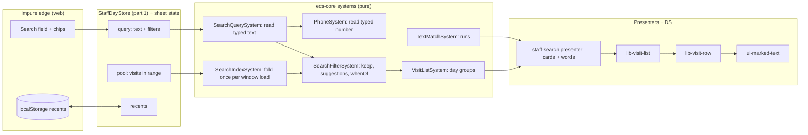

# Schedule search, part 2: filters, recents and a Spotlight-style sheet

- **Author:** Dimitar Dimitrov
- **Status:** Built (2026-11-04). What was decided and where the build differs from this design: [`docs/architecture/decisions/2026-11-03-staff-search-sheet.md`](../architecture/decisions/2026-11-03-staff-search-sheet.md).
- **Date:** 2026-11-03
- **Superseded in part (2026-11-04):** decision B1, the removable-chip anatomy and the idle «Предложения» section gave way to keyed tokens and a filter dropdown — [staff-search-tokens.md](./staff-search-tokens.md).
- **Part 1:** [staff-search.md](./staff-search.md) (one highlighter, phone reading, a window that reaches and stays fresh). This part builds on it and does not start before part 1's stages 1 to 3 have merged.

---

## Overview

After part 1 the schedule search finds the right visits. This part changes how
it asks and how it answers, in the style of Apple Spotlight and Mail:

1.  **Filters on demand.** A user can narrow a search by barber, service, status
    and date. Filters are offered as suggestions and shown as chips in the
    field.
2.  **A Spotlight-style sheet.** Before typing, the sheet shows recent searches
    and suggested filters. Results are event cards (`lib-visit-row`, the same
    family as the agenda's event head), grouped under date headings, with the
    fields that matched shown and marked.
3.  **Mixed queries.** `Иван 088 333` is read as the name `Иван` and the number
    `088 333`.

## The Problem

What is wrong today, with the cause for each:

- **Results are rows in a table.** Each hit is a name, a matched field and a
  time at the right edge. The agenda shows the same visit as an event card with
  its time, services, status and people. Search results share none of that.
- **No filters, no shortcuts.** There is no way to say "only cancelled", "only
  Николай" or "tomorrow", and an empty sheet shows only a sentence.
- **A query is one string.** The text `Иван 088 333` is matched as text, so the
  number part is never read as a number (part 1 reads only a whole-number
  query).
- **Every keystroke re-folds the window.** `searchableFields` rebuilds and
  re-folds every field of every visit on each keystroke. With part 1's window
  (about 4,800 visits) that is about 8 times more work than today.

## Goals

1.  A typed query is read once into terms and an optional phone reading. A
    visit must match every term and, when a number is present, the number.
2.  Filters: barber, service, status (confirmed, cancelled, no-show,
    completed), date (today, tomorrow, this week) and "has a note". Filters of
    different kinds combine with AND; several values of one kind combine with
    OR. A filter shows as a removable chip in the field.
3.  The sheet suggests only filters that would keep at least one result, taken
    from the visits the typed text already matches.
4.  The empty sheet shows recent searches (per device) and suggested filters.
5.  Result rows are `lib-visit-row` event cards (staff layout, the agenda's
    event-head family), grouped under date headings: Today, Tomorrow, then
    weekday and date for later days, with the past under one «По-рано» heading.
    A card shows the lines the query matched (client name, phone, e-mail,
    note), marked.
6.  A keystroke scans a folded index that is built once per window load, not
    re-folded per keystroke.
7.  Law compliance: decisions in `*.system.ts`, wording in `*.presenter.ts`,
    flat archetypes and branded primitives, no new classes outside Angular.

## Non-Goals

- Typed filter syntax (`barber:николай`). Chips and suggestions are the only
  entry (Alternative A).
- Counts beside suggestions ("Николай (4)") (Alternative B).
- A date picker for "a chosen day or range". Today, Tomorrow and This week are
  the date filters (Alternative E).
- Searching older than part 1's window, saving filter sets under a name,
  sharing searches between staff, syncing recents between devices.
- A query language with `AND`/`OR`/parentheses. That is the whole grammar in
  Goals 2.
- Full-text ranking, typo tolerance, transliteration, a hosted search service
  (part 1, Alternative A).
- Changing which visits a staff member may see.

## Decisions

These are choices without an explicit owner ruling; each can be reversed. The
first draft covered both parts in one document; the design review of
2026-11-03 split it and made these choices. The reasoning is in Technical Plan
sections 1 to 3.

| #   | Question                        | Decision                                                                                                                                                                                                                          |
| --- | ------------------------------- | --------------------------------------------------------------------------------------------------------------------------------------------------------------------------------------------------------------------------------- |
| B1  | How are filters entered?        | Suggestions and chips only. The typed `barber:` form and text that resolves to a filter are not built.                                                                                                                            |
| B2  | What do suggestions show?       | The distinct barbers, services, statuses and date presets present in the text-matched visits, with each kind's own filter removed. No counts.                                                                                     |
| B3  | What is a date filter?          | A preset: Today, Tomorrow, or This week (today and the next 6 days), built by `SearchFilterSystem.whenOf(preset, shopNow)`. No picker.                                                                                            |
| B4  | What does a result card show?   | `visitRowOf` as for the client card, plus one `StaffEventLine` (with marked parts) per field the query matched: client name, phone, e-mail, note. The title stays the services and gets marked parts when a service name matched. |
| B5  | Where do recent searches live?  | `localStorage` on the device, last 8, as a small function beside the store (de-duplicate, newest first, cap). No Firestore reads or writes, no sign-out hook.                                                                     |
| B6  | How is the index kept current?  | Rebuilt whenever the window changes (a window load), not patched per visit. One linear scan over about 4,800 visits is expected to take a few milliseconds.                                                                       |
| B7  | Where does the sheet read from? | `StaffDayStore`'s window from part 1 (`pool`, `searchCapped`, `searchStale`, `ensureWindow`). No second store.                                                                                                                    |

## Open Questions

- **Counts.** Do staff want "(4)" beside a suggestion? It needs a second pass
  over the text-matched set per facet (Alternative B). This design ships without
  them.
- **Foreign numbers.** Settled in part 1 (`044…` is read as national).

## Critical User Journeys (CUJs)

### CUJ 1: Find a booking by name and number together

- **Given**: The front desk is on the schedule. The client Иван's number is
  stored as `+359 88 333 4455`.
- **When**: The user opens search and types `Иван 088 333`.
- **Then**: A top suggestion row reads `Телефон +359 88 333…`. The result list
  shows Иван's visits under their dates, with «Иван» marked in the name line
  and `359 88 333` marked in the phone line. Tapping the suggestion row turns
  the number into a phone chip and leaves «Иван» as the text. Typing only `0`
  or `00` shows the suggestions, not an empty message.

### CUJ 2: Open the sheet and tap a shortcut

- **Given**: The sheet is open with the field empty. The user searched
  «Петър» and «Фейд» earlier on this device.
- **When**: The user looks at the sheet.
- **Then**: The sheet shows the two recent searches, then suggested filters
  (Today, Tomorrow, This week, Cancelled, No-shows, With a note, and Barber and
  Service groups). Tapping «Утре» shows tomorrow's visits as event cards under
  one date heading, with no typing and no new Firestore read.

### CUJ 3: Narrow a name search with a filter

- **Given**: The user typed «Иван». Eleven visits match across four barbers.
- **When**: The user taps the suggestion «Бръснар ▸» and then «Николай».
- **Then**: A chip «Николай» sits in the field before the text. The visits that
  remain are grouped by date, «Иван» marked on each. Removing the chip brings
  the eleven back.

### CUJ 4: See why a visit matched

- **Given**: The user types an e-mail fragment that matches only a client's
  e-mail.
- **When**: The results appear.
- **Then**: Each card shows the usual lines plus an e-mail line with the typed
  run marked. A card that matched on the client's name shows a name line
  instead.

---

## Technical Plan (Architecture)

### What the code already gives us

Most of this design joins pieces that exist and are used in one place each:

| Need                   | Exists today                                                                                                                                     | Gap                                               |
| ---------------------- | ------------------------------------------------------------------------------------------------------------------------------------------------ | ------------------------------------------------- |
| Read a typed query     | `ClientQuerySystem.parse` → `ParsedClientQuery` (`name`, `nameTokens`, `phoneDigits`, `phoneInternational`, `email`, `clientQueryShape`)         | Used only by the add-client page                  |
| Read a typed number    | `PhoneSystem.searchDigitsOf` and `readingMatches` (part 1)                                                                                       | Not yet combined with text terms                  |
| As-you-type phone text | `PhoneSystem.formatDraft(input, country)`                                                                                                        | Not used by the schedule search                   |
| A visit as a card      | `lib-visit-row` + `visitRowOf(appointment, options, lookup)` → `AppointmentRowVm`; `StaffEventHead` with marked `parts`; `StaffEventLine.parts`  | The search builds its own plain rows              |
| Sections with headings | `lib-visit-list` + `VisitSectionVm` (key, label, `detail`, `testId`), the `openRow` output, `VisitListSystem`, `VisitStorySystem.outwardFromNow` | History grouping is by month and year, not by day |
| A removable chip       | `button[uiChip]` with a trailing ✕ (`libs/ui/controls/src/lib/chip/chip.ts`)                                                                     | Not inside `ui-search-field`                      |
| The search field       | `ui-search-field` (with `uiPinned`), `searchGlyphOf` for the leading glyph                                                                       | No chips                                          |
| A per-device list      | The `localStorage` pattern in `agenda-fields.ts`                                                                                                 | None for searches                                 |

### Shape of the solution



The systems are `SearchQuerySystem`, `SearchIndexSystem`, `SearchFilterSystem`,
`VisitListSystem` (extended), `TextMatchSystem` and `PhoneSystem` (both from
part 1); the sections below describe each.

Three rules keep it inside the repo's laws:

- **Systems decide, presenters word.** What matches, which filter applies, which
  suggestions exist and how visits group by day are system answers (Law 3,
  Law 10.2). The presenter turns them into rows, headings and chip labels.
- **The edge is the store.** Only the store calls the ports and reads
  `localStorage`. Systems get plain arrays.
- **No new Firestore fields, indexes or rules, and no new reads.** The sheet
  reads the window part 1 already loads.

### 1. The query is data (`@core/components`)

A flat component, composed with the existing slices by intersection where an
entity needs it (Law 6). `*Field` dictionaries are `as const` objects named after
the field:

```text
SearchQuery      = { searchText: string; searchFilters: readonly SearchFilter[] }
SearchFilter     = flat variants, discriminated by searchFilterField:
  BARBER      { filterBarberIds: readonly BarberId[] }        // OR inside
  SERVICE     { filterServiceIds: readonly ServiceId[] }
  STATUS      { filterBookingStatuses: readonly BookingStatus[] }
  WHEN        { filterFromDate: LocalDate; filterToDate: LocalDate }
  NOTE        { filterHasNote: true }
```

Each variant owns its own field names, so the intersection never collapses to
`never`. Filters of different `searchFilterField` combine with AND; ids inside
one filter combine with OR. The phone reading is part of the query, not a
filter. `SearchQuery.parse(raw)` is the smart constructor that guards what
recents read back from storage (Law 7). A type-spec proves each variant narrows.

### 2. Reading and matching what was typed (`@core/systems`)

**`SearchQuerySystem.read(raw, callingCode)`** turns the field's text into a
`ReadQuery { queryTerms; queryPhone }`. It builds on `ClientQuerySystem.parse`
(`ParsedClientQuery`) and adds no second parser.

_Terms and number._ The typed text is split on spaces. A run of consecutive
tokens that are phone-shaped (digits, `+`, `-`, `(`, `)`) and hold at least 3
digits in total forms the phone reading through `PhoneSystem.searchDigitsOf`
(part 1, Technical Plan 1), and those tokens are not text terms. Every other
token is a text term. A visit must match every text term and, when a phone
reading exists, the phone reading. `088 333` is one phone reading and no
terms; `Иван 088 333` is the term `Иван` and one phone reading.

_What the user sees._ The field is **not rewritten** while typing (part 1,
Alternative E). A phone reading shows as the top suggestion row, `Телефон
+359 88 333…`, formatted with `PhoneSystem.formatDraft`, and the field's leading
glyph switches to the phone glyph. Tapping the row turns the number tokens into
a phone chip and leaves the other tokens as the text.

**`SearchIndexSystem.build(visits, labels)`** folds each visit's searchable
fields (client, services, phone digits, e-mail, note, barbers) into flat
parallel columns (one array per field, scanned linearly: the flat-array form of
Law 3). It is rebuilt whenever the window is replaced, not per keystroke and not
patched per visit. Keystrokes then scan those columns and allocate nothing per
visit. Client labels and companion names (today `guestLabelOf` and
`companionNames` in the features layer) arrive as plain strings in `labels`.

**`SearchFilterSystem`**:

- `keep(index, read, filters)` returns the matching visit indexes in one
  linear pass: text terms (all must match, in any field), the phone reading
  (combined as in "Terms and number" above), then each filter.
- `suggestions(index, read, filters)` returns the distinct barbers, services,
  statuses and date presets present in the text-matched visits, computed
  **with each kind's own filter removed**, so a chosen barber does not hide the
  other barbers. A value that would keep no visit is not offered.
- `whenOf(preset, shopNow)` builds the `WHEN` filter for a preset
  (`SearchWhenPreset`: `TODAY`, `TOMORROW`, `THIS_WEEK`, the last being today
  through the next 6 days) from the shop-local `ShopNow` (Law 7).

**`VisitListSystem.dayGroups(visits, today)`** returns a keyed group per future
local date and one `PAST` group for earlier days, with a `DayBucket` dictionary
(`TODAY`, `TOMORROW`, `LATER`, `PAST`). `VisitGrain` is not extended (it has
about 84 usages, and its `sections()` files every upcoming visit under one key).
The presenter words the heading from the key. Order stays
`VisitStorySystem.outwardFromNow`: soonest first among the future, most recent
first among the past.

### 3. The sheet (UI and UX)

A Spotlight-style sheet with two regions (idle and results) plus an empty-result
state, one component:

```text
┌──────────────────────────────────────┐
│ Търсене                          ✕   │  title folds when the field is engaged
│ [🔍 [Николай ✕] Иван…            ✕] │  chips sit inside the field, before the text
├──────────────────────────────────────┤
│ IDLE (field empty, no chips)         │
│  Скорошни        Изчисти             │
│   🕘 Петър   🕘 Фейд                 │  last 8, this device
│  Предложения                         │
│   Днес · Утре · Тази седмица         │  date chips
│   Отказани · Неявили се · С бележка  │  status chips
│   Бръснар ▸   Услуга ▸               │  open a short list
├──────────────────────────────────────┤
│ TYPING / RESULTS                     │
│  ☎ Телефон +359 88 333…              │  only when the text reads as a number
│  Бръснар: Николай                    │  only offers that keep results
│  Услуга: Фейд                        │
│  ── Днес ──                          │  date headings, from VisitListSystem
│  [event card: 10:00  Николай Иванов] │  lib-visit-row, matched lines marked
│  ── Утре ──                          │
│  [event card …]                      │
│  ── По-рано ──                       │
└──────────────────────────────────────┘
```

- **Result cards** are `lib-visit-row` with `VisitPerspective.Staff` and
  `interactive = true`, fed by `visitRowOf`, so a search hit uses the same
  event-head family as the client card's history and the agenda. A search row
  adds, to the usual lines, one `StaffEventLine` for each field the query
  matched (client name, phone, e-mail, note), its `parts` filled by the search
  presenter from `TextMatchSystem` (`StaffEventHead` already draws `parts`
  through `ui-marked-text`). The title stays the services and takes
  `titleParts` when a service name matched. The agenda's own `.agenda-card` is
  hand-built in the dashboard template and is not a reusable component; the
  design uses `lib-visit-row`, which is the reusable card in the same family
  (Alternative C).
- **Sections.** Results are mounted in `lib-visit-list` as `VisitSectionVm`s
  built from `VisitListSystem.dayGroups`: «Днес», «Утре», weekday and date for
  later days, and one «По-рано» for the past. The list's `openRow` output
  drives `openHit` (jump to the day, save the recent, close).
- **Chips in the field.** `ui-search-field` gets a `uiTokens` input and a
  `uiTokenRemove` output; each chip is a `button[uiChip]` (the existing
  removable-token form with a trailing ✕), not a new element. Backspace in an
  empty field removes the last chip. The field's leading glyph still reports
  what the text was read as (as `searchGlyphOf` does for the add-client page).
- **Suggestions** come only from `SearchFilterSystem.suggestions`, so every
  offered filter keeps at least one result. The idle sheet offers the three
  date presets, the status filters and the barber and service lists.
- **Recents** are saved when a result is opened or the keyboard's search key is
  pressed, never on every keystroke. A recent is a full `SearchQuery` (text and
  chips). A small function beside the store de-duplicates (by structural
  equality), puts the newest first and caps the list at 8. The store reads and
  writes `localStorage` (the `agenda-fields.ts` pattern), wraps both in
  try/catch, and validates what it reads with `SearchQuery.parse` (Law 7); a
  corrupt entry is dropped. Recents are per device and cleared by «Изчисти».
- **Empty and edge states.** No match: the existing quiet figure, plus "clear
  filters" when chips are present. Window capped or out of date: part 1's
  footnotes. Loading: the existing busy hook on the field.
- **Keyboard and a11y.** Down from the field lands on the first suggestion or
  card (`focusFirstHit` today). Chips are buttons with a remove label. Each
  group is a labelled `ul` list under its heading. Reduced motion is respected as
  the field already does.

### 4. Reuse across searches

| Search                        | After part 2                                                                                   |
| ----------------------------- | ---------------------------------------------------------------------------------------------- |
| Schedule search sheet         | the new sheet                                                                                  |
| Visit sheet › add-client page | unchanged (it keeps `ClientQuerySystem` for its own ranking; marks and phone come from part 1) |
| Visit sheet › service page    | unchanged                                                                                      |
| `ui-search-field`             | gains chips; the add-client page and the services search use it without chips                  |

### Cross-cutting

- **Performance.** About 4,800 visits × about 8 folded fields. The index is
  rebuilt only when the window is replaced. A keystroke is one linear scan,
  expected to take a few milliseconds; the input is debounced 80 ms. A spec
  drives a sized fixture and asserts a bounded number of comparisons per
  keystroke, not wall time.
- **Memory.** The index holds folded strings only, about the size of the
  window (about 1.5 MB).
- **Law check.** Flat query slice with prefixed discriminators (Law 6);
  branded ids and dates, shop-local `ShopNow` for the date presets (Law 7);
  tiers: components → entities → systems, nothing upward (Law 8); no port or
  pipeline is added, so Laws 4 and 9 are unchanged; presenters hold wording
  only, decisions are in systems (Law 10).

## Risks and Mitigations

| Risk                                                                   | Effect                                                    | Mitigation                                                                                                                   |
| ---------------------------------------------------------------------- | --------------------------------------------------------- | ---------------------------------------------------------------------------------------------------------------------------- |
| `localStorage` is unavailable, or a recent is corrupt                  | Recents are empty or one entry is dropped                 | Every access is in try/catch and recents are validated with `SearchQuery.parse`; nothing else changes.                       |
| A recent holds a client's name or number                               | On-device exposure                                        | Recents are per device and cleared by «Изчисти».                                                                             |
| A phone-shaped token is meant as text (a note that starts with digits) | The token is read as a number                             | The number is a suggestion first and only a chip when tapped; fewer than 3 digits are never read as a number.                |
| `lib-visit-row`'s staff layout has not been used for search            | The first look with real marks may need small CSS changes | `visit-row.css` is listed in stage 2.                                                                                        |
| The folded index is rebuilt on every window load                       | A load briefly costs a rebuild                            | One linear fold of about 4,800 visits, expected to take a few milliseconds; the old index serves until the new one is built. |
| `ui-search-field` gains chips for every user of the field              | A regression in the add-client page or services search    | Chips are opt-in (`uiTokens` defaults to empty); the field's existing specs stay.                                            |
| Old specs of `SearchHitVm` and `searchHits`                            | Stale expectations                                        | The rewrite replaces them and carries the old expectations over case by case into the new spec.                              |

---

## Alternatives Considered

Each option below lost for the reason given; the reopen condition says what would
change that.

### A. Typed filter syntax (`barber:…`), alone or beside the menu

- **Rejected because:** typed syntax alone is a feature people must learn, which
  the owner ruled out (2026-11-03). Beside the menu it adds a parser that needs
  a key table, locale-aware key names, prefix resolution and ambiguity rules,
  and a pure system cannot hold locale words (Laws 8 and 10), so the names must
  be passed in. Chips and suggestions already cover the need.
- **Reopen if:** staff ask for typed filters as a first-class entry.

### B. Counts beside suggestions ("Николай (4)")

- **Rejected because:** it is the hardest algorithm in the design (a facet's
  count is computed over the text-matched set with that facet's own filter
  removed), and it exists only to print a number beside a suggestion.
- **Reopen if:** staff ask for counts, or a suggestion list is long enough that
  users cannot tell which value is worth tapping.

### C. Make the agenda's own card (`.agenda-card`) the result row

- **Rejected for now because:** it is a block of template and CSS inside
  `staff-dashboard.html`, not a component, so reusing it means first extracting
  it, a larger change that touches the main grid. `lib-visit-row` is a
  component of the same event-head family and is already shared by the client
  card and the account pages.
- **Reopen if:** the visual gap between the agenda card and `lib-visit-row`'s
  staff layout is judged too large. Extracting the card would then be its own
  piece of work, and search would switch to it.

### D. Save recent searches in Firestore, per staff account

- **Rejected because:** each save is a write, the document needs rules, and
  the benefit (recents on a second device) is small for a desk with one tablet.
  Local storage costs nothing.
- **Reopen if:** staff share devices and need their own recents, or move
  between devices often.

### E. A date picker for "a chosen day or range"

- **Rejected because:** it needs a new DS element and a stage of its own, and
  the three presets cover the questions asked at a desk ("today", "tomorrow",
  "this week").
- **Reopen if:** staff ask for arbitrary dates or ranges.

### F. Patch the index per changed visit

- **Rejected because:** one linear fold of about 4,800 visits is expected to take a few
  milliseconds, so a patch would add a second code path (including removals) to
  save time nobody would notice.
- **Reopen if:** a measured rebuild misses a frame budget on the slowest desk
  tablet.

---

## Detailed Implementation

`main` takes changes through pull requests only, so the work is cut into three
stages, each its own PR, each green on its own (typecheck, test, lint, layering,
web and functions builds) and each leaving the app working. All stages start
after part 1's stages 1 to 3 have merged.

| Stage | Delivers                                                                                       | Depends on         |
| ----- | ---------------------------------------------------------------------------------------------- | ------------------ |
| 1     | Query, index, filter and day-grouping systems, all pure, each with a spec; nothing visible yet | part 1, stages 1–3 |
| 2     | The new sheet: field chips, suggestions, recents, event-card results by date, i18n, showcase   | 1                  |
| 3     | End-to-end tests, the dev seed, the ADR, doc updates, line-cap ratchets                        | 2                  |

File paths are relative to the repo root. "New" means the file does not exist
yet. Spec files are listed beside their subject. A law reference (for
example L3 for Law 3) cites `CLAUDE.md` §1.

### Stage 1: the pure systems

All new systems are in `libs/ecs-core/src/systems/`, each with a
`*.system.spec.ts` beside it that includes the purity case (same input, same
output, inputs untouched, using the test-only `deepFreeze`), and each exported
from `libs/ecs-core/src/systems/index.ts`.

| File                                                                                          | Change and why                                                                                                                                                                                                                                                                                                                                                                                                                                                                           |
| --------------------------------------------------------------------------------------------- | ---------------------------------------------------------------------------------------------------------------------------------------------------------------------------------------------------------------------------------------------------------------------------------------------------------------------------------------------------------------------------------------------------------------------------------------------------------------------------------------- |
| `libs/ecs-core/src/components/search-query.data.ts` (new)                                     | `SearchFilterField` dictionary (`BARBER`, `SERVICE`, `STATUS`, `WHEN`, `NOTE`), `SearchWhenPreset` dictionary (`TODAY`, `TOMORROW`, `THIS_WEEK`), `SearchFilter` (flat variants, variant-only fields prefixed `filter…`), `SearchQuery`, and the companion with `empty`, `withFilter`, `withoutFilter`, `isEmpty`, `equals` and `parse(raw): Result<SearchQuery, SearchQueryError>`. No class, no `Object.freeze` (L1, L6).                                                              |
| `libs/ecs-core/src/errors/search-query.error.ts` (new) and `errors/index.ts`                  | `SearchQueryErrorCode` dictionary and the flat `SearchQueryError` struct that `parse` returns (L7).                                                                                                                                                                                                                                                                                                                                                                                      |
| `libs/ecs-core/src/components/search-query.data.type-spec.ts` (new)                           | Proves every variant narrows on `searchFilterField` and the intersections are not `never` (L6.3).                                                                                                                                                                                                                                                                                                                                                                                        |
| `libs/ecs-core/src/components/search-query.data.spec.ts` (new)                                | Companion behaviour: adding a second filter of one kind merges ids; removing the last id removes the filter; `parse` accepts a well-formed value and refuses a corrupt one.                                                                                                                                                                                                                                                                                                              |
| `libs/ecs-core/src/components/day-bucket.data.ts` (new) and `components/index.ts`             | `DayBucket` dictionary (`TODAY`, `TOMORROW`, `LATER`, `PAST`) and export of the new components.                                                                                                                                                                                                                                                                                                                                                                                          |
| `search-query.system.ts` + spec (new)                                                         | `read(raw, callingCode)` → `ReadQuery { queryTerms: readonly string[]; queryPhone: PhoneReading }`. Builds on `ClientQuerySystem.parse` (`ParsedClientQuery`), splits words and groups consecutive phone-shaped tokens into one phone reading through `PhoneSystem.searchDigitsOf` (the rest are text terms). Spec: `088 333`, `Иван 088 333`, `Иван 12` (too few digits, all text), `+359 88 333`.                                                                                      |
| `search-index.system.ts` + spec (new)                                                         | `build(visits, labels)` → flat parallel columns (one array per field, scanned linearly): folded text per field kind, phone digits, barber ids, service ids, status, local date, has-note. Folds with `TextMatchSystem.fold`. Client labels and companion names arrive as plain strings in `labels`.                                                                                                                                                                                      |
| `search-filter.system.ts` + spec (new)                                                        | `keep(index, read, filters)` → ascending indexes in one pass; `suggestions(index, read, filters)` → distinct barbers, services, statuses and date presets in the text-matched set, each computed with that kind's own filter removed, values that keep nothing omitted; `whenOf(preset, shopNow)` → the `WHEN` filter (`THIS_WEEK` = today through the next 6 days). Spec: a sized fixture from `search.fixtures.ts` asserting that comparisons per keystroke stay bounded, not timings. |
| `libs/ecs-core/src/systems/visit-list.system.ts` + spec                                       | Add `dayGroups(visits, today)`, which returns a keyed group per future local date and one `PAST` group for earlier days, using `DayBucket`. `VisitGrain` is not extended. The search presenter words the heading from the key, so "is this today" is never decided in a presenter (L10.2). Existing grains untouched.                                                                                                                                                                    |
| `libs/ecs-core/src/testing/search.fixtures.ts` (new) and `libs/ecs-core/src/testing/index.ts` | A seeded generator of visits for index and filter specs and for the e2e dev seed.                                                                                                                                                                                                                                                                                                                                                                                                        |

### Stage 2: the new sheet

| File                                                                                                                                                 | Change and why                                                                                                                                                                                                                                                                                                                                                                                                                                                                                                                                                                                                                                                                                                                                                                                                       |
| ---------------------------------------------------------------------------------------------------------------------------------------------------- | -------------------------------------------------------------------------------------------------------------------------------------------------------------------------------------------------------------------------------------------------------------------------------------------------------------------------------------------------------------------------------------------------------------------------------------------------------------------------------------------------------------------------------------------------------------------------------------------------------------------------------------------------------------------------------------------------------------------------------------------------------------------------------------------------------------------- |
| `libs/ui/controls/src/lib/search-field/search-field.ts`, `search-field.css`, `search-field.spec.ts`                                                  | Add `uiTokens` (readonly `{ id, label, removeLabel }[]`, default empty) and outputs `uiTokenRemove` and `uiTokenActivate` (opens the chip's value list, for example the barber names). Chips (`button[uiChip]`) render before the input inside the field's frame; Backspace on an empty input removes the last chip (and announces it in a live region). The field's focus, pinned, busy and clear behaviour is unchanged. Spec cases: chip render, Backspace removal and announcement, focus order, no chips by default.                                                                                                                                                                                                                                                                                            |
| `apps/showcase/src/app/pages/controls/search-field/` (new) and `app.routes.ts`                                                                       | A `ui-search-field` showcase page: chips in the field, empty field, overflow.                                                                                                                                                                                                                                                                                                                                                                                                                                                                                                                                                                                                                                                                                                                                        |
| `libs/features/staff/dashboard/src/lib/staff-dashboard/staff-search.vm.ts`                                                                           | Replace `SearchHitVm` and `MatchVm` with `SearchSheetVm { searchSheetState: SearchSheetState; recents: RecentVm[]; suggestions: SuggestionGroupVm[]; groups: VisitSectionVm[]; chips: ChipVm[]; phoneReading?: PhoneRowVm; footnote?: string }`, where `SearchSheetState` is an `as const` dictionary (`IDLE`, `RESULTS`, `EMPTY`), `RecentVm { id; label }`, `ChipVm { id; label; removeLabel }`, `PhoneRowVm { label }` and `SuggestionVm { id; label; icon }`. Groups are the shared `VisitSectionVm`, and their rows are `AppointmentRowVm`. Types and tag-to-word tables only (L10.3).                                                                                                                                                                                                                          |
| `libs/features/staff/dashboard/src/lib/staff-dashboard/staff-search.presenter.ts`                                                                    | Rewrite: `searchSheetVm(input)` calls `SearchQuerySystem.read`, `SearchFilterSystem.keep` and `suggestions`, `VisitListSystem.dayGroups`, `VisitStorySystem.outwardFromNow`, `visitRowOf` (from `@creativo/features/shared/visits`, with a full `VisitRowOptions`: staff perspective, one `ShopNow` per list for the dashboard's current location, the zone, locale and words, plus a `VisitLookup`) with the matched lines and marked runs from `TextMatchSystem`, and words headings, chips, suggestions and the phone row. It decides nothing (L10.2). `SearchInput` already carries `callingCode` from part 1.                                                                                                                                                                                                   |
| `libs/features/staff/dashboard/src/lib/staff-dashboard/staff-search.presenter.spec.ts`                                                               | Rewrite in `bg` and `en`: idle state, phone reading row, mixed query, grouping and headings across a day boundary and for the past, matched-line cards, suggestions, truncation and out-of-date footnotes, no-match state. Fixed inputs; no clock.                                                                                                                                                                                                                                                                                                                                                                                                                                                                                                                                                                   |
| `libs/features/shared/visits/src/lib/visit-row.vm.ts`                                                                                                | Add optional `titleParts` and `extraLines` (a list of `StaffEventLine`) to `VisitRowFields`.                                                                                                                                                                                                                                                                                                                                                                                                                                                                                                                                                                                                                                                                                                                         |
| `libs/features/shared/visits/src/lib/visit-row.presenter.ts` and `.spec.ts`                                                                          | `visitRowOf` accepts optional matched lines and title marks in `VisitRowOptions` and returns them on the row; none given, no change.                                                                                                                                                                                                                                                                                                                                                                                                                                                                                                                                                                                                                                                                                 |
| `libs/features/shared/visits/src/lib/visit-row/visit-row.html`, `visit-row-text.html`, `visit-row-text.ts`, and `visit-row.css` if the marks need it | Pass `titleParts` and append `extraLines` to the lines handed to `lib-staff-event-head`.                                                                                                                                                                                                                                                                                                                                                                                                                                                                                                                                                                                                                                                                                                                             |
| `libs/features/staff/dashboard/src/lib/staff-search-sheet/staff-search-sheet.ts`, `.html`, `.css`, `.spec.ts` (new)                                  | `lib-staff-search-sheet`: the sheet extracted from `staff-dashboard.html` (the search sheet's markup). Mounts the results in `lib-visit-list` (keyed sections and the `openRow` output). Reads the window from `StaffDayStore` (`pool`, `searchCapped`, `searchStale`, `ensureWindow`), calls `searchSheetVm` inside a `computed()`, builds the index when the pool is replaced, debounces input 80 ms, handles chips, recents, focus order, and `openHit` (jump to the day, save the recent, close). It takes the case and keyboard handling of the old `focusFirstHit`, and `catalogNames`, `companionNames`, `unnamedClient`, `shopNowAt`, the zone, the locale and `goToDay` as inputs from the dashboard. The spec covers the 80 ms debounce, chip add and remove, focus order, saving a recent, and `openHit`. |
| `libs/features/staff/dashboard/src/lib/staff-search-recents.ts` and `.spec.ts` (new)                                                                 | A plain function pair: `pushRecent(recents, query, max)` (de-duplicate by structural equality, newest first, cap 8, ignore an empty query) and `loadRecents` / `saveRecents` over `localStorage` (key `creativo.staff.search.recents`, try/catch on every access, validated with `SearchQuery.parse`; a corrupt entry is dropped). Spec: de-duplication, the cap, an empty query, unavailable storage, a corrupt entry.                                                                                                                                                                                                                                                                                                                                                                                              |
| `libs/features/staff/dashboard/src/lib/staff-day.store.ts`                                                                                           | Delete the remaining search state (`_searching`, `_searchLoading`, `_term`, `openSearch`, `closeSearch`, `setTerm`) once the new sheet owns it. The window code from part 1 stays.                                                                                                                                                                                                                                                                                                                                                                                                                                                                                                                                                                                                                                   |
| `libs/features/staff/dashboard/src/lib/staff-dashboard/staff-dashboard.ts`, `.html`, `.css`                                                          | Remove the sheet's body, `searchResults`, `searchTermSearchable`, `searchSheetEngaged`, `searchFieldFocused`, `focusFirstHit`, `openHit`, `closeSearchSheet` and the `.staff-search__*` rules; mount `<lib-staff-search-sheet>`. The file shrinks accordingly.                                                                                                                                                                                                                                                                                                                                                                                                                                                                                                                                                       |
| `libs/features/staff/dashboard/src/lib/staff-dashboard/staff-dashboard.spec.ts`                                                                      | Move the search cases into the new sheet's spec; keep a mount case here.                                                                                                                                                                                                                                                                                                                                                                                                                                                                                                                                                                                                                                                                                                                                             |
| `libs/infrastructure/i18n/src/assets/i18n/bg.json` and `en.json`                                                                                     | New keys under `staff.search.*`: recents, clear recents, suggestions heading, today, tomorrow, this week, keys for confirmed, cancelled, no-show and completed, barber group, service group, phone reading row, group headings (today, tomorrow, earlier), clear filters, chip remove label. `catalogue-parity.spec.ts` keeps `bg` and `en` equal. Remove the old `staff.day.searchLabel`, `searchScope`, `searchPlaceholder`, `searchEmpty` and `searchLoading` keys when the old sheet goes; `searchClear` stays (the visit editor uses it).                                                                                                                                                                                                                                                                       |

### Stage 3: tests, seed, docs, caps

| File                                                                 | Change and why                                                                                                                                                                                                                                                                                                                                                                  |
| -------------------------------------------------------------------- | ------------------------------------------------------------------------------------------------------------------------------------------------------------------------------------------------------------------------------------------------------------------------------------------------------------------------------------------------------------------------------- |
| `tools/seed/fixtures/book.fixtures.ts`                               | The seed already has cancellations, no-shows, notes and «Николай Иванов» (`dev-client-6`); add visits for two barbers and a client whose e-mail is unique, if none exist, so every journey has data. Check that the seed's own spec still passes.                                                                                                                               |
| `apps/web/e2e/staff-search-sheet.spec.ts` (new)                      | CUJs 1 to 4 against the emulator, signing in with `signInAs(page, uid, roles)` from `apps/web/e2e/support/sign-in.ts`: `Иван 088 333` finds Иван's visit and marks name and number; idle sheet shows recents and suggestions; a barber chip narrows and removes; an e-mail match shows an e-mail line. Uses `waitUntil: 'commit'`, as `apps/web/e2e/booking-core.spec.ts` does. |
| `docs/architecture/decisions/2026-11-03-staff-search-sheet.md` (new) | ADR: decisions B1 to B7, the alternatives with their reopen conditions.                                                                                                                                                                                                                                                                                                         |
| `docs/architecture/HANDOFF.md`                                       | Add one line pointing at the ADR.                                                                                                                                                                                                                                                                                                                                               |
| `eslint.config.mjs`                                                  | Lower the `staff-dashboard.ts` `max-lines` cap to the new file length (a ratchet: a cap only goes down). A stage that shrinks the file lowers its cap in its own PR.                                                                                                                                                                                                            |

### Order inside each stage, and verification

1.  Write the spec first for each system (red), then the system (green).
2.  After each stage run, through Nx: `pnpm nx run-many -t typecheck`,
    `pnpm nx run-many -t test`, `pnpm nx run-many -t lint`,
    `pnpm nx run verify-tools:layering`, `pnpm nx build web`,
    `pnpm nx build functions`. `typecheck` does not see Angular templates, so
    the web build or the dev server's logs are the template check.
3.  Stage 2 is also checked in the running app with the in-app browser (drive
    the DOM with scripts and read computed styles; take screenshots with a
    standalone Playwright script), including the add-client page and the
    services search, which share `ui-search-field`.
4.  `firestore.indexes.json` and `firestore.rules` are not touched, and this
    part adds no Firestore read: the sheet reads part 1's window.
