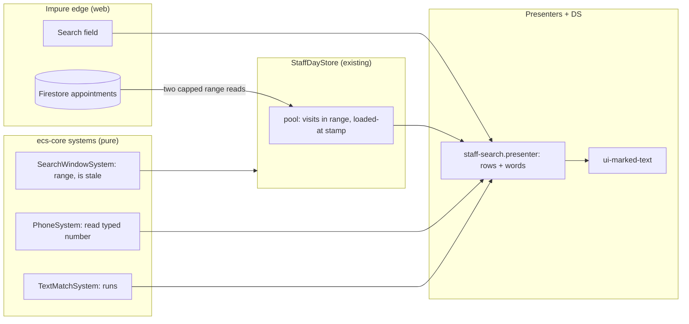

# Schedule search, part 1: one highlighter, phone reading and a window that reaches and stays fresh

- **Author:** Dimitar Dimitrov
- **Status:** Proposed
- **Date:** 2026-11-03
- **Part 2:** [staff-search-spotlight.md](./staff-search-spotlight.md) (filters, recents, the Spotlight-style sheet). It builds on this part.

---

## Overview

The staff schedule has a search sheet («Търсене»). It finds visits by client name,
phone, e-mail, service and note, but it misses visits it should find. Three
root causes, three fixes:

1.  **One highlighter.** The accent-colour background that now marks matches in
    the visit sheet's service list becomes one shared piece of code and one
    design-system element, used by every search.
2.  **Phone numbers read the way people type them.** `088…` means `+359 88…`
    and `00…` means `+…`, in every search that takes a number.
3.  **A window that reaches and stays fresh.** The search covers every future
    visit up to the booking horizon and the past 60 days, and it refreshes
    itself when it is old or when this device saved a visit, instead of being
    read once and never again.

Filters, recent searches and event-card results are part 2.

## The Problem

What is wrong today, with the cause for each:

- **Searching `088…` finds nothing.** Phones are stored as `+359 88…`. The
  digits fallback compares the typed `088…` with `35988…`, and the leading
  zero makes them differ. The add-client page already reads `0…` as a trunk
  prefix (`phoneAsTyped` in `visit-client-row.presenter.ts`), but the
  schedule search does not use that reading.
- **Three copies of "mark the match".** The schedule search has its own
  `splitOnTerm` / `splitOnDigits` (`staff-search.presenter.ts`), the add-client
  rows have `ClientQuerySystem.nameSegments`, and the service list has
  `TextMatchSystem` (merged in PR #20, commit `0926913d`). They mark in two
  different styles (ink only, and a background wash). A fourth search would add
  a fourth copy.
- **The search can miss a future visit.** The sheet reads the 300 visits
  nearest to now on each side (`SEARCH_WINDOW_PER_SIDE` in `staff-day.store.ts`).
  The comment there puts that at about one working week each way. A booking
  three weeks out cannot be found by name. Owner requirement (2026-11-03): find
  all future visits.
- **The window is never refreshed.** The store reads it once, the first time
  the sheet opens, and `openSearch` returns early whenever the pool is not
  empty. The only callers of `reloadSearchPool` are `openSearch` and
  `ensureWindow`, the latter used by the add-client page («Скорошни»). A visit
  booked, moved or cancelled after the first opening is missing or stale in
  the results until the page is reloaded. This is a staleness bug, not a cost.

How often these misses happen today is not measured; the first two are
reproducible by hand.

## Goals

1.  One match-marking system (`TextMatchSystem`) and one DS element
    (`ui-marked-text`) serve the schedule search, the add-client page, the
    service list and any later search. The three older copies are replaced by
    calls to it; the add-client page keeps its word-start rule as a mode of the
    shared function.
2.  A typed number is read once, in one place, and every search uses it:
    `0` + digits is the shop's dial code + digits; `00` is `+`; `+` is kept;
    digits with no prefix still match any part of the number. `088 333`,
    `+359 88 333`, `00359 88 333` and `359 88…` all find the same client.
3.  The schedule search finds every visit from now to the booking horizon, up
    to a safety cap, and the past 60 days.
4.  The window the search reads is never older than 15 minutes when the sheet
    opens, and a visit saved, moved or cancelled on this device is searchable
    at once. Typing and filtering cost no reads; the only reads are window
    loads, and a load happens only when the window is stale.
5.  Law compliance: decisions in `*.system.ts`, wording in `*.presenter.ts`,
    flat archetypes and branded primitives, no new classes outside Angular.

## Non-Goals

- Full-text relevance ranking, typo tolerance, stemming and Latin ↔ Cyrillic
  transliteration. Matching stays "the typed run appears in the text, case
  aside" (Bulgarian collation).
- A hosted search service (Algolia, Typesense, Elastic). The scale does not
  justify a second system to run and pay for (see Alternative A).
- Searching visits older than 60 days from the sheet. A client's own history on
  the client card is paged and client-scoped; older visits are reached there
  (Alternative K).
- Seeing another device's change within seconds. It appears at the next window
  load, at most 15 minutes later (Alternative J).
- Filters, recent searches, event-card results and typed filter hints. They are
  part 2.
- Changing which visits a staff member may see. Scope rules stay as they are.

## Decisions

These are choices without an explicit owner ruling; each can be reversed. The
first draft covered both parts in one document; the design review of
2026-11-03 split it and made these choices. The reasoning is in Technical Plan
sections 1 to 3.

| #   | Question                       | Decision                                                                                                                                                                                                                                                                                                                                                         |
| --- | ------------------------------ | ---------------------------------------------------------------------------------------------------------------------------------------------------------------------------------------------------------------------------------------------------------------------------------------------------------------------------------------------------------------- |
| A1  | How far does search reach?     | Future: everything up to the booking horizon. Past: 60 days. Both as date ranges on `utcEpochMs`, not as a count of visits, with a safety cap per side. Older visits are not in the sheet.                                                                                                                                                                       |
| A2  | How is the window kept fresh?  | Refresh on open: the window is read again when the sheet (or the add-client page) opens and the window is older than 15 minutes or a visit was saved on this device. The old window stays on screen while the refresh runs. No listener.                                                                                                                         |
| A3  | Which highlight style?         | The accent wash, everywhere. The ink-only style of the dashboard search and the event head's marked runs is retired, because the owner required one highlighter in all searches (2026-11-03). The wash deviates from `styling-conventions.md` (a tone wash is the tone at `--sys-alpha-tint`); the exception is recorded in `docs/design-research/decisions.md`. |
| A4  | Where does phone reading live? | In `PhoneSystem` (ecs-core), as one function used by all searches. `ClientQuerySystem.phoneInternationalDigits` and `phoneLookupVariants` delegate to it; the add-client page's `phoneAsTyped` formats its result.                                                                                                                                               |
| A5  | What is in part 1?             | The highlighter, the phone reading and the window. Filters, recents, the Spotlight sheet and event-card results are part 2.                                                                                                                                                                                                                                      |

## Open Questions

- **Foreign numbers.** `0044…` and `+44…` both mean a UK number. A client
  typing `044…` is ambiguous (national `044` or a mistyped `00 44`). The plan
  treats it as national, which is the standard reading of a leading single `0`.
- **The 15-minute age.** It bounds how stale a change from another device can
  be. A shorter age costs more loads (Technical Plan 3). Is 15 minutes right
  for the desk?

## Critical User Journeys (CUJs)

### CUJ 1: Find a booking by the number the client gives on the phone

- **Given**: The front desk is on the schedule. A client is on the phone.
  Their number is stored as `+359 88 333 4455`.
- **When**: The user opens search and types `088 333`.
- **Then**: The result list shows Николай Иванов's visits, with `+359 88 333`
  marked in the phone line. Typing `00359 88 333` or `359 88 333` gives the
  same list. Typing only `0` or `00` is read as text, as today.

### CUJ 2: Find a visit three weeks ahead

- **Given**: A client booked 24 days from now. The old window did not reach it.
- **When**: The user types the client's name.
- **Then**: The visit is listed. No extra read happens, because the window
  already covers the booking horizon.

### CUJ 3: Find a visit that was just saved

- **Given**: The user saved a new visit for «Петър» a minute ago on this device.
- **When**: The user opens search and types «Петър».
- **Then**: The new visit is listed. The save marked the window stale, so the
  sheet re-read it on opening; the old window stayed on screen until the new one
  arrived. A visit saved on another device appears after at most 15 minutes.

### CUJ 4: The same marking everywhere

- **Given**: The visit sheet's service list, the add-client page and the
  schedule search are all open in turn.
- **When**: The user types the same run in each.
- **Then**: The match is marked with the same accent background, the same
  padding and corner, and the same look in a selected row, in each place.

---

## Technical Plan (Architecture)

### What the code already gives us

Most of this design joins pieces that exist and are used in one place each:

| Need                | Exists today                                                                                                                                                 | Gap                                                                                   |
| ------------------- | ------------------------------------------------------------------------------------------------------------------------------------------------------------ | ------------------------------------------------------------------------------------- |
| Mark a match        | `TextMatchSystem` (service list), `ClientQuerySystem.nameSegments`, `splitOnTerm` / `splitOnDigits` (schedule search)                                        | Three copies, two styles                                                              |
| Read a typed number | `ClientQuerySystem.phoneInternationalDigits(parsed, callingCode)`: a carried `+`/code stays, a trunk `0…` gets the code, a bare run gets the code and itself | The schedule search uses `SearchFieldsSystem.digitQuery` instead, which keeps the `0` |
| The booking horizon | `BookingPolicy.horizonMonths` and `horizonEndFrom(policy, today)`                                                                                            | Not read by the search                                                                |
| Cheap range reads   | Single-field index on `utcEpochMs`, `persistentLocalCache` in `firestore-db.provider.ts`                                                                     | The window is a fixed count, not a range                                              |
| The window read     | `StaffDayStore.openSearch`, `ensureWindow`, `reloadSearchPool`, and the port `searchAppointmentWindow` (one-shot, whole-window admission in `windowOf`)      | Read once, never refreshed, a count                                                   |

### Shape of the solution

The systems are `SearchWindowSystem`, `PhoneSystem` and `TextMatchSystem`; the
sections below describe each.

Three rules keep it inside the repo's laws:

- **Systems decide, presenters word.** What matches, which range to read and
  whether the window is stale are system answers (Law 3, Law 10.2). The
  presenter turns them into rows and words.
- **The edge is the store.** Only the store calls the ports. Systems get plain
  arrays.
- **No new Firestore fields, indexes or rules.** Everything the plan reads is
  already on the appointment document.

### 1. Reading a typed number (`@core/systems`)

_Phone reading, the rule._ A national number is written with a trunk prefix (`0` in Bulgaria) at home and without it
after a country code, which is also how libphonenumber and the add-client page
already treat it:

| Typed                                | Read as                                | Matched against the stored number's digits                       |
| ------------------------------------ | -------------------------------------- | ---------------------------------------------------------------- |
| `+359 88 333`, `+44 7…`              | international, as typed                | starts with those digits                                         |
| `00359 88 333`, `0044…`              | `00` → `+`, then as above              | starts with                                                      |
| `088 333`                            | trunk `0` → shop dial code: `35988333` | starts with                                                      |
| `359 88 333`                         | already begins with the shop's code    | starts with                                                      |
| `88 333 4455` (3+ digits, no prefix) | a bare run                             | the code + the run, else the run anywhere (today's digit search) |
| `0`, `00`, `08` (under 3 digits)     | no phone reading yet                   | nothing; the text is read as text only                           |

The shop's dial code comes from `deployment.defaultCountry` through
`PhoneSystem.callingCodeOr`, as the add-client page does. One new function,
`PhoneSystem.searchDigitsOf(typed, callingCode)`, holds the table above and
returns a `PhoneReading`, a flat component in `@core/components`
(`phone-reading.data.ts`): `{ phoneReadingKind: PhoneReadingKind;
phoneReadingCandidates: readonly string[] }`, where `PhoneReadingKind` is an
`as const` dictionary (`INTERNATIONAL`, `BARE`, `NONE`). `INTERNATIONAL` carries
one candidate; `BARE` carries two, `[code + run, run]`, as
`phoneInternationalDigits` does today. `PhoneSystem.readingMatches(reading,
storedDigits)` is true when the stored digits start with the single candidate
(`INTERNATIONAL`), or start with the first candidate or contain the second
(`BARE`); `NONE` never matches. `ClientQuerySystem.phoneInternationalDigits` and
`phoneLookupVariants` delegate to `searchDigitsOf` instead of keeping their own
copies of the rule. `00` always means `+`: `0088 333` reads as the number
`+88 333` and finds a visit only if some stored number starts with `88333`. A
spec pins every row, including `00` and `+` inputs, `+0088…` (no reading) and a
foreign code.

_In the existing sheet._ The sheet reads the whole typed text as a number when
every character is phone-shaped (digits, spaces, `+`, `-`, `(`, `)`) and it
holds at least 3 digits. A visit then matches when its text fields match the
typed text (as today) or its stored phone digits satisfy `readingMatches`.
Mixed queries such as `Иван 088 333` keep today's behaviour (text only) until
part 2 adds the terms-and-number rule. The field is **not rewritten** while
typing: rewriting the text under the caret breaks backspace (the user deletes
`+359` one character at a time), IME input and undo (Alternative E).

### 2. One highlighter

- `TextMatchSystem` (merged in PR #20, commit `0926913d`, which this work
  builds on) gains `segmentsAny(text, terms, matchMode)` for several words,
  where `MatchMode` is an `as const` dictionary (`ANYWHERE`, `WORD_START`);
  `phoneSegments(formatted, digits)`, which marks a digit run across the
  formatter's spaces; and a `fold` function. It replaces `splitOnTerm`,
  `splitOnDigits`, `ClientQuerySystem.nameSegments` (which calls it with
  `WORD_START`, the add-client page's rule, while the service list and the
  schedule search use `ANYWHERE`) and `ClientQuerySystem.phoneSegments` /
  `emailSegments` (called from `visit-client-row.presenter.ts`), keeping their
  candidate-priority output; a spec pins today's output before they move.
  `TextSegment` moves to a neutral file in `@core/components` so
  `text-match.system.ts` and `client-query.system.ts` share no import cycle.
- `ui-marked-text` (`libs/ui/patterns`): a DS element taking `uiRuns`
  (`readonly { text, hit }[]`), printing `<mark>` for hits. Marks are an
  accent wash defined once as a token (`--sys-color-mark`: the accent at twice
  `--sys-alpha-segment-selected`, as `.staff-visit__mark` is now), with the
  padding and corner in the element's own CSS.
- `StaffEventHead` draws its `parts` and `titleParts` through it, so the
  event card, the add-client rows, the service list and the schedule search
  share one look. `.staff-search__mark`, `.staff-visit__mark` and the head's
  ink-only marked-run styling are deleted.
- Showcase: a `ui-marked-text` page in `apps/showcase`, with the selected-row
  and both-theme cases.

### 3. How far the search reaches, and what it costs

**The window is a date range, not a count.**
`SearchWindowSystem.rangeOf(policy, today)` returns
`{ fromDate, toDate }`: from today minus 60 days to
`BookingPolicy.horizonEndFrom(policy, today)`. The default policy is two
months, so the default window is about 60 days back and 60 days ahead. The
store converts the two dates to `UtcEpochMs` once, per shop zone, at the
boundary (Law 7). Each side keeps a safety cap of 3,000 visits so a
misconfigured horizon cannot read the whole collection; hitting the cap sets a
`capped` flag that the sheet words as "showing the nearest 3,000". A longer
horizon costs proportionally more reads and memory (12 months is about 14,600
visits at 40 a day, past the cap, so the cap shortens the window to the nearest
75 days or so).

**Query shape.** Two range queries on the single field `utcEpochMs`, exactly as
`searchAppointmentWindow` does today, so no composite index is needed:
`utcEpochMs >= from && < now` ordered descending with the cap, and
`utcEpochMs >= now && <= to` ordered ascending with the cap.

**Refresh on open.** `SearchWindowSystem.isStale(loadedAtUtcMs, nowUtcMs,
invalidated)` is true when the window is older than `SEARCH_WINDOW_MAX_AGE_MINUTES`
(15) or `invalidated` is set. The age is an elapsed-time rule on a stamp, compared
through `UtcEpochMs.compare` and `UtcEpochMs.plus*` (Law 7). `StaffDayStore`
calls it in `openSearch` and `ensureWindow`: when the window is missing or
stale it reads it again, and the old window stays on screen until the new one
lands. `invalidateSearchWindow()` sets `invalidated` after this device saves,
moves or cancels a visit. A failed refresh keeps the old window and shows a
quiet "may be out of date" footnote.

**Reads.**

| Moment                                                          | Reads                                                                                                                                                 |
| --------------------------------------------------------------- | ----------------------------------------------------------------------------------------------------------------------------------------------------- |
| First open in a session                                         | the window: about `40 visits/day × 120 days (60 back + 60 ahead) ≈ 4,800` (the 40/day figure is the store comment's estimate for a 3 to 5 chair shop) |
| Add-client page first opened in the session                     | the same window load, shared with the sheet                                                                                                           |
| Typing and filtering                                            | 0                                                                                                                                                     |
| Sheet reopened within 15 minutes, no visit saved on this device | 0                                                                                                                                                     |
| Sheet reopened after 15 minutes, or after a save on this device | one window load (about 4,800); the old window stays on screen meanwhile                                                                               |
| A visit changed on another device                               | seen at the next window load, at most 15 minutes later                                                                                                |

At the Firestore list price (about US$0.06 per 100,000 document reads in the
default US region; to be checked against the project's region and the current
price sheet), one window load is about US$0.003. A cold load reads about 8
times more than today's 600 documents, because the window now reaches the
whole booking horizon; that is what "all future visits" costs. Loads happen
only on an opening that finds the window stale, so they are bounded by the
number of openings: a device that opens the sheet 50 times a day and finds the
window stale every time reads about 240,000 documents, about US$0.14 a day or
US$3 a month. The cost grows with the horizon and the shop's daily volume,
which is why the window, the age and the cap are named values in one place.

**Why refresh on open rather than a live listener.** A listener's cost would
follow the changes, but it needs a new store, a new port bundle, an adapter
rewrite, a visibility timer with a detach rule, a re-anchoring rule for a tablet
left open for days, and handling for a partial first paint, to save a few
dollars a month by the figures above (Alternative J). It also reverses the
deliberate choice recorded in the comment at `staff-day.store.ts:1773-1778`.
Refresh on open changes `openSearch` and `ensureWindow` and nothing else.

**What is read.** Cancelled and no-show visits are in the window (part 2's
"cancelled" filter needs them). The queries read every appointment in the date
range that the signed-in role may read (`firestore.rules` lets barbers,
receptionists and admins read all appointments), so a barber searches all
barbers' clients' names, phones and e-mails. No location filter is added,
because one would need a composite index. The persistent local cache serves a
refreshed window's first paint without waiting for the network.

### 4. Reuse across searches

| Search                                                | Today                                        | After                                                                                                              |
| ----------------------------------------------------- | -------------------------------------------- | ------------------------------------------------------------------------------------------------------------------ |
| Schedule search sheet                                 | own window, own marking, digits fallback     | the range window, `TextMatchSystem` + `ui-marked-text`, `searchDigitsOf`                                           |
| Visit sheet › service page                            | `TextMatchSystem`                            | `TextMatchSystem` + `ui-marked-text`                                                                               |
| Visit sheet › add-client page, «Скорошни»             | reads the schedule search's window           | still reads the window; keeps its "nearest to now" order over the wider range                                      |
| Visit sheet › add-client page                         | `ClientQuerySystem` marks and `phoneAsTyped` | marks through `TextMatchSystem`; phone through `PhoneSystem.searchDigitsOf`                                        |
| Client directory (`searchUsers`, server prefix index) | `SearchFieldsSystem` prefixes                | unchanged: `lookupKeys` and `phoneLookupVariants` already emit `0…` and `359…` forms, now through `searchDigitsOf` |
| `admin-rhythm-sheet` search field                     | unmarked services filter                     | marks through `TextMatchSystem` and `ui-marked-text`                                                               |

### Cross-cutting

- **Performance.** The existing sheet re-folds every field of every visit on
  every keystroke. The window is now about 8 times larger (about 4,800
  visits), so each keystroke scans about 8 times more. The input is debounced
  80 ms. Stage 3 measures a keystroke over a 4,800-visit fixture; if it
  misses a keystroke's budget, part 2's folded index moves forward (Risks).
- **Memory.** About 1.5 MB for the window (4,800 visits × about 8 fields ×
  about 40 bytes).
- **Observability.** The store logs each window load through the existing log
  port: size, truncation and the reason (first open, age, invalidated), so a
  bill spike can be traced to its cause.
- **Law check.** Branded ids and dates, shop-zone ranges converted once at the
  edge (Law 7); tiers: components → entities → systems, ports consuming
  entities, and the store at the edge outside the library, nothing upward
  (Law 8); the port `searchAppointmentWindow` keeps its bundle, so Law 9 is
  unchanged; presenters hold wording only, decisions are in systems (Law 10).

## Risks and Mitigations

| Risk                                                                       | Effect                                                   | Mitigation                                                                                                                                                                        |
| -------------------------------------------------------------------------- | -------------------------------------------------------- | --------------------------------------------------------------------------------------------------------------------------------------------------------------------------------- |
| A window refresh fails                                                     | The window stays as it was                               | The sheet keeps the old window and shows a quiet "may be out of date" footnote; the next opening tries again.                                                                     |
| The rules deny the range query                                             | Search is unavailable                                    | The sheet shows the out-of-date state instead of crashing, and the denial is logged.                                                                                              |
| Every staff device holds all visits in the window (names, phones, e-mails) | Wider exposure than a single day's agenda                | The same rules as the agenda (`firestore.rules`, `worksTheBook()`); the window lives in memory and the SDK's local cache; no new fields.                                          |
| The cap is hit, or the horizon is long                                     | The window shortens to the nearest 3,000 visits per side | A footnote says so; cost and memory scale with the horizon; reopen Alternative B when the footnote shows in the logs. Above about 50 visits a day the cap shortens the past side. |
| The existing per-keystroke path scans about 8 times more visits            | Typing may lag                                           | Stage 3 measures it on a 4,800-visit fixture; if it is too slow, part 2's folded index is built first.                                                                            |
| A save path does not call `invalidateSearchWindow()`                       | A just-saved visit is missing for up to 15 minutes       | Stage 3 lists every save, move and cancel path the dashboard handles, and the spec asserts each one invalidates.                                                                  |
| A change from another device                                               | Not visible until the next load                          | Accepted: at most 15 minutes (Open Question on the age).                                                                                                                          |
| The old sheet's specs (`staff-search-hit`, `-headline`, `-sheet`)          | Stale markup expectations                                | Stage 1 updates the cases that query deleted markup; part 2 rewrites the rest.                                                                                                    |

---

## Alternatives Considered

Each option below lost for the reason given; the reopen condition says what would
change that.

### A. A hosted search service (Algolia, Typesense, Elasticsearch, the Firebase search extensions)

Gives typo tolerance, ranking and facets without writing them.

- **Rejected because:** it adds a second system to pay for, secure and keep in
  sync with Firestore (a function on every appointment write, a backfill, a
  failure mode where the two disagree), and it copies clients' names, phones
  and e-mails to a third party. At about 40 visits a day and under 5,000
  searchable visits, a linear scan in memory is expected to answer in a few
  milliseconds, which a staff member will not notice, so the service's ranking
  is not needed.
- **Reopen if:** one shop's searchable history passes roughly 50,000 visits, or
  the owner wants typo tolerance and transliteration as a requirement.

### B. A server-side index on the appointment document (`searchPrefixes`, as the client records have)

The client records already carry `searchPrefixes`, queried with
`array-contains`.

- **Rejected because:** Firestore can only test "begins with a typed word",
  never "contains". Phone matching by any run of digits, e-mail local parts and
  notes would not work. Every extra filter needs its own composite index
  (`array-contains` plus `in` plus a range on `utcEpochMs` is not one index).
  Each document grows with its prefixes, so every write costs more and a
  backfill is needed.
- **Reopen if:** the window cap is regularly hit (the sheet's "showing the
  nearest 3,000" note appears in the logs). The client directory already uses
  this route for the unbounded set of clients, and that stays.

### C. A fixed number of visits around now (today's 300 per side, or a larger count)

- **Rejected because:** a count does not follow the booking horizon. At 40
  visits a day, 300 is a week and 3,000 is about 75 days, so "all future
  visits" still depends on how busy the shop is. A date range follows the
  horizon and the cap is only a safety valve.
- **Reopen if:** the horizon is so long that the cap is hit routinely (see
  Alternative B).

### D. Query Firestore on each search

- **Rejected because:** every keystroke would bill the number of documents
  returned.
- **Reopen if:** the window outgrows what fits in memory.

### E. Rewrite the field's text in place (`088` becomes `+359 88` inside the input)

- **Rejected because:** it fights the caret. Backspace deletes `+359` one
  character at a time, IME composition and undo break, and a user who typed a
  note starting with digits sees their text change. The number is matched
  without touching what was typed.
- **Reopen if:** the owner prefers the in-field rewrite. It would be limited to
  a field whose whole text is phone-shaped, applied on blur, and never
  mid-typing.

### F. Keep two highlight styles (ink on the dashboard search and the event head, wash in the service list)

- **Rejected because:** the owner required one highlighter in every search.
  Keeping two styles keeps two code paths and two sets of selected-row rules.
- **Cost of the choice:** it overrules the 2026-09-24 note in
  `staff-dashboard.css` and the event head's ink-only marked runs. Both were
  set by earlier owner decisions; this design replaces them.
- **Reopen if:** the owner reverses the one-highlighter requirement.

### G. Keep the window fresh with a "changed since" cursor

- **Rejected because:** appointments carry no generic `updatedAt` stamp, so the
  cursor needs a new field on every write path and a new index.
- **Reopen if:** appointments gain a generic `updatedAt` stamp with an index.

### H. Keep our own copy of the window in IndexedDB

- **Rejected because:** the Firestore SDK already persists documents locally
  (`persistentLocalCache`), and a second copy would need its own invalidation.
- **Reopen if:** the SDK cache proves too small to serve a refreshed window's
  first paint.

### I. Re-read the whole window after every write

- **Rejected because:** each write would bill the full window (about 4,800
  documents). Today's code does not do this: it reads once and goes stale.
  Marking the window stale and reading it on the next opening costs one load
  per opening, not per write.
- **Reopen if:** the shop's volume falls so far that a full re-read per write is
  cheaper than anything else.

### J. A live range listener kept for the page session

- **Rejected because:** its cost follows the changes (an initial load plus one
  read per change), but it needs a new `StaffSearchStore`, a new
  `AppointmentRangePorts` bundle, an adapter rewrite (`observeQuery` admits each
  query on its own, while the window must be admitted whole), a visibility
  timer and a 20-minute detach rule, a re-anchoring rule for a tablet left open
  for days, and partial-first-paint handling. By the figures in Technical Plan
  3 the saving is a few dollars a month. The detach rule also rests on an
  unverified billing assumption (a listener off for under 30 minutes resumes
  free).
- **Reopen if:** staff need other devices' changes within seconds, or measured
  loads exceed about US$10 a month for a shop.

### K. A "search older" step in the sheet

- **Rejected because:** each step reads a 60-day range whether or not anything
  matches (a visit 200 days back takes about 3 taps), it needs an end-of-data
  rule and a place for rows that are not live, and the client card already has a
  paged, client-scoped history.
- **Reopen if:** staff report that finding an old visit by name, without
  opening the client, is common.

---

## Detailed Implementation

`main` takes changes through pull requests only, so the work is cut into four
stages, each its own PR, each green on its own (typecheck, test, lint, layering,
web and functions builds) and each leaving the app working. Stages 1 and 2
change what users see on their own, and stage 2 fixes a live bug, so they ship
first.

| Stage | Delivers                                                                                                                                                                   | Depends on      |
| ----- | -------------------------------------------------------------------------------------------------------------------------------------------------------------------------- | --------------- |
| 1     | One highlighter: `TextMatchSystem` extended, `ui-marked-text`, the mark token; the service list and the event head switch to it; the old copies of the marking are deleted | PR #20 (merged) |
| 2     | Phone reading: `PhoneSystem.searchDigitsOf`; `088…` works in the existing search; the add-client page calls the same function                                              | 1               |
| 3     | Reach and freshness: the range window, refresh on open, invalidation on save; the existing sheet and the add-client «Скорошни» read from it                                | 1, 2            |
| 4     | End-to-end tests, the dev seed, the ADR, doc updates, line-cap ratchets                                                                                                    | 3               |

File paths are relative to the repo root. "New" means the file does not exist
yet. Spec files are listed beside their subject. A law reference (for
example L3 for Law 3) cites `CLAUDE.md` §1.

### Stage 1: one highlighter

| File                                                                                                                                                                | Change and why                                                                                                                                                                                                                                                                                                                                                                                                                                                                                                        |
| ------------------------------------------------------------------------------------------------------------------------------------------------------------------- | --------------------------------------------------------------------------------------------------------------------------------------------------------------------------------------------------------------------------------------------------------------------------------------------------------------------------------------------------------------------------------------------------------------------------------------------------------------------------------------------------------------------- |
| `libs/ecs-core/src/systems/text-match.system.ts`                                                                                                                    | Add `segmentsAny(text, terms, matchMode)` (several typed words, overlapping hits merged; `ANYWHERE` or `WORD_START`), a `fold` function, and `phoneSegments(formatted, digits)` (marks a digit run across the formatter's spaces, ported from `splitOnDigits`). One home for every "which run matched" answer (L3).                                                                                                                                                                                                   |
| `libs/ecs-core/src/systems/text-match.system.spec.ts`                                                                                                               | New cases: several terms, overlapping and adjacent hits, `+359 88 333` marked through its spaces, a digit run absent, purity. Includes the property "`segments` marks only what `matches` keeps".                                                                                                                                                                                                                                                                                                                     |
| `libs/ecs-core/src/systems/client-query.system.ts`                                                                                                                  | `nameSegments` keeps its signature (the add-client rows call it) but marks through `TextMatchSystem.segmentsAny(…, WORD_START)`, not its own loop; the add-client page's rule (a typed run marks the beginnings of words) is unchanged. `phoneSegments` and `emailSegments` (called from `visit-client-row.presenter.ts`) also delegate to `TextMatchSystem`, keeping their candidate-priority output. The first commit pins today's output with a spec. `TextSegment` moves to a neutral file in `@core/components`. |
| `libs/ecs-core/src/systems/client-query.system.spec.ts`                                                                                                             | Unchanged expectations; proves no behaviour change.                                                                                                                                                                                                                                                                                                                                                                                                                                                                   |
| `libs/ui/patterns/src/lib/marked-text/marked-text.ts` (new)                                                                                                         | `ui-marked-text`: input `uiRuns: readonly { text, hit }[]`, renders `<mark>` for hits and plain text otherwise, `OnPush`, `ViewEncapsulation.None` with its CSS in `@layer sys-components`, no logic. DS element, so a class is allowed here.                                                                                                                                                                                                                                                                         |
| `libs/ui/patterns/src/lib/marked-text/marked-text.css` (new)                                                                                                        | The mark: background `var(--sys-color-mark)`, text colour inherited, radius, inline padding and equal negative margin as in `.staff-visit__mark` today (taken from that rule when it is deleted), plus a new `box-decoration-break: clone`.                                                                                                                                                                                                                                                                           |
| `libs/ui/patterns/src/lib/marked-text/marked-text.spec.ts` (new)                                                                                                    | Hit and plain runs render in order, an empty run list renders nothing, accessible text reads as one string.                                                                                                                                                                                                                                                                                                                                                                                                           |
| `libs/ui/patterns/src/index.ts`                                                                                                                                     | Export `ui-marked-text`.                                                                                                                                                                                                                                                                                                                                                                                                                                                                                              |
| `libs/ui/tokens/theme-light.css` and `theme-dark.css`                                                                                                               | Add `--sys-color-mark: color-mix(in srgb, var(--sys-color-accent) calc(var(--sys-alpha-segment-selected) * 2), transparent)`. The accent law allows a wash as a shape; the token sits beside `--sys-alpha-segment-selected` in both theme files so `var()` resolves per theme. The alpha rung is that `--sys-alpha-*` step (14% in light, 20% in dark); the mark is twice it.                                                                                                                                         |
| `libs/ui/tokens/src/lib/accent-rule.spec.ts`                                                                                                                        | Add the mark to the `WASHES` list and its stylesheet to the test target's inputs in `project.json`. Re-measure the worst ink contrast at 28% (light) and 40% (dark) against the floors of 14.5 and 9.7; if either falls below, use a single `--sys-alpha-segment-selected` rung for the mark instead, which needs no new floor.                                                                                                                                                                                       |
| `libs/features/shared/visits/src/lib/event-head/staff-event-head.ts` and its `.css` / `.spec.ts`                                                                    | Draw `titleParts` and every line's `parts` through `ui-marked-text`; delete the ink-only marked-run styling and the `data-marked` hook. Overrules the 2026-09-22 ink grammar, as A3 records.                                                                                                                                                                                                                                                                                                                          |
| `libs/features/staff/dashboard/src/lib/visit-editor/staff-visit-editor.html`                                                                                        | The service rows print `row.titleRuns` and `row.lineRuns` through `ui-marked-text` instead of the inline `@for` and `<mark class="staff-visit__mark">`. The add-client rows already go through the event head, so they pick the change up from the line above.                                                                                                                                                                                                                                                        |
| `libs/features/staff/dashboard/src/lib/visit-editor/staff-visit-editor.visit.css`                                                                                   | Delete `.staff-visit__mark`.                                                                                                                                                                                                                                                                                                                                                                                                                                                                                          |
| `libs/features/staff/dashboard/src/lib/visit-editor/staff-visit-editor.ts`                                                                                          | Add `UiMarkedText` to the component's imports. (Net lines go down; the cap is lowered in this PR.)                                                                                                                                                                                                                                                                                                                                                                                                                    |
| `libs/features/staff/dashboard/src/lib/staff-dashboard/staff-search.presenter.ts`                                                                                   | Replace `splitOnTerm` and `splitOnDigits` with calls to `TextMatchSystem` (`segmentsAny`, `phoneSegments`). Part 2 rewrites the file; stage 1 only removes the duplicate logic so the old sheet still works.                                                                                                                                                                                                                                                                                                          |
| `libs/features/staff/dashboard/src/lib/staff-dashboard/staff-search.presenter.spec.ts`                                                                              | Same expectations, now through the shared system.                                                                                                                                                                                                                                                                                                                                                                                                                                                                     |
| `libs/features/staff/dashboard/src/lib/staff-dashboard/staff-dashboard.html`                                                                                        | The old sheet's `@for` mark blocks print through `ui-marked-text`; delete `.staff-search__mark` use.                                                                                                                                                                                                                                                                                                                                                                                                                  |
| `libs/features/staff/dashboard/src/lib/staff-dashboard/staff-dashboard.css`                                                                                         | Delete `.staff-search__mark` and the `:has(> .staff-search__mark)` rule.                                                                                                                                                                                                                                                                                                                                                                                                                                              |
| `libs/features/admin/loyalty/src/lib/admin-rhythm-sheet/admin-rhythm-sheet.html`                                                                                    | The services search (`servicesSearch`, lines 23 to 35 of this file) filters a list by text: print the list through `ui-marked-text` and mark with `TextMatchSystem.segmentsAny`. Update `admin-rhythm-sheet.ts` and its spec to match.                                                                                                                                                                                                                                                                                |
| `apps/showcase/src/app/pages/controls/marked-text/` (new: `.page.ts`, `.page.html`, `.page.css`) and `controls.page.ts` / `.html`                                   | A showcase page: plain, one hit, several hits, inside a selected `ui-list-row`, light and dark.                                                                                                                                                                                                                                                                                                                                                                                                                       |
| `libs/features/staff/dashboard/src/lib/staff-dashboard/staff-dashboard.spec.ts` and `libs/features/staff/dashboard/src/lib/visit-editor/staff-visit-editor.spec.ts` | Update the cases that query deleted markup so stage 1 stays green: `.staff-search__mark` in the dashboard spec (its `staff-search-hit`, `-headline` and `-sheet` cases move to the new markup and stay until part 2 rewrites them) and `.staff-event-head__hit` in the visit-editor spec (now `ui-marked-text`). Check `stylesheets.spec.ts` in the same lib for `.staff-visit__mark` rules.                                                                                                                          |
| `apps/showcase/src/app/app.routes.ts` and `controls.page.ts`                                                                                                        | Register the marked-text page: a lazy route and an entry in the `links` list.                                                                                                                                                                                                                                                                                                                                                                                                                                         |
| `docs/styling-conventions.md`                                                                                                                                       | One paragraph: how a search marks a match (the wash, the token, `ui-marked-text`, never an ad-hoc `<mark>`).                                                                                                                                                                                                                                                                                                                                                                                                          |

### Stage 2: phone reading

| File                                                                                   | Change and why                                                                                                                                                                                                                                                                                                                                                                                                                                                                                                                                                                                                                                                                                                                                                                                                                                                                                                                                                               |
| -------------------------------------------------------------------------------------- | ---------------------------------------------------------------------------------------------------------------------------------------------------------------------------------------------------------------------------------------------------------------------------------------------------------------------------------------------------------------------------------------------------------------------------------------------------------------------------------------------------------------------------------------------------------------------------------------------------------------------------------------------------------------------------------------------------------------------------------------------------------------------------------------------------------------------------------------------------------------------------------------------------------------------------------------------------------------------------- |
| `libs/ecs-core/src/systems/phone.system.ts`                                            | Add `searchDigitsOf(typed, callingCode)` returning a `PhoneReading` (a flat component in `@core/components`, `phone-reading.data.ts`: `{ phoneReadingKind: PhoneReadingKind; phoneReadingCandidates: readonly string[] }`, with `PhoneReadingKind` an `as const` dictionary of `INTERNATIONAL`, `BARE`, `NONE`; `BARE` carries `[code + run, run]`) and `readingMatches(reading, storedDigits)` (true when the stored digits start with the single `INTERNATIONAL` candidate, or start with the first or contain the second `BARE` candidate; `NONE` never matches). It strips every non-digit, applies the table in Technical Plan 1 (leading `00` means international, a single leading `0` means the shop's code plus the rest, a leading `+` or the shop's code means international as typed, three or more bare digits means bare, fewer than three typed digits means none) and never throws (L3, L7). `libphonenumber-js` stays confined to this file (CLAUDE.md §3). |
| `libs/ecs-core/src/systems/phone.system.spec.ts`                                       | One case per table row, plus: `0088 333` (reads as international `88333`), `+0088…` (no reading), `+44 7…` with the shop code `359`, a lone `0`, `00`, `08`, exactly three bare digits, and letters mixed in; `readingMatches` for each kind. Purity case (L3).                                                                                                                                                                                                                                                                                                                                                                                                                                                                                                                                                                                                                                                                                                              |
| `libs/ecs-core/src/systems/client-query.system.ts`                                     | `phoneInternationalDigits` and `phoneLookupVariants` call `PhoneSystem.searchDigitsOf`; the other copies of the rule go. The ranking tiers (exact, prefix, inside) are unchanged.                                                                                                                                                                                                                                                                                                                                                                                                                                                                                                                                                                                                                                                                                                                                                                                            |
| `libs/ecs-core/src/systems/search-fields.system.ts`                                    | Retire `digitQuery` and `digitsMatch` (they moved into `searchDigitsOf` and `PhoneSystem.readingMatches`). Keep `normalizeQuery`, `termSearchable`, `searchFields`, `fromForms`.                                                                                                                                                                                                                                                                                                                                                                                                                                                                                                                                                                                                                                                                                                                                                                                             |
| `libs/ecs-core/src/systems/search-fields.system.spec.ts`                               | Replace the two retired functions' cases with the same inputs through the new ones.                                                                                                                                                                                                                                                                                                                                                                                                                                                                                                                                                                                                                                                                                                                                                                                                                                                                                          |
| `libs/features/staff/dashboard/src/lib/staff-dashboard/staff-search.presenter.ts`      | `SearchInput` gains the shop's `callingCode` (passed from `staff-dashboard.ts`). `matches` reads the whole typed text as a number when it is phone-shaped with at least 3 digits, and a visit matches when its text fields match (as today) or `PhoneSystem.readingMatches` holds for its stored phone digits, so the existing sheet finds `088 333`. Mixed queries keep today's text-only behaviour. This is the live-bug fix.                                                                                                                                                                                                                                                                                                                                                                                                                                                                                                                                              |
| `libs/features/staff/dashboard/src/lib/staff-dashboard/staff-search.presenter.spec.ts` | New cases: `088 333` finds the visit stored as `+359 88 333 4455` and marks `359 88 333` (the `+` stays unmarked, as `client-query.system.spec.ts` pins); `00359 88 333` finds the same visit; `Иван 088 333` behaves as text only.                                                                                                                                                                                                                                                                                                                                                                                                                                                                                                                                                                                                                                                                                                                                          |
| `libs/features/staff/dashboard/src/lib/visit-editor/visit-client-row.presenter.ts`     | `phoneAsTyped` formats the first candidate of the `searchDigitsOf` reading rather than re-deriving it; behaviour is unchanged and its spec must still pass. `staff-visit-editor.ts` (the call to `phoneInternationalDigits`) is updated the same way.                                                                                                                                                                                                                                                                                                                                                                                                                                                                                                                                                                                                                                                                                                                        |

The client directory needs no change: `lookupKeys` and `phoneLookupVariants`
already emit `0…` and `359…` forms.

### Stage 3: reach and freshness

| File                                                                                                  | Change and why                                                                                                                                                                                                                                                                                                                                                                                                                                                                                                                                                                                                                                                                                               |
| ----------------------------------------------------------------------------------------------------- | ------------------------------------------------------------------------------------------------------------------------------------------------------------------------------------------------------------------------------------------------------------------------------------------------------------------------------------------------------------------------------------------------------------------------------------------------------------------------------------------------------------------------------------------------------------------------------------------------------------------------------------------------------------------------------------------------------------ |
| `libs/ecs-core/src/systems/search-window.system.ts` (new)                                             | `SearchWindowSystem.rangeOf(policy, today)` returns `{ fromDate, toDate }`: today minus `SEARCH_PAST_DAYS` (60) to `BookingPolicy.horizonEndFrom(policy, today)`. `isStale(loadedAtUtcMs, nowUtcMs, invalidated)` is true when `invalidated` is set or the window is older than `SEARCH_WINDOW_MAX_AGE_MINUTES` (15), compared through `UtcEpochMs.compare` and `UtcEpochMs.plus*`. `SEARCH_CAP_PER_SIDE` (3,000) lives here too. Pure, local dates and branded instants only (L3, L7).                                                                                                                                                                                                                      |
| `libs/ecs-core/src/systems/search-window.system.spec.ts` (new)                                        | Default two-month policy, a policy with a different horizon, month-end rollover; `isStale` at 14 and 16 minutes, and with `invalidated` set; purity.                                                                                                                                                                                                                                                                                                                                                                                                                                                                                                                                                         |
| `libs/ecs-core/src/ports/scheduling.port.ts`                                                          | Change `SearchAppointmentWindow` from a count to a range: `(fromUtcMs, toUtcMs, nowUtcMs, capPerSide) => Promise<Result<AppointmentWindowRead, RepositoryError>>`, with `AppointmentWindowRead = { appointments; capped: boolean }`. The port keeps its name and its bundle, so no new bundle and no composition-root change (L9).                                                                                                                                                                                                                                                                                                                                                                           |
| `libs/ecs-core/src/testing/port-doubles.ts`, `port-doubles.spec.ts` and `scheduling.port.contract.ts` | Update the `searchAppointmentWindow` double and the shared contract to the range signature (halves, caps, `capped`).                                                                                                                                                                                                                                                                                                                                                                                                                                                                                                                                                                                         |
| `libs/infrastructure/firestore/src/lib/appointments.adapter.ts`                                       | `windowOf` takes the range instead of a count: two range queries on `utcEpochMs` (before now descending, from now ascending), each capped, merged oldest first, with the same whole-window admission as today (`readRawQuery`, `keepAdmitted`: drops a malformed visit, refuses only a window that read rows and kept none). `capped` is set when either raw side returned its cap.                                                                                                                                                                                                                                                                                                                          |
| `libs/infrastructure/firestore/src/lib/appointments.adapter.spec.ts`                                  | Rewrite the `searchAppointmentWindow` cases for the range: halves, caps, malformed-visit admission, the all-malformed refusal, the `capped` flag.                                                                                                                                                                                                                                                                                                                                                                                                                                                                                                                                                            |
| `libs/infrastructure/firestore/src/lib/appointments.adapter.integration.spec.ts`                      | Rewrite the emulator case for the window: only `utcEpochMs` is used, so no composite index is needed.                                                                                                                                                                                                                                                                                                                                                                                                                                                                                                                                                                                                        |
| `libs/features/staff/dashboard/src/lib/staff-day.store.ts`                                            | Replace `SEARCH_WINDOW_PER_SIDE` with the range: `reloadSearchPool` reads `SearchWindowSystem.rangeOf(policy, today)`, converted to `UtcEpochMs` once per shop zone. The policy comes from the scheduling read port's `observePolicy` (first emission, cached for the session). `openSearch` and `ensureWindow` re-read when `SearchWindowSystem.isStale(...)` says so, keep the old pool on screen meanwhile, and on failure keep it and set a `searchStale` signal. A `searchCapped` signal carries `capped`. `invalidateSearchWindow()` sets the invalidated flag; the dashboard calls it from every save, move and cancel path of the visit editor. The store logs each load (size, truncation, reason). |
| `libs/features/staff/dashboard/src/lib/staff-day.store.spec.ts`                                       | First open reads once; reopen within 15 minutes reads nothing; reopen after 15 minutes re-reads and keeps the old pool meanwhile; `invalidateSearchWindow()` forces a re-read; a failed refresh keeps the pool and sets `searchStale`; `capped` is carried; each save, move and cancel path invalidates.                                                                                                                                                                                                                                                                                                                                                                                                     |
| `libs/features/staff/dashboard/src/lib/staff-dashboard/staff-dashboard.ts`, `.html`                   | Call `invalidateSearchWindow()` from the save, move and cancel handlers; show the truncated and out-of-date footnotes in the old sheet.                                                                                                                                                                                                                                                                                                                                                                                                                                                                                                                                                                      |
| `libs/infrastructure/i18n/src/assets/i18n/bg.json` and `en.json`                                      | Add `staff.search.truncated` ("showing the nearest 3,000") and `staff.search.stale` ("may be out of date"). `catalogue-parity.spec.ts` keeps `bg` and `en` equal.                                                                                                                                                                                                                                                                                                                                                                                                                                                                                                                                            |
| `libs/features/staff/dashboard/src/lib/staff-dashboard/staff-dashboard.spec.ts`                       | Update the doubles that stub the old count window to the range signature; add the footnote cases.                                                                                                                                                                                                                                                                                                                                                                                                                                                                                                                                                                                                            |
| `libs/features/staff/dashboard/src/lib/staff-dashboard/staff-search.presenter.spec.ts`                | Add a keystroke measurement over a 4,800-visit fixture (outside the unit assertions: logged, and failing only past a generous budget) so the per-keystroke risk is visible.                                                                                                                                                                                                                                                                                                                                                                                                                                                                                                                                  |

### Stage 4: tests, seed, docs, caps

| File                                                                                                                                                                                                               | Change and why                                                                                                                                                                                                                                                                                                                                                                                                               |
| ------------------------------------------------------------------------------------------------------------------------------------------------------------------------------------------------------------------ | ---------------------------------------------------------------------------------------------------------------------------------------------------------------------------------------------------------------------------------------------------------------------------------------------------------------------------------------------------------------------------------------------------------------------------- |
| `tools/seed/fixtures/book.fixtures.ts`                                                                                                                                                                             | The seed already has cancellations, no-shows, notes and «Николай Иванов» (`dev-client-6`); add a visit about 24 days ahead (CUJ 2) if none exists, so every journey has data. Check that the seed's own spec still passes.                                                                                                                                                                                                   |
| `apps/web/e2e/staff-search.spec.ts` (new)                                                                                                                                                                          | CUJs 1 to 4 against the emulator, signing in with `signInAs(page, uid, roles)` from `apps/web/e2e/support/sign-in.ts`: `088 333` and `00359 88 333` find the same client; a 24-day-ahead visit is found with no extra read; a visit saved in the editor is found at once; marks use the same computed background in the service list and the sheet. Uses `waitUntil: 'commit'`, as `apps/web/e2e/booking-core.spec.ts` does. |
| `docs/architecture/decisions/2026-11-03-staff-search.md` (new)                                                                                                                                                     | ADR: decisions A1 to A5, the cost model with its assumptions and sources, the alternatives with their reopen conditions, the reversal of nothing (the store comment's listener ruling is kept), and the supersession of the 2026-09-24 and 2026-09-22 ink-only rulings.                                                                                                                                                      |
| `docs/architecture/HANDOFF.md`                                                                                                                                                                                     | Add one line pointing at the ADR.                                                                                                                                                                                                                                                                                                                                                                                            |
| `docs/architecture/flips/f-08-dashboard-wording.md`, `docs/architecture/review/f08-dashboard-inventory.md`, `docs/architecture/flips/pass-d-brands-shapes.md`, `docs/design-research/staff-visit-editor-design.md` | Update the passages that name `searchHits`, `splitOnTerm` or `staff-search.presenter.ts`.                                                                                                                                                                                                                                                                                                                                    |
| `eslint.config.mjs`                                                                                                                                                                                                | Lower the two `max-lines` caps to the new file lengths (a ratchet: a cap only goes down) (`staff-dashboard.ts` from 4683, `staff-visit-editor.ts` from 6682). A stage that shrinks one of these files lowers its cap in its own PR.                                                                                                                                                                                          |

### Order inside each stage, and verification

1.  Write the spec first for each system (red), then the system (green).
2.  After each stage run, through Nx: `pnpm nx run-many -t typecheck`,
    `pnpm nx run-many -t test`, `pnpm nx run-many -t lint`,
    `pnpm nx run verify-tools:layering`, `pnpm nx build web`,
    `pnpm nx build functions`. `typecheck` does not see Angular templates, so
    the web build or the dev server's logs are the template check.
3.  Stages 1, 2 and 3 are also checked in the running app with the in-app browser
    (drive the DOM with scripts and read computed styles; take screenshots
    with a standalone Playwright script).
4.  Stage 3 is checked against the emulator: open the sheet, count document
    reads in the Firestore emulator UI's Requests tab (one window load, then none
    while typing and reopening within 15 minutes), then save a visit and confirm
    the next opening loads the window once.
5.  `firestore.indexes.json` and `firestore.rules` are not touched. The stage 3
    integration spec is the proof that the range queries need no new index; if
    it fails for a missing index, the plan changes before deploy.
