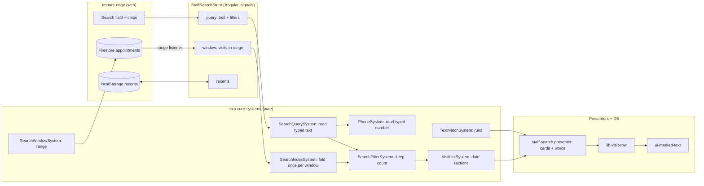

# Schedule search: shared highlighter, phone reading, filters and a Spotlight-style sheet

- **Author:** Dimitar Dimitrov
- **Status:** Proposed (awaiting `egm-review`)
- **Date:** 2026-11-03

---

## Overview

The staff schedule has a search sheet («Търсене»). It finds visits by client name,
phone, e-mail, service and note, but it is small and plain. This design makes it
the model for every search in the app:

1.  **One highlighter.** The accent-colour background that now marks matches in
    the visit sheet's service list becomes one shared piece of code and one
    design-system element, used by every search.
2.  **Phone numbers read the way people type them.** `088…` means `+359 88…`
    and `00…` means `+…`, in every search that takes a number.
3.  **Filters on demand.** A user can narrow a search by barber, service, status
    and date. Filters are offered as suggestions and chips (Apple Spotlight and
    Mail style). Typing `barber:николай` also works, but nobody has to know it.
4.  **A Spotlight-style sheet.** Before typing, the sheet shows recent searches
    and suggested filters. Results are the same event cards the agenda uses,
    grouped under date headings.
5.  **Reach that matches how the shop works.** The search covers every future
    visit and a bounded stretch of the past, and it does this without turning
    each keystroke or each sheet opening into Firestore reads.

How this draft was made: no `concepts_brief.md` exists, because the brainstorm's
Goldfish review did not run. The brief is the conversation of 2026-11-03 plus a
read of the current code. Where you left a choice to me ("pick your
recommendations"), I made it and listed it under **Decisions made on your
delegation** below. Each can be reversed.

## The Problem

What is wrong today, with the cause for each:

- **Searching `088…` finds nothing.** Phones are stored as `+359 88…`. The
  digits fallback compares the typed `088…` with `35988…`, and the leading
  zero makes them differ. The add-client page already reads a typed number
  correctly (`phoneAsTyped` in `visit-client-row.presenter.ts`), but the
  schedule search does not use that reading.
- **Three copies of "mark the match".** The schedule search has its own
  `splitOnTerm` / `splitOnDigits` (`staff-search.presenter.ts`), the add-client
  rows have `ClientQuerySystem.nameSegments`, and the service list now has
  `TextMatchSystem`. They mark in two different styles (ink only, and a
  background wash). A fourth search would add a fourth copy.
- **The search can miss a future visit.** The sheet reads the 300 visits
  nearest to now on each side (`SEARCH_WINDOW_PER_SIDE` in `staff-day.store.ts`).
  The comment there puts that at about one working week each way. A booking
  three weeks out cannot be found by name. You asked for all future visits.
- **The window is never refreshed.** The store reads it once, the first time
  the sheet opens, and `openSearch` returns early whenever the pool is not
  empty. The only caller of `reloadSearchPool` is that same path. A visit
  booked, moved or cancelled after the first opening is missing or stale in
  the results until the page is reloaded. (An earlier version of this draft
  said the pool was re-read after every write. The code does not do that;
  this is a staleness bug, not a cost.)
- **Results are rows in a table.** Each hit is a name, a matched field and a
  time at the right edge. The agenda shows the same visit as an event card with
  its time, services, status and people. Search results look like a different
  app.
- **No filters, no shortcuts.** There is no way to say "only cancelled", "only
  Николай" or "tomorrow", and an empty sheet shows only a sentence.

## Goals

1.  One match-marking system (`TextMatchSystem`) and one DS element
    (`ui-marked-text`) serve the schedule search, the add-client page, the
    service list and any later search. The three older copies are deleted.
2.  A typed number is read once, in one place, and every search uses it:
    `0` + digits is the shop's dial code + digits; `00` is `+`; `+` is kept;
    digits with no prefix still match any part of the number. `088 333`,
    `+359 88 333`, `0088…` and `359 88…` all find the same client.
3.  The schedule search finds every visit from now to the end of the bookable
    horizon, and the past 60 days, by default. Older visits are reachable by an
    explicit "search older" step that costs one bounded read.
4.  Reading cost per sheet opening is zero once the window is loaded, and the
    window stays current at a cost in proportion to the visits that change, not
    to the window's size.
5.  Filters: barber, service, status (confirmed, cancelled, no-show, completed),
    date (today, tomorrow, this week, a chosen day or range) and "has a note".
    They are offered as suggestions that show how many visits each would keep.
    A filter shows as a removable chip in the field.
6.  The empty sheet shows recent searches (per device) and suggested filters.
7.  Result rows are the agenda's event card (`lib-staff-event-head`, regular
    size), grouped under date headings: Today, Tomorrow, then weekday and date,
    with the past under its own headings. Matches are marked on the card.
8.  Law compliance: decisions in `*.system.ts`, wording in `*.presenter.ts`,
    flat archetypes and branded primitives, no new classes outside Angular.

## Non-Goals

- Full-text relevance ranking, typo tolerance, stemming and Latin ↔ Cyrillic
  transliteration. Matching stays "the typed run appears in the text, case
  aside" (Bulgarian collation).
- A hosted search service (Algolia, Typesense, Elastic). The scale does not
  justify a second system to run and pay for (see Alternatives, section 4).
- Searching inside photos, the journal or loyalty data.
- Saving filter sets under a name, sharing searches between staff, syncing
  recent searches between devices.
- A query language with `AND`/`OR`/parentheses. Filters of different kinds
  combine with AND; several values of one kind (two barbers) combine with OR.
  That is the whole grammar.
- Changing which visits a staff member may see. Scope rules stay as they are.

## Decisions made on your delegation

These are the choices you left to me. The reasoning for each is in the Technical
Plan (section 2).

| #   | Question                       | Decision                                                                                                                                                                                                                                  |
| --- | ------------------------------ | ----------------------------------------------------------------------------------------------------------------------------------------------------------------------------------------------------------------------------------------- |
| D1  | How far does search reach?     | Future: everything up to the booking horizon. Past: 60 days. Both as date ranges on `utcEpochMs`, not as a count of visits, with a safety cap per side. Older: an explicit extra read.                                                    |
| D2  | How is the window kept fresh?  | A live range listener, opened the first time the sheet opens and kept for the page session, instead of today's one-shot read, which never updates. It is detached after the page has been hidden 20 minutes and reopened on the next use. |
| D3  | How are filters entered?       | One filter model, three entries: suggestions and chips (primary), a typed `barber:` form (hidden extra), and text that resolves to a filter when it matches a barber, service or status name.                                             |
| D4  | Where do recent searches live? | `localStorage` on the device, last 8. No Firestore reads or writes.                                                                                                                                                                       |
| D5  | Which highlight style?         | The accent wash, everywhere. The ink-only style of the dashboard search and the event head's marked runs is retired, because you asked for one highlighter in all searches.                                                               |
| D6  | Where does phone reading live? | In `PhoneSystem` (ecs-core), as one function used by all searches. The add-client page's `phoneAsTyped` becomes a caller of it.                                                                                                           |

## Open Questions

- **Booking horizon.** How far ahead can a client book? D1 reads that value
  from the shop's booking policy. If the policy has no horizon, the plan uses
  120 days as the cap. Please confirm 120 is acceptable, or give the real
  figure.
- **The remaining search screen.** `admin-rhythm-sheet.html` also hosts a
  search field. I have not read what it searches. Section 5 lists it as
  "inspect, then adopt or exclude".
- **Foreign numbers.** `0044…` and `+44…` both mean a UK number. A client
  typing `044…` is ambiguous (national `044` or a mistyped `00 44`). The plan
  treats it as national, which is the standard reading of a leading single `0`.
- **Older than 60 days, by name.** A client's own history already has a
  paged view on the client card. Should the search sheet's "older" step open
  that card instead of reading more into the sheet? This draft assumes the
  sheet reads one more bounded range.

## Critical User Journeys (CUJs)

### CUJ 1: Find a booking by the number the client gives on the phone

- **Given**: The front desk is on the schedule. A client is on the phone.
  Their number is stored as `+359 88 333 4455`.
- **When**: The user opens search and types `088 333`.
- **Then**: The field reads `+359 88 333` as the user types, and the result
  list shows Николай Иванов's visits under their dates, with `+359 88 333`
  marked in the phone line. Typing `0088 333` or `359 88 333` gives the same
  list. Typing only `0` or `00` shows the suggestions, not an empty message.

### CUJ 2: Open the sheet and tap a shortcut

- **Given**: The sheet is open with the field empty. The user searched
  «Петър» and «Фейд» earlier on this device.
- **When**: The user looks at the sheet.
- **Then**: The sheet shows the two recent searches, then suggested filters
  (Today, Tomorrow, This week, Cancelled, No-shows, With a note, and a Barber
  group). Tapping «Утре» shows tomorrow's visits as event cards under one date
  heading, with no typing and no new Firestore read.

### CUJ 3: Narrow a name search with a filter

- **Given**: The user typed «Иван». Eleven visits match across four barbers.
- **When**: The user taps the suggestion «Барбър: Николай (4)».
- **Then**: A chip «Николай» sits in the field before the text. Four cards
  remain, grouped by date, «Иван» marked on each. Removing the chip brings the
  eleven back. Typing `barber:нико` instead produces the same chip.

### CUJ 4: Find a visit three weeks ahead

- **Given**: A client booked 24 days from now. The old window did not reach it.
- **When**: The user types the client's name.
- **Then**: The visit is listed under its date. No extra read happens, because
  the window already covers the booking horizon.

### CUJ 5: Look further back than the window

- **Given**: A client says they came "in the spring", about 200 days ago.
- **When**: The user types their name and reaches the end of the results.
- **Then**: A row «Търси по-назад» reads the next older range (one bounded
  query), merges it into the window, and shows the new matches under their
  dates. The row is absent once the beginning of the data is reached.

### CUJ 6: The same marking everywhere

- **Given**: The visit sheet's service list, the add-client page and the
  schedule search are all open in turn.
- **When**: The user types the same run in each.
- **Then**: The match is marked with the same accent background, the same
  padding and corner, and the same behaviour in a selected row, in each place.

---

## Technical Plan (Architecture)

### What the code already gives us

Much of this design is joining pieces that exist and are used in one place each:

| Need                   | Exists today                                                                                                                                                                | Gap                                                                                   |
| ---------------------- | --------------------------------------------------------------------------------------------------------------------------------------------------------------------------- | ------------------------------------------------------------------------------------- |
| Mark a match           | `TextMatchSystem` (service list), `ClientQuerySystem.nameSegments`, `splitOnTerm` / `splitOnDigits` (schedule search)                                                       | Three copies, two styles                                                              |
| Read a typed number    | `ClientQuerySystem.phoneInternationalDigits(parsed, callingCode)`: a carried `+`/code stays, a trunk `0…` gets the code, a bare run gets the code and itself                | The schedule search uses `SearchFieldsSystem.digitQuery` instead, which keeps the `0` |
| As-you-type phone text | `PhoneSystem.formatDraft(input, country)`                                                                                                                                   | Not used by the schedule search                                                       |
| A visit as a card      | `lib-visit-row` + `visitRowOf(appointment, options, lookup)` → `AppointmentRowVm`, `VisitSectionVm` (sections with a key and a label), `StaffEventHead` with marked `parts` | The search builds its own plain rows                                                  |
| The booking horizon    | `BookingPolicy.horizonMonths` and `horizonEndFrom(policy, today)`                                                                                                           | Not read by the search                                                                |
| Cheap range reads      | Single-field index on `utcEpochMs`, `persistentLocalCache` in `firestore-db.provider.ts`                                                                                    | The window is a fixed count, not a range                                              |

### Shape of the solution



Three rules keep it inside the repo's laws:

- **Systems decide, presenters word.** What matches, which filter applies,
  which counts to show and how visits group by day are system answers
  (Law 3, Law 10.2). The presenter turns them into `AppointmentRowVm`s,
  headings and chip labels.
- **The edge is the store.** Only the store touches Firestore and
  `localStorage`. Systems get plain arrays.
- **No new Firestore fields, indexes or rules.** Everything the plan reads is
  already on the appointment document.

### 1. The query is data (`@core/components`)

A flat component, composed with the existing slices by intersection where an
entity needs it (Law 6). `*Field` and `*Code` dictionaries are `as const`
objects named after the field:

```
SearchQuery      = { searchText: string; searchFilters: readonly SearchFilter[] }
SearchFilter     = flat variants, discriminated by searchFilterField:
  BARBER      { filterBarberIds: readonly BarberId[] }        // OR inside
  SERVICE     { filterServiceIds: readonly ServiceId[] }
  STATUS      { filterBookingStatuses: readonly BookingStatus[] }
  WHEN        { filterFromDate: LocalDate; filterToDate: LocalDate }
  NOTE        { filterHasNote: true }
  PHONE       { filterPhoneDigits: string }                   // from a typed number
```

Each variant owns its own field names, so the intersection never collapses to
`never`. Filters of different `searchFilterField` combine with AND; ids inside
one filter combine with OR. A type-spec proves each variant narrows.

### 2. Reading what was typed (`@core/systems`)

**`SearchQuerySystem.read(raw, callingCode, names)`** turns the field's text into
a `ReadQuery`: the text terms, an optional phone reading, and filter hints.
This replaces the three ad-hoc readings.

_Phone reading, the rule._ This follows the ITU E.164 convention that a national
number is written with a trunk prefix (`0` in Bulgaria) at home and without it
after a country code, which is also how libphonenumber and the add-client page
already treat it:

| Typed                                | Read as                                | Matched against the stored number's digits                       |
| ------------------------------------ | -------------------------------------- | ---------------------------------------------------------------- |
| `+359 88 333`, `+44 7…`              | international, as typed                | starts with those digits                                         |
| `00359 88 333`, `0044…`              | `00` → `+`, then as above              | starts with                                                      |
| `088 333`                            | trunk `0` → shop dial code: `35988333` | starts with                                                      |
| `359 88 333`                         | already begins with the shop's code    | starts with                                                      |
| `88 333 4455` (4+ digits, no prefix) | a bare run                             | the code + the run, else the run anywhere (today's digit search) |
| `0`, `00`, `08` (under 3 digits)     | no phone reading yet                   | nothing; show suggestions                                        |

The shop's dial code comes from `deployment.defaultCountry` through
`PhoneSystem.callingCodeOr`, as the add-client page does. One new function,
`PhoneSystem.searchDigitsOf(typed, callingCode)`, holds the table above, and
`ClientQuerySystem.phoneInternationalDigits` calls it instead of keeping its own
copy. A spec pins every row, including `00` and `+` inputs and a foreign code.

_What the user sees._ The field is **not rewritten** while typing. Rewriting the
text under the caret breaks backspace (the user deletes `+359` one character at
a time), IME input and undo. Instead, a phone reading shows as the top
suggestion row, `Телефон +359 88 333…`, formatted with `PhoneSystem.formatDraft`,
and the field's leading glyph switches to the phone glyph. Tapping the row turns
the text into a phone chip. (Alternative: rewrite in place, section 4.)

_Filter hints._ `barber:нико`, `бръснар:нико`, `service:фейд`, `status:отказан`
(Bulgarian and English keys) resolve against the catalogue names by prefix. A
hint that resolves to exactly one barber, service or status becomes a filter; one
that does not stays as text. The key names live in the words table, not the
system.

**`SearchIndexSystem.build(pool, names)`** folds each visit's searchable fields
(client, services, phone digits, e-mail, note, barbers) once per window change,
into flat parallel arrays. Keystrokes then scan those arrays and allocate
nothing per visit (Law 3). Today `searchableFields` rebuilds and re-folds every
field of every visit on every keystroke.

**`SearchFilterSystem`**:

- `keep(index, read, filters)` returns the matching visit indexes in one
  linear pass: text terms (all must match, in any field), the phone reading,
  then each filter.
- `facets(index, kept)` counts the kept visits per barber, per service, per
  status and per date bucket, for the suggestion rows ("Николай (4)"). Counts
  are over the text-matched set **with each facet's own filter lifted**, so a
  chosen barber does not hide the other barbers' counts. Suggestions that would
  give zero are not offered.

**`TextMatchSystem`** (already committed in `0926913d`) gains
`segmentsAny(text, terms)` for several words and `phoneSegments(formatted,
digits)` that marks a digit run across the formatter's spaces. It replaces
`splitOnTerm`, `splitOnDigits` and the name marking in
`ClientQuerySystem.nameSegments`, which the add-client rows then call through
the new function.

### 3. How far the search reaches, and what it costs

**The window is a date range, not a count.**
`SearchWindowSystem.rangeOf(policy, today)` returns
`{ fromDate, toDate }`: from today minus 60 days to
`BookingPolicy.horizonEndFrom(policy, today)`. The default policy is two
months, so the default window is about 60 days back and 60 days ahead. The
store converts the two dates to `UtcEpochMs` once, per shop zone, at the
boundary (Law 7). Each side keeps a safety cap of 3,000 visits so a
misconfigured horizon cannot read the whole collection; hitting the cap sets a
`windowTruncated` flag that the sheet words as "showing the nearest 3,000".

**Query shape.** Two range queries on the single field `utcEpochMs`, exactly as
`searchAppointmentWindow` does today, so no composite index is needed:
`utcEpochMs >= from && < now` ordered descending with the cap, and
`utcEpochMs >= now && <= to` ordered ascending with the cap.

**Reads.** One snapshot listener per side, opened when the sheet first opens.

| Moment                                                                 | Reads                                                                                                                                                                              |
| ---------------------------------------------------------------------- | ---------------------------------------------------------------------------------------------------------------------------------------------------------------------------------- |
| First open in a session                                                | the window: about `40 visits/day × 120 days ≈ 4,800` (the 40/day figure is the store comment's estimate for a 3 to 5 chair shop)                                                   |
| Typing, filtering, opening and closing the sheet again                 | 0                                                                                                                                                                                  |
| Someone changes or books a visit while the listener is live            | 1 per change per open listener                                                                                                                                                     |
| Sheet closed and reopened while the page stays open                    | 0; the listener stays attached, so its cost follows changes only                                                                                                                   |
| Page hidden (phone locked, tab in the background) for under 20 minutes | 0 on return; Firestore resumes a listener off for under 30 minutes and bills only what changed                                                                                     |
| Page hidden for 20 minutes or more                                     | the listener is detached, and the window is read again (about 4,800) on the next opening of the sheet; Firestore would bill that re-read anyway for a listener off over 30 minutes |
| "Search older"                                                         | one bounded range read of the next 60 days back, merged into the window                                                                                                            |

At the Firestore list price (about US$0.06 per 100,000 document reads in the
default US region; to be checked against the project's region and the current
price sheet), one window load is about US$0.003. The trade is plain: a cold
load reads about 8 times more than today's 600 documents, because the window
now reaches the whole booking horizon. That is what "all future visits" costs.
In return the window stays current, which today's one-shot read does not. A five-person
shop that cold-loads once per person per day pays about US$0.45 a month; if every
person also came back after a long idle three times a day, about US$1.80. The
cost is small in dollars and bounded; it grows with the horizon and the shop's
daily volume, which is why the window and the cap are named values in one
place.

**Why a listener rather than re-reading.** Today the pool is read once and goes
stale (see The Problem). The obvious fix, calling `reloadSearchPool` after each
write, would read the full window every time, which at 4,800 documents is the
expensive path. A listener's cost follows the changes. The store keeps one listener pair, owned
by `StaffSearchStore`. The original reason for avoiding a listener (a held
subscription over a whole collection) does not apply: the range is bounded and
capped. What a listener does cost is a full re-read after a disconnect of over
30 minutes, which the 20-minute hidden-page detach keeps from happening
silently in the background.

**What is not read.** Cancelled and no-show visits are in the window (a
"cancelled" filter needs them). Nothing outside the shop's own location scope is
read. The persistent local cache serves a reopened sheet's first paint without
waiting for the network.

### 4. The sheet (UI and UX)

A Spotlight-style sheet with three states, one component:

```
┌──────────────────────────────────────┐
│ Търсене                          ✕   │  title folds when the field is engaged
│ [🔍 [Николай ✕] Иван…            ✕] │  chips sit inside the field, before the text
├──────────────────────────────────────┤
│ IDLE (field empty, no chips)         │
│  Скорошни        Изчисти             │
│   🕘 Петър   🕘 Фейд                 │  last 8, this device
│  Предложения                         │
│   Днес · Утре · Тази седмица         │  date chips
│   Отказани · Неявили се · С бележка  │  status chips
│   Бръснар ▸   Услуга ▸               │  open a short list with counts
├──────────────────────────────────────┤
│ TYPING / RESULTS                     │
│  ☎ Телефон +359 88 333…              │  only when the text reads as a number
│  Бръснар: Николай (4)                │  only offers that keep results
│  Услуга: Фейд (2)                    │
│  ── Днес ──                          │  date headings, from VisitListSystem
│  [event card: 10:00  Николай Иванов] │  lib-visit-row, matches marked
│  ── Утре ──                          │
│  [event card …]                      │
│  ── По-рано ──                       │
│  Търси по-назад                      │  one bounded read
└──────────────────────────────────────┘
```

- **Result cards** are `lib-visit-row` with `VisitPerspective.Staff` and
  `interactive = true`, fed by `visitRowOf`, so a search hit looks exactly like
  the same visit in the client card's history and the agenda's event head. The
  row VM gains optional marked runs for the title and for each fact line
  (`StaffEventHead` already draws `parts`), filled by the search presenter
  from `TextMatchSystem`. The agenda's own `.agenda-card` is hand-built in
  the dashboard template and is not a reusable component; the design uses
  `lib-visit-row`, which is the reusable card in the same family. If you want
  the agenda card itself, `lib-visit-row`'s staff layout would need to take
  it over; I have not planned that.
- **Grouping.** `VisitListSystem` already cuts visits into keyed sections for
  the history list. A day grouping (`byLocalDate`, with a `dayOffset` of 0, 1,
  or beyond, and past or future) is added there as a system answer. The
  presenter words the heading: «Днес», «Утре», or weekday and date, with a
  separate «По-рано» for the past. Order stays
  `VisitStorySystem.outwardFromNow`: soonest first among the future, most
  recent first among the past.
- **Chips in the field.** `ui-search-field` gets a `uiTokens` input and a
  `uiTokenRemove` output; each chip is a small `ui-search-token`. Backspace in
  an empty field removes the last chip. The field's leading glyph still
  reports what the text was read as (as `searchGlyphOf` does for the add-client
  page).
- **Suggestions** come only from `facets`, so every offered filter keeps at
  least one result, and each row shows its count.
- **Recents** are saved when a result is opened or the keyboard's search key
  is pressed, never on every keystroke. A recent is a full `SearchQuery`
  (text and chips). `SearchRecentsSystem.push(recents, query, max)` is the pure
  rule (de-duplicate, newest first, cap 8); the store only reads and writes
  `localStorage` and wraps both in try/catch.
- **Empty and edge states.** No match: the existing quiet figure, plus "clear
  filters" when chips are present. Window truncated: one footnote. Loading:
  the existing busy hook on the field.
- **Keyboard and a11y.** Down from the field lands on the first suggestion or
  card (`focusFirstHit` today). Chips are buttons with a remove label. Each
  group heading is a labelled `ul`/`ol` group. Reduced motion is respected as
  the field already does.

### 5. One highlighter

- `ui-marked-text` (`libs/ui/patterns`): a DS element taking `runs`
  (`readonly { text, hit }[]`), printing `<mark>` for hits. Marks are an
  accent wash defined once as a token (`--sys-color-mark`: the accent at twice
  `--sys-alpha-segment-selected`, as `.staff-visit__mark` is now), with the
  padding and corner in the element's own CSS.
- `StaffEventHead` draws its `parts` and `titleParts` through it, so the
  event card, the add-client rows, the service list and the schedule search
  share one look. `.staff-search__mark`, `.staff-visit__mark` and the head's
  ink-only marked-run styling are deleted.
- Showcase: a `ui-marked-text` page in `apps/showcase`, with the selected-row
  and both-theme cases.

### 6. Reuse across searches

| Search                                                | Today                                        | After                                                                                          |
| ----------------------------------------------------- | -------------------------------------------- | ---------------------------------------------------------------------------------------------- |
| Schedule search sheet                                 | own window, own marking, plain rows          | the new sheet                                                                                  |
| Visit sheet › service page                            | `TextMatchSystem`                            | `TextMatchSystem` + `ui-marked-text`                                                           |
| Visit sheet › add-client page                         | `ClientQuerySystem` marks and `phoneAsTyped` | marks through `TextMatchSystem`; phone through `PhoneSystem.searchDigitsOf`                    |
| Client directory (`searchUsers`, server prefix index) | `SearchFieldsSystem` prefixes                | unchanged query; typed number read through `searchDigitsOf`, so `088…` becomes a `359…` prefix |
| `admin-rhythm-sheet` search field                     | not yet inspected                            | inspect in section 5, then adopt or exclude                                                    |

### Cross-cutting

- **Performance.** About 4,800 visits × about 8 folded fields. The index is
  rebuilt only when the window changes (a listener batch, not a keystroke).
  A keystroke is one linear scan; the input is debounced 80 ms. A spec drives
  10,000 synthetic visits and asserts operation counts, not wall time.
- **Memory.** A few megabytes for the window; the index holds folded strings
  only.
- **Failure modes.** Listener error: the sheet keeps the last window and shows
  a quiet "may be out of date" footnote with a retry. `localStorage`
  unavailable: recents are empty, nothing else changes. Unparseable filter
  hint: stays as text.
- **Observability.** The store logs window size, truncation, and every
  listener attach and detach through the existing log port, so a bill spike
  can be traced to a re-attached listener.
- **Privacy.** Recents are stored on the device and can hold a client's name
  or number. They are cleared by the «Изчисти» action and when the staff
  member signs out.
- **Law check.** Flat query slice with prefixed discriminators (Law 6);
  branded ids and dates, shop-zone ranges converted once at the edge (Law 7);
  tiers: components → systems → ports → store, nothing upward (Law 8); new
  port bundle `AppointmentRangePorts` composed by `&` (Law 9); presenters hold
  wording only, decisions are in systems (Law 10).

---

## Alternatives Considered

There is no brainstorm brief to read these from, so this list is the options that
came up in the conversation and in reading the code, each with the reason it
lost and the condition under which it would be worth reopening.

### A. A hosted search service (Algolia, Typesense, Elasticsearch, the Firebase search extensions)

Gives typo tolerance, ranking and facets without writing them.

- **Rejected because:** it adds a second system to pay for, secure and keep in
  sync with Firestore (a function on every appointment write, a backfill, a
  failure mode where the two disagree), and it copies clients' names, phones
  and e-mails to a third party. At about 40 visits a day and under 5,000
  searchable visits, a linear scan in memory answers in a few milliseconds, so
  the service's ranking power buys nothing a staff member would notice. The
  greenfield stance of the repo favours fewer moving parts.
- **Reopen if:** one shop's searchable history passes roughly 50,000 visits, or
  the owner wants typo tolerance and transliteration as a requirement.

### B. A server-side index on the appointment document (`searchPrefixes`, as the client records have)

The client records already carry `searchPrefixes`, queried with
`array-contains`.

- **Rejected because:** Firestore can only test "begins with a typed word",
  never "contains". Phone matching by any run of digits, e-mail local parts and
  notes would not work. Every extra filter needs its own composite index
  (`array-contains` plus `in` plus a range on `utcEpochMs` is not one index),
  and the counts the suggestions show cannot be computed without reading every
  match. Each document grows with its prefixes, so every write costs more and
  a backfill is needed.
- **Reopen if:** the window cap is regularly hit (the sheet's "showing the
  nearest 3,000" note appears in the logs). The client directory already uses
  this route for the unbounded set of clients, and that stays.

### C. A fixed number of visits around now (today's 300 per side, or a larger count)

- **Rejected because:** a count is not a promise. At 40 visits a day, 300 is
  a week and 3,000 is about 75 days with no relation to the booking horizon, so
  "all future visits" still depends on how busy the shop is. A date range is
  exact and the cap is only a safety valve.

### D. Query Firestore on each search (or each filter change)

- **Rejected because:** every keystroke would bill the number of documents
  returned, and every filter combination would need a declared composite
  index. The facet counts in the suggestions would cost one extra query per
  facet.

### E. Rewrite the field's text in place (`088` becomes `+359 88` inside the input)

- **Rejected because:** it fights the caret. Backspace deletes `+359` one
  character at a time, IME composition and undo break, and a user who typed a
  note starting with digits sees their text change. The design shows the
  reading as a suggestion and a phone chip instead, which gets the same
  result for the match without touching what was typed.
- **Reopen if:** you prefer the in-field rewrite anyway. It would be limited to
  a field whose whole text is phone-shaped, applied on blur or on the
  suggestion tap, and never mid-typing.

### F. Filters only as typed syntax (`barber:…`), or only as a menu

- **Rejected because:** typed syntax alone is a feature people must learn, which
  you ruled out; a menu alone gives power users no fast path. The design keeps
  one filter model with suggestions and chips as the main entry, and the typed
  form as a hidden shortcut that costs one small parser.

### G. Keep two highlight styles (ink on the dashboard search and the event head, wash in the service list)

- **Rejected because:** you asked for one highlighter in every search. Keeping
  two styles keeps two code paths and two sets of selected-row rules.
- **Cost of the choice:** it overrules the 2026-09-24 note in
  `staff-dashboard.css` and the event head's ink-only marked runs. Both were
  set by earlier owner decisions; this design replaces them.

### H. Make the agenda's own card (`.agenda-card`) the result row

- **Rejected for now because:** it is a block of template and CSS inside
  `staff-dashboard.html`, not a component, so reusing it means first extracting
  it, a larger change that touches the main grid. `lib-visit-row` is a
  component of the same event-head family and is already shared by the client
  card and the account pages.
- **Reopen if:** the visual gap between the agenda card and `lib-visit-row`'s
  staff layout is judged too large. Extracting the card would then be its own
  piece of work, and search would switch to it.

### I. Keep the window fresh with a "changed since" cursor

- **Rejected because:** appointments carry no generic `updatedAt` stamp, so the
  cursor needs a new field on every write path and a new index. A bounded
  range listener gives the same cost shape (initial read plus one read per
  change) with no schema change.

### J. Save recent searches in Firestore, per staff account

- **Rejected because:** each save is a write, the document needs rules, and
  the benefit (recents on a second device) is small for a desk with one tablet.
  Local storage costs nothing.
- **Reopen if:** staff share devices and need their own recents, or move
  between devices often.

### K. Keep our own copy of the window in IndexedDB

- **Rejected because:** the Firestore SDK already persists documents locally
  (`persistentLocalCache`), and a second copy would need its own invalidation.

---

## Detailed Implementation

`main` takes changes through pull requests only, so the work is cut into six
stages, each its own PR, each green on its own (typecheck, test, lint, layering,
web and functions builds) and each leaving the app working. Stages 1 and 2
change what users see on their own and fix a live bug, so they ship first.

| Stage | Delivers                                                                                                                                                                   | Depends on |
| ----- | -------------------------------------------------------------------------------------------------------------------------------------------------------------------------- | ---------- |
| 1     | One highlighter: `TextMatchSystem` extended, `ui-marked-text`, the mark token; the service list and the event head switch to it; the old copies of the marking are deleted | none       |
| 2     | Phone reading: `PhoneSystem.searchDigitsOf`; `088…` works in the existing search; the add-client page calls the same function                                              | none       |
| 3     | Reach and freshness: the range window, the listener, `StaffSearchStore`; the existing sheet and the add-client «Скорошни» read from it                                     | none       |
| 4     | Query, index, filter, window, recents and day-grouping systems, all pure, all specced; nothing visible yet                                                                 | 2          |
| 5     | The new sheet: field chips, suggestions, recents, event-card results by date, i18n, showcase                                                                               | 1, 3, 4    |
| 6     | End-to-end tests, the dev seed, the ADR, doc updates, line-cap ratchets                                                                                                    | 5          |

File paths are relative to the repo root. "New" means the file does not exist
yet. Spec files are listed beside their subject. A law reference (L6 and so on)
says which rule of `CLAUDE.md` shapes the file.

### Stage 1: one highlighter

| File                                                                                                                              | Change and why                                                                                                                                                                                                                                                                                                                                                                                                                          |
| --------------------------------------------------------------------------------------------------------------------------------- | --------------------------------------------------------------------------------------------------------------------------------------------------------------------------------------------------------------------------------------------------------------------------------------------------------------------------------------------------------------------------------------------------------------------------------------- |
| `libs/ecs-core/src/systems/text-match.system.ts`                                                                                  | Add `segmentsAny(text, terms)` (several typed words, overlapping hits merged) and `phoneSegments(formatted, digits)` (marks a digit run across the formatter's spaces, ported from `splitOnDigits`). One home for every "which run matched" answer (L3).                                                                                                                                                                                |
| `libs/ecs-core/src/systems/text-match.system.spec.ts`                                                                             | New cases: several terms, overlapping and adjacent hits, `+359 88 333` marked through its spaces, a digit run absent, purity. Includes the property "`segments` marks only what `matches` keeps".                                                                                                                                                                                                                                       |
| `libs/ecs-core/src/systems/client-query.system.ts`                                                                                | `nameSegments` keeps its signature (the add-client rows call it) but marks through `TextMatchSystem.segmentsAny`, not its own loop. Word-start matching rule stays: the add-client page's ruling is that a typed run marks the beginnings of words. If that rule differs from "anywhere", `nameSegments` stays and only the shared run type is reused; the first commit of the stage settles this with a spec that pins today's output. |
| `libs/ecs-core/src/systems/client-query.system.spec.ts`                                                                           | Unchanged expectations; proves no behaviour change.                                                                                                                                                                                                                                                                                                                                                                                     |
| `libs/ui/patterns/src/lib/marked-text/marked-text.ts` (new)                                                                       | `ui-marked-text`: input `runs: readonly { text, hit }[]`, renders `<mark>` for hits and plain text otherwise, `OnPush`, no logic. DS element, so a class is allowed here.                                                                                                                                                                                                                                                               |
| `libs/ui/patterns/src/lib/marked-text/marked-text.css` (new)                                                                      | The mark: background `var(--sys-color-mark)`, text colour inherited, 3px radius, 1px inline padding with an equal negative margin (as `.staff-visit__mark` is now), `box-decoration-break: clone`. One rule for every search.                                                                                                                                                                                                           |
| `libs/ui/patterns/src/lib/marked-text/marked-text.spec.ts` (new)                                                                  | Hit and plain runs render in order, an empty run list renders nothing, accessible text reads as one string.                                                                                                                                                                                                                                                                                                                             |
| `libs/ui/patterns/src/index.ts`                                                                                                   | Export `ui-marked-text`.                                                                                                                                                                                                                                                                                                                                                                                                                |
| `libs/ui/tokens/tokens.css`                                                                                                       | Add `--sys-color-mark: color-mix(in srgb, var(--sys-color-accent) calc(var(--sys-alpha-segment-selected) * 2), transparent)`. The accent law allows a wash as a shape; the token keeps one definition, light and dark following the alpha rung's own theme values.                                                                                                                                                                      |
| `libs/ui/tokens/src/lib/*.spec.ts` (the existing token spec that lists tokens, e.g. `accent-label.spec.ts`'s neighbour)           | Register the new token so the token inventory stays honest.                                                                                                                                                                                                                                                                                                                                                                             |
| `libs/features/shared/visits/src/lib/event-head/staff-event-head.ts` and its `.css` / `.spec.ts`                                  | Draw `titleParts` and every line's `parts` through `ui-marked-text`; delete the ink-only marked-run styling and the `data-marked` hook. Overrules the 2026-09-22 ink grammar, as D5 records.                                                                                                                                                                                                                                            |
| `libs/features/staff/dashboard/src/lib/visit-editor/staff-visit-editor.html`                                                      | The service rows print `row.titleRuns` and `row.lineRuns` through `ui-marked-text` instead of the inline `@for` and `<mark class="staff-visit__mark">`. The add-client rows already go through the event head, so they pick the change up from the line above.                                                                                                                                                                          |
| `libs/features/staff/dashboard/src/lib/visit-editor/staff-visit-editor.visit.css`                                                 | Delete `.staff-visit__mark`.                                                                                                                                                                                                                                                                                                                                                                                                            |
| `libs/features/staff/dashboard/src/lib/visit-editor/staff-visit-editor.ts`                                                        | Add `UiMarkedText` to the component's imports. (Net lines go down; the cap is ratcheted in stage 6.)                                                                                                                                                                                                                                                                                                                                    |
| `libs/features/staff/dashboard/src/lib/staff-dashboard/staff-search.presenter.ts`                                                 | Replace `splitOnTerm` and `splitOnDigits` with calls to `TextMatchSystem` (`segmentsAny`, `phoneSegments`). Stage 5 rewrites the file; stage 1 only removes the duplicate logic so the old sheet still works.                                                                                                                                                                                                                           |
| `libs/features/staff/dashboard/src/lib/staff-dashboard/staff-search.presenter.spec.ts`                                            | Same expectations, now through the shared system.                                                                                                                                                                                                                                                                                                                                                                                       |
| `libs/features/staff/dashboard/src/lib/staff-dashboard/staff-dashboard.html`                                                      | The old sheet's `@for` mark blocks print through `ui-marked-text`; delete `.staff-search__mark` use.                                                                                                                                                                                                                                                                                                                                    |
| `libs/features/staff/dashboard/src/lib/staff-dashboard/staff-dashboard.css`                                                       | Delete `.staff-search__mark` and the `:has(> .staff-search__mark)` rule.                                                                                                                                                                                                                                                                                                                                                                |
| `apps/showcase/src/app/pages/controls/marked-text/` (new: `.page.ts`, `.page.html`, `.page.css`) and `controls.page.ts` / `.html` | A showcase page: plain, one hit, several hits, inside a selected `ui-list-row`, light and dark.                                                                                                                                                                                                                                                                                                                                         |
| `docs/styling-conventions.md`                                                                                                     | One paragraph: how a search marks a match (the wash, the token, `ui-marked-text`, never an ad-hoc `<mark>`).                                                                                                                                                                                                                                                                                                                            |

### Stage 2: phone reading

| File                                                                                                                                                               | Change and why                                                                                                                                                                                                                                                                                                                                                                                                                                                                                                                                                           |
| ------------------------------------------------------------------------------------------------------------------------------------------------------------------ | ------------------------------------------------------------------------------------------------------------------------------------------------------------------------------------------------------------------------------------------------------------------------------------------------------------------------------------------------------------------------------------------------------------------------------------------------------------------------------------------------------------------------------------------------------------------------ |
| `libs/ecs-core/src/systems/phone.system.ts`                                                                                                                        | Add `searchDigitsOf(typed, callingCode)` returning a `PhoneReading`: `{ phoneReadingKind: 'INTERNATIONAL' \| 'BARE' \| 'NONE'; phoneReadingDigits: string }`. It strips every non-digit, applies the table in the Technical Plan (leading `00` means international, a single leading `0` means the shop's code plus the rest, a leading `+` or the shop's code means international as typed, four or more bare digits means bare, fewer than three typed digits means none) and never throws (L3, L7). `libphonenumber-js` stays confined to this file (workspace rule). |
| `libs/ecs-core/src/systems/phone.system.spec.ts`                                                                                                                   | One case per table row, plus: `0088…`, `+0088…`, `+44 7…` with the shop code `359`, a lone `0`, `00`, `08`, and letters mixed in. Purity case (L3).                                                                                                                                                                                                                                                                                                                                                                                                                      |
| `libs/ecs-core/src/systems/client-query.system.ts`                                                                                                                 | `phoneInternationalDigits` calls `PhoneSystem.searchDigitsOf`; the second copy of the rule goes. The ranking tiers (exact, prefix, inside) are unchanged.                                                                                                                                                                                                                                                                                                                                                                                                                |
| `libs/ecs-core/src/systems/search-fields.system.ts`                                                                                                                | Retire `digitQuery` and `digitsMatch` (they moved into `searchDigitsOf` and `PhoneSystem`'s matching helper `PhoneSystem.readingMatches(reading, storedDigits)`). Keep `normalizeQuery`, `termSearchable`, `searchFields`, `fromForms`.                                                                                                                                                                                                                                                                                                                                  |
| `libs/ecs-core/src/systems/search-fields.system.spec.ts`                                                                                                           | Replace the two retired functions' cases with the same inputs through the new ones.                                                                                                                                                                                                                                                                                                                                                                                                                                                                                      |
| `libs/features/staff/dashboard/src/lib/staff-dashboard/staff-search.presenter.ts`                                                                                  | `matches` uses `PhoneSystem.readingMatches`, so the existing sheet already finds `088 333`. This is the interim fix for the live bug.                                                                                                                                                                                                                                                                                                                                                                                                                                    |
| `libs/features/staff/dashboard/src/lib/staff-dashboard/staff-search.presenter.spec.ts`                                                                             | New case: `088 333` finds the visit stored as `+359 88 333 4455`, and marks `+359 88 333`.                                                                                                                                                                                                                                                                                                                                                                                                                                                                               |
| `libs/features/staff/dashboard/src/lib/visit-editor/visit-client-row.presenter.ts`                                                                                 | `phoneAsTyped` formats the reading from `searchDigitsOf` rather than re-deriving it; behaviour is unchanged and its spec must still pass.                                                                                                                                                                                                                                                                                                                                                                                                                                |
| `libs/features/staff/dashboard/src/lib/staff-dashboard/staff-dashboard.ts` (the client-directory lookup near `SearchFieldsSystem.normalizeQuery`, about line 4023) | A phone-shaped query is converted by `searchDigitsOf` before `searchUsers`, so `088…` becomes a `359…` prefix.                                                                                                                                                                                                                                                                                                                                                                                                                                                           |

### Stage 3: reach and freshness

| File                                                                             | Change and why                                                                                                                                                                                                                                                                                                                                                                                                                                                                                                                                                                               |
| -------------------------------------------------------------------------------- | -------------------------------------------------------------------------------------------------------------------------------------------------------------------------------------------------------------------------------------------------------------------------------------------------------------------------------------------------------------------------------------------------------------------------------------------------------------------------------------------------------------------------------------------------------------------------------------------- |
| `libs/ecs-core/src/systems/search-window.system.ts` (new)                        | `SearchWindowSystem.rangeOf(policy, today)` returns `{ fromDate, toDate }`: today minus `SEARCH_PAST_DAYS` (60) to `BookingPolicy.horizonEndFrom(policy, today)`; `SEARCH_CAP_PER_SIDE` (3,000), `SEARCH_PAST_DAYS` and `SEARCH_IDLE_DETACH_MINUTES` (20) live here as named constants. `olderRange(fromDate)` returns the next 60 days back. Pure, local dates only (L7).                                                                                                                                                                                                                   |
| `libs/ecs-core/src/systems/search-window.system.spec.ts` (new)                   | Default two-month policy, a policy with a different horizon, month-end rollover, `olderRange` chaining, purity.                                                                                                                                                                                                                                                                                                                                                                                                                                                                              |
| `libs/ecs-core/src/ports/scheduling.port.ts`                                     | Add `ObserveAppointmentRange = (fromUtcMs, toUtcMs, nowUtcMs, capPerSide) => Observable<Result<AppointmentRangeRead, RepositoryError>>` where `AppointmentRangeRead = { appointments; capped: boolean }`, and `ReadAppointmentRange = (fromUtcMs, toUtcMs, cap) => Promise<Result<AppointmentRangeRead, RepositoryError>>` (the "older" step). New bundle `AppointmentRangePorts = { observeAppointmentRange; readAppointmentRange }` (L9). Remove `SearchAppointmentWindow` and drop `searchAppointmentWindow` from `StaffAppointmentReadPorts`, which becomes `… & AppointmentRangePorts`. |
| `libs/ecs-core/src/testing/port-doubles.ts` and `port-doubles.spec.ts`           | Replace the `searchAppointmentWindow` double with an in-memory range observer and reader (a `BehaviorSubject` the spec can push changes into).                                                                                                                                                                                                                                                                                                                                                                                                                                               |
| `libs/infrastructure/firestore/src/lib/appointments.adapter.ts`                  | Implement the two functions: two range queries on `utcEpochMs` (before now descending, from now ascending), each capped, merged oldest first, through the existing `observeQuery` and the `ReadGuard` admission (drops a malformed visit, refuses only a window that read rows and kept none), `capped` set when either side returned its cap. Delete `searchAppointmentWindow`.                                                                                                                                                                                                             |
| `libs/infrastructure/firestore/src/lib/appointments.adapter.spec.ts`             | Rewrite the `searchAppointmentWindow` cases (lines near 326 and 706 to 751) for the new functions: halves, caps, malformed-visit admission, the all-malformed refusal, the `capped` flag.                                                                                                                                                                                                                                                                                                                                                                                                    |
| `libs/infrastructure/firestore/src/lib/appointments.adapter.integration.spec.ts` | Rewrite the emulator case near 242: only `utcEpochMs` is used, so no composite index is needed; asserts a listener sees a later write.                                                                                                                                                                                                                                                                                                                                                                                                                                                       |
| `apps/web/src/app/app.config.ts` (the lazy port list near line 431)              | Register `observeAppointmentRange` and `readAppointmentRange` in place of `searchAppointmentWindow`.                                                                                                                                                                                                                                                                                                                                                                                                                                                                                         |
| `libs/features/staff/dashboard/src/lib/staff-search.store.ts` (new)              | `@Injectable` store (L-Angular row). Signals: `window` (visits), `capped`, `loading`, `stale`, `olderReached`. Opens the listener pair on first `open()`, keeps it for the page session, detaches after 20 minutes hidden (`document.visibilitychange`), re-attaches on the next `open()`, merges `readOlder()` results by id. Logs attach, detach, window size and `capped` through the log port. Holds no domain math: ranges come from `SearchWindowSystem`, instants from `ZonedTimeSystem` at the edge.                                                                                 |
| `libs/features/staff/dashboard/src/lib/staff-search.store.spec.ts` (new)         | Listener opens once; a pushed change updates `window`; hidden 19 minutes keeps it, 21 detaches; reopening re-attaches; a listener error sets `stale` and keeps the last window; `readOlder` merges without duplicates.                                                                                                                                                                                                                                                                                                                                                                       |
| `libs/features/staff/dashboard/src/lib/staff-day.store.ts`                       | Delete the search section (`SEARCH_WINDOW_PER_SIDE`, `_searching`, `_searchLoading`, `_term`, `_pool`, `openSearch`, `closeSearch`, `setTerm`, `ensureWindow`, `window`, `reloadSearchPool`). The store shrinks by about 90 lines.                                                                                                                                                                                                                                                                                                                                                           |
| `libs/features/staff/dashboard/src/lib/staff-day.store.spec.ts`                  | Remove the `searchAppointmentWindow` double (line 189) and the search cases.                                                                                                                                                                                                                                                                                                                                                                                                                                                                                                                 |
| `libs/features/staff/dashboard/src/lib/staff-dashboard/staff-dashboard.ts`       | Inject `StaffSearchStore`. `store.openSearch()` and the sheet's term and loading bindings move to it; the add-client «Скорошни» reads (`ensureWindow`, `window()` near lines 3912 to 3945) read `StaffSearchStore.window`.                                                                                                                                                                                                                                                                                                                                                                   |
| `libs/features/staff/dashboard/src/lib/staff-dashboard/staff-dashboard.html`     | Rebind `store.openSearch()`, `store.searchLoading()`, `store.setTerm()` (lines about 169, 351 to 360) to the search store.                                                                                                                                                                                                                                                                                                                                                                                                                                                                   |
| `libs/features/staff/dashboard/src/lib/staff-dashboard/staff-dashboard.spec.ts`  | Update the doubles at lines about 797, 8628 to 8638, 8808, 8996 to 9020 to the new store.                                                                                                                                                                                                                                                                                                                                                                                                                                                                                                    |

### Stage 4: the pure systems

All new files are in `libs/ecs-core/src/systems/`, each with a `*.system.spec.ts`
beside it that includes the purity case (same input, same output, inputs
untouched, using the test-only `deepFreeze`), and each exported from
`libs/ecs-core/src/systems/index.ts`.

| File                                                                                          | Change and why                                                                                                                                                                                                                                                                                                                                                                                            |
| --------------------------------------------------------------------------------------------- | --------------------------------------------------------------------------------------------------------------------------------------------------------------------------------------------------------------------------------------------------------------------------------------------------------------------------------------------------------------------------------------------------------- |
| `libs/ecs-core/src/components/search-query.data.ts` (new)                                     | `SearchFilterField` dictionary (`BARBER`, `SERVICE`, `STATUS`, `WHEN`, `NOTE`, `PHONE`), `SearchFilter` (flat variants, variant-only fields prefixed `filter…`), `SearchQuery`, and the companion with `empty`, `withFilter`, `withoutFilter`, `isEmpty`, `equals`. No class, no `Object.freeze` (L1, L6).                                                                                                |
| `libs/ecs-core/src/components/search-query.data.type-spec.ts` (new)                           | Proves every variant narrows on `searchFilterField` and the intersections are not `never` (L6.3).                                                                                                                                                                                                                                                                                                         |
| `libs/ecs-core/src/components/search-query.data.spec.ts` (new)                                | Companion behaviour: adding a second filter of one kind merges ids; removing the last id removes the filter.                                                                                                                                                                                                                                                                                              |
| `libs/ecs-core/src/components/index.ts`                                                       | Export the new component.                                                                                                                                                                                                                                                                                                                                                                                 |
| `search-query.system.ts` + spec (new)                                                         | `read(raw, callingCode, names)` → `ReadQuery { queryTerms, queryPhone, queryHints }`. Splits words, reads the number through `PhoneSystem.searchDigitsOf`, resolves `barber:`, `бръснар:`, `service:`, `услуга:`, `status:`, `статус:` hints by unique prefix against `names` (plain `{ id, label }[]` lists, no catalogue types). Keys come from a table passed in, so the words stay out of the system. |
| `search-index.system.ts` + spec (new)                                                         | `build(visits, names)` → flat parallel arrays: folded text per field kind, phone digits, barber ids, service ids, status, local date, has-note. Incremental `patch(index, changedVisits)` for listener batches so one change does not rebuild 4,800 rows. Folds with the same Bulgarian lowercasing as `TextMatchSystem`.                                                                                 |
| `search-filter.system.ts` + spec (new)                                                        | `keep(index, read, filters)` → ascending indexes in one pass; `facets(index, read, filters)` → counts per barber, service, status and date bucket, each computed with that facet's own filter lifted; zero-count entries omitted. Spec: 10,000 synthetic visits (`libs/ecs-core/src/testing/search.fixtures.ts`, new) with operation counts rather than timings.                                          |
| `search-recents.system.ts` + spec (new)                                                       | `push(recents, query, max)`: de-duplicates by `SearchQuery.equals`, newest first, capped at 8, ignores an empty query; `remove`, `clear`.                                                                                                                                                                                                                                                                 |
| `libs/ecs-core/src/systems/visit-list.system.ts` + spec                                       | Add `VisitGrain.Day` to `sectionKeyOf` and a `dayBucketOf(localDate, today)` answer (`TODAY`, `TOMORROW`, `LATER`, `PAST`, with the day offset). The search presenter words the heading from it, so "is this today" is never decided in a presenter (L10.2). Existing grains untouched.                                                                                                                   |
| `libs/ecs-core/src/testing/search.fixtures.ts` (new) and `libs/ecs-core/src/testing/index.ts` | A seeded generator of visits for index and filter specs and for the e2e dev seed.                                                                                                                                                                                                                                                                                                                         |

### Stage 5: the new sheet

| File                                                                                                                | Change and why                                                                                                                                                                                                                                                                                                                                                                                                          |
| ------------------------------------------------------------------------------------------------------------------- | ----------------------------------------------------------------------------------------------------------------------------------------------------------------------------------------------------------------------------------------------------------------------------------------------------------------------------------------------------------------------------------------------------------------------- |
| `libs/ui/controls/src/lib/search-field/search-field.ts`, `search-field.css`, `search-field.spec.ts`                 | Add `uiTokens` (readonly `{ id, label, removeLabel }[]`) and outputs `uiTokenRemove` and `uiTokenActivate`. Chips render before the input inside the field's frame; Backspace on an empty input removes the last chip (and announces it). The field's focus, pinned, busy and clear behaviour is unchanged.                                                                                                             |
| `libs/ui/controls/src/lib/search-token/search-token.ts`, `.css`, `.spec.ts` (new)                                   | `ui-search-token`: a small pill with a label and a remove button, 36px target, the accent-wash grammar of a selected segment, keyboard focusable. Exported from `libs/ui/controls/src/index.ts`.                                                                                                                                                                                                                        |
| `apps/showcase/src/app/pages/controls/search-token/` (new) and the field's existing showcase page                   | Show chips in the field, empty field, overflow.                                                                                                                                                                                                                                                                                                                                                                         |
| `libs/features/staff/dashboard/src/lib/staff-dashboard/staff-search.vm.ts`                                          | Replace `SearchHitVm` and `MatchVm` with `SearchSheetVm { state: IDLE\|RESULTS\|EMPTY; recents; suggestions: SuggestionGroupVm[]; groups: SearchGroupVm[]; chips; phoneReading; footnote }`, `SearchGroupVm { key; heading; rows: VisitRowVm[] }`, `SuggestionVm { id; label; count; icon }`. Types and tag-to-word tables only (L10.3).                                                                                |
| `libs/features/staff/dashboard/src/lib/staff-dashboard/staff-search.presenter.ts`                                   | Rewrite: `searchSheetVm(input)` calls `SearchQuerySystem.read`, `SearchFilterSystem.keep` and `facets`, `VisitListSystem.dayBucketOf`, `VisitStorySystem.outwardFromNow`, `visitRowOf` (from `@creativo/features/shared/visits`) with marked runs from `TextMatchSystem`, and words headings, chips, counts and the phone row. It decides nothing (L10.2).                                                              |
| `libs/features/staff/dashboard/src/lib/staff-dashboard/staff-search.presenter.spec.ts`                              | Rewrite in `bg` and `en`: idle state, phone reading row, hint chips, grouping and headings across a day boundary and for the past, facet counts, truncation footnote, no-match state. Fixed inputs; no clock.                                                                                                                                                                                                           |
| `libs/features/shared/visits/src/lib/visit-row.vm.ts`                                                               | Add optional `titleRuns` and `lineRuns` to `VisitRowFields`.                                                                                                                                                                                                                                                                                                                                                            |
| `libs/features/shared/visits/src/lib/visit-row.presenter.ts` and `.spec.ts`                                         | `visitRowOf` accepts optional marks in `VisitRowOptions` and returns them on the row; no marks, no change.                                                                                                                                                                                                                                                                                                              |
| `libs/features/shared/visits/src/lib/visit-row/visit-row.html`, `visit-row-text.html`, `visit-row-text.ts`          | Pass the runs to `lib-staff-event-head` as `titleParts` / line `parts`.                                                                                                                                                                                                                                                                                                                                                 |
| `libs/features/staff/dashboard/src/lib/staff-search-sheet/staff-search-sheet.ts`, `.html`, `.css`, `.spec.ts` (new) | `lib-staff-search-sheet`: the sheet extracted from `staff-dashboard.html` (about lines 320 to 424). Reads `StaffSearchStore`, calls `searchSheetVm` inside a `computed()`, debounces input 80 ms, handles chips, recents, "search older", focus order, and `openHit` (jump to the day, save the recent, close). Takes the case and keyboard handling of the old `focusFirstHit`.                                        |
| `libs/features/staff/dashboard/src/lib/staff-search.store.ts`                                                       | Add `query` (a `SearchQuery`), `recents` (read from and written to `localStorage` key `creativo.staff.search.recents`, try/catch on every access, cleared on sign-out), `rememberCurrent()`.                                                                                                                                                                                                                            |
| `libs/features/staff/dashboard/src/lib/staff-dashboard/staff-dashboard.ts`, `.html`, `.css`                         | Remove the sheet's body, `searchResults`, `searchTermSearchable`, `searchSheetEngaged`, `searchFieldFocused`, `focusFirstHit`, `openHit`, `closeSearchSheet` and the `.staff-search__*` rules; mount `<lib-staff-search-sheet>`. The file drops by about 150 lines.                                                                                                                                                     |
| `libs/features/staff/dashboard/src/lib/staff-dashboard/staff-dashboard.spec.ts`                                     | Move the search cases (about lines 8990 to 9030) into the new sheet's spec; keep a mount case here.                                                                                                                                                                                                                                                                                                                     |
| `libs/features/staff/dashboard/src/lib/staff-dashboard/staff-day.presenter.ts`, `staff-day.vm.ts`                   | Remove the search-related words and types that moved.                                                                                                                                                                                                                                                                                                                                                                   |
| `libs/infrastructure/i18n/src/assets/i18n/bg.json` and `en.json`                                                    | New keys under `staff.search.*`: recents, clear recents, suggestions heading, today, tomorrow, this week, one key per status, barber group, service group, phone reading row, group headings (today, tomorrow, earlier), "search older", truncated footnote, stale footnote, clear filters, chip remove label, hint keys (`barber`, `бръснар`, and so on). The i18n parity spec (if present) keeps `bg` and `en` equal. |
| `libs/features/admin/loyalty/src/lib/admin-rhythm-sheet/admin-rhythm-sheet.html`                                    | Inspect the field's list; if it filters a list by text, print the list through `ui-marked-text` and use `TextMatchSystem`; if it is not a text filter, leave it and record why in the ADR.                                                                                                                                                                                                                              |

### Stage 6: tests, seed, docs, caps

| File                                                                                      | Change and why                                                                                                                                                                                                                                                                                                                                                                                                                                                                                |
| ----------------------------------------------------------------------------------------- | --------------------------------------------------------------------------------------------------------------------------------------------------------------------------------------------------------------------------------------------------------------------------------------------------------------------------------------------------------------------------------------------------------------------------------------------------------------------------------------------- |
| `tools/seed/fixtures/book.fixtures.ts`                                                    | Add a visit about 24 days ahead (CUJ 4), a cancelled and a no-show visit, a visit with a note, and visits for two barbers, so every journey has data. Check that the seed's own spec still passes.                                                                                                                                                                                                                                                                                            |
| `apps/web/e2e/staff-search.spec.ts` (new)                                                 | Journeys 1 to 6 against the emulator, using the e2e harness's custom-token sign-in (`mintCustomToken` + `window.__e2eSignIn`): `088 333` and `0088 333` find the same client; idle sheet shows recents and suggestions; a barber chip narrows and removes; a 24-day-ahead visit is found with no extra read; "search older" merges; marks use the same computed background in the service list and the sheet. Uses `waitUntil: 'commit'`, as the notes on this app's Playwright runs require. |
| `docs/architecture/decisions/2026-11-03-staff-search.md` (new)                            | ADR: decisions D1 to D7, the cost model with its assumptions and sources, the alternatives with their reopen conditions, and the supersession of the 2026-09-24 and 2026-09-22 ink-only rulings.                                                                                                                                                                                                                                                                                              |
| `docs/architecture/HANDOFF.md`                                                            | One line pointing at the ADR if the file lists live decisions.                                                                                                                                                                                                                                                                                                                                                                                                                                |
| `docs/design-research/staff-schedule-remediation-plan.md`, `staff-visit-editor-design.md` | Update the passages that describe the old search sheet (they were the only docs matching the sheet's test ids).                                                                                                                                                                                                                                                                                                                                                                               |
| `eslint.config.mjs`                                                                       | Ratchet the two `max-lines` caps down to the new file lengths (`staff-dashboard.ts` from 4683, `staff-visit-editor.ts` from 6682). A cap is lowered the moment a file shrinks, so it cannot creep back.                                                                                                                                                                                                                                                                                       |
| `design_draft.md` → `docs/designs/staff-search.md`                                        | The finished design, saved by the draft skill's final step.                                                                                                                                                                                                                                                                                                                                                                                                                                   |

### Order inside each stage, and verification

1.  Write the spec first for each system (red), then the system (green).
2.  After each stage run, through Nx: `pnpm nx run-many -t typecheck`,
    `pnpm nx run-many -t test`, `pnpm nx run-many -t lint`,
    `pnpm nx run verify-tools:layering`, `pnpm nx build web`,
    `pnpm nx build functions`. `typecheck` does not see Angular templates, so
    the web build or the dev server's logs are the template check.
3.  Stages 1, 2 and 5 are also checked in the running app with the Browser pane
    (the notes on this app: drive the DOM with scripts and read computed
    styles; take real screenshots with a standalone Playwright script).
4.  Stage 3 is checked against the emulator: open the sheet, count document
    reads in the Firestore emulator's request log (one window load, then none
    while typing and reopening), then write a visit and confirm exactly one read.
5.  `firestore.indexes.json` and `firestore.rules` are not touched. The stage 3
    integration spec is the proof that the range queries need no new index; if
    it ever fails for a missing index, the plan changes before deploy.

### Risks the implementer should watch

- **Word-start marking in the add-client rows.** `nameSegments` marks the
  beginnings of words, the service list marks anywhere. Unifying the two is
  not assumed; stage 1's first commit pins today's output and only then
  decides how much of `nameSegments` can move.
- **Listener lifetime.** A listener left attached in a hidden tab for more
  than 30 minutes is billed as a new query on return. The 20-minute detach and
  the log lines exist to catch this; the log must show every attach.
- **Window cap.** If a shop's real daily volume is well over 40, the 3,000
  cap per side shortens the window; the footnote is the signal to reopen
  alternative B.
- **Event card in results.** `lib-visit-row`'s staff layout has never been
  used for search; the first look at it with real marks may need small CSS
  changes in `visit-row.css`, which is why stage 5 lists the files.
- **Rename churn.** `SearchHitVm` and the old `searchHits` have specs of their
  own; the rewrite replaces them rather than adapting them, and the old
  expectations are carried over case by case into the new spec.
